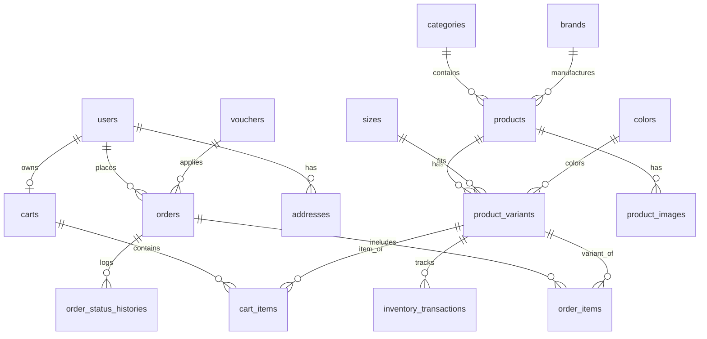

# 👟 VAMOS STORE — TOÀN BỘ BỐI CẢNH VÀ ĐẶC TẢ KỸ THUẬT DỰ ÁN (FOR AI ASSISTANT / CHATGPT)

> **MỤC ĐÍCH TÀI LIỆU:**  
> Tệp tài liệu này tổng hợp **100% bối cảnh kỹ thuật, kiến trúc, cơ sở dữ liệu, quy tắc nghiệp vụ và hiện trạng mã nguồn** của dự án **VAMOS STORE**.  
> Tài liệu được biên soạn nhằm mục đích cung cấp thông tin đầu vào hoàn chỉnh cho **ChatGPT (hoặc bất kỳ mô hình AI nào)** để AI có thể nắm bắt bức tranh toàn cảnh một cách chính xác nhất, từ đó tư vấn, đề xuất ý tưởng mới, thiết kế tính năng bổ sung hoặc sinh mã nguồn tương thích tuyệt đối với hệ thống hiện tại mà không làm phá vỡ các quy tắc sẵn có.

---

## 🤖 HƯỚNG DẪN PROMPT DÀNH CHO CHATGPT (PROMPT TEMPLATE)

Khi bạn muốn làm việc với ChatGPT về dự án này, hãy copy đoạn prompt ngắn dưới đây và gửi kèm tệp Markdown này:

```markdown
Chào ChatGPT! Tôi đang phát triển dự án website thương mại điện tử VAMOS STORE (bán giày sneaker, thể thao). 
Dưới đây là toàn bộ bối cảnh kỹ thuật, cấu trúc source code, cơ sở dữ liệu SQL Server, các tính năng đã hoàn thiện và quy tắc nghiệp vụ bất biến của dự án (trong file Markdown đính kèm).
Hãy đọc kỹ toàn bộ tài liệu này. Sau đó tôi sẽ đưa ra các ý tưởng mới mà tôi muốn thêm vào dự án. 
Nhiệm vụ của bạn là:
1. Đánh giá tính khả thi của ý tưởng dựa trên kiến trúc MVC, công nghệ (Node.js, Express, Pug, Tailwind, MSSQL) và quy tắc hiện tại.
2. Thiết kế chi tiết: Cập nhật CSDL (thêm bảng/cột), luồng Service, Controller, Route và Giao diện Pug tương ứng.
3. Hướng dẫn code từng bước, chuẩn phong cách clean code, validate chặt chẽ từ server-side và xử lý transaction an toàn.
Bạn đã hiểu rõ bối cảnh dự án chưa?
```

---

## 1. TỔNG QUAN DỰ ÁN (EXECUTIVE SUMMARY)

- **Tên dự án:** VAMOS STORE (Website thương mại điện tử chuyên kinh doanh giày dép).
- **Thương hiệu:** VAMOS.
- **Slogan:** *"MOVE YOUR WAY."*
- **Bối cảnh phát triển:** Đồ án môn học JAV102 (Dự án tốt nghiệp / Dự án phần mềm 1) — Khoa Công nghệ thông tin, FPT Polytechnic Đà Nẵng.
- **Mục tiêu sản phẩm:** Xây dựng website bán lẻ giày trực tuyến trẻ trung, năng động, mang phong cách giao diện Kinetic Modern UI, cung cấp trải nghiệm mượt mà từ khâu chọn giày, chọn size, áp voucher cho đến đặt hàng thanh toán khi nhận hàng (COD).
- **GitHub Repository chính thức:** [https://github.com/dungtttd01702-coder/vamos-store](https://github.com/dungtttd01702-coder/vamos-store)
- **Tác nhân người dùng (3 Actors):**
  1. **Khách vãng lai (Guest):** Xem trang chủ, tìm kiếm, lọc danh mục, xem chi tiết sản phẩm, đăng ký tài khoản, đăng nhập.
  2. **Khách hàng thành viên (Customer):** Quản lý giỏ hàng đồng bộ tài khoản, áp dụng voucher, đặt hàng COD, theo dõi lịch sử đơn hàng, hủy đơn hàng khi trạng thái còn `PENDING`.
  3. **Quản trị viên (Admin):** Quản lý toàn diện hệ thống: xem dashboard thống kê doanh thu, quản lý trạng thái đơn hàng theo pipeline, quản lý biến thể kho hàng, quản lý voucher và khách hàng.

---

## 2. NGĂN XẾP CÔNG NGHỆ (FULL TECH STACK)

| Lớp | Công nghệ / Thư viện | Phiên bản / Chi tiết | Ghi chú kỹ thuật |
|---|---|---|---|
| **Runtime** | Node.js | v18+ | JavaScript runtime phía máy chủ |
| **Backend Framework** | Express.js | ^4.19.2 | Xây dựng RESTful routing, xử lý middleware |
| **Template Engine** | Pug (Jade) | ^3.0.3 | Server-Side Rendering (SSR), kế thừa layout `main.pug` |
| **CSS Framework** | Tailwind CSS | ^3.4.4 | Utility-first CSS biên dịch tối ưu vào `src/public/css/style.css` |
| **Hệ Quản trị CSDL** | Microsoft SQL Server | 2025 / 2022 | RDBMS lưu trữ dữ liệu quan hệ (`vamos_store_db`) |
| **Database Driver** | `mssql` (Tedious) | ^11.0.1 | Kết nối pool, xử lý T-SQL Parameterized Queries & Transactions |
| **Authentication** | `bcryptjs` | ^2.4.3 | Mã hóa băm mật khẩu 1 chiều (Salt rounds = 10) |
| **Session & Auth** | `express-session` | ^1.18.0 | Lưu trữ phiên đăng nhập (`req.session.user`) |
| **Typography** | Google Fonts | Space Grotesk & Inter | Space Grotesk (Brand/Header), Inter (Body) |
| **Containerization** | Docker & Compose | Dockerfile, docker-compose.yml | Môi trường triển khai chuẩn hóa |

---

## 3. BẢNG MÀU & ĐỊNH HƯỚNG GIAO DIỆN (DESIGN SYSTEM)

- **Đỏ Vamos (Primary Brand Accent):** `#E11B22` — Màu nhận diện thương hiệu, nút hành động chính (CTA), nhãn SALE, giá khuyến mãi, trạng thái kích hoạt.
- **Đen Slate (Dark Accent):** `#0B0F19` — Header, typography tiêu đề, badge thương hiệu, thanh footer.
- **Xám viền (Border):** `#E5E7EB` / `#F3F4F6` — Đường kẻ ngăn cách tinh tế, đường bao thẻ sản phẩm.
- **Nền (Background):** `#FFFFFF` kết hợp `#F9FAFB` (xám khói nhạt tạo độ sâu cho section).
- **Phong cách giao diện:** Hiện đại, Kinetic Motion, viền bo tròn (`rounded-vamos-xl`), hiệu ứng đổ bóng nhẹ (`shadow-vamos-card`), tối ưu responsive 100% trên Mobile, Tablet và Desktop.

---

## 4. KIẾN TRÚC MÃ NGUỒN (LAYERED MVC ARCHITECTURE)

Dự án tuân thủ nghiêm ngặt nguyên lý **Separation of Concerns (Tách biệt trách nhiệm)** theo mô hình phân tầng:

```
[Browser / HTTP Request]
          │
          ▼
1. ROUTES (`src/routes/`) ─────────── Định tuyến URL, gắn kết Middleware
          │
          ▼
2. MIDDLEWARES (`src/middlewares/`) ── Kiểm tra quyền: requireAuth, requireAdmin, requireGuest
          │
          ▼
3. CONTROLLERS (`src/controllers/`) ── Nhận request, validate dữ liệu (src/utils/validator.js), điều phối luồng
          │
          ▼
4. SERVICES (`src/services/`) ─────── Xử lý nghiệp vụ lõi (tính tiền, voucher, transaction trừ kho, hoàn kho)
          │
          ▼
5. REPOSITORIES / DB (`src/config/database.js`) ── Thực thi SQL Parameterized, Transaction, Lock dòng
          │
          ▼
6. VIEWS (`src/views/`) ───────────── Render template Pug trả về HTML hoàn chỉnh cho client
```

### Cấu Trúc Thư Mục Thực Tế:

```
c:\Users\Admin\Desktop\dự án JAV/
├── database/                          # Kịch bản cơ sở dữ liệu
│   ├── mssql_schema.sql               # Định nghĩa DDL toàn bộ 18 bảng SQL Server
│   ├── init_mssql.js                  # Script Node.js tự động khởi tạo database & bảng
│   ├── seed_products.js               # Dữ liệu sản phẩm mẫu, danh mục, kích cỡ, màu sắc
│   ├── seed_vouchers.js               # Dữ liệu mã giảm giá mẫu (VAMOS50K, VAMOS100, FREESHIP)
│   └── seed_customer.js               # Tạo tài khoản khách hàng mẫu
├── docs/                              # Hồ sơ phân tích thiết kế
│   ├── analysis/                      # SRS, phạm vi dự án, tài liệu quy tắc nghiệp vụ
│   ├── database/                      # ERD, từ điển dữ liệu (Data Dictionary)
│   ├── diagrams/                      # Sơ đồ PlantUML (Use-case, Activity, ERD)
│   └── ui/                            # Đặc tả Wireframe giao diện
├── labs/                              # 4 bài Lab môn học (FPT Polytechnic)
│   ├── Lab 1 - Usecase/
│   ├── Lab 2 - ERD/
│   ├── Lab 3 - Activity Diagram/
│   └── Lab 4 - Thiet ke giao dien (Wireframe)/
├── report/                            # Báo cáo đồ án tốt nghiệp bản hoàn chỉnh (6 chương)
├── src/                               # MÃ NGUỒN CHÍNH ỨNG DỤNG
│   ├── app.js                         # Cấu hình Express app, middlewares, session, view engine
│   ├── config/
│   │   ├── app.config.js              # Nạp biến môi trường (.env)
│   │   └── database.js                # Quản lý kết nối pool mssql, hàm query helper an toàn
│   ├── controllers/
│   │   ├── account.controller.js      # Hồ sơ, sổ địa chỉ, lịch sử & chi tiết đơn, hủy đơn
│   │   ├── admin.controller.js        # Bảng điều khiển admin, danh sách & chi tiết đơn, đổi trạng thái
│   │   ├── auth.controller.js         # Đăng nhập, đăng ký (validate đa tầng), đăng xuất
│   │   ├── cart.controller.js         # Xem giỏ, thêm vào giỏ, cập nhật số lượng, xóa sản phẩm
│   │   ├── checkout.controller.js     # Trang thanh toán COD, áp voucher, chốt đơn hàng
│   │   ├── home.controller.js         # Trang chủ, banner, sản phẩm nổi bật
│   │   └── product.controller.js      # Trang danh mục sản phẩm (bộ lọc), trang chi tiết sản phẩm
│   ├── middlewares/
│   │   ├── auth.middleware.js         # Phân quyền requireAuth, requireGuest, requireAdmin
│   │   └── error.middleware.js        # Bắt lỗi toàn cục, render trang 404 và 500
│   ├── models/
│   │   └── repositories/
│   │       └── product.repository.js  # Truy vấn sản phẩm theo bộ lọc, phân trang, chi tiết
│   ├── public/                        # Static assets phục vụ trình duyệt
│   │   ├── css/
│   │   │   ├── input.css              # Mã nguồn Tailwind CSS đầu vào
│   │   │   └── style.css              # File CSS đã biên dịch (minified)
│   │   └── js/
│   │       └── main.js                # Script JS tương tác giao diện (toast, copy voucher, size picker)
│   ├── routes/
│   │   ├── account.routes.js          # /account/*
│   │   ├── admin.routes.js            # /admin/*
│   │   ├── auth.routes.js             # /auth/*
│   │   ├── cart.routes.js             # /cart/*
│   │   ├── checkout.routes.js         # /checkout/*
│   │   ├── home.routes.js             # /
│   │   ├── index.js                   # Điểm tập trung mount tất cả routes, health check
│   │   ├── info.routes.js             # /about, /policy, /promotions, /categories
│   │   └── product.routes.js          # /products, /products/:slug
│   ├── services/
│   │   ├── order.service.js           # Xử lý transaction đặt hàng, trừ tồn kho, hoàn kho khi hủy
│   │   └── product.service.js         # Logic nghiệp vụ lấy sản phẩm, lọc danh mục
│   ├── utils/
│   │   └── validator.js               # Biểu thức chính quy kiểm tra Email RFC, Phone VN, Password
│   └── views/                         # Giao diện Pug Templates
│       ├── layouts/main.pug           # Layout khung (Head, Navbar, Footer, Flash Toast)
│       ├── pages/                     # Từng màn hình chức năng cụ thể
│       └── partials/                  # Header điều hướng, Footer chân trang
├── .env.example                       # Mẫu cấu hình môi trường
├── .gitignore                         # Đã loại trừ node_modules và .env an toàn
├── docker-compose.yml                 # Cấu hình container Docker
├── Dockerfile                         # Khởi dựng container Node.js
├── package.json                       # Khai báo dependencies
├── README.md                          # Tài liệu giới thiệu kho lưu trữ GitHub
├── server.js                          # Entry point khởi chạy HTTP Server (Port 3000)
└── tailwind.config.js                 # Cấu hình bộ màu, font, spacing Tailwind
```

---

## 5. ĐẶC TẢ CƠ SỞ DỮ LIỆU SQL SERVER (DATABASE SCHEMA)

Cơ sở dữ liệu gồm **18 bảng** quan hệ chặt chẽ:



### Danh Sách Chi Tiết 18 Bảng:

1. **`users`:** Quản lý tài khoản.
   - `id INT IDENTITY PRIMARY KEY`, `full_name NVARCHAR(100)`, `email NVARCHAR(150) UNIQUE`, `password_hash NVARCHAR(255)`, `phone NVARCHAR(20)`, `role NVARCHAR(20)` (`ADMIN` | `CUSTOMER`), `status NVARCHAR(20)` (`active` | `locked`), `created_at`, `updated_at`.
2. **`categories`:** Danh mục sản phẩm.
   - `id INT IDENTITY PRIMARY KEY`, `name NVARCHAR(100)`, `slug NVARCHAR(120) UNIQUE`, `description NVARCHAR(MAX)`, `is_active BIT`.
3. **`brands`:** Thương hiệu / dòng bộ sưu tập VAMOS.
   - `id INT IDENTITY PRIMARY KEY`, `name NVARCHAR(100)`, `slug NVARCHAR(120) UNIQUE`, `description NVARCHAR(MAX)`.
4. **`sizes`:** Kích cỡ giày chuẩn hóa (38, 39, 40, 41, 42, 43, 44).
   - `id INT IDENTITY PRIMARY KEY`, `size_name NVARCHAR(20) UNIQUE`, `display_order INT`.
5. **`colors`:** Bảng màu sắc (Đen, Trắng, Đỏ, Xanh Navy, Xám,...).
   - `id INT IDENTITY PRIMARY KEY`, `color_name NVARCHAR(50) UNIQUE`, `hex_code NVARCHAR(10)`.
6. **`products`:** Thông tin sản phẩm cha.
   - `id INT IDENTITY PRIMARY KEY`, `category_id INT FK`, `brand_id INT FK`, `product_code NVARCHAR(50) UNIQUE`, `name NVARCHAR(200)`, `slug NVARCHAR(255) UNIQUE`, `description NVARCHAR(MAX)`, `gender_target NVARCHAR(20)` (`MEN` | `WOMEN` | `KIDS` | `UNISEX`), `base_price DECIMAL(12,0)`, `sale_price DECIMAL(12,0)`, `status NVARCHAR(20)` (`active` | `inactive` | `draft`).
7. **`product_images`:** Thư viện ảnh chi tiết từng sản phẩm.
   - `id INT IDENTITY PRIMARY KEY`, `product_id INT FK`, `image_url NVARCHAR(255)`, `is_primary BIT`, `display_order INT`.
8. **`product_variants`:** Biến thể tồn kho (Kích cỡ x Màu sắc x SKU).
   - `id INT IDENTITY PRIMARY KEY`, `product_id INT FK`, `size_id INT FK`, `color_id INT FK`, `sku NVARCHAR(100) UNIQUE`, `stock_quantity INT CHECK(>=0)`, `status NVARCHAR(20)`. (Có ràng buộc `UNIQUE(product_id, size_id, color_id)`).
9. **`carts`:** Giỏ hàng khách hàng (Mối quan hệ 1-1 với `users`).
   - `id INT IDENTITY PRIMARY KEY`, `user_id INT UNIQUE FK`.
10. **`cart_items`:** Chi tiết các mặt hàng trong giỏ.
    - `id INT IDENTITY PRIMARY KEY`, `cart_id INT FK`, `variant_id INT FK`, `quantity INT CHECK(>0)`.
11. **`orders`:** Thông tin đơn hàng & thông tin snapshot người nhận.
    - `id INT IDENTITY PRIMARY KEY`, `order_code NVARCHAR(50) UNIQUE`, `user_id INT FK`, `recipient_name_snapshot NVARCHAR(100)`, `recipient_phone_snapshot NVARCHAR(20)`, `delivery_address_snapshot NVARCHAR(500)`, `subtotal DECIMAL(12,0)`, `discount_amount DECIMAL(12,0)`, `shipping_fee DECIMAL(12,0)`, `total_amount DECIMAL(12,0)`, `voucher_id INT FK NULL`, `voucher_code_snapshot NVARCHAR(50)`, `payment_method NVARCHAR(20) DEFAULT 'COD'`, `payment_status NVARCHAR(20)` (`UNPAID` | `PAID`), `order_status NVARCHAR(20)` (`PENDING` | `CONFIRMED` | `PROCESSING` | `SHIPPING` | `COMPLETED` | `CANCELLED`), `customer_note`, `admin_note`.
12. **`order_items`:** Snapshot sản phẩm trong đơn hàng (bất biến sau khi mua).
    - `id INT IDENTITY PRIMARY KEY`, `order_id INT FK`, `product_variant_id INT FK`, `product_name_snapshot NVARCHAR(200)`, `sku_snapshot NVARCHAR(100)`, `size_snapshot NVARCHAR(20)`, `color_snapshot NVARCHAR(50)`, `unit_price DECIMAL(12,0)`, `quantity INT`, `line_total DECIMAL(12,0)`.
13. **`order_status_histories`:** Nhật ký thay đổi trạng thái đơn hàng.
    - `id INT IDENTITY PRIMARY KEY`, `order_id INT FK`, `changed_by INT FK`, `previous_status NVARCHAR(50)`, `new_status NVARCHAR(50)`, `note NVARCHAR(255)`, `created_at`.
14. **`inventory_transactions`:** Sổ kiểm toán biến động kho hàng (Audit Trail).
    - `id INT IDENTITY PRIMARY KEY`, `variant_id INT FK`, `user_id INT FK`, `old_quantity INT`, `new_quantity INT`, `change_quantity INT`, `reason NVARCHAR(255)`, `created_at`.
15. **`vouchers`:** Mã giảm giá khuyến mãi.
    - `id INT IDENTITY PRIMARY KEY`, `code NVARCHAR(50) UNIQUE`, `name NVARCHAR(100)`, `discount_type NVARCHAR(20)` (`percentage` | `fixed_amount`), `discount_value DECIMAL(12,0)`, `min_order_value DECIMAL(12,0)`, `max_discount_amount DECIMAL(12,0)`, `start_date`, `end_date`, `usage_limit INT`, `used_count INT`, `is_active BIT`.
16. **`addresses`:** Sổ địa chỉ giao hàng của người dùng.
    - `id INT IDENTITY PRIMARY KEY`, `user_id INT FK`, `recipient_name`, `phone`, `province`, `district`, `ward`, `detail_address`, `is_default BIT`.
17. **`banners`:** Banner quảng cáo trang chủ.
    - `id INT IDENTITY PRIMARY KEY`, `title`, `image_url`, `link_url`, `display_order`, `is_active`.
18. **`password_reset_tokens`:** Quản lý token đặt lại mật khẩu an toàn (chỉ lưu dạng hash).
    - `id INT IDENTITY PRIMARY KEY`, `user_id INT FK`, `token_hash NVARCHAR(255) UNIQUE`, `expires_at DATETIME2`, `used_at DATETIME2`, `created_at DATETIME2`.

---

## 6. QUY TẮC NGHIỆP VỤ BẤT BIẾN (CORE BUSINESS RULES)

Khi đề xuất hoặc bổ sung tính năng mới, **bắt buộc tuân thủ 5 nguyên tắc sau**:

1. **Phương thức thanh toán COD độc quyền:**
   - Đơn hàng mới tạo luôn có `payment_method = 'COD'` và `payment_status = 'UNPAID'`.
   - `payment_status` **CHỈ** được phép chuyển thành `'PAID'` khi trạng thái đơn hàng chuyển sang `'COMPLETED'` (tức khách nhận hàng thành công và trả tiền mặt cho shipper).
2. **Trừ kho tức thời & Khóa dòng chống bán vượt (Anti-Overselling):**
   - Khi khách hàng nhấn xác nhận đặt hàng, hệ thống mở Database Transaction và thực thi truy vấn có khóa dòng:
     ```sql
     SELECT stock_quantity FROM product_variants WITH (UPDLOCK, ROWLOCK) WHERE id = @variantId
     ```
   - Trừ kho ngay lập tức tại bước chốt đơn; đồng thời thêm 1 bản ghi vào bảng `inventory_transactions` với lý do *"Xuất kho đơn hàng #{order_code}"*.
3. **Quy tắc hủy đơn hàng & Hoàn trả kho tự động:**
   - **Khách hàng** chỉ được hủy đơn khi đơn hàng đang ở trạng thái `PENDING`. Khi đã chuyển sang `CONFIRMED`, `PROCESSING`, `SHIPPING` thì khách hàng không thể tự hủy qua giao diện.
   - Khi hủy đơn, hệ thống tự động hoàn trả số lượng lại cho biến thể `product_variants.stock_quantity` và ghi nhận một bản ghi vào `inventory_transactions` với lý do *"Hoàn kho do hủy đơn hàng #{order_code}"*.
4. **Bảo toàn dữ liệu hóa đơn (Snapshot bất biến):**
   - Bảng `order_items` lưu cố định tên sản phẩm, mã SKU, size, màu sắc và đơn giá tại thời điểm giao dịch thành công. Nếu người quản trị sau này sửa giá hoặc xóa sản phẩm cha, dữ liệu lịch sử đơn hàng của khách hàng không bao giờ bị sai lệch.
5. **Kiểm tra dữ liệu đầu vào đa tầng (Multi-tier Server Validation):**
   - Không phụ thuộc vào HTML5 validate phía trình duyệt. Mọi dữ liệu nhận được tại Controller đều phải qua tiện ích [`src/utils/validator.js`](file:///c:/Users/Admin/Desktop/dự%20án%20JAV/src/utils/validator.js):
     - `EMAIL_REGEX`: Bắt buộc đúng chuẩn RFC có đuôi tên miền hợp lệ từ 2 ký tự trở lên (`.com`, `.vn`,...).
     - `PHONE_REGEX`: Chuẩn 10 số điện thoại di động Việt Nam.
     - `PASSWORD`: Tối thiểu 6 ký tự.

---

## 7. BẢNG DANH MỤC ĐỊNH TUYẾN URL (ROUTES MAP)

| URL | Phương thức | Middleware | Chức năng |
|---|---|---|---|
| `/` | `GET` | — | Trang chủ (Hero, Banner, Sản phẩm hot, Ưu đãi) |
| `/products` | `GET` | — | Xem catalog sản phẩm (Lọc theo danh mục `cat`, giới tính `gender`, giá `minPrice`/`maxPrice`, sắp xếp `sort`, tìm kiếm `q`, phân trang `page`) |
| `/products/:slug` | `GET` | — | Trang chi tiết sản phẩm (Bộ chọn màu, chọn size, kiểm tra tồn kho, ảnh gallery) |
| `/auth/login` | `GET`, `POST` | `requireGuest` (GET) | Đăng nhập tài khoản (Bảo mật bcrypt, tạo session) |
| `/auth/register` | `GET`, `POST` | `requireGuest` (GET) | Đăng ký thành viên (Validate đa tầng họ tên, email, SĐT, pass) |
| `/auth/logout` | `GET` | `requireAuth` | Đăng xuất, hủy session |
| `/cart` | `GET` | `requireAuth` | Xem giỏ hàng liên tục (Persistent Cart từ CSDL) |
| `/cart/add` | `POST` | `requireAuth` | Thêm biến thể sản phẩm vào giỏ (Check tồn kho trước khi thêm) |
| `/cart/update` | `POST` | `requireAuth` | Cập nhật số lượng mặt hàng trong giỏ |
| `/cart/remove/:itemId` | `POST` | `requireAuth` | Xóa sản phẩm khỏi giỏ hàng |
| `/cart/clear` | `POST` | `requireAuth` | Xóa trắng giỏ hàng |
| `/checkout` | `GET`, `POST` | `requireAuth` | Nhập địa chỉ, nhập mã voucher, chốt đặt hàng COD |
| `/checkout/success/:code` | `GET` | `requireAuth` | Màn hình đặt hàng thành công, hiển thị mã đơn |
| `/account/profile` | `GET`, `POST` | `requireAuth` | Xem và cập nhật thông tin cá nhân |
| `/account/addresses` | `GET`, `POST` | `requireAuth` | Quản lý danh sách địa chỉ nhận hàng |
| `/account/orders` | `GET` | `requireAuth` | Lịch sử mua hàng của khách hàng |
| `/account/orders/:code` | `GET` | `requireAuth` | Chi tiết đơn mua (Danh sách sản phẩm, giá, trạng thái) |
| `/account/orders/:code/cancel` | `POST` | `requireAuth` | Khách hàng hủy đơn `PENDING` (Hoàn kho tự động) |
| `/admin` | `GET` | `requireAdmin` | Dashboard thống kê doanh thu thực tế, số đơn, khách hàng |
| `/admin/orders` | `GET` | `requireAdmin` | Danh sách toàn bộ đơn hàng hệ thống |
| `/admin/orders/:code` | `GET` | `requireAdmin` | Chi tiết đơn hàng phía Admin |
| `/admin/orders/:code/status` | `POST` | `requireAdmin` | Cập nhật tiến trình đơn (PENDING $\rightarrow$ CONFIRMED $\rightarrow$ PROCESSING $\rightarrow$ SHIPPING $\rightarrow$ COMPLETED / CANCELLED) |
| `/about`, `/policy`, `/promotions` | `GET` | — | Các trang thông tin tĩnh, chính sách và khuyến mại |
| `/health` | `GET` | — | Health check kiểm tra trạng thái máy chủ |

---

## 8. TÀI KHOẢN THỬ NGHIỆM HỆ THỐNG

- **Tài khoản Quản trị viên (Admin):**
  - Email: `admin@vamos.vn`
  - Mật khẩu: `123456`
  - Quyền hạn: Toàn quyền truy cập bảng quản trị `/admin`.
- **Tài khoản Khách hàng mẫu (Customer):**
  - Email: `khachhang@vamos.vn`
  - Mật khẩu: `123456`
  - Quyền hạn: Đặt hàng, quản lý đơn cá nhân.
- **Tài khoản Khách hàng kiểm thử (Customer Test):**
  - Email: `trungdung@gmail.com`
  - Mật khẩu: `password123`
- **Mã Voucher có sẵn trong hệ thống:**
  - `VAMOS50K`: Giảm trực tiếp 50,000 VNĐ cho đơn từ 500,000 VNĐ.
  - `VAMOS100`: Giảm trực tiếp 100,000 VNĐ cho đơn từ 1,000,000 VNĐ.
  - `FREESHIP`: Miễn phí vận chuyển (giảm 30,000 VNĐ) cho đơn từ 300,000 VNĐ.

---

## 9. CÁC ĐỊNH HƯỚNG MỞ RỘNG Ý TƯỞNG (EXTENSION & IDEA BACKLOG)

Dưới đây là danh sách các vùng tính năng tiềm năng đã được chuẩn bị sẵn cấu trúc để bạn cùng ChatGPT thảo luận và phát triển tiếp:

1. **Ý tưởng 1: Đánh giá & Bình luận sản phẩm (Product Reviews & Ratings):**
   - Khách hàng đã mua đơn thành công (`COMPLETED`) có quyền đánh giá 1 - 5 sao và viết nhận xét kèm ảnh trải nghiệm trên trang chi tiết sản phẩm.
   - Thêm bảng `product_reviews (id, product_id, user_id, order_id, rating, comment, is_approved, created_at)`.
2. **Ý tưởng 2: Danh sách sản phẩm yêu thích (Wishlist):**
   - Khách hàng bấm thả tim ❤️ để lưu giày vào danh sách xem sau.
   - Thêm bảng `wishlists (id, user_id, product_id, created_at)`.
3. **Ý tưởng 3: Giao diện Quản trị Sản phẩm toàn diện (Admin Product CRUD):**
   - Giao diện Admin cho phép thêm mới giày dép, upload hình ảnh, chỉnh sửa giá bán, bật/tắt hiển thị, quản lý tạo biến thể Size x Màu.
4. **Ý tưởng 4: Quản lý Phiếu Nhập Kho & Cảnh báo tồn kho (Inventory Management):**
   - Admin tạo phiếu nhập thêm số lượng giày từ nhà sản xuất, cập nhật giá vốn, ghi nhận lịch sử vào `inventory_transactions`.
   - Cảnh báo biến thể sắp hết hàng khi số lượng tồn kho `< 5`.
5. **Ý tưởng 5: Admin Quản lý Mã Giảm Giá (Voucher Management UI):**
   - Tạo mã voucher mới trên web, cài đặt thời hạn bắt đầu/kết thúc, giới hạn lượt dùng, chọn giảm % hoặc tiền mặt cố định.
6. **Ý tưởng 6: Tích hợp Cổng thanh toán trực tuyến (Online Payment):**
   - Tích hợp thêm phương thức thanh toán qua VietQR (tạo mã QR động kèm nội dung đơn hàng) hoặc cổng VNPAY Sandbox / MoMo.
7. **Ý tưởng 7: Tìm kiếm thông minh (Live Search Autocomplete):**
   - Khi gõ vào ô tìm kiếm ở thanh Header, xuất hiện dropdown gợi ý tên giày kèm ảnh thumbnail và giá ngay lập tức mà không cần reload trang.
8. **Ý tưởng 8: Xuất Hóa đơn bán hàng PDF (Invoice Generator):**
   - Admin và khách hàng có thể bấm nút "Tải hóa đơn PDF" để in hóa đơn bán lẻ chuẩn phục vụ đóng gói và đối soát.

---

## 10. KẾT LUẬN & CAM KẾT KIẾN TRÚC

Hệ thống **VAMOS STORE** hiện đã có nền tảng mã nguồn vô cùng vững chắc, được thiết kế theo đúng tiêu chuẩn đồ án phần mềm chuyên nghiệp:
- CSDL chuẩn hóa bậc 3 (3NF) với 18 thực thể.
- Đã đồng bộ toàn bộ mã nguồn lên GitHub tại `dungtttd01702-coder/vamos-store`.
- Đầy đủ báo cáo đồ án 6 chương và 4 bài Lab chuẩn format FPT Polytechnic.
- Khi làm việc với ChatGPT, bạn hoàn toàn có thể yêu cầu mở rộng bất kỳ ý tưởng nào trong mục số 9 hoặc ý tưởng riêng của bạn, hệ thống sẵn sàng tiếp nhận và mở rộng module một cách liền mạch!

