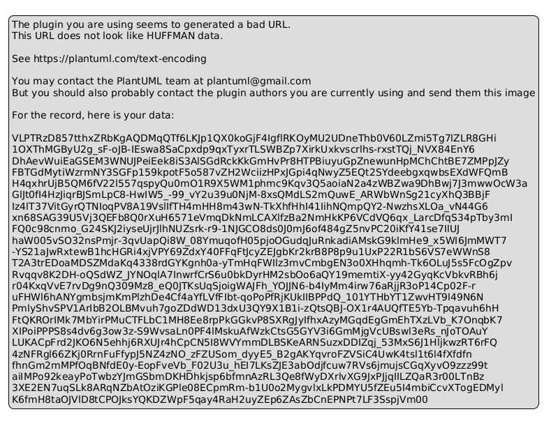

# TỔNG QUAN HỆ THỐNG VÀ DANH MỤC USE CASE (USE CASE OVERVIEW)
## HỆ THỐNG THƯƠNG MẠI ĐIỆN TỬ BÁN GIÀY VAMOS STORE

> **Dự án:** VAMOS STORE — Website Thương mại điện tử Bán giày chuyên nghiệp  
> **Phiên bản tài liệu:** v2.1 (Kiểm toán toàn diện & Chuẩn hóa khớp 100% mã nguồn thực tế)  
> **Cập nhật ngày:** 14/11/2026  
> **Trạng thái:** Chính thức (Đã xác thực từng dòng code, middleware và cơ sở dữ liệu)  

---

## 1. Ranh giới hệ thống (System Boundary)

Hệ thống **VAMOS STORE** là nền tảng thương mại điện tử chuyên sâu phục vụ kinh doanh giày dép đa biến thể (Kích cỡ x Màu sắc), hỗ trợ khách hàng khám phá sản phẩm, quản lý giỏ hàng trực tuyến (hỗ trợ cả giỏ hàng tạm trong phiên cho khách vãng lai và giỏ hàng bền vững trên CSDL cho thành viên), đặt hàng thanh toán khi nhận hàng (COD), theo dõi tiến trình đơn hàng (Timeline) và lưu giữ danh sách sản phẩm yêu thích (Server-side Wishlist). 

Đồng thời, hệ thống cung cấp cổng thông tin quản trị (Admin Portal) độc lập giúp theo dõi vận đơn, cập nhật máy trạng thái đơn hàng một chiều, quản lý và kiểm kê tồn kho theo biến thể SKU có lưu vết kiểm toán, cấu hình danh mục sản phẩm, thương hiệu, banner quảng cáo, mã giảm giá và báo cáo doanh thu tài chính thực tế từ các đơn hàng đã hoàn tất.

Ranh giới hệ thống phân định rõ ràng giữa hai không gian nghiệp vụ:
1. **Không gian Mua sắm (Storefront Space):** Dành cho khách vãng lai và khách hàng thành viên thực hiện các tương tác duyệt hàng, giỏ hàng, yêu thích và giao dịch mua sắm.
2. **Không gian Quản trị (Admin Management Space):** Tách biệt hoàn toàn, bảo vệ bằng middleware kiểm soát vai trò (`requireAdmin`), phục vụ công tác điều hành, kế toán kho và xử lý đơn hàng.

---

## 2. Mô hình Tác nhân (Actor Model) và Ma trận Phân quyền

Hệ thống được thiết kế và thực thi chuẩn xác với **03 Tác nhân người dùng (Actors)** và **01 Tác nhân phụ (Secondary Actor - Dự kiến trong thiết kế)**. Hệ thống **không có vai trò Nhân viên (Staff)**; toàn bộ tác vụ vận hành nội bộ do tác nhân Quản trị viên (Admin) đảm nhiệm.

```
       ┌────────────────────────┐
       │ Khách vãng lai (Guest) │
       └───────────▲────────────┘
                   │  (Kế thừa quyền duyệt - Generalization: Customer --|> Guest)
       ┌───────────┴────────────┐            ┌────────────────────────┐
       │  Khách hàng (Customer) │            │  Quản trị viên (Admin) │
       └────────────────────────┘            └────────────────────────┘
```

### 2.1. Chi tiết các Tác nhân

| Tác nhân | Định danh trong CSDL / Code | Bản chất & Phạm vi hoạt động | Quyền hạn và Ràng buộc bảo mật |
| :--- | :--- | :--- | :--- |
| **Khách vãng lai (Guest)** | Session khách (`sessionID`), không có `req.session.user` | Người dùng ẩn danh truy cập website chưa xác thực danh tính. | - Được duyệt danh mục, tìm kiếm sản phẩm (Live Search), xem ma trận biến thể, đọc thông tin giới thiệu.<br>- **Quản lý Giỏ hàng phiên (Guest Session Cart):** Tự do thêm, sửa, xóa giỏ hàng tạm lưu trong `req.session.guestCart` mà **KHÔNG bắt buộc đăng nhập**.<br>- Được đăng ký tài khoản (`/auth/register`) và đăng nhập (`/auth/login`). Khi đăng nhập/đăng ký thành công, giỏ hàng tạm tự động gộp vào CSDL.<br>- **Bị chặn:** Không được vào trang thanh toán (`/checkout`), không có trang quản lý tài khoản (`/account/*`), không gọi được API Wishlist lưu máy chủ (`/api/wishlist`). |
| **Khách hàng (Customer)** | `users.role = 'CUSTOMER'` (`req.session.user.role === 'CUSTOMER'`) | Người mua hàng đã xác thực tài khoản qua phiên làm việc an toàn (`vamos_sid`). **Kế thừa toàn bộ quyền xem và duyệt giỏ của Guest.** | - Kế thừa quyền xem sản phẩm, duyệt giỏ của Guest.<br>- Sở hữu giỏ hàng bền vững lưu CSDL (`carts`, `cart_items`).<br>- Quản lý hồ sơ cá nhân và sổ địa chỉ nhận hàng (`addresses`).<br>- Quản lý danh sách sản phẩm yêu thích (Server Wishlist: `wishlist_items`).<br>- Tạo đơn hàng thanh toán khi nhận hàng (COD Checkout).<br>- Tra cứu lịch sử mua sắm và theo dõi tiến trình xử lý đơn hàng.<br>- Tự hủy đơn hàng khi đơn ở trạng thái chờ xác nhận (`PENDING`).<br>- **Bị chặn:** Bị chặn hoàn toàn khỏi cổng quản trị (`/admin/*`) với mã lỗi HTTP 403 Forbidden. |
| **Quản trị viên (Admin)** | `users.role = 'ADMIN'` (`req.session.user.role === 'ADMIN'`) | Người quản lý và điều hành toàn bộ nghiệp vụ kinh doanh của cửa hàng. | - Toàn quyền truy cập Cổng quản trị (`/admin/*`).<br>- Quản lý danh mục (`categories`), thương hiệu (`brands`), sản phẩm (`products`), bộ sưu tập ảnh và ma trận biến thể SKU.<br>- Quản lý banner slider quảng cáo trang chủ (`banners`).<br>- Quản lý và điều chỉnh tồn kho có lưu vết kiểm toán (`inventory_transactions`).<br>- Tiếp nhận, xác nhận, chuyển trạng thái đơn hàng theo máy trạng thái và xử lý hủy đơn nội bộ kèm hoàn kho.<br>- Quản lý mã giảm giá (`vouchers`) và kiểm soát lượt dùng.<br>- Quản lý danh sách khách hàng và khóa/mở khóa tài khoản khách.<br>- Khai thác báo cáo doanh thu thực tế và KPI Dashboard.<br>- **Quy tắc cô lập Quản trị viên (Admin Isolation):** Admin **bị cấm tham gia giao dịch mua sắm** (Middleware `requireCustomer` và `CartController` chặn truy cập `/checkout`, `/account/*`, `/cart` bằng redirect về Dashboard kèm flash warning; chặn API `/api/wishlist/*` bằng HTTP 403 Forbidden). |
| **Dịch vụ Email (Email Service)** | Secondary External Actor *(Dự kiến trong thiết kế)* | Hệ thống chuyển phát thư điện tử (SMTP / SendGrid / Mailgun). | - Tác nhân bên ngoài phục vụ gửi liên kết và mã token khôi phục mật khẩu.<br>- *Hiện trạng:* Đã thiết kế cấu trúc bảng `password_reset_tokens` và liên kết UI, nhưng mã nguồn backend chưa kết nối SMTP (Trạng thái: **`Designed Only / Not Implemented`**). |

### 2.2. Ma trận Phân quyền và Bằng chứng Mã nguồn (Access Control Matrix)

| Khu vực / Chức năng | Đường dẫn (Route Endpoint) | Khách vãng lai (Guest) | Khách hàng (Customer) | Quản trị viên (Admin) | Cơ chế kiểm soát & Bằng chứng mã nguồn |
| :--- | :--- | :---: | :---: | :---: | :--- |
| **Trang chủ & Danh mục sản phẩm** | `GET /`, `GET /products` | Cho phép (200) | Cho phép (200 - Kế thừa) | Cho phép (200) | Tuyến công khai (`src/routes/home.routes.js`, `src/routes/product.routes.js`). |
| **Tìm kiếm nhanh (Live Search API)** | `GET /api/products/search` | Cho phép (200 JSON) | Cho phép (200 JSON) | Cho phép (200 JSON) | Tuyến công khai (`src/controllers/product.controller.js:143-176`). |
| **Chi tiết sản phẩm & Biến thể** | `GET /products/:slug` | Cho phép (200) | Cho phép (200) | Cho phép (200) | Tuyến công khai (`src/controllers/product.controller.js:52-120`). |
| **Đăng ký & Đăng nhập** | `GET/POST /auth/login`, `/register` | Cho phép (200) | **302 Redirect** sang `/` | **302 Redirect** sang `/admin/dashboard` | `requireGuest` (`src/middlewares/auth.middleware.js:71-85`). |
| **Xem & Sửa Giỏ hàng** | `GET/POST /cart/*` | Cho phép (200 - Session Cart) | Cho phép (200 - DB Cart) | **302 Redirect** sang `/admin/dashboard` | `cart.controller.js:34-39` (Admin bị chuyển hướng kèm flash warning). |
| **Danh sách Yêu thích (API)** | `GET/POST/DELETE /api/wishlist/*` | **401 Unauthorized JSON** | Cho phép (200 JSON) | **403 Forbidden JSON** | `requireCustomer` (`src/middlewares/auth.middleware.js:96, 103`). |
| **Đặt hàng thanh toán COD** | `GET/POST /checkout` | **302 Redirect** sang login | Cho phép (200) | **302 Redirect** sang `/admin/dashboard` | `requireCustomer` (`src/middlewares/auth.middleware.js:98, 108`). |
| **Sổ địa chỉ & Hồ sơ cá nhân** | `GET/POST /account/profile`, `/addresses` | **302 Redirect** sang login | Cho phép (200) | **302 Redirect** sang `/admin/dashboard` | `requireCustomer` (`src/middlewares/auth.middleware.js:98, 108`). |
| **Lịch sử đơn & Chi tiết đơn** | `GET /account/orders/*` | **302 Redirect** sang login | Cho phép (200) | **302 Redirect** sang `/admin/dashboard` | `requireCustomer` (`src/middlewares/auth.middleware.js:98, 108`). |
| **Khách tự hủy đơn hàng** | `POST /account/orders/:id/cancel` | **302 Redirect** sang login | Cho phép (khi PENDING) | **302 Redirect** sang `/admin/dashboard` | `requireCustomer` (`src/middlewares/auth.middleware.js:98, 108`). |
| **Bảng điều khiển Quản trị (Dashboard)** | `GET /admin/dashboard` | **302 Redirect** sang login | **403 Forbidden** | Cho phép (200) | `requireAdmin` (`src/middlewares/auth.middleware.js:134, 137-139`). |
| **Xử lý đơn hàng nội bộ** | `GET/POST /admin/orders/*` | **302 Redirect** sang login | **403 Forbidden** | Cho phép (200) | `requireAdmin` (`src/middlewares/auth.middleware.js:134, 137-139`). |
| **Quản lý sản phẩm & Biến thể** | `GET/POST /admin/products/*` | **302 Redirect** sang login | **403 Forbidden** | Cho phép (200) | `requireAdmin` (`src/middlewares/auth.middleware.js:134, 137-139`). |
| **Quản lý Danh mục & Thương hiệu** | `GET/POST /admin/categories/*`, `/brands/*` | **302 Redirect** sang login | **403 Forbidden** | Cho phép (200) | `requireAdmin` (`src/middlewares/auth.middleware.js:134, 137-139`). |
| **Quản lý Banner slider trang chủ** | `GET/POST /admin/banners/*` | **302 Redirect** sang login | **403 Forbidden** | Cho phép (200) | `requireAdmin` (`src/middlewares/auth.middleware.js:134, 137-139`). |
| **Kiểm kê & Điều chỉnh Tồn kho** | `GET/POST /admin/inventory/*` | **302 Redirect** sang login | **403 Forbidden** | Cho phép (200) | `requireAdmin` (`src/middlewares/auth.middleware.js:134, 137-139`). |
| **Quản lý Mã giảm giá (Vouchers)** | `GET/POST /admin/vouchers/*` | **302 Redirect** sang login | **403 Forbidden** | Cho phép (200) | `requireAdmin` (`src/middlewares/auth.middleware.js:134, 137-139`). |
| **Quản lý Tài khoản Khách hàng** | `GET/POST /admin/customers/*` | **302 Redirect** sang login | **403 Forbidden** | Cho phép (200) | `requireAdmin` (`src/middlewares/auth.middleware.js:134, 137-139`). |

---

## 3. Danh mục 16 Use Case Chuẩn hóa của VAMOS STORE

Hệ thống được chuẩn hóa thành **16 Use Case chức năng** phân bổ thành **04 Phân hệ nghiệp vụ**, bao quát đầy đủ mọi tính năng đã xây dựng:

```
                                 VAMOS STORE (16 USE CASES)
                                              │
         ┌───────────────────┬────────────────┴───────────────────┬───────────────────┐
         ▼                   ▼                                    ▼                   ▼
    [ PHÂN HỆ 1 ]       [ PHÂN HỆ 2 ]                        [ PHÂN HỆ 3 ]       [ PHÂN HỆ 4 ]
 Tài khoản & Xác thực  Mua sắm & Khách hàng                  Quản lý Đơn hàng    Quản trị & Vận hành
 (UC01, 02, 03, 04, 16)(UC05, 06, 15)                        (UC07, 08, 09)      (UC10, 11, 12, 13, 14, 16)
```

### Bảng Danh mục 16 Use Case và Trạng thái Thực tế

| Mã UC | Tên Use Case chuẩn hóa | Tác nhân chính | Tác nhân phụ | Thuộc Phân hệ | Mức độ ưu tiên | Trạng thái triển khai |
| :---: | :--- | :--- | :--- | :--- | :---: | :---: |
| **UC01** | Đăng ký tài khoản | Khách vãng lai (Guest) | - | Tài khoản & Xác thực | Cao (High) | **Implemented** |
| **UC02** | Đăng nhập hệ thống | Khách vãng lai, Customer, Admin | - | Tài khoản & Xác thực | Cao (High) | **Implemented** |
| **UC03** | Khôi phục mật khẩu | Khách vãng lai (Guest) | Dịch vụ Email *(Dự kiến)* | Tài khoản & Xác thực | Trung bình (Medium) | **Designed Only / Not Implemented** |
| **UC04** | Quản lý hồ sơ & sổ địa chỉ | Khách hàng (Customer) | - | Tài khoản & Xác thực | Cao (High) | **Implemented** |
| **UC05** | Tìm kiếm & xem sản phẩm | Khách vãng lai, Customer | - | Mua sắm & Khách hàng | Cao (High) | **Implemented** |
| **UC06** | Quản lý giỏ hàng | Khách vãng lai, Customer | - | Mua sắm & Khách hàng | Cao (High) | **Implemented** |
| **UC07** | Đặt hàng COD | Khách hàng (Customer) | - | Quản lý Đơn hàng | Cốt lõi (Critical) | **Implemented** |
| **UC08** | Tra cứu & theo dõi đơn hàng | Khách hàng (Customer) | - | Quản lý Đơn hàng | Cao (High) | **Implemented** |
| **UC09** | Hủy đơn hàng tự phục vụ | Khách hàng (Customer) | - | Quản lý Đơn hàng | Cao (High) | **Implemented** |
| **UC10** | Xử lý & cập nhật đơn hàng | Quản trị viên (Admin) | - | Quản trị & Vận hành | Cốt lõi (Critical) | **Implemented** |
| **UC11** | Quản lý tồn kho | Quản trị viên (Admin) | - | Quản trị & Vận hành | Cao (High) | **Implemented** |
| **UC12** | Quản lý danh mục, thương hiệu, sản phẩm & banner | Quản trị viên (Admin) | - | Quản trị & Vận hành | Cao (High) | **Implemented** |
| **UC13** | Quản lý mã giảm giá | Quản trị viên (Admin) | - | Quản trị & Vận hành | Trung bình (Medium) | **Implemented** |
| **UC14** | Báo cáo doanh thu & KPI Dashboard | Quản trị viên (Admin) | - | Quản trị & Vận hành | Cao (High) | **Implemented** |
| **UC15** | Quản lý danh sách yêu thích (Wishlist) | Khách hàng (Customer) | - | Mua sắm & Khách hàng | Trung bình (Medium) | **Implemented** |
| **UC16** | Quản lý tài khoản khách hàng | Quản trị viên (Admin) | - | Quản trị & Vận hành | Cao (High) | **Implemented** |

---

## 4. Phân tích Các Mối quan hệ giữa các Use Case (Include, Extend, Generalization)

### 4.1. Quan hệ Kế thừa Tác nhân (Generalization)
- `Customer -up-|> Guest`: Khách hàng (Customer) là một chuyên biệt hóa của Khách vãng lai (Guest). Do đó, Customer tự động kế thừa toàn bộ năng lực duyệt danh mục, tìm kiếm và xem chi tiết sản phẩm của Guest.

### 4.2. Quan hệ Bao hàm (`<<include>>`)
1. **UC01 (Đăng ký) `<<include>>`:** Kiểm tra trùng lặp Email, Mã hóa mật khẩu bcrypt và Tạo giỏ hàng CSDL mặc định.
2. **UC02 (Đăng nhập) `<<include>>`:** Xác thực mật khẩu bcrypt và Cấp Session an toàn kèm phân quyền RBAC.
3. **UC06 (Quản lý giỏ hàng) `<<include>>`:** Kiểm tra tồn kho thời gian thực & Live Sync giá, Ràng buộc giới hạn mua lẻ (1-10 đôi/mẫu).
4. **UC07 (Đặt hàng COD) `<<include>>`:** Chọn địa chỉ nhận hàng, Khóa bi quan & Trừ tồn kho biến thể (`UPDLOCK, ROWLOCK`), Tạo snapshot đơn hàng (`order_items`), Xác nhận phương thức COD.
5. **UC08 (Tra cứu đơn hàng) `<<include>>`:** Xem Timeline tiến trình đơn hàng và Xem Snapshot mặt hàng & địa chỉ.
6. **UC09 (Hủy đơn tự phục vụ) `<<include>>`:** Tự động hoàn trả tồn kho (Anti-double Restitution) và Ghi vết lịch sử trạng thái (`order_status_histories`).
7. **UC10 (Xử lý đơn Admin) `<<include>>`:** Chuyển trạng thái theo State Machine hợp lệ và Cập nhật thanh toán PAID khi COMPLETED (Không trừ kho lần hai).
8. **UC11 (Quản lý kho) `<<include>>`:** Cảnh báo tồn kho thấp (`stock_quantity <= 5`).
9. **UC14 (Báo cáo doanh thu) `<<include>>`:** Tổng hợp doanh thu thực tế (chỉ tính đơn `COMPLETED` + `PAID`), Thống kê đơn theo trạng thái và Top 5 bán chạy.
10. **UC16 (Quản lý khách) `<<include>>`:** Xem danh sách khách hàng và chi tiết lịch sử đơn hàng.

### 4.3. Quan hệ Mở rộng (`<<extend>>`)
1. **UC02 (Đăng nhập) `<..` Tự động gộp giỏ hàng khách vãng lai:** Kích hoạt mở rộng khi khách vãng lai đã thêm sản phẩm vào `req.session.guestCart` trước khi đăng nhập hoặc đăng ký.
2. **UC04 (Quản lý hồ sơ) `<..` Đổi mật khẩu, Cập nhật hồ sơ, Quản lý sổ địa chỉ:** Các chức năng mở rộng tại trang tài khoản.
3. **UC05 (Tìm kiếm & xem sản phẩm) `<..` Tìm kiếm nhanh (Live Search API) & Lọc đa tiêu chí:** Khách hàng gõ từ khóa trên thanh header hoặc chọn bộ lọc.
4. **UC06 (Quản lý giỏ hàng) `<..` Mua ngay (Buy Now):** Khách bấm "Mua ngay" tại trang chi tiết, sản phẩm được đưa vào giỏ và chuyển thẳng sang trang `/cart`.
5. **UC07 (Đặt hàng COD) `<..` Áp dụng mã giảm giá (Voucher):** Mở rộng khi khách hàng nhập mã voucher hợp lệ (kiểm tra hạn, min order, và 1 lần dùng/khách).
6. **UC08 (Tra cứu đơn) `<..` UC09 (Hủy đơn hàng tự phục vụ):** Điểm mở rộng hiển thị nút hủy đơn. **Điều kiện mở rộng:** Đơn hàng đang ở trạng thái `PENDING`.
7. **UC10 (Xử lý đơn Admin) `<..` Hủy đơn nội bộ kèm hoàn kho:** Điểm mở rộng khi Admin cần hủy đơn. **Điều kiện mở rộng:** Đơn hàng ở trạng thái `PENDING` hoặc `CONFIRMED` và bắt buộc nhập lý do hủy.
8. **UC11 (Quản lý kho) `<..` Điều chỉnh tồn kho thủ công:** Admin can thiệp điều chỉnh tồn kho kèm lý do bắt buộc.
9. **UC12 (Quản lý danh mục, thương hiệu, sản phẩm & banner) `<..`:** Quản lý danh mục, Quản lý thương hiệu, Quản lý sản phẩm & biến thể SKU, Quản lý banner.
10. **UC13 (Quản lý voucher) `<..` Tạo mới voucher & Bật/Tắt trạng thái:** Các tác vụ mở rộng của voucher.
11. **UC15 (Wishlist) `<..` Bật/tắt yêu thích (1-click Heart Toggle) & Xóa sạch danh sách yêu thích:** Thao tác trên giao diện.
12. **UC16 (Quản lý khách) `<..` Khóa / Mở khóa tài khoản khách:** Mở rộng thao tác an toàn (chặn khóa Admin).

---

## 5. Sơ đồ Use Case Toàn hệ thống (System Diagram)



*Tập tin nguồn PlantUML:* [USE_CASE_OVERVIEW.puml](../../diagrams/usecase/USE_CASE_OVERVIEW.puml)

---

## 6. Danh mục Sơ đồ Phân hệ Chi tiết

1. **Phân hệ Tài khoản & Xác thực (Auth & Account Subsystem):**  
   - Tập tin PlantUML: [uc-01-auth.puml](../../diagrams/usecase/uc-01-auth.puml)  
   - Ảnh sơ đồ: [uc-01-auth.png](../../diagrams/usecase/uc-01-auth.png)  
   - Phạm vi: UC01, UC02, UC03, UC04, UC16.

2. **Phân hệ Mua sắm & Khách hàng (Shopping & Wishlist Subsystem):**  
   - Tập tin PlantUML: [uc-02-shopping.puml](../../diagrams/usecase/uc-02-shopping.puml)  
   - Ảnh sơ đồ: [uc-02-shopping.png](../../diagrams/usecase/uc-02-shopping.png)  
   - Phạm vi: UC05, UC06, UC15.

3. **Phân hệ Quản lý Đơn hàng & Vận chuyển (Order & Fulfillment Subsystem):**  
   - Tập tin PlantUML: [uc-03-orders.puml](../../diagrams/usecase/uc-03-orders.puml)  
   - Ảnh sơ đồ: [uc-03-orders.png](../../diagrams/usecase/uc-03-orders.png)  
   - Phạm vi: UC07, UC08, UC09, UC10.

4. **Phân hệ Quản trị & Vận hành Hệ thống (Admin Operations Subsystem):**  
   - Tập tin PlantUML: [uc-04-admin.puml](../../diagrams/usecase/uc-04-admin.puml)  
   - Ảnh sơ đồ: [uc-04-admin.png](../../diagrams/usecase/uc-04-admin.png)  
   - Phạm vi: UC10, UC11, UC12, UC13, UC14, UC16.
