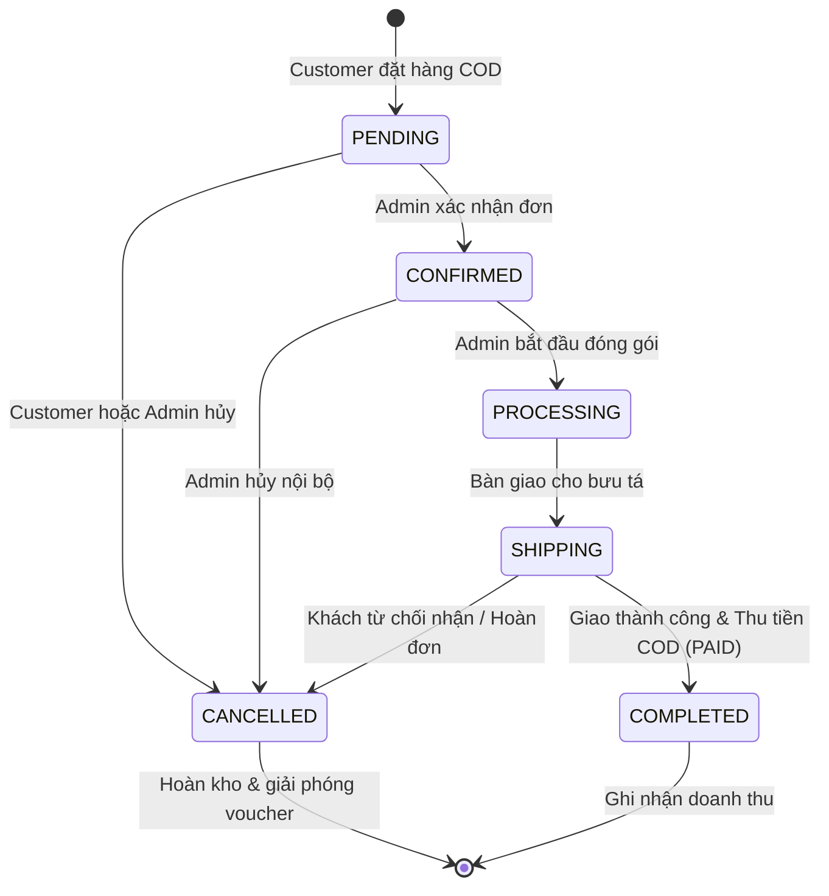

# THIẾT KẾ KIẾN TRÚC HỆ THỐNG (SYSTEM ARCHITECTURE) - VAMOS STORE

> **Dự án:** VAMOS STORE  
> **Thương hiệu:** VAMOS - MOVE YOUR WAY.  
> **Kiến trúc:** Layered MVC + Repository Pattern (Kiến trúc phân tầng chuyên sâu)  
> **Phiên bản:** v1.1 Chuẩn hóa

---

## 1. TỔNG QUAN NGĂN XẾP CÔNG NGHỆ (TECHNOLOGY STACK)

| Tầng kiến trúc            | Công nghệ sử dụng         | Phiên bản | Vai trò kỹ thuật                                                                       |
| :------------------------ | :------------------------ | :-------: | :------------------------------------------------------------------------------------- |
| **Frontend Rendering**    | Pug Template Engine       |  v3.0.x   | Server-Side Rendering (SSR), biên dịch HTML tốc độ cao, zero layout shift              |
| **Frontend Styling**      | Tailwind CSS (JIT)        |  v3.4.x   | Utility-first CSS, thiết kế giao diện thương hiệu VAMOS (Charcoal/Coral/White)         |
| **Client-side JS**        | Vanilla JavaScript (ES6+) |  Modern   | Tương tác UI nhẹ nhàng, ngăn chặn double submit, kiểm tra form client                  |
| **Backend Runtime**       | Node.js (LTS)             |   v20.x   | Môi trường thực thi non-blocking I/O hiệu năng cao                                     |
| **Application Framework** | Express.js                |  v4.19.x  | Định tuyến HTTP, Middleware pipeline, RESTful Controllers                              |
| **Session Management**    | `express-session`         |  v1.18.x  | Quản lý phiên làm việc máy chủ (Server-side Session) bảo mật                           |
| **Database Driver**       | `mssql` (Tedious)         |   v10.x   | Kết nối Microsoft SQL Server với cơ chế Connection Pooling và Prepared Statements      |
| **Database Server**       | Microsoft SQL Server      | 2022/2025 | Lưu trữ dữ liệu quan hệ, đảm bảo ACID, T-SQL Transaction, khóa dòng `UPDLOCK, ROWLOCK` |
| **Bảo mật & Hashing**     | `bcryptjs` / `crypto`     |  v2.4.x   | Băm mật khẩu một chiều an toàn (salt rounds = 10), sinh token mật mã                   |

---

## 2. MÔ HÌNH KIẾN TRÚC PHÂN TẦNG (LAYERED ARCHITECTURE)

Hệ thống tuân thủ chặt chẽ nguyên lý tách biệt trách nhiệm (Separation of Concerns):

```mermaid
graph TD
    subgraph Client_Tier["Client Tier (Trình duyệt Người dùng)"]
        Browser["Web Browser (Desktop / Tablet / Mobile)"]
    end

    subgraph Presentation_Tier["Presentation Tier (Giao diện & Điều hướng)"]
        PugViews["Pug Templates (SSR Engine)"]
        TailwindCSS["Tailwind CSS System (Style)"]
        ClientJS["Client Scripts (main.js)"]
        Routes["Express Routes (src/routes/)"]
    end

    subgraph Middleware_Tier["Middleware Tier (Kiểm soát An ninh)"]
        AuthMid["auth.middleware (requireAuth, requireAdmin, requireGuest, real-time lock check)"]
        ErrorMid["error.middleware (Centralized Exception Handling)"]
    end

    subgraph Controller_Tier["Controller Tier (Điều phối Yêu cầu)"]
        Controllers["Controllers (src/controllers/)<br/>- auth.controller<br/>- product.controller<br/>- cart.controller<br/>- checkout.controller<br/>- order.controller<br/>- admin.controller"]
    end

    subgraph Service_Tier["Service Tier (Nghiệp vụ & Giao dịch)"]
        OrderService["order.service.js<br/>(Transaction, Concurrency Locking, Restocking)"]
        CartService["cart.controller (mergeGuestCart logic)"]
    end

    subgraph Repository_Tier["Repository Tier (Truy xuất Dữ liệu)"]
        Repositories["Repositories (src/repositories/)<br/>- user.repository<br/>- product.repository<br/>- cart.repository<br/>- order.repository<br/>- voucher.repository<br/>- etc."]
    end

    subgraph Database_Tier["Database Tier (Lưu trữ Dữ liệu)"]
        MSSQL["Microsoft SQL Server 2022/2025<br/>(T-SQL, Connection Pool, UPDLOCK/ROWLOCK)"]
    end

    Browser <--> Presentation_Tier
    Presentation_Tier --> Middleware_Tier
    Middleware_Tier --> Controller_Tier
    Controller_Tier --> Service_Tier
    Service_Tier --> Repository_Tier
    Repository_Tier <--> Database_Tier
```

### 2.1. Tầng Trình diễn (Presentation & Controller Tier)

- **Routes (`src/routes/`):** Tiếp nhận các HTTP Request, gắn kết các middleware xác thực và ủy quyền, sau đó chuyển tới Controller tương ứng.
- **Middlewares (`src/middlewares/`):**
  - `requireAuth`: Xác thực người dùng đã đăng nhập; truy vấn CSDL để phát hiện tài khoản bị khóa và vô hiệu hóa session ngay lập tức.
  - `requireAdmin`: Kiểm tra quyền `role === 'ADMIN'`.
  - `requireGuest`: Chặn tài khoản đã đăng nhập gửi form đăng ký/đăng nhập lại, trả về flash message thân thiện.
- **Controllers (`src/controllers/`):** Tiếp nhận request, trích xuất dữ liệu, validate dữ liệu đầu vào, gọi Service thực hiện nghiệp vụ, và render Pug template hoặc trả về JSON.

### 2.2. Tầng Nghiệp vụ (Service Tier)

- **`order.service.js`:** Trọng tâm nghiệp vụ của hệ thống. Quản lý toàn bộ vòng đời đơn hàng:
  - Khởi tạo Database Transaction khi đặt hàng COD (`createCodOrder`).
  - Thực hiện khóa bản ghi tồn kho `WITH (UPDLOCK, ROWLOCK)`.
  - Kiểm tra điều kiện voucher và ghi nhận `voucher_usages`.
  - Thực hiện hủy đơn hàng (`cancelOrderCustomer` và `cancelOrderAdmin`) kèm theo logic hoàn tồn kho và giải phóng voucher một lần duy nhất (Idempotent).

### 2.3. Tầng Truy xuất Dữ liệu (Repository Tier)

- Đóng gói toàn bộ các câu lệnh T-SQL vào các hàm thuần túy (`user.repository.js`, `product.repository.js`, v.v.).
- 100% câu truy vấn đều sử dụng **Prepared Statements** thông qua `new sql.Request()` kết hợp `.input(name, type, value)`, triệt tiêu hoàn toàn lỗ hổng SQL Injection.

---

## 3. LUỒNG ĐỒNG THỜI VÀ MÁY TRẠNG THÁI (CONCURRENCY & STATE MACHINE)

### 3.1. Máy Trạng thái Đơn hàng (Order State Machine)

Hệ thống quản lý trạng thái đơn hàng theo luồng chuyển tiếp nghiêm ngặt:

- **Quy tắc chuyển đổi:** Chỉ cho phép chuyển tiếp tuần tự theo hướng mũi tên. Không thể chuyển ngược trạng thái từ `COMPLETED` về `PENDING`.
- **Hoàn trả kho:** Bất kỳ nhánh hủy đơn (`CANCELLED`) nào cũng kích hoạt hoàn trả số lượng biến thể về kho và ghi nhật ký vào `inventory_transactions`.
- **Thanh toán COD:** Chỉ khi đơn sang trạng thái `COMPLETED`, trường `payment_status` mới được cập nhật từ `'UNPAID'` sang `'PAID'`. Doanh thu trong Dashboard quản trị được tính dựa trên các đơn `COMPLETED`.

---

## 4. CHIẾN LƯỢC QUẢN LÝ PHIÊN LÀM VIỆC (SESSION MANAGEMENT)

- **Cookie định danh phiên:** Cookie `vamos_sid` được cấu hình bảo mật với các cờ:
  - `httpOnly: true`: Ngăn chặn JavaScript phía Client đánh cắp Session qua tấn công XSS.
  - `sameSite: 'lax'`: Ngăn chặn tấn công CSRF.
  - `secure: false`: Cấu hình linh hoạt tương thích môi trường local development HTTP; chuyển sang `true` khi chạy Production HTTPS.
- **Phòng chống Session Fixation:** Khi người dùng thực hiện đăng nhập hoặc đăng ký thành công, Controller gọi `req.session.regenerate()` để tạo một Session ID hoàn toàn mới trước khi lưu dữ liệu người dùng.
- **Thu hồi phiên khi bị khóa tài khoản:** Middleware `requireAuth` kiểm tra trực tiếp trạng thái trong CSDL. Nếu tài khoản bị Admin chuyển sang `'locked'`, session bị hủy ngay lập tức (`req.session.destroy()`) và cookie bị xóa sạch.
