# THIẾT KẾ CƠ SỞ DỮ LIỆU TỔNG THỂ (DATABASE DESIGN) - VAMOS STORE

> **Hệ quản trị CSDL:** Microsoft SQL Server 2022 / 2025  
> **Ngôn ngữ truy vấn:** Transact-SQL (T-SQL)  
> **Collation:** `SQL_Latin1_General_CP1_CI_AS`  
> **Bảng mã ký tự:** Unicode (`NVARCHAR` / UTF-8)  
> **Phiên bản thiết kế:** v1.1 Chuẩn hóa Bảo toàn Dữ liệu (19 Bảng thực thể)

---

## 1. NGUYÊN TẮC VÀ CHIẾN LƯỢC THIẾT KẾ

### 1.1. Lựa chọn Công nghệ

Hệ thống VAMOS STORE được thiết kế vận hành 100% trên nền tảng **Microsoft SQL Server (T-SQL)**, đảm bảo:

- **Tuân thủ ACID tuyệt đối:** Mọi giao dịch tài chính, tạo đơn hàng COD, trừ tồn kho và hoàn trả voucher đều chạy trong Transaction bảo mật.
- **Khóa hàng cấp độ dòng (Row-level Locking):** Sử dụng các gợi ý khóa chuyên sâu `WITH (UPDLOCK, ROWLOCK)` để loại bỏ hoàn toàn hiện tượng Race Condition khi nhiều khách hàng cùng tranh chấp số lượng tồn kho của một biến thể tại cùng một thời điểm.
- **Toàn vẹn khóa ngoại (Referential Integrity):** Mọi mối quan hệ cha-con đều được bảo vệ bởi Khóa ngoại (Foreign Key) chặt chẽ, sử dụng `ON DELETE CASCADE` đối với các bảng phụ thuộc vòng đời cha (như `cart_items`, `order_items`, `product_images`).

### 1.2. Chiến lược Bảo toàn Dữ liệu (Non-Destructive Evolution)

- **Tuyệt đối không sử dụng `DROP TABLE` hoặc `DROP DATABASE`** trong môi trường triển khai hoặc kiểm thử.
- Mọi thay đổi cấu trúc dữ liệu được quản lý qua các tệp migration lũy kế có đánh số thứ tự trong thư mục `database/migrations/` và lưu vết tại bảng `schema_migrations`.
- Kiểm tra `OBJECT_ID('table_name', 'U') IS NULL` và `COL_LENGTH('table_name', 'column_name') IS NULL` trước khi khởi tạo hoặc thêm trường mới, bảo đảm tính idempotent 100%.

---

## 2. PHÂN HOẠCH MIỀN DỮ LIỆU (DOMAIN PARTITIONS)

Hệ thống bao gồm 19 bảng thực thể được phân chia thành 7 miền chức năng rõ ràng:

```mermaid
graph TD
    subgraph Users_Domain["1. Phân hệ Người dùng & Định danh"]
        users["users (Tài khoản)"]
        addresses["addresses (Sổ địa chỉ)"]
        password_reset_tokens["password_reset_tokens (Token đổi MK)"]
    end

    subgraph Catalog_Domain["2. Phân hệ Danh mục & Sản phẩm"]
        categories["categories (Danh mục)"]
        brands["brands (Thương hiệu)"]
        sizes["sizes (Kích cỡ)"]
        colors["colors (Màu sắc)"]
        products["products (Sản phẩm cha)"]
        product_images["product_images (Bộ ảnh SP)"]
        product_variants["product_variants (Biến thể Size x Color x SKU)"]
    end

    subgraph Cart_Domain["3. Phân hệ Giỏ hàng"]
        carts["carts (Giỏ hàng Customer)"]
        cart_items["cart_items (Mặt hàng trong giỏ)"]
    end

    subgraph Marketing_Domain["4. Phân hệ Marketing & Voucher"]
        vouchers["vouchers (Mã giảm giá)"]
        voucher_usages["voucher_usages (Giới hạn 1 lần/user)"]
        banners["banners (Slider trang chủ)"]
    end

    subgraph Order_Domain["5. Phân hệ Đơn hàng & Snapshot"]
        orders["orders (Đơn hàng COD)"]
        order_items["order_items (Snapshot SP & Giá)"]
        order_status_histories["order_status_histories (Timeline đơn)"]
    end

    subgraph Inventory_Domain["6. Phân hệ Kiểm toán Kho"]
        inventory_transactions["inventory_transactions (Audit Log kho)"]
    end

    subgraph System_Domain["7. Phân hệ Quản trị Hệ thống"]
        schema_migrations["schema_migrations (Lịch sử vá CSDL)"]
    end

    users --> addresses
    users --> password_reset_tokens
    users --> carts
    users --> orders
    users --> voucher_usages
    users --> inventory_transactions

    categories --> products
    brands --> products
    products --> product_images
    products --> product_variants
    sizes --> product_variants
    colors --> product_variants

    carts --> cart_items
    product_variants --> cart_items

    orders --> order_items
    orders --> order_status_histories
    orders --> voucher_usages
    product_variants --> order_items
    vouchers --> orders
    vouchers --> voucher_usages

    product_variants --> inventory_transactions
```



---

## 3. CÁC MẪU THIẾT KẾ ĐẶC THÙ (DESIGN PATTERNS)

### 3.1. Thiết kế Snapshot Bất biến (Order Snapshot Pattern)

Trong thương mại điện tử giày dép, giá sản phẩm, tên sản phẩm và thông tin biến thể có thể thay đổi liên tục theo thời gian. Để đảm bảo hóa đơn quá khứ không bao giờ bị sai lệch:

- Bảng `order_items` lưu trữ đầy đủ các trường snapshot tại thời điểm bấm "Xác nhận đặt hàng":
  - `product_name_snapshot`: Tên sản phẩm gốc.
  - `sku_snapshot`: Mã SKU duy nhất của biến thể.
  - `size_snapshot`: Tên kích cỡ (VD: "42").
  - `color_snapshot`: Tên màu sắc (VD: "Trắng Coral").
  - `unit_price`: Đơn giá bán thực tế áp dụng cho dòng sản phẩm đó.
- Bảng `orders` lưu snapshot thông tin giao hàng:
  - `recipient_name_snapshot`, `recipient_phone_snapshot`, `delivery_address_snapshot`.
  - `voucher_code_snapshot`: Lưu mã voucher đã được hưởng giảm giá.

### 3.2. Chống Race Condition khi Trừ Tồn Kho (Pessimistic Concurrency Pattern)

Để bảo đảm không bao giờ xảy ra Overselling (bán quá số lượng tồn thực tế) khi nhiều khách đặt cùng một đôi giày phiên bản giới hạn:

```sql
-- Đoạn mã T-SQL chuẩn hóa trong src/services/order.service.js:
SELECT id, product_id, stock_quantity, status
FROM product_variants WITH (UPDLOCK, ROWLOCK)
WHERE id = @variantId;
```

- Khi câu lệnh này được thực thi bên trong `BEGIN TRANSACTION`, SQL Server sẽ cấp phát Exclusive Row Lock trên bản ghi biến thể tương ứng, buộc các giao dịch checkout khác phải xếp hàng chờ cho đến khi Transaction hiện tại `COMMIT` hoặc `ROLLBACK`.
- Nếu `stock_quantity < quantity_requested`, toàn bộ Transaction lập tức bị Rollback và thông báo rõ ràng cho khách hàng.

### 3.3. Ràng buộc Giới hạn 01 Voucher / Khách hàng (Voucher Usage Constraint Pattern - Q8)

Để hiện thực hóa quyết định Q8, bảng `voucher_usages` được thiết lập với ràng buộc tổ hợp duy nhất:

```sql
CONSTRAINT UQ_voucher_user_usage UNIQUE (voucher_id, user_id)
```

- Khi đơn hàng được tạo, hệ thống ghi nhận một bản ghi vào `voucher_usages`. Nếu cùng một tài khoản khách hàng cố gắng tạo thêm đơn thứ hai dùng lại mã đó, CSDL sẽ kích hoạt Unique Violation và chặn đứng giao dịch.
- Khi đơn hàng bị hủy (`CANCELLED`), hệ thống xóa dòng tương ứng trong `voucher_usages` và giảm `used_count` của voucher, tự động phục hồi quyền dùng mã cho khách hàng.

### 3.4. Gộp Giỏ hàng Tự động (Cart Merging Pattern - Q2)

- Khi khách vãng lai (`Guest`) xem hàng và đưa sản phẩm vào giỏ, thông tin được lưu trữ tạm trong Session (`req.session.guestCart`).
- Ngay khi người dùng Đăng nhập hoặc Đăng ký thành công:
  - Controller gọi hàm `CartController.mergeGuestCart(userCartId, guestCart)`.
  - Hệ thống kiểm tra từng biến thể, đối soát tồn kho thời gian thực và thực hiện câu lệnh `UPSERT` (hoặc kiểm tra `cart_items` hiện có để tăng `quantity` cộng dồn, khống chế trần theo `stock_quantity`).
  - Toàn bộ dữ liệu giỏ hàng khách trong Session được làm sạch, chuyển sang giỏ hàng CSDL bền vững.
