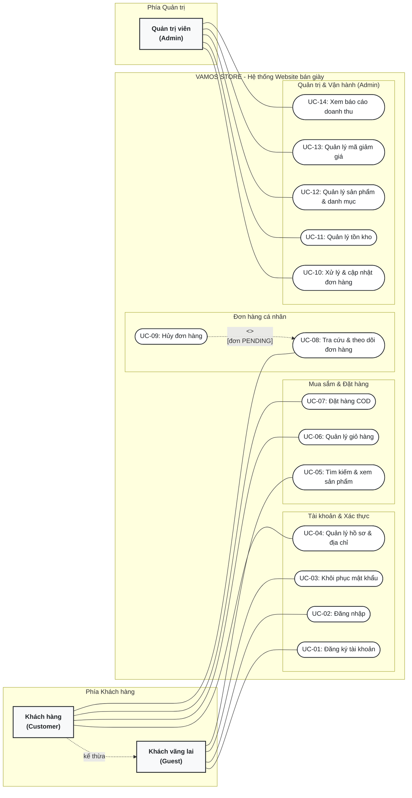
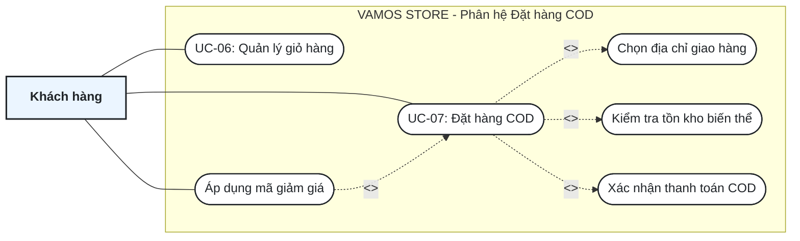
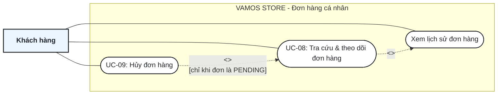
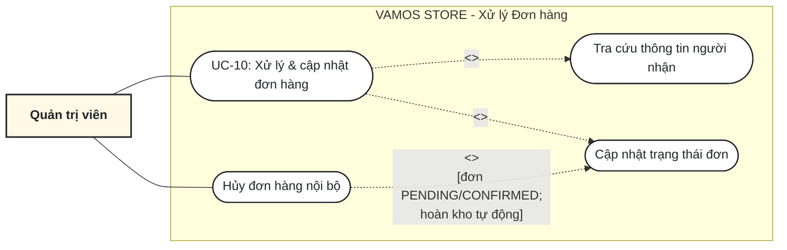
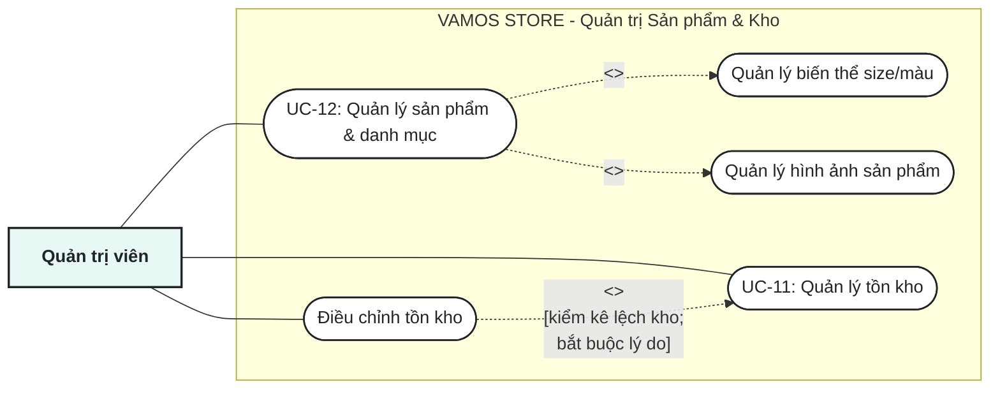

# BẢN VẼ SƠ ĐỒ USE CASE CHUẨN MỰC - VAMOS STORE (v1.1)

Tài liệu này tổng hợp toàn bộ các sơ đồ Use Case của hệ thống **VAMOS STORE** đã được chuẩn hóa thống nhất theo mã định danh từ **`UC-01` đến `UC-14`**, 3 Actors chính và tuân thủ các nguyên tắc thiết kế chuyên nghiệp của Thầy và Thinhnotes.

---

## 1. SƠ ĐỒ USE CASE TỔNG QUAN (SYSTEM OVERVIEW)
* **File PlantUML:** [uc-00-overview.puml](file:///c:/Users/Admin/Desktop/dự%20án%20JAV/docs/diagrams/use-case/uc-00-overview.puml)
* **Mô tả:** 3 Actors chính: `Khách vãng lai` (Guest), `Khách hàng` (Customer kế thừa Guest) và `Quản trị viên` (Admin). Tổng cộng 14 Use Cases phân bổ theo 4 phân hệ cân xứng, không có đường cắt chéo.

---

## 2. CHI TIẾT 1: PHÂN HỆ ĐẶT HÀNG COD (UC-07)
* **File PlantUML:** [uc-01-checkout-detail.puml](file:///c:/Users/Admin/Desktop/dự%20án%20JAV/docs/diagrams/use-case/uc-01-checkout-detail.puml)
* **Mô hình tương đồng 100% với ví dụ Đặt xe Grab của Thầy:**
  * `UC-07: Đặt hàng COD` bắt buộc `<<include>>`: *Chọn địa chỉ giao hàng*, *Kiểm tra tồn kho biến thể*, *Xác nhận thanh toán COD*.
  * `Áp dụng mã giảm giá` là nhánh `<<extend>>` tùy chọn vào `Đặt hàng`.

---

## 3. CHI TIẾT 2: PHÂN HỆ ĐƠN HÀNG CÁ NHÂN (UC-08 & UC-09)
* **File PlantUML:** [uc-02-customer-orders-detail.puml](file:///c:/Users/Admin/Desktop/dự%20án%20JAV/docs/diagrams/use-case/uc-02-customer-orders-detail.puml)
* **Logic:** `UC-08: Tra cứu & theo dõi đơn hàng` bao gồm `<<include>>` lịch sử đơn hàng. `UC-09: Hủy đơn hàng` là mở rộng `<<extend>>` có điều kiện (*chỉ khi đơn ở trạng thái PENDING*).

---

## 4. CHI TIẾT 3: PHÂN HỆ XỬ LÝ ĐƠN HÀNG ADMIN (UC-10)
* **File PlantUML:** [uc-03-order-operations-detail.puml](file:///c:/Users/Admin/Desktop/dự%20án%20JAV/docs/diagrams/use-case/uc-03-order-operations-detail.puml)
* **Logic:** `UC-10: Xử lý & cập nhật đơn hàng` bắt buộc `<<include>>`: *Tra cứu thông tin người nhận* và *Cập nhật trạng thái đơn*. Nhánh *Hủy đơn nội bộ* là `<<extend>>` khi có sự cố đơn ảo hoặc khách báo hủy.

---

## 5. CHI TIẾT 4: PHÂN HỆ QUẢN TRỊ SẢN PHẨM & TỒN KHO (UC-11 & UC-12)
* **File PlantUML:** [uc-04-catalog-inventory-detail.puml](file:///c:/Users/Admin/Desktop/dự%20án%20JAV/docs/diagrams/use-case/uc-04-catalog-inventory-detail.puml)
* **Logic:** `UC-12: Quản lý sản phẩm & danh mục` bắt buộc `<<include>>`: *Biến thể size/màu* và *Hình ảnh*. `Điều chỉnh tồn kho` mở rộng `<<extend>>` từ `UC-11: Quản lý tồn kho` khi kiểm kê chênh lệch.

