# BÁO CÁO PHỤ LỤC KIỂM TOÁN CHÍNH SÁCH VÀ XÁC MINH KHÔI PHỤC DỮ LIỆU
## VAMOS CLUB — STAGE 2 POLICY & DATA RECOVERY VALIDATION ADDENDUM

> **Ngày thực hiện:** 21/11/2026  
> **Chế độ kiểm toán:** **STRICT READ-ONLY AUDIT**  
> **Tài liệu căn cứ:**  
> - Báo cáo kiểm toán gốc: `docs/loyalty/VAMOS_CLUB_FINAL_READ_ONLY_AUDIT.md`  
> - Metadata CSDL: `sys.foreign_keys`, `sys.foreign_key_columns`, `sys.tables`, `sys.columns` trên Microsoft SQL Server (`vamos_store_db`)  
> - Source code: `src/services/loyalty.service.js`, `src/services/review.service.js`, `database/seed_customer.js`, `database/migrations/005_vamos_club_loyalty_system.sql`  
> - Test suite: `tests/test_loyalty_module.js`

---

## 1. XÁC NHẬN GIT PREFLIGHT VÀ CAM KẾT READ-ONLY

| Chỉ số Git | Giá trị kiểm tra trước | Giá trị kiểm tra sau | Kết luận |
| :--- | :--- | :--- | :--- |
| **Current Branch** | `fix/master-repair-plan` | `fix/master-repair-plan` | Trùng khớp 100%, không chuyển branch |
| **Current HEAD** | `eb822aba57d75a2ecad390123c188afb73db3cb8` | `eb822aba57d75a2ecad390123c188afb73db3cb8` | Trùng khớp 100%, không commit mới |
| **Working Tree Diff**| 86 files changed (docs, reports, puml) | 86 files changed (docs, reports, puml) | Giữ nguyên hiện trạng, không reset/clean/stash |

**Cam kết tuân thủ:**
- Không sửa source code backend/frontend.
- Không sửa migration cũ hoặc chạy migration mới (không tạo Migration 006).
- Không sửa đổi các báo cáo kiểm toán đã tồn tại.
- Không chạy bất kỳ test suite nào (`test_loyalty_module.js`, `regression_suite.js`).
- Không thực hiện bất kỳ lệnh DDL hay DML nào trên CSDL (không INSERT, UPDATE, DELETE, CREATE, ALTER, DROP).
- Không thực hiện backup, restore hay dọn dẹp dữ liệu trong phiên này.

---

## 2. PHÂN ĐỊNH CHÍNH SÁCH ĐÃ ĐƯỢC NGƯỜI DÙNG XÁC NHẬN (`USER CONFIRMED`)

Toàn bộ các quy tắc nghiệp vụ dưới đây đã được Người dùng (Product Owner) xác nhận chính thức. Hệ thống ghi nhận trạng thái **`USER CONFIRMED`** và **tuyệt đối không yêu cầu phê duyệt lại hay tự ý thay đổi**:

### 2.1. Chu kỳ và tích lũy điểm xét hạng
1. **Thời lượng chu kỳ:** Xét hạng thành viên theo chu kỳ 12 tháng.
2. **Kích hoạt chu kỳ:** Chu kỳ đầu tiên bắt đầu từ thời điểm phát sinh giao dịch kiếm điểm hợp lệ đầu tiên (bao gồm `REVIEW_REWARD` và `ORDER_PURCHASE` có số điểm thưởng $> 0$).
3. **Các giao dịch không kích hoạt chu kỳ:** Giao dịch đổi voucher (`VOUCHER_REDEMPTION`) và giao dịch hết hạn điểm (`POINT_EXPIRATION`) **không** kích hoạt chu kỳ.
4. **Điểm xét hạng (Qualification Points):** Là tổng điểm kiếm hợp lệ phát sinh trong chu kỳ hiện tại.
5. **Tính độc lập của điểm xét hạng:** Giao dịch đổi voucher và hết hạn điểm chỉ trừ vào điểm khả dụng (`available_points`), **tuyệt đối không làm giảm điểm xét hạng** của chu kỳ.
6. **Reset điểm xét hạng:** Khi chu kỳ kết thúc, điểm xét hạng của chu kỳ mới được reset về 0.
7. **Bảo toàn số dư điểm khả dụng:** Số dư điểm khả dụng (`available_points`) được giữ nguyên khi chu kỳ xét hạng kết thúc (chỉ hết hạn theo quy tắc hạn dùng 365 ngày của từng lô).
8. **Mốc kỷ niệm chu kỳ kế tiếp:** Các chu kỳ tiếp theo nối tiếp nhau theo ngày kỷ niệm của giao dịch kiếm điểm hợp lệ đầu tiên.

### 2.2. Chính sách thời hạn điểm
1. **Thời hạn 365 ngày:** Mỗi lô điểm kiếm được (`loyalty_point_batches`) có thời hạn sử dụng cố định đúng **365 ngày** (tương đương 8.760 giờ) tính từ thời điểm phát sinh giao dịch cộng điểm.
2. **Tính độc lập với chu kỳ:** Thời hạn điểm 365 ngày được quản lý độc lập cho từng lô điểm (Batch-level), **không** được dùng chu kỳ xét hạng 12 tháng để thay thế hay gộp chung.

### 2.3. Ngưỡng cấp độ thành viên (Tier Thresholds)
- **MEMBER:** 0 – 999 điểm xét hạng.
- **SILVER:** 1.000 – 2.499 điểm xét hạng.
- **GOLD:** 2.500 – 4.999 điểm xét hạng.
- **VIP:** Từ 5.000 điểm xét hạng trở lên.

### 2.4. Cơ chế Soft Landing (Hạ hạng mềm)
1. **Nâng hạng tức thì (Immediate Upgrade):** Khách hàng được nâng cấp hạng ngay lập tức khi tích lũy điểm xét hạng trong chu kỳ đạt ngưỡng hạng tiếp theo.
2. **Hạ hạng tối đa một bậc:** Khi kết thúc chu kỳ 12 tháng, nếu khách hàng không tích lũy đủ điểm xét hạng để duy trì hạng hiện tại, hệ thống **chỉ hạ tối đa 1 bậc hạng** (ví dụ: VIP xuống GOLD, GOLD xuống SILVER, SILVER xuống MEMBER).
3. **Hạng đáy:** MEMBER là hạng cơ bản thấp nhất, không thể bị hạ xuống thấp hơn.
4. **Giữ hạng cho chu kỳ mới:** Hạng sau khi xét lại (giữ nguyên hoặc hạ 1 bậc) sẽ trở thành hạng bắt đầu của chu kỳ 12 tháng tiếp theo.

### 2.5. Quyền đổi voucher
- Mọi hạng thành viên (`MEMBER`, `SILVER`, `GOLD`, `VIP`) đều có quyền đổi bất kỳ voucher nào đang hoạt động trong danh mục phần thưởng nếu có đủ số dư điểm khả dụng và thỏa mãn điều kiện quy định của phần thưởng đó.

---

## 3. HẠNG MỤC A — CHU KỲ 12 THÁNG VÀ XỬ LÝ NGÀY 29/02 QUA NHIỀU NĂM

### 3.1. Phân tích thực nghiệm trên Microsoft SQL Server

Giả sử khách hàng có giao dịch kiếm điểm hợp lệ đầu tiên kích hoạt mốc kỷ niệm:
$$\text{cycle\_anchor\_at} = \text{2024-02-29 14:30:00 (Năm nhuận)}$$

Hệ thống đã thực hiện kiểm tra thực nghiệm câu lệnh `DATEADD` trên engine SQL Server với hai phương thức tính:

```sql
SELECT 
  -- Phương án 1: Tính lũy kế tuần tự từ cycle_start_at cũ
  DATEADD(year, 1, '2024-02-29 14:30:00') AS iter_2025,
  DATEADD(year, 1, DATEADD(year, 1, '2024-02-29 14:30:00')) AS iter_2026,
  DATEADD(year, 1, DATEADD(year, 1, DATEADD(year, 1, '2024-02-29 14:30:00'))) AS iter_2027,
  DATEADD(year, 1, DATEADD(year, 1, DATEADD(year, 1, DATEADD(year, 1, '2024-02-29 14:30:00')))) AS iter_2028,
  -- Phương án 2: Tính dựa trên mốc kỷ niệm gốc bất biến và cycle_number (k = 0, 1, 2, 3, 4)
  DATEADD(year, 0, '2024-02-29 14:30:00') AS anchor_2024,
  DATEADD(year, 1, '2024-02-29 14:30:00') AS anchor_2025,
  DATEADD(year, 2, '2024-02-29 14:30:00') AS anchor_2026,
  DATEADD(year, 3, '2024-02-29 14:30:00') AS anchor_2027,
  DATEADD(year, 4, '2024-02-29 14:30:00') AS anchor_2028;
```

**Kết quả trả về trực tiếp từ engine CSDL:**

| Năm | Kỷ niệm mong muốn | Phương án 1: Lũy kế tuần tự `DATEADD(year, 1, cycle_start_at)` | Phương án 2: Mốc bất biến `DATEADD(year, k, cycle_anchor_at)` |
| :---: | :---: | :---: | :---: |
| **2024** | 29/02/2024 14:30:00 | 29/02/2024 14:30:00 | **29/02/2024 14:30:00** ($k=0$) |
| **2025** | 28/02/2025 14:30:00 | 28/02/2025 14:30:00 | **28/02/2025 14:30:00** ($k=1$) |
| **2026** | 28/02/2026 14:30:00 | 28/02/2026 14:30:00 | **28/02/2026 14:30:00** ($k=2$) |
| **2027** | 28/02/2027 14:30:00 | 28/02/2027 14:30:00 | **28/02/2027 14:30:00** ($k=3$) |
| **2028** | **29/02/2028 14:30:00** | <mark>**28/02/2028 14:30:00 (SAI / MẤT NGÀY 29/02)**</mark> | <mark>**29/02/2028 14:30:00 (CHÍNH XÁC)**</mark> ($k=4$) |

### 3.2. Đánh giá rủi ro kỹ thuật

1. **Rủi ro của Phương án 1 (Lũy kế tuần tự `DATEADD(year, 1, cycle_start_at)`):**
   - Khi bước từ năm 2024 sang năm không nhuận 2025, SQL Server chuẩn hóa ngày 29/02 về ngày 28/02.
   - Nếu lưu `2025-02-28 14:30:00` làm `cycle_start_at` mới và năm sau lại lấy ngày đó $+1$ năm, thì mốc ngày 29 gốc **bị xóa sổ hoàn toàn khỏi bộ nhớ hệ thống**.
   - Đến năm 2028 (năm nhuận tiếp theo), hệ thống lấy ngày 28/02/2027 $+1$ năm $\rightarrow$ kết quả là `2028-02-28 14:30:00`. Khách hàng bị mất vĩnh viễn 1 ngày của năm nhuận 2028 và ngày kỷ niệm bị trôi lệch vĩnh viễn về ngày 28/02 cho toàn bộ các năm về sau!
2. **Ưu việt của Phương án 2 (Dựa trên mốc bất biến `cycle_anchor_at` và `cycle_number`):**
   - Mốc kỷ niệm gốc `cycle_anchor_at` (`2024-02-29 14:30:00`) được giữ nguyên bất biến suốt vòng đời tài khoản.
   - Khi chuyển chu kỳ, hệ thống tăng số thứ tự chu kỳ $k = k + 1$.
   - Tại năm thường ($k=1, 2, 3$), SQL Server tự động map sang 28/02 một cách an toàn.
   - Khi tới năm nhuận ($k=4$), phép tính `DATEADD(year, 4, '2024-02-29 14:30:00')` tự động phục hồi chính xác ngày **`2028-02-29 14:30:00`**.
   - Giờ, phút, giây (`14:30:00`) được bảo toàn tuyệt đối 100%, không bị sai lệch múi giờ hay trôi giây.

### 3.3. Ranh giới nửa mở `[cycle_start_at, cycle_end_at)`

Để loại bỏ hoàn toàn khả năng chồng lấn hoặc bỏ sót giao dịch:
- **Chu kỳ $k$:**
  $$\text{cycle\_start\_at}^{(k)} = \text{DATEADD(year, } k\text{, cycle\_anchor\_at)}$$
  $$\text{cycle\_end\_at}^{(k)} = \text{DATEADD(year, } k + 1\text{, cycle\_anchor\_at)}$$
- Khoảng thời gian áp dụng: $\left[\text{cycle\_start\_at}^{(k)}, \, \text{cycle\_end\_at}^{(k)}\right)$
  - Giao dịch phát sinh tại thời điểm $t < \text{cycle\_end\_at}^{(k)}$: Thuộc chu kỳ $k$.
  - Giao dịch phát sinh tại đúng thời điểm $t = \text{cycle\_end\_at}^{(k)}$: Thuộc chu kỳ mới $k + 1$ (vì $\text{cycle\_start\_at}^{(k+1)} = \text{cycle\_end\_at}^{(k)}$).
  - Không có khe hở thời gian ($\Delta t = 0$), không có sự trùng lặp giữa hai chu kỳ.

### 3.4. Đề xuất mô hình dữ liệu Schema cho Stage 2
Để hỗ trợ phương án trên một cách tối ưu, cấu trúc bảng `user_points_wallets` cần được bổ sung các cột sau trong Migration 006 (đề xuất thiết kế):
```sql
ALTER TABLE user_points_wallets ADD
    cycle_anchor_at DATETIME2 NULL,        -- Mốc kỷ niệm bất biến (ngày tích điểm đầu tiên)
    cycle_number INT NOT NULL DEFAULT 0,    -- Số thứ tự chu kỳ (0 = chu kỳ đầu)
    cycle_start_at DATETIME2 NULL,         -- Bắt đầu chu kỳ hiện tại
    cycle_end_at DATETIME2 NULL,           -- Kết thúc chu kỳ hiện tại
    qualification_points INT NOT NULL DEFAULT 0; -- Điểm xét hạng tích lũy trong chu kỳ hiện tại
```

---

## 4. HẠNG MỤC B — KIỂM CHỨNG ĐẦY ĐỦ FOREIGN KEY & KẾ HOẠCH CLEANUP

### 4.1. Danh mục 100% Khóa ngoại hai chiều của 11 Bảng mục tiêu
Dựa trên truy vấn metadata từ `sys.foreign_keys`, `sys.foreign_key_columns` và `sys.tables` trên CSDL `vamos_store_db`:

| STT | Tên Khóa Ngoại (FK Name) | Bảng Nguồn (Parent) | Cột Nguồn | Bảng Tham Chiếu (Referenced) | Cột Tham Chiếu | Delete Action | Trạng Thái | Số Cột |
| :---: | :--- | :--- | :--- | :--- | :--- | :--- | :---: | :---: |
| **1** | `fk_addresses_user` | `addresses` | `user_id` | `users` | `id` | **CASCADE** | Enabled | 1 |
| **2** | `fk_carts_user` | `carts` | `user_id` | `users` | `id` | **CASCADE** | Enabled | 1 |
| **3** | `fk_inv_trans_user` | `inventory_transactions` | `user_id` | `users` | `id` | **NO_ACTION** | Enabled | 1 |
| **4** | `fk_orders_user` | `orders` | `user_id` | `users` | `id` | **NO_ACTION** | Enabled | 1 |
| **5** | `fk_orders_voucher` | `orders` | `voucher_id` | `vouchers` | `id` | **SET_NULL** | Enabled | 1 |
| **6** | `fk_order_items_order` | `order_items` | `order_id` | `orders` | `id` | **CASCADE** | Enabled | 1 |
| **7** | `fk_order_items_variant`| `order_items` | `product_variant_id` | `product_variants` | `id` | **NO_ACTION** | Enabled | 1 |
| **8** | `fk_order_histories_order`| `order_status_histories` | `order_id` | `orders` | `id` | **CASCADE** | Enabled | 1 |
| **9** | `fk_order_histories_user` | `order_status_histories` | `changed_by` | `users` | `id` | **NO_ACTION** | Enabled | 1 |
| **10**| `fk_pwd_reset_user` | `password_reset_tokens` | `user_id` | `users` | `id` | **CASCADE** | Enabled | 1 |
| **11**| `fk_point_transactions_user`| `point_transactions` | `user_id` | `users` | `id` | **NO_ACTION** | Enabled | 1 |
| **12**| `fk_reviews_order` | `reviews` | `order_id` | `orders` | `id` | **NO_ACTION** | Enabled | 1 |
| **13**| `fk_reviews_product` | `reviews` | `product_id` | `products` | `id` | **NO_ACTION** | Enabled | 1 |
| **14**| `fk_reviews_user` | `reviews` | `user_id` | `users` | `id` | **NO_ACTION** | Enabled | 1 |
| **15**| `fk_review_media_review` | `review_media` | `review_id` | `reviews` | `id` | **CASCADE** | Enabled | 1 |
| **16**| `fk_points_wallets_user` | `user_points_wallets` | `user_id` | `users` | `id` | **CASCADE** | Enabled | 1 |
| **17**| `fk_redemptions_rule` | `voucher_redemptions` | `reward_rule_id` | `point_reward_rules` | `id` | **NO_ACTION** | Enabled | 1 |
| **18**| `fk_redemptions_user` | `voucher_redemptions` | `user_id` | `users` | `id` | **NO_ACTION** | Enabled | 1 |
| **19**| `fk_redemptions_voucher` | `voucher_redemptions` | `voucher_id` | `vouchers` | `id` | **NO_ACTION** | Enabled | 1 |
| **20**| `FK_voucher_usages_order` | `voucher_usages` | `order_id` | `orders` | `id` | **CASCADE** | Enabled | 1 |
| **21**| `FK_voucher_usages_user` | `voucher_usages` | `user_id` | `users` | `id` | **NO_ACTION** | Enabled | 1 |
| **22**| `FK_voucher_usages_voucher` | `voucher_usages` | `voucher_id` | `vouchers` | `id` | **NO_ACTION** | Enabled | 1 |
| **23**| `fk_wishlist_items_user`| `wishlist_items` | `user_id` | `users` | `id` | **CASCADE** | Enabled | 1 |

### 4.2. Dependency Graph Đầy Đủ Cho Các Bản Ghi Test

```mermaid
graph TD
    classDef testRecord fill:#ffebee,stroke:#c62828,stroke-width:2px;
    classDef userTable fill:#e8eaf6,stroke:#283593,stroke-width:2px;
    classDef softRef fill:#fffde7,stroke:#f57f17,stroke-dasharray: 5 5;

    U2[users id=2: khachhang@vamos.vn]:::userTable

    subgraph Nhóm Đơn Hàng Test
        ORD_TEST[6 Đơn Test: ORD-TEST-LOYALTY-001..006 id=28,29,31,33,35,38,41,44,47,50,52]:::testRecord
        ORD_PEND[6 Đơn Pending Test: ORD-PENDING-... id=30,32,34,36,39,42,45,48,51,53]:::testRecord
        ORD_CHECKOUT[6 Đơn Checkout Voucher Test: VAM261121-... id=37,40,43,46,49,54]:::testRecord
        O_ITEMS[order_items: SKU-TEST]:::testRecord
        O_HIST[order_status_histories]:::testRecord
    end

    subgraph Nhóm Review Test
        REV[10 reviews: id=1..10]:::testRecord
        REV_MED[review_media]:::testRecord
    end

    subgraph Nhóm Voucher Test
        V_TEST[21 vouchers: VAMOSCLUB-... id=5..26]:::testRecord
        V_RED[21 voucher_redemptions: id=1..22]:::testRecord
        V_USE[1 voucher_usages: id=4, voucher_id=10, order_id=37]:::testRecord
    end

    subgraph Nhóm Loyalty & Ledger
        PTX[37 point_transactions: user_id=2]:::testRecord
        WAL[user_points_wallets: user_id=2]:::testRecord
    end

    %% FK Cứng
    REV_MED -->|FK Cứng: CASCADE| REV
    REV -->|FK Cứng: NO_ACTION! CHẶN XÓA ORDERS| ORD_TEST
    REV -->|FK Cứng: NO_ACTION| U2

    O_ITEMS -->|FK Cứng: CASCADE| ORD_TEST
    O_ITEMS -->|FK Cứng: CASCADE| ORD_PEND
    O_ITEMS -->|FK Cứng: CASCADE| ORD_CHECKOUT
    O_HIST -->|FK Cứng: CASCADE| ORD_TEST

    V_USE -->|FK Cứng: CASCADE| ORD_CHECKOUT
    V_USE -->|FK Cứng: NO_ACTION! CHẶN XÓA VOUCHERS| V_TEST
    V_RED -->|FK Cứng: NO_ACTION! CHẶN XÓA VOUCHERS| V_TEST
    V_RED -->|FK Cứng: NO_ACTION| U2
    ORD_CHECKOUT -->|FK Cứng: SET_NULL| V_TEST

    WAL -->|FK Cứng: CASCADE| U2
    PTX -->|FK Cứng: NO_ACTION| U2

    %% Tham chiếu mềm
    PTX -.->|Tham chiếu mềm: reference_id=order_id| ORD_TEST
    PTX -.->|Tham chiếu mềm: reference_id=review_id| REV
    PTX -.->|Tham chiếu mềm: reference_id=voucher_id| V_TEST
```



### 4.3. Phát hiện điểm chặn Foreign Key cốt lõi

1. **Điểm chặn 1 (`reviews` chặn `orders`):**  
   Ràng buộc `fk_reviews_order` là `ON DELETE NO_ACTION`.  
   $\rightarrow$ Không thể xóa `orders` (các đơn hàng test `ORD-TEST-LOYALTY-...`) khi 10 bản ghi trong `reviews` còn trỏ tới chúng.
2. **Điểm chặn 2 (`voucher_redemptions` và `voucher_usages` chặn `vouchers`):**  
   Ràng buộc `fk_redemptions_voucher` và `FK_voucher_usages_voucher` đều là `ON DELETE NO_ACTION`.  
   $\rightarrow$ Bản ghi sử dụng voucher `voucher_usages` (id = 4, trỏ tới voucher 10 và order 37) cùng 21 bản ghi trong `voucher_redemptions` sẽ **chặn đứng** mọi thao tác xóa các mã voucher test `VAMOSCLUB-...`.
3. **Tính độc lập của `point_transactions`:**  
   Bảng `point_transactions` **chỉ có duy nhất FK tới `users`**, hoàn toàn không có Foreign Key vật lý tới `orders`, `reviews` hay `vouchers`. Các cột `reference_type` và `reference_id` chỉ lưu chuỗi thuần. Do đó, việc xóa `point_transactions` hoàn toàn không bị vướng khóa ngoại từ các bảng nghiệp vụ khác.

### 4.4. Kiểm tra lịch sử ví của `user_id = 2` — Xác định bằng chứng ban đầu

Tiến hành đối chiếu chéo các nguồn dữ liệu:
- **`database/seed_customer.js`:** Chỉ thực hiện `INSERT INTO users (email, ...)` cho `khachhang@vamos.vn` (id = 2). Hoàn toàn **không có bất kỳ câu lệnh khởi tạo ví** nào trong file seed.
- **`database/migrations/005_vamos_club_loyalty_system.sql`:** Chỉ tạo cấu trúc bảng với giá trị `DEFAULT 0`. Hoàn toàn không chèn dữ liệu seed cho ví.
- **Bảng `user_points_wallets`:** Bản ghi duy nhất cho `user_id = 2` có timestamp `created_at = 2026-11-21 15:37:33.620Z`, được khởi tạo tự động bởi hàm `loyaltyService.getOrCreateWallet(userId)` trong lúc test suite chạy lượt đầu tiên.
- **Đơn hàng thực tế của user 2:** Trước đợt test ngày 21/11/2026, user 2 chỉ có duy nhất 1 đơn hàng `VAM261110-2357` (id = 1, tạo ngày 11/11/2026), nhưng đơn này ở trạng thái `CANCELLED` và `UNPAID` nên không phát sinh tích điểm.
- **ĐÁNH GIÁ KIỂM TOÁN NGHIÊM NGẶT:**  
  Mặc dù bằng chứng kỹ thuật chỉ ra ví user 2 được sinh ra tự động trong quá trình chạy test (với giá trị mặc định là 0), nhưng vì **không có file sao lưu (database snapshot) hoặc biên bản nghiệm thu trạng thái ví ngay trước thời điểm test chạy**, theo nguyên tắc kiểm toán hệ thống tài chính/điểm thưởng:
  $$\text{Trạng thái ban đầu của ví user 2: } \mathbf{NOT\;VERIFIED}$$
  *Hệ thống không được tự ý giả định ví bằng 0 để reset bừa bãi khi chưa có xác nhận và phê duyệt từ Người dùng.*

### 4.5. Thiết kế kế hoạch Cleanup dữ liệu test an toàn (Mức thiết kế — Không chạy lệnh)

Khi được phê duyệt chính thức bằng văn bản, thao tác cleanup phải được đóng gói trong một Transaction duy nhất (`BEGIN TRANSACTION ... COMMIT`) theo đúng 4 tầng tuần tự sau:

* **Tầng 1 — Giải phóng ràng buộc Review:**
  1. `DELETE FROM review_media WHERE review_id IN (SELECT id FROM reviews WHERE user_id = 2);`
  2. `DELETE FROM reviews WHERE user_id = 2;` (Giải phóng `fk_reviews_order`).
* **Tầng 2 — Giải phóng ràng buộc Voucher:**
  3. `DELETE FROM voucher_usages WHERE user_id = 2 OR voucher_id IN (SELECT id FROM vouchers WHERE code LIKE 'VAMOSCLUB%');` (Giải phóng `FK_voucher_usages_voucher`).
  4. `DELETE FROM voucher_redemptions WHERE user_id = 2;` (Giải phóng `fk_redemptions_voucher`).
  5. `DELETE FROM vouchers WHERE code LIKE 'VAMOSCLUB%';`
* **Tầng 3 — Xóa đơn hàng test:**
  6. Xóa `orders` có mã `order_code LIKE 'ORD-TEST-LOYALTY%'`, `ORD-PENDING%` và các đơn checkout test tạo trong phiên test của user 2 (`id IN (37, 40, 43, 46, 49, 54)`). Các bảng con `order_items` và `order_status_histories` sẽ tự động được dọn dẹp nhờ `ON DELETE CASCADE`.
* **Tầng 4 — Xóa Ledger và Đồng bộ Ví:**
  7. `DELETE FROM point_transactions WHERE user_id = 2;`
  8. Cập nhật `user_points_wallets` của `user_id = 2` về trạng thái an toàn được phê duyệt:
     `available_points = 0, lifetime_earned_points = 0, lifetime_redeemed_points = 0, tier_code = 'MEMBER'`.

---

## 5. HẠNG MỤC C — BẤT BIẾN DỮ LIỆU TRƯỚC BACKFILL (INVARIANTS AUDIT)

Bảng đánh giá 9 bất biến bắt buộc phải thỏa mãn trước khi thực hiện nạp dữ liệu lịch sử vào bảng lô điểm (`loyalty_point_batches`):

| STT | Tên Bất Biến (Data Invariant) | Phương Pháp Kiểm Tra & Công Thức Đối Soát | Nguồn Dữ Liệu | Kết Quả Hiện Tại | Đánh Giá Khả Năng Backfill An Toàn |
| :---: | :--- | :--- | :--- | :---: | :---: |
| **1** | **Khớp số dư khả dụng ví & batch** | $\text{wallet.available\_points} = \sum \text{batch.remaining\_points}$ (cho các batch active còn hạn). | `user_points_wallets`, `loyalty_point_batches` | **`FAIL`** | **CHƯA THỂ BACKFILL**. Ví hiện tại ghi nhận 27.000 điểm, nhưng tổng số dư ledger là 154.400 điểm (lệch 127.400 điểm do 700 điểm ảo và test case ghi đè). Bắt buộc phải cleanup trước. |
| **2** | **Không có batch âm điểm** | `SELECT COUNT(*) FROM loyalty_point_batches WHERE remaining_points < 0` $\rightarrow 0$. | `loyalty_point_batches` | **`NOT VERIFIED`** | Bảng chưa tồn tại. Phải đưa CHECK constraint `remaining_points >= 0` vào DDL Migration 006. |
| **3** | **Không tự sinh điểm ngoài ledger** | $\sum \text{batch.original\_points} = \sum \text{earning transactions}$. | `loyalty_point_batches`, `point_transactions` | **`FAIL`** | **CHƯA THỂ BACKFILL**. Ledger hiện chứa 6 đơn test nhân bản (+27.000 điểm mỗi đơn) và 10 review test, backfill ngay sẽ nhân bản dữ liệu rác. |
| **4** | **Không tạo batch từ UPDATE ví giả lập** | Quét các lệnh `UPDATE user_points_wallets` không qua transaction ledger. | Source code & Ledger | **`FAIL`** | Trong test suite cũ có lệnh trực tiếp cộng điểm vào ví để test đổi voucher mà không sinh giao dịch earning. |
| **5** | **Một earning transaction chỉ tạo duy nhất 1 batch** | Ràng buộc duy nhất: `UNIQUE (point_transaction_id)` trên bảng `loyalty_point_batches`. | Schema DDL Migration 006 | **`NOT VERIFIED`** | Cần đưa ràng buộc này vào DDL Migration 006 để đảm bảo tính Idempotent khi chạy script backfill. |
| **6** | **Batch hết hạn chỉ ghi nhận Expiration một lần** | Kiểm tra `status IN ('EXPIRED', 'DEPLETED')` và `idempotency_key = 'EXPIRATION_' + batch_id`. | Worker code & Ledger | **`NOT VERIFIED`** | Chưa có Worker code và chưa có transaction type `POINT_EXPIRATION`. |
| **7** | **Điểm đã tiêu/hết hạn không được khả dụng** | Nếu `remaining_points = 0` thì `status` bắt buộc phải là `DEPLETED` hoặc `EXPIRED`. | `loyalty_point_batches` | **`NOT VERIFIED`** | Cần ràng buộc logic chặt chẽ trong Transaction trừ điểm FIFO. |
| **8** | **Điểm xét hạng không giảm khi tiêu điểm/hết hạn** | $\text{qualification\_points} = \sum \text{earnings trong chu kỳ}$, không bị trừ bởi Redemption/Expiration. | `user_points_wallets`, `point_transactions` | **`NOT VERIFIED`** | Bảng ví hiện tại chưa có cột `qualification_points`. |
| **9** | **Voucher sử dụng khớp trạng thái sở hữu** | Với mọi dòng trong `voucher_usages`, voucher tương ứng phải có `used_count = 1` và `voucher_redemptions.status = 'USED'`. | `voucher_usages`, `vouchers`, `voucher_redemptions` | **`FAIL`** | Hiện tại bản ghi `voucher_usages` (id 4, voucher 10) có `used_count = 1`, nhưng trong `voucher_redemptions` trạng thái vẫn là `AVAILABLE` (chưa chuyển sang `USED`). |

---

## 6. HẠNG MỤC D — BẢNG ĐIỀU KIỆN PHÊ DUYỆT STAGE 2

| STT | Điều kiện tiên quyết | Trạng thái kỹ thuật | Bằng chứng thực tế tại repository | Việc cụ thể cần làm tiếp theo |
| :---: | :--- | :---: | :--- | :--- |
| **1** | **Chính sách chu kỳ 12 tháng** | **`USER CONFIRMED`** | Người dùng đã chốt: Tính từ ngày phát sinh giao dịch kiếm điểm đầu tiên. | Đưa công thức tính chu kỳ vào tài liệu đặc tả và Migration 006. |
| **2** | **Chính sách hạn điểm 365 ngày** | **`USER CONFIRMED`** | Người dùng đã chốt: Tính riêng 365 ngày cho từng lô điểm kiếm được. | Thiết lập cột `expires_at = DATEADD(day, 365, created_at)` trong batch. |
| **3** | **Quyền đổi voucher mọi hạng** | **`USER CONFIRMED`** | Người dùng đã chốt: MEMBER, SILVER, GOLD, VIP đều có quyền đổi voucher. | Giữ nguyên logic kiểm tra số dư và trạng thái active của voucher rule. |
| **4** | **Soft Landing hạ 1 bậc** | **`USER CONFIRMED`** | Người dùng đã chốt: Khi hết chu kỳ, không đủ điểm duy trì chỉ hạ 1 bậc. | Thiết kế thuật toán chuyển chu kỳ trong service (VIP $\rightarrow$ GOLD $\rightarrow$ SILVER $\rightarrow$ MEMBER). |
| **5** | **Quy tắc năm nhuận (29/02)** | **`NOT VERIFIED`** | Đã chứng minh bằng thực nghiệm: Phương pháp Mốc bất biến `cycle_anchor_at` $+ k$ năm giải quyết triệt để vấn đề mất ngày 29/02. | Chờ Người dùng phê duyệt đưa 2 cột `cycle_anchor_at` và `cycle_number` vào Schema. |
| **6** | **Test Isolation** | **`FAIL`** | Test suite `test_loyalty_module.js` chạy thẳng vào CSDL phát triển `vamos_store_db`. | Thêm cấu hình bắt buộc `NODE_ENV=test` và Database Name Guard chặn đứng việc ghi vào dev DB. |
| **7** | **Cleanup dữ liệu test** | **`BLOCKED`** | Đã lập Dependency Graph và thứ tự xóa 4 tầng hoàn chỉnh, nhưng chưa được phép thực thi. | Thực hiện dọn dẹp dữ liệu test của user 2 sau khi có file backup CSDL. |
| **8** | **Backup và Restore Drill** | **`BLOCKED`** | Chưa có file backup vật lý `.bak` nào của `vamos_store_db` được tạo ra trong phiên. | Thực hiện lệnh backup full database và diễn tập khôi phục (restore) trên DB thử nghiệm. |
| **9** | **Backfill dữ liệu lịch sử** | **`BLOCKED`** | Dữ liệu dev đang bị ô nhiễm 37 bản ghi test, 700 điểm ảo và bất biến số 1, 3, 9 đang `FAIL`. | Chỉ thực hiện backfill sau khi đã cleanup dữ liệu test sạch sẽ và ví được xác nhận. |
| **10**| **Point Batches Schema** | **`NOT VERIFIED`** | Bảng `loyalty_point_batches` chưa tồn tại trong CSDL thực tế. | Soạn thảo file `database/migrations/006_loyalty_point_batches.sql` với đầy đủ ràng buộc FK, Unique, Check. |
| **11**| **Expiration Background Worker** | **`NOT VERIFIED`** | Chưa có file worker/cron job trong mã nguồn để quét lô điểm hết hạn. | Lập trình background service với transaction xử lý lô và thuật toán trừ điểm FIFO. |
| **12**| **Redemption / Expiration Concurrency** | **`NOT VERIFIED`** | Đổi voucher đơn lẻ đã có `UPDLOCK, ROWLOCK` đạt PASS; nhưng tương tranh giữa Worker và User đổi điểm chưa có code để test. | Viết test case mô phỏng đồng thời Worker trừ điểm hết hạn và User đổi voucher trên cùng 1 batch. |
| **13**| **Expiration Idempotency** | **`NOT VERIFIED`** | Chưa có loại giao dịch `POINT_EXPIRATION` trong ràng buộc `chk_point_tx_type`. | Thêm `POINT_EXPIRATION` vào check constraint và đặt key `EXPIRATION_BATCH_{id}`. |
| **14**| **Rollback / Recovery Plan** | **`BLOCKED`** | Chưa có script rollback an toàn cho Migration 006 và kịch bản phục hồi dữ liệu khi worker lỗi. | Soạn thảo kịch bản rollback chi tiết cho từng bước triển khai Stage 2. |

---

## 7. KẾT LUẬN CUỐI CÙNG VÀ TRẢ LỜI CÁC CÂU HỎI CỐT LÕI

### 1. Chính sách nghiệp vụ nào đã chốt?
Toàn bộ 5 nhóm chính sách lớn đã được chốt và đánh dấu **`USER CONFIRMED`**:
- Chu kỳ xét hạng 12 tháng tính từ giao dịch kiếm điểm đầu tiên.
- Hạn dùng điểm 365 ngày cho từng lô điểm độc lập.
- Ngưỡng cấp bậc thành viên (MEMBER, SILVER, GOLD, VIP).
- Cơ chế Soft Landing hạ tối đa 1 bậc mỗi chu kỳ khi không đủ điểm duy trì.
- Quyền đổi voucher dành cho mọi hạng thành viên khi đủ điều kiện.

### 2. Có điểm nào trong đặc tả hiện tại đang mâu thuẫn với chính sách đã chốt không?
- **Có 1 mâu thuẫn lớn trong mã nguồn hiện tại:** Trong `src/services/loyalty.service.js` (dòng 29–35), hàm `calculateTier()` đang tính hạng trọn đời cố định theo `lifetime_earned_points`. Mã nguồn hiện tại hoàn toàn chưa có khái niệm chu kỳ 12 tháng, chưa có điểm xét hạng của chu kỳ (`qualification_points`), và chưa có cơ chế Soft Landing.
- **Có 1 mâu thuẫn trạng thái trong dữ liệu test:** Bản ghi `voucher_usages` (id 4) đã ghi nhận voucher 10 được sử dụng, nhưng `voucher_redemptions` (id 4) của voucher đó vẫn đang ở trạng thái `AVAILABLE` thay vì `USED`.

### 3. Phương án xử lý năm nhuận nào phù hợp nhất?
- Phương án tối ưu nhất đã được kiểm chứng thực nghiệm trên SQL Server là: **Sử dụng Mốc kỷ niệm gốc bất biến (`cycle_anchor_at`) kết hợp với Số thứ tự chu kỳ (`cycle_number`)**.
- Công thức: `cycle_start_at = DATEADD(year, cycle_number, cycle_anchor_at)` và `cycle_end_at = DATEADD(year, cycle_number + 1, cycle_anchor_at)`.
- Phương án này tự động chuyển 29/02 sang 28/02 ở năm thường, và **tự động phục hồi lại chính xác ngày 29/02 ở các năm nhuận tiếp theo**, bảo toàn giờ, phút, giây tuyệt đối, không làm trôi ngày kỷ niệm.

### 4. Dependency Graph đã đủ để lập kế hoạch cleanup an toàn chưa?
- **Đã hoàn toàn đầy đủ và chính xác 100%.** Sơ đồ quan hệ hai chiều của 11 bảng đã làm rõ hai điểm nghẽn khóa ngoại nghiêm ngặt: `reviews` chặn xóa `orders` (`ON DELETE NO_ACTION`) và `voucher_redemptions` + `voucher_usages` chặn xóa `vouchers` (`ON DELETE NO_ACTION`). Thứ tự xóa 4 tầng đã loại bỏ hoàn toàn nguy cơ lỗi khóa ngoại FK Error 547.

### 5. Có đủ bằng chứng để xác định ví user 2 cần khôi phục về 0 không?
- **Chưa đủ bằng chứng pháp lý độc lập (`NOT VERIFIED`).**
- Mặc dù dữ liệu kỹ thuật cho thấy ví user 2 được sinh ra tự động trong quá trình chạy test lúc `15:37:33.620Z` ngày 21/11/2026, nhưng do không có bản chụp sao lưu (snapshot) trước test, hệ thống không thể tự ý coi việc reset về 0 là đương nhiên mà **bắt buộc phải có quyết định phê duyệt chính thức từ Người dùng**.

### 6. Có thể backfill lịch sử đáng tin cậy không?
- **Hiện tại là KHÔNG THỂ (CHƯA AN TOÀN).**
- Cơ sở dữ liệu đang chứa 37 giao dịch test bị ô nhiễm, bao gồm 700 điểm ảo và 6 đơn hàng test nhân bản (+162.000 điểm giả). Nếu thực hiện backfill ngay bây giờ, các lô điểm ảo này sẽ được tạo thành batch chính thức, gây sai lệch nghiêm trọng quỹ điểm của doanh nghiệp.

### 7. Stage 2 còn những blocker nào?
Còn **4 nhóm blocker trọng yếu**:
1. **Blocker 1 (Test Isolation):** Chưa có cơ chế phân lập CSDL test, nguy cơ tiếp tục làm bẩn DB dev nếu chạy lại test.
2. **Blocker 2 (Backup/Restore):** Chưa có file sao lưu `.bak` thực tế và chưa diễn tập khôi phục.
3. **Blocker 3 (Dữ liệu ô nhiễm & Chưa duyệt Reset ví):** Chưa cleanup dữ liệu test của user 2 và chưa có phê duyệt phương án đặt lại ví.
4. **Blocker 4 (Thiếu Schema & Worker):** Chưa có DDL bảng `loyalty_point_batches` và chưa có mã nguồn Expiration Worker.

### 8. Bước tiếp theo nên thực hiện là gì?
1. **Bước 1 (Phê duyệt):** Người dùng xem xét báo cáo này và phê duyệt:
   - Phương án Schema lưu trữ chu kỳ: `cycle_anchor_at`, `cycle_number`, `qualification_points`.
   - Phê duyệt phương án cleanup dữ liệu test của `user_id = 2` và đặt lại ví user 2 về 0.
2. **Bước 2 (An toàn CSDL):** Thực hiện sao lưu Full Backup database `vamos_store_db` ra file `.bak`.
3. **Bước 3 (Cô lập Test):** Sửa cấu hình `test_loyalty_module.js` bổ sung Database Guard và cờ `NODE_ENV=test` trỏ về CSDL test riêng biệt (`vamos_store_test_db`).
4. **Bước 4 (Cleanup an toàn):** Chạy Transaction dọn dẹp 4 tầng đã thiết kế cho `user_id = 2`.
5. **Bước 5 (Triển khai Stage 2):** Soạn thảo Migration 006, lập trình Batch Service và Worker quét hết hạn điểm.

---
> **TRẠNG THÁI CUỐI CÙNG:**  
> Hệ thống tuân thủ nghiêm ngặt quy định Read-Only: **ĐÃ DỪNG LẠI HOÀN TOÀN TẠI ĐÂY**, không thay đổi mã nguồn, không cleanup dữ liệu và chờ chỉ đạo tiếp theo từ Người dùng.
