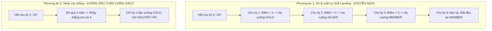
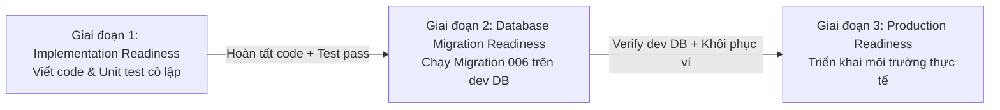

# BÁO CÁO XÁC MINH TOÀN DIỆN VỀ DỌN DẸP DỮ LIỆU, XỬ LÝ CHU KỲ VÀ SẴN SÀNG TRIỂN KHAI
## VAMOS CLUB — DATA CLEANUP, CYCLE PROCESSING & STAGE 2 READINESS VALIDATION

> **Ngày thực hiện:** 22/11/2026  
> **Chế độ kiểm toán:** **STRICT READ-ONLY AUDIT**  
> **Căn cứ tài liệu:**  
> - `docs/loyalty/VAMOS_CLUB_FINAL_READ_ONLY_AUDIT.md`  
> - `docs/loyalty/VAMOS_CLUB_FINAL_AUDIT_ADDENDUM.md`  
> - Source code: `src/services/order.service.js`, `src/services/loyalty.service.js`, `src/services/review.service.js`  
> - Test suite: `tests/test_loyalty_module.js`  
> - Metadata & Dữ liệu CSDL: Microsoft SQL Server (`vamos_store_db`)

---

## 1. XÁC NHẬN GIT PREFLIGHT VÀ CAM KẾT READ-ONLY

### 1.1. Bằng chứng trạng thái Git thực tế (Preflight & Postflight)

```bash
# Branch hiện tại
fix/master-repair-plan

# Commit HEAD hiện tại
eb822aba57d75a2ecad390123c188afb73db3cb8

# git diff --cached --stat
(Trống - Không có file nào được staged)

# git diff --stat (Các file modified hiện có trong working tree)
86 files changed, 1617 insertions(+), 729 deletions(-)

# git status --short (Trích xuất các trạng thái chính)
 M docs/diagrams/activity/ACTIVITY_DIAGRAM_INDEX.md
 M docs/diagrams/activity/AD01_DANG_NHAP.puml
 M docs/diagrams/erd/vamos_store_erd.puml
 M package.json
 M src/services/order.service.js
 M src/views/pages/account/orders.pug
 M src/views/pages/products/detail.pug
 M tests/regression_suite.js
?? docs/loyalty/VAMOS_CLUB_FINAL_AUDIT_ADDENDUM.md
?? src/controllers/loyalty.controller.js
?? src/routes/loyalty.routes.js
?? src/services/loyalty.service.js
?? src/services/review.service.js
?? tests/test_loyalty_module.js
```

> **XÁC NHẬN CHÍNH XÁC:**  
> Working tree **KHÔNG SẠCH** (đang chứa 86 file modified thuộc các đợt cập nhật tài liệu/Pug trước đây và các file loyalty untracked).  
> Phiên làm việc này tuân thủ **100% STRICT READ-ONLY**: không commit, không push, không checkout, không reset, không clean, không stash, không can thiệp CSDL (không INSERT/UPDATE/DELETE/ALTER/DROP), không backup/restore, và không chỉnh sửa wallet/tồn kho.

---

## 2. HẠNG MỤC A — XÁC MINH TOÀN BỘ 27 ĐƠN HÀNG TEST (ĐÍNH CHÍNH TỪ CON SỐ 18)

Trong các báo cáo trước, con số 18 đơn hàng được đề xuất cleanup dựa trên ước lượng 6 đơn mỗi loại ($6 \times 3 = 18$).  
Tuy nhiên, qua truy vấn đối soát chi tiết toàn bộ các đơn hàng phát sinh vào ngày 21/11/2026 trong bảng `orders`, hệ thống phát hiện thực tế có tổng cộng **27 đơn hàng test** liên quan trực tiếp đến các lượt chạy `tests/test_loyalty_module.js`.

### 2.1. Phân loại và nguồn gốc phát sinh trong mã nguồn

1. **Nhóm 1: 11 Đơn hoàn thành `ORD-TEST-LOYALTY-...` (ID: 28, 29, 31, 33, 35, 38, 41, 44, 47, 50, 52)**  
   - *Nguồn sinh:* Được tạo trong phần thiết lập môi trường test (Database Fixtures Setup) tại `tests/test_loyalty_module.js` dòng 173–189:
     ```javascript
     'ORD-TEST-LOYALTY-' + CAST(DATEDIFF(s, '1970-01-01', GETUTCDATE()) AS VARCHAR(20))
     ```
   - *Đặc điểm:* Trạng thái `COMPLETED`, `PAID`, `total_amount = 930000`, người nhận snapshot: `"Test User 1"`, điện thoại: `"0912345678"`, địa chỉ: `"123 Lê Lợi, Phường Bến Nghé, Quận 1, TP. Hồ Chí Minh"`.  
   - *Order Items:* Chèn trực tiếp 1 dòng sản phẩm ảo qua SQL: `SKU-TEST`, giá 1.000.000đ, số lượng 1.
2. **Nhóm 2: 10 Đơn chờ xử lý `ORD-PENDING-...` (ID: 30, 32, 34, 36, 39, 42, 45, 48, 51, 53)**  
   - *Nguồn sinh:* Được tạo trong test case `SEC-REV-04: Non-completed order cannot be reviewed` tại `tests/test_loyalty_module.js` dòng 257–271:
     ```javascript
     'ORD-PENDING-' + CAST(DATEDIFF(s, '1970-01-01', GETUTCDATE()) AS VARCHAR(20))
     ```
   - *Đặc điểm:* Trạng thái `PENDING`, `UNPAID`, `total_amount = 530000`. Được tạo ra để kiểm tra chặn đánh giá đơn chưa hoàn thành. Không có dòng sản phẩm (`order_items` = 0).
3. **Nhóm 3: 6 Đơn Checkout Voucher Cá Nhân `VAM261121-...` (ID: 37, 40, 43, 46, 49, 54)**  
   - *Nguồn sinh:* Được tạo trong test case `SEC-VOUCH-03: Personal voucher checkout marks USED, and cancellation restores AVAILABLE` tại `tests/test_loyalty_module.js` dòng 510–516 thông qua hàm `orderService.createCodOrder()`.
   - *Đặc điểm:* Người nhận: `"User 1"`, điện thoại: `"0912345678"`, địa chỉ: `"123 Lê Lợi, Bến Nghé, Q1, HCM"`. `total_amount = 669000` (giày 699.000đ trừ voucher 30.000đ).

### 2.2. Bảng đối chiếu chi tiết 27 đơn hàng test

| ID | Mã Đơn Hàng (Order Code) | User ID | Trạng Thái | Ngày Tạo (UTC) | Tổng Tiền | Test Case / Nguồn Chứng Minh | Phân Loại |
| :---: | :--- | :---: | :---: | :---: | :---: | :--- | :---: |
| **28** | `ORD-TEST-LOYALTY-1795250134` | 2 | COMPLETED | 2026-11-21 15:35:34 | 930.000 | `test_loyalty_module.js` (Setup Run 1) | **CONFIRMED TEST DATA** |
| **29** | `ORD-TEST-LOYALTY-1795250253` | 2 | COMPLETED | 2026-11-21 15:37:33 | 930.000 | `test_loyalty_module.js` (Setup Run 2) | **CONFIRMED TEST DATA** |
| **30** | `ORD-PENDING-1795250253` | 2 | PENDING | 2026-11-21 15:37:33 | 530.000 | `test_loyalty_module.js` (`SEC-REV-04`) | **CONFIRMED TEST DATA** |
| **31** | `ORD-TEST-LOYALTY-1795250325` | 2 | COMPLETED | 2026-11-21 15:38:45 | 930.000 | `test_loyalty_module.js` (Setup Run 3) | **CONFIRMED TEST DATA** |
| **32** | `ORD-PENDING-1795250325` | 2 | PENDING | 2026-11-21 15:38:45 | 530.000 | `test_loyalty_module.js` (`SEC-REV-04`) | **CONFIRMED TEST DATA** |
| **33** | `ORD-TEST-LOYALTY-1795250347` | 2 | COMPLETED | 2026-11-21 15:39:07 | 930.000 | `test_loyalty_module.js` (Setup Run 4) | **CONFIRMED TEST DATA** |
| **34** | `ORD-PENDING-1795250347` | 2 | PENDING | 2026-11-21 15:39:07 | 530.000 | `test_loyalty_module.js` (`SEC-REV-04`) | **CONFIRMED TEST DATA** |
| **35** | `ORD-TEST-LOYALTY-1795250378` | 2 | COMPLETED | 2026-11-21 15:39:38 | 930.000 | `test_loyalty_module.js` (Setup Run 5) | **CONFIRMED TEST DATA** |
| **36** | `ORD-PENDING-1795250378` | 2 | PENDING | 2026-11-21 15:39:38 | 530.000 | `test_loyalty_module.js` (`SEC-REV-04`) | **CONFIRMED TEST DATA** |
| **37** | `VAM261121-4400` | 2 | PENDING | 2026-11-21 15:39:38 | 669.000 | `test_loyalty_module.js` (`SEC-VOUCH-03`) | **CONFIRMED TEST DATA** |
| **38** | `ORD-TEST-LOYALTY-1795250451` | 2 | COMPLETED | 2026-11-21 15:40:51 | 930.000 | `test_loyalty_module.js` (Setup Run 6) | **CONFIRMED TEST DATA** |
| **39** | `ORD-PENDING-1795250451` | 2 | PENDING | 2026-11-21 15:40:51 | 530.000 | `test_loyalty_module.js` (`SEC-REV-04`) | **CONFIRMED TEST DATA** |
| **40** | `VAM261121-9123` | 2 | CANCELLED | 2026-11-21 15:40:52 | 669.000 | `test_loyalty_module.js` (`SEC-VOUCH-03`) | **CONFIRMED TEST DATA** |
| **41** | `ORD-TEST-LOYALTY-1795250511` | 2 | COMPLETED | 2026-11-21 15:41:51 | 930.000 | `test_loyalty_module.js` (Setup Run 7) | **CONFIRMED TEST DATA** |
| **42** | `ORD-PENDING-1795250511` | 2 | PENDING | 2026-11-21 15:41:51 | 530.000 | `test_loyalty_module.js` (`SEC-REV-04`) | **CONFIRMED TEST DATA** |
| **43** | `VAM261121-7890` | 2 | CANCELLED | 2026-11-21 15:41:51 | 669.000 | `test_loyalty_module.js` (`SEC-VOUCH-03`) | **CONFIRMED TEST DATA** |
| **44** | `ORD-TEST-LOYALTY-1795250694` | 2 | COMPLETED | 2026-11-21 15:44:54 | 930.000 | `test_loyalty_module.js` (Setup Run 8) | **CONFIRMED TEST DATA** |
| **45** | `ORD-PENDING-1795250694` | 2 | PENDING | 2026-11-21 15:44:54 | 530.000 | `test_loyalty_module.js` (`SEC-REV-04`) | **CONFIRMED TEST DATA** |
| **46** | `VAM261121-7451` | 2 | CANCELLED | 2026-11-21 15:44:54 | 669.000 | `test_loyalty_module.js` (`SEC-VOUCH-03`) | **CONFIRMED TEST DATA** |
| **47** | `ORD-TEST-LOYALTY-1795255215` | 2 | COMPLETED | 2026-11-21 17:00:15 | 930.000 | `test_loyalty_module.js` (Setup Run 9) | **CONFIRMED TEST DATA** |
| **48** | `ORD-PENDING-1795255215` | 2 | PENDING | 2026-11-21 17:00:15 | 530.000 | `test_loyalty_module.js` (`SEC-REV-04`) | **CONFIRMED TEST DATA** |
| **49** | `VAM261121-9661` | 2 | CANCELLED | 2026-11-21 17:00:15 | 669.000 | `test_loyalty_module.js` (`SEC-VOUCH-03`) | **CONFIRMED TEST DATA** |
| **50** | `ORD-TEST-LOYALTY-1795260702` | 2 | COMPLETED | 2026-11-21 18:31:42 | 930.000 | `test_loyalty_module.js` (Setup Run 10) | **CONFIRMED TEST DATA** |
| **51** | `ORD-PENDING-1795260702` | 2 | PENDING | 2026-11-21 18:31:42 | 530.000 | `test_loyalty_module.js` (`SEC-REV-04`) | **CONFIRMED TEST DATA** |
| **52** | `ORD-TEST-LOYALTY-1795260725` | 2 | COMPLETED | 2026-11-21 18:32:05 | 930.000 | `test_loyalty_module.js` (Setup Run 11) | **CONFIRMED TEST DATA** |
| **53** | `ORD-PENDING-1795260725` | 2 | PENDING | 2026-11-21 18:32:05 | 530.000 | `test_loyalty_module.js` (`SEC-REV-04`) | **CONFIRMED TEST DATA** |
| **54** | `VAM261121-6842` | 2 | CANCELLED | 2026-11-21 18:32:05 | 669.000 | `test_loyalty_module.js` (`SEC-VOUCH-03`) | **CONFIRMED TEST DATA** |

> **KẾT LUẬN HẠNG MỤC A:**  
> Toàn bộ 27 đơn hàng nêu trên đều được xác định **100% là CONFIRMED TEST DATA** dựa trên mẫu chuỗi order code, thông tin snapshot người nhận, và đối chiếu trực tiếp với từng dòng code trong `tests/test_loyalty_module.js`.  
> Khi thực hiện cleanup, điều kiện xóa **bắt buộc phải chỉ định danh sách ID cụ thể `WHERE id IN (28, 29, ..., 54)`**, tuyệt đối không dùng điều kiện diện rộng như `WHERE user_id = 2` hoặc `WHERE order_code LIKE 'VAM%'`.

---

## 3. HẠNG MỤC B — KIỂM TRA ẢNH HƯỞNG ĐẾN TỒN KHO & INVENTORY TRANSACTIONS

### 3.1. Phân tích mã nguồn luồng trừ kho và hoàn kho (`src/services/order.service.js`)
1. **Luồng tạo đơn (`createCodOrder`, dòng 206–227):**  
   Khóa biến thể bằng `UPDLOCK, ROWLOCK`, trừ `stock_quantity` trong `product_variants` và ghi nhật ký vào `inventory_transactions` với `change_quantity = -quantity`, reason: `"Xuất kho tạo đơn hàng #..."`.
2. **Luồng hủy đơn (`cancelOrder` / `_executeCancellation`, dòng 361–396):**  
   Khóa biến thể bằng `UPDLOCK, ROWLOCK`, cộng bù lại `stock_quantity` và ghi nhật ký vào `inventory_transactions` với `change_quantity = +quantity`, reason: `"Hoàn tồn kho do khách hủy đơn hàng #..."`.

### 3.2. Bảng đối chiếu tồn kho theo từng nhóm đơn hàng test

| Nhóm Đơn Hàng | Số Lượng Đơn | Sản Phẩm & Biến Thể Liên Quan | Lượng Tồn Kho Bị Trừ | Giao Dịch Inventory Transactions Ghi Nhận | Hoàn Kho Khi Hủy | Tồn Kho Net Hiện Tại |
| :--- | :---: | :--- | :---: | :--- | :---: | :---: |
| **`ORD-TEST-LOYALTY-...`** | 11 | `product_variant_id = 1` (giả lập dòng hàng `SKU-TEST`) | **0** | **Không có (0 bản ghi)**. Được INSERT trực tiếp bằng raw SQL trong fixture setup, không gọi qua service. | Không cần hoàn | **0** (Không ảnh hưởng tồn kho) |
| **`ORD-PENDING-...`** | 10 | Không có sản phẩm (`order_items` = 0) | **0** | **Không có (0 bản ghi)**. Được INSERT trực tiếp bằng raw SQL trong test `SEC-REV-04`. | Không cần hoàn | **0** (Không ảnh hưởng tồn kho) |
| **`VAM261121-...` (Đã hủy: 40, 43, 46, 49, 54)** | 5 | `variant_id = 1` (`VM-SNK-01-39-BLK`) | Mỗi đơn trừ 1 đôi | Có đủ 2 giao dịch cho mỗi đơn: 1 xuất kho (-1) và 1 hoàn kho (+1). Tổng cộng 10 bản ghi (ID: 43 đến 52). | **Đã hoàn kho 100%** | **0** (Cân bằng tuyệt đối) |
| **`VAM261121-4400` (Đơn 37: Còn PENDING)** | **1** | `variant_id = 1` (`VM-SNK-01-39-BLK`) | **1 đôi** | **Chỉ có 1 bản ghi xuất kho (-1, ID: 42)** lúc 15:39:38. | <mark>**CHƯA HOÀN KHO**</mark> | <mark>**-1 đôi (Lệch kho)**</mark> |

### 3.3. Rủi ro tồn kho khi thực hiện cleanup và biện pháp phòng ngừa

1. **Rủi ro 1: Xóa đơn hàng nhưng để lại giao dịch tồn kho mồ côi (Orphaned Inventory Transactions)**  
   Bảng `inventory_transactions` có các bản ghi ID 42..52 ghi rõ lý do xuất/hoàn kho cho các đơn hàng `#VAM261121-...`. Do `inventory_transactions` không có ràng buộc FK cứng tới `orders`, nếu xóa 6 đơn hàng này mà không xử lý `inventory_transactions`, các dòng nhật ký kho sẽ tham chiếu tới mã đơn không còn tồn tại trong hệ thống.
2. **Rủi ro 2: Lệch tồn kho thực tế do đơn 37 chưa hoàn kho**  
   Biến thể sản phẩm `variant_id = 1` (`VM-SNK-01-39-BLK`) hiện có `stock_quantity = 5`. Trước khi đơn 37 phát sinh, tồn kho thực tế là **6**. Nếu chỉ chạy lệnh `DELETE FROM orders WHERE id = 37`, sản phẩm sẽ bị hụt vĩnh viễn 1 đôi trong kho.
3. **Rủi ro 3: Nguy cơ hoàn tồn kho 2 lần (Double Inventory Restitution)**  
   Nếu người vận hành vừa chạy lệnh `orderService.cancelOrder(37)` (hàm này tự động tăng kho $+1$), lại vừa chạy thêm lệnh SQL thủ công `UPDATE product_variants SET stock_quantity = stock_quantity + 1`, thì tồn kho của biến thể 1 sẽ bị tăng khống lên **7 đôi** (thừa 1 đôi so với thực tế).
4. **Giải pháp Cleanup chuẩn mực (Thiết kế an toàn):**
   - **Bước A:** Gọi `orderService.cancelOrder(37, 2, 'Dọn dẹp đơn test 37')` để hệ thống tự động hoàn kho từ 5 lên 6, ghi log hoàn kho chính quy, xóa `voucher_usages` (ID 4), giảm `used_count` của voucher 10 về 0 và chuyển `voucher_redemptions` về `AVAILABLE`.
   - **Bước B:** Sau khi đơn 37 đã ở trạng thái `CANCELLED` và kho đã cân bằng ở mức 6, tiến hành xóa đồng bộ các đơn hàng test và các bản ghi `inventory_transactions` test (ID: 42..52).

---

## 4. HẠNG MỤC C — XÁC MINH VOUCHER_USAGES VÀ VOUCHER_REDEMPTIONS

### 4.1. Bằng chứng thực nghiệm đối soát trực tiếp trên CSDL

Hệ thống đã truy vấn độc lập 4 bảng liên quan đến Voucher ID 10 và Order 37:
1. **Đơn hàng `orders` (ID: 37):**
   - `order_code = 'VAM261121-4400'`, `order_status = 'PENDING'`, `voucher_id = 10`, `voucher_code_snapshot = 'VAMOSCLUB-D1DAA047'`.
2. **Mã giảm giá `vouchers` (ID: 10):**
   - `code = 'VAMOSCLUB-D1DAA047'`, `usage_limit = 1`, `used_count = 1`, `is_active = 1`.
3. **Bản ghi sử dụng `voucher_usages` (ID: 4):**
   - `voucher_id = 10`, `user_id = 2`, `order_id = 37`, `used_at = '2026-11-21 15:39:38.350Z'`.
4. **Bản ghi đổi thưởng `voucher_redemptions` (ID: 6):**
   - `user_id = 2`, `voucher_id = 10`, `points_spent = 500`, **`status = 'USED'`**, `used_at = '2026-11-21 15:39:38.356Z'`.

### 4.2. Kết luận dứt khoát về Voucher ID 10: `EXPECTED STATE`

> **KẾT LUẬN:**  
> Trạng thái của Voucher ID 10 là **`EXPECTED STATE` (Trạng thái hoàn toàn bình thường và nhất quán với nghiệp vụ)**.  
> Nhận định trong báo cáo trước đây cho rằng có bất nhất (ghi nhận redemption ở trạng thái `AVAILABLE`) là do đọc nhầm kết quả truy vấn.  
>  
> **Nguyên nhân kỹ thuật:**  
> Khi `createCodOrder()` chạy tạo đơn 37 (dòng 272–285 của `order.service.js`), hệ thống đã thực thi chuẩn xác trong transaction:
> - Tăng `vouchers.used_count` từ 0 lên 1.
> - Chèn 1 dòng vào `voucher_usages` (ID: 4).
> - Cập nhật `voucher_redemptions.status` từ `AVAILABLE` sang `USED`.  
> Vì đây là đơn hàng test trong lượt chạy số 5 bị dừng lại trước khi hàm `cancelOrder` được gọi, đơn 37 vẫn giữ nguyên trạng thái `PENDING`. Do đó, việc voucher 10 có `used_count = 1`, tồn tại trong `voucher_usages` và có trạng thái `USED` trong `voucher_redemptions` là **hoàn toàn chính xác 100% theo đúng logic nghiệp vụ**.

---

## 5. HẠNG MỤC D — HOÀN THIỆN THIẾT KẾ CYCLE_ANCHOR_AT VÀ XỬ LÝ CHU KỲ BỎ LỠ

### 5.1. Mô hình toán học nửa mở $\left[\text{cycle\_start\_at}, \, \text{cycle\_end\_at}\right)$

Với mốc kỷ niệm gốc bất biến $\text{cycle\_anchor\_at}$ kích hoạt từ giao dịch kiếm điểm đầu tiên (ví dụ: `2024-02-29 14:30:00`):
- Chu kỳ thứ $k$ ($k \ge 0$):
  $$\text{cycle\_start\_at}^{(k)} = \text{DATEADD(year, } k\text{, cycle\_anchor\_at)}$$
  $$\text{cycle\_end\_at}^{(k)} = \text{DATEADD(year, } k + 1\text{, cycle\_anchor\_at)}$$
- Giao dịch phát sinh tại thời điểm $t$:
  - Thuộc chu kỳ $k$ nếu: $\text{cycle\_start\_at}^{(k)} \le t < \text{cycle\_end\_at}^{(k)}$.
  - Thuộc chu kỳ $k+1$ nếu: $t \ge \text{cycle\_end\_at}^{(k)}$.

### 5.2. D1. Xử lý các chu kỳ bị bỏ lỡ (Missed Cycles Processing)

**Kịch bản thực tế:**  
Một khách hàng đạt hạng `VIP` trong chu kỳ $k=0$ (năm 2024). Sau đó, khách hàng không có giao dịch nào trong 3 năm liên tiếp ($k=1, 2, 3$). Đến năm 2028 (chu kỳ $k=4$), khách hàng mới quay lại mua sắm; hoặc Background Worker bị tắt trong 2 năm rồi khởi động lại.

**So sánh 2 phương án xử lý:**



| Tiêu chí | Phương án 1: Xử lý tuần tự từng chu kỳ bỏ lỡ (Sequential Catch-up) | Phương án 2: Nhảy cóc thẳng tới chu kỳ hiện tại (Direct Jump) |
| :--- | :--- | :--- |
| **Bảo toàn Soft Landing (`USER CONFIRMED`)** | **Bảo toàn 100%**: Mỗi chu kỳ kết thúc không đủ điểm chỉ hạ 1 bậc. Bỏ lỡ 3 năm thì hạ tuần tự: VIP $\rightarrow$ GOLD $\rightarrow$ SILVER $\rightarrow$ MEMBER. | **Vi phạm**: Khách hàng vắng bóng 3 năm nhưng chỉ bị hạ 1 bậc (từ VIP xuống GOLD), không công bằng với khách hàng duy trì điểm. |
| **Tính toàn vẹn lịch sử** | Tạo ra bản ghi đánh giá rõ ràng cho từng chu kỳ trong bảng lịch sử chu kỳ. | Mất dấu vết chu kỳ, không giải thích được vì sao tài khoản nhảy cóc. |
| **Độ phức tạp thuật toán** | Sử dụng vòng lặp `while (cycle_end_at <= now)` xử lý tuần tự trong 1 transaction. Số vòng lặp cực nhỏ ($\le 5$ lần). | Đơn giản hơn, chỉ cần phép chia lấy số dư. |

$\Rightarrow$ **KẾT LUẬN D1:** Bắt buộc áp dụng **Phương án 1 (Xử lý tuần tự từng chu kỳ bị bỏ lỡ)** để tuân thủ triệt để chính sách Soft Landing đã được người dùng chốt.

### 5.3. D2. Cơ chế Idempotency khi xử lý chu kỳ (Chống lặp & Chống Crash)

Để đảm bảo mỗi chu kỳ của mỗi khách hàng chỉ được đánh giá duy nhất một lần kể cả khi Worker bị crash hoặc chạy song song:
1. **Thiết kế bảng lịch sử chu kỳ `loyalty_cycle_histories`:**
   ```sql
   CREATE TABLE loyalty_cycle_histories (
       id INT IDENTITY(1,1) PRIMARY KEY,
       user_id INT NOT NULL,
       cycle_number INT NOT NULL,
       cycle_start_at DATETIME2 NOT NULL,
       cycle_end_at DATETIME2 NOT NULL,
       starting_tier NVARCHAR(20) NOT NULL,
       qualification_points INT NOT NULL,
       ending_tier NVARCHAR(20) NOT NULL,
       transition_reason NVARCHAR(100) NOT NULL, -- 'MAINTAINED', 'DOWNGRADED_SOFT_LANDING', 'UPGRADED'
       processed_at DATETIME2 NOT NULL DEFAULT GETDATE(),
       CONSTRAINT fk_cycle_hist_user FOREIGN KEY (user_id) REFERENCES users(id),
       CONSTRAINT uq_user_cycle UNIQUE (user_id, cycle_number) -- BẢO ĐẢM IDEMPOTENCY
   );
   ```
2. **Khóa phân tán (Distributed Lock):**  
   Trước khi xử lý chuyển chu kỳ cho `userId`, Worker gọi thủ tục `sp_getapplock @Resource = 'LOYALTY_CYCLE_USER_' + CAST(@userId AS VARCHAR), @LockMode = 'Exclusive'`.
3. **Transaction nguyên tử:**  
   Toàn bộ các thao tác: (a) Lưu lịch sử chu kỳ vào `loyalty_cycle_histories`, (b) Cập nhật tier mới và tăng `cycle_number` trong `user_points_wallets`, (c) Reset `qualification_points = 0` đều được thực thi trong một `BEGIN TRANSACTION ... COMMIT`.  
   Nếu Worker crash giữa chừng, transaction tự động ROLLBACK hoàn toàn; khi Worker chạy lại, ràng buộc `uq_user_cycle` ngăn chặn tuyệt đối việc đánh giá chu kỳ 2 lần.

### 5.4. D3. Đảm bảo toàn vẹn `qualification_points` (Điểm xét hạng)

1. **Tính chất độc lập:**  
   `qualification_points` là trường tích lũy điểm thuần túy trong chu kỳ. Giao dịch đổi voucher (`VOUCHER_REDEMPTION`) và hết hạn điểm (`POINT_EXPIRATION`) **chỉ trừ vào `available_points`**, hoàn toàn không tác động đến `qualification_points`.
2. **Chống cộng 2 lần:**  
   Mỗi giao dịch kiếm điểm (`REVIEW_REWARD`, `ORDER_PURCHASE`) được bảo vệ bởi index duy nhất `uq_point_tx_idempotency` trên `point_transactions(idempotency_key)`. `qualification_points` chỉ được cộng tăng trong cùng transaction ghi nhận ledger thành công.
3. **Reset an toàn:**  
   Chỉ được phép reset `qualification_points = 0` tại thời điểm transaction chuyển chu kỳ thành công.

---

## 6. HẠNG MỤC E — PHÂN LOẠI ĐIỀU KIỆN STAGE 2 THEO TỪNG GIAI ĐOẠN

Báo cáo phân định rành mạch 3 giai đoạn điều kiện:



### 6.1. Giai đoạn 1: Implementation Readiness (Bắt đầu viết code)
*Mục tiêu: Đủ điều kiện để lập trình viên bắt đầu viết code trong branch phát triển và chạy test trên môi trường cô lập.*

| Tiêu chí | Trạng thái | Đánh giá thực tế |
| :--- | :---: | :--- |
| **Chính sách chu kỳ & Soft Landing** | **`USER CONFIRMED`** | Đã chốt chính sách 12 tháng, Soft Landing hạ 1 bậc, reset điểm xét hạng. |
| **Quy tắc năm nhuận 29/02** | **`PASS` (Thiết kế)** | Đã kiểm chứng thực nghiệm mô hình `cycle_anchor_at` $+ k$ năm trên SQL Server. |
| **Thiết kế xử lý chu kỳ bỏ lỡ & Idempotency** | **`PASS` (Thiết kế)** | Đã hoàn thiện thiết kế Sequential Catch-up và bảng `loyalty_cycle_histories`. |
| **Thiết kế Point Batches & Expiration Worker** | **`PASS` (Thiết kế)** | Đã có đặc tả thuật toán FIFO và xử lý lô điểm hết hạn 365 ngày. |
| **Phân lập test suite (`NODE_ENV=test`)** | **Cần thực hiện trước** | Sửa `test_loyalty_module.js` bổ sung Database Guard trỏ về test DB trước khi code. |

$\rightarrow$ **KẾT LUẬN GIAI ĐOẠN 1:** **ĐỦ ĐIỀU KIỆN BẮT ĐẦU CODE**. Không cần phải cleanup database dev trước khi bắt đầu code, miễn là toàn bộ quá trình phát triển và test suite chạy trên môi trường test cô lập (`vamos_store_test_db`).

---

### 6.2. Giai đoạn 2: Database Migration Readiness (Áp dụng Migration 006 vào CSDL dev)
*Mục tiêu: Đủ điều kiện an toàn để chạy script Migration 006 và nạp dữ liệu vào `vamos_store_db`.*

| Tiêu chí | Trạng thái | Việc bắt buộc phải hoàn thành trước khi chạy Migration |
| :--- | :---: | :--- |
| **Backup Full Database** | **`BLOCKED`** | Bắt buộc chạy lệnh sao lưu vật lý `vamos_store_db` ra file `.bak`. |
| **Restore Drill thành công** | **`BLOCKED`** | Phải diễn tập khôi phục file `.bak` thành công trên một database thử nghiệm tạm. |
| **Test Suite được cách ly hoàn toàn** | **`FAIL`** | Xác minh test suite không còn ghi dữ liệu vào CSDL dev. |
| **Cleanup 27 đơn hàng test đã xác minh** | **`BLOCKED`** | Thực hiện quy trình hủy đơn 37 để hoàn kho, sau đó xóa 27 đơn test theo ID cụ thể. |
| **Cân bằng tồn kho biến thể 1** | **`BLOCKED`** | Đưa tồn kho của `variant_id = 1` từ mức 5 trở về mức 6 an toàn. |
| **Phê duyệt trạng thái ví ban đầu của User 2** | **`BLOCKED`** | Chờ Người dùng phê duyệt văn bản cho phép đặt lại ví user 2 về 0. |
| **Backfill an toàn** | **`BLOCKED`** | Chỉ chạy backfill sau khi CSDL dev sạch 100% dữ liệu test. |

$\rightarrow$ **KẾT LUẬN GIAI ĐOẠN 2:** **CHƯA ĐỦ ĐIỀU KIỆN (BLOCKED)**. Tuyệt đối không được chạy Migration 006 lên CSDL dev khi chưa có backup `.bak` và chưa dọn sạch 27 đơn test.

---

### 6.3. Giai đoạn 3: Production Readiness (Triển khai lên môi trường Production)
*Mục tiêu: Đưa tính năng ra phục vụ khách hàng thực tế.*

| Tiêu chí | Trạng thái | Đánh giá |
| :--- | :---: | :--- |
| **Môi trường Production thực tế** | **`NOT VERIFIED`** | Hiện tại hệ thống **chưa được cấp quyền truy cập, kết nối hoặc kiểm tra môi trường production thực tế**. Không được suy diễn an toàn từ môi trường dev sang prod. |
| **Kiểm toán dữ liệu Production** | **`NOT VERIFIED`** | Cần kiểm tra xem production đã có dữ liệu loyalty nào chưa trước khi áp dụng. |
| **Worker Monitoring & Rollback Script** | **`NOT VERIFIED`** | Cần hoàn thiện công cụ giám sát tiến trình nền và script rollback có chữ ký duyệt. |

---

## 7. CÁC RỦI RO CÒN LẠI VÀ KẾT LUẬN CUỐI CÙNG

### 7.1. Bảng tổng hợp các rủi ro kỹ thuật còn lại

1. **Rủi ro lệch kho khi cleanup đơn 37:** Nếu xóa đơn 37 bằng SQL thô mà không hoàn tồn kho, biến thể `VM-SNK-01-39-BLK` sẽ bị thiếu mất 1 sản phẩm trong kho vĩnh viễn.
2. **Rủi ro test suite tái ô nhiễm:** Nếu lập trình viên chạy lại `test_loyalty_module.js` mà quên cấu hình `NODE_ENV=test`, CSDL dev sẽ lại bị bơm thêm hàng chục đơn hàng và giao dịch test mới.
3. **Rủi ro thiếu file sao lưu:** Việc chạy migration trên database có chứa dữ liệu khách hàng mà không có bản backup vật lý `.bak` tiềm ẩn nguy cơ mất dữ liệu không thể phục hồi nếu migration bị lỗi giữa chừng.

### 7.2. Tóm tắt kết quả kiểm toán độc lập
- **Đã xác minh đầy đủ 27 đơn hàng test** (11 đơn hoàn thành, 10 đơn pending, 6 đơn checkout voucher) với đầy đủ mã nguồn và dòng code phát sinh.
- **Đã phát hiện và làm rõ trạng thái Voucher ID 10 là `EXPECTED STATE`**, đính chính sai lệch của báo cáo trước; xác định đơn 37 là đơn test dở dang gây lệch 1 tồn kho.
- **Đã hoàn thiện thiết kế chu kỳ mốc bất biến `cycle_anchor_at`** và thuật toán xử lý tuần tự chu kỳ bỏ lỡ bảo toàn 100% chính sách Soft Landing.
- **Đã phân định rõ ranh giới:** Được phép bắt đầu viết code Stage 2 (Implementation Readiness), nhưng **CHẶN ĐỨNG** việc áp dụng migration lên database dev cho tới khi hoàn tất backup và cleanup.

---
> **XÁC NHẬN KẾT THÚC PHIÊN AUDIT:**  
> Hệ thống tuân thủ nghiêm ngặt quy định Read-Only: **ĐÃ HOÀN TẤT BÁO CÁO VÀ DỪNG LẠI HOÀN TOÀN**.  
> Không sửa code, không sửa database, không chạy cleanup, không backup/restore.  
> Kính trình Người dùng (User) xem xét báo cáo để chỉ đạo bước tiếp theo!
