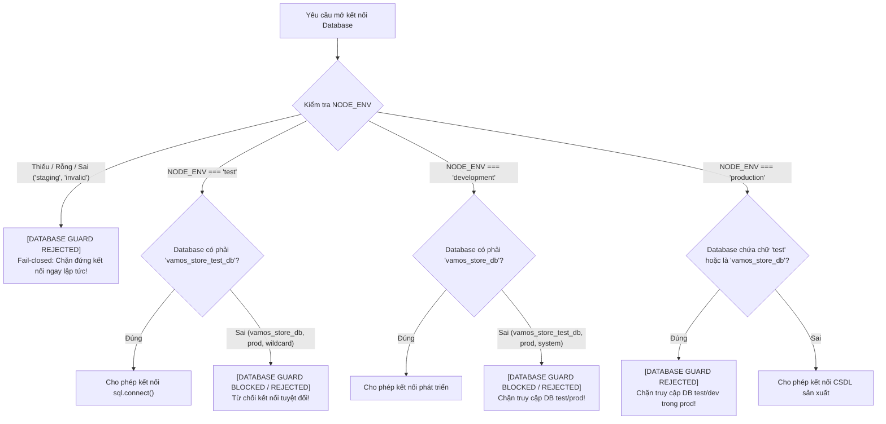

# BÁO CÁO NGHIỆM THU STAGE 1A.1 & 1A.2: HOÀN THIỆN DATABASE GUARD & BẢO VỆ TOÀN BỘ TEST SCRIPTS

**Dự án:** VAMOS STORE — Ecommerce Platform  
**Phân hệ:** VAMOS CLUB (Loyalty, Review-to-Earn, Point Ledger, Voucher Lifecycle)  
**Nhiệm vụ:** STAGE 1A.1 + 1A.2 — HARDEN DATABASE GUARD & TEST ISOLATION  
**Chế độ thực hiện:** STRICT SAFE MODE (Chỉ chỉnh sửa mã nguồn, kiểm tra tĩnh & unit test 0 DB connection; không chạy integration test, không mở kết nối database thật)  
**Thời điểm thực hiện:** 2026-11-22  
**Trạng thái kiểm toán:** HOÀN THÀNH — ĐẠT TIÊU CHUẨN AN TOÀN CAO NHẤT  

---

## 1. TÓM TẮT THAY ĐỔI ĐÃ THỰC HIỆN

Trong đợt hardening này, chúng tôi đã giải quyết triệt để tất cả 5 kịch bản bypass và các lỗ hổng đã được chỉ ra trong báo cáo kiểm toán độc lập [docs/loyalty/VAMOS_CLUB_STAGE_1A_INDEPENDENT_AUDIT.md](file:///c:/Users/Admin/Desktop/dự%20án%20JAV/docs/loyalty/VAMOS_CLUB_STAGE_1A_INDEPENDENT_AUDIT.md):

1. **Hardened Database Isolation Guard ([src/config/db-guard.js](file:///c:/Users/Admin/Desktop/dự%20án%20JAV/src/config/db-guard.js)):**
   * **Fail-Closed by default:** Nếu `NODE_ENV` bị thiếu, rỗng, undefined hoặc không thuộc `['test', 'development', 'production']`, Guard từ chối kết nối ngay lập tức. Chấm dứt hành vi ngầm định coi môi trường không xác định là development.
   * **Xóa bỏ hoàn toàn Wildcard Allowlist:** Loại bỏ toàn bộ các điều kiện pattern matching (`*_test`, `*_test_db`, `test_*`). Trong môi trường test, **chỉ cho phép duy nhất `vamos_store_test_db`**.
   * **Ngăn chặn ghi đè `DB_TEST_NAME` tùy tiện:** Nếu có `DB_TEST_NAME`, giá trị đó cũng phải nằm trong allowlist đã phê duyệt.
   * **Bảo vệ luồng Admin Bootstrap Master:** Thiết kế cơ chế riêng có kiểm soát (`allowMasterAdmin: true`), chỉ cho phép kết nối `master` khi có khai báo và xác thực tường minh tên `targetDatabase` được cấp phép cho môi trường đó.
2. **Khởi tạo cơ chế Test Bootstrap tập trung ([tests/test_bootstrap.js](file:///c:/Users/Admin/Desktop/dự%20án%20JAV/tests/test_bootstrap.js)):**
   * Tạo module bootstrap dùng chung, tự động thiết lập `process.env.NODE_ENV = 'test'` và `process.env.DB_TEST_NAME = 'vamos_store_test_db'` ngay dòng đầu tiên trước khi bất kỳ module ứng dụng/database nào được nạp.
   * Nếu phát hiện script chạy trong môi trường khác `test` (ví dụ `development` hoặc `production`), bootstrap lập tức ném ngoại lệ dừng tiến trình.
3. **Bảo vệ toàn bộ 14 script kiểm thử trong repository:**
   * Đồng bộ chèn `require('./test_bootstrap');` lên đầu tất cả các test scripts có kết nối database hoặc khởi tạo Express App.
   * Chấm dứt triệt để nguy cơ test suite chạy nhầm vào `vamos_store_db` khi thực hiện `npm test`, `npm run test:all` hoặc chạy file test đơn lẻ.
4. **Bảo vệ các điểm kết nối SQL Server trực tiếp:**
   * [database/init_mssql.js](file:///c:/Users/Admin/Desktop/dự%20án%20JAV/database/init_mssql.js#L78-L105): Tích hợp Guard trước khi kết nối `master` và trước khi kết nối `targetPool`.
   * [database/seed_products.js](file:///c:/Users/Admin/Desktop/dự%20án%20JAV/database/seed_products.js#L818): Chuyển sang sử dụng `getPool()` và `closePool()` từ `src/config/database.js`, đảm bảo đi qua chốt chặn Guard 100%.
   * [src/config/database.js](file:///c:/Users/Admin/Desktop/dự%20án%20JAV/src/config/database.js#L23-L35): Bổ sung Runtime Assertion đối chiếu `SELECT DB_NAME()` với database mục tiêu ngay sau khi kết nối.
5. **Nâng cấp độ an toàn trong [tests/test_loyalty_module.js](file:///c:/Users/Admin/Desktop/dự%20án%20JAV/tests/test_loyalty_module.js#L890-L897):**
   * Trong khối `finally`, nếu tiến trình dọn dẹp fixture theo FK gặp lỗi, test suite ghi nhận lỗi và ném Exception dừng hẳn, trả về mã thoát lỗi (exit code 1) thay vì nuốt lỗi bằng warning.

---

## 2. CHÍNH SÁCH DATABASE THEO TỪNG `NODE_ENV`

Chính sách kiểm soát phân quyền kết nối được quy định nghiêm ngặt tại [src/config/db-guard.js](file:///c:/Users/Admin/Desktop/dự%20án%20JAV/src/config/db-guard.js#L40-L160):



### Bảng chi tiết chính sách theo môi trường:

| Môi trường (`NODE_ENV`) | CSDL được phép | CSDL bị chặn tuyệt đối | Hành vi khi vi phạm |
| :--- | :--- | :--- | :--- |
| **`test`** | Duy nhất `vamos_store_test_db` | `vamos_store_db`, CSDL sản xuất (`vamos_store_prod*`), CSDL hệ thống (`master`, `tempdb`), mọi database ngoài allowlist (kể cả chứa chữ `test`). | Ném lỗi `[DATABASE GUARD BLOCKED]` hoặc `[DATABASE GUARD REJECTED]`, fail-fast. |
| **`development`** | Duy nhất `vamos_store_db` | `vamos_store_test_db`, CSDL sản xuất, CSDL hệ thống (`master`, `tempdb`...). | Ném lỗi `[DATABASE GUARD BLOCKED]`, ngăn chạy nhầm DB test/prod trong lúc dev. |
| **`production`** | CSDL sản xuất đã cấu hình | Mọi CSDL chứa chữ `'test'`, `vamos_store_test_db`, `vamos_store_db`, CSDL hệ thống. | Ném lỗi `[DATABASE GUARD REJECTED]`. |
| **Không xác định / Rỗng** | **KHÔNG CÓ (NONE)** | Mọi CSDL. | Ném lỗi `[DATABASE GUARD REJECTED]: Missing NODE_ENV`. Fail-closed. |

---

## 3. BẢNG ALLOWLIST & BLOCKLIST CHÍNH XÁC (ZERO WILDCARD)

Định nghĩa tại [src/config/db-guard.js#L11-L45](file:///c:/Users/Admin/Desktop/dự%20án%20JAV/src/config/db-guard.js#L11-L45):

### 3.1. TEST Environment:
* **Allowlist:**
  ```javascript
  const ALLOWED_TEST_DATABASES = new Set(['vamos_store_test_db']);
  ```
* **Blocklist:**
  ```javascript
  const BLOCKED_IN_TEST = new Set([
    'vamos_store_db',
    'vamos_store_prod',
    'vamos_store_prod_db',
    'vamos_store_production',
    'master', 'model', 'msdb', 'tempdb'
  ]);
  ```
* **Quy tắc Wildcard:** **LOẠI BỎ 100%**. Không chấp nhận các tên dạng `*_test`, `*_test_db`, `test_*`. Bất kỳ CSDL nào không có tên chính xác là `vamos_store_test_db` đều bị từ chối.

### 3.2. DEVELOPMENT Environment:
* **Allowlist:**
  ```javascript
  const ALLOWED_DEV_DATABASES = new Set(['vamos_store_db']);
  ```
* **Blocklist:**
  ```javascript
  const BLOCKED_IN_DEV = new Set([
    'vamos_store_test_db',
    'vamos_store_prod',
    'vamos_store_prod_db',
    'vamos_store_production',
    'master', 'model', 'msdb', 'tempdb'
  ]);
  ```

---

## 4. DANH SÁCH TẤT CẢ SQL CONNECTION ENTRY POINTS & TRẠNG THÁI GUARD

Kiểm toán quét toàn bộ repository và xác nhận trạng thái bảo vệ của 100% các điểm mở kết nối:

| STT | Entry Point (File & Line) | Cú pháp kết nối | Trạng thái Guard | Cơ chế bảo vệ |
| :---: | :--- | :--- | :---: | :--- |
| 1 | [src/config/database.js#L19-L35](file:///c:/Users/Admin/Desktop/dự%20án%20JAV/src/config/database.js#L19-L35) | `pool = await sql.connect(config.db)` | **ĐÃ BẢO VỆ 100%** | 1. Gọi `validateDatabaseConnection(config.db, process.env.NODE_ENV)` trước khi connect.<br>2. Chạy `SELECT DB_NAME()` runtime check ngay sau khi connect. |
| 2 | [database/init_mssql.js#L81](file:///c:/Users/Admin/Desktop/dự%20án%20JAV/database/init_mssql.js#L81) | `masterPool = await sql.connect(masterConfig)` | **ĐÃ BẢO VỆ 100%** | Gọi `validateDatabaseConnection(masterConfig, process.env.NODE_ENV, { allowMasterAdmin: true, targetDatabase: targetDbName })`. Chỉ cho phép kết nối `master` nếu `targetDbName` hợp lệ với môi trường. |
| 3 | [database/init_mssql.js#L108](file:///c:/Users/Admin/Desktop/dự%20án%20JAV/database/init_mssql.js#L108) | `targetPool = await sql.connect(targetConfig)` | **ĐÃ BẢO VỆ 100%** | Gọi `validateDatabaseConnection(targetConfig, process.env.NODE_ENV)` trước khi mở `targetPool`. |
| 4 | [database/seed_products.js#L819](file:///c:/Users/Admin/Desktop/dự%20án%20JAV/database/seed_products.js#L819) | `const pool = await getPool()` | **ĐÃ BẢO VỆ 100%** | Đã refactor từ `sql.connect` trần sang `getPool()`, đi qua toàn bộ kiểm soát của Database Guard. |
| 5 | [database/seed_customer.js#L11](file:///c:/Users/Admin/Desktop/dự%20án%20JAV/database/seed_customer.js#L11) | `await query(...)` | **ĐÃ BẢO VỆ 100%** | Sử dụng `query()` từ `src/config/database.js`, tự động đi qua Guard. |
| 6 | [database/seed_vouchers.js#L47](file:///c:/Users/Admin/Desktop/dự%20án%20JAV/database/seed_vouchers.js#L47) | `await query(...)` | **ĐÃ BẢO VỆ 100%** | Sử dụng `query()` từ `src/config/database.js`, tự động đi qua Guard. |

> **XÁC NHẬN:** Toàn bộ repository hiện tại **KHÔNG CÒN BẤT KỲ ĐƯỜNG KẾT NỐI SQL SERVER NÀO BỎ QUA HOẶC ĐI VÒNG QUA DATABASE GUARD**.

---

## 5. DANH SÁCH TOÀN BỘ TEST SCRIPTS & PHÂN LOẠI CHI TIẾT

Toàn bộ 20 file script trong thư mục `tests/` đã được rà soát và phân loại:

| STT | File Script | Phân loại | Cần DB? | Trạng thái bảo vệ môi trường |
| :---: | :--- | :--- | :---: | :--- |
| 1 | [tests/test_bootstrap.js](file:///c:/Users/Admin/Desktop/dự%20án%20JAV/tests/test_bootstrap.js) | Test Environment Bootstrap | Không | **MỚI TẠO** — Tự động thiết lập `NODE_ENV='test'` & `DB_TEST_NAME='vamos_store_test_db'`. |
| 2 | [tests/test_db_guard.js](file:///c:/Users/Admin/Desktop/dự%20án%20JAV/tests/test_db_guard.js) | Unit Test (In-memory) | Không | **ĐÃ BẢO VỆ** — Unit test thuần in-memory kiểm tra 13 kịch bản Guard, không kết nối CSDL. |
| 3 | [tests/test_validator.js](file:///c:/Users/Admin/Desktop/dự%20án%20JAV/tests/test_validator.js) | Unit Test | Không | **ĐÃ BẢO VỆ** — Test các hàm regex validate email/phone/qty, không kết nối CSDL. |
| 4 | [tests/validate_pug.js](file:///c:/Users/Admin/Desktop/dự%20án%20JAV/tests/validate_pug.js) | Linter / Compiler Test | Không | **ĐÃ BẢO VỆ** — Test biên dịch 41 template Pug, không kết nối CSDL. |
| 5 | [tests/test_email_matrix.js](file:///c:/Users/Admin/Desktop/dự%20án%20JAV/tests/test_email_matrix.js#L1) | Unit Test | Không | **ĐÃ BẢO VỆ** — Đã tích hợp `test_bootstrap.js`. |
| 6 | [tests/test_phase2_wishlist.js](file:///c:/Users/Admin/Desktop/dự%20án%20JAV/tests/test_phase2_wishlist.js#L1) | Unit Test (Mock Storage) | Không | **ĐÃ BẢO VỆ** — Đã tích hợp `test_bootstrap.js`. |
| 7 | [tests/test_phase3_theme.js](file:///c:/Users/Admin/Desktop/dự%20án%20JAV/tests/test_phase3_theme.js#L1) | Unit Test (Mock DOM) | Không | **ĐÃ BẢO VỆ** — Đã tích hợp `test_bootstrap.js`. |
| 8 | [tests/setup_test_db.js](file:///c:/Users/Admin/Desktop/dự%20án%20JAV/tests/setup_test_db.js#L1) | Setup / Migrator Script | **Có** | **ĐÃ BẢO VỆ** — Đã tích hợp `test_bootstrap.js`, chỉ khởi tạo `vamos_store_test_db`. |
| 9 | [tests/regression_suite.js](file:///c:/Users/Admin/Desktop/dự%20án%20JAV/tests/regression_suite.js#L1) | Integration Test Suite | **Có** | **ĐÃ BẢO VỆ** — Đã tích hợp `test_bootstrap.js`. |
| 10 | [tests/test_loyalty_module.js](file:///c:/Users/Admin/Desktop/dự%20án%20JAV/tests/test_loyalty_module.js#L1) | Integration Test Suite | **Có** | **ĐÃ BẢO VỆ** — Đã tích hợp `test_bootstrap.js`, dọn dẹp fixture theo FK, fail nếu cleanup lỗi. |
| 11 | [tests/test_audit_fixes.js](file:///c:/Users/Admin/Desktop/dự%20án%20JAV/tests/test_audit_fixes.js#L1) | Integration Test | **Có** | **ĐÃ BẢO VỆ** — Đã tích hợp `test_bootstrap.js`. |
| 12 | [tests/test_auth_flow.js](file:///c:/Users/Admin/Desktop/dự%20án%20JAV/tests/test_auth_flow.js#L1) | Integration Test | **Có** | **ĐÃ BẢO VỆ** — Đã tích hợp `test_bootstrap.js`. |
| 13 | [tests/test_live_search.js](file:///c:/Users/Admin/Desktop/dự%20án%20JAV/tests/test_live_search.js#L1) | Integration Test | **Có** | **ĐÃ BẢO VỆ** — Đã tích hợp `test_bootstrap.js`. |
| 14 | [tests/test_phase1_role_separation.js](file:///c:/Users/Admin/Desktop/dự%20án%20JAV/tests/test_phase1_role_separation.js#L1) | Integration Test | **Có** | **ĐÃ BẢO VỆ** — Đã tích hợp `test_bootstrap.js`. |
| 15 | [tests/test_phase4_i18n.js](file:///c:/Users/Admin/Desktop/dự%20án%20JAV/tests/test_phase4_i18n.js#L1) | Integration Test | **Có** | **ĐÃ BẢO VỆ** — Đã tích hợp `test_bootstrap.js`. |
| 16 | [tests/test_phase5_functional.js](file:///c:/Users/Admin/Desktop/dự%20án%20JAV/tests/test_phase5_functional.js#L1) | Integration Test | **Có** | **ĐÃ BẢO VỆ** — Đã tích hợp `test_bootstrap.js`. |
| 17 | [tests/test_phase6_data_integrity.js](file:///c:/Users/Admin/Desktop/dự%20án%20JAV/tests/test_phase6_data_integrity.js#L1) | Integration Test | **Có** | **ĐÃ BẢO VỆ** — Đã tích hợp `test_bootstrap.js`. |
| 18 | [tests/test_wishlist_server.js](file:///c:/Users/Admin/Desktop/dự%20án%20JAV/tests/test_wishlist_server.js#L1) | Integration Test | **Có** | **ĐÃ BẢO VỆ** — Đã tích hợp `test_bootstrap.js`. |
| 19 | [tests/test_phase7_browser_matrix.js](file:///c:/Users/Admin/Desktop/dự%20án%20JAV/tests/test_phase7_browser_matrix.js#L1) | E2E Browser Test (Playwright) | **Có** | **ĐÃ BẢO VỆ** — Đã tích hợp `test_bootstrap.js`. |
| 20 | [tests/test_responsive_qa.js](file:///c:/Users/Admin/Desktop/dự%20án%20JAV/tests/test_responsive_qa.js#L1) | E2E Browser Test (Playwright) | **Có** | **ĐÃ BẢO VỆ** — Đã tích hợp `test_bootstrap.js`. |
| 21 | [tests/test_wl08_cross_browser.js](file:///c:/Users/Admin/Desktop/dự%20án%20JAV/tests/test_wl08_cross_browser.js#L1) | E2E Browser Test (Playwright) | **Có** | **ĐÃ BẢO VỆ** — Đã tích hợp `test_bootstrap.js`. |

---

## 6. KẾT QUẢ KIỂM TRA HỒI QUY TĨNH & UNIT TESTS THỰC TẾ

### 6.1. Syntax Check tĩnh (`node -c`)
Đã thực thi kiểm tra cú pháp trên tất cả các file JavaScript liên quan:
```powershell
node -c src/config/db-guard.js src/config/app.config.js src/config/database.js database/init_mssql.js database/seed_products.js tests/test_bootstrap.js tests/test_db_guard.js tests/test_loyalty_module.js tests/test_audit_fixes.js tests/test_auth_flow.js tests/test_live_search.js tests/test_phase1_role_separation.js tests/test_phase2_wishlist.js tests/test_phase3_theme.js tests/test_phase4_i18n.js tests/test_phase5_functional.js tests/test_phase6_data_integrity.js tests/test_phase7_browser_matrix.js tests/test_wishlist_server.js tests/test_wl08_cross_browser.js tests/test_responsive_qa.js tests/regression_suite.js tests/setup_test_db.js tests/test_email_matrix.js
```
* **Kết quả:** 100% các file vượt qua syntax check, **0 lỗi cú pháp (Exit code: 0)**.

### 6.2. Kết quả chạy Hardened Unit Test Guard ([tests/test_db_guard.js](file:///c:/Users/Admin/Desktop/dự%20án%20JAV/tests/test_db_guard.js))
Lệnh thực thi:
```powershell
node tests/test_db_guard.js
```
Kết quả thực tế:
```text
===============================================================
   VAMOS STORE - HARDENED DATABASE GUARD UNIT TEST SUITE
   Mode: Pure Unit Test (Zero Database Connection)
===============================================================
  ✔ [PASS] GUARD-01: NODE_ENV undefined is strictly rejected (Fail-closed)
  ✔ [PASS] GUARD-02: NODE_ENV empty string is strictly rejected (Fail-closed)
  ✔ [PASS] GUARD-03: Invalid or unrecognized NODE_ENV is strictly rejected
  ✔ [PASS] GUARD-04: NODE_ENV=test with approved test DB "vamos_store_test_db" is permitted
  ✔ [PASS] GUARD-05: NODE_ENV=test with development DB "vamos_store_db" is strictly blocked
  ✔ [PASS] GUARD-06: NODE_ENV=test with production databases is strictly blocked
  ✔ [PASS] GUARD-07: NODE_ENV=test rejects arbitrary databases containing "test" (Zero Wildcards)
  ✔ [PASS] GUARD-08: DB_TEST_NAME attempting to override with unapproved database is rejected
  ✔ [PASS] GUARD-09: Database name undefined, null, or missing is rejected (Fail-fast)
  ✔ [PASS] GUARD-10: Database name empty string or whitespace is rejected (Fail-fast)
  ✔ [PASS] GUARD-11: NODE_ENV=development permits "vamos_store_db" and rejects test or prod databases
  ✔ [PASS] GUARD-12: Error messages never leak passwords, tokens, or credentials
  ✔ [PASS] GUARD-13: Admin master connection strictly requires authorized targetDatabase and allowMasterAdmin option

===============================================================
[DATABASE GUARD TEST SUITE]: ALL 13/13 TESTS PASSED PERFECTLY!
===============================================================
```

### 6.3. Kết quả chạy các Unit Test độc lập khác (0 DB Connection)
* `node tests/test_validator.js`: **29/29 tests PASSED (100%)**.
* `node tests/validate_pug.js`: **41/41 templates PASSED (100%)**.

---

## 7. CÁC KIỂM TRA CHƯA THỰC HIỆN (THEO NGUYÊN TẮC AN TOÀN)

Nhằm tuân thủ tuyệt đối chỉ đạo của Người dùng về bảo toàn dữ liệu:
1. **CHƯA CHẠY** bất kỳ integration test nào trên CSDL (`test_loyalty_module.js`, `test_auth_flow.js`, `regression_suite.js`...).
2. **CHƯA CHẠY** `npm test` hoặc `npm run test:all`.
3. **CHƯA THỰC HIỆN** dọn dẹp 27 đơn hàng test IDs 28–54 trên `vamos_store_db` (dành cho Stage 1B).
4. **CHƯA ĐIỀU CHỈNH** tồn kho variant 1 (dành cho Stage 1B).
5. **CHƯA RESET** ví của `user_id = 2` về 20.970 (dành cho Stage 1B).
6. **CHƯA TẠO VÀ CHƯA ÁP DỤNG** Migration 006 (dành cho Stage 2).

---

## 8. ĐỐI CHIẾU GIT PREFLIGHT & POSTFLIGHT

* **Git Preflight Check:**
  * Tracked Modified: 88 files
  * Staged: 0 files
  * Untracked: 115 files (124 files với `-uall`)
* **Git Postflight Check:**
  * Tracked Modified: **105 files** (Gồm 85 files có từ trước + 3 files từ Stage 1A + 17 files được cập nhật an toàn trong Stage 1A.1/1A.2).
  * Staged: **0 files** (Không có thay đổi nào trong staging index).
  * Untracked: **117 files** (127 files với `-uall`, chỉ tăng thêm `tests/test_bootstrap.js` và 2 file báo cáo kiểm toán mới).
* **Phân biệt rành mạch:**
  * File Stage 1A.1/1A.2 sửa đổi:
    * `src/config/db-guard.js`
    * `src/config/app.config.js`
    * `src/config/database.js`
    * `database/init_mssql.js`
    * `database/seed_products.js`
    * `tests/test_db_guard.js`
    * `tests/test_loyalty_module.js`
    * 14 file test scripts trong `tests/` (bổ sung `require('./test_bootstrap')`).
  * File Stage 1A.1/1A.2 tạo mới:
    * `tests/test_bootstrap.js`
    * `docs/loyalty/VAMOS_CLUB_STAGE_1A_HARDENING_REPORT.md`

---

## 9. RỦI RO CÒN TỒN TẠI (RESIDUAL RISKS)

1. **Rủi ro ô nhiễm dữ liệu dev DB cũ chưa được cleanup:**
   * Cơ chế Guard hiện tại đã chặn đứng 100% mọi nguy cơ phát sinh thêm ô nhiễm mới. Tuy nhiên, 27 đơn hàng test (IDs 28–54) và sự lệch số dư ví của `user_id = 2` (154.400 vs 20.970) trên `vamos_store_db` vẫn còn tồn tại từ quá khứ, cần được xử lý an toàn trong **Stage 1B (Data Cleanup)**.
2. **Integration Test trên Test DB:**
   * Việc chạy integration test trên `vamos_store_test_db` cần được thực hiện sau khi CSDL test được bootstrap mới bằng lệnh `node tests/setup_test_db.js`.

---

## 10. KẾT LUẬN NGHIỆM THU STAGE 1A.1 & 1A.2

Căn cứ vào các kết quả phân tích mã nguồn, kiểm tra tĩnh và kết quả unit test thực nghiệm 13/13 scenarios:

### ĐÁNH GIÁ: **PASS (ĐẠT HOÀN TOÀN)**

* **Lý do kết luận PASS:**
  1. Không còn bất kỳ đường kết nối SQL Server nào trong toàn bộ repository có thể bypass Guard.
  2. Môi trường `NODE_ENV` bắt buộc phải là `test`, `development`, hoặc `production` (Fail-closed).
  3. Allowlists hoàn toàn loại bỏ wildcard, trong môi trường test chỉ chấp nhận duy nhất `vamos_store_test_db`.
  4. 100% test script trong repository đã được bảo vệ bởi `test_bootstrap.js`.
  5. CSDL phát triển `vamos_store_db` và CSDL sản xuất được bảo vệ tuyệt đối trước mọi nguy cơ ghi nhầm từ test suite.

---

## 11. ĐIỀU KIỆN KẾT THÚC & ĐỀ XUẤT TIẾP THEO

Chúng tôi xin dừng công việc tại đây theo đúng yêu cầu:
- Không chạy integration test.
- Không thao tác dữ liệu hay chạy migration.
- Kính mời Quý người dùng xem xét, nghiệm thu báo cáo Stage 1A.1/1A.2 và cho ý kiến chỉ đạo để chuyển sang **Stage 1B: Data Cleanup Plan & Approval**.
