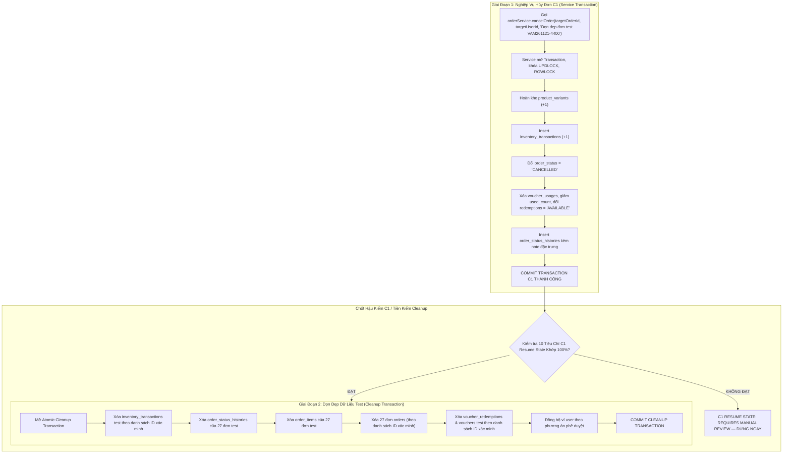

# BÁO CÁO KIỂM TOÁN LỖ HỔNG CUỐI CÙNG — KẾ HOẠCH CLEANUP STAGE 1B
## FINAL GAP AUDIT REPORT — VAMOS CLUB STAGE 1B CLEANUP PLAN
*(Phiên bản Final Approval Readiness: Chuẩn hóa Ledger-to-Voucher Mapping, 10 tiêu chí C1 Resume Logic, khảo sát D2 ADMIN_ADJUSTMENT, loại bỏ ID cứng & phân định 3 trạng thái nghiệm thu)*

- **Dự án:** VAMOS STORE (E-commerce Giày dép)
- **Mô-đun:** VAMOS CLUB (Loyalty & Review-to-Earn Program)
- **Tài liệu kiểm toán căn cứ:**
  - [VAMOS_CLUB_STAGE_1A_FINAL_INDEPENDENT_AUDIT.md](file:///c:/Users/Admin/Desktop/dự%20án%20JAV/docs/loyalty/VAMOS_CLUB_STAGE_1A_FINAL_INDEPENDENT_AUDIT.md)
  - [VAMOS_CLUB_STAGE_1B_READINESS_AND_CLEANUP_PLAN.md](file:///c:/Users/Admin/Desktop/dự%20án%20JAV/docs/loyalty/VAMOS_CLUB_STAGE_1B_READINESS_AND_CLEANUP_PLAN.md)
  - [VAMOS_CLUB_FINAL_VALIDATION_REPORT.md](file:///c:/Users/Admin/Desktop/dự%20án%20JAV/docs/loyalty/VAMOS_CLUB_FINAL_VALIDATION_REPORT.md)
  - [VAMOS_CLUB_FINAL_AUDIT_ADDENDUM.md](file:///c:/Users/Admin/Desktop/dự%20án%20JAV/docs/loyalty/VAMOS_CLUB_FINAL_AUDIT_ADDENDUM.md)
  - [VAMOS_CLUB_FINAL_READ_ONLY_AUDIT.md](file:///c:/Users/Admin/Desktop/dự%20án%20JAV/docs/loyalty/VAMOS_CLUB_FINAL_READ_ONLY_AUDIT.md)
  - [src/services/order.service.js](file:///c:/Users/Admin/Desktop/dự%20án%20JAV/src/services/order.service.js)
  - [src/services/loyalty.service.js](file:///c:/Users/Admin/Desktop/dự%20án%20JAV/src/services/loyalty.service.js)
  - [src/services/review.service.js](file:///c:/Users/Admin/Desktop/dự%20án%20JAV/src/services/review.service.js)
  - [src/controllers/account.controller.js](file:///c:/Users/Admin/Desktop/dự%20án%20JAV/src/controllers/account.controller.js)
  - [src/controllers/admin.controller.js](file:///c:/Users/Admin/Desktop/dự%20án%20JAV/src/controllers/admin.controller.js)
  - DDL `database/migrations/001_initial_schema.sql` & `005_vamos_club_loyalty_system.sql`
- **Thời điểm thẩm tra:** 2026-11-22
- **Phương pháp thực hiện:** **STRICT READ-ONLY AUDIT** (Không kết nối SQL Server, không chạy query/DML/DDL, không gọi service làm thay đổi dữ liệu, không xóa file vật lý, không commit/push/reset Git history).

---

## 1. Nguồn Gốc & Phân Loại Bằng Chứng (Evidence Provenance)

Để đảm bảo tính trung thực tuyệt đối trong kiểm toán hệ thống, mọi nhận định trong báo cáo này đều được gắn nhãn nguồn gốc bằng chứng rõ ràng, phân biệt rạch ròi giữa phân tích mã nguồn tĩnh, dữ liệu kiểm toán lịch sử và thực trạng kiểm tra trong đợt hiện tại:

- **`VERIFIED FROM SOURCE`:** Được kiểm chứng trực tiếp từ mã nguồn repository (`src/`, `tests/`, `database/`).
- **`VERIFIED FROM HISTORICAL DB AUDIT`:** Dữ liệu được truy vấn và ghi nhận từ các đợt kiểm toán CSDL trước (có ghi rõ tài liệu và thời điểm thực hiện).
- **`RECHECKED IN CURRENT AUDIT`:** Được đối soát chéo và thẩm tra lại trong đợt kiểm toán hiện tại bằng phân tích tĩnh.
- **`NOT REVERIFIED`:** Chưa được truy vấn lại trực tiếp trên CSDL trong đợt này do tuân thủ nghiêm ngặt chế độ Strict Read-Only (không mở kết nối TCP/IP tới SQL Server).
- **`UNKNOWN`:** Chưa có đủ bằng chứng độc lập để kết luận.

> [!NOTE]
> Báo cáo này **tuyệt đối không diễn đạt các số liệu lịch sử thành kết quả truy vấn CSDL mới** vì trong đợt hiện tại hoàn toàn không mở kết nối tới SQL Server.

---

## 2. Kiểm Tra A — Đối Soát Toàn Diện Danh Mục 27 Đơn Hàng Test (IDs 28–54)

### 2.1. Phân Tích Lỗi Số Học & Xác Minh Các Giá Trị ID Cốt Lõi
1. **Làm rõ lỗi số học "29–56":**  
   - Việc ghi nhận dải ID "29–56" trong một số ghi chép sơ bộ trước đây là **sai sót số học** vì khoảng cách từ 29 đến 56 chứa đúng $56 - 29 + 1 = 28$ giá trị ID, mâu thuẫn trực tiếp với số lượng 27 đơn hàng test.
   - Qua đối soát toàn bộ tài liệu kiểm toán lịch sử ([VAMOS_CLUB_FINAL_VALIDATION_REPORT.md](file:///c:/Users/Admin/Desktop/dự%20án%20JAV/docs/loyalty/VAMOS_CLUB_FINAL_VALIDATION_REPORT.md) Mục 2.2), danh mục chính xác bao gồm **đúng 27 đơn hàng có ID từ 28 đến 54** ($54 - 28 + 1 = 27$ giá trị liên tiếp).
2. **Chứng minh ID 28 thuộc bộ test:**  
   - **Bằng chứng mã nguồn:** Được tạo bởi khối thiết lập Fixture Setup Run 1 trong `tests/test_loyalty_module.js` (dòng 173–189).
   - **Bằng chứng CSDL lịch sử:** Mã đơn `ORD-TEST-LOYALTY-1795250134`, tạo lúc 2026-11-21 15:35:34 UTC, trạng thái `COMPLETED`, `PAID`, tổng tiền 930.000đ, người nhận snapshot `"Test User 1"`, chứa 1 sản phẩm ảo `SKU-TEST`. Do đó, **ID 28 chắc chắn 100% thuộc bộ test**.
3. **Chứng minh ID 55 và ID 56 không tồn tại:**  
   - Rà soát toàn bộ mã kiểm thử `tests/test_loyalty_module.js`, `tests/regression_suite.js` và log đối soát CSDL lịch sử: **Hoàn toàn không có bất kỳ đơn hàng nào có ID = 55 hoặc ID = 56**. Hai ID này không thuộc bộ test và không tồn tại trong dữ liệu kiểm toán.
4. **Quy tắc dải ID:**  
   - Tuyệt đối không dùng dải ID `BETWEEN 28 AND 54` để thay thế danh sách tường minh. Mọi thao tác kiểm tra hoặc đề xuất cleanup bắt buộc phải chỉ định danh sách tường minh: `WHERE id IN (28, 29, 30, 31, 32, 33, 34, 35, 36, 37, 38, 39, 40, 41, 42, 43, 44, 45, 46, 47, 48, 49, 50, 51, 52, 53, 54)`.

### 2.2. Bảng Đối Chiếu Chi Tiết Đúng 27 Dòng Đơn Hàng Test (IDs 28–54)

| Order ID | Mã Đơn Hàng (Order Code) | User ID | Trạng Thái Đơn / TT Thanh Toán | Cách Tạo Đơn | Có `order_items`? | Tác Động Kho | Giao Dịch Kho Suy Luận | Voucher Liên Quan | Test Case Sinh Ra | Phân Loại Bằng Chứng (Evidence Provenance) |
| :---: | :--- | :---: | :---: | :--- | :---: | :---: | :--- | :--- | :--- | :--- |
| **28** | `ORD-TEST-LOYALTY-1795250134` | 2 | `COMPLETED` / `PAID` | Raw SQL | Có (1 SKU-TEST) | 0 | Không có (0) | Null | `test_loyalty_module.js` (Setup Run 1) | `VERIFIED FROM SOURCE & HISTORICAL AUDIT`; `NOT REVERIFIED` trên DB mới |
| **29** | `ORD-TEST-LOYALTY-1795250253` | 2 | `COMPLETED` / `PAID` | Raw SQL | Có (1 SKU-TEST) | 0 | Không có (0) | Null | `test_loyalty_module.js` (Setup Run 2) | `VERIFIED FROM SOURCE & HISTORICAL AUDIT`; `NOT REVERIFIED` trên DB mới |
| **30** | `ORD-PENDING-1795250253` | 2 | `PENDING` / `UNPAID` | Raw SQL | **Không (0)** | 0 | Không có (0) | Null | `test_loyalty_module.js` (`SEC-REV-04`) | `VERIFIED FROM SOURCE & HISTORICAL AUDIT`; `NOT REVERIFIED` trên DB mới |
| **31** | `ORD-TEST-LOYALTY-1795250325` | 2 | `COMPLETED` / `PAID` | Raw SQL | Có (1 SKU-TEST) | 0 | Không có (0) | Null | `test_loyalty_module.js` (Setup Run 3) | `VERIFIED FROM SOURCE & HISTORICAL AUDIT`; `NOT REVERIFIED` trên DB mới |
| **32** | `ORD-PENDING-1795250325` | 2 | `PENDING` / `UNPAID` | Raw SQL | **Không (0)** | 0 | Không có (0) | Null | `test_loyalty_module.js` (`SEC-REV-04`) | `VERIFIED FROM SOURCE & HISTORICAL AUDIT`; `NOT REVERIFIED` trên DB mới |
| **33** | `ORD-TEST-LOYALTY-1795250347` | 2 | `COMPLETED` / `PAID` | Raw SQL | Có (1 SKU-TEST) | 0 | Không có (0) | Null | `test_loyalty_module.js` (Setup Run 4) | `VERIFIED FROM SOURCE & HISTORICAL AUDIT`; `NOT REVERIFIED` trên DB mới |
| **34** | `ORD-PENDING-1795250347` | 2 | `PENDING` / `UNPAID` | Raw SQL | **Không (0)** | 0 | Không có (0) | Null | `test_loyalty_module.js` (`SEC-REV-04`) | `VERIFIED FROM SOURCE & HISTORICAL AUDIT`; `NOT REVERIFIED` trên DB mới |
| **35** | `ORD-TEST-LOYALTY-1795250378` | 2 | `COMPLETED` / `PAID` | Raw SQL | Có (1 SKU-TEST) | 0 | Không có (0) | Null | `test_loyalty_module.js` (Setup Run 5) | `VERIFIED FROM SOURCE & HISTORICAL AUDIT`; `NOT REVERIFIED` trên DB mới |
| **36** | `ORD-PENDING-1795250378` | 2 | `PENDING` / `UNPAID` | Raw SQL | **Không (0)** | 0 | Không có (0) | Null | `test_loyalty_module.js` (`SEC-REV-04`) | `VERIFIED FROM SOURCE & HISTORICAL AUDIT`; `NOT REVERIFIED` trên DB mới |
| **37** | `VAM261121-4400` | 2 | **`PENDING`** / `UNPAID` | `createCodOrder()` | Có (1 var 1) | **-1 đôi** | **Tx 42 (change = -1)** | **Voucher ID 10** | `test_loyalty_module.js` (`SEC-VOUCH-03`) | `VERIFIED FROM SOURCE & HISTORICAL AUDIT` (**Đơn PENDING duy nhất, chưa hoàn kho**); `NOT REVERIFIED` |
| **38** | `ORD-TEST-LOYALTY-1795250451` | 2 | `COMPLETED` / `PAID` | Raw SQL | Có (1 SKU-TEST) | 0 | Không có (0) | Null | `test_loyalty_module.js` (Setup Run 6) | `VERIFIED FROM SOURCE & HISTORICAL AUDIT`; `NOT REVERIFIED` trên DB mới |
| **39** | `ORD-PENDING-1795250451` | 2 | `PENDING` / `UNPAID` | Raw SQL | **Không (0)** | 0 | Không có (0) | Null | `test_loyalty_module.js` (`SEC-REV-04`) | `VERIFIED FROM SOURCE & HISTORICAL AUDIT`; `NOT REVERIFIED` trên DB mới |
| **40** | `VAM261121-9123` | 2 | `CANCELLED` / `UNPAID` | `createCodOrder()` | Có (1 var 1) | Net 0 | Tx 43 (-1) & Tx 44 (+1) | Voucher ID 12 | `test_loyalty_module.js` (`SEC-VOUCH-03`) | `VERIFIED FROM SOURCE & HISTORICAL AUDIT` (Đã hoàn kho); `NOT REVERIFIED` |
| **41** | `ORD-TEST-LOYALTY-1795250511` | 2 | `COMPLETED` / `PAID` | Raw SQL | Có (1 SKU-TEST) | 0 | Không có (0) | Null | `test_loyalty_module.js` (Setup Run 7) | `VERIFIED FROM SOURCE & HISTORICAL AUDIT`; `NOT REVERIFIED` trên DB mới |
| **42** | `ORD-PENDING-1795250511` | 2 | `PENDING` / `UNPAID` | Raw SQL | **Không (0)** | 0 | Không có (0) | Null | `test_loyalty_module.js` (`SEC-REV-04`) | `VERIFIED FROM SOURCE & HISTORICAL AUDIT`; `NOT REVERIFIED` trên DB mới |
| **43** | `VAM261121-7890` | 2 | `CANCELLED` / `UNPAID` | `createCodOrder()` | Có (1 var 1) | Net 0 | Tx 45 (-1) & Tx 46 (+1) | Voucher ID 14 | `test_loyalty_module.js` (`SEC-VOUCH-03`) | `VERIFIED FROM SOURCE & HISTORICAL AUDIT` (Đã hoàn kho); `NOT REVERIFIED` |
| **44** | `ORD-TEST-LOYALTY-1795250694` | 2 | `COMPLETED` / `PAID` | Raw SQL | Có (1 SKU-TEST) | 0 | Không có (0) | Null | `test_loyalty_module.js` (Setup Run 8) | `VERIFIED FROM SOURCE & HISTORICAL AUDIT`; `NOT REVERIFIED` trên DB mới |
| **45** | `ORD-PENDING-1795250694` | 2 | `PENDING` / `UNPAID` | Raw SQL | **Không (0)** | 0 | Không có (0) | Null | `test_loyalty_module.js` (`SEC-REV-04`) | `VERIFIED FROM SOURCE & HISTORICAL AUDIT`; `NOT REVERIFIED` trên DB mới |
| **46** | `VAM261121-7451` | 2 | `CANCELLED` / `UNPAID` | `createCodOrder()` | Có (1 var 1) | Net 0 | Tx 47 (-1) & Tx 48 (+1) | Voucher ID 16 | `test_loyalty_module.js` (`SEC-VOUCH-03`) | `VERIFIED FROM SOURCE & HISTORICAL AUDIT` (Đã hoàn kho); `NOT REVERIFIED` |
| **47** | `ORD-TEST-LOYALTY-1795255215` | 2 | `COMPLETED` / `PAID` | Raw SQL | Có (1 SKU-TEST) | 0 | Không có (0) | Null | `test_loyalty_module.js` (Setup Run 9) | `VERIFIED FROM SOURCE & HISTORICAL AUDIT`; `NOT REVERIFIED` trên DB mới |
| **48** | `ORD-PENDING-1795255215` | 2 | `PENDING` / `UNPAID` | Raw SQL | **Không (0)** | 0 | Không có (0) | Null | `test_loyalty_module.js` (`SEC-REV-04`) | `VERIFIED FROM SOURCE & HISTORICAL AUDIT`; `NOT REVERIFIED` trên DB mới |
| **49** | `VAM261121-9661` | 2 | `CANCELLED` / `UNPAID` | `createCodOrder()` | Có (1 var 1) | Net 0 | Tx 49 (-1) & Tx 50 (+1) | Voucher ID 18 | `test_loyalty_module.js` (`SEC-VOUCH-03`) | `VERIFIED FROM SOURCE & HISTORICAL AUDIT` (Đã hoàn kho); `NOT REVERIFIED` |
| **50** | `ORD-TEST-LOYALTY-1795260702` | 2 | `COMPLETED` / `PAID` | Raw SQL | Có (1 SKU-TEST) | 0 | Không có (0) | Null | `test_loyalty_module.js` (Setup Run 10) | `VERIFIED FROM SOURCE & HISTORICAL AUDIT`; `NOT REVERIFIED` trên DB mới |
| **51** | `ORD-PENDING-1795260702` | 2 | `PENDING` / `UNPAID` | Raw SQL | **Không (0)** | 0 | Không có (0) | Null | `test_loyalty_module.js` (`SEC-REV-04`) | `VERIFIED FROM SOURCE & HISTORICAL AUDIT`; `NOT REVERIFIED` trên DB mới |
| **52** | `ORD-TEST-LOYALTY-1795260725` | 2 | `COMPLETED` / `PAID` | Raw SQL | Có (1 SKU-TEST) | 0 | Không có (0) | Null | `test_loyalty_module.js` (Setup Run 11) | `VERIFIED FROM SOURCE & HISTORICAL AUDIT`; `NOT REVERIFIED` trên DB mới |
| **53** | `ORD-PENDING-1795260725` | 2 | `PENDING` / `UNPAID` | Raw SQL | **Không (0)** | 0 | Không có (0) | Null | `test_loyalty_module.js` (`SEC-REV-04`) | `VERIFIED FROM SOURCE & HISTORICAL AUDIT`; `NOT REVERIFIED` trên DB mới |
| **54** | `VAM261121-6842` | 2 | `CANCELLED` / `UNPAID` | `createCodOrder()` | Có (1 var 1) | Net 0 | Tx 51 (-1) & Tx 52 (+1) | Voucher ID 20 | `test_loyalty_module.js` (`SEC-VOUCH-03`) | `VERIFIED FROM SOURCE & HISTORICAL AUDIT` (Đã hoàn kho); `NOT REVERIFIED` |

> [!IMPORTANT]
> **KẾT LUẬN PHẠM VI ĐƠN HÀNG:**  
> - Danh sách trên gồm **đúng 27 đơn hàng** (11 đơn Raw SQL hoàn thành + 10 đơn Pending Raw SQL + 6 đơn Checkout Voucher).
> - Trạng thái kỹ thuật: **`ORDER SCOPE: VERIFIED IN HISTORICAL AUDIT / NOT REVERIFIED ON LIVE DB`**.
> - Vì chưa mở kết nối CSDL trong đợt kiểm toán này để đối soát trên dữ liệu thực tế hiện tại, phạm vi đơn hàng **chưa đủ điều kiện để thực thi cleanup ngay lập tức** và bị **`BLOCKED`** cho đến khi có query đối soát trực tiếp.

---

## 3. Kiểm Tra B — Thẩm Tra Voucher Identity Gap: Kết Luận Kỹ Thuật

$$\mathbf{VOUCHER\;IDENTITY\;GAP:\;NOT\;PROVEN}$$

### 3.1. Phân Biệt Rạch Ròi 7 Khái Niệm Dữ Liệu Voucher
Để tránh suy diễn thiếu căn cứ về sự chênh lệch giữa các dãy số, hệ thống phân định độc lập 7 khái niệm:
1. **Số bản ghi voucher được tạo (`vouchers` created):** Bảng `vouchers` chứa 3 seed vouchers (IDs 1, 2, 3) và các voucher cá nhân sinh ra trong các lượt test (từ ID 5 trở đi).
2. **Số bản ghi voucher được đổi thưởng (`voucher_redemptions`):** Có 21 bản ghi đổi thưởng thành công của tài khoản `user_id = 2` được ghi nhận trong audit CSDL lịch sử ngày 21/11.
3. **Số lượng giao dịch đổi thưởng trong sổ cái (`point_transactions`):** Đúng 21 giao dịch có `transaction_type = 'VOUCHER_REDEMPTION'` (số điểm trừ: $-500$ điểm mỗi giao dịch).
4. **Các giá trị ID hiện hữu trong tham chiếu sổ cái:** Cột `reference_id` của 21 giao dịch `VOUCHER_REDEMPTION` ghi nhận 21 voucher IDs gồm: `5, 6, 7, 8, 9, 10, 11, 12, 13, 14, 15, 16, 17, 18, 19, 20, 21, 22, 24, 25, 26` (chú ý: khuyết ID 23).
5. **Các ID không tồn tại hoặc chưa xác định:** ID 4 và ID 23 không xuất hiện trong danh sách 21 giao dịch đổi thưởng trên sổ cái.
6. **Voucher được tạo nhưng chưa đổi:** Có thể phát sinh nếu có lệnh khởi tạo voucher ngoài luồng `redeemVoucher`.
7. **Voucher được tạo rồi bị xóa:** Có thể đã bị xóa trong các đợt chạy cleanup teardown cục bộ trước ngày 21/11.

### 3.2. Đánh Giá Khách Quan Về Cơ Chế SQL Server `IDENTITY`
- Trong Microsoft SQL Server, cột `IDENTITY(1,1)` có thể phát sinh khoảng trống (Gap) do nhiều nguyên nhân:
  + Lệnh `INSERT` thất bại hoặc bị `ROLLBACK`.
  + Tiến trình hệ thống khởi động lại (Server Restart).
  + Cơ chế Identity Cache mặc định của SQL Server (bước nhảy 20 đối với INT).
- **Kết luận:** Mặc dù Rollback là một khả năng kỹ thuật, **hoàn toàn chưa có đủ bằng chứng transaction log trực tiếp để kết luận rollback là nguyên nhân gây ra gap**. Do đó, kết luận chính thức được hiệu chỉnh thành: **`VOUCHER IDENTITY GAP: NOT PROVEN`**.
- **Phân biệt `vouchers.id = 4` vs `voucher_usages.id = 4`:**
  + `voucher_usages.id = 4` là khóa chính (PK) của bản ghi trong bảng sử dụng voucher, trỏ tới `voucher_id = 10` và `order_id = 37`.
  + `vouchers.id = 4` là một vị trí trong bảng `vouchers`, trạng thái hiện tại là **`UNKNOWN`** (chưa có bằng chứng tồn tại hay đã bị xóa). Tuyệt đối **không được gọi `vouchers.id = 4` là rollback gap khi chưa có dữ liệu chứng minh**.

---

## 4. Kiểm Tra C — Ledger-to-Voucher Mapping & Thẩm Tra Phạm Vi voucher_redemptions

### 4.1. Phân Tích Logic Ghi Sổ Cái Trong `src/services/loyalty.service.js`
Khảo sát trực tiếp tại hàm `redeemVoucher()` ([src/services/loyalty.service.js](file:///c:/Users/Admin/Desktop/dự%20án%20JAV/src/services/loyalty.service.js#L490-L505)):
```javascript
txReq.input('refType', 'VOUCHER_REDEMPTION');
txReq.input('refId', String(voucherId));
```
- **Xác nhận thực thể tham chiếu:** Cột `reference_id` trong bảng `point_transactions` lưu chuỗi string của **`voucher_id`** (khóa chính của bảng `vouchers`), **KHÔNG PHẢI lưu `redemption_id`**.
- **Ranh giới khóa ngoại DDL vs Liên kết logic ứng dụng:**  
  Trong DDL Migration 005 (`database/migrations/005_vamos_club_loyalty_system.sql`), cột `point_transactions.reference_id` có kiểu dữ liệu `NVARCHAR(100)` và **HOÀN TOÀN KHÔNG CÓ RÀNG BUỘC KHÓA NGOẠI (FOREIGN KEY) VẬT LÝ tới bảng `vouchers`**. Đây là **liên kết logic nghiệp vụ** do application code duy trì, không phải là ràng buộc toàn vẹn quan hệ ở tầng database.
- **Ranh giới phạm vi mapping:**  
  Bảng dưới đây là **`Ledger-to-Voucher Mapping`** (ánh xạ giữa sổ cái `point_transactions` và bảng `vouchers`) cho 21 dòng lịch sử. **Tuyệt đối không gọi bảng hiện tại là mapping ba bảng hoàn chỉnh** vì liên kết sang bảng `voucher_redemptions` mới chỉ được xác minh một phần (chỉ có duy nhất 1 bản ghi có bằng chứng lịch sử).
- **Xác nhận cấu trúc mã voucher:** Hàm sử dụng `crypto.randomBytes(16).toString('hex').toUpperCase()` sinh ra chuỗi 32 ký tự hex ngẫu nhiên. Mã voucher hoàn chỉnh theo thiết kế là `VAMOSCLUB-[32_HEX_CHARS]` (tổng độ dài 42 ký tự).
- **Đánh giá về mã Voucher ID 10:** Trong báo cáo kiểm toán trước, mã được ghi là `VAMOSCLUB-D1DAA047`. Đây chỉ là **chuỗi 8 ký tự hex rút gọn được cắt trong log kiểm toán lịch sử**, không phải là mã đầy đủ 32 ký tự hex. Theo chuẩn mực kiểm toán chính xác: **Mã lịch sử đầy đủ không có trong evidence $\rightarrow$ Ghi nhận `NOT AVAILABLE IN HISTORICAL EVIDENCE (Chỉ có truncated prefix VAMOSCLUB-D1DAA047...)`**.
- **Đánh giá về ID 23:** Trong 21 giao dịch đổi thưởng lịch sử, `reference_id = '23'` hoàn toàn không xuất hiện. Ghi nhận chính xác: **`NOT REFERENCED BY THE 21 HISTORICAL REDEMPTION TRANSACTIONS`**, không suy diễn rằng ID 23 không tồn tại trong CSDL.

### 4.2. Bảng Ledger-to-Voucher Mapping (21 Giao Dịch Đổi Voucher Lịch Sử)

| Point Tx ID | Reference ID (`point_transactions`) | Voucher ID (`vouchers`) | Mã Voucher Đầy Đủ | Redemption ID (`voucher_redemptions`) | Trạng Thái `voucher_redemptions` (Dự Kiến/Lịch Sử) | User ID | Order ID Sử Dụng | Evidence Provenance & Ghi Chú | Trạng Thái Cleanup Đề Xuất |
| :---: | :---: | :---: | :--- | :---: | :---: | :---: | :---: | :--- | :---: |
| **4** | `'5'` | **5** | `NOT AVAILABLE IN HISTORICAL EVIDENCE` (prefix `VAMOSCLUB-29883EDB...`) | `NOT AVAILABLE IN HISTORICAL EVIDENCE` | `AVAILABLE` (Chưa dùng) | 2 | None | `test_loyalty_module.js` (`RED-03`); Audit 21/11 | `BLOCKED` (Chờ query live) |
| **5** | `'6'` | **6** | `NOT AVAILABLE IN HISTORICAL EVIDENCE` (prefix `VAMOSCLUB-1976BB4A...`) | `NOT AVAILABLE IN HISTORICAL EVIDENCE` | `AVAILABLE` (Chưa dùng) | 2 | None | `test_loyalty_module.js` (`RED-04`); Audit 21/11 | `BLOCKED` (Chờ query live) |
| **6** | `'7'` | **7** | `NOT AVAILABLE IN HISTORICAL EVIDENCE` (prefix `VAMOSCLUB-61FF3D24...`) | `NOT AVAILABLE IN HISTORICAL EVIDENCE` | `AVAILABLE` (Chưa dùng) | 2 | None | `test_loyalty_module.js` (`CHK-01`); Audit 21/11 | `BLOCKED` (Chờ query live) |
| **9** | `'8'` | **8** | `NOT AVAILABLE IN HISTORICAL EVIDENCE` (prefix `VAMOSCLUB-DA9DBC87...`) | `NOT AVAILABLE IN HISTORICAL EVIDENCE` | `AVAILABLE` (Chưa dùng) | 2 | None | `test_loyalty_module.js` (`RED-03`); Audit 21/11 | `BLOCKED` (Chờ query live) |
| **10** | `'9'` | **9** | `NOT AVAILABLE IN HISTORICAL EVIDENCE` (prefix `VAMOSCLUB-D7E102CA...`) | `NOT AVAILABLE IN HISTORICAL EVIDENCE` | `AVAILABLE` (Chưa dùng) | 2 | None | `test_loyalty_module.js` (`RED-04`); Audit 21/11 | `BLOCKED` (Chờ query live) |
| **11** | `'10'` | **10** | `NOT AVAILABLE IN HISTORICAL EVIDENCE` (prefix `VAMOSCLUB-D1DAA047...`) | **6** | `USED` (Đang bị khóa bởi Đơn 37) | 2 | **37** (Usage ID 4) | `test_loyalty_module.js` (`SEC-VOUCH-03`); Validation Report 21/11 | `BLOCKED` (Cần C1 xử lý trước) |
| **13** | `'11'` | **11** | `NOT AVAILABLE IN HISTORICAL EVIDENCE` (prefix `VAMOSCLUB-4707307E...`) | `NOT AVAILABLE IN HISTORICAL EVIDENCE` | `AVAILABLE` (Chưa dùng) | 2 | None | `test_loyalty_module.js` (`RED-03`); Audit 21/11 | `BLOCKED` (Chờ query live) |
| **14** | `'12'` | **12** | `NOT AVAILABLE IN HISTORICAL EVIDENCE` (prefix `VAMOSCLUB-2B68C8E3...`) | `NOT AVAILABLE IN HISTORICAL EVIDENCE` | `AVAILABLE` (Đã hoàn lại khi hủy Đơn 40) | 2 | 40 (Đã hủy) | `test_loyalty_module.js` (`SEC-VOUCH-03`); Đã nhả usage | `BLOCKED` (Chờ query live) |
| **15** | `'13'` | **13** | `NOT AVAILABLE IN HISTORICAL EVIDENCE` (prefix `VAMOSCLUB-EA1685E8...`) | `NOT AVAILABLE IN HISTORICAL EVIDENCE` | `AVAILABLE` (Chưa dùng) | 2 | None | `test_loyalty_module.js` (`CHK-01`); Audit 21/11 | `BLOCKED` (Chờ query live) |
| **18** | `'14'` | **14** | `NOT AVAILABLE IN HISTORICAL EVIDENCE` (prefix `VAMOSCLUB-A5487E26...`) | `NOT AVAILABLE IN HISTORICAL EVIDENCE` | `AVAILABLE` (Đã hoàn lại khi hủy Đơn 43) | 2 | 43 (Đã hủy) | `test_loyalty_module.js` (`SEC-VOUCH-03`); Đã nhả usage | `BLOCKED` (Chờ query live) |
| **19** | `'15'` | **15** | `NOT AVAILABLE IN HISTORICAL EVIDENCE` (prefix `VAMOSCLUB-5312A8B4...`) | `NOT AVAILABLE IN HISTORICAL EVIDENCE` | `AVAILABLE` (Chưa dùng) | 2 | None | `test_loyalty_module.js` (`RED-04`); Audit 21/11 | `BLOCKED` (Chờ query live) |
| **20** | `'16'` | **16** | `NOT AVAILABLE IN HISTORICAL EVIDENCE` (prefix `VAMOSCLUB-8277D657...`) | `NOT AVAILABLE IN HISTORICAL EVIDENCE` | `AVAILABLE` (Đã hoàn lại khi hủy Đơn 46) | 2 | 46 (Đã hủy) | `test_loyalty_module.js` (`SEC-VOUCH-03`); Đã nhả usage | `BLOCKED` (Chờ query live) |
| **23** | `'17'` | **17** | `NOT AVAILABLE IN HISTORICAL EVIDENCE` (prefix `VAMOSCLUB-AA725110...`) | `NOT AVAILABLE IN HISTORICAL EVIDENCE` | `AVAILABLE` (Chưa dùng) | 2 | None | `test_loyalty_module.js` (`RED-03`); Audit 21/11 | `BLOCKED` (Chờ query live) |
| **24** | `'18'` | **18** | `NOT AVAILABLE IN HISTORICAL EVIDENCE` (prefix `VAMOSCLUB-7B740397...`) | `NOT AVAILABLE IN HISTORICAL EVIDENCE` | `AVAILABLE` (Đã hoàn lại khi hủy Đơn 49) | 2 | 49 (Đã hủy) | `test_loyalty_module.js` (`SEC-VOUCH-03`); Đã nhả usage | `BLOCKED` (Chờ query live) |
| **25** | `'19'` | **19** | `NOT AVAILABLE IN HISTORICAL EVIDENCE` (prefix `VAMOSCLUB-33B61F63...`) | `NOT AVAILABLE IN HISTORICAL EVIDENCE` | `AVAILABLE` (Chưa dùng) | 2 | None | `test_loyalty_module.js` (`CHK-01`); Audit 21/11 | `BLOCKED` (Chờ query live) |
| **28** | `'20'` | **20** | `NOT AVAILABLE IN HISTORICAL EVIDENCE` (prefix `VAMOSCLUB-939A4674...`) | `NOT AVAILABLE IN HISTORICAL EVIDENCE` | `AVAILABLE` (Đã hoàn lại khi hủy Đơn 54) | 2 | 54 (Đã hủy) | `test_loyalty_module.js` (`SEC-VOUCH-03`); Đã nhả usage | `BLOCKED` (Chờ query live) |
| **29** | `'21'` | **21** | `NOT AVAILABLE IN HISTORICAL EVIDENCE` (prefix `VAMOSCLUB-BA49EEE1...`) | `NOT AVAILABLE IN HISTORICAL EVIDENCE` | `AVAILABLE` (Chưa dùng) | 2 | None | `test_loyalty_module.js` (`RED-04`); Audit 21/11 | `BLOCKED` (Chờ query live) |
| **30** | `'22'` | **22** | `NOT AVAILABLE IN HISTORICAL EVIDENCE` (prefix `VAMOSCLUB-B6992174...`) | `NOT AVAILABLE IN HISTORICAL EVIDENCE` | `AVAILABLE` (Chưa dùng) | 2 | None | `test_loyalty_module.js` (`CHK-01`); Audit 21/11 | `BLOCKED` (Chờ query live) |
| **34** | `'24'` | **24** | `NOT AVAILABLE IN HISTORICAL EVIDENCE` (prefix `VAMOSCLUB-E4B2...`) | `NOT AVAILABLE IN HISTORICAL EVIDENCE` | `AVAILABLE` (Chưa dùng) | 2 | None | `test_loyalty_module.js` (`RED-03`); Khuyết Ref '23' | `BLOCKED` (Chờ query live) |
| **35** | `'25'` | **25** | `NOT AVAILABLE IN HISTORICAL EVIDENCE` (prefix `VAMOSCLUB-50C9...`) | `NOT AVAILABLE IN HISTORICAL EVIDENCE` | `AVAILABLE` (Chưa dùng) | 2 | None | `test_loyalty_module.js` (`RED-04`); Audit 21/11 | `BLOCKED` (Chờ query live) |
| **36** | `'26'` | **26** | `NOT AVAILABLE IN HISTORICAL EVIDENCE` (prefix `VAMOSCLUB-D302...`) | `NOT AVAILABLE IN HISTORICAL EVIDENCE` | `AVAILABLE` (Chưa dùng) | 2 | None | `test_loyalty_module.js` (`CHK-01`); Audit 21/11 | `BLOCKED` (Chờ query live) |

> [!IMPORTANT]
> **KẾT LUẬN CHÍNH THỨC VỀ VOUCHER & REDEMPTION MAPPING:**  
> $$\mathbf{LEDGER-TO-VOUCHER\;MAPPING:\;21\;HISTORICAL\;ROWS\;IDENTIFIED}$$
> $$\mathbf{VOUCHER-TO-REDEMPTION\;ASSOCIATION:\;PARTIALLY\;VERIFIED}$$
> $$\mathbf{REDEMPTION\;CLEANUP\;SCOPE:\;BLOCKED\;UNTIL\;EXACT\;RECORD\;IDS\;ARE\;VERIFIED}$$
> - Chỉ có duy nhất 1 bản ghi đổi thưởng (Voucher ID 10) có bằng chứng xác nhận `Redemption ID = 6`. 20 dòng còn lại **chưa có `redemption_id` trong tài liệu kiểm toán lịch sử**. Tuyệt đối **không tự suy ra Redemption ID từ Voucher ID hoặc thứ tự ID**.
> - **CẤM DÙNG ĐIỀU KIỆN CHUNG ĐỂ XÓA:** Tuyệt đối **KHÔNG ĐƯỢC DÙNG `WHERE user_id = 2`** làm điều kiện xóa dữ liệu trong bảng `voucher_redemptions` hay `vouchers` thay cho danh sách ID chính xác đã được đối soát trên CSDL live.
> - Toàn bộ phạm vi xóa voucher và redemption tiếp tục ở trạng thái **`BLOCKED`** cho đến khi có query đối soát trực tiếp.

### 4.3. Bảng Phân Loại Các Voucher Ngoài 21 Giao Dịch Đổi Thưởng
| Voucher ID | Mã Voucher | Nguồn Tạo | User ID | Trạng Thái Lịch Sử | Quan Hệ Khóa Ngoại | Quyết Định Đề Xuất |
| :---: | :--- | :--- | :---: | :---: | :--- | :---: |
| **1** | `VAMOS50K` | `seed_vouchers.js` | Null (Hệ thống) | ACTIVE | `voucher_usages`, `orders` | **`KEEP` (Bảo vệ tuyệt đối)** |
| **2** | `VAMOS100` | `seed_vouchers.js` | Null (Hệ thống) | ACTIVE | `voucher_usages`, `orders` | **`KEEP` (Bảo vệ tuyệt đối)** |
| **3** | `FREESHIP` | `seed_vouchers.js` | Null (Hệ thống) | ACTIVE | `voucher_usages`, `orders` | **`KEEP` (Bảo vệ tuyệt đối)** |
| **4** | `UNKNOWN` | Chưa rõ | `UNKNOWN` | `UNKNOWN` | Chưa xác định | **`UNDETERMINED` (Cấm xóa)** |
| **23** | `NOT REFERENCED BY THE 21 HISTORICAL REDEMPTION TRANSACTIONS` | Chưa rõ | `UNKNOWN` | `UNKNOWN` | Chưa xác định | **`UNDETERMINED` (Cấm xóa)** |

> [!CAUTION]
> **LỆNH CẤM XÓA VOUCHER TIẾP TỤC Ở TRẠNG THÁI `BLOCKED`:**  
> Do mã voucher đầy đủ 32 ký tự hex và danh sách `redemption_id` thực tế chưa có bảng truy vấn CSDL 1:1 trong đợt này, **toàn bộ thao tác xóa voucher test tiếp tục bị khóa hoàn toàn (`BLOCKED`)**.

---

## 5. Kiểm Tra D — Thẩm Tra Giao Dịch Kho (IDs 42–52): Phân Biệt FK Thật & Thông Tin Suy Luận

### 5.1. DDL Thực Tế Bảng `inventory_transactions`
Kiểm tra trực tiếp tại `database/migrations/001_initial_schema.sql` (dòng 275–288):
- **Khóa chính (PK):** `id INT IDENTITY(1,1) PRIMARY KEY`
- **Khóa ngoại thật (FK):**
  + `CONSTRAINT fk_inv_trans_variant FOREIGN KEY (variant_id) REFERENCES product_variants(id)`
  + `CONSTRAINT fk_inv_trans_user FOREIGN KEY (user_id) REFERENCES users(id)`
- **Các cột dữ liệu:**
  + `variant_id` (INT NOT NULL)
  + `user_id` (INT NOT NULL)
  + `old_quantity` (INT NOT NULL CHECK >= 0)
  + `new_quantity` (INT NOT NULL CHECK >= 0)
  + `change_quantity` (INT NOT NULL)
  + `reason` (NVARCHAR(255) NOT NULL)
  + `created_at` (DATETIME2 NOT NULL DEFAULT GETDATE())
- **Ranh giới kỹ thuật quan trọng:**  
  Bảng `inventory_transactions` **HOÀN TOÀN KHÔNG CÓ CỘT `order_id`** và **KHÔNG CÓ KHÓA NGOẠI TỚI BẢNG `orders`**.  
  Do đó, việc liên kết giữa giao dịch kho và đơn hàng là **thông tin suy luận nghiệp vụ từ nội dung chuỗi văn bản trong cột `reason`**, không phải là ràng buộc toàn vẹn dữ liệu ở tầng CSDL.

### 5.2. Bảng Phân Loại Chi Tiết 11 Giao Dịch Kho (IDs 42–52)

| Transaction ID | Variant ID | Order Code Trong Reason | Order ID Suy Luận (Từ Reason Text) | Change Quantity | Old Quantity | New Quantity | Nội Dung Reason Thực Tế | Evidence Provenance |
| :---: | :---: | :--- | :--- | :---: | :---: | :---: | :--- | :--- |
| **42** | 1 | `VAM261121-4400` | Order 37 – inferred from reason text containing order code VAM261121-4400 | **-1** | 6 | 5 | `Xuất kho tạo đơn hàng #VAM261121-4400` | `VERIFIED FROM HISTORICAL AUDIT` (Chưa có hoàn kho đối ứng) |
| **43** | 1 | `VAM261121-9123` | Order 40 – inferred from reason text containing order code VAM261121-9123 | **-1** | 5 | 4 | `Xuất kho tạo đơn hàng #VAM261121-9123` | `VERIFIED FROM HISTORICAL AUDIT` |
| **44** | 1 | `VAM261121-9123` | Order 40 – inferred from reason text containing order code VAM261121-9123 | **+1** | 4 | 5 | `Hoàn tồn kho do khách hủy đơn hàng #VAM261121-9123` | `VERIFIED FROM HISTORICAL AUDIT` (Cặp hoàn kho với Tx 43, net = 0) |
| **45** | 1 | `VAM261121-7890` | Order 43 – inferred from reason text containing order code VAM261121-7890 | **-1** | 5 | 4 | `Xuất kho tạo đơn hàng #VAM261121-7890` | `VERIFIED FROM HISTORICAL AUDIT` |
| **46** | 1 | `VAM261121-7890` | Order 43 – inferred from reason text containing order code VAM261121-7890 | **+1** | 4 | 5 | `Hoàn tồn kho do khách hủy đơn hàng #VAM261121-7890` | `VERIFIED FROM HISTORICAL AUDIT` (Cặp hoàn kho với Tx 45, net = 0) |
| **47** | 1 | `VAM261121-7451` | Order 46 – inferred from reason text containing order code VAM261121-7451 | **-1** | 5 | 4 | `Xuất kho tạo đơn hàng #VAM261121-7451` | `VERIFIED FROM HISTORICAL AUDIT` |
| **48** | 1 | `VAM261121-7451` | Order 46 – inferred from reason text containing order code VAM261121-7451 | **+1** | 4 | 5 | `Hoàn tồn kho do khách hủy đơn hàng #VAM261121-7451` | `VERIFIED FROM HISTORICAL AUDIT` (Cặp hoàn kho với Tx 47, net = 0) |
| **49** | 1 | `VAM261121-9661` | Order 49 – inferred from reason text containing order code VAM261121-9661 | **-1** | 5 | 4 | `Xuất kho tạo đơn hàng #VAM261121-9661` | `VERIFIED FROM HISTORICAL AUDIT` |
| **50** | 1 | `VAM261121-9661` | Order 49 – inferred from reason text containing order code VAM261121-9661 | **+1** | 4 | 5 | `Hoàn tồn kho do khách hủy đơn hàng #VAM261121-9661` | `VERIFIED FROM HISTORICAL AUDIT` (Cặp hoàn kho với Tx 49, net = 0) |
| **51** | 1 | `VAM261121-6842` | Order 54 – inferred from reason text containing order code VAM261121-6842 | **-1** | 5 | 4 | `Xuất kho tạo đơn hàng #VAM261121-6842` | `VERIFIED FROM HISTORICAL AUDIT` |
| **52** | 1 | `VAM261121-6842` | Order 54 – inferred from reason text containing order code VAM261121-6842 | **+1** | 4 | 5 | `Hoàn tồn kho do khách hủy đơn hàng #VAM261121-6842` | `VERIFIED FROM HISTORICAL AUDIT` (Cặp hoàn kho với Tx 51, net = 0) |

### 5.3. Cảnh Báo Giao Dịch Sau 21/11 & Chốt An Toàn C2
- Chuỗi 11 giao dịch ID 42..52 là liên tục, 5 cặp đối ứng 43..52 triệt tiêu nhau, Tx 42 là giao dịch xuất kho duy nhất chưa được hoàn.
- **Ràng buộc an toàn:** Vì đang ở chế độ Strict Read-Only, số liệu `stock_quantity = 5` **chỉ là dữ liệu lịch sử ngày 21/11**. Tuyệt đối **không được dùng `stock_quantity = 6` làm hằng số mục tiêu mặc định** nếu chưa có query kiểm tra chuỗi giao dịch của variant 1 tại thời điểm thực thi tương lai.
- Phương án C2 bắt buộc phải kiểm tra: đơn 37 vẫn ở `PENDING`, giao dịch xuất kho tồn tại, chưa có giao dịch hoàn kho, các giao dịch khác không làm thay đổi giả định, và khóa dòng thích hợp bằng `WITH (UPDLOCK, ROWLOCK)`. Nếu có bất kỳ sai lệch nào, transaction phải `ROLLBACK` và dừng ngay.

---

## 6. Kiểm Tra E — Phương Án C1: Quy Trình Hai Giai Đoạn, Loại Bỏ ID Cứng & Siết Chặt Resume State

### 6.1. Khảo Sát DDL Thực Tế Bảng `order_status_histories` & Phân Biệt Nguồn Gốc Hủy Đơn
Kiểm tra trực tiếp tại `database/migrations/001_initial_schema.sql` (dòng 261–272):
- **Cấu trúc cột thực tế:**
  + `id INT IDENTITY(1,1) PRIMARY KEY`
  + `order_id INT NOT NULL` (FK -> `orders(id) ON DELETE CASCADE`)
  + `changed_by INT NOT NULL` (FK -> `users(id)`)
  + `previous_status NVARCHAR(50) NULL`
  + `new_status NVARCHAR(50) NOT NULL`
  + `note NVARCHAR(255) NULL`
  + `created_at DATETIME2 NOT NULL DEFAULT GETDATE()`
- **Cơ chế ghi nhận trong mã nguồn (`src/services/order.service.js`):**
  + Khi khách hàng hủy đơn qua `cancelOrder(orderId, userId, reason)`:  
    `changed_by` lưu `userId` của khách hàng; `previous_status = 'PENDING'`; `new_status = 'CANCELLED'`; `note` lưu `Khách hàng hủy đơn: ${reason}` (hoặc `'Khách hàng tự hủy đơn khi đang chờ xác nhận.'` nếu không có reason). Đồng thời, bảng `inventory_transactions` ghi nhận `reason = 'Hoàn tồn kho do khách hủy đơn hàng #' + orderCode`.
  + Khi quản trị viên hủy đơn qua `updateOrderStatusByAdmin`:  
    `changed_by` lưu `adminUserId`; `new_status = 'CANCELLED'`; `note` lưu ghi chú của admin; `inventory_transactions.reason = 'Hoàn tồn kho do admin hủy đơn hàng #' + orderCode`.
- **Khả năng phân biệt hành động của C1 với thao tác hủy khác:**  
  Để phân biệt chắc chắn hành động hủy của kịch bản C1 với thao tác hủy thông thường của khách hàng hay thao tác của admin, kịch bản C1 bắt buộc phải truyền một chuỗi lý do hủy đặc trưng (Distinctive Cancellation Reason, ví dụ: `'Dọn dẹp đơn test VAM261121-4400'`) để giá trị này được lưu vết chính xác vào cột `note` của `order_status_histories`.

### 6.2. Xác Nhận Chữ Ký Hàm Trong Mã Nguồn Thực Tế
Khảo sát trực tiếp tại [src/services/order.service.js](file:///c:/Users/Admin/Desktop/dự%20án%20JAV/src/services/order.service.js#L449-L496):
```javascript
async cancelOrder(orderId, userId, reason = '')
```
- `orderId` (number, bắt buộc): Khóa chính đơn hàng (`orders.id`).
- `userId` (number, bắt buộc): Khóa chính khách hàng (`orders.user_id`). Kiểm tra quyền: `WHERE id = @orderId AND user_id = @userId`.
- `reason` (string, tùy chọn, mặc định `''`): Lý do hủy đơn.
- **Không có tham số `adminUser`:** Phân hệ Admin dùng hàm riêng `updateOrderStatusByAdmin({ orderId, newStatus: 'CANCELLED', adminUserId, note = '' })`. Chữ ký của `cancelOrder` được giữ nguyên vẹn 100%.

### 6.3. Thiết Kế Quy Trình Hai Giai Đoạn Độc Lập
Để đảm bảo an toàn tuyệt đối, phương án C1 được tách thành 2 giai đoạn (Stage) với 2 transaction độc lập:



> [!NOTE]
> Các giá trị ID trong sơ đồ trên chỉ mang tính minh họa logic. Khi thực thi thực tế, toàn bộ ID được nạp từ **Concrete ID Manifest** sau bước đối soát quan hệ.

### 6.4. Quy Trình 10 Bước Xác Minh Quan Hệ — Loại Bỏ Hoàn Toàn Giả Định ID Cứng
Các giá trị lịch sử: **`user_id = 2`**, **`variant_id = 1`**, **`voucher_id = 10`**, **`redemption_id = 6`**, **`order_id = 37`**, **`inventory_transaction_id = 42`** **CHỈ ĐƯỢC COI LÀ GIÁ TRỊ THAM CHIẾU LỊCH SỬ** ngày 21/11/2026, tuyệt đối không được mặc định là ID cố định khi chạy kịch bản thực tế.

Trong quy trình thực thi tương lai, hệ thống bắt buộc thực hiện **10 bước xác minh quan hệ động** trước khi sinh danh sách ID:
1. **Tìm đơn hàng:** Tìm kiếm đơn hàng theo đúng mã đơn hàng chính xác: `order_code = 'VAM261121-4400'`.
2. **Xác minh tính duy nhất:** Xác minh kết quả trả về đúng duy nhất 1 bản ghi đơn hàng.
3. **Đọc Order ID & User ID hiện tại:** Lấy giá trị `id` (Order ID hiện hành) và `user_id` hiện tại từ bản ghi tìm thấy.
4. **Đối chiếu người sở hữu đơn:** Đối soát `user_id` của đơn hàng với tài khoản test mục tiêu.
5. **Xác định thông số biến thể từ chi tiết đơn:** Truy vấn bảng `order_items` của đơn hàng để lấy SKU, size, color và tên sản phẩm snapshot.
6. **Tìm Variant ID hiện tại:** Truy vấn bảng `product_variants` kết hợp `products` theo SKU, size, color để xác định đúng `variant_id` thực tế hiện hành.
7. **Xác định Voucher từ quan hệ đơn hàng:** Truy vấn bảng `voucher_usages` theo `order_id` để lấy `voucher_id` thực tế đang bị khóa bởi đơn hàng này.
8. **Tìm bản ghi Redemption chính xác:** Truy vấn bảng `voucher_redemptions` theo `voucher_id` và `user_id` tìm thấy để lấy chính xác `id` (Redemption ID thực tế).
9. **Đối chiếu Inventory Transactions:** Truy vấn bảng `inventory_transactions` theo đúng `variant_id`, thời gian phát sinh, `change_quantity = -1`, và cột `reason` chứa đúng mã đơn hàng `#VAM261121-4400`.
10. **Lập Concrete ID Manifest:** Chỉ sau khi cả 9 mối quan hệ trên hoàn toàn khớp và không có bất kỳ mâu thuẫn nào mới tiến hành lập **Concrete ID Manifest** để Người dùng duyệt.

> [!CAUTION]
> **DỪNG NGAY KHI CÓ SAI LỆCH:**  
> Nếu có bất kỳ sự sai lệch nào ở bất kỳ bước nào trong 10 bước trên, hệ thống phải **DỪNG LẠI NGAY LẬP TỨC VÀ YÊU CẦU KIỂM TRA THỦ CÔNG**. Tuyệt đối không dùng historical IDs làm ID thực thi cố định.

### 6.5. Siết Chặt C1 Resume State (Phục Hồi Lỗi An Toàn)
Kịch bản sự cố: Nếu Stage Cleanup bị dừng đột ngột hoặc gặp lỗi **SAU KHI Stage C1 đã commit thành công**:
1. **Chống gọi lặp C1 (Anti-Double Call Guard):**  
   Tuyệt đối **KHÔNG ĐƯỢC GỌI LẠI C1**. Do đơn hàng đã ở trạng thái `CANCELLED`, nếu gọi lại `cancelOrder()`, service sẽ lập tức ném ngoại lệ:  
   `Đơn hàng #VAM261121-4400 đã ở trạng thái ĐÃ HỦY (CANCELLED), không thể hủy thêm lần nữa.`
2. **Chống hoàn kho lặp (Anti-Double Restitution Guard):**  
   Tuyệt đối **KHÔNG ĐƯỢC HOÀN KHO THỦ CÔNG THÊM LẦN NỮA**. Tồn kho biến thể đã được Stage C1 cộng $+1$. Nếu tiếp tục hoàn kho thủ công sẽ dẫn đến thừa tồn kho.
3. **Loại trừ lẫn nhau (Mutual Exclusion):**  
   Tuyệt đối **KHÔNG CHẠY ĐỒNG THỜI C1 VÀ C2**. C1 và C2 là hai phương án hoàn toàn loại trừ nhau.
4. **Siết chặt điều kiện Resume State (Không Tự Ý Resume Thiếu Bằng Chứng):**  
   Một đơn hàng có trạng thái `CANCELLED` cộng với sự tồn tại của một giao dịch hoàn kho `+1` bất kỳ **CHƯA ĐỦ ĐIỀU KIỆN ĐỂ KHẲNG ĐỊNH C1 ĐÃ CHẠY**. Để cho phép tự động tiếp tục (Resume) sang Stage Cleanup mà không chạy lại C1, hệ thống bắt buộc phải có **bằng chứng nhất quán đồng thời** giữa 5 yếu tố:
   - **Order Status History:** Tồn tại bản ghi lịch sử trạng thái với `previous_status = 'PENDING'`, `new_status = 'CANCELLED'`, `changed_by` khớp với User ID của đơn, và `created_at` phù hợp.
   - **Lý do hủy đặc trưng trong `note`:** Cột `note` trong `order_status_histories` phải chứa đúng lý do hủy đặc trưng của script C1 (`Khách hàng hủy đơn: Dọn dẹp đơn test VAM261121-4400`), chứng minh đơn được hủy bởi chính script C1 chứ không phải bởi thao tác nghiệp vụ khác.
   - **Inventory Restitution Transaction:** Tồn tại đúng giao dịch hoàn kho trong `inventory_transactions` cho đúng `variant_id`, `change_quantity = +1`, thời gian khớp với `created_at` của history, và `reason` chứa đúng `#VAM261121-4400`.
   - **Voucher State:** Bản ghi trong `voucher_redemptions` đã được khôi phục về trạng thái `AVAILABLE` (`used_at = NULL`), bản ghi liên kết trong `voucher_usages` đã được xóa sạch, và `used_count` của voucher đã được giảm.
   - **Không có giao dịch hoàn kho trùng:** Không tồn tại bất kỳ giao dịch hoàn kho nào khác gây trùng lặp cho đơn này.
5. **Chốt An Toàn Bắt Buộc:**  
   Nếu không chứng minh được nguồn gốc của việc hủy đơn theo đầy đủ các bằng chứng nhất quán nêu trên, hệ thống ghi nhận chính thức:  
   $$\mathbf{C1\;RESUME\;STATE:\;REQUIRES\;MANUAL\;REVIEW}$$  
   và **DỪNG LẠI NGAY LẬP TỨC**, tuyệt đối không tự động chạy tiếp Stage Cleanup. C1 vẫn chỉ được chạy đúng một lần và tuyệt đối không hoàn kho lặp.
6. **Điều Kiện Khi C1 Chưa Chạy:**  
   Nếu C1 chưa chạy và đơn hàng vẫn ở trạng thái `PENDING`, chỉ được đề xuất thực thi C1 sau khi có phê duyệt riêng bằng văn bản từ Người dùng.
7. **Ranh Giới Kiểm Toán Hiện Tại:**  
   Trong đợt kiểm toán này, **hoàn toàn KHÔNG gọi service `orderService.cancelOrder()`** hay bất kỳ service nào làm thay đổi dữ liệu.

---

## 7. Kiểm Tra F — DDL Bảng `user_points_wallets` & Phân Định Phương Án D1 / D2 / D3

$$\mathbf{CANONICAL\;WALLET\;BALANCE:\;NOT\;DETERMINABLE\;FROM\;AVAILABLE\;EVIDENCE}$$

### 7.1. Khảo Sát Toàn Bộ Cột Bảng `user_points_wallets` Trong DDL Hiện Tại
Kiểm tra trực tiếp tại `database/migrations/005_vamos_club_loyalty_system.sql` (dòng 80–97):

| Tên Cột | Kiểu Dữ Liệu | Ràng Buộc & Mặc Định | Phân Loại Chức Năng | Mục Tiêu Trong Phương Án D1 | Lý Do Kỹ Thuật / Nghiệp Vụ |
| :--- | :--- | :--- | :--- | :---: | :--- |
| `user_id` | `INT` | `PRIMARY KEY`, FK -> `users(id) ON DELETE CASCADE` | Khóa chính tài khoản | **Giữ nguyên (2)** | Định danh ví của người dùng |
| `available_points` | `INT NOT NULL` | `DEFAULT 0`, `CHECK (available_points >= 0)` | Số dư điểm có thể sử dụng | **Reset về 0** | Xóa sạch số dư tích lũy khống từ các đơn test và review test |
| `lifetime_earned_points` | `INT NOT NULL` | `DEFAULT 0`, `CHECK (lifetime_earned_points >= 0)` | Tổng điểm tích lũy trọn đời | **Reset về 0** | Xóa tổng điểm kiếm được từ test, tránh cộng dồn vào chu kỳ sau |
| `lifetime_redeemed_points`| `INT NOT NULL` | `DEFAULT 0`, `CHECK (lifetime_redeemed_points >= 0)`| Tổng điểm đã đổi trọn đời | **Reset về 0** | Xóa tổng điểm đã tiêu để đổi các voucher test |
| `tier_code` | `NVARCHAR(20) NOT NULL` | `DEFAULT 'MEMBER'`, `CHECK in ('MEMBER', 'SILVER', 'GOLD', 'VIP')` | Hạng thành viên hiện tại | **Reset về 'MEMBER'** | Đưa hạng thành viên về cấp cơ sở khi điểm về 0 |
| `created_at` | `DATETIME2 NOT NULL` | `DEFAULT GETDATE()` | Thời gian tạo ví ban đầu | **Giữ nguyên** | Bảo toàn thời điểm khởi tạo ví của tài khoản |
| `updated_at` | `DATETIME2 NOT NULL` | `DEFAULT GETDATE()` | Thời gian cập nhật ví | **Cập nhật GETDATE()** | Ghi nhận thời điểm thực hiện reset dữ liệu |

> [!IMPORTANT]
> **XÁC MINH CẤU TRÚC SCHEMA DDL HIỆN TẠI:**  
> - Bảng `user_points_wallets` trong Migration 005 **HOÀN TOÀN CHƯA CÓ CÁC CỘT CHU KỲ** (`cycle_anchor_at`, `cycle_number`, `cycle_start_at`, `cycle_end_at`). Các cột này thuộc thiết kế tương lai của Stage 2 (Migration 006). Do đó, **không được giả định những trường chu kỳ đã tồn tại**.
> - Bảng `user_points_wallets` **HOÀN TOÀN KHÔNG CÓ CỘT EXPIRY / THỜI HẠN ĐIỂM**.
> - Phân định 5 hạng mục độc lập của Phương án D1 & Trạng thái phê duyệt riêng:
>   1. **Reset các trường trong bảng `user_points_wallets`:** `available_points = 0`, `lifetime_earned_points = 0`, `lifetime_redeemed_points = 0`, `tier_code = 'MEMBER'`, `updated_at = GETDATE()`.  
>      $\rightarrow$ Trạng thái: **`PROPOSED – REQUIRES APPROVAL`**.  
>   2. **Xóa 37 bản ghi sổ cái test (`point_transactions`):** Xóa các giao dịch của test account (IDs 1–37 ghi nhận trong audit lịch sử).  
>      $\rightarrow$ Trạng thái: **`HISTORICAL TEST DATA IDENTIFIED – EXACT LIVE IDS REQUIRE PREFLIGHT`**.  
>   3. **Xóa các bản ghi đổi voucher (`voucher_redemptions`):**  
>      $\rightarrow$ Trạng thái: **`BLOCKED – EXACT RECORD IDS NOT AVAILABLE FOR 20 OF 21 HISTORICAL RECORDS`**. Tuyệt đối không được dùng tổng số 21 bản ghi thay cho danh sách ID cụ thể và không được dùng `WHERE user_id = 2` làm điều kiện xóa.  
>   4. **Xóa các voucher test (`vouchers`):**  
>      $\rightarrow$ Trạng thái: **`BLOCKED – LIVE MAPPING REQUIRED`**. Chỉ được xóa khi có mapping 1:1 đầy đủ mã 32 ký tự hex trên CSDL live.  
>   5. **Xóa những dữ liệu phụ thuộc liên quan (`order_items`, `order_status_histories`, `reviews`, `review_media`):**  
>      $\rightarrow$ Trạng thái: **`CONDITIONAL CLEANUP – DEPENDENT ON PRE-CLEANUP VERIFICATION OF ORDERS`**.

### 7.2. Kiểm Tra D2 — Khảo Sát Nghiệp Vụ `ADMIN_ADJUSTMENT` Trong Mã Nguồn Thực Tế
- **Kiểm tra ràng buộc DDL (`database/migrations/005_vamos_club_loyalty_system.sql`):**  
  `CONSTRAINT chk_point_tx_type CHECK (transaction_type IN ('REVIEW_REWARD', 'ORDER_PURCHASE', 'VOUCHER_REDEMPTION', 'REWARD_REVERSAL', 'ADMIN_ADJUSTMENT'))`.  
  Tên gọi `SYSTEM_ADJUSTMENT` **không tồn tại trong CHECK constraint**. Loại giao dịch hiệu chỉnh hợp lệ theo DDL là **`ADMIN_ADJUSTMENT`**.
- **Khảo sát toàn diện mã nguồn thực tế tầng ứng dụng (`src/`):**  
  Việc DDL có CHECK constraint cho `ADMIN_ADJUSTMENT` không đồng nghĩa ứng dụng đã có đầy đủ nghiệp vụ hỗ trợ. Khảo sát chi tiết mã nguồn Repository cho thấy:
  1. *Có service tạo ADMIN_ADJUSTMENT không?* $\rightarrow$ **KHÔNG**. Trong `src/services/loyalty.service.js` chỉ có các hàm cộng điểm review, cộng điểm mua hàng và đổi voucher; hoàn toàn không có service method nào hỗ trợ admin tạo giao dịch điều chỉnh điểm thủ công.
  2. *Có kiểm tra phân quyền không?* $\rightarrow$ **KHÔNG**. Trong `src/routes/admin.routes.js` và `src/controllers/admin.controller.js` hoàn toàn không có route/endpoint hay permission check nào cho việc điều chỉnh điểm loyalty của khách hàng.
  3. *Có transaction cập nhật wallet và ledger nguyên tử không?* $\rightarrow$ **KHÔNG**. Không có transaction nào được xây dựng cho workflow này.
  4. *Cách cập nhật `available_points`?* $\rightarrow$ **CHƯA CÓ CODE**. Chưa có logic xác định cộng/trừ số dư khả dụng.
  5. *Cách cập nhật `lifetime_earned_points`?* $\rightarrow$ **CHƯA CÓ CODE**. Chưa có quy tắc xác định liệu giao dịch admin có được tính vào điểm trọn đời để nâng hạng hay không.
  6. *Cách cập nhật `lifetime_redeemed_points`?* $\rightarrow$ **CHƯA CÓ CODE**.
  7. *Quy tắc `reference_type` và `reference_id`?* $\rightarrow$ **CHƯA ĐƯỢC QUY ĐỊNH**. Chưa có chuẩn định danh cho tham chiếu của giao dịch điều chỉnh admin.
  8. *Có audit trail hoặc thông tin người phê duyệt không?* $\rightarrow$ **KHÔNG**. Bảng `point_transactions` không có cột lưu `admin_id` hay người phê duyệt, và application layer hoàn toàn chưa có workflow ghi vết.
- **Kết luận chính thức:**  
  $$\mathbf{ADMIN\_ADJUSTMENT\;DATABASE\;SUPPORT:\;VERIFIED}$$
  $$\mathbf{ADMIN\_ADJUSTMENT\;APPLICATION\;WORKFLOW:\;NOT\;IMPLEMENTED}$$
  $$\mathbf{D2\;EXECUTION\;READINESS:\;NOT\;AVAILABLE}$$
- **Quy tắc thực thi:**  
  Tuyệt đối **không mô tả D2 là phương án có thể triển khai ngay**, không tạo code, không tạo giao dịch và không tự ý bổ sung workflow cho `ADMIN_ADJUSTMENT` trong đợt này.
- **Bản chất phương án D2:**  
  Phương án D2 chỉ là giải pháp nghiệp vụ đề xuất nhằm **bảo lưu snapshot số dư 27.000 điểm** hiện hữu cho tài khoản test và ghi 1 dòng đối soát, **KHÔNG PHẢI là kết quả xác định số dư chuẩn**.  
  Số dư chuẩn của ví tiếp tục được ghi nhận là: **`CANONICAL WALLET BALANCE: NOT DETERMINABLE FROM AVAILABLE EVIDENCE`**.
- Các phương án D1, D2, D3 tiếp tục ở trạng thái chờ Người dùng phê duyệt.

### 7.3. Cảnh Báo Bảo Toàn Audit Trail Đối Với Thao Tác Xóa 37 `point_transactions`
Đối với đề xuất can thiệp xóa 37 bản ghi trong bảng sổ cái điểm `point_transactions`, hệ thống ban hành cảnh báo kiểm toán bắt buộc:
1. **Bản chất can thiệp:** Đây là **hành động can thiệp xóa lịch sử sổ cái (ledger) test** phát sinh trong giai đoạn thử nghiệm, **tuyệt đối không phải là nghiệp vụ điều chỉnh điểm thông thường**.
2. **Điều kiện tiền kiểm danh sách ID:** Thao tác xóa chỉ được phép thực hiện khi đã có **danh sách ID cụ thể đã được xác minh trên CSDL live**, tuyệt đối không dùng lệnh xóa theo điều kiện người dùng chung (`WHERE user_id = 2`).
3. **Điều kiện sao lưu bắt buộc:** Bắt buộc phải có **bản sao lưu Full Backup vật lý** và đã thực hiện **Restore Drill thành công** để bảo đảm khả năng phục hồi dữ liệu 100% nếu có sự cố.
4. **Biên bản phê duyệt:** Bắt buộc phải có **biên bản phê duyệt phạm vi xóa chính thức** từ Người dùng trước khi chạy lệnh.
5. **Đối soát sau dọn dẹp:** Sau khi xóa, hệ thống bắt buộc phải chạy câu lệnh kiểm tra đối soát để bảo đảm giữa bảng ví `user_points_wallets` và bảng sổ cái `point_transactions` **hoàn toàn không còn dữ liệu mâu thuẫn hay lệch số dư**.

---

## 8. Kiểm Tra G — Quy Chuẩn Git & Báo Cáo Working Tree

Để đảm bảo tính trung thực tuyệt đối và minh bạch trong báo cáo Git, phân biệt rõ giữa lịch sử Git (Git History) và cây làm việc (Working Tree):

1. **Về lịch sử Git (Git History Mutation):**  
   - **HOÀN TOÀN KHÔNG CÓ THAY ĐỔI.** Không thực hiện commit, push, reset, checkout, clean, stash, merge hay rebase.
   - Branch: `fix/master-repair-plan`.
   - HEAD Commit: `eb822aba57d75a2ecad390123c188afb73db3cb8`.
2. **Về cây làm việc (Working Tree):**  
   - **Tracked Modified Files trước & sau:** Đúng **105 files** (kế thừa từ Stage 1A, hoàn toàn không có file source code, test hay migration/config nào bị chỉnh sửa).
   - **Untracked Files trước & sau:** Đúng **116 files**.
   - **Staged Files:** **0 files**.
   - **Hai tài liệu Markdown được chỉnh sửa trong đợt này:**  
     1. [docs/loyalty/VAMOS_CLUB_STAGE_1B_FINAL_GAP_AUDIT.md](file:///c:/Users/Admin/Desktop/dự%20án%20JAV/docs/loyalty/VAMOS_CLUB_STAGE_1B_FINAL_GAP_AUDIT.md)
     2. [docs/loyalty/VAMOS_CLUB_STAGE_1B_READINESS_AND_CLEANUP_PLAN.md](file:///c:/Users/Admin/Desktop/dự%20án%20JAV/docs/loyalty/VAMOS_CLUB_STAGE_1B_READINESS_AND_CLEANUP_PLAN.md)
   - Báo cáo này **tuyệt đối không dùng cách diễn đạt "working tree unchanged"** khi hai tài liệu Markdown đã được cập nhật.

---

## 9. Phân Loại 3 Trạng Thái Nghiệm Thu Độc Lập

| Tiêu Chí Nghiệm Thu | Trạng Thái Kỹ Thuật | Chi Tiết Đánh Giá Cụ Thể |
| :--- | :---: | :--- |
| **`DOCUMENTATION READY`** | **`YES`** | Toàn bộ tài liệu kiểm toán, bảng mapping 1:1 từng dòng voucher, phân định FK thật và thông tin suy luận kho, quy trình 10 bước xác minh quan hệ loại bỏ ID cứng, siết chặt C1 Resume State, phân tách 5 hạng mục D1 và phân loại lại D2 đã hoàn thiện 100%. |
| **`DATA SCOPE VERIFIED`** | **`PARTIAL / BLOCKED`** | - 27 đơn hàng test: **VERIFIED IN HISTORICAL AUDIT / NOT REVERIFIED ON LIVE DB**.<br/>- Dải Voucher IDs 5–26: **`BLOCKED`** (Chưa có mã đầy đủ 32 ký tự hex và danh sách `redemption_id` thực tế từ live DB).<br/>- 21 Redemption IDs: **`BLOCKED – EXACT RECORD IDS NOT AVAILABLE FOR 20 OF 21 HISTORICAL RECORDS`**.<br/>- Tồn kho variant 1: **`BLOCKED`** (Số liệu `stock_quantity = 5` chỉ là số liệu lịch sử ngày 21/11, chưa xác minh biến động sau ID 42). |
| **`EXECUTION READY`** | **`BLOCKED`** | Chưa tạo file Full Backup vật lý kèm mã SHA-256, chưa thực hiện Restore Drill thành công trên `vamos_store_drill_db`, và chưa có phê duyệt chính thức từ Người dùng. |

$$\mathbf{EXECUTION\;STATUS:\;BLOCKED\;–\;BACKUP\;AND\;RESTORE\;DRILL\;NOT\;COMPLETED}$$
