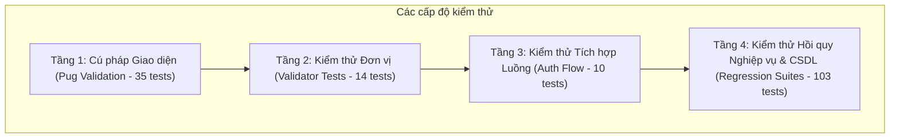

# KẾ HOẠCH KIỂM THỬ PHẦN MỀM (TEST PLAN) - VAMOS STORE

> **Dự án:** VAMOS STORE - E-commerce Footwear System  
> **Phiên bản tài liệu:** v1.1 Chuẩn hóa  
> **Mục tiêu:** Định nghĩa chiến lược kiểm thử, môi trường, phạm vi, công cụ và tiêu chuẩn nghiệm thu cho toàn bộ hệ thống.

---

## 1. MỤC TIÊU KIỂM THỬ

1. Đảm bảo toàn bộ 14 Use Cases nghiệp vụ hoạt động chính xác theo đặc tả.
2. Kiểm tra tính toàn vẹn và nhất quán của CSDL Microsoft SQL Server trong các điều kiện giao dịch phức tạp (Transaction ACID).
3. Đảm bảo triệt tiêu hiện tượng Race Condition (Overselling) khi xử lý đồng thời.
4. Đảm bảo 100% các file giao diện Pug biên dịch thành công không có lỗi cú pháp.
5. Kiểm tra an toàn bảo mật (Băm mật khẩu, Session Fixation, phân quyền RBAC, vô hiệu hóa phiên khi tài khoản bị khóa).

---

## 2. PHẠM VI KIỂM THỬ (TEST SCOPE)

### 2.1. Trong phạm vi kiểm thử (In-Scope)

- **Kiểm thử cú pháp giao diện (View Validation):** 35 tệp Pug template.
- **Kiểm thử đơn vị (Unit Tests):** Bộ chuẩn hóa và kiểm tra dữ liệu đầu vào (Email, số điện thoại, định dạng họ tên).
- **Kiểm thử tích hợp & Luồng người dùng (Integration Tests):** Quy trình Đăng ký, Đăng nhập, Quản lý Session, Guest Cart merge vào Database Cart.
- **Kiểm thử hồi quy nghiệp vụ (Regression Tests):**
  - Trừ tồn kho và hoàn kho tự động trong Transaction.
  - Snapshot dữ liệu đơn hàng và giá bán.
  - Giới hạn 01 voucher/khách hàng và mở khóa khi hủy đơn.
  - Điều chỉnh tồn kho thủ công của Admin và ghi nhật ký kiểm toán.
  - Khóa tài khoản khách hàng và vô hiệu hóa Session ngay lập tức.
  - Ngăn chặn Admin tự khóa tài khoản của chính mình.

### 2.2. Ngoài phạm vi kiểm thử (Out-of-Scope)

- Tích hợp cổng thanh toán trực tuyến bên thứ ba (VNPay, MoMo) - Hệ thống chỉ dùng COD.
- Giao diện ứng dụng di động riêng (Native Apps).

---

## 3. CHIẾN LƯỢC VÀ PHƯƠNG PHÁP KIỂM THỬ

Hệ thống áp dụng chiến lược kiểm thử đa tầng tự động (Multi-layered Automated Testing):

1. **Môi trường CSDL biệt lập:** Toàn bộ các bài kiểm thử hồi quy chạy trên cơ sở dữ liệu kiểm thử riêng biệt `vamos_store_test_db` để không làm ô nhiễm dữ liệu của CSDL chính `vamos_store_db`.
2. **Cơ chế Dọn dẹp Tự động (Teardown):** Mỗi kịch bản kiểm thử sau khi hoàn thành đều tự động dọn dẹp các bản ghi phát sinh (đơn hàng test, item test, tài khoản test), đảm bảo tính độc lập giữa các lần chạy.
3. **Tiêu chuẩn Nghiệm thu (Acceptance Criteria):**
   - 100% bài kiểm thử phải đạt trạng thái **PASSED**.
   - Mã thoát (Exit code) của script kiểm thử phải là `0`.
   - Tuyệt đối không chấp nhận lỗi cú pháp hoặc cảnh báo nghiêm trọng.

---

## 4. MÔI TRƯỜNG VÀ CÔNG CỤ KIỂM THỬ

| Hạng mục              | Thông số kỹ thuật                                        |
| :-------------------- | :------------------------------------------------------- |
| **Hệ điều hành**      | Windows 10/11 / Windows Server                           |
| **Node.js**           | v20.x LTS                                                |
| **Cơ sở dữ liệu**     | Microsoft SQL Server 2022 / 2025 (`vamos_store_test_db`) |
| **Test Runner**       | Node.js Test Runner / Custom Assert Suites               |
| **Lệnh chạy toàn bộ** | `npm run test:all`                                       |
