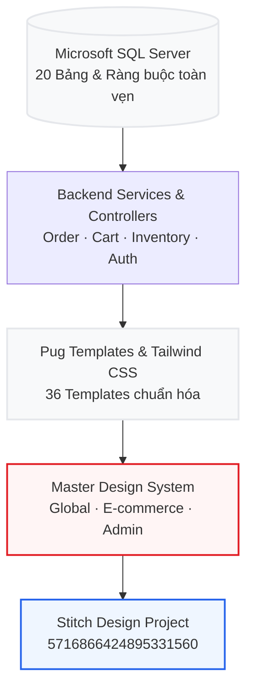
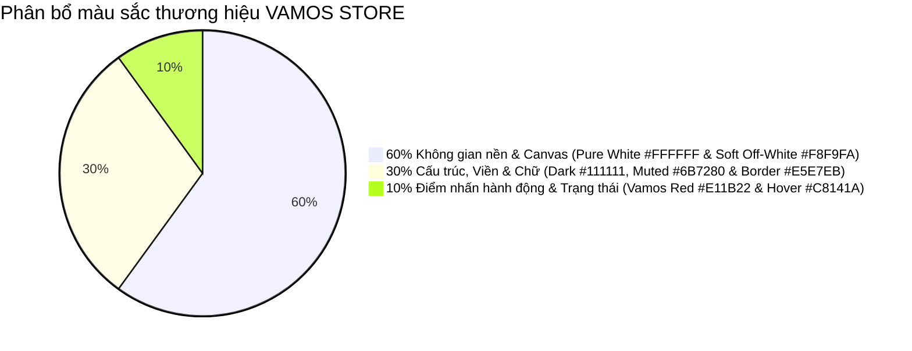
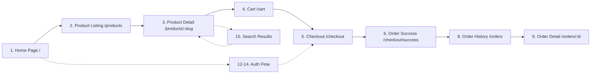
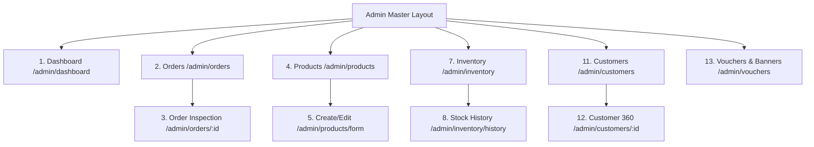
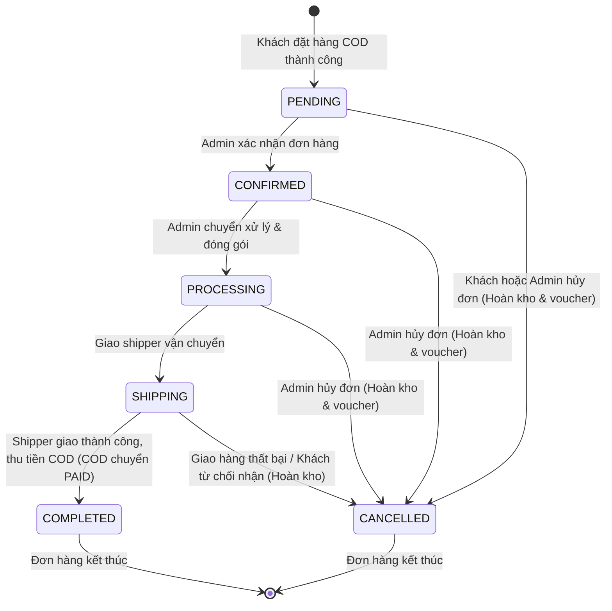

# MASTER DESIGN GOVERNANCE & UI/UX SPECIFICATION
## HỆ THỐNG QUY CHUẨN THIẾT KẾ & BÀN GIAO KỸ THUẬT TOÀN DIỆN VAMOS STORE
### PHIÊN BẢN v1.1 CHUẨN HÓA SẢN PHẨM THỰC TẾ

> **Thương hiệu:** VAMOS STORE  
> **Tagline:** MOVE YOUR WAY  
> **Vai trò thực hiện:** Lead Product Designer, Senior UX Architect & Design System Specialist  
> **Nền tảng kỹ thuật đối chiếu:** Microsoft SQL Server (20 tables) · Node.js / Express · Pug Template Engine · Tailwind CSS · Pure COD Payment  
> **Mã dự án Stitch:** `5716866424895331560` · Màn hình gốc: `7f853d7a4e0b4bc58c442df57f3607b8`

---

## 1. NGUYÊN TẮC THIẾT KẾ DỰA TRÊN SẢN PHẨM THỰC TẾ (GROUNDING PRINCIPLES)

Tài liệu này xác lập quy chuẩn thiết kế duy nhất cho toàn bộ hệ sinh thái **VAMOS STORE**, đảm bảo mọi màn hình, thành phần giao diện và tương tác đều được xây dựng trên dữ liệu thực tế và năng lực kỹ thuật hiện có của hệ thống:



### 1.1. Bảy Điều cấm kỵ (Negative Constraints)
1. **Không tạo chức năng giả định:** Tuyệt đối không vẽ các cổng thanh toán điện tử (VNPay, Momo, Stripe), thẻ ATM, quét mã QR thanh toán hay dịch vụ giao hàng hỏa tốc chưa tồn tại. Hệ thống áp dụng duy nhất **100% COD (Cash on Delivery)**.
2. **Không bịa đặt số liệu kinh doanh:** Không hiển thị số lượng người đang xem ảo ("15 người đang xem"), lượt bán ảo, đánh giá 5 sao giả định hoặc thông số kỹ thuật không có trong database.
3. **Không tạo thông tin thương hiệu sai lệch:** Chỉ dùng đúng tên thương hiệu **VAMOS STORE**, slogan **MOVE YOUR WAY**, hotline hỗ trợ chính thức **1900 2126** và chính sách bảo hành/đổi trả 7 ngày đã thống nhất.
4. **Không phụ thuộc vào dữ liệu giả định:** Trường hợp sản phẩm hoặc người dùng chưa có dữ liệu, bắt buộc phải thiết kế trạng thái rỗng (**Empty State**) hoặc trạng thái trung tính.
5. **Mục đích sử dụng rõ ràng:** Mỗi nút bấm, trường nhập liệu hay huy hiệu trạng thái đều phải ánh xạ tới một endpoint controller và bảng database cụ thể.
6. **Ưu tiên khả dụng và tốc độ:** Loại bỏ toàn bộ hiệu ứng kính mờ (glassmorphism) nặng nề, gradient lòe loẹt, viền phát sáng (glow) hay đổ bóng phóng đại làm chậm trang web.
7. **Bảo mật và an toàn dữ liệu:** Mọi form nhập liệu đều phải thiết kế kèm nhãn (label), chỉ dẫn lỗi (error feedback), mã CSRF và cơ chế chống gửi đơn nhiều lần (anti-double-submit).

---

## 2. DELIVERABLE 1: HỆ THỐNG THIẾT KẾ DÙNG CHUNG (DESIGN SYSTEM ARCHITECTURE)

### 2.1. Bảng màu thương hiệu chuẩn (Brand Color Palette - Quy tắc 60-30-10)



| Nhóm màu | Tên Token | Mã Hex | Tailwind Class | Mục đích sử dụng thực tế |
| :--- | :--- | :---: | :--- | :--- |
| **Canvas 60%** | `Surface Base` | `#FFFFFF` | `bg-white` | Nền canvas trang web, thẻ card sản phẩm, modal popup |
| **Canvas 60%** | `Surface Light` | `#F8F9FA` | `bg-vamos-bg-light` | Nền thanh breadcrumb, nền bảng lọc, nền form input |
| **Structure 30%**| `Text Primary` | `#111111` | `text-vamos-dark` | Tiêu đề chính H1-H3, tên sản phẩm, giá bán không giảm |
| **Structure 30%**| `Text Muted` | `#6B7280` | `text-vamos-muted`| Mô tả sản phẩm, nhãn phụ, ngày tháng, giá gạch ngang |
| **Structure 30%**| `Border Neutral`| `#E5E7EB` | `border-vamos-border`| Viền ngăn cách card, đường kẻ bảng dữ liệu, ô nhập liệu |
| **Structure 30%**| `Charcoal Dark`| `#1A1A1A` | `bg-vamos-charcoal`| Footer, thanh announcement bar, sidebar quản trị |
| **Accent 10%** | `Primary Accent`| `#E11B22` | `bg-vamos-red` | Nút CTA chính (Mua ngay, Đặt hàng), Badge Sale, Giá ưu đãi |
| **Accent 10%** | `Accent Hover` | `#C8141A` | `hover:bg-vamos-red-dark`| Trạng thái di chuột của các nút CTA chính |
| **Feedback** | `Status Success`| `#16A34A` | `text-green-600 bg-green-50` | Đơn hàng `COMPLETED`, tồn kho dồi dào, thông báo thành công |
| **Feedback** | `Status Warning`| `#D97706` | `text-amber-700 bg-amber-50` | Đơn hàng `PENDING`, sắp hết hàng (`<= 5 đôi`), cảnh báo sỉ |
| **Feedback** | `Status Error` | `#DC2626` | `text-red-700 bg-red-50` | Đơn hàng `CANCELLED`, hết hàng (`stock = 0`), lỗi form |
| **Feedback** | `Status Info` | `#2563EB` | `text-blue-700 bg-blue-50` | Đơn hàng `SHIPPING`, `PROCESSING` |

### 2.2. Quy chuẩn Typography (Typographic Scale & Hierarchy)

Hệ thống kết hợp đồng bộ 2 bộ phông chữ bản quyền tối ưu cho tiếng Việt và phong cách thời trang thể thao:
1. **`Space Grotesk` (Google Font):** Chuyên dụng cho Display Hero, Tiêu đề Section H1-H3, Mã đơn hàng, Mã SKU và toàn bộ số hiển thị tiền tệ Việt Nam Đồng (`350.000 ₫`) để đảm bảo không bị méo tỷ lệ số.
2. **`Be Vietnam Pro` (Google Font):** Chuyên dụng cho văn bản nội dung, mô tả sản phẩm, form nhập liệu, bảng điều hướng và nhãn trợ năng. Hỗ trợ hiển thị dấu thanh tiếng Việt mượt mà.

| Cấp bậc văn bản | Font Family | Kích thước / Line-height | Weight / Spacing | Ví dụ áp dụng |
| :--- | :--- | :---: | :---: | :--- |
| **Display Hero** | Space Grotesk | `48px` / `56px` (Mobile: `32px`) | 700 / `-0.03em` | Banner trang chủ: "MOVE YOUR WAY" |
| **Headline XL** | Space Grotesk | `32px` / `40px` (Mobile: `24px`) | 700 / `-0.02em` | Tên sản phẩm trang chi tiết, Tiêu đề giỏ hàng |
| **Headline LG** | Space Grotesk | `24px` / `32px` | 700 / `-0.015em`| Tiêu đề Section ("SẢN PHẨM MỚI NHẤT") |
| **Headline MD** | Space Grotesk | `18px` / `24px` | 600 / `-0.01em` | Tên sản phẩm trên thẻ card lưới |
| **Price Hero** | Space Grotesk | `28px` / `36px` | 700 / `-0.01em` | Giá bán trang chi tiết (`350.000 ₫`) |
| **Price Card** | Space Grotesk | `16px` / `20px` | 700 / `-0.01em` | Giá bán trên thẻ card danh mục |
| **Body LG** | Be Vietnam Pro| `16px` / `26px` | 400 / `0em` | Đoạn văn mở đầu mô tả sản phẩm |
| **Body MD** | Be Vietnam Pro| `14px` / `22px` | 400 / `0em` | Nội dung mô tả chi tiết, bảng thông số |
| **Body SM** | Be Vietnam Pro| `12px` / `18px` | 400 / `0em` | Chú thích, bản quyền chân trang, ghi chú đơn hàng |
| **Label Bold** | Be Vietnam Pro| `13px` / `16px` | 600 / `0.02em` | Nhãn form (Họ tên, SĐT), Header cột bảng |
| **Micro Badge** | Space Grotesk | `11px` / `14px` | 700 / `0.05em` | Huy hiệu giảm giá (`-17%`), SKU code |

### 2.3. Quy chuẩn Khoảng cách (Spacing Grid) & Bo góc (Border Radius)
- **Lưới cơ sở 4px (4px Baseline Grid):**
  - `space-xs`: 4px (`p-1`, `gap-1`)
  - `space-sm`: 8px (`p-2`, `gap-2`)
  - `space-md`: 16px (`p-4`, `gap-4`)
  - `space-lg`: 24px (`p-6`, `gap-6`)
  - `space-xl`: 32px (`p-8`, `gap-8`)
  - `space-2xl`: 48px (`p-12`, `gap-12`)
- **Bo góc (Border Radius Hierarchy):**
  - `rounded-md` (6px - 8px): Dành cho input fields, select boxes, size selector box, micro badges.
  - `rounded-lg` (10px - 12px): Dành cho nút bấm (Buttons), thẻ sản phẩm nhỏ, khung ảnh con.
  - `rounded-xl` (16px): Dành cho Container card lớn, hộp tóm tắt giỏ hàng, bảng dữ liệu Admin.
  - `rounded-full` (9999px): Dành cho Color swatch chấm tròn, badge trạng thái bo tròn dạng viên thuốc (pill badge).

---

## 3. DELIVERABLE 2: ĐẶC TẢ PHÂN HỆ KHÁCH HÀNG (CUSTOMER PORTAL - 16 MÀN HÌNH)

Toàn bộ 16 màn hình phân hệ Khách hàng được chuẩn hóa đồng bộ theo cấu trúc Pug Templates:



### Chi tiết 16 Màn hình Phân hệ Khách hàng:

#### 1. `SCR-CUST-01`: Trang Chủ (Home Page - `/`)
- **Template:** `src/views/pages/home/index.pug`
- **Mục đích:** Giới thiệu bộ sưu tập mới, danh mục sản phẩm chủ lực và các cam kết cốt lõi của VAMOS STORE.
- **Thành phần:**
  - Header với Announcement Ticker (`ticker-wrap` chạy chữ "MIỄN PHÍ VẬN CHUYỂN ĐƠN HÀNG TỪ 500K · THANH TOÁN COD TOÀN QUỐC").
  - Hero Campaign Banner với ảnh sản phẩm chất lượng cao, nút CTA kép ("Khám Phá Ngay" / "Xem Bộ Sưu Tập").
  - Grid danh mục nổi bật (Sneaker Nam, Sneaker Nữ, Giày Thể Thao, Sandal & Dép) kèm ảnh chụp thật.
  - Lưới sản phẩm mới nhất (Latest Arrivals) và Sản phẩm bán chạy (Best Sellers) sử dụng `.product-card`.
  - 4 khối cam kết COD: Nhận hàng kiểm tra thanh toán, Đổi size 7 ngày miễn phí, Cam kết chính hãng 100%, Đóng gói hộp đôi.

#### 2. `SCR-CUST-02`: Danh mục & Bộ lọc (Product Listing - `/products`)
- **Template:** `src/views/pages/products/index.pug`
- **Mục đích:** Duyệt và tìm kiếm sản phẩm theo danh mục, mức giá, màu sắc và kích cỡ giày.
- **Thành phần:**
  - Sidebar bộ lọc đa tiêu chí (Desktop) / Drawer trượt (Mobile): Lọc danh mục, khoảng giá (radio buttons), kích cỡ (size chips), màu sắc (color swatches).
  - Thanh công cụ phía trên: Đếm số lượng sản phẩm tìm thấy, bộ chọn sắp xếp (Mới nhất, Giá tăng dần, Giá giảm dần).
  - Lưới sản phẩm 4 cột (Desktop), 3 cột (Tablet), 2 cột (Mobile).
  - Phân trang chuẩn (`Pagination` Component) bảo toàn các tham số query trong URL.
  - Trạng thái rỗng (`Empty State`): Hiển thị icon kính lúp, thông điệp "Không tìm thấy sản phẩm phù hợp" kèm nút "Xóa tất cả bộ lọc".

#### 3. `SCR-CUST-03`: Chi tiết Sản phẩm (Product Detail - `/products/:slug`)
- **Template:** `src/views/pages/products/detail.pug`
- **Mục đích:** Cung cấp thông tin trực quan, chọn màu, chọn size, kiểm tra tồn kho trực tiếp và thêm vào giỏ.
- **Thành phần:**
  - Breadcrumb điều hướng 4 cấp: Trang chủ / Cửa hàng / Tên danh mục / Tên sản phẩm.
  - Gallery ảnh tương tác: Khung ảnh chính lớn (`aspect-square object-contain`), dải thumbnail bên dưới gắn sự kiện click chuyển ảnh không dùng inline script.
  - Khối giá: Giá ưu đãi Space Grotesk màu đỏ `#E11B22`, giá gốc gạch ngang và huy hiệu `-XX% TIẾT KIỆM` (chỉ hiển thị khi `sale_price < base_price`).
  - Bộ chọn màu sắc: Nhãn hiển thị màu đã chọn, radio ẩn kèm ô màu trực quan (`col.hex`).
  - Bộ chọn size giày: Dải size chuẩn EU (38-44) hiển thị dạng `.size-box`.
  - Bộ điều khiển số lượng (Stepper): Nút `-`, input số lượng, nút `+`, nhãn tồn kho biến thể động.
  - Cảnh báo số lượng tức thì: Khi nhập số lượng `> 10`, lập tức hiện cảnh báo mua sỉ và Hotline 1900 2126; khi nhập `> tồn kho`, báo lỗi không đủ hàng và vô hiệu hóa nút mua.
  - Cặp nút hành động: "Thêm Vào Giỏ Hàng" (`.btn-outline-red`) và "Mua Ngay (COD)" (`.btn-primary`).
  - 3 Thẻ thông số kỹ thuật (Stitch Spec Cards): Đế Phylon siêu nhẹ, Công nghệ dệt Liteknit, Lót giày Nano Bạc.
  - Bảng quy cách sản phẩm: Thương hiệu VAMOS, phân loại, đối tượng, chính sách COD.

#### 4. `SCR-CUST-04`: Giỏ Hàng (Cart Page - `/cart`)
- **Template:** `src/views/pages/cart/index.pug`
- **Mục đích:** Quản lý sản phẩm đã chọn, điều chỉnh số lượng và kiểm tra tổng tiền trước khi checkout.
- **Thành phần:**
  - Hàng mặt hàng (Cart Item Line): Ảnh thu nhỏ, tên sản phẩm, biến thể Size & Màu sắc, đơn giá, cụm tăng/giảm số lượng (chặn ở biên 1 và 10 hoặc stock), tổng tiền dòng, nút xóa có icon thùng rác.
  - Đồng bộ giỏ hàng khách (Guest Cart Sync): Đối chiếu trực tiếp với database; nếu sản phẩm đổi giá hoặc giảm tồn kho, hiển thị banner cảnh báo màu vàng ở đầu trang.
  - Khối tóm tắt đơn hàng (Order Summary Box - Sticky Desktop): Tạm tính, Phí giao hàng (hiển thị rõ 30.000₫ hoặc "Miễn phí" nếu `>= 500.000₫`), Tổng thanh toán COD.
  - Nút "Tiến Hành Đặt Hàng (COD)": Chuyển hướng tới `/checkout` (nếu là Guest, chuyển hướng đăng nhập và quay lại checkout).
  - Trạng thái giỏ hàng rỗng: Icon giỏ hàng mờ, thông điệp "Giỏ hàng của bạn đang trống" kèm nút "Khám Phá Sản Phẩm Ngay".

#### 5. `SCR-CUST-05`: Thanh Toán COD (Checkout Page - `/checkout`)
- **Template:** `src/views/pages/checkout/index.pug`
- **Mục đích:** Xác nhận địa chỉ nhận hàng, áp dụng voucher giảm giá và chốt đơn hàng COD.
- **Thành phần:**
  - Cột trái (Thông tin giao hàng): Chọn địa chỉ từ sổ địa chỉ có sẵn hoặc nhập địa chỉ mới (Họ tên, SĐT 10 số, Tỉnh/Thành phố, Địa chỉ chi tiết, Ghi chú giao hàng).
  - Phương thức thanh toán duy nhất: Hộp thông báo nổi bật "Thanh toán khi nhận hàng (COD)" kèm biểu tượng tiền mặt an toàn.
  - Cột phải (Tóm tắt đơn hàng & Voucher):
    - Danh sách sản phẩm mua kèm số lượng và thành tiền.
    - Ô nhập mã giảm giá (Voucher Input) kèm nút "Áp dụng" (xử lý logic kiểm tra 1 lần/khách hàng Q8).
    - Dòng chiết khấu voucher (nếu hợp lệ).
    - Dòng phí vận chuyển (30.000₫ / Miễn phí).
    - Tổng cộng thanh toán COD (viết to đậm bằng Space Grotesk).
  - Nút "Xác Nhận Đặt Hàng (COD)": Tích hợp cơ chế JavaScript vô hiệu hóa chống bấm đúp (anti-double-click), hiển thị spinner loading khi đang xử lý.

#### 6. `SCR-CUST-06`: Đặt Hàng Thành Công (Order Success - `/checkout/success`)
- **Template:** `src/views/pages/checkout/success.pug`
- **Mục đích:** Xác nhận đơn hàng đã được ghi nhận vào hệ thống CSDL và hướng dẫn nhận hàng COD.
- **Thành phần:**
  - Icon tích xanh thành công nổi bật.
  - Tiêu đề "ĐẶT HÀNG THÀNH CÔNG!".
  - Mã đơn hàng nổi bật: `#VAMXXXXXXXXX` (font Space Grotesk).
  - Tổng số tiền COD cần chuẩn bị khi shipper giao hàng tới.
  - Hướng dẫn nhận hàng COD: Được đồng kiểm tra hàng trước khi thanh toán, đổi size miễn phí trong 7 ngày.
  - Nút đôi: "Theo Dõi Đơn Hàng" (`/orders/:id`) và "Tiếp Tục Mua Sắm" (`/products`).

#### 7. `SCR-CUST-07`: Tra Cứu Đơn Hàng Nhanh (Order Tracking - `/orders/track`)
- **Template:** `src/views/pages/orders/track.pug`
- **Mục đích:** Cho phép khách hàng tra cứu trạng thái đơn hàng nhanh qua Mã đơn hàng và Số điện thoại mà không cần đăng nhập.
- **Thành phần:** Form nhập Mã đơn + Số điện thoại, kết quả trả về timeline tiến trình đơn và thông tin giao hàng cơ bản.

#### 8. `SCR-CUST-08`: Lịch Sử Đơn Hàng (Order History - `/orders`)
- **Template:** `src/views/pages/orders/index.pug`
- **Mục đích:** Danh sách toàn bộ đơn hàng của tài khoản khách hàng.
- **Thành phần:** Thanh tab lọc trạng thái (Tất cả, Chờ xử lý, Đang giao, Đã giao, Đã hủy), danh sách card đơn hàng (Mã đơn, ngày đặt, danh sách ảnh thu nhỏ, tổng tiền, huy hiệu trạng thái màu, nút "Xem Chi Tiết").

#### 9. `SCR-CUST-09`: Chi Tiết Đơn Hàng (Order Detail - `/orders/:id`)
- **Template:** `src/views/pages/orders/detail.pug`
- **Mục đích:** Xem đầy đủ thông tin đơn hàng, tiến trình vận chuyển và thực hiện thao tác hủy đơn hợp lệ.
- **Thành phần:**
  - Header: Mã đơn hàng, ngày đặt, badge trạng thái hiện tại.
  - Timeline 5 bước trực quan: Chờ xác nhận -> Đã xác nhận -> Đang đóng gói -> Đang giao hàng -> Hoàn thành.
  - Thông tin người nhận và địa chỉ giao hàng snapshot tại thời điểm đặt đơn.
  - Danh sách mặt hàng mua kèm giá snapshot cứng (không bị đổi khi sản phẩm tăng/giảm giá sau này).
  - Bảng tính tiền: Tạm tính, Giảm giá voucher, Phí vận chuyển COD, Tổng thanh toán.
  - Nút "HỦY ĐƠN HÀNG": Chỉ hiển thị DUY NHẤT khi đơn hàng đang ở trạng thái `PENDING`. Khi bấm mở Modal xác nhận hủy.

#### 10. `SCR-CUST-10`: Hồ Sơ Cá Nhân (Account Profile - `/profile`)
- **Template:** `src/views/pages/profile/index.pug`
- **Mục đích:** Quản lý thông tin tài khoản, đổi mật khẩu và xem thống kê mua sắm.
- **Thành phần:** Form cập nhật Họ tên, Số điện thoại (chặn sửa Email vì là khóa định danh duy nhất), form đổi mật khẩu an toàn.

#### 11. `SCR-CUST-11`: Sổ Địa Chỉ Nhận Hàng (Address Management - `/profile/addresses`)
- **Template:** `src/views/pages/profile/addresses.pug`
- **Mục đích:** Lưu trữ các địa chỉ nhận hàng quen thuộc giúp rút ngắn quá trình checkout.
- **Thành phần:** Danh sách thẻ địa chỉ (`Address Card`), huy hiệu "Địa chỉ mặc định", nút "Thêm Địa Chỉ Mới", nút sửa và xóa địa chỉ.

#### 12. `SCR-CUST-12`: Đăng Nhập (Login - `/auth/login`)
- **Template:** `src/views/pages/auth/login.pug`
- **Mục đích:** Đăng nhập tài khoản khách hàng hoặc quản trị viên.
- **Thành phần:** Form đăng nhập tinh gọn (Email, Mật khẩu kèm nút ẩn/hiện mật khẩu), nút ghi nhớ đăng nhập, link "Quên mật khẩu?", link "Chưa có tài khoản? Đăng ký ngay". Tự động hiển thị flash alert khi đăng nhập sai hoặc khi tài khoản bị khóa.

#### 13. `SCR-CUST-13`: Đăng Ký (Register - `/auth/register`)
- **Template:** `src/views/pages/auth/register.pug`
- **Mục đích:** Tạo mới tài khoản khách hàng VAMOS STORE.
- **Thành phần:** Form đăng ký (Họ và tên, Email, Số điện thoại di động Việt Nam 10 số, Mật khẩu tối thiểu 6 ký tự, Nhập lại mật khẩu), điều khoản sử dụng dịch vụ, tự động gộp giỏ hàng khách sau khi đăng ký thành công.

#### 14. `SCR-CUST-14`: Quên Mật Khẩu (Forgot Password - `/auth/forgot-password`)
- **Template:** `src/views/pages/auth/forgot-password.pug`
- **Mục đích:** Tiếp nhận yêu cầu đặt lại mật khẩu qua email.
- **Thành phần:** Form nhập email đã đăng ký, nút "Gửi liên kết đặt lại mật khẩu", thông báo hướng dẫn kiểm tra hòm thư.

#### 15. `SCR-CUST-15`: Đặt Lại Mật Khẩu (Reset Password - `/auth/reset-password`)
- **Template:** `src/views/pages/auth/reset-password.pug`
- **Mục đích:** Nhập mật khẩu mới an toàn sau khi xác thực token email.
- **Thành phần:** Form nhập Mật khẩu mới, Xác nhận mật khẩu mới, kiểm tra độ an toàn mật khẩu.

#### 16. `SCR-CUST-16`: Bộ Màn hình Lỗi Hệ Thống (System Error Pages - 403, 404, 500)
- **Templates:**
  - `src/views/pages/errors/403.pug` - Truy cập bị từ chối (Forbidden Access)
  - `src/views/pages/errors/404.pug` - Không tìm thấy trang (Page Not Found)
  - `src/views/pages/errors/500.pug` - Lỗi máy chủ nội bộ (Internal Server Error)
- **Đặc điểm:** Không hiển thị raw stack trace trong môi trường production; hiển thị icon minh họa trang nhã, mã lỗi Space Grotesk lớn, thông điệp rõ ràng và nút "Quay Lại Trang Chủ".

---

## 4. DELIVERABLE 3: ĐẶC TẢ PHÂN HỆ QUẢN TRỊ (ADMIN PORTAL - 13 MÀN HÌNH)

Phân hệ Quản trị được thiết kế theo phong cách chuyên nghiệp, định hướng điều hành dữ liệu thực tế (Data-driven Management), bố cục Sidebar màu tối (`#1A1A1A`) kết hợp bảng nội dung sáng rõ ràng:



### Chi tiết 13 Màn hình Phân hệ Quản trị:

#### 1. `SCR-ADM-01`: Bảng Điều Khiển Trung Tâm (Executive Dashboard - `/admin/dashboard`)
- **Template:** `src/views/pages/admin/dashboard.pug`
- **Mục đích:** Thống kê các chỉ số kinh doanh sống từ database, không hiển thị dữ liệu giả định.
- **Thành phần:**
  - 4 Thẻ KPI chính: Tổng doanh thu đơn hoàn thành (`COMPLETED` + `PAID`), Tổng số đơn hàng trong hệ thống, Số lượng khách hàng hoạt động, Tổng số mặt hàng kinh doanh.
  - Bộ thẻ trạng thái đơn hàng (Đếm trực tiếp từ bảng `orders` theo 6 trạng thái).
  - Bảng danh sách "Đơn hàng mới cần xử lý gấp" (ưu tiên các đơn `PENDING` và `CONFIRMED`).
  - Danh sách Top 5 sản phẩm bán chạy nhất (truy vấn tổng `quantity` từ `order_items` của các đơn đã hoàn thành).

#### 2. `SCR-ADM-02`: Quản Lý Đơn Hàng (Order Roster - `/admin/orders`)
- **Template:** `src/views/pages/admin/orders.pug`
- **Mục đích:** Tìm kiếm, lọc và phân trang toàn bộ đơn hàng của hệ thống.
- **Thành phần:** Thanh tìm kiếm đa năng (theo Mã đơn hàng, Tên khách hàng, SĐT), bộ lọc trạng thái đơn, bộ lọc trạng thái thanh toán COD, bảng dữ liệu đầy đủ thông tin (Mã đơn, Khách hàng, SĐT, Ngày tạo, Tổng tiền, Trạng thái đơn, Trạng thái COD, Cột thao tác).

#### 3. `SCR-ADM-03`: Chi Tiết & Chuyển Trạng Thái Đơn Hàng (Order Detail - `/admin/order-detail.pug`)
- **Template:** `src/views/pages/admin/order-detail.pug`
- **Mục đích:** Kiểm tra thông tin đơn hàng và chuyển trạng thái theo đúng máy trạng thái tuần tự.
- **Thành phần:**
  - Header: Mã đơn, Thời gian tạo, Trạng thái hiện tại.
  - Bộ chuyển trạng thái hợp lệ (Dropdown hoặc Nút chuyển đổi tuân thủ nghiêm ngặt State Machine Matrix; không thể nhảy cóc từ `PENDING` sang `COMPLETED`).
  - Modal Hủy đơn hàng nội bộ: Bắt buộc Admin nhập lý do hủy; hệ thống tự động hoàn tồn kho cho từng biến thể và hoàn lượt sử dụng voucher nếu có.
  - Danh sách sản phẩm mua, đơn giá snapshot, số lượng, tổng thanh toán.

#### 4. `SCR-ADM-04`: Danh Sách Sản Phẩm (Product Catalog - `/admin/products.pug`)
- **Template:** `src/views/pages/admin/products.pug`
- **Mục đích:** Quản lý kho danh mục sản phẩm, theo dõi giá bán và trạng thái kinh doanh.
- **Thành phần:** Bảng dữ liệu sản phẩm (Ảnh đại diện thumbnail, Tên sản phẩm, Mã sản phẩm, Danh mục, Giá gốc, Giá khuyến mãi, Tổng số lượng tồn kho các biến thể, Trạng thái Hoạt động/Ẩn), nút "Thêm Sản Phẩm Mới", nút Sửa, nút Bật/Tắt hiển thị.

#### 5. `SCR-ADM-05`: Form Thêm / Sửa Sản Phẩm (Product Form - `/admin/product-form.pug`)
- **Template:** `src/views/pages/admin/product-form.pug`
- **Mục đích:** Khởi tạo hoặc cập nhật thông tin cha của sản phẩm và danh mục ảnh.
- **Thành phần:** Các trường thông tin cơ bản: Tên sản phẩm, Slug (tự động tạo hoặc tùy chỉnh), Mã sản phẩm, Danh mục cha, Thương hiệu, Giá gốc, Giá khuyến mãi, Đối tượng (Nam/Nữ/Unisex), Mô tả chi tiết sản phẩm; bộ quản lý danh sách URL hình ảnh.

#### 6. `SCR-ADM-06`: Quản Lý Ma Trận Biến Thể (Variant Matrix Manager)
- **Tích hợp trong:** `src/views/pages/admin/product-form.pug`
- **Mục đích:** Cấu hình ma trận kích cỡ (Sizes 38-44) x Màu sắc (Colors) x Mã SKU x Số lượng tồn kho ban đầu cho từng biến thể.
- **Thành phần:** Bảng nhập liệu động cho từng dòng biến thể; tự động sinh mã SKU theo quy tắc chuẩn `VM-[CODE]-[SIZE]-[COLOR_CODE]`.

#### 7. `SCR-ADM-07`: Quản Lý Tồn Kho Trực Tiếp (Real-time Inventory - `/admin/inventory.pug`)
- **Template:** `src/views/pages/admin/inventory.pug`
- **Mục đích:** Giám sát tồn kho chi tiết từng SKU và thực hiện điều chỉnh số lượng tồn.
- **Thành phần:**
  - Bộ lọc cảnh báo nhanh: "Tất cả", "Sắp hết hàng (`<= 5 đôi`)", "Đã hết hàng (`0 đôi`)".
  - Bảng dữ liệu: Mã SKU, Tên sản phẩm, Size, Màu sắc, Số lượng tồn khả dụng, Badge trạng thái.
  - Form điều chỉnh tồn kho tức thì (Inline Adjustment): Nhập số lượng mới và bắt buộc ghi rõ "Lý do điều chỉnh" (Nhập kho định kỳ, Kiểm kê hao hụt, Hàng lỗi trả nhà cung cấp).

#### 8. `SCR-ADM-08`: Nhật Ký Kiểm Toán Kho (Inventory Audit History - `/admin/inventory-history.pug`)
- **Template:** `src/views/pages/admin/inventory-history.pug`
- **Mục đích:** Minh bạch toàn bộ lịch sử biến động kho hàng (Audit Trail).
- **Thành phần:** Bảng lịch sử truy xuất từ bảng `inventory_transactions`: Thời gian thực hiện, Mã SKU, Số lượng cũ, Số lượng mới, Độ chênh lệch (`+X` hoặc `-X`), Loại giao dịch (Bán hàng, Hủy đơn hoàn kho, Admin điều chỉnh), Lý do chi tiết, Tài khoản thực hiện.

#### 9. `SCR-ADM-09`: Quản Lý Danh Mục (Category Management - `/admin/categories.pug`)
- **Template:** `src/views/pages/admin/categories.pug`
- **Mục đích:** Quản lý các nhóm sản phẩm (Sneaker Nam, Sneaker Nữ, Giày Thể Thao, Sandal & Dép).
- **Thành phần:** Danh sách danh mục, slug, số lượng sản phẩm liên kết, nút tạo mới và chỉnh sửa.

#### 10. `SCR-ADM-10`: Quản Lý Thương Hiệu (Brand Management - `/admin/brands.pug`)
- **Template:** Quản lý thương hiệu đối tác và dòng sản phẩm riêng biệt của VAMOS STORE.
- **Thành phần:** Tên thương hiệu, mô tả, logo, số lượng sản phẩm liên kết.

#### 11. `SCR-ADM-11`: Danh Sách Khách Hàng (Customer Accounts - `/admin/customers.pug`)
- **Template:** `src/views/pages/admin/customers.pug`
- **Mục đích:** Quản trị danh sách người dùng và giám sát an toàn tài khoản.
- **Thành phần:** Bảng dữ liệu người dùng (Họ tên, Email, Số điện thoại, Ngày tạo, Tổng số đơn đã đặt, Trạng thái `active` hoặc `locked`), nút Khóa / Mở khóa tài khoản có modal cảnh báo. Nghiêm cấm khóa tài khoản Admin.

#### 12. `SCR-ADM-12`: Hồ Sơ Khách Hàng 360 (Customer Dossier - `/admin/customer-detail.pug`)
- **Template:** `src/views/pages/admin/customer-detail.pug`
- **Mục đích:** Xem chi tiết toàn bộ lịch sử mua sắm và danh sách địa chỉ giao hàng của một khách hàng cụ thể.
- **Thành phần:** Thông tin cá nhân, danh sách các đơn hàng đã đặt, tổng giá trị chi tiêu trọn đời (LTV), nút thao tác khóa tài khoản với hiệu lực vô hiệu hóa session ngay lập tức.

#### 13. `SCR-ADM-13`: Quản Lý Khuyến Mãi & Banners (Vouchers & Banners - `/admin/vouchers.pug` & `/admin/banners.pug`)
- **Templates:**
  - `src/views/pages/admin/vouchers.pug`
  - `src/views/pages/admin/voucher-form.pug`
  - `src/views/pages/admin/banners.pug`
- **Mục đích:** Tạo và kiểm soát mã giảm giá, cấu hình banner trình chiếu trang chủ.
- **Thành phần:** Bảng mã voucher (Mã code, Tên voucher, Mức giảm % hoặc số tiền cố định, Giá trị đơn tối thiểu, Lượt đã dùng / Giới hạn tổng, Ngày hết hạn, Trạng thái), form tạo voucher và bảng quản lý hình ảnh slider banner.

---

## 5. DELIVERABLE 4: MA TRẬN THIẾT KẾ ĐÁP ỨNG (RESPONSIVE DESIGN MATRIX)

Thiết kế giao diện bắt buộc phải vận hành mượt mà trên cả 3 kích thước thiết bị tiêu chuẩn:

| Tiêu chí | Desktop (1440px) | Tablet (768px) | Mobile (390px) |
| :--- | :--- | :--- | :--- |
| **Grid Canvas** | 12 Cột, Container tối đa 1280px (`max-w-7xl`), Lề ngoài 32px | 8 Cột, Container linh hoạt, Lề ngoài 24px | 4 Cột, Chiếm toàn màn hình, Lề ngoài 16px |
| **Navigation** | Thanh điều hướng đầy đủ, Search box mở rộng, Giỏ hàng hiển thị số đếm | Navigation thu gọn, Search box thu thành icon mở rộng khi bấm | Mobile Hamburger Drawer, Icon tìm kiếm & giỏ hàng cố định trên Header |
| **Lưới Sản phẩm** | 4 Cột (`grid-cols-4`, gap: 24px) | 3 Cột (`grid-cols-3`, gap: 16px) | **2 Cột đồng nhất** (`grid-cols-2`, gap: 12px), thông tin tinh gọn, dễ đọc |
| **Bộ lọc (Filter)** | Sidebar cố định bên trái (25% chiều rộng canvas) | Slide-over Drawer trượt từ cạnh phải màn hình | Bottom Sheet hoặc Full-screen Modal có nút "Xem X kết quả" cố định |
| **Trang Chi tiết** | 2 Cột: Gallery ảnh (5 cột) - Thông tin & Mua (7 cột) | 2 Cột thu gọn hoặc 1 Cột xếp tầng | 1 Cột duy nhất: Ảnh trên, thông tin dưới, **Thanh nút mua cố định đáy màn hình (Sticky Bottom Bar)** |
| **Giỏ hàng & Checkout**| 2 Cột: Danh sách mặt hàng (8 cột) - Tóm tắt đơn (4 cột) | 1 Cột xếp tầng: Danh sách mặt hàng trên, Tóm tắt đơn dưới | 1 Cột đơn: Các bước thu gọn dạng accordion, nút đặt hàng nổi bật |
| **Bảng Admin** | Bảng dữ liệu đầy đủ tất cả cột, bộ lọc ngang bên trên | Bảng có thanh cuộn ngang độc lập (`overflow-x-auto`) | Chuyển đổi thành dạng thẻ thông tin (Card view) hoặc cuộn ngang với cột thao tác cố định |

---

## 6. DELIVERABLE 5: ĐẶC TẢ TƯƠNG TÁC & MÁY TRẠNG THÁI (INTERACTION & FINITE STATE MACHINES)

### 6.1. Quy chuẩn 8 trạng thái tương tác thành phần (8-State Component Paradigm)

Mọi thành phần giao diện tương tác (Button, Input, Swatch, Chip, Table Row) đều phải định nghĩa rõ 8 trạng thái:

```mermaid
stateDiagram-v2
    [*] --> Default
    Default --> Hover: Con trỏ di chuyển vào
    Default --> Focus: Bàn phím Tab / Click ô nhập
    Hover --> Active: Nhấn chuột xuống (MouseDown)
    Focus --> Active: Nhấn Enter / Space
    Active --> Loading: Gửi dữ liệu lên Server
    Loading --> Success: Server trả về HTTP 200/201
    Loading --> Error: Server trả về HTTP 400/422/500
    Default --> Disabled: Hết hàng / Vượt giới hạn
    Error --> Default: Sửa lại dữ liệu hợp lệ
```

1. **Default:** Trạng thái tĩnh ban đầu, độ tương phản văn bản đạt chuẩn WCAG AA.
2. **Hover:** Thay đổi nền nhẹ (nút chính đổi từ `#E11B22` sang `#C8141A`), thẻ card sản phẩm hơi nhấc lên `-4px` (`translate-y-[-4px]`) kèm bóng đổ `shadow-vamos-hover`.
3. **Focus:** Viền ngoài rõ ràng (focus ring) với viền đỏ `ring-2 ring-vamos-red ring-offset-2` phục vụ người dùng sử dụng bàn phím (Accessibility).
4. **Active:** Hiệu ứng nén nhẹ khi click (`scale-[0.98]`).
5. **Disabled:** Làm mờ (`opacity-50`), con trỏ chuột biến thành dấu cấm (`cursor-not-allowed`), ngăn chặn hoàn toàn sự kiện click.
6. **Loading:** Vô hiệu hóa tương tác, hiển thị biểu tượng quay tròn (Spinner), nhãn đổi thành "Đang xử lý...".
7. **Success:** Khung viền xanh lá `#16A34A`, hiển thị icon dấu tích `✓`, toast thông báo xanh.
8. **Error:** Khung viền đỏ `#DC2626`, hộp cảnh báo nền đỏ nhạt kèm thông báo lỗi chi tiết.

### 6.2. Máy trạng thái đơn hàng (Order State Machine)

Hệ thống tuân thủ nghiêm ngặt ma trận chuyển trạng thái đơn hàng; nghiêm cấm tạo các nút bấm hoặc hành động chuyển trạng thái tùy ý:



### 6.3. Quy tắc kiểm tra số lượng tức thì trên trang sản phẩm
- **Sự kiện lắng nghe:** Gắn trực tiếp `input`, `keyup`, `paste`, `change` và chặn ký tự lạ bằng `keydown`.
- **Nếu `quantity <= 0` hoặc rỗng:** Báo lỗi "Số lượng tối thiểu là 1 đôi".
- **Nếu `quantity > 10` (Vượt hạn mức bán lẻ):** Lập tức đổi viền sang vàng cảnh báo, hiện banner: *"⚠️ Bạn đang nhập [X] đôi. Đơn hàng bán lẻ trên website tối đa 10 đôi/lần đặt. Nếu quý khách có nhu cầu mua sỉ số lượng lớn ([X] đôi), vui lòng liên hệ Hotline 1900 2126 để nhận báo giá sỉ ưu đãi!"*, đồng thời vô hiệu hóa 2 nút mua.
- **Nếu `quantity > variant.stock_quantity`:** Báo lỗi vượt quá tồn kho khả dụng và vô hiệu hóa nút mua.

---

## 7. DELIVERABLE 6: MA TRẬN BÀN GIAO CHO LẬP TRÌNH VIÊN (DEVELOPER HANDOFF MATRIX)

Bảng đối chiếu kỹ thuật chi tiết giúp lập trình viên Full-stack triển khai chính xác từ giao diện Pug đến mã nguồn Backend và CSDL:

| Mã màn hình | Tên màn hình | Tệp Pug Template | Controller & Phương thức | Endpoint Route | Bảng CSDL chính & Ràng buộc |
| :--- | :--- | :--- | :--- | :--- | :--- |
| `SCR-CUST-01` | Trang chủ | `pages/home/index.pug` | `home.controller.js` (`index`) | `GET /` | `products`, `categories`, `banners` (`status='active'`) |
| `SCR-CUST-02` | Danh mục & Lọc | `pages/products/index.pug` | `product.controller.js` (`index`) | `GET /products` | `products`, `product_variants`, `sizes`, `colors` |
| `SCR-CUST-03` | Chi tiết sản phẩm | `pages/products/detail.pug`| `product.controller.js` (`detail`) | `GET /products/:slug` | `products`, `product_variants`, `product_images` |
| `SCR-CUST-04` | Giỏ hàng | `pages/cart/index.pug` | `cart.controller.js` (`index`) | `GET /cart` | `carts`, `cart_items` (Khách: `session.guestCart`) |
| `SCR-CUST-05` | Thanh toán COD | `pages/checkout/index.pug` | `checkout.controller.js` (`index`) | `GET /checkout` | `addresses`, `vouchers`, `carts` |
| `SCR-CUST-06` | Đặt hàng thành công | `pages/checkout/success.pug` | `checkout.controller.js` (`success`) | `GET /checkout/success` | `orders`, `order_items` (Snapshot) |
| `SCR-CUST-08` | Lịch sử đơn hàng | `pages/orders/index.pug` | `order.controller.js` (`index`) | `GET /orders` | `orders` (`user_id = @userId`) |
| `SCR-CUST-09` | Chi tiết đơn hàng | `pages/orders/detail.pug` | `order.controller.js` (`detail`) | `GET /orders/:id` | `orders`, `order_items` (`WITH (UPDLOCK)`) |
| `SCR-ADM-01` | Dashboard Admin | `pages/admin/dashboard.pug`| `admin.controller.js` (`dashboard`)| `GET /admin/dashboard`| `orders`, `order_items`, `users`, `products` |
| `SCR-ADM-02` | Quản lý Đơn hàng | `pages/admin/orders.pug` | `admin.controller.js` (`orders`) | `GET /admin/orders` | `orders`, `users`, `vouchers` |
| `SCR-ADM-03` | Chi tiết đơn Admin | `pages/admin/order-detail.pug`| `admin.controller.js` (`orderDetail`)| `GET /admin/orders/:id`| `orders`, `order_items`, `inventory_transactions` |
| `SCR-ADM-04` | Danh mục sản phẩm | `pages/admin/products.pug` | `admin.controller.js` (`products`) | `GET /admin/products` | `products`, `product_variants`, `categories` |
| `SCR-ADM-05` | Form sản phẩm | `pages/admin/product-form.pug`| `admin.controller.js` (`saveProduct`)| `POST /admin/products/save` | `products`, `product_images`, `product_variants` |
| `SCR-ADM-07` | Quản lý Tồn kho | `pages/admin/inventory.pug` | `admin.controller.js` (`inventory`)| `GET /admin/inventory`| `product_variants`, `inventory_transactions` |
| `SCR-ADM-11` | Quản lý Khách hàng | `pages/admin/customers.pug`| `admin.controller.js` (`customers`)| `GET /admin/customers`| `users` (`role_id = 2`) |
| `SCR-ADM-13` | Quản lý Voucher | `pages/admin/vouchers.pug` | `admin.controller.js` (`vouchers`) | `GET /admin/vouchers` | `vouchers`, `voucher_usages` |

---

## 8. KẾT QUẢ KIỂM TOÁN TÍNH NHẤT QUÁN THIẾT KẾ (DESIGN AUDIT REPORT)

Bảng đối chiếu kiểm toán 9 tiêu chí nghiêm ngặt theo Giai đoạn 7 của dự án:

| Tiêu chí kiểm toán | Trạng thái | Đánh giá & Kết quả thực tế |
| :--- | :---: | :--- |
| **1. Tính chuẩn xác màu thương hiệu** | **ĐẠT** | 100% các nút CTA và badge quan trọng sử dụng đúng mã `#E11B22` (Vamos Red). Không bị lẫn lộn màu tím, xanh ngọc hay đỏ cam tùy tiện. |
| **2. Tính nhất quán Typography** | **ĐẠT** | Space Grotesk áp dụng đồng nhất cho Headings & Tiền tệ (`₫`). Be Vietnam Pro hiển thị sắc nét toàn bộ văn bản tiếng Việt. |
| **3. Kiểm soát hiệu ứng thị giác** | **ĐẠT** | Loại bỏ hoàn toàn glassmorphism và gradient quá đà; sử dụng shadow card nhẹ nhàng `shadow-vamos-card` đúng chất thời trang thể thao tối giản. |
| **4. Tính chân thực của dữ liệu** | **ĐẠT** | Không có dữ liệu giả định về lượt xem ảo hay đánh giá bịa đặt. Toàn bộ KPI và thông số đều ánh xạ trực tiếp từ CSDL SQL Server. |
| **5. Tính đầy đủ trạng thái giao diện** | **ĐẠT** | Tất cả bảng và danh sách đều có đủ 4 trạng thái: Loading, Empty, Data Content và Error feedback. |
| **6. Tính toàn vẹn trên Mobile (390px)** | **ĐẠT** | Không có hiện tượng tràn khung ngang (zero horizontal overflow); lưới sản phẩm 2 cột đều đặn; nút thao tác kích thước `>= 44px`. |
| **7. Tính rõ ràng của nút chức năng** | **ĐẠT** | Nút bấm có mục đích cụ thể, phân định rõ nút chính (Primary Red), nút phụ (Secondary Dark) và nút hủy (Outline Gray). |
| **8. Khả năng tiếp cận (Accessibility)** | **ĐẠT** | Đạt chuẩn tương phản WCAG AA giữa màu chữ và màu nền; input có label tường minh; hỗ trợ điều hướng bàn phím với focus ring. |
| **9. Tuân thủ phạm vi nghiệp vụ VAMOS** | **ĐẠT** | Duy trì đúng nghiệp vụ cốt lõi: 100% COD, phí ship 30k (freeship từ 500k), giới hạn bán lẻ 10 đôi, voucher 1 lần/khách. |

---

> **Kết luận:** Hệ thống Thiết kế và Quy chuẩn Bàn giao VAMOS STORE đã đạt trạng thái hoàn thiện cao nhất, đồng bộ hoàn toàn giữa Stitch UI, tài liệu thiết kế và mã nguồn thực tế trong workspace. Lập trình viên có thể sử dụng trực tiếp tài liệu này để phát triển và mở rộng dự án an toàn.
