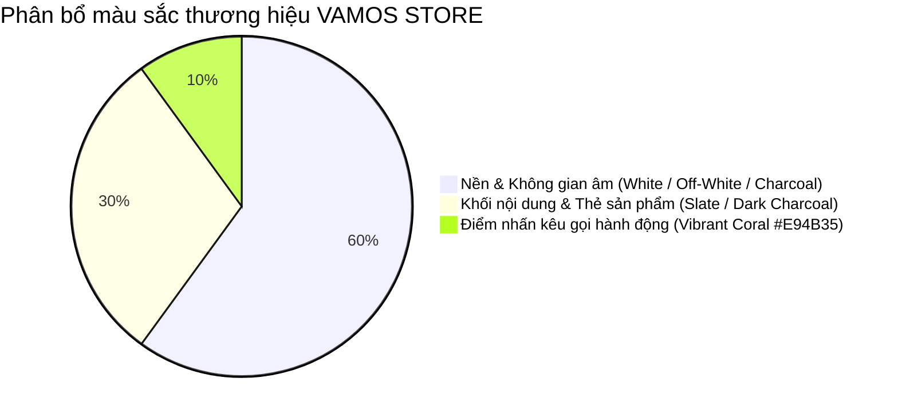

# HỆ THỐNG THIẾT KẾ GIAO DIỆN (DESIGN SYSTEM) - VAMOS STORE

> **Thương hiệu:** VAMOS  
> **Slogan:** MOVE YOUR WAY.  
> **Phong cách chủ đạo:** Trẻ trung, Năng động, Tối giản, Hiện đại (Athletic Lifestyle)  
> **Phiên bản:** v1.1 Chuẩn hóa  

---

## 1. BẢNG MÀU THƯƠNG HIỆU (BRAND COLOR PALETTE - QUY TẮC 60-30-10)

Hệ thống áp dụng nghiêm ngặt quy tắc phối màu 60-30-10 để tạo nên diện mạo ấn tượng, chuyên nghiệp và có bản sắc riêng, tránh hiện tượng giao diện nhạt nhòa hoặc lạm dụng quá nhiều màu sắc:



| Tên màu | Mã màu Hex | Tên Tailwind | Tỷ lệ | Vai trò trong hệ thống |
| :--- | :---: | :--- | :---: | :--- |
| **Dark Charcoal** | `#151515` | `bg-charcoal` / `slate-900` | 60% (Dark) | Thanh điều hướng Header, Footer, chữ tiêu đề chính, các mảng tương phản mạnh |
| **Pure White** | `#FFFFFF` | `bg-white` | 60% (Light) | Nền trang web, nền thẻ sản phẩm, khoảng trắng không gian âm (Negative space) |
| **Light Gray** | `#F8F9FA` | `bg-slate-50` / `gray-100` | 30% | Nền phụ, khu vực lọc sản phẩm, khung thông tin tóm tắt giỏ hàng |
| **Border Gray** | `#E2E8F0` | `border-slate-200` | 30% | Đường viền ngăn cách các khối, viền bảng dữ liệu, viền thẻ sản phẩm |
| **Vibrant Coral** | `#E94B35` | `bg-coral` / `orange-600` | **10%** | **Màu thương hiệu cốt lõi:** Nút bấm CTA chính ("Mua ngay", "Thanh toán"), Badge Sale, Giá khuyến mãi, Trạng thái đơn active |
| **Coral Hover** | `#D43823` | `hover:bg-coral-dark` | State | Trạng thái di chuột (Hover) của các nút bấm CTA chính |
| **Status Green** | `#10B981` | `emerald-600` | Feedback | Badge đơn hàng `COMPLETED`, thông báo thành công |
| **Status Blue** | `#3B82F6` | `blue-600` | Feedback | Badge đơn hàng `SHIPPING`, `PROCESSING` |
| **Status Amber** | `#F59E0B` | `amber-500` | Feedback | Badge đơn hàng `PENDING`, cảnh báo tồn kho thấp |
| **Status Red** | `#EF4444` | `red-600` | Feedback | Badge đơn hàng `CANCELLED`, thông báo lỗi |

---

## 2. QUY CHUẨN TYPOGRAPHY

- **Font Family:** `Inter`, `-apple-system`, `BlinkMacSystemFont`, `"Segoe UI"`, `Roboto`, `sans-serif`.
- **Hệ thống cấp bậc văn bản (Hierarchy):**
  - **Display H1 (Hero Banner / Slogan):** `text-4xl` hoặc `text-5xl` (36px - 48px), `font-extrabold`, `tracking-tight`. Dùng cho thông điệp chính thương hiệu VAMOS.
  - **Page Title H2:** `text-2xl` hoặc `text-3xl` (24px - 30px), `font-bold`, `text-slate-900`.
  - **Section Title H3:** `text-xl` (20px), `font-bold`, `text-slate-900`.
  - **Product Card Title:** `text-base` (16px), `font-semibold`, `text-slate-800`, `line-clamp-2`.
  - **Body Text:** `text-sm` (14px), `font-normal`, `text-slate-600`, `leading-relaxed`.
  - **Caption / Badge:** `text-xs` (12px), `font-medium`, `uppercase`, `tracking-wider`.

---

## 3. THƯ VIỆN THÀNH PHẦN GIAO DIỆN (UI COMPONENTS)

### 3.1. Nút bấm (Buttons)
- **Primary Coral CTA (Hành động chính):**
  ```html
  class="inline-flex items-center justify-center px-6 py-3 bg-[#E94B35] hover:bg-[#D43823] text-white text-sm font-semibold rounded-lg shadow-sm transition-colors duration-150"
  ```
- **Secondary Charcoal (Hành động phụ / Quản trị):**
  ```html
  class="inline-flex items-center justify-center px-4 py-2 bg-slate-900 hover:bg-slate-800 text-white text-sm font-medium rounded-lg transition-colors"
  ```
- **Outline Button (Hủy bỏ / Quay lại):**
  ```html
  class="inline-flex items-center justify-center px-4 py-2 border border-slate-300 hover:bg-slate-50 text-slate-700 text-sm font-medium rounded-lg transition-colors"
  ```

### 3.2. Huy hiệu Trạng thái (Status Badges)
- **Đơn hàng Chờ xác nhận (`PENDING`):**
  ```html
  class="inline-flex items-center px-2.5 py-0.5 rounded-full text-xs font-semibold bg-amber-50 text-amber-800 border border-amber-200"
  ```
- **Đơn hàng Hoàn thành (`COMPLETED`):**
  ```html
  class="inline-flex items-center px-2.5 py-0.5 rounded-full text-xs font-semibold bg-emerald-50 text-emerald-800 border border-emerald-200"
  ```
- **Đơn hàng Đã hủy (`CANCELLED`):**
  ```html
  class="inline-flex items-center px-2.5 py-0.5 rounded-full text-xs font-semibold bg-rose-50 text-rose-800 border border-rose-200"
  ```

### 3.3. Trường Nhập liệu (Form Controls)
- **Input chuẩn:**
  ```html
  class="w-full px-3.5 py-2.5 bg-white border border-slate-300 rounded-lg text-sm text-slate-900 placeholder-slate-400 focus:outline-none focus:ring-2 focus:ring-[#E94B35] focus:border-transparent transition-all"
  ```

---

## 4. QUY TẮC BẢO TOÀN CÚ PHÁP PUG
Khi sử dụng Pug template engine cùng các class Tailwind CSS có dấu chấm thập phân (ví dụ: `py-0.5`, `py-1.5`, `px-2.5`), **bắt buộc viết dưới dạng thuộc tính `(class="...")`** thay vì dot notation `.py-0.5` để tránh lỗi biên dịch cú pháp Pug.
