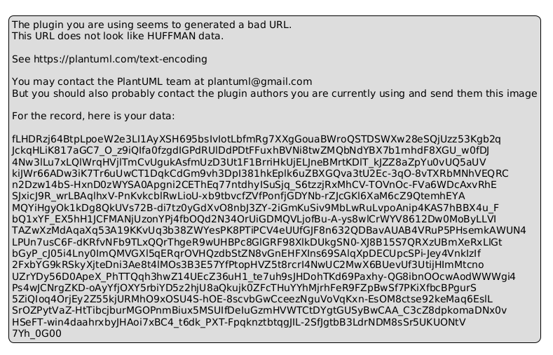
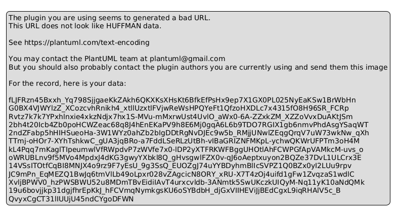
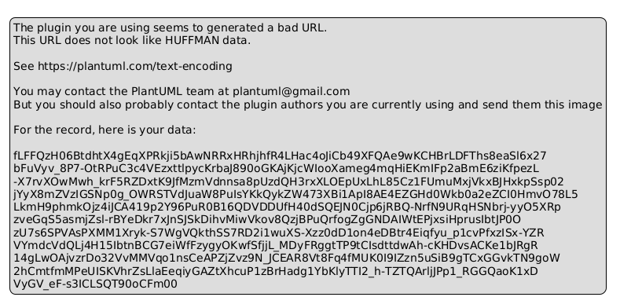
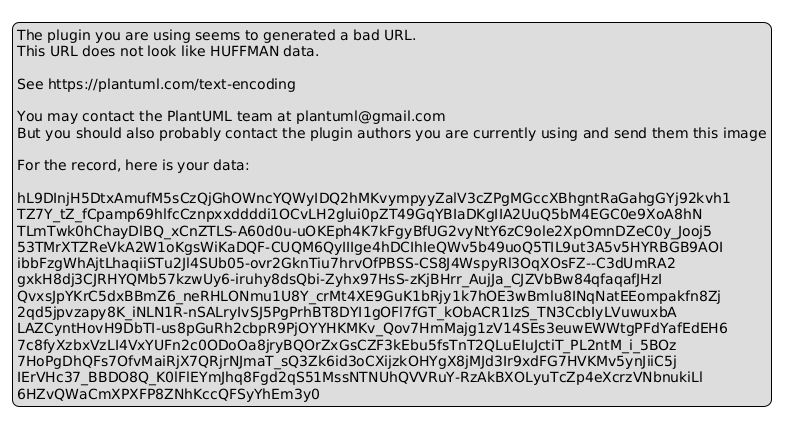
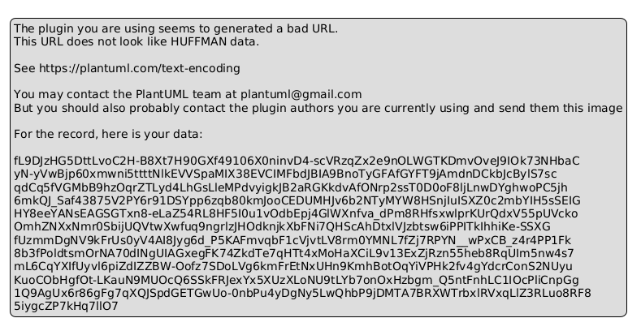

# BÁO CÁO THỰC HÀNH LAB 1: THIẾT KẾ SƠ ĐỒ USE CASE & ĐẶC TẢ USE CASE

> **Đơn vị đào tạo:** TRƯỜNG CAO ĐẲNG FPT POLYTECHNIC  
> **Dự án:** VAMOS STORE - Website thương mại điện tử chuyên kinh doanh giày sneaker, thể thao & sandal  
> **Slogan:** MOVE YOUR WAY.  
> **Sinh viên thực hiện:** Trần Trung Dũng  
> **Mã số sinh viên:** [MSSV của bạn]  
> **Giảng viên hướng dẫn:** [Họ và tên giảng viên]  
> **Phiên bản:** v1.1 Chuẩn hóa kiến trúc 3 Actors  

---

## 1. MỤC TIÊU & PHẠM VI LAB 1

- Xác định chính xác ranh giới hệ thống (**System Boundary**) và phân quyền bảo mật giữa các nhóm người dùng.
- Chuẩn hóa đúng **3 Primary Actors** trong hệ thống thương mại điện tử:
  1. **Khách vãng lai (`Guest`):** Người dùng truy cập hệ thống khi chưa đăng nhập.
  2. **Khách hàng (`Customer`):** Người dùng đã đăng nhập tài khoản cá nhân (kế thừa các quyền cơ bản của `Guest`).
  3. **Quản trị viên (`Admin`):** Người quản lý toàn diện sản phẩm, biến thể kho, đơn hàng và doanh thu.
  *(Tác nhân phụ - `Secondary Actor`: **Email Service** phụ trách gửi token khôi phục mật khẩu).*
- Xây dựng sơ đồ Use Case tổng quát (**14 Use Cases cốt lõi**) và 4 sơ đồ phân rã chi tiết tuân thủ triệt để chuẩn mực UML 2.5.
- Áp dụng chính xác quan hệ `<<include>>` (hành vi bắt buộc) và `<<extend>>` (hành vi mở rộng tùy chọn kèm điều kiện Extension Point).

---

## 2. SƠ ĐỒ USE CASE TỔNG QUÁT TOÀN HỆ THỐNG

Sơ đồ bao quát 14 Use Case được phân bổ cân đối vào 4 gói phân hệ nghiệp vụ, thể hiện rõ đường biên hệ thống và liên kết của 3 Actor.


*Hình 1.1: Sơ đồ Use Case tổng quát hệ thống VAMOS STORE (14 Use Cases)*

### Bảng Danh Mục 14 Use Cases Cốt Lõi

| Mã UC | Tên Use Case | Tác nhân chính (Actor) | Phân hệ nghiệp vụ | Mô tả tóm tắt | Độ ưu tiên |
| :---: | :--- | :--- | :--- | :--- | :---: |
| **UC-01** | Đăng ký tài khoản | Guest | Tài khoản & Xác thực | Đăng ký tài khoản với email độc nhất, băm mật khẩu bcrypt. | High |
| **UC-02** | Đăng nhập | Guest, Customer, Admin | Tài khoản & Xác thực | Xác thực danh tính, cấp phiên Session máy chủ bảo mật. | High |
| **UC-03** | Khôi phục mật khẩu | Guest (phụ: Email Svc) | Tài khoản & Xác thực | Gửi mã token xác thực qua email để đặt lại mật khẩu mới. | Medium |
| **UC-04** | Quản lý hồ sơ & địa chỉ | Customer | Tài khoản & Xác thực | Cập nhật thông tin cá nhân và quản lý sổ địa chỉ giao hàng. | High |
| **UC-05** | Tìm kiếm & xem sản phẩm | Guest, Customer | Mua sắm & Đặt hàng | Lọc đa tiêu chí (size, màu, giá, giới tính) và xem chi tiết giày. | High |
| **UC-06** | Quản lý giỏ hàng | Customer, Guest | Mua sắm & Đặt hàng | Thêm biến thể giày, chỉnh số lượng (1-10 đôi), đồng bộ giỏ hàng. | High |
| **UC-07** | Đặt hàng COD | Customer | Mua sắm & Đặt hàng | Chọn địa chỉ nhận, áp voucher, chốt đơn COD với Transaction. | High |
| **UC-08** | Tra cứu & theo dõi đơn | Customer | Đơn hàng cá nhân | Xem dòng thời gian trạng thái đơn hàng và snapshot sản phẩm. | High |
| **UC-09** | Hủy đơn hàng | Customer | Đơn hàng cá nhân | Khách hủy đơn khi ở trạng thái `PENDING`, tự động hoàn kho. | High |
| **UC-10** | Xử lý & cập nhật đơn hàng | Admin | Quản trị & Vận hành | Chuyển trạng thái đơn (`PENDING` $\rightarrow$ `COMPLETED`), hủy đơn nội bộ. | High |
| **UC-11** | Quản lý tồn kho | Admin | Quản trị & Vận hành | Theo dõi tồn kho theo SKU, cảnh báo hết hàng, điều chỉnh kho. | High |
| **UC-12** | Quản lý sản phẩm & danh mục | Admin | Quản trị & Vận hành | Quản lý danh mục, biến thể (Size/Màu/SKU) và ảnh sản phẩm. | High |
| **UC-13** | Quản lý mã giảm giá | Admin | Quản trị & Vận hành | Tạo voucher, giới hạn lượt dùng, quota 1 lần/khách (Q8). | Medium |
| **UC-14** | Xem báo cáo doanh thu | Admin | Quản trị & Vận hành | Báo cáo doanh thu thực tế chỉ ghi nhận từ đơn `COMPLETED`. | High |

---

## 3. CÁC SƠ ĐỒ USE CASE CHI TIẾT THEO PHÂN HỆ

### 3.1. Phân hệ Mua sắm & Đặt hàng COD (`UC-07`)

Phân tích quan hệ `<<include>>` và `<<extend>>` trong quy trình checkout đơn hàng bằng tiền mặt khi nhận hàng (COD):


*Hình 1.2: Sơ đồ Use Case chi tiết Đặt hàng COD & Giỏ hàng*

- **Quan hệ `<<include>>` (Bắt buộc phải thực hiện):**
  - `UC-07` $\rightarrow$ `Chọn địa chỉ giao hàng`: Khách bắt buộc phải chọn hoặc nhập địa chỉ người nhận trước khi tạo đơn.
  - `UC-07` $\rightarrow$ `Kiểm tra tồn kho biến thể`: Hệ thống bắt buộc khóa bi quan (`SELECT ... FOR UPDATE`) để kiểm tra số lượng tồn kho còn đủ hay không.
  - `UC-07` $\rightarrow$ `Xác nhận thanh toán COD`: Đơn hàng được tạo với phương thức COD và `payment_status = 'UNPAID'`.
- **Quan hệ `<<extend>>` (Mở rộng tùy chọn có điều kiện):**
  - `Áp dụng mã giảm giá (Voucher)` $\rightarrow$ `UC-07`: Chỉ kích hoạt khi khách hàng nhập mã hợp lệ, thỏa mãn giá trị đơn hàng tối thiểu và chưa dùng hết lượt (Q8).

---

### 3.2. Phân hệ Đơn hàng cá nhân (`UC-08` & `UC-09`)

Trực quan hóa luồng theo dõi dòng đời đơn hàng và quyền hủy đơn an toàn của khách hàng:


*Hình 1.3: Sơ đồ Use Case chi tiết Tra cứu & Hủy đơn hàng của khách hàng*

- **Quan hệ `<<include>>`:** `UC-08 (Tra cứu & theo dõi đơn hàng)` bắt buộc bao gồm chức năng `Xem lịch sử đơn hàng` để lấy snapshot chi tiết từng món đồ.
- **Quan hệ `<<extend>>`:** `UC-09 (Hủy đơn hàng)` là nhánh mở rộng có điều kiện của `UC-08`: **Chỉ cho phép hủy khi trạng thái đơn hàng đang là `PENDING`**. Sau khi hủy, hệ thống kích hoạt tự động hoàn kho (`ORDER_CANCELLED_RESTOCK`).

---

### 3.3. Phân hệ Vận hành & Cập nhật trạng thái đơn hàng Admin (`UC-10`)

Quản trị viên tiếp nhận và vận hành đơn hàng qua 5 trạng thái tuần tự:


*Hình 1.4: Sơ đồ Use Case chi tiết Quản lý & Vận hành đơn hàng của Admin*

- **Quan hệ `<<include>>`:** `UC-10` bắt buộc bao gồm chức năng `Xem danh sách đơn hàng` để tra cứu thông tin vận chuyển và liên hệ người nhận.
- **Quan hệ `<<extend>>`:** Nhánh `Hủy đơn hàng nội bộ` được kích hoạt khi Admin liên hệ khách không được hoặc khách yêu cầu hủy qua hotline. Hành động này tự động hoàn trả số lượng biến thể về kho.

---

### 3.4. Phân hệ Quản trị Sản phẩm & Tồn kho (`UC-11` & `UC-12`)

Mô hình quản lý sản phẩm giày dép đa biến thể Kích cỡ (Size) x Màu sắc (Color):


*Hình 1.5: Sơ đồ Use Case chi tiết Quản lý Sản phẩm, Biến thể và Tồn kho*

- **Quan hệ `<<include>>`:** `UC-12 (Quản lý sản phẩm & danh mục)` bắt buộc phải thực hiện `Quản lý biến thể size/màu` và `Quản lý hình ảnh sản phẩm` (vì giày không thể bán nếu không gắn với size và màu sắc cụ thể).
- **Quan hệ `<<extend>>`:** `Điều chỉnh tồn kho` mở rộng từ `UC-11 (Quản lý tồn kho)`: Kích hoạt khi kiểm kê thực tế có sai lệch; **bắt buộc phải ghi rõ lý do kiểm toán** vào bảng `inventory_transactions`.

---

## 4. QUY CHUẨN UML 2.5 ĐƯỢC TUÂN THỦ

1. **Ranh giới hệ thống rõ ràng (System Boundary):** Bao bọc toàn bộ Use Case bên trong khung hình chữ nhật, các Actor đứng bên ngoài.
2. **Kế thừa tác nhân (Actor Generalization):** `Customer` kế thừa (`generalizes`) từ `Guest`, đảm bảo không trùng lặp các liên kết đến các Use Case xem sản phẩm, đăng ký, đăng nhập.
3. **Mũi tên quan hệ chuẩn mực:**
   - `<<include>>`: Mũi tên nét đứt hướng từ Base Use Case tới Included Use Case.
   - `<<extend>>`: Mũi tên nét đứt hướng từ Extension Use Case về Base Use Case, có ghi chú rõ điều kiện Extension Point trong ngoặc vuông `[condition]`.
4. **Không phân rã chức năng (No Functional Decomposition):** Gom các thao tác CRUD hoặc tìm kiếm/lọc nhỏ lẻ vào Use Case mức doanh nghiệp.

---

## 5. DANH MỤC HỒ SƠ NỘP BÀI LAB 1

```
labs/Lab 1 - Usecase/
├── images/                               # Thư mục hình ảnh sơ đồ độ phân giải cao
│   ├── uc-00-overview.png                # Ảnh sơ đồ Use Case tổng quát
│   ├── uc-01-checkout-detail.png         # Ảnh chi tiết Đặt hàng COD
│   ├── uc-02-customer-orders-detail.png  # Ảnh chi tiết Đơn hàng cá nhân
│   ├── uc-03-order-operations-detail.png # Ảnh chi tiết Vận hành Admin
│   ├── uc-04-catalog-inventory-detail.png# Ảnh chi tiết Sản phẩm & Kho
│   ├── fpt_polytechnic_logo.jpg          # Logo chuẩn FPT Polytechnic
│   └── fpt_assignment_border.png         # Khung viền trang bìa
├── BAO_CAO_LAB1_PRINT.html               # Báo cáo in ấn xuất PDF chuẩn A4 (1-Click Print)
├── README_LAB1.md                        # Báo cáo tổng quan Lab 1 (file hiện tại)
├── 03-use-case-catalog.md                # Bảng danh mục 14 Use Case chi tiết
├── 04-use-case-specifications.md         # Bản đặc tả kịch bản tiền/hậu điều kiện, luồng xử lý
├── plan.md                               # Kế hoạch & Đặc tả bài toán tổng thể v1.1
├── uc-00-overview.puml                   # Mã nguồn PlantUML sơ đồ tổng quát
├── uc-01-checkout-detail.puml            # Mã nguồn PlantUML đặt hàng COD
├── uc-02-customer-orders-detail.puml     # Mã nguồn PlantUML đơn hàng cá nhân
├── uc-03-order-operations-detail.puml    # Mã nguồn PlantUML vận hành đơn hàng Admin
└── uc-04-catalog-inventory-detail.puml   # Mã nguồn PlantUML quản trị sản phẩm & kho
```
