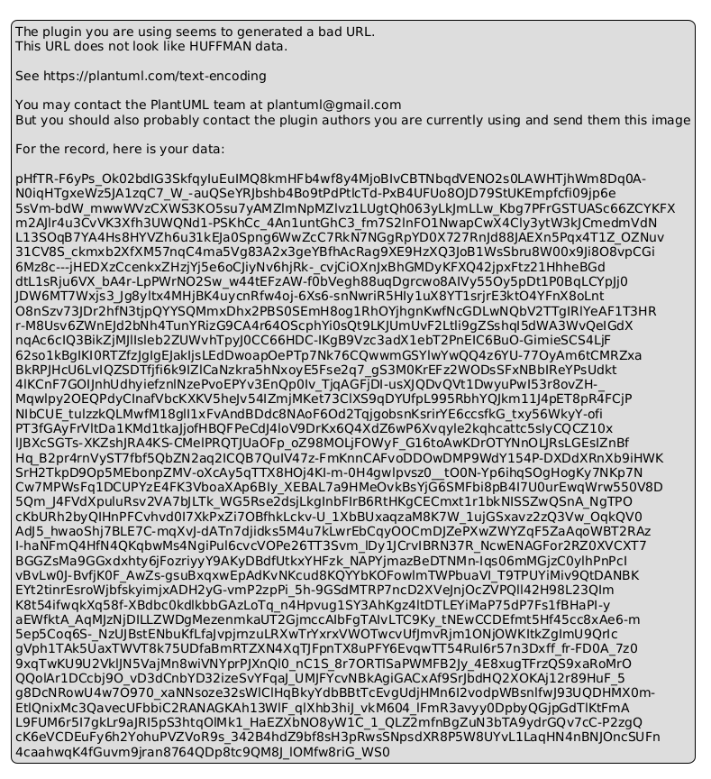

# BÁO CÁO THỰC HÀNH LAB 2: MÔ HÌNH THỰC THỂ QUAN HỆ (ERD) & THIẾT KẾ DATABASE

> **Đơn vị đào tạo:** TRƯỜNG CAO ĐẲNG FPT POLYTECHNIC  
> **Dự án:** VAMOS STORE - Website thương mại điện tử chuyên kinh doanh giày sneaker, thể thao & sandal  
> **Slogan:** MOVE YOUR WAY.  
> **Sinh viên thực hiện:** Trần Trung Dũng  
> **Mã số sinh viên:** [MSSV của bạn]  
> **Giảng viên hướng dẫn:** [Họ và tên giảng viên]  
> **Quy mô CSDL:** 18 Thực thể quan hệ chuẩn hóa 3NF, hỗ trợ MySQL 8.0 & Microsoft SQL Server 2025  

---

## 1. MỤC TIÊU & YÊU CẦU THIẾT KẾ CƠ SỞ DỮ LIỆU LAB 2

- Thiết kế hoàn thiện sơ đồ Thực thể Quan hệ (**ERD - Entity Relationship Diagram**) theo chuẩn ký hiệu Crow's Foot.
- Chuẩn hóa CSDL đạt dạng chuẩn 3 (**3NF - Third Normal Form**), loại bỏ triệt để hiện tượng dư thừa dữ liệu và dị thường khi thêm/xóa/sửa (Anomalies).
- Thực thi nghiêm ngặt các nguyên tắc bất biến trong hệ thống E-commerce thực tế:
  1. **Pattern Snapshot Đơn hàng:** `order_items` lưu cứng tên sản phẩm, mã SKU, size, màu sắc, đơn giá tại thời điểm đặt hàng. `orders` lưu snapshot địa chỉ nhận hàng và thông tin voucher. Ngăn chặn tuyệt đối việc giá sản phẩm thay đổi trong tương lai làm sai lệch doanh thu lịch sử.
  2. **Quản lý biến thể giày dép độc lập:** Tách rời `products` (thông tin chung) và `product_variants` (từng cặp Kích cỡ x Màu sắc x SKU x Tồn kho thực tế), bảo đảm ràng buộc toàn vẹn `UNIQUE(product_id, size_id, color_id)`.
  3. **Kiểm soát kho & Race Condition:** Ràng buộc `stock_quantity >= 0` ngăn bán âm kho; ghi nhận mọi biến động xuất nhập tồn vào `inventory_transactions`.
  4. **Kiểm soát mã giảm giá (Q8):** Bảng `voucher_usages` lưu vết `(voucher_id, user_id)` bảo đảm mỗi khách hàng chỉ áp dụng voucher khuyến mãi đúng 1 lần duy nhất.

---

## 2. SƠ ĐỒ THỰC THỂ QUAN HỆ TOÀN DIỆN (ERD 18 BẢNG)

Dưới đây là sơ đồ ERD chi tiết toàn bộ 18 thực thể, thể hiện đầy đủ khóa chính (PK), khóa ngoại (FK), các chỉ mục hiệu năng (INDEX) và quan hệ liên kết 1-N, N-N:


*Hình 2.1: Sơ đồ Thực thể Quan hệ (ERD) toàn diện 18 bảng - VAMOS STORE*

---

## 3. BẢNG PHÂN BỔ 18 THỰC THỂ THEO PHÂN HỆ

| STT | Tên bảng (Table) | Tên tiếng Việt | Khóa chính (PK) | Mục đích nghiệp vụ cốt lõi |
| :---: | :--- | :--- | :--- | :--- |
| **I** | **NHÓM NGƯỜI DÙNG & XÁC THỰC** | | | |
| 1 | `users` | Tài khoản người dùng | `id` | Lưu email, mật khẩu băm bcrypt 10 vòng, vai trò (`CUSTOMER`, `ADMIN`), trạng thái (`active`, `locked`). |
| 2 | `user_profiles` | Hồ sơ chi tiết | `user_id` (1-1) | Lưu họ tên, số điện thoại, ngày sinh, giới tính của người dùng. |
| 3 | `addresses` | Sổ địa chỉ giao hàng | `id` | Danh sách các địa chỉ nhận hàng của khách, cờ `is_default`. |
| 4 | `password_resets` | Mã khôi phục mật khẩu | `id` | Lưu token ngẫu nhiên bảo mật, thời hạn hết hạn 15 phút. |
| **II** | **NHÓM SẢN PHẨM & BIẾN THỂ** | | | |
| 5 | `categories` | Danh mục sản phẩm | `id` | Phân cấp danh mục (Sneaker Nam, Sneaker Nữ, Giày Thể Thao, Sandal & Dép). |
| 6 | `brands` | Thương hiệu sản xuất | `id` | Thương hiệu giày dép đối tác và dòng sản phẩm riêng VAMOS. |
| 7 | `sizes` | Bảng kích cỡ giày | `id` | Kích thước EU chuẩn (38, 39, 40, 41, 42, 43, 44). |
| 8 | `colors` | Bảng màu sắc giày | `id` | Tên màu và mã Hex màu trực quan hiển thị ngoài giao diện. |
| 9 | `products` | Sản phẩm chính | `id` | Tên giày, slug SEO, mã SP, giá niêm yết, giá khuyến mãi, trạng thái hiển thị. |
| 10 | `product_variants` | Biến thể giày chi tiết | `id` | Ma trận Kích cỡ x Màu sắc x Mã SKU x Số lượng tồn kho x Giá phụ thu. |
| 11 | `product_images` | Thư viện hình ảnh | `id` | Danh sách URL ảnh sản phẩm, ảnh đại diện `is_primary`, thứ tự sắp xếp. |
| **III** | **NHÓM GIỎ HÀNG** | | | |
| 12 | `carts` | Giỏ hàng người dùng | `id` | Giỏ hàng gán với từng `user_id`, hỗ trợ hợp nhất từ giỏ hàng khách vãng lai. |
| 13 | `cart_items` | Chi tiết món hàng giỏ | `id` | Biến thể được chọn và số lượng mua (giới hạn từ 1 đến 10 đôi/sản phẩm theo Q7). |
| **IV** | **NHÓM ĐƠN HÀNG & THANH TOÁN COD** | | | |
| 14 | `orders` | Đơn đặt hàng | `id` | Mã đơn (VAM...), thông tin người nhận snapshot, trạng thái 5 bước, tổng tiền COD. |
| 15 | `order_items` | Chi tiết sản phẩm đơn | `id` | Snapshot cứng tên giày, SKU, size, màu, đơn giá tại thời điểm chốt đơn. |
| 16 | `order_status_history`| Lịch sử trạng thái | `id` | Ghi vết thời gian và người thay đổi trạng thái đơn hàng (Audit Trail). |
| **V** | **NHÓM KHUYẾN MÃI & KIỂM TOÁN KHO** | | | |
| 17 | `vouchers` | Mã giảm giá | `id` | Mã voucher, loại giảm (tiền/phần trăm), đơn tối thiểu, số lượng giới hạn. |
| 18 | `voucher_usages` | Lịch sử dùng voucher | `id` | Ràng buộc mỗi tài khoản chỉ được dùng mã đúng 1 lần (Q8). |
| 19 | `inventory_transactions` | Nhật ký xuất nhập tồn | `id` | Ghi vết tăng giảm tồn kho kèm lý do (Bán hàng, Khách hủy, Kiểm kê). |

---

## 4. CHI TIẾT TỪ ĐIỂN DỮ LIỆU & RÀNG BUỘC TOÀN VẸN (CONSTRAINTS)

### 4.1. Khóa ngoại và Hành vi bảo vệ lịch sử giao dịch (ON DELETE RESTRICT)

Để đảm bảo tính toàn vẹn của sổ sách kế toán và lịch sử giao dịch bán lẻ:
- **`orders` $\rightarrow$ `users`:** `ON DELETE RESTRICT`. Tuyệt đối không cho phép xóa tài khoản người dùng nếu tài khoản đó đã từng phát sinh đơn hàng.
- **`order_items` $\rightarrow$ `product_variants`:** `ON DELETE RESTRICT`. Không xóa biến thể nếu biến thể đó đã nằm trong đơn hàng lịch sử.
- **`product_variants` $\rightarrow$ `products`:** `ON DELETE CASCADE`. Khi xóa sản phẩm cha chưa có giao dịch, toàn bộ biến thể con và ảnh sẽ tự động được dọn dẹp an toàn.

### 4.2. Ràng buộc kiểm tra tài chính (CHECK CONSTRAINTS)

- `base_price > 0`: Giá bán niêm yết của giày bắt buộc phải lớn hơn 0.
- `sale_price >= 0 AND sale_price <= base_price`: Giá khuyến mãi không được âm và không được vượt quá giá gốc.
- `stock_quantity >= 0`: Số lượng tồn kho biến thể không bao giờ được âm.
- `quantity >= 1 AND quantity <= 10`: Giới hạn mua bán lẻ từ 1 đến tối đa 10 đôi trên một món hàng giỏ (Q7).

---

## 5. DANH MỤC FILE NỘP TRONG LAB 2

```
labs/Lab 2 - ERD/
├── images/                           # Thư mục hình ảnh sơ đồ CSDL sắc nét
│   ├── vamos_store_erd.png           # Bản vẽ sơ đồ ERD 18 bảng độ phân giải cao
│   ├── fpt_polytechnic_logo.jpg      # Logo chuẩn FPT Polytechnic
│   └── fpt_assignment_border.png     # Khung viền bìa học thuật
├── BAO_CAO_LAB2_PRINT.html           # Báo cáo in ấn xuất PDF chuẩn A4 (1-Click Print)
├── README_LAB2.md                    # Báo cáo tổng quan Lab 2 (file hiện tại)
├── schema.sql                        # Mã nguồn SQL DDL tạo 18 bảng, index, constraints
├── data-dictionary.md                # Từ điển dữ liệu chi tiết từng cột của 18 bảng
├── database-design-review.md         # Bản thuyết minh kiến trúc và giải pháp xử lý tranh chấp
└── vamos_store_erd.puml              # Mã nguồn PlantUML sơ đồ ERD chuẩn
```
