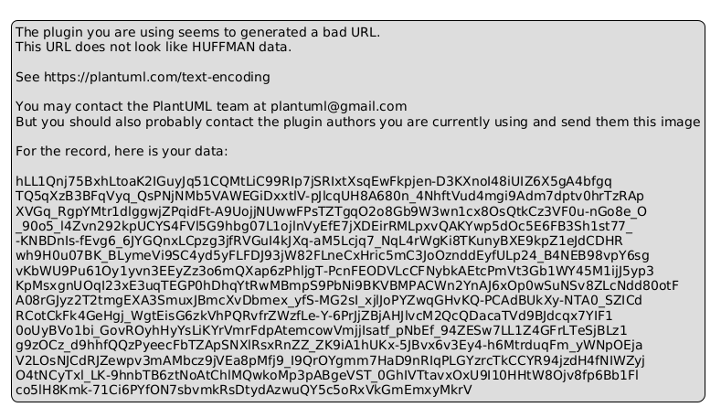
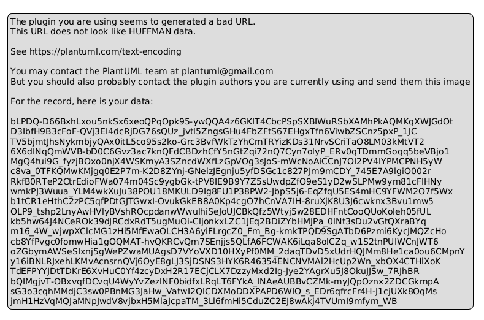
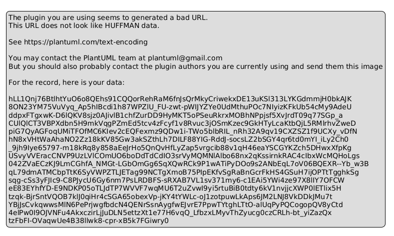
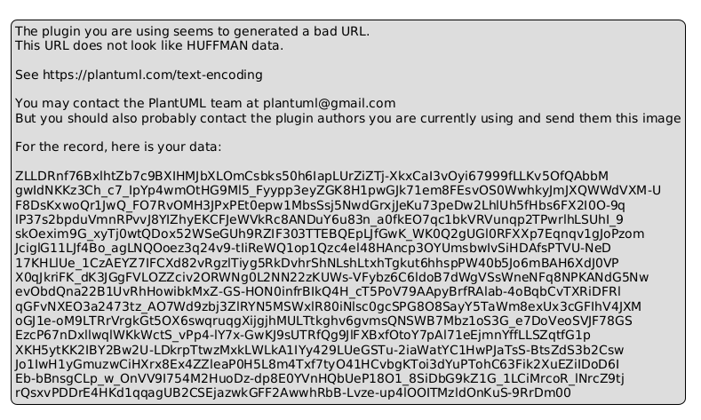
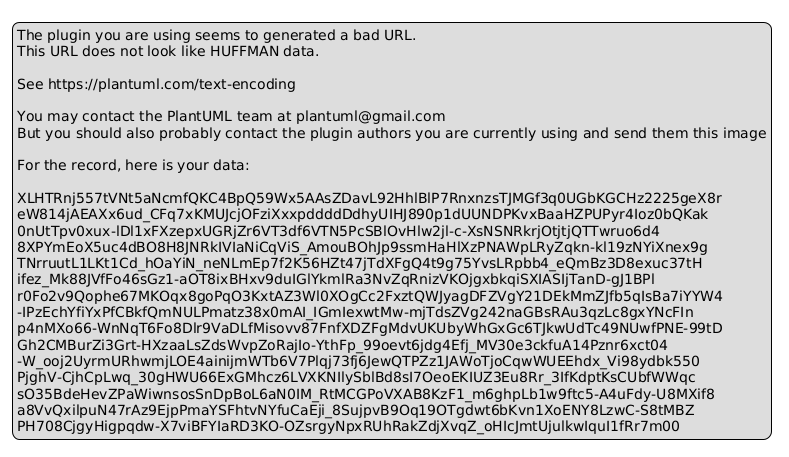

# BÁO CÁO THỰC HÀNH LAB 3: THIẾT KẾ SƠ ĐỒ HOẠT ĐỘNG (ACTIVITY DIAGRAM)

> **Đơn vị đào tạo:** TRƯỜNG CAO ĐẲNG FPT POLYTECHNIC  
> **Dự án:** VAMOS STORE - Website thương mại điện tử chuyên kinh doanh giày sneaker, thể thao & sandal  
> **Slogan:** MOVE YOUR WAY.  
> **Sinh viên thực hiện:** Trần Trung Dũng  
> **Mã số sinh viên:** [MSSV của bạn]  
> **Giảng viên hướng dẫn:** [Họ và tên giảng viên]  
> **Quy chuẩn UML:** 5 Sơ đồ hoạt động chuẩn hóa luồng điều khiển (Control Flow) và Swimlanes đa tác nhân  

---

## 1. MỤC TIÊU & PHẠM VI LAB 3

- Trực quan hóa dòng chảy dữ liệu và quyền hạn xử lý giữa Người dùng (`Guest`, `Customer`, `Admin`) và Phía máy chủ (`Node.js/Express`, `Database Transaction`).
- Áp dụng các thành phần chuẩn của sơ đồ hoạt động UML:
  - **Swimlanes (Làn bơi phân định trách nhiệm):** Phân định ranh giới giữa Client (Giao diện người dùng) và Server/DB (Máy chủ xử lý).
  - **Initial & Final Nodes (Nút bắt đầu và Nút kết thúc):** Điểm khởi đầu và hoàn tất quy trình.
  - **Decision Nodes (Nút điều kiện rẽ nhánh):** Thể hiện các kịch bản kiểm tra logic, validate form, kiểm tra tồn kho và các luồng ngoại lệ.
  - **Fork & Join Nodes (Phân nhánh và Đồng bộ):** Thực thi các tác vụ song song trong cùng transaction.

---

## 2. CHI TIẾT 5 SƠ ĐỒ HOẠT ĐỘNG CỐT LÕI

### 2.1. AD-01: Quy trình Đăng ký & Đăng nhập (Auth Flow)

Sơ đồ mô tả quy trình tiếp nhận thông tin người dùng, kiểm tra định dạng email chuẩn regex, kiểm tra email trùng trong database, băm mật khẩu bảo mật bằng thư viện `bcrypt` (10 rounds) và cấp phát Cookie phiên làm việc `vamos_sid`:


*Hình 3.1: Sơ đồ hoạt động quy trình Đăng ký, Đăng nhập và Cấp Session bảo mật*

- **Làn bơi (Swimlanes):** Người dùng (Client) | Máy chủ hệ thống (Server) | Cơ sở dữ liệu (Database).
- **Điểm rẽ nhánh (Decision nodes):**
  - Email đúng định dạng regex và mật khẩu $\ge$ 6 ký tự? $\rightarrow$ Nếu sai: Trả về thông báo lỗi trực tiếp trên giao diện.
  - Email đã tồn tại trong CSDL chưa? $\rightarrow$ Nếu trùng: Báo lỗi *"Email đã được sử dụng"*.
  - Mật khẩu nhập vào khớp với hash bcrypt trong CSDL? $\rightarrow$ Nếu khớp: Khởi tạo session an toàn, chống Session Fixation bằng `req.session.regenerate()`.

---

### 2.2. AD-02: Quy trình Đặt hàng Thanh toán COD (Checkout COD Flow)

Trực quan hóa luồng nghiệp vụ tạo đơn hàng bằng tiền mặt khi nhận hàng (COD), cơ chế khóa bi quan kiểm tra số lượng tồn kho và cập nhật trong Database Transaction an toàn tuyệt đối:


*Hình 3.2: Sơ đồ hoạt động quy trình Đặt hàng COD và Khóa bi quan trừ tồn kho*

- **Làn bơi:** Khách hàng (Customer) | Hệ thống bán hàng (Checkout Service) | CSDL (Transaction & Lock).
- **Cơ chế chống Overselling:**
  - Bắt đầu Transaction (`BEGIN TRANSACTION`).
  - Khóa bi quan dòng biến thể bằng câu lệnh: `SELECT stock_quantity FROM product_variants WITH (UPDLOCK, ROWLOCK) WHERE id = @variantId`.
  - Nếu `stock_quantity < buy_quantity`: Rollback toàn bộ và trả về thông báo lỗi hết hàng.
  - Nếu đủ hàng: Thực hiện trừ tồn kho `stock_quantity = stock_quantity - buy_quantity`, tạo bản ghi đơn hàng snapshot, xóa giỏ hàng và `COMMIT TRANSACTION`.

---

### 2.3. AD-03: Quy trình Máy trạng thái xử lý Đơn hàng (Order Processing Flow)

Vận hành đơn hàng tuần tự 5 bước theo ma trận chuyển đổi trạng thái nghiêm ngặt, ngăn chặn các hành vi nhảy cóc hoặc đảo ngược trạng thái phi lý:


*Hình 3.3: Sơ đồ hoạt động quy trình Máy trạng thái đơn hàng (Order State Machine)*

- **5 Bước trạng thái chuẩn:**
  $$\text{PENDING} \longrightarrow \text{CONFIRMED} \longrightarrow \text{PROCESSING} \longrightarrow \text{SHIPPING} \longrightarrow \text{COMPLETED}$$
- **Quy tắc thanh toán COD:** Đơn hàng COD chỉ được chuyển sang `payment_status = 'PAID'` khi và chỉ khi đơn hàng đã đạt trạng thái `COMPLETED` (Giao hàng thành công và thu tiền).
- **Lưu vết:** Mọi bước chuyển đổi trạng thái đều được ghi nhận vào `order_status_history` kèm ID người thực hiện và thời gian chính xác.

---

### 2.4. AD-04: Quy trình Hủy đơn hàng và Hoàn kho tự động (Order Cancellation & Restock)

Xử lý kịch bản khách hàng tự hủy đơn hoặc Quản trị viên hủy đơn nội bộ, đi kèm cơ chế tự động cộng trả lại số lượng giày vào kho hàng:


*Hình 3.4: Sơ đồ hoạt động quy trình Hủy đơn hàng và Tự động hoàn kho*

- **Điều kiện khách hủy:** Đơn hàng bắt buộc phải đang ở trạng thái `PENDING`. Nếu đơn đã sang `CONFIRMED` hoặc `SHIPPING`, khách hàng không thể tự hủy qua web mà phải liên hệ tổng đài.
- **Hoàn kho tự động trong Transaction:**
  - Cập nhật trạng thái `orders.order_status = 'CANCELLED'`.
  - Đọc danh sách `order_items` và cộng bù lại số lượng tương ứng vào `product_variants.stock_quantity`.
  - Ghi bản ghi kiểm toán vào `inventory_transactions` với loại `ORDER_CANCELLED_RESTOCK`.
  - Hoàn trả lượt sử dụng voucher nếu đơn hàng có áp dụng mã giảm giá (xóa dòng ghi nhận trong `voucher_usages`).

---

### 2.5. AD-05: Quy trình Kiểm kê & Điều chỉnh tồn kho Admin (Inventory Adjustment Flow)

Quy trình quản lý kho hàng thực tế của Quản trị viên khi phát hiện hàng hóa bị hao hụt, hỏng hóc hoặc nhập bổ sung từ nhà xưởng:


*Hình 3.5: Sơ đồ hoạt động quy trình Kiểm kê và Điều chỉnh tồn kho có lưu vết*

- **Làn bơi:** Quản trị viên (Admin) | Giao diện Kho (Admin Portal) | CSDL (Audit Ledger).
- **Ràng buộc kiểm toán:** Admin bắt buộc phải nhập số lượng điều chỉnh mới ($\ge 0$) và **bắt buộc chọn hoặc ghi rõ lý do kiểm kê** (Kiểm kê định kỳ, Giày lỗi nhà sản xuất, Bổ sung hàng mới).
- Số lượng mới được cập nhật vào `product_variants`, đồng thời tạo một bản ghi bất biến trong `inventory_transactions` để ban giám đốc đối soát.

---

## 3. DANH MỤC FILE NỘP TRONG LAB 3

```
labs/Lab 3 - Activity Diagram/
├── images/                               # Thư mục hình ảnh sơ đồ hoạt động độ phân giải cao
│   ├── ad-01-auth.png                    # Ảnh sơ đồ quy trình Đăng ký / Đăng nhập
│   ├── ad-02-checkout-cod.png            # Ảnh sơ đồ quy trình Đặt hàng COD
│   ├── ad-03-order-processing.png        # Ảnh sơ đồ quy trình Máy trạng thái đơn hàng
│   ├── ad-04-order-cancellation.png      # Ảnh sơ đồ quy trình Hủy đơn & Hoàn kho
│   ├── ad-05-inventory-adjustment.png    # Ảnh sơ đồ quy trình Kiểm kê kho Admin
│   ├── fpt_polytechnic_logo.jpg          # Logo FPT Polytechnic
│   └── fpt_assignment_border.png         # Khung viền trang bìa
├── BAO_CAO_LAB3_PRINT.html               # Báo cáo in ấn xuất PDF chuẩn A4 (1-Click Print)
├── README_LAB3.md                        # Báo cáo tổng quan Lab 3 (file hiện tại)
├── ad-01-auth.puml                       # Mã nguồn PlantUML quy trình Auth
├── ad-02-checkout-cod.puml               # Mã nguồn PlantUML đặt hàng COD
├── ad-03-order-processing.puml           # Mã nguồn PlantUML xử lý đơn hàng
├── ad-04-order-cancellation.puml         # Mã nguồn PlantUML hủy đơn & hoàn kho
└── ad-05-inventory-adjustment.puml       # Mã nguồn PlantUML kiểm kê kho
```
