# BÁO CÁO THỰC HÀNH LAB 4: THIẾT KẾ GIAO DIỆN & ĐẶC TẢ MÀN HÌNH (WIREFRAME & UI SPECS)

> **Đơn vị đào tạo:** TRƯỜNG CAO ĐẲNG FPT POLYTECHNIC  
> **Dự án:** VAMOS STORE - Website thương mại điện tử chuyên kinh doanh giày sneaker, thể thao & sandal  
> **Slogan:** MOVE YOUR WAY.  
> **Sinh viên thực hiện:** Trần Trung Dũng  
> **Mã số sinh viên:** [MSSV của bạn]  
> **Giảng viên hướng dẫn:** [Họ và tên giảng viên]  
> **Phong cách UI/UX:** Modern Kinetic UI, tỉ lệ màu 60-30-10, Responsive đa thiết bị  

---

## 1. MỤC TIÊU & ĐỊNH HƯỚNG THIẾT KẾ GIAO DIỆN LAB 4

- Xây dựng cấu trúc cây điều hướng website (**Sitemap**) phân tầng rõ ràng giữa khu vực Khách hàng (**Storefront**) và khu vực Quản trị (**Admin Portal**).
- Thiết kế hoàn thiện bộ khung giao diện (**Wireframe & Visual UI**) cho 10 màn hình quan trọng nhất của hệ thống VAMOS STORE.
- Tuân thủ quy chuẩn thiết kế sản phẩm thương mại điện tử cao cấp:
  - **Bảng màu nhận diện:** Nền trắng `#FFFFFF` (60%), chữ than chì `#111827` (30%), màu đỏ điểm nhấn `#E11B22` (10% - chỉ dành cho CTA chính, giá sale và badge quan trọng).
  - **Tối ưu hình ảnh sản phẩm:** Ảnh giày thể thao dùng tỉ lệ `aspect-square`, `object-contain` trên nền studio trắng tinh khiết nhằm làm nổi bật kiểu dáng sản phẩm.
  - **Bảng ma trận kích cỡ & Trạng thái tồn kho (Q1):** Kích cỡ còn $\le$ 5 đôi hiển thị badge `🔥 Chỉ còn [X] đôi`. Cỡ giày hết hàng hiển thị gạch chéo `/` và bị vô hiệu hóa `disabled`.

---

## 2. SƠ ĐỒ ĐIỀU HƯỚNG MÀN HÌNH TOÀN HỆ THỐNG (SITEMAP)

Sơ đồ cây phân cấp thể hiện toàn bộ các luồng di chuyển của người dùng từ Trang chủ qua các danh mục, chi tiết sản phẩm, giỏ hàng, đặt hàng và khu vực quản trị:

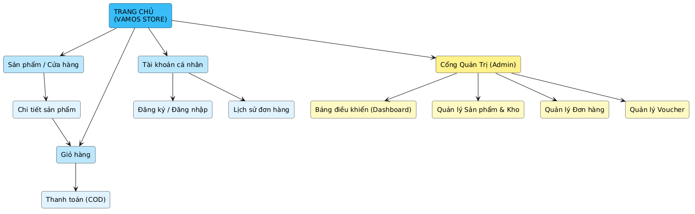
*Hình 4.0: Sơ đồ cấu trúc cây điều hướng màn hình (Sitemap) - VAMOS STORE*

---

## 3. CHI TIẾT 10 MÀN HÌNH WIREFRAME & ĐẶC TẢ LINH KIỆN

### 3.1. UI-01: Trang chủ (Home Page)
- **Mục đích:** Giới thiệu bộ sưu tập mới, banner khuyến mãi, danh mục nổi bật, sản phẩm hot và các cam kết thương hiệu (Giao hàng COD, Đổi size 7 ngày).
- **Quyền truy cập:** `Guest`, `Customer`.

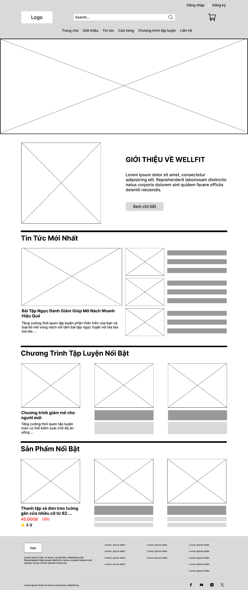
*Hình 4.1: Bản vẽ thiết kế giao diện Trang chủ (Home Page)*

---

### 3.2. UI-02: Cửa hàng & Bộ lọc đa tiêu chí (Shop & Filter)
- **Mục đích:** Khách hàng duyệt danh mục, tìm kiếm theo từ khóa, lọc kết hợp nhiều điều kiện (Giới tính, Kích cỡ, Khoảng giá, Khuyến mãi) và sắp xếp theo giá/độ mới.
- **Quyền truy cập:** `Guest`, `Customer`.

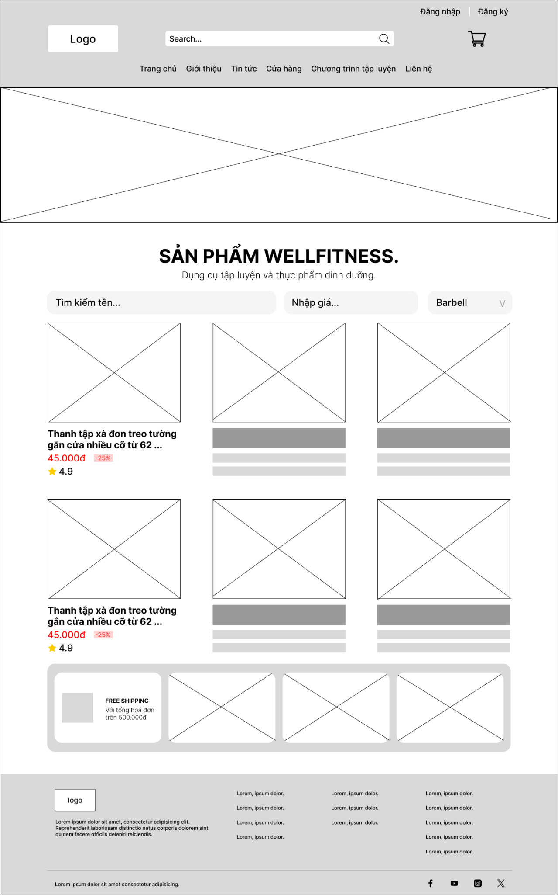
*Hình 4.2: Bản vẽ thiết kế giao diện Cửa hàng và Bộ lọc đa tiêu chí*

---

### 3.3. UI-03: Chi tiết sản phẩm & Chọn Size/Màu (Product Detail)
- **Mục đích:** Hiển thị thông số kỹ thuật giày, bộ sưu tập ảnh đa góc độ, chọn Size x Màu sắc, hiển thị cảnh báo tồn kho realtime và nút "Thêm vào giỏ" / "Mua ngay".
- **Quyền truy cập:** `Guest`, `Customer`.

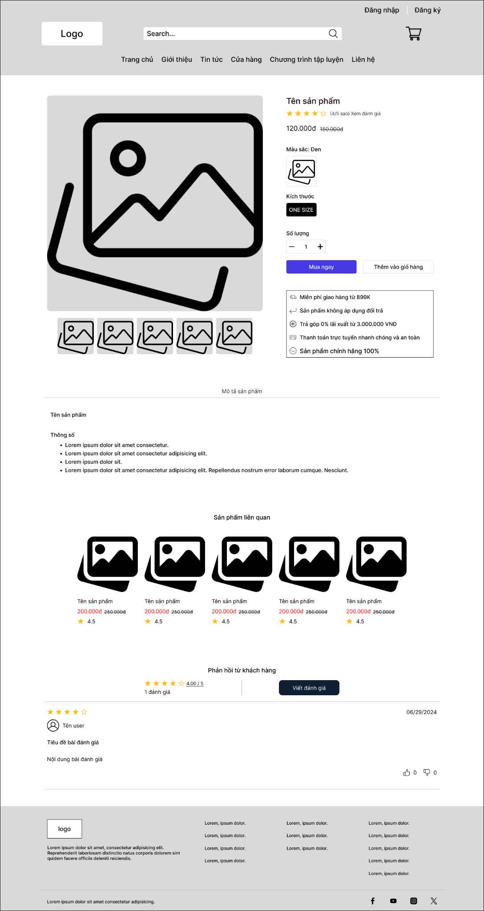
*Hình 4.3: Bản vẽ thiết kế giao diện Chi tiết sản phẩm & Bộ chọn biến thể Size/Màu*

---

### 3.4. UI-04: Giỏ hàng trực tuyến (Shopping Cart)
- **Mục đích:** Xem danh sách giày đã chọn, điều chỉnh số lượng (chặn tối đa 10 đôi theo Q7), kiểm tra giá tiền và đồng bộ giỏ hàng vãng lai sau khi đăng nhập.
- **Quyền truy cập:** `Customer`, `Guest`.

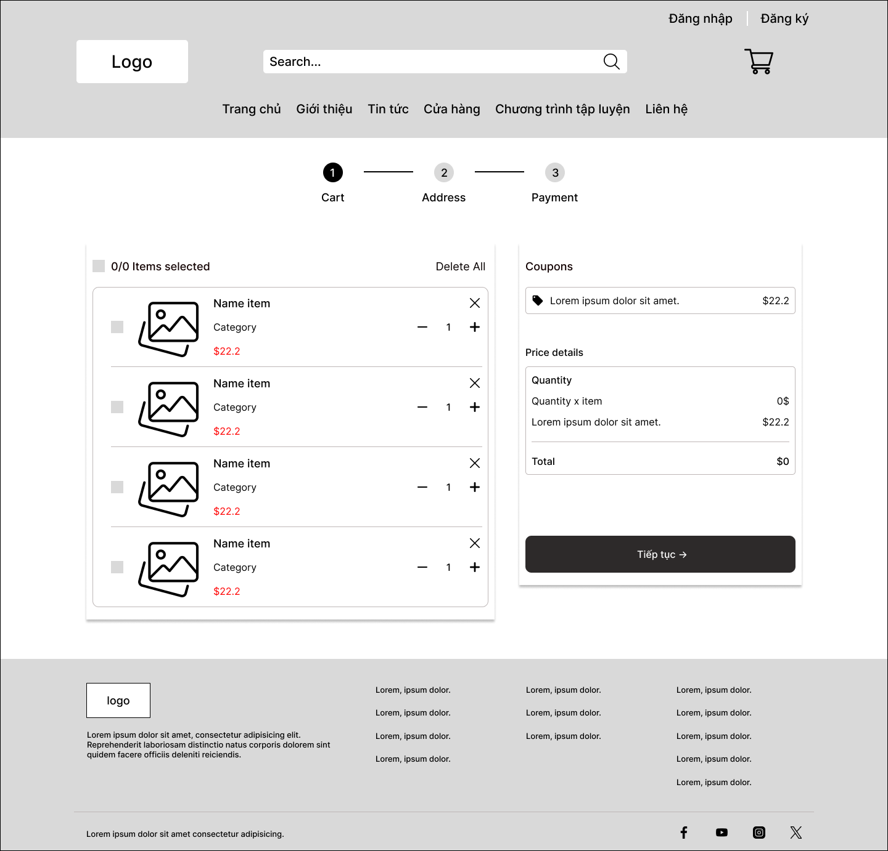
*Hình 4.4: Bản vẽ thiết kế giao diện Giỏ hàng trực tuyến*

---

### 3.5. UI-05: Đặt hàng thanh toán COD (Checkout COD)
- **Mục đích:** Chọn hoặc thêm mới địa chỉ giao hàng, nhập mã voucher ưu đãi, chọn phương thức thanh toán khi nhận hàng (COD) và chốt đơn trong Transaction.
- **Quyền truy cập:** `Customer`.

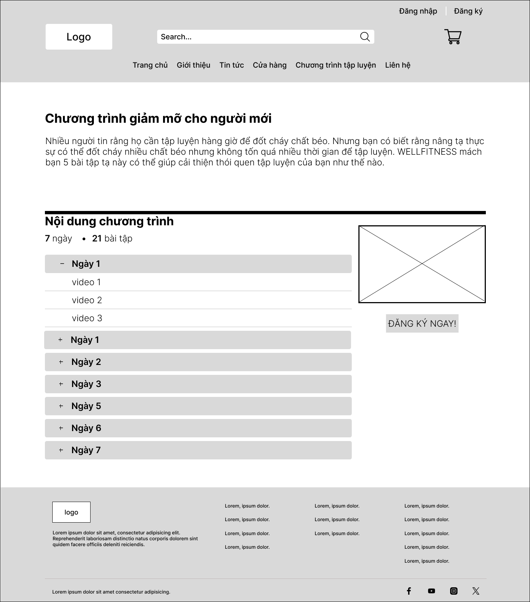
*Hình 4.5: Bản vẽ thiết kế giao diện Đặt hàng thanh toán COD*

---

### 3.6. UI-06: Đăng nhập & Đăng ký tài khoản (Auth Modal/Page)
- **Mục đích:** Xác thực người dùng, chuyển đổi mượt mà giữa Đăng nhập và Đăng ký, hiển thị phản hồi lỗi realtime và bảo mật với CSRF Token.
- **Quyền truy cập:** `Guest`.

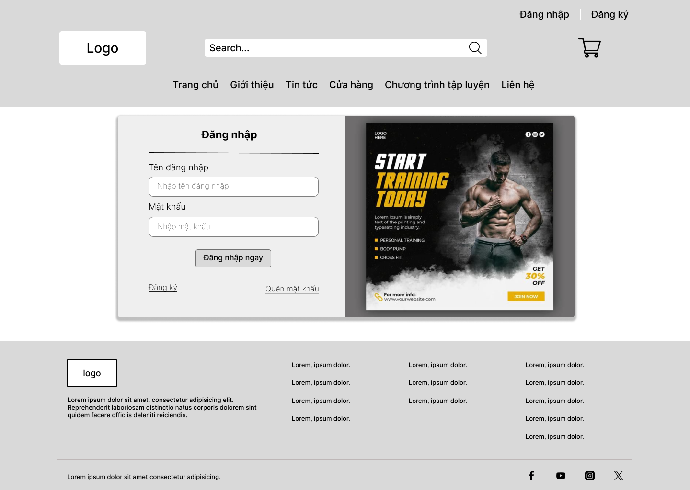
*Hình 4.6: Bản vẽ thiết kế giao diện Đăng ký & Đăng nhập tài khoản*

---

### 3.7. UI-07: Lịch sử đơn hàng & Chi tiết trạng thái (Order History)
- **Mục đích:** Khách hàng theo dõi dòng thời gian tiến trình đơn hàng (Timeline), xem snapshot giày đã mua và thực hiện Hủy đơn hàng khi còn ở `PENDING`.
- **Quyền truy cập:** `Customer`.

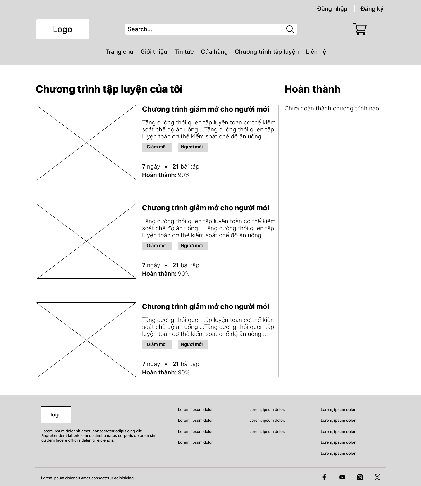
*Hình 4.7: Bản vẽ thiết kế giao diện Lịch sử đơn hàng và Tiến trình trạng thái*

---

### 3.8. UI-08: Admin Dashboard tổng quan (Admin Overview)
- **Mục đích:** Bảng điều khiển quản trị hiển thị KPI doanh thu thực tế, số lượng đơn chờ duyệt và danh sách các biến thể giày sắp hết hàng ($\le$ 5 đôi).
- **Quyền truy cập:** `Admin`.

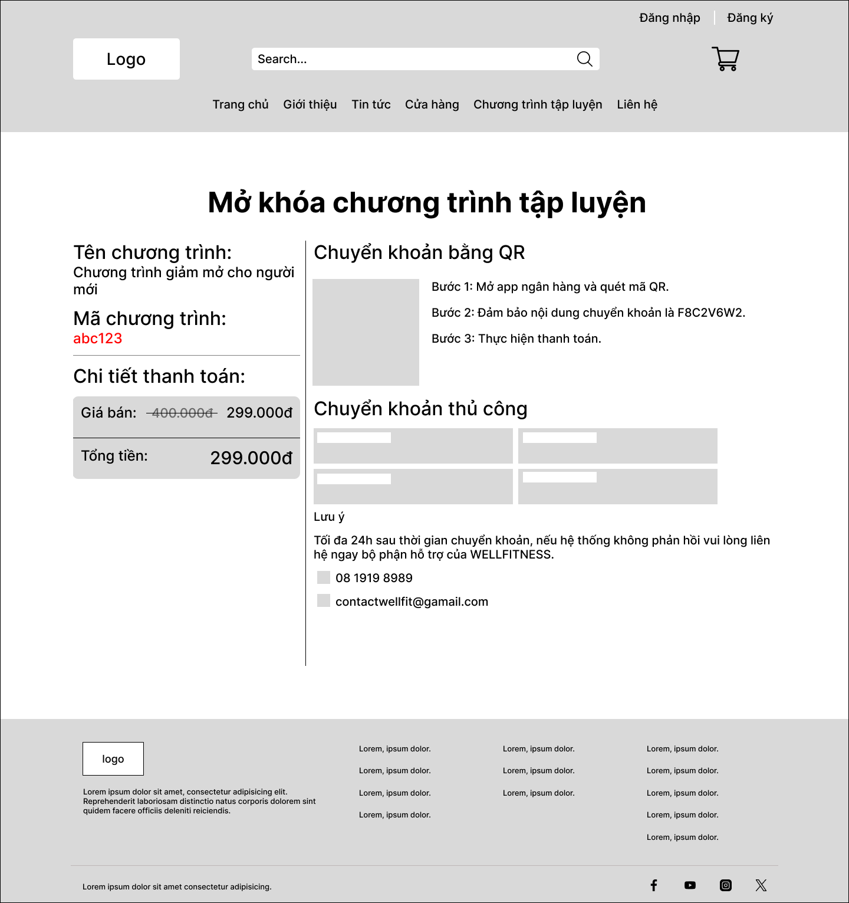
*Hình 4.8: Bản vẽ thiết kế giao diện Bảng điều khiển quản trị (Admin Dashboard)*

---

### 3.9. UI-09: Admin Quản lý sản phẩm & Biến thể (Admin Products)
- **Mục đích:** Quản trị viên thêm/sửa sản phẩm, thiết lập ma trận biến thể (Size, Color, SKU, Tồn kho, Giá phụ thu) và cập nhật thư viện ảnh.
- **Quyền truy cập:** `Admin`.

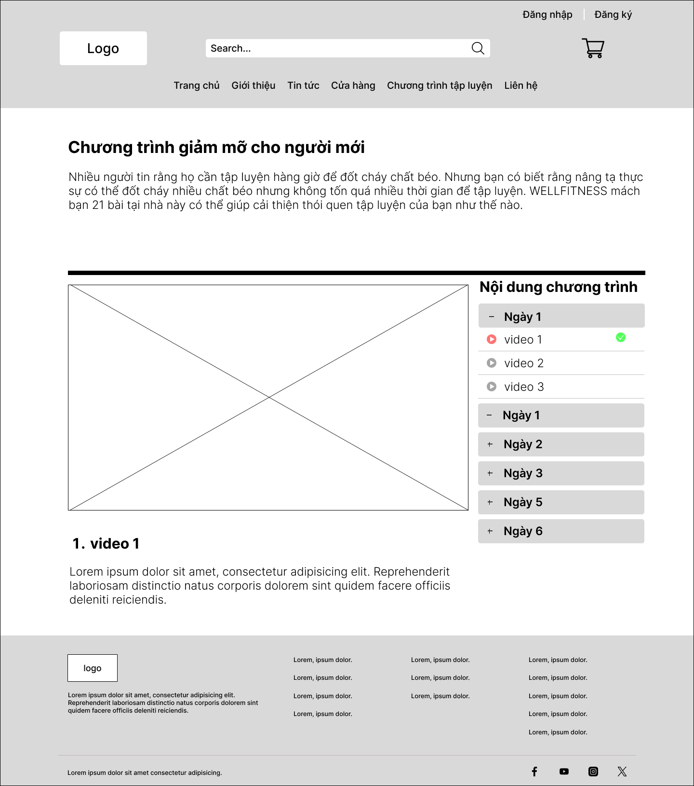
*Hình 4.9: Bản vẽ thiết kế giao diện Quản lý sản phẩm & Biến thể của Admin*

---

### 3.10. UI-10: Admin Vận hành đơn hàng (Admin Orders)
- **Mục đích:** Lọc đơn hàng theo tab trạng thái, xem chi tiết giao nhận, chuyển tiếp trạng thái theo máy trạng thái và hủy đơn hàng kèm hoàn kho tự động.
- **Quyền truy cập:** `Admin`.

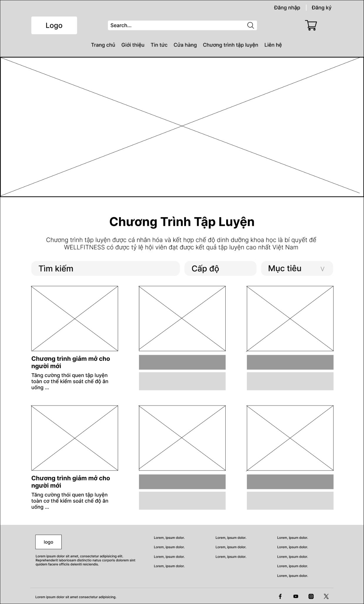
*Hình 4.10: Bản vẽ thiết kế giao diện Quản lý và Vận hành đơn hàng của Admin*

---

## 4. DANH MỤC FILE NỘP TRONG LAB 4

```
labs/Lab 4 - Thiet ke giao dien (Wireframe)/
├── images/                               # Thư mục hình ảnh giao diện độ phân giải cao
│   ├── sitemap.png                       # Cây sơ đồ điều hướng website
│   ├── ui-01-home.png                    # Giao diện Trang chủ
│   ├── ui-02-shop.png                    # Giao diện Cửa hàng & Bộ lọc
│   ├── ui-03-product-detail.png          # Giao diện Chi tiết sản phẩm
│   ├── ui-04-cart.png                    # Giao diện Giỏ hàng
│   ├── ui-05-checkout-cod.png            # Giao diện Đặt hàng COD
│   ├── ui-06-auth.png                    # Giao diện Đăng nhập / Đăng ký
│   ├── ui-07-order-history.png           # Giao diện Lịch sử đơn hàng
│   ├── ui-08-admin-dashboard.png         # Giao diện Admin Dashboard
│   ├── ui-09-admin-products.png          # Giao diện Admin Quản lý sản phẩm
│   ├── ui-10-admin-orders.png            # Giao diện Admin Vận hành đơn hàng
│   ├── fpt_polytechnic_logo.jpg          # Logo chuẩn FPT Polytechnic
│   └── fpt_assignment_border.png         # Khung viền bìa học thuật
├── BAO_CAO_LAB4_PRINT.html               # Báo cáo in ấn xuất PDF chuẩn A4 (1-Click Print)
├── README_LAB4.md                        # Báo cáo tổng quan Lab 4 (file hiện tại)
└── wireframe_specifications.md           # Bản đặc tả chi tiết linh kiện từng màn hình
```
