# ĐẶC TẢ GIAO DIỆN VÀ KHUNG XƯƠNG (WIREFRAME SPECIFICATIONS) - VAMOS STORE

> **Dự án:** VAMOS STORE - Website thương mại điện tử chuyên kinh doanh giày dép  
> **Phiên bản:** v1.1 Chuẩn hóa  
> **Nguyên tắc UI/UX:** Responsive, hình ảnh trực quan, bố cục rõ ràng, điều hướng thuận tiện theo chuẩn E-commerce hiện đại.

---

## 1. SƠ ĐỒ MÀN HÌNH TỔNG QUAN (SITEMAP)

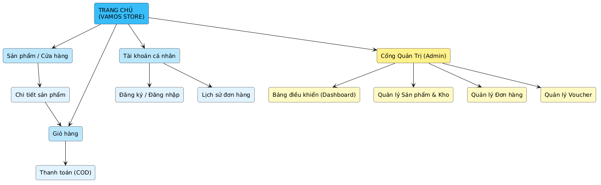
*Hình 4.0: Sơ đồ cấu trúc cây điều hướng màn hình (Sitemap) toàn hệ thống*

```
[ TRANG CHỦ - VAMOS STORE ]
  ├── Cửa hàng / Danh mục (Shop)
  │     ├── Bộ lọc (Giới tính, Kích cỡ, Màu sắc, Khoảng giá)
  │     └── Chi tiết sản phẩm (Product Detail)
  │           └── Chọn Size x Màu sắc ──► Thêm giỏ hàng / Mua ngay
  ├── Giỏ hàng (Cart) ──► Đặt hàng COD (Checkout) ──► Xác nhận đơn hàng
  ├── Tài khoản (Account)
  │     ├── Đăng ký / Đăng nhập / Quên mật khẩu
  │     ├── Sổ địa chỉ nhận hàng
  │     └── Lịch sử đơn hàng ──► Theo dõi tiến trình / Hủy đơn (PENDING)
  └── Khu vực Quản trị (Admin Portal)
        ├── Dashboard thống kê doanh thu & đơn hàng
        ├── Quản lý Sản phẩm & Biến thể Size/Color
        ├── Quản lý Danh mục & Thương hiệu
        ├── Quản lý Tồn kho & Ghi vết điều chỉnh
        ├── Quản lý Đơn hàng & Chuyển trạng thái
        └── Quản lý Khuyến mãi (Voucher) & Banner
```

---

## 2. ĐẶC TẢ CHI TIẾT 10 MÀN HÌNH CỐT LÕI

### 2.1. UI-01: Trang chủ (Home Page)

- **Mô tả:** Màn hình chính đầu tiên tiếp cận người dùng, giới thiệu bộ sưu tập mới, banner khuyến mãi, danh mục nổi bật và sản phẩm bán chạy.
- **Quyền truy cập:** `Guest`, `Customer`.
- **Hình ảnh giao diện thiết kế:**

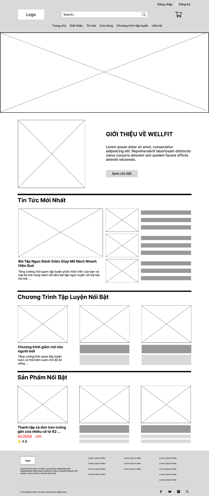
*Hình 4.1: Bản vẽ thiết kế giao diện Trang chủ (Home Page)*

- **Khung Wireframe:**

```
+-------------------------------------------------------------------------+
| [LOGO VAMOS]   [Sneaker] [Thể thao] [Chạy bộ] [Sandal]   [Search] [Cart] [User] |
+-------------------------------------------------------------------------+
| [ HERO BANNER SLIDER: "MOVE YOUR WAY - BỘ SƯU TẬP MỚI 2026" ]           |
| [ CTA Button: KHÁM PHÁ NGAY ]                                           |
+-------------------------------------------------------------------------+
| DANH MỤC NỔI BẬT:                                                       |
| [ Card: Sneaker Nam ]  [ Card: Giày Thể Thao ]  [ Card: Sandal Đi Mưa ] |
+-------------------------------------------------------------------------+
| SẢN PHẨM MỚI NHẤT:                                                      |
| [ Ảnh SP | Tên SP | Giá gốc | Giá sale ] x 4 Cột                        |
+-------------------------------------------------------------------------+
| CHÍNH SÁCH BÁN HÀNG: [COD toàn quốc] [Đổi size 7 ngày] [Bảo hành keo]  |
+-------------------------------------------------------------------------+
| FOOTER: Thông tin thương hiệu VAMOS, Hotline, Địa chỉ, Bản quyền        |
+-------------------------------------------------------------------------+
```

- **Bảng đặc tả thành phần:**

| Mục                  | Loại Component       | Mô tả và tương tác                                                                                                                                |
| :------------------- | :------------------- | :------------------------------------------------------------------------------------------------------------------------------------------------ |
| `Header Bar`         | Navigation Container | Chứa Logo VAMOS, menu phân cấp danh mục, thanh tìm kiếm nhanh, icon giỏ hàng kèm số lượng (badge count), icon tài khoản.                          |
| `Hero Banner Slider` | Image Carousel       | Hiển thị các banner quảng bá sự kiện lấy từ bảng `banners`. Tự động chuyển slide hoặc bấm nút điều hướng.                                         |
| `Category Cards`     | Grid Container       | Thẻ đại diện cho các danh mục chính (`categories`), bấm vào sẽ lọc sản phẩm theo danh mục tương ứng.                                              |
| `Product Grid`       | Product Card List    | Hiển thị 8 sản phẩm mới nhất/nổi bật (`products` active). Mỗi card gồm: ảnh đại diện chính, nhãn sale, tên sản phẩm, giá bán, nút "Xem chi tiết". |
| `Footer`             | Information Block    | Địa chỉ showroom VAMOS, thông tin liên hệ, chính sách đổi trả, liên kết mạng xã hội.                                                              |

---

### 2.2. UI-02: Danh sách sản phẩm & Bộ lọc (Shop & Filter)

- **Mô tả:** Màn hình duyệt toàn bộ sản phẩm, trang bị bộ lọc bên trái (Sidebar Filter) cho phép lọc đa tiêu chí và thanh sắp xếp.
- **Quyền truy cập:** `Guest`, `Customer`.
- **Hình ảnh giao diện thiết kế:**

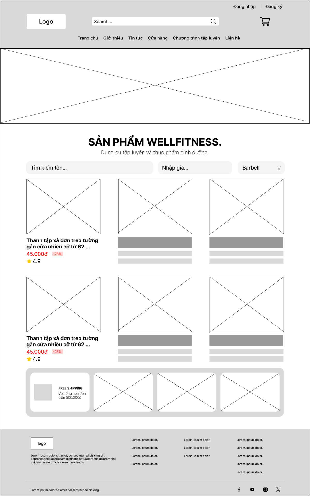
*Hình 4.2: Bản vẽ thiết kế giao diện Cửa hàng và Bộ lọc đa tiêu chí*

- **Khung Wireframe:**

```
+-------------------------------------------------------------------------+
| [Header & Navigation Bar]                                               |
+-------------------------------------------------------------------------+
| Breadcrumb: Trang chủ > Giày Sneaker                                    |
+---------------------+---------------------------------------------------+
| BỘ LỌC TÌM KIẾM     | HIỂN THỊ 24 SẢN PHẨM           [Sắp xếp: Giá tăng] |
|                     +---------------------------------------------------+
| * Giới tính:        | [ Card SP 1 ]       [ Card SP 2 ]   [ Card SP 3 ] |
|   [ ] Nam  [ ] Nữ   | Ảnh chính           Ảnh chính       Ảnh chính     |
|   [ ] Unisex        | VAMOS Retro '88     VAMOS Speed X   VAMOS Cloud   |
| * Khoảng giá:       | 850.000đ  1.100.000 650.000đ        920.000đ      |
|   Từ [....] Đến [..]| [Xem chi tiết]      [Xem chi tiết]  [Xem chi tiết]|
| * Kích cỡ (Size):   +---------------------------------------------------+
|   (38) (39) (40)    | [ Card SP 4 ]       [ Card SP 5 ]   [ Card SP 6 ] |
|   (41) (42) (43)    | ...                 ...             ...           |
| * Màu sắc:          +---------------------------------------------------+
|   [x] Đen  [ ] Trắng| PHÂN TRANG: [ << ] [ 1 ] [ 2 ] [ 3 ] [ >> ]       |
+---------------------+---------------------------------------------------+
```

- **Bảng đặc tả thành phần:**

| Mục             | Loại Component        | Mô tả và tương tác                                                                           |
| :-------------- | :-------------------- | :------------------------------------------------------------------------------------------- |
| `Gender Filter` | Checkbox Group        | Lọc theo `gender_target` (`MEN`, `WOMEN`, `UNISEX`).                                         |
| `Price Range`   | Range Input / Textbox | Nhập mức giá tối thiểu và tối đa (VNĐ).                                                      |
| `Size Selector` | Button Pill Group     | Lọc các sản phẩm có biến thể `sizes.size_name` tương ứng và còn hàng (`stock_quantity > 0`). |
| `Color Filter`  | Color Palette Box     | Lọc theo `colors.color_name` kèm ô màu trực quan.                                            |
| `Sort Dropdown` | Select Box            | Sắp xếp theo: Mới nhất, Giá tăng dần, Giá giảm dần, Tên A-Z.                                 |
| `Pagination`    | Pagination Control    | Chuyển trang (12 sản phẩm / trang).                                                          |

---

### 2.3. UI-03: Chi tiết sản phẩm & Chọn biến thể (Product Detail)

- **Mô tả:** Màn hình xem chi tiết thông số giày, bộ sưu tập ảnh, chọn biến thể Size x Màu sắc và thao tác thêm giỏ / mua ngay.
- **Quyền truy cập:** `Guest`, `Customer`.
- **Hình ảnh giao diện thiết kế:**

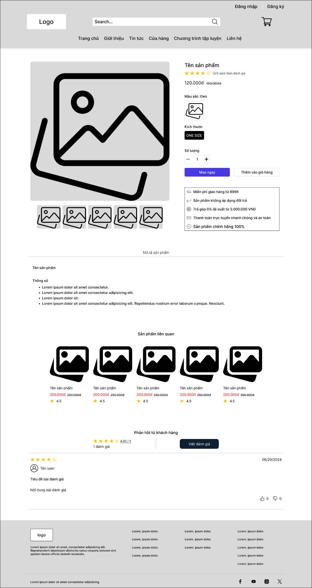
*Hình 4.3: Bản vẽ thiết kế giao diện Chi tiết sản phẩm & Bộ chọn biến thể Size/Màu*

- **Khung Wireframe:**

```
+-------------------------------------------------------------------------+
| [Header & Navigation Bar]                                               |
+-------------------------------------------------------------------------+
| [ THUMBNAILS ]  | [ ẢNH CHÍNH LỚN ]  | TÊN SP: VAMOS CLASSIC LEATHER    |
| [ Ảnh 1 ]       |                     | Mã SP: VM-SNEAKER-01             |
| [ Ảnh 2 ]       |                     | Giá: 750.000đ  (Gốc: 950.000đ)   |
| [ Ảnh 3 ]       |                     | Trạng thái: CÒN HÀNG (Kho: 15)   |
|                 |                     |---------------------------------|
|                 |                     | CHỌN MÀU SẮC:                   |
|                 |                     | [X] Đen huyền bí   [ ] Trắng     |
|                 |                     |---------------------------------|
|                 |                     | CHỌN KÍCH CỠ:                   |
|                 |                     | [39]  [X 40]  [41]  [42 (Hết)]   |
|                 |                     |---------------------------------|
|                 |                     | SỐ LƯỢNG: [ - ] [ 1 ] [ + ]     |
|                 |                     |---------------------------------|
|                 |                     | [ Nút: THÊM GIỎ HÀNG ]          |
|                 |                     | [ Nút: MUA NGAY (COD) ]         |
+-----------------+---------------------+---------------------------------+
| MÔ TẢ CHI TIẾT SẢN PHẨM:                                                |
| Chất liệu da Microfiber cao cấp, đế cao su nguyên khối chống trơn trượt |
+-------------------------------------------------------------------------+
```

- **Bảng đặc tả thành phần:**

| Mục              | Loại Component        | Mô tả và tương tác                                                                                                     |
| :--------------- | :-------------------- | :--------------------------------------------------------------------------------------------------------------------- |
| `Image Gallery`  | Thumbnail + Main View | Cho phép bấm đổi ảnh lớn hoặc phóng to chi tiết mũi giày, đế giày, gót giày.                                           |
| `Color Picker`   | Radio Button Pill     | Chọn màu sắc. Khi chọn màu, các size khả dụng của màu đó sẽ được làm nổi bật.                                          |
| `Size Picker`    | Radio Button Box      | Chọn kích cỡ giày. Nếu biến thể có `stock_quantity = 0`, nút size bị làm mờ (disabled).                                |
| `Quantity Input` | Stepper Number Input  | Tăng giảm số lượng mua. Không cho phép giảm dưới 1 hoặc vượt quá tồn kho khả dụng.                                     |
| `Add To Cart`    | Primary Action Button | Thêm biến thể đã chọn vào `cart_items`. Nếu chưa đăng nhập, chuyển hướng sang màn hình đăng nhập hoặc lưu tạm session. |

---

### 2.4. UI-04: Giỏ hàng trực tuyến (Shopping Cart)

- **Mô tả:** Màn hình quản lý các mặt hàng đã chọn mua, cập nhật số lượng, xóa sản phẩm và xem tạm tính tiền hàng.
- **Quyền truy cập:** `Customer`.
- **Hình ảnh giao diện thiết kế:**

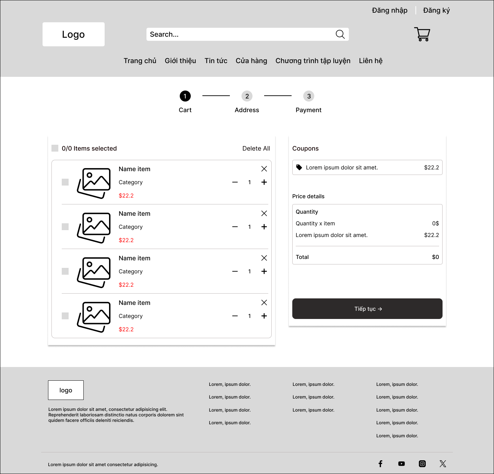
*Hình 4.4: Bản vẽ thiết kế giao diện Giỏ hàng trực tuyến*

- **Khung Wireframe:**

```
+-------------------------------------------------------------------------+
| [Header & Navigation Bar]                                               |
+-------------------------------------------------------------------------+
| GIỎ HÀNG CỦA BẠN (3 sản phẩm)                                           |
+-----------------------------------------------+-------------------------+
| SẢN PHẨM              | ĐƠN GIÁ  | SỐ LƯỢNG   | TỔNG TIỀN ĐƠN HÀNG      |
+-----------------------+----------+------------+-------------------------+
| [Ảnh] VAMOS Classic   | 750.000đ | [-] 1 [+]  | Tạm tính:    1.950.000đ |
| Size: 40 | Màu: Đen   |          | [Xóa dòng] | Giảm giá:            0đ |
+-----------------------+----------+------------+ Phí ship:     (Tính sau)|
| [Ảnh] VAMOS Sport Max | 600.000đ | [-] 2 [+]  |-------------------------|
| Size: 41 | Màu: Trắng |          | [Xóa dòng] | TỔNG CỘNG:   1.950.000đ |
+-----------------------------------------------+-------------------------+
| [ < Tiếp tục mua sắm ]                        | [ TIẾN HÀNH ĐẶT HÀNG > ]|
+-----------------------------------------------+-------------------------+
```

- **Bảng đặc tả thành phần:**

| Mục                | Loại Component        | Mô tả và tương tác                                                                                |
| :----------------- | :-------------------- | :------------------------------------------------------------------------------------------------ |
| `Cart Item Row`    | Table Row Data        | Hiển thị ảnh biến thể, tên sản phẩm, thông tin size, màu, đơn giá, nút tăng/giảm và nút xóa.      |
| `Quantity Stepper` | Dynamic Input         | Tăng/giảm số lượng; tự động gửi Ajax request cập nhật `cart_items.quantity` và tính lại tạm tính. |
| `Remove Button`    | Icon Button           | Xóa một dòng biến thể khỏi giỏ hàng sau khi xác nhận hộp thoại (Confirm Modal).                   |
| `Checkout Button`  | Call to Action Button | Chuyển hướng sang màn hình Đặt hàng COD (`UI-05`).                                                |

---

### 2.5. UI-05: Đặt hàng thanh toán COD (Checkout COD)

- **Mô tả:** Màn hình xác nhận thông tin nhận hàng, nhập mã voucher và hoàn tất tạo đơn thanh toán khi nhận hàng.
- **Quyền truy cập:** `Customer` (đã đăng nhập và giỏ hàng có sản phẩm).
- **Hình ảnh giao diện thiết kế:**

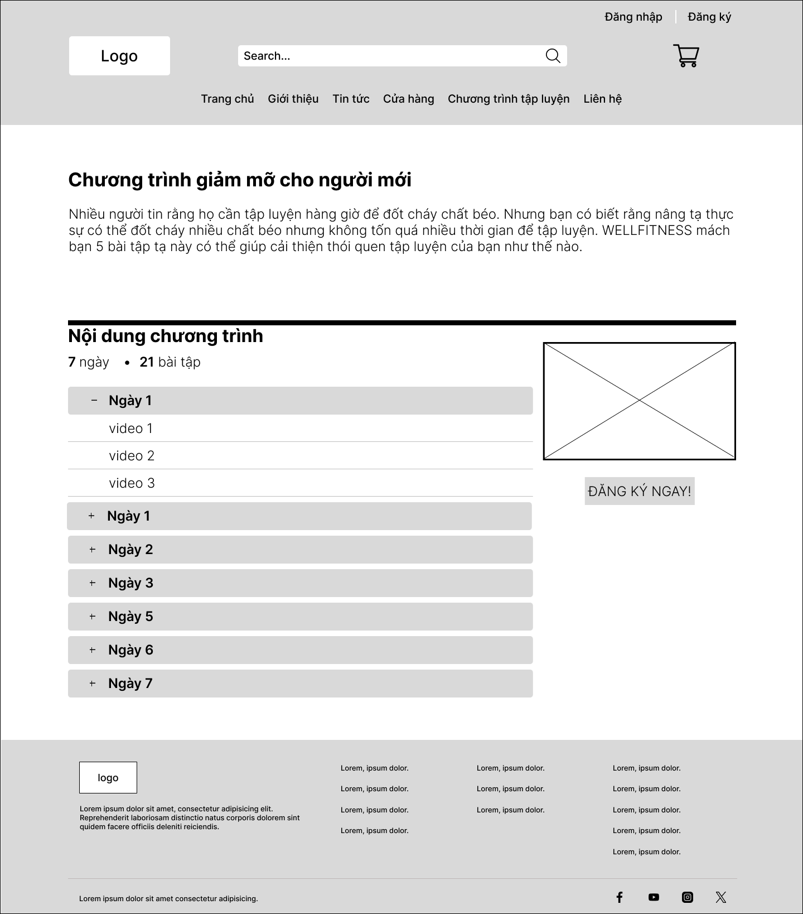
*Hình 4.5: Bản vẽ thiết kế giao diện Đặt hàng thanh toán COD*

- **Khung Wireframe:**

```
+-------------------------------------------------------------------------+
| [Header & Navigation Bar]                                               |
+-------------------------------------------------------------------------+
| THANH TOÁN ĐƠN HÀNG (COD)                                               |
+---------------------------------------+---------------------------------+
| 1. ĐỊA CHỈ NHẬN HÀNG                  | 2. TỔNG KẾT ĐƠN HÀNG (2 món)    |
| [X] Sử dụng địa chỉ mặc định:         | - VAMOS Classic (40, Đen) x 1   |
|     Nguyễn Văn A - 0901234567         | - VAMOS Sport Max (41, Trắng) x2|
|     123 Nguyễn Văn Linh, Đà Nẵng      |---------------------------------|
| [ ] Nhập địa chỉ nhận hàng mới        | Tạm tính:            1.950.000đ |
|---------------------------------------| Phí vận chuyển:         30.000đ |
| PHƯƠNG THỨC THANH TOÁN                | Mã giảm giá:                    |
| (*) Thanh toán tiền mặt khi nhận hàng | [ Nhập mã: VAMOS50K ] [Áp dụng] |
|     (COD - Kiểm hàng trước khi trả)   | Giảm voucher:          -50.000đ |
|---------------------------------------|---------------------------------|
| Ghi chú đơn hàng: [Giao giờ hành chính| TỔNG THANH TOÁN:     1.930.000đ |
+---------------------------------------+---------------------------------+
| [ Nút lớn: XÁC NHẬN ĐẶT HÀNG THANH TOÁN KHI NHẬN HÀNG (COD) ]           |
+-------------------------------------------------------------------------+
```

- **Bảng đặc tả thành phần:**

| Mục                | Loại Component     | Mô tả và tương tác                                                                               |
| :----------------- | :----------------- | :----------------------------------------------------------------------------------------------- |
| `Address Selector` | Radio List / Form  | Chọn địa chỉ từ `addresses` hoặc nhập trực tiếp địa chỉ mới để lưu snapshot vào `orders`.        |
| `Voucher Input`    | Textbox + Button   | Nhập mã voucher; hệ thống kiểm tra tính hợp lệ (`vouchers`) và trừ trực tiếp vào tổng tiền.      |
| `Payment Method`   | Radio Selection    | Mặc định cố định `COD` (Thanh toán tiền mặt khi giao hàng).                                      |
| `Order Note`       | Textarea           | Nhập ghi chú giao nhận hàng của khách (`customer_note`).                                         |
| `Submit Order`     | Primary CTA Button | Thực thi Database Transaction tạo đơn hàng `PENDING`, trừ tồn kho khả dụng và làm rỗng giỏ hàng. |

---

### 2.6. UI-06: Đăng ký & Đăng nhập (Auth Portal)

- **Mô tả:** Màn hình xác thực tài khoản người dùng, băm mật khẩu bảo mật và cấp session đăng nhập.
- **Quyền truy cập:** `Guest`.
- **Hình ảnh giao diện thiết kế:**

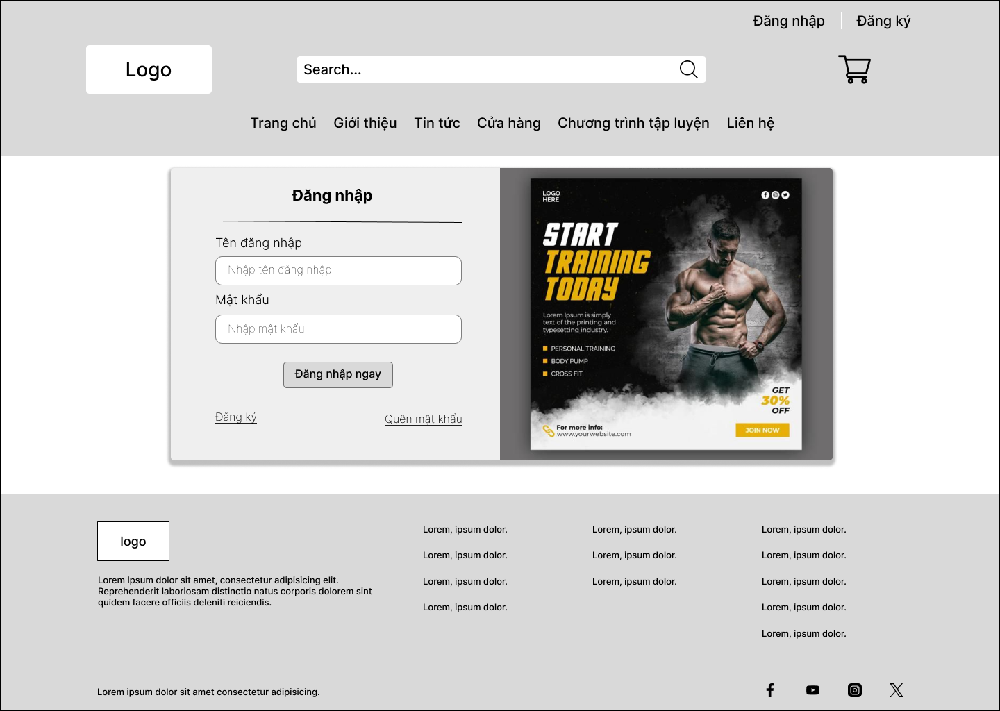
*Hình 4.6: Bản vẽ thiết kế giao diện Đăng ký & Đăng nhập tài khoản*

- **Khung Wireframe:**

```
+-------------------------------------------------------------------------+
|                           [ LOGO VAMOS STORE ]                          |
|                                                                         |
|            +---------------------------------------------+              |
|            |      [ ĐĂNG NHẬP ]   |   [ ĐĂNG KÝ ]        |              |
|            +---------------------------------------------+              |
|            | Email đăng nhập:                            |              |
|            | [ user@example.com                        ] |              |
|            | Mật khẩu:                                   |              |
|            | [ ******************                      ] |              |
|            |                                             |              |
|            | [ ] Ghi nhớ đăng nhập   [ Quên mật khẩu? ]  |              |
|            |                                             |              |
|            | [ NÚT: ĐĂNG NHẬP ]                          |              |
|            |                                             |              |
|            | Chưa có tài khoản? [ Đăng ký ngay ]         |              |
|            +---------------------------------------------+              |
+-------------------------------------------------------------------------+
```

---

### 2.7. UI-07: Lịch sử & Chi tiết đơn hàng (Order History)

- **Mô tả:** Khách hàng theo dõi danh sách đơn hàng đã mua, xem trạng thái xử lý theo thời gian thực và thực hiện hủy đơn khi đơn ở trạng thái `PENDING`.
- **Quyền truy cập:** `Customer`.
- **Hình ảnh giao diện thiết kế:**

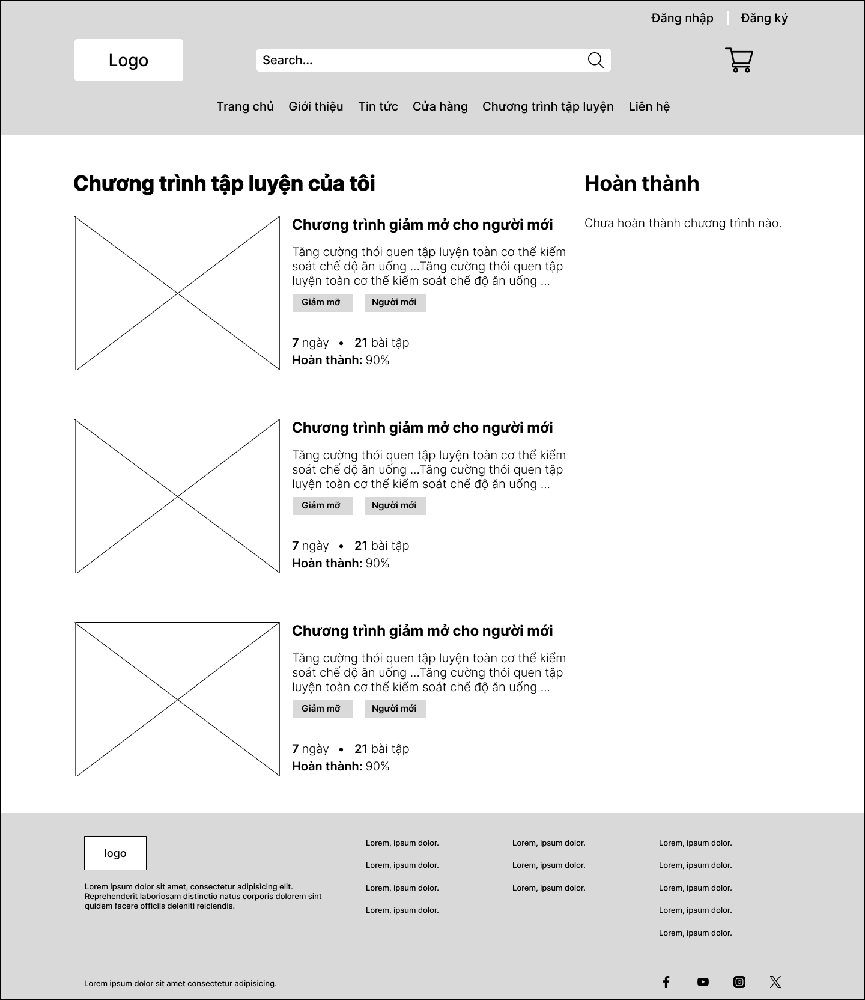
*Hình 4.7: Bản vẽ thiết kế giao diện Lịch sử đơn hàng & Tiến trình trạng thái*

- **Khung Wireframe:**

```
+-------------------------------------------------------------------------+
| [Header & Navigation Bar]                                               |
+-------------------------------------------------------------------------+
| ĐƠN HÀNG CỦA TÔI                                                        |
+-------------------------------------------------------------------------+
| Mã đơn: ORD-20261110-001  | Ngày đặt: 10/11/2026  | Tổng: 1.930.000đ    |
| Trạng thái: [ PENDING - CHỜ XÁC NHẬN ]            | [ NÚT: HỦY ĐƠN ]    |
| Tiết trình: (o) Đặt hàng -> ( ) Xác nhận -> ( ) Đang giao -> ( ) Đã nhận|
| Chi tiết: 2 mặt hàng (VAMOS Classic 40, VAMOS Sport 41)                 |
+-------------------------------------------------------------------------+
| Mã đơn: ORD-20261025-089  | Ngày đặt: 25/10/2026  | Tổng: 850.000đ      |
| Trạng thái: [ COMPLETED - ĐÃ GIAO THÀNH CÔNG ]                          |
+-------------------------------------------------------------------------+
```

---

### 2.8. UI-08: Admin Dashboard tổng quan (Admin Overview)

- **Mô tả:** Màn hình bảng điều khiển trung tâm cho Quản trị viên, thống kê số liệu kinh doanh, đơn hàng mới và cảnh báo sản phẩm sắp hết hàng.
- **Quyền truy cập:** `Admin`.
- **Hình ảnh giao diện thiết kế:**

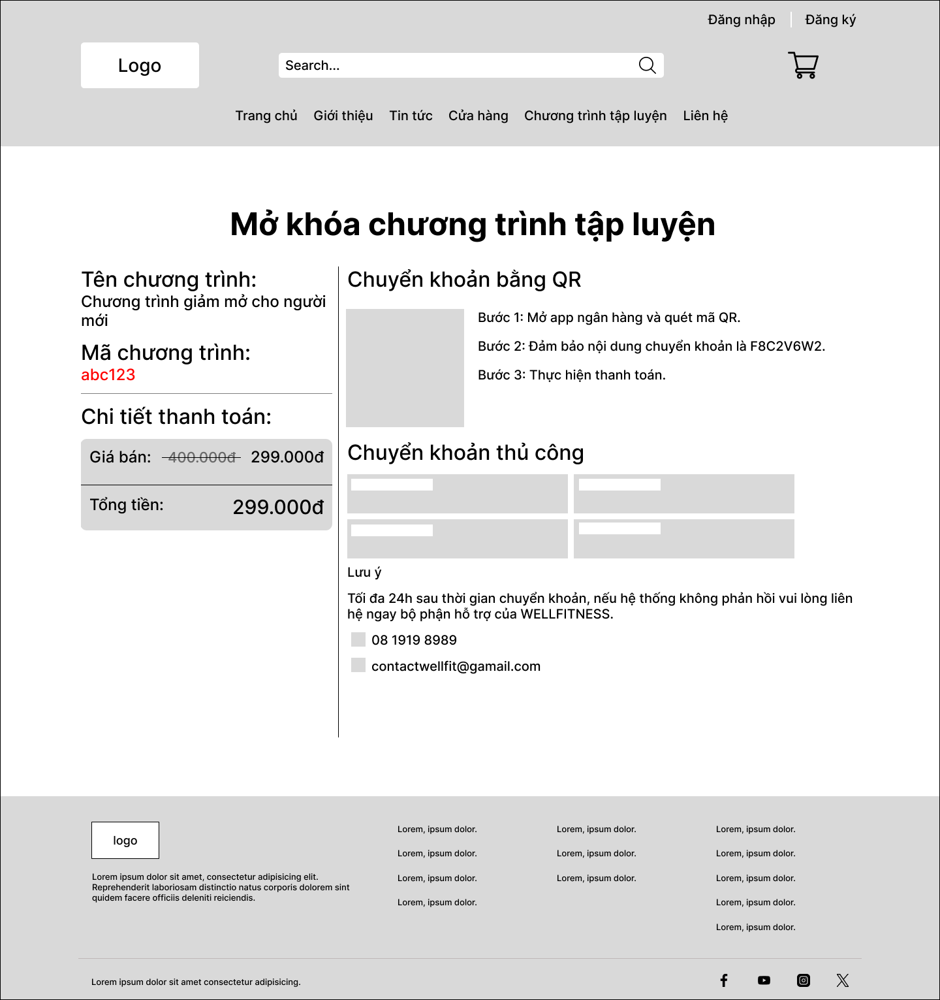
*Hình 4.8: Bản vẽ thiết kế giao diện Bảng điều khiển quản trị (Admin Dashboard)*

- **Khung Wireframe:**

```
+-------------------------------------------------------------------------+
| [VAMOS ADMIN] | Tổng quan | Sản phẩm | Kho hàng | Đơn hàng | Voucher    |
+-------------------------------------------------------------------------+
| TỔNG QUAN HỆ THỐNG                                    [ Xin chào: Admin ]|
+-------------------+-------------------+-------------------+-------------+
| DOANH THU THỰC TẾ | TỔNG ĐƠN HÀNG     | ĐƠN CHỜ XỬ LÝ     | CẢNH BÁO KHO|
| 125.400.000đ      | 142 đơn           | 8 đơn (PENDING)   | 5 biến thể  |
| (Chỉ đơn COMPLETED)                   | [Xem ngay]        | (Tồn <= 5)  |
+-------------------+-------------------+-------------------+-------------+
| ĐƠN HÀNG MỚI CẦN DUYỆT (8 đơn gần nhất):                                |
| [Mã đơn] [Khách hàng] [Số điện thoại] [Tổng COD] [Trạng thái] [Thao tác]|
+-------------------------------------------------------------------------+
```

---

### 2.9. UI-09: Quản lý sản phẩm & Biến thể (Admin Product Management)

- **Mô tả:** Màn hình Admin thêm, sửa, xem danh sách sản phẩm cha và cấu hình ma trận biến thể Size x Màu sắc x SKU x Tồn kho.
- **Quyền truy cập:** `Admin`.
- **Hình ảnh giao diện thiết kế:**

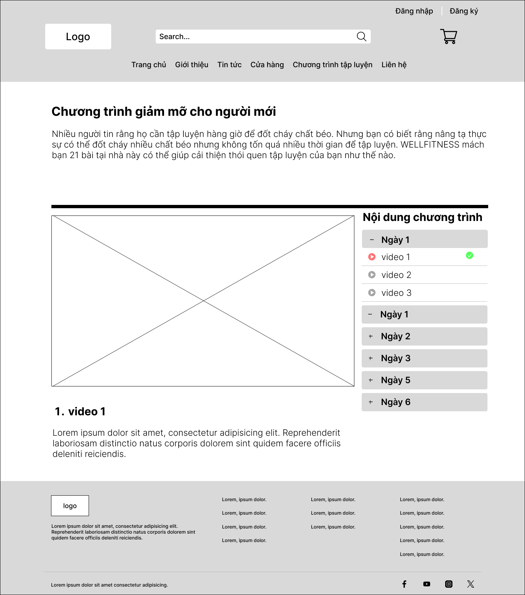
*Hình 4.9: Bản vẽ thiết kế giao diện Quản lý sản phẩm & Biến thể của Admin*

- **Khung Wireframe:**

```
+-------------------------------------------------------------------------+
| QUẢN LÝ SẢN PHẨM & BIẾN THỂ                [ + THÊM SẢN PHẨM MỚI ]      |
+-------------------------------------------------------------------------+
| [ Tìm tên/mã SP... ]   [ Danh mục: Tất cả ]   [ Giới tính: Tất cả ]     |
+----+--------+--------------------+------------+----------+--------------+
| ID | Mã SP  | Tên sản phẩm       | Danh mục   | Giá niêm | Số biến thể  |
+----+--------+--------------------+------------+----------+--------------+
| 01 | VM-001 | VAMOS Classic      | Sneaker    | 750.000đ | 6 biến thể   |
|    |        | -> 40 Đen (Tồn 15) | 41 Đen (8) | 40 Trắng (12)...        |
| 02 | VM-002 | VAMOS Runner Lite  | Chạy bộ    | 890.000đ | 4 biến thể   |
+----+--------+--------------------+------------+----------+--------------+
```

---

### 2.10. UI-10: Vận hành đơn hàng Admin (Admin Order Operations)

- **Mô tả:** Quản lý quy trình xử lý đơn hàng, xác nhận đơn, chuyển giao vận, xác nhận giao thành công và ghi chú lý do hủy.
- **Quyền truy cập:** `Admin`.
- **Hình ảnh giao diện thiết kế:**

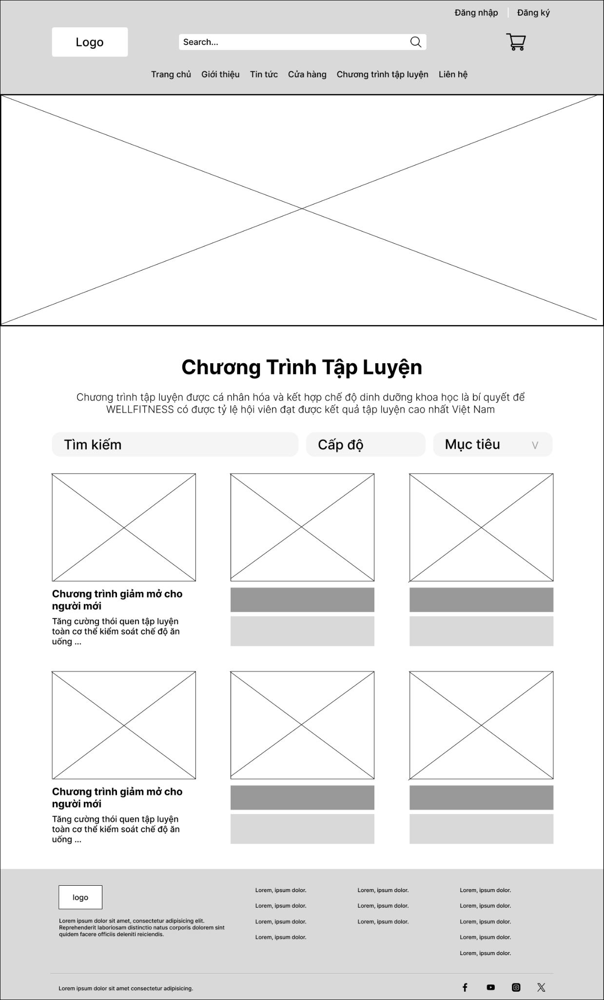
*Hình 4.10: Bản vẽ thiết kế giao diện Quản lý và Vận hành đơn hàng của Admin*

- **Khung Wireframe:**

```
+-------------------------------------------------------------------------+
| QUẢN LÝ ĐƠN HÀNG                                                        |
+-------------------------------------------------------------------------+
| Lọc: [ Tất cả ] [ Chờ duyệt (8) ] [ Đang chuẩn bị ] [ Đang giao ]       |
+-------------------------------------------------------------------------+
| CHI TIẾT ĐƠN HÀNG: #ORD-20261110-001                                    |
| Khách hàng: Nguyễn Văn A | ĐT: 0901234567 | COD: 1.930.000đ             |
| Địa chỉ: 123 Nguyễn Văn Linh, Phường Nam Dương, Hải Châu, Đà Nẵng       |
| Trạng thái hiện tại: [ PENDING ]                                        |
| CHUYỂN TRẠNG THÁI:                                                      |
| [ Nút: XÁC NHẬN ĐƠN (CONFIRMED) ]      [ Nút: HỦY ĐƠN HÀNG ]            |
| Ghi chú nội bộ: [ Đã liên hệ khách xác nhận size giày chuẩn.......... ] |
+-------------------------------------------------------------------------+
| LỊCH SỬ CHUYỂN TRẠNG THÁI (Audit Trail):                                |
| - 10/11/2026 14:30: Tạo mới PENDING (bởi Customer: Nguyễn Văn A)        |
+-------------------------------------------------------------------------+
```
