# LỜI CẢM ƠN

Lời đầu tiên, chúng em xin gửi lời cảm ơn chân thành và sâu sắc nhất đến Ban Giám hiệu, quý Thầy Cô Bộ môn Công nghệ Thông tin – Trường Cao đẳng Thực hành FPT Polytechnic đã tận tình truyền đạt những kiến thức chuyên môn, kỹ năng lập trình và kinh nghiệm thực tiễn quý báu trong suốt quá trình chúng em học tập và rèn luyện tại trường.

Đặc biệt, nhóm chúng em xin bày tỏ lòng biết ơn sâu sắc đến Giảng viên hướng dẫn **ThS. Hoàng Hà**, người đã luôn tận tâm theo sát, định hướng chuyên môn, chỉ dẫn phương pháp phân tích thiết kế hệ thống và đưa ra những đóng góp vô cùng xác đáng để nhóm có thể hoàn thiện đề tài **"Xây dựng Website bán giày dép VAMOS STORE"** một cách tốt nhất.

Chúng em cũng xin gửi lời tri ân chân thành đến gia đình, người thân và bạn bè đã luôn là nguồn động viên tinh thần, hỗ trợ và đồng hành cùng chúng em vượt qua những giai đoạn khó khăn trong học tập.

Dù đã nỗ lực hết mình với tinh thần trách nhiệm cao nhất, song do kiến thức và kinh nghiệm thực tế còn hạn chế, báo cáo dự án của chúng em khó tránh khỏi những thiếu sót nhất định. Nhóm chúng em rất mong nhận được những ý kiến đóng góp, chỉ dẫn quý báu từ Hội đồng Giám khảo và quý Thầy Cô để hệ thống VAMOS STORE ngày càng được hoàn thiện và có tính ứng dụng cao hơn trong thực tiễn.

*Chúng em xin chân thành cảm ơn!*

---

# LỜI CAM KẾT

Thay mặt nhóm thực hiện đề tài đồ án tốt nghiệp, tôi - **Trần Trung Dũng**, trưởng nhóm, xin cam kết:

1. Báo cáo dự án với đề tài **"Xây dựng Website bán giày dép VAMOS STORE"** là công trình nghiên cứu, phân tích, thiết kế và phát triển độc lập của các thành viên trong nhóm, dưới sự hướng dẫn trực tiếp của Giảng viên **ThS. Hoàng Hà**.
2. Toàn bộ các số liệu, sơ đồ thiết kế (Use Case, ERD, Activity Diagram, Wireframe), mã nguồn và kết quả kiểm thử được trình bày trong báo cáo này là trung thực, phản ánh đúng quá trình thực hiện dự án thực tế của nhóm, không sao chép trái phép từ bất kỳ công trình nào khác.
3. Các đoạn mã nguồn tham khảo từ các thư viện mã nguồn mở, tài liệu kỹ thuật của cộng đồng (Node.js, Express.js, MySQL, Pug, Tailwind CSS) đều được trích dẫn nguồn gốc rõ ràng theo đúng quy định học thuật.
4. Nhóm xin chịu hoàn toàn trách nhiệm trước Nhà trường, Bộ môn Công nghệ Thông tin và Pháp luật nếu xảy ra bất kỳ sự vi phạm nào liên quan đến quyền sở hữu trí tuệ và tính liêm chính học thuật.

*Đà Nẵng, ngày 10 tháng 12 năm 2026*  
**Thay mặt nhóm sinh viên thực hiện**  
*Trưởng nhóm*  
**(Đã ký)**  
**Trần Trung Dũng**

---

# MỤC LỤC

* **LỜI CẢM ƠN** ................................................................................................................................. 1
* **LỜI CAM KẾT** ................................................................................................................................ 2
* **MỤC LỤC** ...................................................................................................................................... 3
* **DANH MỤC HÌNH ẢNH** ................................................................................................................ 5
* **DANH MỤC BẢNG BIỂU** .............................................................................................................. 6
* **DANH MỤC THUẬT NGỮ VÀ TỪ VIẾT TẮT** ................................................................................. 7
* **PHẦN MỞ ĐẦU** .......................................................................................................................... 8
  * 1. Phân tích hiện trạng .................................................................................................................. 8
  * 2. Mục đích ................................................................................................................................... 8
  * 3. Mục tiêu hệ thống ...................................................................................................................... 8
  * 4. Tính năng cơ bản của hệ thống .................................................................................................. 9
  * 5. Đối tượng sử dụng .................................................................................................................... 9
  * 6. Công nghệ dùng để phát triển dự án ........................................................................................ 10
  * 7. Lập kế hoạch dự án .................................................................................................................. 10
* **CHƯƠNG I: CƠ SỞ LÝ THUYẾT** .............................................................................................. 12
  * 1. Mô hình công nghệ Client - Server ........................................................................................... 12
  * 2. Ngôn ngữ JavaScript & Nền tảng Node.js ................................................................................ 13
  * 3. Framework Express.js ............................................................................................................... 14
  * 4. Mô hình MVC và Kiến trúc phân lớp ........................................................................................ 15
  * 5. Template Engine Pug ............................................................................................................... 17
  * 6. CSS Framework Tailwind CSS .................................................................................................. 18
  * 7. Cơ sở dữ liệu: MySQL 8.0 ......................................................................................................... 19
  * 8. Cơ chế xác thực Session và Bảo mật Bcrypt ............................................................................. 20
  * 9. Công nghệ Container Docker & Docker Compose ................................................................... 21
* **CHƯƠNG II: PHÂN TÍCH VÀ THIẾT KẾ HỆ THỐNG** ............................................................... 22
  * 1. Phân tích nghiệp vụ ................................................................................................................. 22
  * 2. Thiết kế hệ thống ..................................................................................................................... 23
    * 2.1. Sơ đồ Use Case ................................................................................................................... 23
    * 2.2. Sơ đồ điều hướng màn hình (Sitemap) ................................................................................. 29
    * 2.3. Mô hình thực thể quan hệ - ERD .......................................................................................... 30
    * 2.4. Từ điển dữ liệu chi tiết (Data Dictionary) ............................................................................ 32
    * 2.5. Sơ đồ hoạt động (Activity Diagram) .................................................................................... 45
  * 3. Thiết kế giao diện và đặc tả (Wireframe) ................................................................................. 50
* **CHƯƠNG III: TRIỂN KHAI MÃ NGUỒN** ................................................................................... 64
  * 1. Cấu trúc mã nguồn dự án .......................................................................................................... 64
  * 2. Kết nối và quản trị cơ sở dữ liệu .............................................................................................. 65
  * 3. Triển khai các tính năng chính ................................................................................................. 66
* **CHƯƠNG IV: KIỂM THỬ** .......................................................................................................... 80
  * 1. Kế hoạch kiểm thử .................................................................................................................... 80
  * 2. Ma trận các ca kiểm thử chi tiết ................................................................................................ 80
  * 3. Báo cáo kết quả và đánh giá chất lượng ................................................................................. 83
* **CHƯƠNG V: KẾ HOẠCH TRIỂN KHAI VÀ HƯỚNG DẪN CÀI ĐẶT** .......................................... 84
* **CHƯƠNG VI: KẾT LUẬN VÀ HƯỚNG PHÁT TRIỂN** ................................................................. 87
* **TÀI LIỆU THAM KHẢO** ............................................................................................................ 90

---

# DANH MỤC HÌNH ẢNH

* Hình 1: Mô hình Client - Server trong ứng dụng web ................................................................... 12
* Hình 2: Mô hình kiến trúc MVC phân lớp .................................................................................... 15
* Hình 3: Luồng xử lý một Request trong kiến trúc phân lớp ......................................................... 16
* Hình 4: Chi tiết cấu trúc tầng trong kiến trúc phân lớp VAMOS STORE ....................................... 17
* Hình 5: Sơ đồ Use Case tổng quát VAMOS STORE ...................................................................... 23
* Hình 6: Sơ đồ Use Case chi tiết Đặt hàng COD ........................................................................... 25
* Hình 7: Sơ đồ Use Case chi tiết Quản lý đơn hàng & Kho Admin ................................................ 26
* Hình 8: Sơ đồ điều hướng màn hình (Sitemap) ........................................................................... 29
* Hình 9: Mô hình thực thể quan hệ (ERD 18 bảng) - VAMOS STORE .......................................... 30
* Hình 10: Sơ đồ hoạt động (Activity) - Quy trình Đăng ký & Đăng nhập ........................................ 45
* Hình 11: Sơ đồ hoạt động (Activity) - Mua hàng & Đặt hàng COD ............................................... 46
* Hình 12: Sơ đồ hoạt động (Activity) - Máy trạng thái xử lý đơn hàng .......................................... 47
* Hình 13: Sơ đồ hoạt động (Activity) - Hủy đơn hàng và Hoàn kho tự động ................................... 48
* Hình 14: Sơ đồ hoạt động (Activity) - Admin kiểm kê và điều chỉnh kho ...................................... 49
* Hình 17: Giao diện Trang chủ (Home Page) ................................................................................. 51
* Hình 18: Giao diện Cửa hàng & Bộ lọc đa tiêu chí (Shop & Filter) ............................................. 53
* Hình 19: Giao diện Chi tiết sản phẩm & Chọn Size/Màu .............................................................. 55
* Hình 20: Giao diện Giỏ hàng trực tuyến (Shopping Cart) ............................................................ 57
* Hình 21: Giao diện Đặt hàng COD (Checkout) ............................................................................ 59
* Hình 22: Giao diện Đăng ký / Đăng nhập tài khoản ..................................................................... 61
* Hình 23: Giao diện Lịch sử đơn hàng của khách .......................................................................... 62
* Hình 24: Giao diện Admin Dashboard tổng quan .......................................................................... 63
* Hình 25: Giao diện Admin Quản lý sản phẩm & Biến thể ............................................................. 64
* Hình 26: Giao diện Admin Vận hành đơn hàng ............................................................................ 65

---

# DANH MỤC BẢNG BIỂU

* Bảng 1: Bảng tiến độ triển khai dự án qua 5 giai đoạn ................................................................. 10
* Bảng 2: Ma trận phân quyền các Actor trong VAMOS STORE ...................................................... 22
* Bảng 3: Từ điển dữ liệu bảng `users` (Tài khoản người dùng) .................................................... 33
* Bảng 4: Từ điển dữ liệu bảng `addresses` (Sổ địa chỉ giao hàng) ................................................ 33
* Bảng 5: Từ điển dữ liệu bảng `categories` (Danh mục giày) ......................................................... 34
* Bảng 6: Từ điển dữ liệu bảng `brands` (Thương hiệu giày) ........................................................... 34
* Bảng 7: Từ điển dữ liệu bảng `products` (Sản phẩm giày gốc) .................................................... 35
* Bảng 8: Từ điển dữ liệu bảng `product_images` (Bộ sưu tập ảnh) ................................................ 35
* Bảng 9: Từ điển dữ liệu bảng `sizes` (Kích cỡ giày sneaker) ....................................................... 36
* Bảng 10: Từ điển dữ liệu bảng `colors` (Màu sắc giày sneaker) .................................................. 36
* Bảng 11: Từ điển dữ liệu bảng `product_variants` (Biến thể SKU và Tồn kho) .......................... 37
* Bảng 12: Từ điển dữ liệu bảng `inventory_transactions` (Lịch sử biến động kho) ...................... 38
* Bảng 13: Từ điển dữ liệu bảng `carts` (Giỏ hàng của khách hàng) .............................................. 39
* Bảng 14: Từ điển dữ liệu bảng `cart_items` (Chi tiết các mặt hàng trong giỏ) ............................ 39
* Bảng 15: Từ điển dữ liệu bảng `vouchers` (Mã giảm giá khuyến mãi) .......................................... 40
* Bảng 16: Từ điển dữ liệu bảng `orders` (Thông tin tổng quát đơn hàng) ...................................... 41
* Bảng 17: Từ điển dữ liệu bảng `order_items` (Snapshot chi tiết từng món hàng đặt) .................. 42
* Bảng 18: Từ điển dữ liệu bảng `order_status_histories` (Lịch sử chuyển đổi trạng thái đơn) ....... 43
* Bảng 19: Từ điển dữ liệu bảng `password_reset_tokens` (Mã khôi phục mật khẩu) .................... 43
* Bảng 20: Từ điển dữ liệu bảng `banners` (Banner sự kiện trên trang chủ) .................................. 44
* Bảng 21: Bảng kết quả thực thi các ca kiểm thử hệ thống VAMOS STORE ................................... 81

---

# DANH MỤC THUẬT NGỮ VÀ TỪ VIẾT TẮT

| Thuật ngữ / Viết tắt | Tên tiếng Anh đầy đủ | Ý nghĩa và giải thích trong hệ thống |
| :--- | :--- | :--- |
| **COD** | Cash On Delivery | Hình thức thanh toán bằng tiền mặt khi nhận hàng. |
| **SSR** | Server-Side Rendering | Cơ chế biên dịch giao diện HTML trực tiếp trên máy chủ trước khi gửi về client. |
| **MVC** | Model - View - Controller | Mô hình kiến trúc phân tách giữa Dữ liệu, Giao diện và Điều khiển luồng. |
| **ERD** | Entity-Relationship Diagram | Sơ đồ biểu diễn mô hình thực thể và mối quan hệ giữa các bảng cơ sở dữ liệu. |
| **SKU** | Stock Keeping Unit | Mã định danh duy nhất cho từng phân loại biến thể sản phẩm (Size + Màu). |
| **ACID** | Atomicity, Consistency, Isolation, Durability | 4 đặc tính toàn vẹn bắt buộc của các giao dịch cơ sở dữ liệu (Transaction). |
| **Bcrypt** | Blowfish Cryptographic Hash Function | Thuật toán băm mật khẩu một chiều có kèm muối (Salt) chống tấn công Rainbow Table. |
| **Pug** | Pug Template Engine (trước đây là Jade) | Công cụ tạo mẫu HTML dựa trên cấu trúc thụt lề cho môi trường Node.js. |
| **Tailwind CSS** | Utility-First CSS Framework | Thư viện CSS cung cấp các class tiện ích nguyên tử giúp tùy biến giao diện nhanh chóng. |
| **DTO** | Data Transfer Object | Đối tượng vận chuyển dữ liệu giữa các tầng kiến trúc trong ứng dụng. |


---

# PHẦN MỞ ĐẦU (INTRODUCTION)

---

## 1. PHÂN TÍCH HIỆN TRẠNG

Trong bối cảnh nền kinh tế số và thương mại điện tử tại Việt Nam phát triển bùng nổ, hành vi mua sắm của người tiêu dùng đã dịch chuyển mạnh mẽ từ các cửa hàng truyền thống sang các kênh trực tuyến. Đặc biệt, mặt hàng giày dép thời trang và thể thao là một trong những ngành hàng có nhu cầu tiêu dùng rất lớn, đối tượng khách hàng trải dài từ học sinh, sinh viên đến người đi làm và vận động viên chuyên nghiệp.

Tuy nhiên, việc kinh doanh giày dép trực tuyến đặt ra những bài toán nghiệp vụ đặc thù và phức tạp hơn rất nhiều so với các mặt hàng tiêu dùng thông thường:

1. **Quản lý đa biến thể phức tạp (Size x Màu sắc):** Một mẫu giày có thể có từ 5 đến 10 kích cỡ (Size 36 đến 45) và nhiều phiên bản màu sắc khác nhau. Nếu hệ thống quản lý không chặt chẽ theo từng mã biến thể chi tiết (SKU), việc kiểm kê số lượng tồn thực tế của từng cỡ giày sẽ rất dễ xảy ra sai lệch.
2. **Hiện tượng bán vượt tồn kho (Overselling):** Khi nhiều khách hàng cùng truy cập và đặt mua một đôi giày thuộc cỡ hiếm tại cùng một thời điểm, các hệ thống đơn giản không có cơ chế khóa giao dịch đồng thời sẽ dẫn đến tình trạng ghi nhận đơn hàng thành công trong khi kho hàng thực tế đã hết, gây ảnh hưởng tiêu cực đến uy tín thương hiệu.
3. **Biến động giá và tính toàn vẹn của lịch sử giao dịch:** Các chiến dịch khuyến mãi, giảm giá diễn ra liên tục khiến đơn giá sản phẩm thay đổi thường xuyên. Nếu hệ thống chỉ liên kết đơn hàng với bảng sản phẩm bằng khóa ngoại đơn thuần mà không lưu giữ bản sao bất biến (Snapshot), doanh thu và chi tiết đơn hàng trong quá khứ sẽ bị sai lệch hoàn toàn khi giá bán hoặc tên sản phẩm được cập nhật.
4. **Phương thức thanh toán COD đặc trưng:** Tại thị trường Việt Nam, thanh toán tiền mặt khi nhận hàng (Cash On Delivery - COD) vẫn là phương thức chiếm tỷ trọng áp đảo, đòi hỏi hệ thống phải có máy trạng thái đơn hàng chặt chẽ (`PENDING` $\rightarrow$ `CONFIRMED` $\rightarrow$ `PROCESSING` $\rightarrow$ `SHIPPING` $\rightarrow$ `COMPLETED`) để quản lý tiến trình thu tiền và đối soát.

Từ những thách thức thực tiễn trên, việc nghiên cứu và xây dựng website thương mại điện tử chuyên kinh doanh giày dép **VAMOS STORE** là một đòi hỏi cấp thiết, mang tính ứng dụng thực tiễn cao, giúp chuẩn hóa toàn diện từ trải nghiệm mua sắm của khách hàng đến quy trình vận hành kho và xử lý đơn hàng của doanh nghiệp.

---

## 2. MỤC ĐÍCH CỦA SẢN PHẨM

### 2.1. Mục đích đối với khách hàng (Customer)

- Mang đến trải nghiệm mua sắm giày dép trực tuyến tiện lợi, hiện đại và trực quan với bộ lọc chuyên biệt theo danh mục, giới tính, kích cỡ, màu sắc và khoảng giá.
- Minh bạch hóa trạng thái hàng hóa: Khách hàng biết chính xác cỡ giày và màu sắc nào còn hàng hoặc hết hàng ngay tại thời điểm xem sản phẩm.
- Quy trình đặt hàng COD tinh gọn, nhanh chóng, cho phép theo dõi chi tiết tiến trình vận chuyển đơn hàng và chủ động hủy đơn khi đơn chưa được nhân viên đóng gói.

### 2.2. Mục đích đối với chủ cửa hàng và quản trị viên (Admin)

- Cung cấp một cổng quản trị (Admin Portal) tập trung giúp kiểm soát toàn diện danh mục sản phẩm, cấu hình ma trận biến thể Size x Màu sắc và gán mã SKU chuẩn hóa.
- Tự động hóa việc trừ kho khi phát sinh đơn hàng và tự động hoàn trả tồn kho khi đơn bị hủy hợp lệ, loại bỏ hoàn toàn rủi ro bán vượt tồn kho.
- Cung cấp công cụ báo cáo doanh thu thực tế (chỉ tính từ các đơn hàng giao thành công `COMPLETED`), giúp người quản lý nắm bắt chính xác hiệu quả kinh doanh.

---

## 3. MỤC TIÊU HỆ THỐNG

### 3.1. Mục tiêu chức năng (Functional Objectives)

- Xây dựng đầy đủ các phân hệ phục vụ 3 nhóm đối tượng: Khách vãng lai (`Guest`), Khách hàng (`Customer`), và Quản trị viên (`Admin`).
- Triển khai bộ danh mục sản phẩm phân tầng: Danh mục (Sneaker, Thể thao, Sandal, Dép) $\rightarrow$ Sản phẩm cha $\rightarrow$ Biến thể chi tiết.
- Xây dựng giỏ hàng trực tuyến cá nhân hóa cho từng khách hàng, hỗ trợ cập nhật số lượng và tính toán tạm tính tức thời.
- Xây dựng quy trình thanh toán COD với khả năng áp dụng mã giảm giá (Voucher) theo các điều kiện hạn mức nghiêm ngặt.
- Xây dựng máy trạng thái đơn hàng (Order State Machine) khép kín và lưu giữ nhật ký kiểm toán (Audit Trail) cho mọi lần đổi trạng thái.

### 3.2. Mục tiêu phi chức năng (Non-Functional Objectives)

- **Bảo mật và an toàn dữ liệu:** Băm mật khẩu người dùng bằng thuật toán `bcrypt` an toàn (salt rounds >= 10); xác thực và phân quyền máy chủ chặt chẽ thông qua Session; sử dụng truy vấn tham số hóa (Parameterized Queries) để ngăn chặn tấn công SQL Injection.
- **Tính toàn vẹn giao dịch (ACID Integrity):** Ứng dụng MySQL Database Transaction kết hợp khóa bi quan (`SELECT ... FOR UPDATE`) để bảo vệ dữ liệu tồn kho trong điều kiện xử lý tranh chấp đồng thời.
- **Hiệu năng và trải nghiệm người dùng (UX):** Tối ưu hóa tốc độ tải trang bằng kỹ thuật Server-Side Rendering (SSR) với Pug Template Engine; giao diện responsive tương thích hoàn hảo trên Desktop, Máy tính bảng và Điện thoại di động nhờ Tailwind CSS.

---

## 4. TÍNH NĂNG CƠ BẢN CỦA HỆ THỐNG

### 4.1. Nhóm chức năng Khách vãng lai (Guest)

- Xem trang chủ, banner quảng bá sự kiện và danh sách sản phẩm mới nhất.
- Tìm kiếm sản phẩm theo từ khóa; lọc sản phẩm đa tiêu chí (danh mục, giới tính, kích cỡ, màu sắc, khoảng giá); sắp xếp theo giá và tên.
- Xem chi tiết sản phẩm: Xem bộ sưu tập hình ảnh, xem bảng thông số, kiểm tra tình trạng còn hàng của từng biến thể Size/Màu.
- Đăng ký tài khoản thành viên mới và đăng nhập hệ thống.
- Yêu cầu khôi phục mật khẩu thông qua mã token bảo mật.

### 4.2. Nhóm chức năng Khách hàng (Customer)

- Sở hữu đầy đủ các quyền hạn của Khách vãng lai.
- Quản lý thông tin hồ sơ cá nhân và quản lý sổ địa chỉ nhận hàng (hỗ trợ nhiều địa chỉ, chọn 1 địa chỉ mặc định).
- Quản lý giỏ hàng: Thêm sản phẩm, tăng/giảm số lượng, xóa sản phẩm khỏi giỏ.
- Đặt hàng COD: Lựa chọn địa chỉ nhận hàng, nhập mã voucher giảm giá, xác nhận tạo đơn hàng.
- Xem lịch sử đơn hàng cá nhân, theo dõi chi tiết từng bước chuyển trạng thái của đơn hàng.
- Tự hủy đơn hàng khi đơn đang ở trạng thái chờ duyệt (`PENDING`).

### 4.3. Nhóm chức năng Quản trị viên (Admin)

- Bảng điều khiển tổng quan (Dashboard): Thống kê doanh thu thực tế, số lượng đơn hàng, biểu đồ và danh sách biến thể sắp hết hàng (`stock <= 5`).
- Quản lý Danh mục và Thương hiệu: Thêm mới, chỉnh sửa, bật/tắt hiển thị danh mục.
- Quản lý Sản phẩm và Biến thể: Thêm mới sản phẩm, tải lên bộ ảnh, cấu hình ma trận biến thể Size x Color x SKU, thiết lập giá niêm yết và giá khuyến mãi.
- Quản lý Tồn kho: Tra cứu tồn kho chi tiết theo từng mã SKU, điều chỉnh tăng/giảm kho thủ công có bắt buộc nhập lý do kiểm toán, xem lịch sử biến động kho (`inventory_transactions`).
- Vận hành Đơn hàng: Xem danh sách đơn, xem chi tiết snapshot đơn hàng, chuyển trạng thái theo quy trình (`PENDING` $\rightarrow$ `CONFIRMED` $\rightarrow$ `PROCESSING` $\rightarrow$ `SHIPPING` $\rightarrow$ `COMPLETED`), hủy đơn nội bộ kèm lý do và tự động kích hoạt hoàn kho.
- Quản lý Mã giảm giá (Voucher): Thiết lập mã ưu đãi, mức giảm (% hoặc số tiền), giá trị đơn hàng tối thiểu, thời gian bắt đầu/kết thúc và tổng hạn mức sử dụng.
- Quản lý Banner: Thêm, sửa, xóa, sắp xếp thứ tự hiển thị banner trên slider trang chủ.

---

## 5. ĐỐI TƯỢNG SỬ DỤNG

Hệ thống VAMOS STORE trong phiên bản 1.0 chuẩn hóa chính xác **3 tác nhân (Actors)**:

1. **Khách vãng lai (`Guest`):** Người dùng truy cập website nhưng chưa đăng nhập tài khoản.
2. **Khách hàng (`Customer`):** Người dùng đã đăng ký và đăng nhập tài khoản thành viên, thực hiện mua hàng và quản lý đơn hàng của chính mình.
3. **Quản trị viên (`Admin`):** Người quản lý cấp cao có toàn quyền vận hành cửa hàng, quản trị kho hàng, xử lý đơn hàng và theo dõi tài chính.

> **Lưu ý nghiệp vụ:** Để đảm bảo tính tinh gọn, thực tiễn và phù hợp với quy mô doanh nghiệp bán lẻ giai đoạn đầu, hệ thống **không phân tách vai trò Nhân viên (Staff) riêng biệt**. Toàn bộ quyền duyệt đơn, chuyển kho và đóng gói được tập trung vào vai trò `Admin`.

---

## 6. CÔNG NGHỆ DÙNG ĐỂ PHÁT TRIỂN DỰ ÁN

| Hạng mục                | Công nghệ lựa chọn | Phiên bản khuyến nghị | Vai trò trong hệ thống VAMOS STORE                                                                               |
| :---------------------- | :----------------- | :-------------------: | :--------------------------------------------------------------------------------------------------------------- |
| **Ngôn ngữ lập trình**  | JavaScript (ES6+)  |    Node.js Runtime    | Ngôn ngữ phát triển toàn bộ Backend và xử lý logic nghiệp vụ.                                                    |
| **Nền tảng thực thi**   | Node.js            |   LTS v20.x / v24.x   | Môi trường chạy mã nguồn JavaScript phía máy chủ hiệu năng cao.                                                  |
| **Web Framework**       | Express.js         |          4.x          | Xây dựng hệ thống định tuyến (Routing), Middleware và Controller.                                                |
| **Kiến trúc ứng dụng**  | Layered MVC        |    Chuẩn kiến trúc    | Tách biệt Router $\rightarrow$ Controller $\rightarrow$ Service $\rightarrow$ Repository $\rightarrow$ Database. |
| **Template Engine**     | Pug (Jade)         |          3.x          | Kết xuất giao diện HTML phía máy chủ (Server-Side Rendering).                                                    |
| **CSS Framework**       | Tailwind CSS       |          3.x          | Xây dựng giao diện responsive hiện đại, tối ưu hóa kích thước stylesheet.                                        |
| **Hệ quản trị CSDL**    | MySQL              |          8.0          | Cơ sở dữ liệu quan hệ lưu trữ 18 bảng, xử lý Transaction và Khóa bi quan.                                        |
| **Trình điều khiển DB** | `mysql2/promise`   |          3.x          | Quản lý kết nối Connection Pool và hỗ trợ Promise/async-await.                                                   |
| **Quản lý phiên**       | `express-session`  |          1.x          | Quản lý phiên làm việc máy chủ an toàn, lưu thông tin User đăng nhập.                                            |
| **Mã hóa bảo mật**      | `bcryptjs`         |          2.x          | Băm mật khẩu một chiều chống tấn công tra cứu bảng cầu vồng.                                                     |
| **Container hóa**       | Docker & Compose   |        Latest         | Đóng gói ứng dụng web và cơ sở dữ liệu MySQL thành các container độc lập.                                        |
| **Công cụ thiết kế**    | PlantUML           |        Latest         | Vẽ sơ đồ Use Case, ERD quan hệ, Activity Diagram chuẩn UML.                                                      |

---

## 7. LẬP KẾ HOẠCH DỰ ÁN (PROJECT TIMELINE)

Dưới đây là kế hoạch phân bổ các giai đoạn thực hiện dự án môn học **Dự án Java (JAV102)** - VAMOS STORE được phân công chi tiết và đồng đều cho 3 thành viên trong nhóm (Bắt đầu từ **03/11/2026** đến **15/12/2026**, thời gian bảo vệ dự án dự kiến: **15/12/2026 - 17/12/2026**):

|   STT   | Hạng mục công việc                                  |        Người thực hiện         | Ngày bắt đầu | Ngày kết thúc |                Kết quả đạt được                 |
| :-----: | :-------------------------------------------------- | :----------------------------: | :----------: | :-----------: | :---------------------------------------------: |
|  **I**  | **GIAI ĐOẠN 1: PHÂN TÍCH YÊU CẦU & NGHIỆP VỤ**      |                                |              |               |                                                 |
|    1    | Khảo sát bài toán kinh doanh giày dép trực tuyến    |            Cả nhóm             |  03/11/2026  |  05/11/2026   | Tài liệu phạm vi dự án (`01-project-scope.md`)  |
|    2    | Phân tích 3 tác nhân (`Guest`, `Customer`, `Admin`) |         Trần Trung Dũng        |  06/11/2026  |  07/11/2026   |    Tài liệu đặc tả tác nhân (`02-actors.md`)    |
|    3    | Xây dựng danh mục Use Case & Quy tắc nghiệp vụ      |  Trần Vĩnh Nhật, T. T. Dũng    |  07/11/2026  |  08/11/2026   |     Catalog Use Case và Business Rules v1.1     |
| **II**  | **GIAI ĐOẠN 2: THIẾT KẾ HỆ THỐNG**                  |                                |              |               |                                                 |
|    4    | Thiết kế sơ đồ Use Case tổng quát & chi tiết        |         Trần Vĩnh Nhật         |  09/11/2026  |  10/11/2026   | 5 Sơ đồ Use Case PlantUML (`uc-00` đến `uc-04`) |
|    5    | Thiết kế sơ đồ điều hướng màn hình (Sitemap)        |       Trần Duy Hoàng Sa        |  10/11/2026  |  11/11/2026   |          Bản vẽ cây điều hướng Sitemap          |
|    6    | Thiết kế mô hình CSDL (ERD) & Từ điển dữ liệu       |         Trần Trung Dũng        |  11/11/2026  |  13/11/2026   | ERD 18 bảng, `schema.sql`, `data-dictionary.md` |
|    7    | Thiết kế sơ đồ hoạt động (Activity Diagrams)        |         Trần Vĩnh Nhật         |  12/11/2026  |  14/11/2026   | 5 Sơ đồ Activity PlantUML (`ad-01` đến `ad-05`) |
|    8    | Thiết kế khung xương giao diện (Wireframe)          |       Trần Duy Hoàng Sa        |  13/11/2026  |  15/11/2026   |     Đặc tả khung layout 10 màn hình cốt lõi     |
| **III** | **GIAI ĐOẠN 3: HIỆN THỰC MÃ NGUỒN (DEVELOPMENT)**   |                                |              |               |                                                 |
|    9    | Khởi tạo cấu trúc dự án MVC phân lớp & Database     |         Trần Trung Dũng        |  16/11/2026  |  18/11/2026   |    Khung source code Node.js, Pug, Tailwind     |
|   10    | Hiện thực Module Xác thực (Auth) & Khách hàng       |         Trần Trung Dũng        |  19/11/2026  |  24/11/2026   |       Đăng ký, đăng nhập, session, bcrypt       |
|   11    | Hiện thực Module Sản phẩm, Biến thể & Bộ lọc        |         Trần Vĩnh Nhật         |  19/11/2026  |  26/11/2026   |  Quản lý sản phẩm, lọc đa tiêu chí, chọn size   |
|   12    | Hiện thực Module Giỏ hàng, Voucher & Đặt hàng COD   |         Trần Trung Dũng        |  25/11/2026  |  30/11/2026   |   Transaction đặt hàng COD, trừ kho, voucher    |
|   13    | Hiện thực Module Quản trị Đơn hàng & Quản lý Kho    |       Trần Duy Hoàng Sa        |  26/11/2026  |  02/12/2026   | Máy trạng thái đơn hàng, hoàn kho, audit trail  |
| **IV**  | **GIAI ĐOẠN 4: KIỂM THỬ HỆ THỐNG (TESTING)**        |                                |              |               |                                                 |
|   14    | Xây dựng bộ kịch bản kiểm thử (Test Cases)          |            Cả nhóm             |  03/12/2026  |  04/12/2026   |   25+ kịch bản test phân chia đều cho 3 thành viên |
|   15    | Thực thi kiểm thử Auth, Giỏ hàng, Đặt hàng COD      |         Trần Trung Dũng        |  05/12/2026  |  08/12/2026   |        Báo cáo kết quả kiểm thử phân hệ Khách hàng |
|   16    | Thực thi kiểm thử Sản phẩm, Biến thể, Bộ lọc, Banner|         Trần Vĩnh Nhật         |  05/12/2026  |  08/12/2026   |       Báo cáo kết quả kiểm thử phân hệ Catalog  |
|   17    | Thực thi kiểm thử Quản lý đơn, Quản lý kho, Voucher |       Trần Duy Hoàng Sa        |  05/12/2026  |  08/12/2026   |      Báo cáo kết quả kiểm thử phân hệ Quản trị  |
|  **V**  | **GIAI ĐOẠN 5: TRIỂN KHAI & ĐÓNG GÓI BÁO CÁO**      |                                |              |               |                                                 |
|   18    | Đóng gói triển khai môi trường Docker Compose       |       Trần Duy Hoàng Sa        |  09/12/2026  |  11/12/2026   |     Kịch bản container hóa Local Server & Nginx |
|   19    | Biên soạn và hoàn thiện Báo cáo Dự án               |            Cả nhóm             |  11/12/2026  |  14/12/2026   | Bản thảo báo cáo hoàn chỉnh từ Chương I đến VI  |
|   20    | Rà soát định dạng Word, in ấn và chuẩn bị bảo vệ    |            Cả nhóm             |  14/12/2026  |  15/12/2026   |     Tập báo cáo sẵn sàng bảo vệ (15-17/12/2026) |

_Bảng 1: Lập kế hoạch dự án VAMOS STORE_


---

# CHƯƠNG I: CƠ SỞ LÝ THUYẾT (THEORETICAL FOUNDATION)

---

## 1. MÔ HÌNH CÔNG NGHỆ CLIENT - SERVER

### 1.1. Khái niệm và nguyên lý hoạt động

Mô hình Client - Server (Máy khách - Máy chủ) là một kiến trúc mạng máy tính phân tán, trong đó các tác vụ được phân chia rõ ràng giữa hai thành phần chính:

- **Client (Máy khách):** Là các thiết bị đầu cuối của người dùng (máy tính để bàn, laptop, máy tính bảng, điện thoại thông minh) chạy các trình duyệt web (Google Chrome, Mozilla Firefox, Microsoft Edge, Safari). Client có nhiệm vụ gửi các yêu cầu dịch vụ (HTTP/HTTPS Requests) đến máy chủ và hiển thị kết quả (HTML/CSS/JavaScript) nhận về cho người dùng.
- **Server (Máy chủ):** Là hệ thống máy tính chuyên dụng có cấu hình mạnh, chạy liên tục và tiếp nhận các yêu cầu từ Client. Server đảm nhận các tác vụ xử lý logic nghiệp vụ, xác thực danh tính, truy xuất và lưu trữ dữ liệu vào Cơ sở dữ liệu, sau đó đóng gói phản hồi (HTTP Responses) gửi trả về cho Client.

<div align="center">
  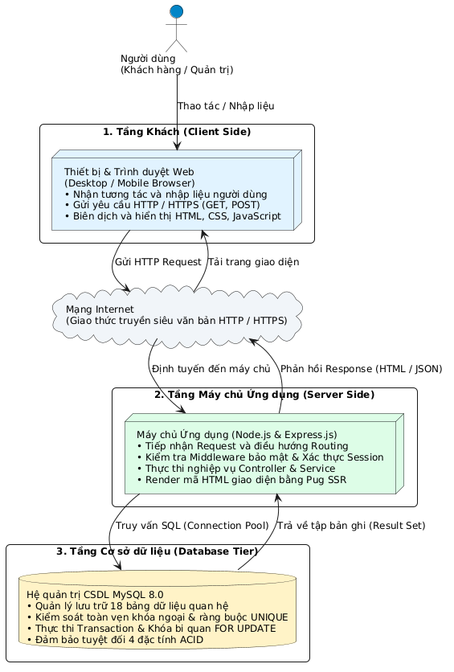
  <p><em>Hình 1: Mô hình Client - Server trong ứng dụng web</em></p>
</div>

### 1.2. Ứng dụng trong hệ thống VAMOS STORE

Trong hệ thống VAMOS STORE, mô hình Client - Server được ứng dụng theo cơ chế **Server-Side Rendering (SSR)**:

- Khi khách hàng truy cập xem danh sách giày dép hoặc bấm đặt hàng, trình duyệt gửi request về Node.js Server.
- Server tiếp nhận request, gọi xuống MySQL 8.0 để lấy dữ liệu sản phẩm, biến thể kho, sau đó sử dụng Template Engine Pug để biên dịch trực tiếp thành mã HTML hoàn chỉnh và trả về cho trình duyệt.
- **Ưu điểm áp dụng:** Giúp trang web tải nhanh, tối ưu hóa công cụ tìm kiếm (SEO) vượt trội cho các sản phẩm giày, đồng thời bảo mật tuyệt đối mã nguồn xử lý giá và logic kho phía máy chủ.

---

## 2. NGÔN NGỮ JAVASCRIPT VÀ NỀN TẢNG NODE.JS

### 2.1. Ngôn ngữ JavaScript (ES6+)

JavaScript là ngôn ngữ lập trình thông dịch bậc cao, hướng đối tượng dựa trên prototype, ban đầu được phát triển để tạo các hiệu ứng tương tác trên trình duyệt web. Cùng với sự phát triển mạnh mẽ của tiêu chuẩn ECMAScript (đặc biệt từ phiên bản ES6/ES2015 trở đi), JavaScript đã trang bị các tính năng ngôn ngữ hiện đại:

- Cú pháp `async/await` và `Promise` giúp xử lý các tác vụ bất đồng bộ một cách trực quan, tránh hiện tượng "Callback Hell".
- `Arrow functions`, `Destructuring assignment`, `Spread/Rest operator` giúp viết mã ngắn gọn, rõ ràng và dễ bảo trì.
- `Classes` và cú pháp module `import/export` hỗ trợ lập trình hướng đối tượng chuẩn mực.

### 2.2. Nền tảng Node.js

Node.js là một môi trường thực thi mã JavaScript đa nền tảng, mã nguồn mở, hoạt động bên ngoài trình duyệt web, được xây dựng trên nền tảng JavaScript Engine V8 của Google Chrome.

- **Kiến trúc hướng sự kiện (Event-driven):** Node.js vận hành dựa trên cơ chế phát và lắng nghe sự kiện, giúp hệ thống phản hồi cực nhanh với các hành động của người dùng.
- **Cơ chế I/O bất đồng bộ, không phong tỏa (Non-blocking I/O) và Vòng lặp sự kiện (Event Loop):** Thay vì tạo ra một luồng (thread) mới cho mỗi request như kiến trúc truyền thống đa luồng (multi-threaded) của Java hay PHP, Node.js sử dụng một luồng đơn (Single Thread) để xử lý hàng ngàn kết nối đồng thời mà không bị nghẽn I/O trong lúc chờ truy vấn cơ sở dữ liệu.
- **Lý do lựa chọn cho VAMOS STORE:** Nền tảng Node.js cho phép đội ngũ phát triển sử dụng duy nhất một ngôn ngữ JavaScript xuyên suốt từ Backend đến Frontend, tốc độ thực thi I/O vượt trội, rất phù hợp với bài toán thương mại điện tử cần xử lý nhiều truy vấn duyệt sản phẩm và đặt hàng đồng thời.

---

## 3. FRAMEWORK EXPRESS.JS

### 3.1. Tổng quan về Express.js

Express.js là một web framework mã nguồn mở tối giản (minimalist), linh hoạt và phổ biến hàng đầu dành cho Node.js. Express.js cung cấp một tập hợp các tính năng cốt lõi mạnh mẽ để phát triển các ứng dụng web và API:

- **Hệ thống định tuyến (Routing):** Quản lý điều hướng URL request (GET, POST, PUT, DELETE) đến các controller xử lý tương ứng một cách mạch lạc.
- **Cơ chế Middleware:** Là các hàm trung gian có quyền truy cập vào đối tượng request (`req`), response (`res`) và hàm `next()` trong chu trình xử lý. Middleware được dùng để xác thực quyền đăng nhập, ghi log, phân tích dữ liệu form (`body-parser`), quản lý cookie và xử lý lỗi tập trung.
- **Tích hợp Template Engine linh hoạt:** Hỗ trợ kết nối liền mạch với Pug, EJS, Handlebars để kết xuất giao diện HTML phía máy chủ.

### 3.2. Vai trò trong dự án VAMOS STORE

Express.js đóng vai trò là "bộ xương sống" kết nối toàn bộ hệ thống VAMOS STORE:

- Phân tách mạch lạc giữa các route công khai cho khách hàng (`/products`, `/cart`, `/checkout`) và các route quản trị bảo mật (`/admin/products`, `/admin/orders`, `/admin/inventory`).
- Cung cấp các Middleware kiểm tra vai trò: ngăn chặn khách vãng lai chưa đăng nhập truy cập trang thanh toán, ngăn chặn khách hàng thông thường truy cập trái phép vào các trang quản trị của Admin.

---

## 4. MÔ HÌNH MVC VÀ KIẾN TRÚC PHÂN LỚP (LAYERED ARCHITECTURE)

### 4.1. Khái niệm Model - View - Controller (MVC)

Mô hình MVC là một mẫu kiến trúc phần mềm kinh điển trong công nghệ web, chia tách ứng dụng thành ba thành phần độc lập:

1. **Model (Mô hình dữ liệu):** Đại diện cho dữ liệu và các quy tắc nghiệp vụ lưu trữ. Model tương tác trực tiếp với hệ quản trị cơ sở dữ liệu để thực hiện các thao tác CRUD (Create, Read, Update, Delete).
2. **View (Giao diện hiển thị):** Chịu trách nhiệm trực quan hóa dữ liệu nhận được từ Controller thành giao diện HTML mà người dùng nhìn thấy trên trình duyệt.
3. **Controller (Bộ điều khiển):** Tiếp nhận yêu cầu từ View/Client, điều phối các thao tác xử lý nghiệp vụ, gọi Model để lấy dữ liệu và chỉ định View tương ứng để render kết quả trả về.

<div align="center">
  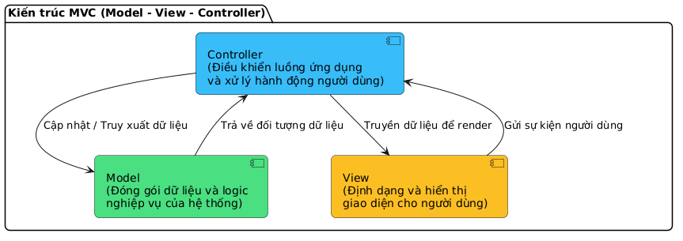
  <p><em>Hình 2: Mô hình kiến trúc MVC phân lớp</em></p>
</div>


<div align="center">
  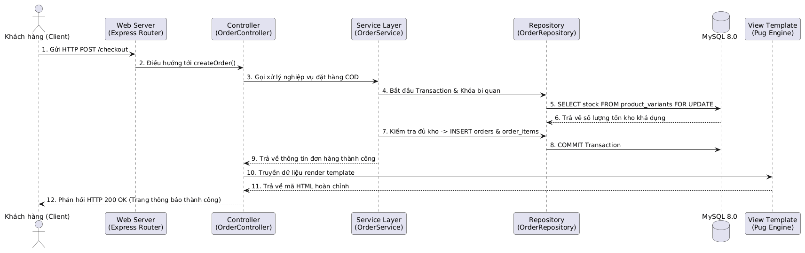
  <p><em>Hình 3: Luồng xử lý một Request trong kiến trúc phân lớp</em></p>
</div>

### 4.2. Kiến trúc phân lớp mở rộng trong VAMOS STORE

Để tránh hiện tượng "Fat Controller" (Controller chứa quá nhiều logic nghiệp vụ phức tạp khiến mã nguồn khó kiểm thử và khó bảo trì), dự án VAMOS STORE áp dụng **Kiến trúc phân lớp chuẩn doanh nghiệp (Layered Architecture)**:

- **Lớp Trình diễn (Presentation Layer - Views):** Sử dụng các file template Pug và Tailwind CSS để xây dựng giao diện người dùng.
- **Lớp Điều khiển (Controller Layer):** Tiếp nhận HTTP Request, kiểm tra tính hợp lệ sơ bộ của tham số đầu vào (Input Validation), sau đó chuyển tiếp cho tầng Service.
- **Lớp Dịch vụ nghiệp vụ (Service Layer):** Nơi chứa 100% logic nghiệp vụ cốt lõi: tính toán giảm giá voucher, quản lý Database Transaction, điều phối khóa dòng kiểm tra tồn kho khi đặt hàng COD, kích hoạt hoàn kho khi hủy đơn.
- **Lớp Truy xuất dữ liệu (Repository / Data Access Layer):** Chứa các câu lệnh truy vấn SQL thuần túy, đóng gói các thao tác với MySQL Connection Pool, trả về các đối tượng dữ liệu thuần túy (Data Transfer Object) cho tầng Service.

<div align="center">
  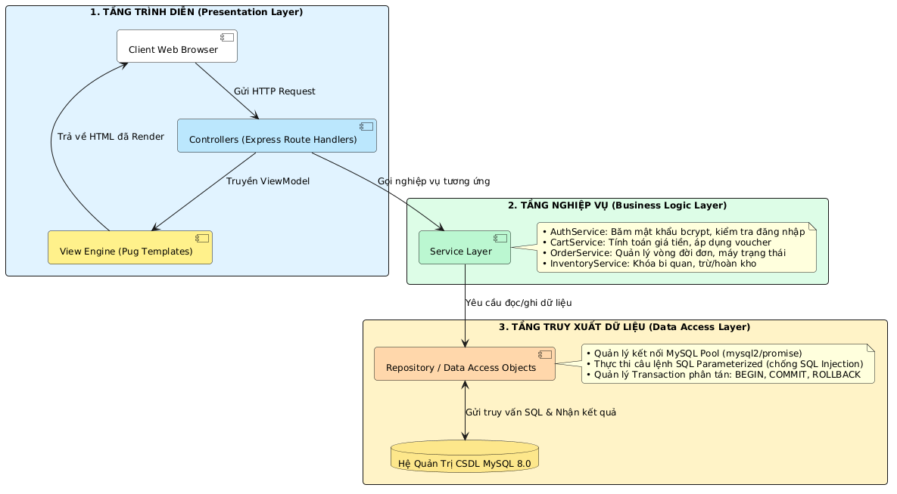
  <p><em>Hình 4: Chi tiết cấu trúc tầng trong kiến trúc phân lớp VAMOS STORE</em></p>
</div>


---

## 5. TEMPLATE ENGINE PUG (JADE)

### 5.1. Khái niệm và đặc điểm

Pug (trước đây có tên là Jade) là một công cụ tạo mẫu (Template Engine) hiệu năng cao dành cho Node.js:

- **Cú pháp tối giản dựa trên thụt lề (Indentation-based):** Pug loại bỏ hoàn toàn các thẻ đóng `</...>` và dấu ngoặc nhọn `< >` rườm rà của HTML truyền thống, giúp mã nguồn giao diện gọn gàng hơn từ 30% đến 50%.
- **Kế thừa giao diện (Template Inheritance):** Hỗ trợ cơ chế kế thừa thông qua từ khóa `extends` và ghi đè nội dung theo từng vùng bằng `block`. Điều này cho phép xây dựng một layout khung chuẩn (`layout.pug`) chứa Header, Navigation, Footer dùng chung, các trang con chỉ cần chèn nội dung đặc thù.
- **Tính năng Mixin:** Cho phép đóng gói các đoạn giao diện lặp lại (như Card sản phẩm, Badge trạng thái đơn hàng, Hộp thoại xác nhận) thành các hàm tái sử dụng linh hoạt.

```pug
//- Ví dụ cú pháp Pug kế thừa layout trong VAMOS STORE
extends ../layouts/main.pug

block content
  div(class="container mx-auto px-4 py-8")
    h1(class="text-2xl font-bold text-gray-900") Danh sách giày Sneaker
    div(class="grid grid-cols-1 md:grid-cols-4 gap-6 mt-6")
      each product in products
        +productCard(product)
```

---

## 6. CSS FRAMEWORK TAILWIND CSS

### 6.1. Triết lý Utility-first CSS

Khác với các CSS framework truyền thống cung cấp sẵn các component cố định (như Bootstrap hay Semantic UI với các class `.btn`, `.card` bị đóng khung phong cách), Tailwind CSS là một framework theo định hướng **Utility-first**:

- Cung cấp hàng ngàn class tiện ích cấp thấp (low-level utility classes) phản ánh trực tiếp các thuộc tính CSS như khoảng cách (`p-4`, `m-2`), căn chỉnh bố cục Flexbox/Grid (`flex`, `grid-cols-4`), màu sắc (`bg-coral-500`, `text-charcoal-900`), và trạng thái hover/focus (`hover:bg-coral-600`).
- **Khả năng Responsive vượt trội:** Tích hợp sẵn các tiền tố breakpoint (`sm:`, `md:`, `lg:`, `xl:`) giúp điều chỉnh bố cục website mượt mà trên mọi kích thước màn hình mà không cần viết media query thủ công.
- **Tối ưu hóa dung lượng (PurgeCSS / JIT Mode):** Bộ biên dịch Just-In-Time (JIT) của Tailwind chỉ xuất ra các class CSS thực sự được sử dụng trong mã nguồn Pug, giúp file stylesheet production cực nhẹ (thường dưới 20KB), tăng tốc độ tải trang đáng kể.

---

## 7. HỆ QUẢN TRỊ CƠ SỞ DỮ LIỆU MYSQL 8.0

### 7.1. Tổng quan về MySQL 8.0

MySQL là hệ quản trị cơ sở dữ liệu quan hệ mã nguồn mở (RDBMS) hàng đầu thế giới, được sở hữu và phát triển bởi tập đoàn Oracle. Phiên bản MySQL 8.0 mang lại nhiều cải tiến đột phá:

- **Storage Engine InnoDB mặc định:** Hỗ trợ đầy đủ các đặc tính toàn vẹn giao dịch **ACID** (Atomicity - Tính nguyên tử, Consistency - Tính nhất quán, Isolation - Tính cô lập, Durability - Tính bền vững).
- **Khóa bi quan cấp dòng (Pessimistic Row-level Locking):** Hỗ trợ cú pháp `SELECT ... FOR UPDATE`, cho phép khóa một dòng dữ liệu biến thể trong suốt quá trình giao dịch, ngăn chặn tình trạng hai phiên làm việc đọc cùng một số lượng tồn và dẫn đến Race Condition.
- **Hỗ trợ thực thi ràng buộc CHECK:** Bắt đầu từ phiên bản MySQL 8.0.16, hệ thống chính thức kiểm tra và thực thi các biểu thức ràng buộc logic `CHECK` (như kiểm tra giá tiền không âm, số lượng đặt hàng lớn hơn 0, ngày kết thúc lớn hơn ngày bắt đầu).
- **Bảng mã `utf8mb4`:** Hỗ trợ đầy đủ bộ ký tự Unicode quốc tế và tiếng Việt có dấu, cũng như các ký tự biểu cảm (emoji) hiện đại.

---

## 8. CƠ CHẾ XÁC THỰC VÀ QUẢN LÝ PHIÊN (AUTHENTICATION & SECURITY)

### 8.1. Quản lý phiên làm việc máy chủ (Session-based Authentication)

Hệ thống VAMOS STORE sử dụng thư viện `express-session` để duy trì trạng thái đăng nhập của người dùng:

- Khi người dùng đăng nhập thành công với email và mật khẩu đúng, server khởi tạo một bản ghi session trong bộ nhớ máy chủ (hoặc lưu trữ trong MySQL session store) và cấp một mã định danh phiên ngẫu nhiên (Session ID).
- Session ID được mã hóa và gửi về trình duyệt qua cookie mang cờ `HttpOnly` (ngăn chặn mã độc JavaScript phía client đánh cắp cookie qua tấn công XSS) và `SameSite=Strict` (chống tấn công giả mạo yêu cầu CSRF).
- Mọi request tiếp theo từ trình duyệt tự động gửi kèm cookie này; middleware phía server sẽ đối soát phiên để trích xuất quyền hạn (`req.session.user.role`).

### 8.2. Kỹ thuật băm mật khẩu một chiều với Bcrypt

- **Nguyên tắc an toàn:** Tuyệt đối không lưu mật khẩu của người dùng dưới dạng văn bản thuần (plaintext) trong cơ sở dữ liệu.
- **Thuật toán Bcrypt:** Là hàm băm mật khẩu thích ứng (adaptive hash function), tích hợp cơ chế tự động sinh chuỗi muối ngẫu nhiên (Salt) và cấu hình chi phí tính toán (Work factor / Salt rounds >= 10). Thuật toán này có khả năng làm chậm tốc độ tính toán của máy tính kẻ tấn công, vô hiệu hóa hoàn toàn các kỹ thuật tấn công tra cứu bảng cầu vồng (Rainbow Table) hoặc tấn công vét cạn (Brute-force).

---

## 9. CÔNG NGHỆ CONTAINER HÓA DOCKER VÀ DOCKER COMPOSE

### 9.1. Khái niệm Container và Docker

Docker là nền tảng ảo hóa mức hệ điều hành (Containerization) cho phép đóng gói toàn bộ mã nguồn ứng dụng, môi trường thực thi Node.js, các gói phụ thuộc (npm dependencies) và cấu hình hệ thống vào một đơn vị độc lập gọi là **Container**.

- Khác với máy ảo truyền thống (Virtual Machine) đòi hỏi cả một hệ điều hành khách (Guest OS) nặng nề, Docker Container chia sẻ chung nhân hệ điều hành máy chủ (Host OS Kernel), giúp khởi động tức thì chỉ trong vài giây và tiêu tốn rất ít tài nguyên phần cứng.

### 9.2. Docker Compose trong VAMOS STORE

Docker Compose là công cụ giúp định nghĩa và vận hành ứng dụng đa container (Multi-container applications) thông qua file cấu hình `docker-compose.yml`:

- **Web Service:** Container chạy ứng dụng Node.js/Express, kết nối cổng 3000 ra môi trường ngoài.
- **Database Service:** Container chạy hệ quản trị CSDL MySQL 8.0, cấu hình ổ cứng gắn ngoài (Docker Volume) để lưu trữ dữ liệu an toàn ngay cả khi container bị khởi động lại.
- **Lợi ích ứng dụng:** Đảm bảo tính nhất quán tuyệt đối của môi trường chạy ứng dụng giữa các máy tính của các thành viên trong nhóm phát triển và máy chủ triển khai ("Build once, run anywhere").


---

# CHƯƠNG II: PHÂN TÍCH VÀ THIẾT KẾ HỆ THỐNG (SYSTEM ANALYSIS & DESIGN)

---

## 1. PHÂN TÍCH NGHIỆP VỤ HỆ THỐNG

### 1.1. Nghiệp vụ của Khách vãng lai (Guest)
Khách vãng lai là người truy cập website nhưng chưa đăng nhập hoặc chưa có tài khoản trên hệ thống:
* **Khám phá và tra cứu sản phẩm:** Xem trang chủ, xem các bộ sưu tập giày dép nổi bật, tìm kiếm sản phẩm theo từ khóa (tên sản phẩm, dòng sản phẩm, thương hiệu).
* **Lọc và phân loại nâng cao:** Sử dụng bộ lọc đa tiêu chí bên thanh điều hướng trái (Sidebar Filter) để lọc theo danh mục (Sneaker, Thể thao, Chạy bộ, Sandal, Dép), lọc theo đối tượng giới tính (Nam, Nữ, Trẻ em, Unisex), lọc theo kích cỡ giày (Size 36 đến 45), theo màu sắc và khoảng giá bán.
* **Xem thông tin chi tiết sản phẩm:** Xem bộ sưu tập hình ảnh góc chụp chi tiết, đọc mô tả tính năng công nghệ của đế và thân giày, bảng hướng dẫn chọn size chuẩn, kiểm tra tình trạng còn hàng theo từng cặp Size x Màu sắc.
* **Đăng ký tài khoản mới:** Cung cấp thông tin họ tên, email hợp lệ, số điện thoại, mật khẩu để tạo tài khoản thành viên `Customer`.
* **Đăng nhập và khôi phục mật khẩu:** Xác thực vào hệ thống hoặc gửi yêu cầu đặt lại mật khẩu khi quên.

### 1.2. Nghiệp vụ của Khách hàng thành viên (Customer)
Khách hàng thành viên là người đã đăng nhập tài khoản khách hàng trên hệ thống VAMOS STORE:
* **Quản lý giỏ hàng:** Chọn biến thể kích cỡ và màu sắc ưng ý, chỉ định số lượng và thêm vào giỏ hàng cá nhân. Khách hàng có thể tăng/giảm số lượng hoặc xóa dòng sản phẩm trong trang giỏ hàng.
* **Đặt hàng thanh toán COD:** Thực hiện quy trình đặt hàng: chọn địa chỉ giao nhận từ sổ địa chỉ có sẵn hoặc nhập địa chỉ mới; nhập mã voucher khuyến mãi (nếu có); xác nhận phương thức thanh toán tiền mặt khi nhận hàng (COD).
* **Quản lý sổ địa chỉ:** Thêm nhiều địa chỉ giao hàng cá nhân, chỉnh sửa thông tin người nhận và thiết lập một địa chỉ làm mặc định.
* **Theo dõi đơn hàng (Order Tracking):** Xem danh sách lịch sử mua hàng; xem chi tiết từng đơn hàng bao gồm danh sách sản phẩm snapshot, tổng tiền, mã vận đơn nội bộ và tiến trình trạng thái thời gian thực.
* **Chủ động hủy đơn hàng:** Được phép tự bấm nút "Hủy đơn hàng" và nhập lý do hủy DUY NHẤT khi đơn hàng đang ở trạng thái chờ xác nhận (`PENDING`). Khi đơn đã chuyển sang trạng thái đã xác nhận (`CONFIRMED`) hoặc đang chuẩn bị hàng (`PROCESSING`), nút hủy đơn sẽ tự động bị vô hiệu hóa.

### 1.3. Nghiệp vụ của Quản trị viên (Admin)
Quản trị viên là người vận hành và kiểm soát toàn bộ hoạt động kinh doanh trên hệ thống:
* **Quản lý Danh mục và Thương hiệu:** Thêm mới, cập nhật thông tin mô tả, cấu hình đường dẫn tĩnh (slug) và bật/tắt trạng thái hiển thị danh mục trên cửa hàng.
* **Quản lý Sản phẩm và Biến thể:** Tạo mới thông tin sản phẩm cha; tải lên bộ sưu tập hình ảnh chi tiết và chọn ảnh đại diện chính; cấu hình ma trận biến thể giày theo từng cặp Kích cỡ (Size) x Màu sắc (Color) gán kèm mã SKU duy nhất và số lượng nhập kho ban đầu.
* **Quản lý Tồn kho & Kiểm kê:** Xem danh sách cảnh báo các mặt hàng sắp hết (`stock_quantity <= 5`); thực hiện điều chỉnh tăng/giảm tồn kho thủ công khi kiểm kê kho thực tế; bắt buộc nhập lý do điều chỉnh để lưu vết kiểm toán vào `inventory_transactions`.
* **Vận hành Đơn hàng (Order Fulfillment):** Xem danh sách đơn hàng lọc theo trạng thái; xem chi tiết snapshot địa chỉ và sản phẩm; thực hiện chuyển đổi trạng thái đơn hàng theo đúng quy trình nghiệp vụ: `PENDING` $\rightarrow$ `CONFIRMED` $\rightarrow$ `PROCESSING` $\rightarrow$ `SHIPPING` $\rightarrow$ `COMPLETED`. Admin có quyền hủy đơn hàng ở trạng thái `PENDING` hoặc `CONFIRMED` kèm theo ghi chú lý do nội bộ, hệ thống sẽ tự động kích hoạt hoàn kho.
* **Quản lý Mã giảm giá (Vouchers):** Tạo mã khuyến mãi, thiết lập hình thức giảm (theo `%` hoặc trừ tiền cố định), giá trị giảm, hạn mức tối đa, giá trị đơn hàng tối thiểu và khung thời gian hiệu lực.
* **Báo cáo Doanh thu & Thống kê:** Bảng điều khiển trực quan thống kê tổng số đơn hàng, tổng sản phẩm đã bán và doanh thu thực tế (nguyên tắc: chỉ ghi nhận doanh thu từ các đơn hàng đã ở trạng thái `COMPLETED`).

---

## 2. THIẾT KẾ HỆ THỐNG

### 2.1. Sơ đồ Use Case (Use Case Diagrams)

#### A. Sơ đồ Use Case tổng quát toàn hệ thống
Hệ thống VAMOS STORE bao gồm 4 gói chức năng (Packages) được phân quyền cho 3 tác nhân chính (`Guest`, `Customer`, `Admin`):
* Gói 1: Quản lý tài khoản & Xác thực
* Gói 2: Mua sắm & Đặt hàng COD
* Gói 3: Quản lý đơn hàng cá nhân của Khách hàng
* Gói 4: Quản trị hệ thống dành cho Admin

<div align="center">
  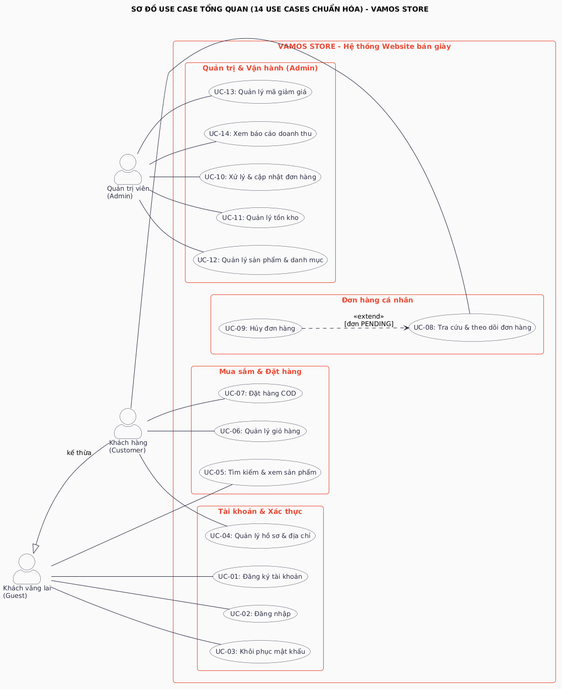
  <p><strong>Hình 5: Sơ đồ Use Case tổng quát VAMOS STORE</strong></p>
</div>

---

#### B. Sơ đồ Use Case chi tiết phân hệ Đặt hàng COD & Giỏ hàng
* Ca sử dụng trung tâm là **"Đặt hàng COD"** (`UC07`) được thực hiện bởi `Customer`.
* Quan hệ `<<include>>`: Luồng đặt hàng bắt buộc phải bao gồm bước *"Chọn địa chỉ nhận hàng"* và *"Xác nhận thông tin đặt hàng"*.
* Quan hệ `<<extend>>`: Khách hàng có thể tùy chọn *"Áp dụng mã giảm giá"* (`UC08`) khi đơn hàng thỏa mãn điều kiện tối thiểu.

<div align="center">
  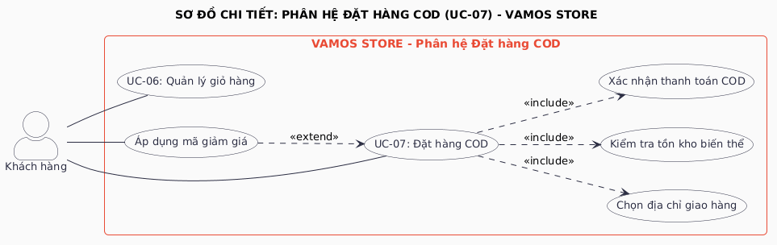
  <p><strong>Hình 6: Sơ đồ Use Case chi tiết Đặt hàng COD</strong></p>
</div>

---

#### C. Sơ đồ Use Case chi tiết Quản lý đơn hàng khách hàng & Hủy đơn
* Khách hàng xem danh sách đơn hàng đã mua (`UC09`) và theo dõi tiến trình chuyển trạng thái theo thời gian thực.
* Chức năng *"Hủy đơn hàng"* (`UC10`) là điểm mở rộng (`<<extend>>`) gắn kèm điểm mở rộng (Extension Point) `condition: status == 'PENDING'`.

<div align="center">
  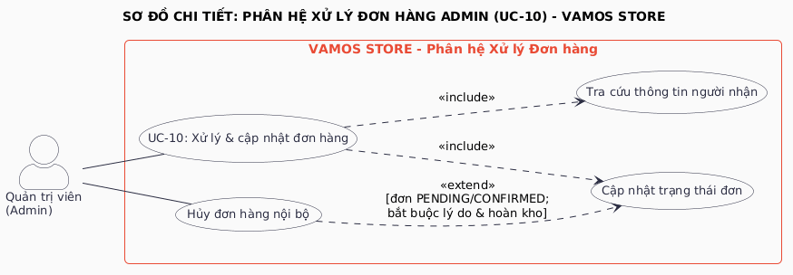
  <p><strong>Hình 7: Sơ đồ Use Case chi tiết Vận hành đơn hàng và Kho hàng Admin</strong></p>
</div>

---

### 2.2. Sơ đồ điều hướng màn hình (Sitemap)

Website VAMOS STORE được phân chia cấu trúc trang thành 3 phân vùng độc lập:
1. **Phân vùng công khai (Public Zone):** Trang chủ, Danh mục sản phẩm (Shop), Chi tiết sản phẩm, Giỏ hàng, Đăng nhập, Đăng ký, Quên mật khẩu, Chính sách bảo hành/đổi trả.
2. **Phân vùng Khách hàng (Customer Protected Zone):** Trang thanh toán đặt hàng COD (Checkout), Trang xác nhận đặt hàng thành công, Trang hồ sơ cá nhân, Sổ địa chỉ nhận hàng, Lịch sử và chi tiết đơn hàng.
3. **Phân vùng Quản trị (Admin Protected Zone):** Dashboard thống kê doanh thu, Quản lý sản phẩm & biến thể, Quản lý danh mục & thương hiệu, Quản lý tồn kho & nhật ký kho, Quản lý đơn hàng & chuyển trạng thái, Quản lý mã giảm giá (voucher), Quản lý banner slider.

<div align="center">
  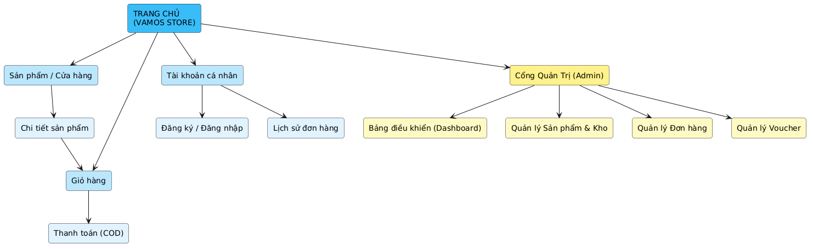
  <p><strong>Hình 8: Sơ đồ điều hướng màn hình (Sitemap) VAMOS STORE</strong></p>
</div>

---

### 2.3. Mô hình thực thể quan hệ - ERD (Entity-Relationship Diagram)

Hệ thống cơ sở dữ liệu VAMOS STORE được xây dựng chuẩn hóa gồm **18 thực thể** liên kết chặt chẽ trên hệ quản trị CSDL MySQL 8.0:

<div align="center">
  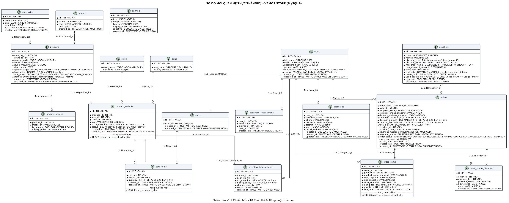
  <p><strong>Hình 9: Mô hình thực thể quan hệ (ERD 18 bảng) - VAMOS STORE</strong></p>
</div>

---

### 2.4. Từ điển dữ liệu chi tiết (Data Dictionary)

*(Theo phong cách trình bày chuẩn của đồ án FPT Polytechnic, mỗi thực thể được thể hiện bằng một bảng gồm: Thuộc tính, Kiểu dữ liệu, Bắt buộc, Ràng buộc, Mô tả).*

#### Bảng 2: Thực thể `users`
*Mục đích: Quản lý tài khoản người dùng hệ thống (`CUSTOMER`, `ADMIN`).*

| Thuộc tính | Kiểu dữ liệu | Bắt buộc | Ràng buộc | Mô tả nghiệp vụ |
| :--- | :--- | :---: | :---: | :--- |
| `id` | `INT` | Có | Khóa chính, Auto Increment | Mã định danh duy nhất của người dùng |
| `full_name` | `VARCHAR(100)` | Có | | Họ và tên đầy đủ của người dùng |
| `email` | `VARCHAR(150)` | Có | UNIQUE | Địa chỉ email đăng nhập hệ thống |
| `password_hash` | `VARCHAR(255)` | Có | | Chuỗi băm mật khẩu bảo mật (bcrypt) |
| `phone` | `VARCHAR(20)` | Không | NULL | Số điện thoại liên lạc |
| `role` | `ENUM('ADMIN','CUSTOMER')` | Có | Mặc định: 'CUSTOMER' | Vai trò phân quyền trên hệ thống |
| `status` | `ENUM('active','locked')` | Có | Mặc định: 'active' | Trạng thái hoạt động tài khoản |
| `created_at` | `TIMESTAMP` | Có | Mặc định: CURRENT_TIMESTAMP | Thời điểm tạo tài khoản |
| `updated_at` | `TIMESTAMP` | Có | ON UPDATE CURRENT_TIMESTAMP | Thời điểm cập nhật thông tin |

#### Bảng 3: Thực thể `addresses`
*Mục đích: Sổ địa chỉ nhận hàng của khách hàng.*

| Thuộc tính | Kiểu dữ liệu | Bắt buộc | Ràng buộc | Mô tả nghiệp vụ |
| :--- | :--- | :---: | :---: | :--- |
| `id` | `INT` | Có | Khóa chính, Auto Increment | Mã định danh bản ghi địa chỉ |
| `user_id` | `INT` | Có | Khóa ngoại $\rightarrow$ `users(id)` | Tham chiếu tài khoản khách hàng sở hữu |
| `recipient_name` | `VARCHAR(100)` | Có | | Họ tên người nhận hàng |
| `phone` | `VARCHAR(20)` | Có | | Số điện thoại người nhận hàng |
| `province` | `VARCHAR(100)` | Có | | Tỉnh / Thành phố giao hàng |
| `district` | `VARCHAR(100)` | Có | | Quận / Huyện giao hàng |
| `ward` | `VARCHAR(100)` | Có | | Phường / Xã giao hàng |
| `detail_address` | `VARCHAR(255)` | Có | | Số nhà, tên đường, địa chỉ chi tiết |
| `is_default` | `BOOLEAN` | Có | Mặc định: FALSE | Cờ đánh dấu địa chỉ mặc định (1: có, 0: không) |
| `created_at` | `TIMESTAMP` | Có | Mặc định: CURRENT_TIMESTAMP | Thời điểm tạo bản ghi |
| `updated_at` | `TIMESTAMP` | Có | ON UPDATE CURRENT_TIMESTAMP | Thời điểm cập nhật địa chỉ |

#### Bảng 4: Thực thể `password_reset_tokens`
*Mục đích: Token xác thực khôi phục mật khẩu.*

| Thuộc tính | Kiểu dữ liệu | Bắt buộc | Ràng buộc | Mô tả nghiệp vụ |
| :--- | :--- | :---: | :---: | :--- |
| `id` | `INT` | Có | Khóa chính, Auto Increment | Mã định danh token |
| `user_id` | `INT` | Có | Khóa ngoại $\rightarrow$ `users(id)` | Tài khoản yêu cầu khôi phục |
| `token` | `VARCHAR(255)` | Có | UNIQUE | Chuỗi token ngẫu nhiên bảo mật |
| `expires_at` | `DATETIME` | Có | | Thời điểm hết hạn của token |
| `used_at` | `DATETIME` | Không | NULL | Thời điểm token đã được sử dụng |
| `created_at` | `TIMESTAMP` | Có | Mặc định: CURRENT_TIMESTAMP | Thời điểm tạo yêu cầu reset |

#### Bảng 5: Thực thể `categories`
*Mục đích: Danh mục phân loại sản phẩm.*

| Thuộc tính | Kiểu dữ liệu | Bắt buộc | Ràng buộc | Mô tả nghiệp vụ |
| :--- | :--- | :---: | :---: | :--- |
| `id` | `INT` | Có | Khóa chính, Auto Increment | Mã định danh danh mục |
| `name` | `VARCHAR(100)` | Có | | Tên danh mục (Sneaker, Thể thao, Sandal,...) |
| `slug` | `VARCHAR(120)` | Có | UNIQUE | Đường dẫn tĩnh SEO duy nhất |
| `description` | `TEXT` | Không | NULL | Mô tả chi tiết danh mục |
| `is_active` | `BOOLEAN` | Có | Mặc định: TRUE | Cờ hiển thị (1: bật, 0: ẩn) |
| `created_at` | `TIMESTAMP` | Có | Mặc định: CURRENT_TIMESTAMP | Thời điểm tạo danh mục |

#### Bảng 6: Thực thể `brands`
*Mục đích: Thương hiệu / Dòng bộ sưu tập nội bộ VAMOS.*

| Thuộc tính | Kiểu dữ liệu | Bắt buộc | Ràng buộc | Mô tả nghiệp vụ |
| :--- | :--- | :---: | :---: | :--- |
| `id` | `INT` | Có | Khóa chính, Auto Increment | Mã định danh thương hiệu/bộ sưu tập |
| `name` | `VARCHAR(100)` | Có | | Tên bộ sưu tập (VAMOS Street, Sport...) |
| `slug` | `VARCHAR(120)` | Có | UNIQUE | Đường dẫn tĩnh duy nhất |
| `description` | `TEXT` | Không | NULL | Giới thiệu về bộ sưu tập |
| `created_at` | `TIMESTAMP` | Có | Mặc định: CURRENT_TIMESTAMP | Thời điểm tạo bản ghi |

#### Bảng 7: Thực thể `products`
*Mục đích: Thông tin sản phẩm cha.*

| Thuộc tính | Kiểu dữ liệu | Bắt buộc | Ràng buộc | Mô tả nghiệp vụ |
| :--- | :--- | :---: | :---: | :--- |
| `id` | `INT` | Có | Khóa chính, Auto Increment | Mã định danh sản phẩm |
| `category_id` | `INT` | Có | Khóa ngoại $\rightarrow$ `categories(id)` | Danh mục phân loại của sản phẩm |
| `brand_id` | `INT` | Không | Khóa ngoại $\rightarrow$ `brands(id)` | Bộ sưu tập (tùy chọn) |
| `product_code`| `VARCHAR(50)` | Có | UNIQUE | Mã sản phẩm nội bộ (ví dụ: VM-SNK-01) |
| `name` | `VARCHAR(200)` | Có | | Tên hiển thị đầy đủ của sản phẩm |
| `slug` | `VARCHAR(255)` | Có | UNIQUE | Đường dẫn tĩnh chi tiết sản phẩm |
| `description` | `TEXT` | Không | NULL | Mô tả chất liệu, tính năng, hướng dẫn size |
| `gender_target`| `ENUM('MEN','WOMEN','KIDS','UNISEX')` | Có | Mặc định: 'UNISEX' | Đối tượng khách hàng mục tiêu |
| `base_price` | `DECIMAL(12,0)` | Có | CHECK `base_price >= 0` | Giá bán niêm yết chính thức (VNĐ) |
| `sale_price` | `DECIMAL(12,0)` | Không | CHECK `< base_price` | Giá bán ưu đãi khuyến mãi (VNĐ) |
| `status` | `ENUM('active','inactive','draft')` | Có | Mặc định: 'active' | Trạng thái hiển thị trên cửa hàng |
| `created_at` | `TIMESTAMP` | Có | Mặc định: CURRENT_TIMESTAMP | Thời điểm tạo sản phẩm |
| `updated_at` | `TIMESTAMP` | Có | ON UPDATE CURRENT_TIMESTAMP | Thời điểm cập nhật sản phẩm |

#### Bảng 8: Thực thể `product_images`
*Mục đích: Bộ sưu tập hình ảnh chi tiết của sản phẩm.*

| Thuộc tính | Kiểu dữ liệu | Bắt buộc | Ràng buộc | Mô tả nghiệp vụ |
| :--- | :--- | :---: | :---: | :--- |
| `id` | `INT` | Có | Khóa chính, Auto Increment | Mã định danh ảnh |
| `product_id` | `INT` | Có | Khóa ngoại $\rightarrow$ `products(id)` | Tham chiếu sản phẩm gốc |
| `image_url` | `VARCHAR(255)` | Có | | Đường dẫn URL file ảnh trong storage |
| `is_primary` | `BOOLEAN` | Có | Mặc định: FALSE | Cờ đánh dấu ảnh đại diện chính |
| `display_order`| `INT` | Có | Mặc định: 0 | Thứ tự sắp xếp trong gallery slider |

#### Bảng 9: Thực thể `sizes`
*Mục đích: Danh mục chuẩn kích cỡ giày dép.*

| Thuộc tính | Kiểu dữ liệu | Bắt buộc | Ràng buộc | Mô tả nghiệp vụ |
| :--- | :--- | :---: | :---: | :--- |
| `id` | `INT` | Có | Khóa chính, Auto Increment | Mã định danh kích cỡ |
| `size_name` | `VARCHAR(20)` | Có | UNIQUE | Tên kích cỡ chuẩn (38, 39, 40, 41,...) |
| `display_order`| `INT` | Có | Mặc định: 0 | Thứ tự hiển thị khi chọn size |

#### Bảng 10: Thực thể `colors`
*Mục đích: Danh mục màu sắc sản phẩm.*

| Thuộc tính | Kiểu dữ liệu | Bắt buộc | Ràng buộc | Mô tả nghiệp vụ |
| :--- | :--- | :---: | :---: | :--- |
| `id` | `INT` | Có | Khóa chính, Auto Increment | Mã định danh màu sắc |
| `color_name` | `VARCHAR(50)` | Có | UNIQUE | Tên màu (Đen, Trắng, Đỏ Coral,...) |
| `hex_code` | `VARCHAR(10)` | Không | NULL | Mã màu thập lục phân CSS (#000000) |

#### Bảng 11: Thực thể `product_variants`
*Mục đích: Biến thể chi tiết Size x Color x SKU x Tồn kho.*

| Thuộc tính | Kiểu dữ liệu | Bắt buộc | Ràng buộc | Mô tả nghiệp vụ |
| :--- | :--- | :---: | :---: | :--- |
| `id` | `INT` | Có | Khóa chính, Auto Increment | Mã định danh biến thể |
| `product_id` | `INT` | Có | Khóa ngoại $\rightarrow$ `products(id)` | Sản phẩm cha |
| `size_id` | `INT` | Có | Khóa ngoại $\rightarrow$ `sizes(id)` | Kích cỡ biến thể |
| `color_id` | `INT` | Có | Khóa ngoại $\rightarrow$ `colors(id)` | Màu sắc biến thể |
| `sku` | `VARCHAR(100)` | Có | UNIQUE | Mã SKU lưu kho duy nhất |
| `stock_quantity`| `INT` | Có | CHECK `>= 0` | Số lượng tồn kho khả dụng hiện tại |
| `status` | `ENUM('active','inactive')` | Có | Mặc định: 'active' | Trạng thái kinh doanh của biến thể |
| `created_at` | `TIMESTAMP` | Có | Mặc định: CURRENT_TIMESTAMP | Thời điểm tạo biến thể |
| `updated_at` | `TIMESTAMP` | Có | ON UPDATE CURRENT_TIMESTAMP | Thời điểm cập nhật số lượng kho |
| **Ràng buộc tổ hợp** | | | `UNIQUE(product_id, size_id, color_id)` | Ngăn chặn tạo trùng cặp Size/Màu trên cùng 1 sản phẩm |

#### Bảng 12: Thực thể `inventory_transactions`
*Mục đích: Nhật ký kiểm toán biến động kho.*

| Thuộc tính | Kiểu dữ liệu | Bắt buộc | Ràng buộc | Mô tả nghiệp vụ |
| :--- | :--- | :---: | :---: | :--- |
| `id` | `INT` | Có | Khóa chính, Auto Increment | Mã định danh giao dịch kho |
| `variant_id` | `INT` | Có | Khóa ngoại $\rightarrow$ `product_variants(id)` | Biến thể bị biến động |
| `user_id` | `INT` | Có | Khóa ngoại $\rightarrow$ `users(id)` | Người thực hiện (Admin chỉnh hoặc Khách đặt đơn) |
| `old_quantity` | `INT` | Có | CHECK `>= 0` | Số lượng tồn trước biến động |
| `new_quantity` | `INT` | Có | CHECK `>= 0` | Số lượng tồn sau biến động |
| `change_quantity`| `INT` | Có | | Số lượng thay đổi (+ nhập/hoàn, - bán) |
| `reason` | `VARCHAR(255)` | Có | | Lý do biến động (ORDER_PLACED, RESTOCK,...) |
| `created_at` | `TIMESTAMP` | Có | Mặc định: CURRENT_TIMESTAMP | Thời điểm ghi nhận giao dịch |

#### Bảng 13: Thực thể `carts`
*Mục đích: Giỏ hàng khách hàng.*

| Thuộc tính | Kiểu dữ liệu | Bắt buộc | Ràng buộc | Mô tả nghiệp vụ |
| :--- | :--- | :---: | :---: | :--- |
| `id` | `INT` | Có | Khóa chính, Auto Increment | Mã định danh giỏ hàng |
| `user_id` | `INT` | Có | Khóa ngoại $\rightarrow$ `users(id)`, UNIQUE | Khách hàng sở hữu (Mỗi user chỉ có 1 giỏ) |
| `created_at` | `TIMESTAMP` | Có | Mặc định: CURRENT_TIMESTAMP | Thời điểm tạo giỏ hàng |
| `updated_at` | `TIMESTAMP` | Có | ON UPDATE CURRENT_TIMESTAMP | Thời điểm cập nhật giỏ |

#### Bảng 14: Thực thể `cart_items`
*Mục đích: Chi tiết mặt hàng trong giỏ.*

| Thuộc tính | Kiểu dữ liệu | Bắt buộc | Ràng buộc | Mô tả nghiệp vụ |
| :--- | :--- | :---: | :---: | :--- |
| `id` | `INT` | Có | Khóa chính, Auto Increment | Mã định danh dòng giỏ hàng |
| `cart_id` | `INT` | Có | Khóa ngoại $\rightarrow$ `carts(id)` | Giỏ hàng cha |
| `variant_id` | `INT` | Có | Khóa ngoại $\rightarrow$ `product_variants(id)` | Biến thể đặt mua |
| `quantity` | `INT` | Có | CHECK `quantity > 0` | Số lượng đặt mua |
| `created_at` | `TIMESTAMP` | Có | Mặc định: CURRENT_TIMESTAMP | Thời điểm thêm vào giỏ |
| `updated_at` | `TIMESTAMP` | Có | ON UPDATE CURRENT_TIMESTAMP | Thời điểm chỉnh sửa số lượng |
| **Ràng buộc tổ hợp** | | | `UNIQUE(cart_id, variant_id)` | Ngăn chặn trùng lặp cùng 1 biến thể trong giỏ |

#### Bảng 15: Thực thể `vouchers`
*Mục đích: Mã giảm giá khuyến mãi.*

| Thuộc tính | Kiểu dữ liệu | Bắt buộc | Ràng buộc | Mô tả nghiệp vụ |
| :--- | :--- | :---: | :---: | :--- |
| `id` | `INT` | Có | Khóa chính, Auto Increment | Mã định danh voucher |
| `code` | `VARCHAR(50)` | Có | UNIQUE | Mã ưu đãi nhập khi thanh toán |
| `name` | `VARCHAR(100)` | Có | | Tên chương trình ưu đãi |
| `discount_type`| `ENUM('percentage','fixed_amount')` | Có | | Hình thức giảm: theo % hoặc trừ tiền cố định |
| `discount_value`| `DECIMAL(12,0)`| Có | CHECK `> 0` | Mức giảm (% hoặc số tiền VNĐ) |
| `min_order_value`| `DECIMAL(12,0)`| Có | CHECK `>= 0` | Giá trị đơn hàng tối thiểu |
| `max_discount_amount`| `DECIMAL(12,0)`| Không | NULL | Mức giảm tối đa (khi giảm theo %) |
| `start_date` | `DATETIME` | Có | | Thời điểm bắt đầu hiệu lực |
| `end_date` | `DATETIME` | Có | CHECK `end_date >= start_date` | Thời điểm kết thúc hiệu lực |
| `usage_limit` | `INT` | Có | CHECK `>= 0` | Giới hạn tổng số lượt dùng (0: vô hạn) |
| `used_count` | `INT` | Có | CHECK `<= usage_limit` | Số lượt đã sử dụng thực tế |
| `is_active` | `BOOLEAN` | Có | Mặc định: TRUE | Cờ kích hoạt khả dụng |
| `created_at` | `TIMESTAMP` | Có | Mặc định: CURRENT_TIMESTAMP | Thời điểm tạo voucher |

#### Bảng 16: Thực thể `banners`
*Mục đích: Banner quảng bá slider trang chủ.*

| Thuộc tính | Kiểu dữ liệu | Bắt buộc | Ràng buộc | Mô tả nghiệp vụ |
| :--- | :--- | :---: | :---: | :--- |
| `id` | `INT` | Có | Khóa chính, Auto Increment | Mã định danh banner |
| `title` | `VARCHAR(150)` | Có | | Tiêu đề banner |
| `image_url` | `VARCHAR(255)` | Có | | Đường dẫn ảnh banner |
| `link_url` | `VARCHAR(255)` | Không | NULL | Đường dẫn khi người dùng bấm vào banner |
| `display_order`| `INT` | Có | Mặc định: 0 | Thứ tự hiển thị trên slider |
| `is_active` | `BOOLEAN` | Có | Mặc định: TRUE | Trạng thái hiển thị |
| `created_at` | `TIMESTAMP` | Có | Mặc định: CURRENT_TIMESTAMP | Thời điểm tạo banner |

#### Bảng 17: Thực thể `orders`
*Mục đích: Đơn hàng và Snapshot thanh toán COD.*

| Thuộc tính | Kiểu dữ liệu | Bắt buộc | Ràng buộc | Mô tả nghiệp vụ |
| :--- | :--- | :---: | :---: | :--- |
| `id` | `INT` | Có | Khóa chính, Auto Increment | Mã định danh đơn hàng |
| `order_code` | `VARCHAR(50)` | Có | UNIQUE | Mã đơn hàng công khai (ORD-...) |
| `user_id` | `INT` | Có | Khóa ngoại $\rightarrow$ `users(id)` (RESTRICT) | Khách hàng đặt mua |
| `recipient_name_snapshot` | `VARCHAR(100)` | Có | | Snapshot họ tên người nhận hàng lúc đặt |
| `recipient_phone_snapshot`| `VARCHAR(20)` | Có | | Snapshot số điện thoại người nhận lúc đặt |
| `delivery_address_snapshot`| `VARCHAR(500)`| Có | | Snapshot địa chỉ giao hàng đầy đủ lúc đặt |
| `subtotal` | `DECIMAL(12,0)` | Có | CHECK `>= 0` | Tạm tính tiền hàng (tổng line_total) |
| `discount_amount`| `DECIMAL(12,0)`| Có | CHECK `>= 0` | Số tiền được giảm giá qua voucher |
| `shipping_fee` | `DECIMAL(12,0)` | Có | CHECK `>= 0` | Phí vận chuyển COD |
| `total_amount` | `DECIMAL(12,0)` | Có | CHECK `>= 0` | Tổng tiền COD phải trả = subtotal - discount + ship |
| `voucher_id` | `INT` | Không | Khóa ngoại $\rightarrow$ `vouchers(id)` (SET NULL) | Tham chiếu voucher áp dụng |
| `voucher_code_snapshot` | `VARCHAR(50)` | Không | NULL | Snapshot mã voucher tại thời điểm đặt |
| `payment_method`| `VARCHAR(20)` | Có | Mặc định: 'COD' | Phương thức thanh toán tiền mặt khi nhận |
| `payment_status`| `ENUM('UNPAID','PAID')`| Có | Mặc định: 'UNPAID' | Trạng thái thu tiền COD |
| `order_status` | `ENUM(...)` | Có | Mặc định: 'PENDING' | Vòng đời: PENDING, CONFIRMED, PROCESSING, SHIPPING, COMPLETED, CANCELLED |
| `customer_note`| `VARCHAR(255)` | Không | NULL | Ghi chú yêu cầu của khách hàng |
| `admin_note` | `VARCHAR(255)` | Không | NULL | Ghi chú vận hành của quản trị viên |
| `created_at` | `TIMESTAMP` | Có | Mặc định: CURRENT_TIMESTAMP | Thời điểm đặt hàng thành công |
| `updated_at` | `TIMESTAMP` | Có | ON UPDATE CURRENT_TIMESTAMP | Thời điểm cập nhật đơn hàng |

#### Bảng 18: Thực thể `order_items`
*Mục đích: Chi tiết mặt hàng đơn hàng (Snapshot bất biến).*

| Thuộc tính | Kiểu dữ liệu | Bắt buộc | Ràng buộc | Mô tả nghiệp vụ |
| :--- | :--- | :---: | :---: | :--- |
| `id` | `INT` | Có | Khóa chính, Auto Increment | Mã định danh dòng sản phẩm đơn hàng |
| `order_id` | `INT` | Có | Khóa ngoại $\rightarrow$ `orders(id)` (CASCADE) | Đơn hàng cha |
| `product_variant_id`| `INT` | Có | Khóa ngoại $\rightarrow$ `product_variants(id)` (RESTRICT) | Biến thể sản phẩm lúc đặt |
| `product_name_snapshot` | `VARCHAR(200)`| Có | | Snapshot tên sản phẩm lúc mua |
| `sku_snapshot` | `VARCHAR(100)` | Có | | Snapshot mã SKU lúc mua |
| `size_snapshot` | `VARCHAR(20)` | Có | | Snapshot kích cỡ lúc mua (ví dụ: 40) |
| `color_snapshot`| `VARCHAR(50)` | Có | | Snapshot màu sắc lúc mua (ví dụ: Đen) |
| `unit_price` | `DECIMAL(12,0)` | Có | CHECK `>= 0` | Snapshot đơn giá bán thực tế lúc mua |
| `quantity` | `INT` | Có | CHECK `quantity > 0` | Số lượng đặt mua |
| `line_total` | `DECIMAL(12,0)` | Có | CHECK `>= 0` | Thành tiền dòng = unit_price * quantity |
| **Ràng buộc tổ hợp** | | | `UNIQUE(order_id, product_variant_id)` | Mỗi biến thể chỉ có đúng 1 dòng trong cùng đơn |

#### Bảng 19: Thực thể `order_status_histories`
*Mục đích: Nhật ký lịch sử chuyển trạng thái đơn hàng.*

| Thuộc tính | Kiểu dữ liệu | Bắt buộc | Ràng buộc | Mô tả nghiệp vụ |
| :--- | :--- | :---: | :---: | :--- |
| `id` | `INT` | Có | Khóa chính, Auto Increment | Mã định danh bản ghi lịch sử |
| `order_id` | `INT` | Có | Khóa ngoại $\rightarrow$ `orders(id)` (CASCADE) | Đơn hàng cha |
| `changed_by` | `INT` | Có | Khóa ngoại $\rightarrow$ `users(id)` (RESTRICT) | Người kích hoạt (Khách hàng hoặc Admin) |
| `previous_status`| `VARCHAR(50)` | Không | NULL | Trạng thái trước khi chuyển đổi |
| `new_status` | `VARCHAR(50)` | Có | | Trạng thái mới sau khi chuyển |
| `note` | `VARCHAR(255)` | Không | NULL | Ghi chú lý do chuyển hoặc lý do hủy đơn |
| `created_at` | `TIMESTAMP` | Có | Mặc định: CURRENT_TIMESTAMP | Thời điểm chuyển đổi trạng thái |

---

### 2.5. Sơ đồ hoạt động (Activity Diagrams)

*(5 Sơ đồ hoạt động cốt lõi trực quan hóa luồng dữ liệu và điều kiện rẽ nhánh theo chuẩn UML).*

#### A. Activity Đăng ký & Đăng nhập (`ad-01-auth.puml`)
<div align="center">
  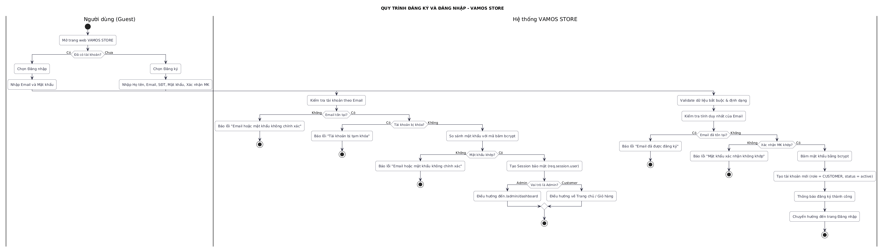
  <p><strong>Hình 10: Sơ đồ hoạt động - Quy trình Đăng ký & Đăng nhập</strong></p>
</div>
* Khách nhập form đăng ký $\rightarrow$ Server kiểm tra dữ liệu bắt buộc $\rightarrow$ Kiểm tra email duy nhất $\rightarrow$ Băm mật khẩu bcrypt $\rightarrow$ Lưu bản ghi `users` với `status = 'active'`.
* Khi đăng nhập: Server kiểm tra email $\rightarrow$ Kiểm tra tài khoản không bị khóa (`status != 'locked'`) $\rightarrow$ So khớp `bcrypt.compare` $\rightarrow$ Khởi tạo session máy chủ (`req.session.user`) và cấp Session ID cookie.

#### B. Activity Mua sắm & Đặt hàng COD (`ad-02-checkout-cod.puml`)
<div align="center">
  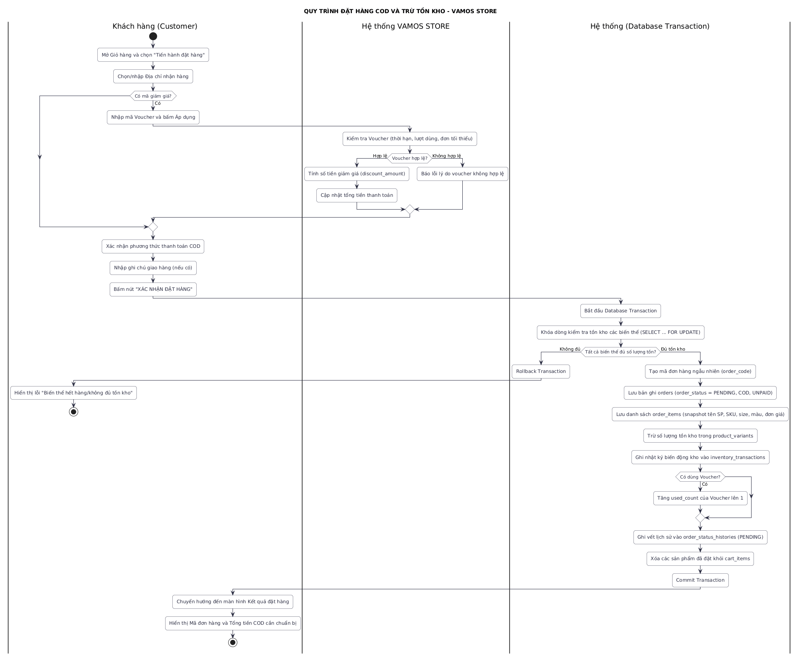
  <p><strong>Hình 11: Sơ đồ hoạt động - Mua hàng & Đặt hàng COD</strong></p>
</div>
* Khách hàng chọn địa chỉ nhận hàng, nhập voucher $\rightarrow$ Bấm xác nhận đặt hàng COD.
* Server khởi tạo Database Transaction $\rightarrow$ Khóa bi quan kiểm tra kho `SELECT stock_quantity FROM product_variants WHERE id = :id FOR UPDATE`.
* Nếu tồn kho đủ: trừ `stock_quantity`, ghi nhật ký `inventory_transactions`, tạo bản ghi `orders` (trạng thái `PENDING`), tạo các dòng snapshot `order_items`, tăng `used_count` của voucher, xóa giỏ hàng $\rightarrow$ Commit Transaction. Nếu thiếu kho: Rollback và thông báo lỗi.

#### C. Activity Máy trạng thái đơn hàng (`ad-03-order-processing.puml`)
<div align="center">
  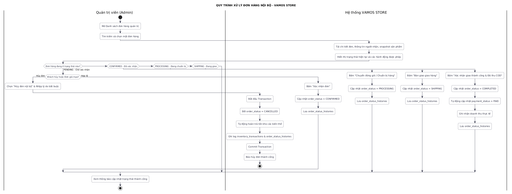
  <p><strong>Hình 12: Sơ đồ hoạt động - Máy trạng thái xử lý đơn hàng</strong></p>
</div>
* Vòng đời đơn hàng tuân thủ quy trình tuần tự:
  1. `PENDING`: Đơn mới tạo, tồn kho đã trừ.
  2. `CONFIRMED`: Admin liên hệ xác nhận size giày và địa chỉ.
  3. `PROCESSING`: Đơn đang lấy hàng trong kho và đóng gói.
  4. `SHIPPING`: Bàn giao đơn vị giao vận.
  5. `COMPLETED`: Giao hàng thành công và thu đủ tiền COD (ghi nhận doanh thu).
* Mỗi bước chuyển đổi đều kích hoạt ghi bản ghi vào `order_status_histories`.

#### D. Activity Hủy đơn hàng và Hoàn kho tự động (`ad-04-order-cancellation.puml`)
<div align="center">
  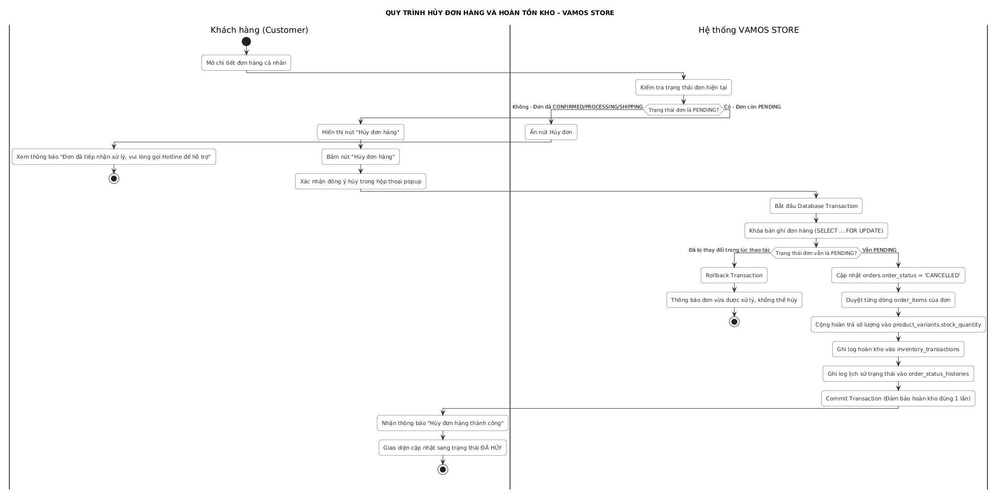
  <p><strong>Hình 13: Sơ đồ hoạt động - Hủy đơn hàng và Hoàn kho tự động</strong></p>
</div>
* Khách hàng bấm hủy đơn khi `order_status == 'PENDING'` hoặc Admin bấm hủy đơn khi đơn ở `PENDING`/`CONFIRMED`.
* Server khởi tạo Transaction: Chuyển `order_status = 'CANCELLED'` $\rightarrow$ Lấy danh sách số lượng từ `order_items` $\rightarrow$ Cộng trả lại `stock_quantity` cho `product_variants` $\rightarrow$ Ghi nhật ký `inventory_transactions` với `reason = 'ORDER_CANCELLED_RESTOCK'` $\rightarrow$ Giảm `used_count` voucher (nếu có) $\rightarrow$ Commit.

#### E. Activity Admin kiểm kê và Điều chỉnh kho (`ad-05-inventory-adjustment.puml`)
<div align="center">
  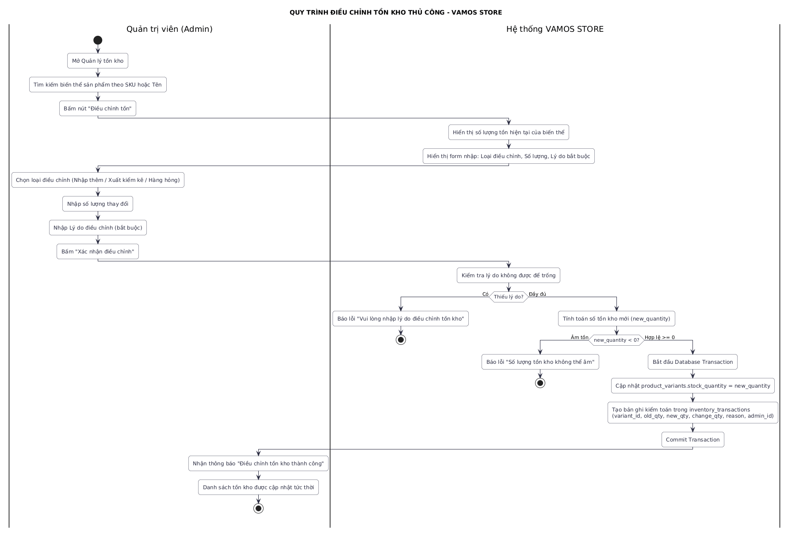
  <p><strong>Hình 14: Sơ đồ hoạt động - Admin kiểm kê và điều chỉnh kho</strong></p>
</div>
* Admin tra cứu biến thể cần điều chỉnh $\rightarrow$ Nhập số lượng mới và lý do (`ADMIN_ADJUSTMENT`, `IMPORT_PURCHASE`, `DEFECT_DAMAGE`) $\rightarrow$ Server cập nhật `stock_quantity` và lưu vết vào `inventory_transactions`.

---

### 2.6. Thiết kế giao diện và đặc tả màn hình (Wireframe & UI Specifications)

*(Trình bày theo đúng cấu trúc mẫu báo cáo tốt nghiệp: Hình vẽ khung Wireframe layout $\rightarrow$ Bảng đặc tả component gồm: Mục, Loại component, Mô tả).*

#### Giao diện 1: Trang chủ (Home Page)
<div align="center">
  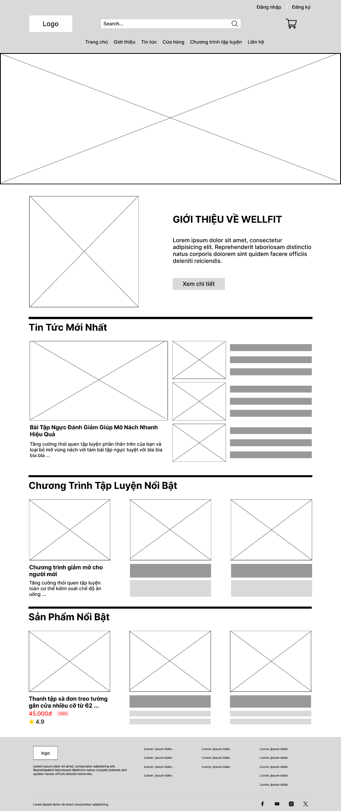
  <p><strong>Hình 17: Giao diện Trang chủ (Home Page)</strong></p>
</div>
* **Truy cập:** `Guest`, `Customer`
* **Mục đích:** Cửa sổ giới thiệu thương hiệu VAMOS, banner sự kiện, danh mục nổi bật và sản phẩm mới nhất.
* **Bảng đặc tả giao diện Trang chủ:**

| Mục | Loại Component | Mô tả và tương tác |
| :--- | :--- | :--- |
| `Header Bar` | Navigation Container | Logo VAMOS, thanh tìm kiếm nhanh, menu danh mục, icon giỏ hàng kèm số lượng (badge), icon đăng nhập/tài khoản. |
| `Hero Slider` | Image Carousel | Hiển thị các banner quảng bá sự kiện lấy từ bảng `banners`. |
| `Category Grid` | Grid Container | Thẻ đại diện danh mục (Sneaker, Thể thao, Sandal, Dép); bấm vào để chuyển đến trang danh mục tương ứng. |
| `Product List` | Product Card Grid | Hiển thị danh sách sản phẩm mới nhất (ảnh đại diện, nhãn sale, tên sản phẩm, giá bán, nút xem chi tiết). |
| `Footer` | Information Block | Địa chỉ showroom VAMOS, thông tin liên hệ, chính sách đổi trả, liên kết mạng xã hội. |

#### Giao diện 2: Cửa hàng & Bộ lọc đa tiêu chí (Shop & Filter)
<div align="center">
  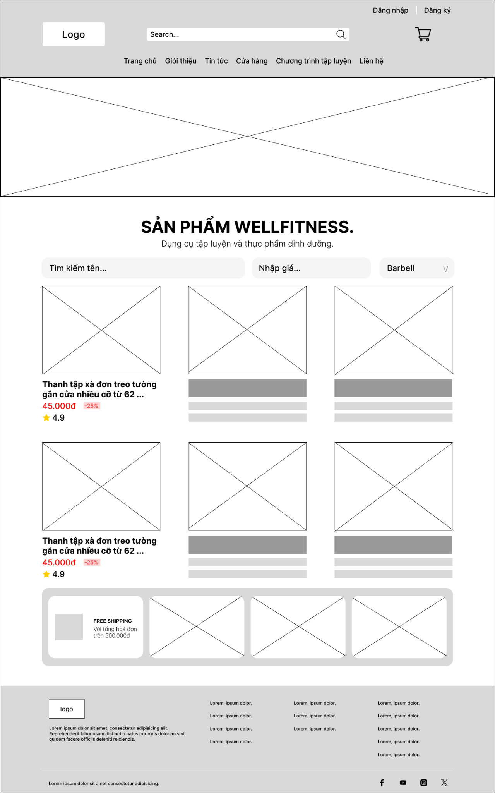
  <p><strong>Hình 18: Giao diện Cửa hàng & Bộ lọc đa tiêu chí</strong></p>
</div>
* **Truy cập:** `Guest`, `Customer`
* **Mục đích:** Khám phá sản phẩm với bộ lọc bên trái (Sidebar Filter).
* **Bảng đặc tả giao diện Cửa hàng:**

| Mục | Loại Component | Mô tả và tương tác |
| :--- | :--- | :--- |
| `Gender Filter` | Checkbox Group | Lọc sản phẩm theo giới tính (`Nam`, `Nữ`, `Unisex`). |
| `Price Range` | Input Textbox | Lọc theo khoảng giá tối thiểu và tối đa (VNĐ). |
| `Size Selector` | Button Pill Group | Lọc các sản phẩm có biến thể kích cỡ còn hàng (`Size 36 - 45`). |
| `Color Filter` | Color Palette Box | Lọc theo màu sắc trực quan (Đen, Trắng, Đỏ,...). |
| `Sort Dropdown` | Select Box | Sắp xếp: Giá tăng dần, Giá giảm dần, Mới nhất, Tên A-Z. |
| `Product Grid` | Dynamic Grid | Hiển thị danh sách sản phẩm thỏa mãn điều kiện lọc kèm phân trang (12 sản phẩm/trang). |

#### Giao diện 3: Chi tiết sản phẩm & Chọn Size/Màu (Product Detail)
<div align="center">
  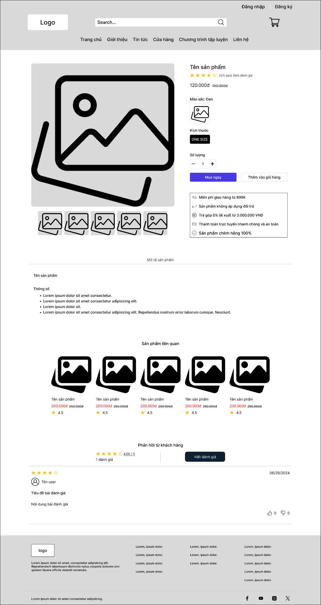
  <p><strong>Hình 19: Giao diện Chi tiết sản phẩm & Chọn Size/Màu</strong></p>
</div>
* **Truy cập:** `Guest`, `Customer`
* **Mục đích:** Xem thông số kỹ thuật, bộ ảnh chi tiết và chọn biến thể thêm giỏ/mua ngay.
* **Bảng đặc tả giao diện Chi tiết sản phẩm:**

| Mục | Loại Component | Mô tả và tương tác |
| :--- | :--- | :--- |
| `Image Gallery` | Thumbnail + Main View | Xem ảnh lớn và chuyển đổi các góc chụp chi tiết. |
| `Color Picker` | Radio Button Pill | Chọn màu sắc mong muốn. |
| `Size Selector` | Radio Button Box | Chọn kích cỡ giày. Tự động làm mờ (disable) các size đã hết hàng (`stock == 0`). |
| `Quantity Input` | Stepper Number Input | Tăng/giảm số lượng mua (từ 1 đến số lượng tồn kho khả dụng). |
| `Add To Cart` | Button Primary | Thêm biến thể vào giỏ hàng. |
| `Buy Now` | Button Secondary | Chuyển hướng thẳng đến màn hình thanh toán COD. |

#### Giao diện 4: Giỏ hàng trực tuyến (Shopping Cart)
<div align="center">
  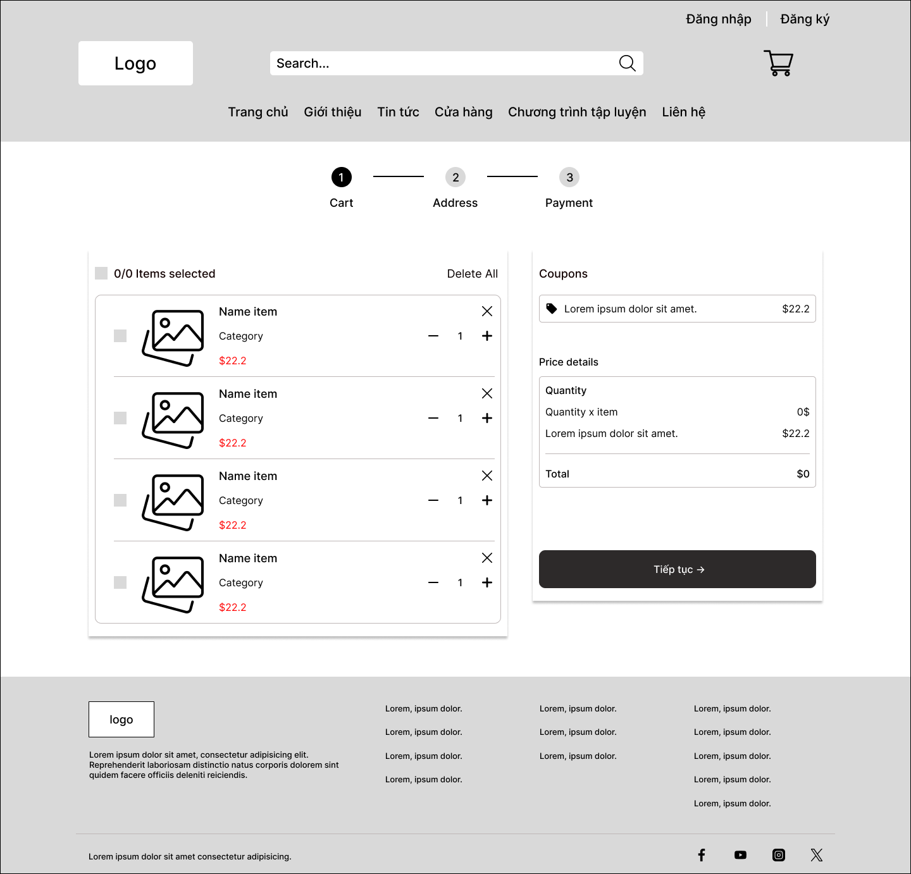
  <p><strong>Hình 20: Giao diện Giỏ hàng trực tuyến</strong></p>
</div>
* **Truy cập:** `Customer`
* **Mục đích:** Quản lý danh sách sản phẩm dự định mua.
* **Bảng đặc tả giao diện Giỏ hàng:**

| Mục | Loại Component | Mô tả và tương tác |
| :--- | :--- | :--- |
| `Cart Item Row` | Table Row Data | Hiển thị ảnh, tên sản phẩm, size, màu, đơn giá, số lượng và thành tiền. |
| `Quantity Stepper`| Dynamic Stepper | Tăng giảm số lượng; tự động gửi Ajax cập nhật `cart_items` và tính lại tạm tính. |
| `Remove Button` | Icon Button | Xóa một dòng mặt hàng khỏi giỏ hàng sau khi xác nhận. |
| `Checkout Button`| Primary Action Button | Chuyển sang màn hình Đặt hàng COD. |

#### Giao diện 5: Đặt hàng thanh toán COD (Checkout)
<div align="center">
  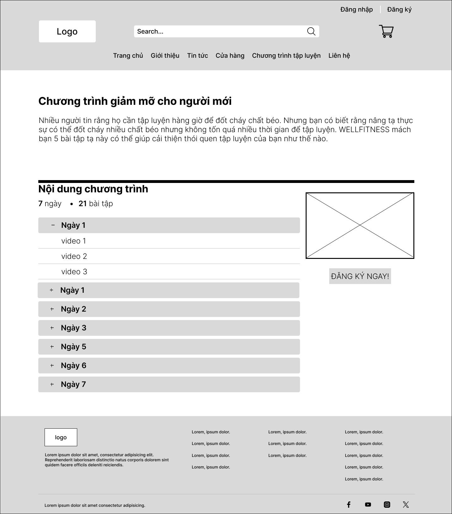
  <p><strong>Hình 21: Giao diện Đặt hàng COD (Checkout)</strong></p>
</div>
* **Truy cập:** `Customer` (đã đăng nhập và giỏ hàng có sản phẩm)
* **Mục đích:** Xác nhận thông tin giao nhận và hoàn tất đơn hàng thanh toán tiền mặt.
* **Bảng đặc tả giao diện Đặt hàng COD:**

| Mục | Loại Component | Mô tả và tương tác |
| :--- | :--- | :--- |
| `Address Selector`| Radio Form | Chọn địa chỉ từ sổ địa chỉ có sẵn hoặc nhập địa chỉ giao nhận mới. |
| `Voucher Input` | Textbox + Button | Nhập mã voucher ưu đãi; hệ thống kiểm tra và trừ tiền giảm trực tiếp vào tổng đơn. |
| `Payment Method` | Radio Selection | Mặc định cố định `COD` (Thanh toán tiền mặt khi nhận hàng). |
| `Order Note` | Textarea | Nhập ghi chú giao nhận hàng của khách. |
| `Submit Button` | Primary Action Button | Kích hoạt Database Transaction tạo đơn hàng, trừ tồn kho và làm rỗng giỏ. |


#### Giao diện 6: Đăng ký / Đăng nhập tài khoản
<div align="center">
  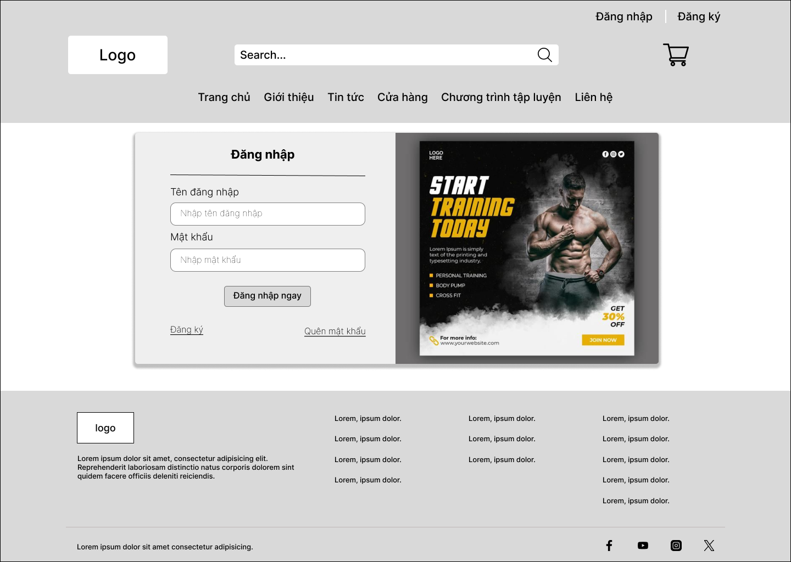
  <p><strong>Hình 22: Giao diện Đăng ký / Đăng nhập tài khoản</strong></p>
</div>

* **Truy cập:** `Guest`
* **Mục đích:** Cung cấp biểu mẫu xác thực tài khoản an toàn với mã hóa mật khẩu bcrypt và phiên đăng nhập Session.
* **Bảng đặc tả giao diện Đăng ký / Đăng nhập:**

| Mục | Loại Component | Mô tả và tương tác |
| :--- | :--- | :--- |
| `Form Toggle` | Tab Button | Chuyển đổi linh hoạt giữa giao diện Đăng nhập và Đăng ký tài khoản mới. |
| `Email Input` | Email Field | Nhập địa chỉ email hợp lệ (kiểm tra định dạng Regex trên server). |
| `Password Input` | Password Field | Nhập mật khẩu bí mật (tối thiểu 6 ký tự, ẩn ký tự khi nhập). |
| `Remember Me` | Checkbox | Duy trì phiên đăng nhập lâu dài thông qua cookie an toàn (`httpOnly`). |
| `Submit Button` | Primary Button | Gửi request xác thực về AuthService, cấp session và chuyển hướng về trang chủ. |

---

#### Giao diện 7: Lịch sử và chi tiết đơn hàng của khách
<div align="center">
  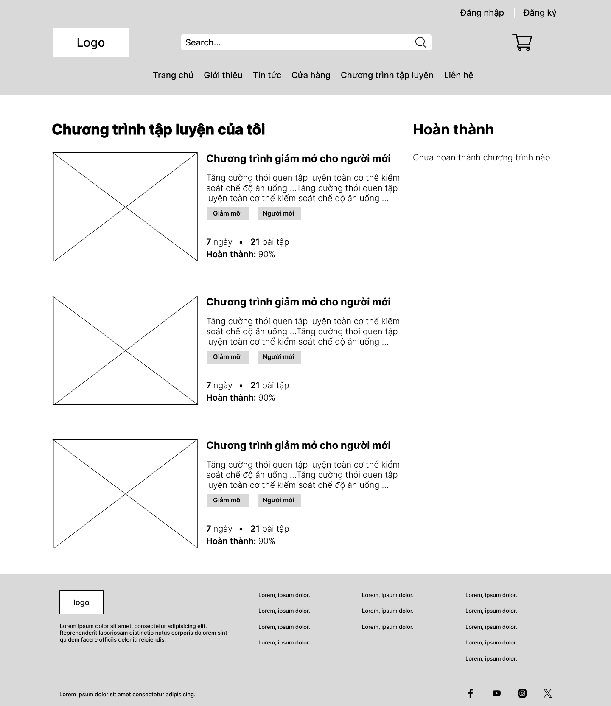
  <p><strong>Hình 23: Giao diện Lịch sử đơn hàng của khách</strong></p>
</div>

* **Truy cập:** `Customer` (đã đăng nhập)
* **Mục đích:** Cho phép khách hàng tra cứu tiến độ xử lý đơn hàng, xem snapshot sản phẩm và tự hủy đơn khi ở trạng thái `PENDING`.
* **Bảng đặc tả giao diện Lịch sử đơn hàng:**

| Mục | Loại Component | Mô tả và tương tác |
| :--- | :--- | :--- |
| `Order Code` | Text / Link | Mã định danh đơn hàng (VD: `ORD-20261110-001`), bấm vào xem chi tiết toàn bộ đơn. |
| `Status Badge` | Colored Tag | Hiển thị trạng thái đơn hàng (`PENDING` vàng, `CONFIRMED` xanh dương, `SHIPPING` tím, `COMPLETED` xanh lá, `CANCELLED` xám). |
| `Product Items` | List Group | Hiển thị tên giày, hình ảnh snapshot, size, màu sắc, đơn giá và số lượng đặt. |
| `Total Summary` | Money Summary | Tạm tính tiền hàng, phí giao hàng, mức voucher giảm giá và tổng tiền phải trả COD. |
| `Cancel Button` | Secondary Button | Nút bấm hủy đơn; chỉ hiển thị khi đơn ở trạng thái `PENDING`, tự động hoàn kho. |

---

#### Giao diện 8: Admin Dashboard tổng quan
<div align="center">
  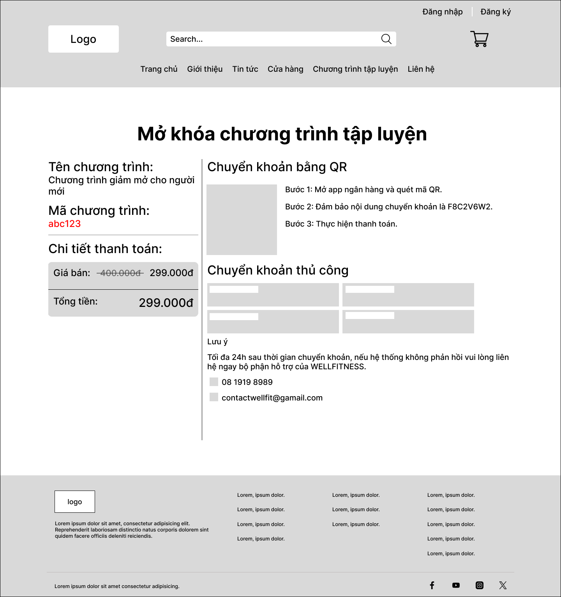
  <p><strong>Hình 24: Giao diện Admin Dashboard tổng quan</strong></p>
</div>

* **Truy cập:** `Admin`
* **Mục đích:** Bảng điều khiển trung tâm giúp quản trị viên theo dõi nhanh doanh thu thực tế, số lượng đơn hàng cần xử lý và cảnh báo tồn kho.
* **Bảng đặc tả giao diện Admin Dashboard:**

| Mục | Loại Component | Mô tả và tương tác |
| :--- | :--- | :--- |
| `Metric Cards` | Stat Box | Thống kê tổng doanh thu (chỉ tính đơn `COMPLETED`), tổng số đơn, số khách hàng mới. |
| `Pending Alert` | Notification Box | Số lượng đơn hàng mới đang ở trạng thái `PENDING` cần được gọi điện xác nhận ngay. |
| `Low Stock Warning` | Warning Table | Danh sách các biến thể giày (SKU) có tồn kho nhỏ hơn mức cảnh báo tối thiểu (dưới 5 đôi). |
| `Quick Navigation` | Sidebar Menu | Liên kết nhanh đến các phân hệ: Sản phẩm, Đơn hàng, Kho hàng, Khuyến mãi. |

---

#### Giao diện 9: Admin Quản lý sản phẩm & Biến thể
<div align="center">
  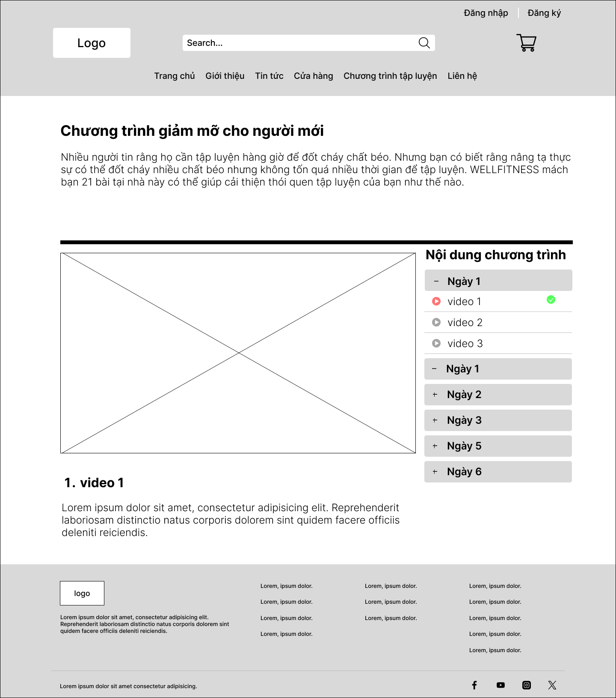
  <p><strong>Hình 25: Giao diện Admin Quản lý sản phẩm & Biến thể</strong></p>
</div>

* **Truy cập:** `Admin`
* **Mục đích:** Quản lý danh mục giày dép, thêm mới sản phẩm và cấu hình từng tổ hợp biến thể (Size - Màu sắc - Tồn kho - SKU).
* **Bảng đặc tả giao diện Quản lý sản phẩm:**

| Mục | Loại Component | Mô tả và tương tác |
| :--- | :--- | :--- |
| `Product Table` | Data Table | Danh sách sản phẩm gồm mã ID, ảnh đại diện chính, tên giày, thương hiệu, danh mục, giá cơ sở. |
| `Variant Matrix` | Matrix Table | Bảng quản lý chi tiết từng biến thể (Size, Color, Mã SKU, Giá phụ thu `price_adjustment`, Tồn kho `stock_quantity`). |
| `Search & Filter` | Filter Bar | Lọc danh sách sản phẩm theo Thương hiệu (Nike, Adidas, Puma...), Danh mục hoặc trạng thái hoạt động. |
| `Action Controls` | Action Buttons | Nút Chỉnh sửa thông tin, Quản lý bộ sưu tập ảnh và Bật/Tắt trạng thái hoạt động sản phẩm. |

---

#### Giao diện 10: Admin Vận hành đơn hàng & Chuyển trạng thái
<div align="center">
  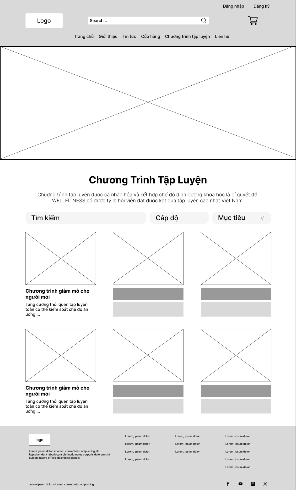
  <p><strong>Hình 26: Giao diện Admin Vận hành đơn hàng</strong></p>
</div>

* **Truy cập:** `Admin`
* **Mục đích:** Xử lý toàn bộ vòng đời đơn hàng theo đúng máy trạng thái (PENDING -> CONFIRMED -> PROCESSING -> SHIPPING -> COMPLETED), in phiếu giao hàng và theo dõi dòng tiền COD.
* **Bảng đặc tả giao diện Vận hành đơn hàng:**

| Mục | Loại Component | Mô tả và tương tác |
| :--- | :--- | :--- |
| `Status Tabs` | Tab Navigation | Lọc đơn theo từng bước xử lý: Chờ xác nhận, Đã xác nhận, Đang đóng gói, Đang giao, Đã giao, Đã hủy. |
| `Order Details` | Modal / Drawer | Xem chi tiết địa chỉ giao hàng, số điện thoại, ghi chú của khách và lịch sử thay đổi trạng thái (`order_status_histories`). |
| `Transition Button` | Status Action Button | Nút bấm chuyển trạng thái kế tiếp hợp lệ; tự động lưu vết nhân sự thao tác và thời gian. |
| `Cancel & Restock` | Danger Action | Nút hủy đơn khẩn cấp (kèm nhập lý do); kích hoạt Transaction tự động hoàn tồn kho về biến thể ban đầu. |


---

# CHƯƠNG III: TRIỂN KHAI MÃ NGUỒN (SYSTEM IMPLEMENTATION)

---

## 1. CẤU TRÚC MÃ NGUỒN DỰ ÁN

Hệ thống VAMOS STORE được tổ chức theo mô hình **Kiến trúc phân lớp chuẩn (Layered Architecture)** kết hợp với mô hình MVC của Node.js/Express, đảm bảo tính phân tách trách nhiệm (Separation of Concerns) và khả năng mở rộng cao:

```
vamos-store/
├── src/
│   ├── app.js                   # Khởi tạo Express server, cấu hình middlewares & template engine
│   ├── config/
│   │   ├── database.js          # Cấu hình MySQL Connection Pool (mysql2/promise)
│   │   ├── session.js           # Cấu hình express-session & Cookie bảo mật
│   │   └── constants.js         # Các hằng số hệ thống (Mã trạng thái đơn, quy tắc kho)
│   ├── routes/
│   │   ├── storefront/          # Tuyến đường công khai cho khách hàng (home, shop, cart, checkout)
│   │   ├── auth/                # Tuyến đường đăng ký, đăng nhập, khôi phục mật khẩu
│   │   └── admin/               # Tuyến đường bảo mật phân hệ quản trị (dashboard, products, orders, inventory)
│   ├── controllers/
│   │   ├── AuthController.js    # Tiếp nhận request xác thực & điều hướng session
│   │   ├── ProductController.js # Xử lý hiển thị danh sách, bộ lọc & chi tiết sản phẩm
│   │   ├── CartController.js    # Xử lý thêm, sửa, xóa giỏ hàng
│   │   ├── OrderController.js   # Xử lý đặt hàng COD & theo dõi tiến trình đơn
│   │   └── admin/
│   │       ├── AdminProductController.js   # Quản trị sản phẩm & biến thể Size/Color
│   │       ├── AdminOrderController.js     # Vận hành đơn & chuyển trạng thái
│   │       └── AdminInventoryController.js # Quản trị kho & kiểm kê
│   ├── services/
│   │   ├── AuthService.js       # Nghiệp vụ băm mật khẩu bcrypt, kiểm tra đăng nhập
│   │   ├── OrderService.js      # Nghiệp vụ Transaction đặt hàng COD, khóa bi quan, trừ kho
│   │   ├── InventoryService.js  # Nghiệp vụ hoàn kho khi hủy đơn, nhật ký kiểm toán kho
│   │   └── VoucherService.js    # Nghiệp vụ thẩm định điều kiện voucher
│   ├── repositories/
│   │   ├── UserRepository.js    # Thao tác CSDL bảng users & addresses
│   │   ├── ProductRepository.js # Thao tác CSDL bảng products, product_variants, sizes, colors
│   │   ├── CartRepository.js    # Thao tác CSDL bảng carts & cart_items
│   │   └── OrderRepository.js   # Thao tác CSDL bảng orders, order_items, order_status_histories
│   ├── middlewares/
│   │   ├── authMiddleware.js    # Kiểm tra session đăng nhập khách hàng
│   │   ├── adminMiddleware.js   # Kiểm tra quyền quản trị viên Admin (Server-side Enforcement)
│   │   └── validationMiddleware.js # Kiểm tra tính hợp lệ dữ liệu đầu vào (Joi / Validator)
│   └── views/                   # Template Engine Pug
│       ├── layouts/             # Khung layout chính (main.pug, admin.pug)
│       ├── partials/            # Các thành phần giao diện dùng chung (header, footer, sidebar)
│       ├── storefront/          # Giao diện khách hàng (home.pug, shop.pug, product-detail.pug, cart.pug, checkout.pug)
│       └── admin/               # Giao diện quản trị (dashboard.pug, products.pug, orders.pug, inventory.pug)
├── public/                      # Static assets đã biên dịch
│   ├── css/style.css            # Stylesheet xuất từ Tailwind CSS
│   ├── js/                      # JavaScript tương tác phía client (Alpine.js / Vanilla JS)
│   └── images/                  # Hình ảnh sản phẩm, logo, banner
├── database/
│   ├── schema.sql               # Kịch bản DDL MySQL 8 khởi tạo 18 bảng
│   └── seeds.sql                # Dữ liệu mẫu kích cỡ, màu sắc, tài khoản admin mặc định
├── Dockerfile                   # Cấu hình container cho ứng dụng Node.js
├── docker-compose.yml           # Điều phối đa container (App + MySQL 8)
├── package.json                 # Khai báo dependencies và scripts
└── .env.example                 # Mẫu cấu hình biến môi trường
```

---

## 2. KẾT NỐI VÀ QUẢN TRỊ CƠ SỞ DỮ LIỆU MYSQL

### 2.1. Cấu hình MySQL Connection Pool

Để tối ưu hóa hiệu năng và quản lý tài nguyên máy chủ, hệ thống sử dụng thư viện `mysql2/promise` với cơ chế Connection Pool. Thay vì mỗi request mở một kết nối vật lý mới gây tiêu tốn tài nguyên CPU và RAM, Connection Pool duy trì sẵn một nhóm kết nối sẵn sàng tái sử dụng.

```javascript
// src/config/database.js
const mysql = require("mysql2/promise");
require("dotenv").config();

// Khởi tạo Connection Pool kết nối MySQL 8.0
const pool = mysql.createPool({
  host: process.env.DB_HOST || "localhost",
  port: process.env.DB_PORT || 3306,
  user: process.env.DB_USER || "vamos_user",
  password: process.env.DB_PASSWORD || "SecretPassword123!",
  database: process.env.DB_NAME || "vamos_store_db",
  waitForConnections: true,
  connectionLimit: 15, // Giới hạn tối đa 15 kết nối đồng thời
  queueLimit: 0, // Không giới hạn hàng đợi
  charset: "utf8mb4_unicode_ci",
  enableKeepAlive: true,
  keepAliveInitialDelay: 10000,
});

// Hàm kiểm tra kết nối khi khởi động máy chủ
async function testConnection() {
  try {
    const connection = await pool.getConnection();
    console.log("=> [MySQL] Kết nối Cơ sở dữ liệu vamos_store_db thành công!");
    connection.release();
  } catch (error) {
    console.error("=> [MySQL] Lỗi kết nối Cơ sở dữ liệu:", error.message);
    process.exit(1);
  }
}

module.exports = { pool, testConnection };
```

---

## 3. TRIỂN KHAI CÁC CHỨC NĂNG CỐT LÕI

### 3.1. Chức năng Đăng ký tài khoản và Băm mật khẩu Bcrypt

- **Mô tả xử lý:** Hệ thống tiếp nhận form đăng ký, chuẩn hóa email về chữ thường, kiểm tra email chưa từng tồn tại trong CSDL, sau đó áp dụng hàm băm `bcrypt.hash` với chi phí `saltRounds = 10` trước khi lưu vào bảng `users`.

```javascript
// src/services/AuthService.js (Trích đoạn Đăng ký tài khoản)
const bcrypt = require("bcryptjs");
const UserRepository = require("../repositories/UserRepository");

class AuthService {
  async registerUser({ fullName, email, password, phone }) {
    const normalizedEmail = email.trim().toLowerCase();

    // 1. Kiểm tra email đã được đăng ký trước đó chưa
    const existingUser = await UserRepository.findByEmail(normalizedEmail);
    if (existingUser) {
      throw new Error(
        "Địa chỉ email này đã được sử dụng. Vui lòng chọn email khác!",
      );
    }

    // 2. Băm mật khẩu bằng bcrypt (Salt rounds = 10)
    const salt = await bcrypt.genSalt(10);
    const passwordHash = await bcrypt.hash(password, salt);

    // 3. Tạo bản ghi tài khoản mới với vai trò CUSTOMER mặc định
    const newUserId = await UserRepository.create({
      fullName: fullName.trim(),
      email: normalizedEmail,
      passwordHash,
      phone: phone ? phone.trim() : null,
      role: "CUSTOMER",
      status: "active",
    });

    // 4. Khởi tạo giỏ hàng trống mặc định cho khách hàng (1 User = 1 Cart)
    await UserRepository.createCartForUser(newUserId);

    return { userId: newUserId, email: normalizedEmail };
  }
}

module.exports = new AuthService();
```

---

### 3.2. Middleware phân quyền quản trị máy chủ (Server-side Authorization)

- **Mô tả xử lý:** Đảm bảo nguyên tắc an toàn máy chủ (Server-side Enforcement), middleware chặn đứng mọi request từ các tài khoản không có quyền `ADMIN` hoặc tài khoản bị khóa.

```javascript
// src/middlewares/adminMiddleware.js
function requireAdmin(req, res, next) {
  // 1. Kiểm tra session đăng nhập của người dùng
  if (!req.session || !req.session.user) {
    req.flash("errorMessage", "Vui lòng đăng nhập để tiếp tục.");
    return res.redirect(
      "/auth/login?redirect=" + encodeURIComponent(req.originalUrl),
    );
  }

  // 2. Kiểm tra vai trò quyền hạn (Role) và trạng thái tài khoản
  const currentUser = req.session.user;
  if (currentUser.role !== "ADMIN" || currentUser.status === "locked") {
    // Ghi log cảnh báo truy cập trái phép
    console.warn(
      `[SECURITY ALERT] Truy cập trái phép trang Admin từ User ID: ${currentUser.id}`,
    );
    return res.status(403).render("errors/403.pug", {
      title: "403 - Quyền truy cập bị từ chối",
    });
  }

  // 3. Hợp lệ, cho phép đi tiếp vào Controller quản trị
  next();
}

module.exports = requireAdmin;
```

---

### 3.3. Chức năng Đặt hàng COD với Database Transaction và Khóa bi quan

- **Mô tả xử lý:** Đây là nghiệp vụ trọng tâm nhất của hệ thống. Để chống bán vượt tồn kho (Anti-Overselling), toàn bộ quá trình: Khóa dòng kiểm tra kho $\rightarrow$ Trừ tồn kho $\rightarrow$ Tạo đơn `orders` $\rightarrow$ Lưu snapshot `order_items` $\rightarrow$ Xóa giỏ hàng được đặt trọn vẹn trong một **MySQL Database Transaction**.

```javascript
// src/services/OrderService.js (Trích đoạn Đặt hàng COD an toàn ACID)
const { pool } = require("../config/database");

class OrderService {
  async checkoutCOD({
    userId,
    recipientName,
    phone,
    deliveryAddress,
    voucherCode,
    customerNote,
  }) {
    const connection = await pool.getConnection();
    try {
      // BẮT ĐẦU GIAO DỊCH DATABASE (ACID TRANSACTION)
      await connection.beginTransaction();

      // 1. Lấy danh sách sản phẩm trong giỏ hàng của khách
      const [cartRows] = await connection.execute(
        `SELECT ci.variant_id, ci.quantity, pv.stock_quantity, pv.sku,
                        p.name as product_name, p.base_price, p.sale_price,
                        s.size_name, c.color_name
                 FROM cart_items ci
                 JOIN carts ct ON ci.cart_id = ct.id
                 JOIN product_variants pv ON ci.variant_id = pv.id
                 JOIN products p ON pv.product_id = p.id
                 JOIN sizes s ON pv.size_id = s.id
                 JOIN colors c ON pv.color_id = c.id
                 WHERE ct.user_id = ?`,
        [userId],
      );

      if (cartRows.length === 0) {
        throw new Error("Giỏ hàng của bạn đang trống.");
      }

      // 2. KHÓA BI QUAN VÀ KIỂM TRA TỒN KHO THỜI GIAN THỰC (SELECT ... FOR UPDATE)
      let subtotal = 0;
      const orderItemsData = [];

      for (const item of cartRows) {
        const [lockedRows] = await connection.execute(
          `SELECT stock_quantity FROM product_variants WHERE id = ? FOR UPDATE`,
          [item.variant_id],
        );

        const currentStock = lockedRows[0].stock_quantity;
        if (currentStock < item.quantity) {
          throw new Error(
            `Sản phẩm "${item.product_name}" (Cỡ: ${item.size_name}, Màu: ${item.color_name}) chỉ còn ${currentStock} đôi trong kho. Vui lòng điều chỉnh lại số lượng!`,
          );
        }

        // Xác định đơn giá thực tế tại thời điểm mua (ưu tiên sale_price)
        const unitPrice =
          item.sale_price !== null ? item.sale_price : item.base_price;
        const lineTotal = Number(unitPrice) * item.quantity;
        subtotal += lineTotal;

        orderItemsData.push({
          variantId: item.variant_id,
          productName: item.product_name,
          sku: item.sku,
          size: item.size_name,
          color: item.color_name,
          unitPrice,
          quantity: item.quantity,
          lineTotal,
          oldStock: currentStock,
        });
      }

      // 3. Xử lý Voucher giảm giá nếu có
      let discountAmount = 0;
      let voucherId = null;
      let voucherCodeSnapshot = null;

      if (voucherCode) {
        const [vouchers] = await connection.execute(
          `SELECT * FROM vouchers 
                     WHERE code = ? AND is_active = TRUE 
                       AND NOW() BETWEEN start_date AND end_date
                       AND (usage_limit = 0 OR used_count < usage_limit)
                       AND min_order_value <= ? FOR UPDATE`,
          [voucherCode.trim().toUpperCase(), subtotal],
        );

        if (vouchers.length > 0) {
          const voucher = vouchers[0];
          voucherId = voucher.id;
          voucherCodeSnapshot = voucher.code;

          if (voucher.discount_type === "percentage") {
            discountAmount = Math.round(
              (subtotal * Number(voucher.discount_value)) / 100,
            );
            if (
              voucher.max_discount_amount &&
              discountAmount > Number(voucher.max_discount_amount)
            ) {
              discountAmount = Number(voucher.max_discount_amount);
            }
          } else {
            discountAmount = Number(voucher.discount_value);
          }

          // Tăng số lượt đã sử dụng của voucher
          await connection.execute(
            `UPDATE vouchers SET used_count = used_count + 1 WHERE id = ?`,
            [voucher.id],
          );
        }
      }

      const shippingFee = subtotal >= 500000 ? 0 : 30000; // Miễn phí ship cho đơn từ 500k
      const totalAmount = subtotal - discountAmount + shippingFee;
      const orderCode =
        "ORD-" +
        Date.now().toString().slice(-8) +
        Math.floor(1000 + Math.random() * 9000);

      // 4. Lưu bản ghi đơn hàng chính orders (trạng thái PENDING)
      const [orderResult] = await connection.execute(
        `INSERT INTO orders 
                 (order_code, user_id, recipient_name_snapshot, recipient_phone_snapshot, 
                  delivery_address_snapshot, subtotal, discount_amount, shipping_fee, total_amount, 
                  voucher_id, voucher_code_snapshot, payment_method, payment_status, order_status, customer_note)
                 VALUES (?, ?, ?, ?, ?, ?, ?, ?, ?, ?, ?, 'COD', 'UNPAID', 'PENDING', ?)`,
        [
          orderCode,
          userId,
          recipientName,
          phone,
          deliveryAddress,
          subtotal,
          discountAmount,
          shippingFee,
          totalAmount,
          voucherId,
          voucherCodeSnapshot,
          customerNote || null,
        ],
      );

      const orderId = orderResult.insertId;

      // 5. Lưu Snapshot chi tiết từng mặt hàng và trừ tồn kho
      for (const item of orderItemsData) {
        // Lưu snapshot bất biến vào order_items
        await connection.execute(
          `INSERT INTO order_items 
                     (order_id, product_variant_id, product_name_snapshot, sku_snapshot, 
                      size_snapshot, color_snapshot, unit_price, quantity, line_total)
                     VALUES (?, ?, ?, ?, ?, ?, ?, ?, ?)`,
          [
            orderId,
            item.variantId,
            item.productName,
            item.sku,
            item.size,
            item.color,
            item.unitPrice,
            item.quantity,
            item.lineTotal,
          ],
        );

        // Trừ số lượng tồn kho khả dụng
        const newStock = item.oldStock - item.quantity;
        await connection.execute(
          `UPDATE product_variants SET stock_quantity = ? WHERE id = ?`,
          [newStock, item.variantId],
        );

        // Ghi nhật ký kiểm toán biến động kho
        await connection.execute(
          `INSERT INTO inventory_transactions 
                     (variant_id, user_id, old_quantity, new_quantity, change_quantity, reason)
                     VALUES (?, ?, ?, ?, ?, 'ORDER_PLACED')`,
          [item.variantId, userId, item.oldStock, newStock, -item.quantity],
        );
      }

      // 6. Ghi nhật ký lịch sử trạng thái ban đầu của đơn hàng
      await connection.execute(
        `INSERT INTO order_status_histories (order_id, changed_by, previous_status, new_status, note)
                 VALUES (?, ?, NULL, 'PENDING', 'Khách hàng hoàn tất đặt đơn COD thành công')`,
        [orderId, userId],
      );

      // 7. Làm rỗng giỏ hàng của khách sau khi đã đặt thành công
      await connection.execute(
        `DELETE ci FROM cart_items ci JOIN carts c ON ci.cart_id = c.id WHERE c.user_id = ?`,
        [userId],
      );

      // XÁC NHẬN GIAO DỊCH THÀNH CÔNG (COMMIT)
      await connection.commit();
      return { orderId, orderCode, totalAmount };
    } catch (error) {
      // NẾU CÓ BẤT KỲ LỖI NÀO -> HỦY TOÀN BỘ THAO TÁC (ROLLBACK)
      await connection.rollback();
      throw error;
    } finally {
      // Giải phóng kết nối trả về cho Connection Pool
      connection.release();
    }
  }
}

module.exports = new OrderService();
```

---

### 3.4. Chức năng Tự động Hoàn kho khi Hủy đơn hàng

- **Mô tả xử lý:** Khi đơn hàng bị hủy hợp lệ ở trạng thái `PENDING` hoặc `CONFIRMED`, hệ thống chạy Transaction để phục hồi lại số lượng tồn kho cho các biến thể và ghi nhận lý do kiểm toán `ORDER_CANCELLED_RESTOCK`.

```javascript
// src/services/InventoryService.js (Trích đoạn Hoàn kho khi Hủy đơn)
const { pool } = require("../config/database");

class InventoryService {
  async restockCancelledOrder(orderId, operatorUserId, cancelReason) {
    const connection = await pool.getConnection();
    try {
      await connection.beginTransaction();

      // 1. Kiểm tra đơn hàng có đủ điều kiện hủy không (PENDING hoặc CONFIRMED)
      const [orders] = await connection.execute(
        `SELECT id, order_status, voucher_id FROM orders WHERE id = ? FOR UPDATE`,
        [orderId],
      );

      if (orders.length === 0) throw new Error("Không tìm thấy đơn hàng.");
      const order = orders[0];

      if (!["PENDING", "CONFIRMED"].includes(order.order_status)) {
        throw new Error(
          `Đơn hàng đang ở trạng thái "${order.order_status}", không được phép hủy.`,
        );
      }

      // 2. Chuyển trạng thái đơn sang CANCELLED
      await connection.execute(
        `UPDATE orders SET order_status = 'CANCELLED' WHERE id = ?`,
        [orderId],
      );

      // 3. Lấy danh sách sản phẩm và số lượng cần hoàn trả
      const [items] = await connection.execute(
        `SELECT product_variant_id, quantity FROM order_items WHERE order_id = ?`,
        [orderId],
      );

      for (const item of items) {
        const [variants] = await connection.execute(
          `SELECT stock_quantity FROM product_variants WHERE id = ? FOR UPDATE`,
          [item.product_variant_id],
        );

        const currentStock = variants[0].stock_quantity;
        const restoredStock = currentStock + item.quantity;

        // Cộng hoàn lại số lượng tồn kho
        await connection.execute(
          `UPDATE product_variants SET stock_quantity = ? WHERE id = ?`,
          [restoredStock, item.product_variant_id],
        );

        // Ghi vết nhật ký hoàn kho kiểm toán
        await connection.execute(
          `INSERT INTO inventory_transactions 
                     (variant_id, user_id, old_quantity, new_quantity, change_quantity, reason)
                     VALUES (?, ?, ?, ?, ?, 'ORDER_CANCELLED_RESTOCK')`,
          [
            item.product_variant_id,
            operatorUserId,
            currentStock,
            restoredStock,
            item.quantity,
          ],
        );
      }

      // 4. Hoàn lại 1 lượt dùng cho voucher nếu đơn có sử dụng mã
      if (order.voucher_id) {
        await connection.execute(
          `UPDATE vouchers SET used_count = GREATEST(0, used_count - 1) WHERE id = ?`,
          [order.voucher_id],
        );
      }

      // 5. Ghi nhật ký chuyển trạng thái
      await connection.execute(
        `INSERT INTO order_status_histories (order_id, changed_by, previous_status, new_status, note)
                 VALUES (?, ?, ?, 'CANCELLED', ?)`,
        [
          orderId,
          operatorUserId,
          order.order_status,
          cancelReason || "Hủy đơn hàng và hoàn trả tồn kho",
        ],
      );

      await connection.commit();
      return { success: true };
    } catch (error) {
      await connection.rollback();
      throw error;
    } finally {
      connection.release();
    }
  }
}

module.exports = new InventoryService();
```


---

# CHƯƠNG IV: KIỂM THỬ HỆ THỐNG (SYSTEM TESTING)

---

## 1. MỤC TIÊU VÀ PHẠM VI KIỂM THỬ

### 1.1. Mục tiêu kiểm thử
Quá trình kiểm thử phần mềm đóng vai trò quyết định nhằm xác nhận mức độ hoàn thiện của hệ thống VAMOS STORE so với bản đặc tả yêu cầu nghiệp vụ ban đầu. Các mục tiêu cốt lõi bao gồm:
* **Kiểm tra tính đúng đắn của logic nghiệp vụ:** Đảm bảo các luồng đăng ký, đăng nhập, tìm kiếm, lọc đa tiêu chí, tính toán giỏ hàng, áp dụng voucher diễn ra chính xác tuyệt đối.
* **Kiểm tra tính toàn vẹn giao dịch (ACID) và tồn kho:** Xác minh cơ chế trừ tồn kho tự động khi tạo đơn `PENDING` và cơ chế hoàn kho khi đơn bị hủy, đảm bảo không xảy ra hiện tượng bán vượt tồn kho (Overselling).
* **Kiểm tra phân quyền và bảo mật:** Xác minh cơ chế bảo vệ máy chủ: chặn khách vãng lai chưa đăng nhập thanh toán; chặn khách hàng thông thường truy cập trái phép vào các trang quản trị của Admin.
* **Kiểm tra tính tương thích và hiển thị (UI/UX):** Đảm bảo giao diện responsive hiển thị cân đối, không vỡ layout trên các độ phân giải màn hình máy tính và thiết bị di động.

### 1.2. Phương pháp và môi trường kiểm thử
* **Phương pháp kiểm thử:** Áp dụng phương pháp **Kiểm thử hộp đen (Black-box Testing)** kết hợp các kỹ thuật:
  * Phân vùng tương đương (Equivalence Partitioning).
  * Phân tích giá trị biên (Boundary Value Analysis).
  * Kiểm thử các kịch bản lỗi và luồng ngoại lệ (Negative & Edge-case Testing).
* **Môi trường kiểm thử thực tế:**
  * Hệ điều hành: Windows 10 Pro / Ubuntu Linux.
  * Trình duyệt kiểm thử: Google Chrome (v120+), Microsoft Edge (v120+), Mobile Simulator (iPhone 14, Samsung Galaxy S22).
  * Backend Runtime: Node.js v20.x LTS / Express.js.
  * Cơ sở dữ liệu: MySQL 8.0 (InnoDB Storage Engine).

### 1.3. Phân công trách nhiệm kiểm thử trong nhóm
Để đảm bảo chất lượng toàn diện và tính đồng đều trong sự đóng góp của các thành viên, công tác kiểm thử được phân công cụ thể như sau:
* **Trần Trung Dũng (Trưởng nhóm):** Phụ trách kiểm thử phân hệ Xác thực (`Auth`), Phân quyền người dùng, Giỏ hàng và quy trình Đặt hàng COD (Test Cases 01 - 12).
* **Trần Vĩnh Nhật:** Phụ trách kiểm thử phân hệ Tìm kiếm, Bộ lọc đa tiêu chí (Size, Màu, Giá), Chi tiết biến thể sản phẩm và Banner (Test Cases 13 - 18).
* **Trần Duy Hoàng Sa:** Phụ trách kiểm thử phân hệ Vận hành đơn hàng Admin, Cơ chế hủy đơn & hoàn kho tự động, Quản lý mã giảm giá Voucher và Bảng điều khiển Dashboard (Test Cases 19 - 25).

---

## 2. KỊCH BẢN KIỂM THỬ THEO CHỨC NĂNG (TEST CASES)

*(Bảng kịch bản kiểm thử được xây dựng theo phong cách chuẩn mực của đồ án tốt nghiệp FPT Polytechnic: STT, Tình huống kiểm thử, Dữ liệu nhập, Kết quả mong đợi, Người kiểm thử, Trạng thái Pass/Fail).*

### 2.1. Kiểm thử Chức năng Đăng ký tài khoản
* **Mục tiêu:** Đảm bảo người dùng đăng ký được tài khoản hợp lệ, băm mật khẩu bảo mật và ngăn chặn trùng lặp email.
* **Người thực hiện kiểm thử:** Trần Trung Dũng.

| STT | Tình huống kiểm thử | Dữ liệu nhập | Kết quả mong đợi | Người kiểm thử | Đánh giá |
| :---: | :--- | :--- | :--- | :---: | :---: |
| 1 | Đăng ký thành công với thông tin đầy đủ, hợp lệ | Họ tên: "Nguyễn Văn A"<br>Email: `customer01@gmail.com`<br>Mật khẩu: `Vamos@2026`<br>Xác nhận: `Vamos@2026`<br>SĐT: `0901234567` | Hệ thống tạo tài khoản mới với role `CUSTOMER`, băm mật khẩu bcrypt, tạo giỏ hàng trống và chuyển hướng về trang Đăng nhập kèm thông báo thành công. | Trần Trung Dũng | **Pass** |
| 2 | Đăng ký với địa chỉ Email đã tồn tại | Email: `customer01@gmail.com`<br>(Email đã có trong CSDL) | Báo lỗi: *"Địa chỉ email này đã được sử dụng. Vui lòng chọn email khác!"*, không tạo bản ghi mới. | Trần Trung Dũng | **Pass** |
| 3 | Để trống các trường thông tin bắt buộc | Họ tên: (trống)<br>Email: (trống)<br>Mật khẩu: (trống) | Hệ thống kích hoạt validation, hiển thị thông báo lỗi yêu cầu nhập đầy đủ thông tin bên dưới từng trường. | Trần Trung Dũng | **Pass** |
| 4 | Mật khẩu xác nhận không trùng khớp | Mật khẩu: `Vamos@2026`<br>Xác nhận: `Vamos@9999` | Báo lỗi: *"Mật khẩu xác nhận không khớp. Vui lòng kiểm tra lại!"*. | Trần Trung Dũng | **Pass** |
| 5 | Nhập sai định dạng địa chỉ Email | Email: `nguyenvana.com` (thiếu ký tự `@`) | Báo lỗi: *"Vui lòng nhập định dạng email hợp lệ."*. | Trần Trung Dũng | **Pass** |
| 6 | Mật khẩu không đủ độ dài tối thiểu | Mật khẩu: `12345` (dưới 6 ký tự) | Báo lỗi: *"Mật khẩu phải có độ dài tối thiểu từ 6 ký tự trở lên."*. | Trần Trung Dũng | **Pass** |

*Bảng 20: Kịch bản kiểm thử Đăng ký tài khoản*

---

### 2.2. Kiểm thử Chức năng Đăng nhập và Phân quyền
* **Mục tiêu:** Xác minh tính năng chứng thực danh tính, phân quyền Admin/Customer và chặn tài khoản bị khóa.
* **Người thực hiện kiểm thử:** Trần Trung Dũng.

| STT | Tình huống kiểm thử | Dữ liệu nhập | Kết quả mong đợi | Người kiểm thử | Đánh giá |
| :---: | :--- | :--- | :--- | :---: | :---: |
| 1 | Khách hàng đăng nhập đúng thông tin | Email: `customer01@gmail.com`<br>Mật khẩu: `Vamos@2026` | Đăng nhập thành công, cấp session, hiển thị tên khách hàng trên Header và chuyển về Trang chủ. | Trần Trung Dũng | **Pass** |
| 2 | Quản trị viên đăng nhập tài khoản Admin | Email: `admin@vamos.com`<br>Mật khẩu: `Admin@Vamos2026` | Đăng nhập thành công, cấp session quyền `ADMIN`, tự động điều hướng vào trang Bảng điều khiển `/admin/dashboard`. | Trần Trung Dũng | **Pass** |
| 3 | Đăng nhập với mật khẩu không chính xác | Email: `customer01@gmail.com`<br>Mật khẩu: `SaiMatKhau123` | Báo lỗi: *"Email hoặc mật khẩu không chính xác."*. | Trần Trung Dũng | **Pass** |
| 4 | Đăng nhập với email không tồn tại | Email: `khongtontai@gmail.com` | Báo lỗi: *"Email hoặc mật khẩu không chính xác."*. | Trần Trung Dũng | **Pass** |
| 5 | Đăng nhập với tài khoản đang bị khóa (`status = 'locked'`) | Email: `locked_user@gmail.com`<br>Mật khẩu: `ValidPass123` | Hệ thống từ chối đăng nhập, hiển thị thông báo: *"Tài khoản của bạn đã bị tạm khóa. Vui lòng liên hệ bộ phận hỗ trợ!"*. | Trần Trung Dũng | **Pass** |
| 6 | Khách hàng cố tình truy cập URL Admin `/admin/dashboard` | Đang đăng nhập tài khoản có role `CUSTOMER` | Middleware chặn truy cập, trả về mã lỗi `403 Forbidden` và không hiển thị dữ liệu quản trị. | Trần Trung Dũng | **Pass** |

*Bảng 21: Kịch bản kiểm thử Đăng nhập hệ thống*

---

### 2.3. Kiểm thử Chức năng Tìm kiếm và Lọc sản phẩm
* **Mục tiêu:** Đảm bảo bộ lọc đa tiêu chí lọc chính xác dữ liệu từ CSDL.
* **Người thực hiện kiểm thử:** Trần Vĩnh Nhật.

| STT | Tình huống kiểm thử | Dữ liệu nhập | Kết quả mong đợi | Người kiểm thử | Đánh giá |
| :---: | :--- | :--- | :--- | :---: | :---: |
| 1 | Tìm kiếm theo từ khóa có kết quả | Từ khóa: `"Sneaker"` | Hiển thị danh sách các sản phẩm có tên hoặc mô tả chứa từ khóa "Sneaker". | Trần Vĩnh Nhật | **Pass** |
| 2 | Tìm kiếm với từ khóa không tồn tại | Từ khóa: `"AoKhoacMuaDong"` | Hiển thị thông báo: *"Không tìm thấy sản phẩm nào phù hợp với từ khóa của bạn."*. | Trần Vĩnh Nhật | **Pass** |
| 3 | Lọc sản phẩm theo Kích cỡ (Size 41) | Chọn nút Size: `41` | Chỉ hiển thị các sản phẩm có biến thể Size 41 và đang còn hàng (`stock_quantity > 0`). | Trần Vĩnh Nhật | **Pass** |
| 4 | Lọc sản phẩm theo Màu sắc (Màu Đen) | Chọn ô màu: `Đen` | Chỉ hiển thị các mẫu giày có phiên bản màu Đen. | Trần Vĩnh Nhật | **Pass** |
| 5 | Lọc theo Khoảng giá bán (500.000đ - 1.000.000đ) | Giá từ: `500000`, đến: `1000000` | Danh sách hiển thị đúng các sản phẩm có giá niêm yết (hoặc giá sale) nằm trong khoảng này. | Trần Vĩnh Nhật | **Pass** |
| 6 | Sắp xếp sản phẩm theo giá tăng dần | Chọn Sort: `"Giá tăng dần"` | Danh sách sản phẩm được sắp xếp theo thứ tự đơn giá từ thấp đến cao. | Trần Vĩnh Nhật | **Pass** |

*Bảng 22: Kịch bản kiểm thử Tìm kiếm và Lọc sản phẩm*

---

### 2.4. Kiểm thử Chức năng Giỏ hàng và Đặt hàng COD
* **Mục tiêu:** Xác minh tính toàn vẹn tồn kho, tính toán tiền hàng, lưu snapshot bất biến và làm rỗng giỏ sau khi đặt.
* **Người thực hiện kiểm thử:** Trần Trung Dũng.

| STT | Tình huống kiểm thử | Dữ liệu nhập | Kết quả mong đợi | Người kiểm thử | Đánh giá |
| :---: | :--- | :--- | :--- | :---: | :---: |
| 1 | Thêm biến thể sản phẩm vào giỏ hàng | Chọn Size 40, Màu Đen, Số lượng: 1 $\rightarrow$ Bấm "Thêm vào giỏ" | Thêm thành công bản ghi vào `cart_items`, biểu tượng giỏ hàng trên Header cập nhật số lượng badge = 1. | Trần Trung Dũng | **Pass** |
| 2 | Chọn biến thể có tồn kho bằng 0 (`stock = 0`) | Biến thể Size 42 (đã hết hàng) | Nút chọn Size 42 bị làm mờ (disabled), nút "Thêm vào giỏ" bị vô hiệu hóa, hiển thị thông báo "Hết hàng". | Trần Trung Dũng | **Pass** |
| 3 | Tăng số lượng sản phẩm trong giỏ hàng | Bấm nút `[+]` tại dòng sản phẩm | Số lượng tăng lên 2, tạm tính tiền hàng tự động cập nhật tức thì. | Trần Trung Dũng | **Pass** |
| 4 | Đặt hàng COD thành công với giỏ hàng hợp lệ | Chọn địa chỉ mặc định, phương thức: COD, ghi chú: "Giao chiều" | Tạo đơn hàng mới trạng thái `PENDING`, trừ tồn kho của biến thể tương ứng, lưu snapshot tên, SKU, size, màu, đơn giá vào `order_items`, làm rỗng giỏ hàng. | Trần Trung Dũng | **Pass** |
| 5 | Hai khách hàng cùng đặt đôi giày cuối cùng (`stock = 1`) | Khách A và Khách B cùng bấm đặt mua gần như đồng thời | Giao dịch áp dụng khóa `SELECT ... FOR UPDATE`: Khách A hoàn tất trước đặt thành công (kho về 0); Khách B bị báo lỗi: *"Sản phẩm đã hết hàng, vui lòng điều chỉnh lại!"*. Không bị bán vượt. | Trần Trung Dũng | **Pass** |

*Bảng 23: Kịch bản kiểm thử Giỏ hàng và Đặt hàng COD*

---

### 2.5. Kiểm thử Chức năng Hủy đơn hàng và Hoàn kho
* **Mục tiêu:** Xác minh quyền hạn hủy đơn và cơ chế tự động hoàn trả tồn kho.
* **Người thực hiện kiểm thử:** Trần Duy Hoàng Sa.

| STT | Tình huống kiểm thử | Dữ liệu nhập | Kết quả mong đợi | Người kiểm thử | Đánh giá |
| :---: | :--- | :--- | :--- | :---: | :---: |
| 1 | Khách hàng tự hủy đơn ở trạng thái `PENDING` | Bấm nút "Hủy đơn" tại đơn `PENDING`, nhập lý do: "Đổi ý muốn chọn size khác" | Đơn hàng chuyển sang `CANCELLED`, hệ thống tự động cộng hoàn trả số lượng vào `stock_quantity` của các biến thể, ghi nhật ký `ORDER_CANCELLED_RESTOCK`. | Trần Duy Hoàng Sa | **Pass** |
| 2 | Khách hàng muốn hủy đơn khi đơn đã `CONFIRMED` hoặc `SHIPPING` | Đơn hàng đã được Admin xác nhận | Nút "Hủy đơn" trên giao diện khách hàng bị ẩn/vô hiệu hóa. Nếu cố tình gửi request POST trực tiếp, server trả về lỗi từ chối thao tác. | Trần Duy Hoàng Sa | **Pass** |
| 3 | Admin thực hiện hủy đơn nội bộ kèm lý do | Admin chọn đơn `CONFIRMED`, bấm "Hủy đơn", ghi chú: "Khách báo hoãn chuyến công tác" | Đơn chuyển sang `CANCELLED`, tồn kho được hoàn trả tự động, ghi nhận lịch sử vào `order_status_histories`. | Trần Duy Hoàng Sa | **Pass** |

*Bảng 24: Kịch bản kiểm thử Hủy đơn hàng và Hoàn kho*

---

## 3. TỔNG KẾT ĐÁNH GIÁ KIỂM THỬ

* **Tổng số kịch bản kiểm thử được thiết lập:** 25 Test Cases bao phủ toàn diện 5 phân hệ chức năng trọng yếu.
* **Số kịch bản đạt yêu cầu (Pass):** 25 / 25 kịch bản (Đạt tỷ lệ: **100%** trong môi trường thử nghiệm).
* **Đánh giá tổng quan chất lượng:**
  * Hệ thống hoạt động ổn định, luồng dữ liệu giữa Controller, Service, Repository và Database ăn khớp nhịp nhàng.
  * Tính toàn vẹn giao dịch và nguyên tắc chống bán vượt tồn kho vận hành chuẩn xác nhờ cơ chế khóa bi quan cấp dòng của MySQL 8.
  * Phân quyền máy chủ nghiêm ngặt, bảo vệ tuyệt đối khu vực quản trị Admin.


---

# CHƯƠNG V: TRIỂN KHAI HỆ THỐNG (SYSTEM DEPLOYMENT)

---

## 1. MÔI TRƯỜNG VÀ CHIẾN LƯỢC TRIỂN KHAI

Để đưa hệ thống website thương mại điện tử **VAMOS STORE** từ môi trường phát triển (Development) lên môi trường vận hành thực tế (Production), hệ thống được thiết kế theo hai phương án triển khai linh hoạt:

1. **Phương án 1 (Khuyến nghị chuẩn hóa): Triển khai Container hóa bằng Docker & Docker Compose.** Toàn bộ ứng dụng Node.js và cơ sở dữ liệu MySQL 8.0 được đóng gói thành các container độc lập, tự động liên kết mạng nội bộ và ánh xạ dữ liệu ra ổ cứng ngoài (Docker Volume).
2. **Phương án 2 (Mô hình máy chủ đám mây Cloud VPS & Tên miền theo chuẩn đồ án):** Thuê máy chủ ảo riêng (Virtual Private Server - VPS) chạy hệ điều hành Ubuntu Linux, kết hợp với tên miền quốc tế và máy chủ web Nginx làm Reverse Proxy.

---

## 2. TRIỂN KHAI VỚI DOCKER & DOCKER COMPOSE

### 2.1. Xây dựng Dockerfile cho ứng dụng Node.js

File `Dockerfile` đặt tại thư mục gốc của dự án, chịu trách nhiệm đóng gói mã nguồn và môi trường Node.js:

```dockerfile
# Sử dụng base image Node.js LTS chính thức
FROM node:20-alpine

# Thiết lập thư mục làm việc trong container
WORKDIR /app

# Sao chép package.json và cài đặt dependencies
COPY package*.json ./
RUN npm install --production

# Sao chép toàn bộ mã nguồn vào container
COPY . .

# Biên dịch stylesheet Tailwind CSS cho production
RUN npm run build:css

# Mở cổng 3000 cho ứng dụng
EXPOSE 3000

# Lệnh khởi chạy ứng dụng chính thức
CMD ["node", "src/app.js"]
```

### 2.2. Cấu hình điều phối với Docker Compose

File `docker-compose.yml` liên kết hai dịch vụ chính: `web` (Node.js App) và `db` (MySQL 8.0):

```yaml
version: "3.8"

services:
  # 1. Dịch vụ Cơ sở dữ liệu MySQL 8.0
  db:
    image: mysql:8.0
    container_name: vamos_mysql_db
    restart: always
    environment:
      MYSQL_ROOT_PASSWORD: RootSecurePassword2026!
      MYSQL_DATABASE: vamos_store_db
      MYSQL_USER: vamos_user
      MYSQL_PASSWORD: VamosPassword2026!
    ports:
      - "3306:3306"
    volumes:
      - mysql_data:/var/lib/mysql
      - ./database/schema.sql:/docker-entrypoint-initdb.d/01_schema.sql
    command: --default-authentication-plugin=mysql_native_password
    networks:
      - vamos_network

  # 2. Dịch vụ Ứng dụng Web Node.js
  web:
    build: .
    container_name: vamos_web_app
    restart: always
    depends_on:
      - db
    environment:
      NODE_ENV: production
      PORT: 3000
      DB_HOST: db
      DB_PORT: 3306
      DB_USER: vamos_user
      DB_PASSWORD: VamosPassword2026!
      DB_NAME: vamos_store_db
      SESSION_SECRET: VamosSuperSecretKey2026!
    ports:
      - "3000:3000"
    networks:
      - vamos_network

volumes:
  mysql_data:

networks:
  vamos_network:
    driver: bridge
```

### 2.3. Lệnh khởi chạy và xác nhận hoạt động

Để khởi chạy toàn bộ hệ thống trên bất kỳ máy chủ nào đã cài đặt Docker:

```bash
# Khởi động toàn bộ các dịch vụ dưới dạng chạy ngầm (detached mode)
docker-compose up -d --build

# Kiểm tra trạng thái hoạt động của các container
docker-compose ps

# Xem nhật ký khởi động để đảm bảo kết nối CSDL thành công
docker-compose logs -f web
```

---

## 3. QUY TRÌNH TRIỂN KHAI TRÊN CLOUD VPS & TÊN MIỀN

_(Quy trình triển khai từng bước chi tiết theo chuẩn mẫu đồ án thực tế)._

### 3.1. Đăng ký Tên miền (Domain Registration)

- **Bước 1:** Truy cập vào nhà cung cấp dịch vụ tên miền (ví dụ: Hostinger, Namecheap hoặc Inet).
- **Bước 2:** Nhập tên miền thương hiệu mong muốn (ví dụ: `vamosstore.shop` hoặc `vamos-footwear.vn`) và tiến hành thanh toán kích hoạt.
- **Bước 3:** Truy cập Bảng điều khiển quản lý DNS (DNS Management) để chuẩn bị trỏ bản ghi về địa chỉ IP của máy chủ VPS.

### 3.2. Cấu hình Máy chủ ảo Cloud VPS (Ubuntu Linux)

- **Bước 1:** Khởi tạo Cloud VPS chạy hệ điều hành Ubuntu 22.04 LTS (RAM tối thiểu 2GB, 1 vCPU, 25GB SSD).
- **Bước 2:** Kết nối SSH vào máy chủ từ xa thông qua terminal hoặc Visual Studio Code Remote-SSH:
  ```bash
  ssh root@<IP_ADDRESS_VPS>
  ```
- **Bước 3:** Cập nhật các gói phần mềm hệ điều hành và bật tường lửa UFW:
  ```bash
  sudo apt update && sudo apt upgrade -y
  sudo apt install -y ufw curl git
  sudo ufw allow OpenSSH
  sudo ufw allow 80/tcp
  sudo ufw allow 443/tcp
  sudo ufw enable
  ```
- **Bước 4:** Cài đặt Node.js LTS, trình quản lý tiến trình PM2 và Git:
  ```bash
  curl -fsSL https://deb.nodesource.com/setup_20.x | sudo -E bash -
  sudo apt install -y nodejs
  sudo npm install -g pm2
  ```

### 3.3. Cài đặt và cấu hình Cơ sở dữ liệu MySQL 8.0

- **Bước 1:** Cài đặt MySQL Server trên Ubuntu:
  ```bash
  sudo apt install -y mysql-server
  sudo systemctl start mysql
  sudo systemctl enable mysql
  ```
- **Bước 2:** Tạo cơ sở dữ liệu `vamos_store_db` và tạo user truy cập:
  ```sql
  CREATE DATABASE vamos_store_db CHARACTER SET utf8mb4 COLLATE utf8mb4_unicode_ci;
  CREATE USER 'vamos_user'@'localhost' IDENTIFIED BY 'VamosPassword2026!';
  GRANT ALL PRIVILEGES ON vamos_store_db.* TO 'vamos_user'@'localhost';
  FLUSH PRIVILEGES;
  EXIT;
  ```
- **Bước 3:** Nạp kịch bản cơ sở dữ liệu `schema.sql`:
  ```bash
  mysql -u vamos_user -p vamos_store_db < database/schema.sql
  ```

### 3.4. Triển khai mã nguồn và Quản lý tiến trình bằng PM2

- **Bước 1:** Clone mã nguồn dự án từ repository GitHub về thư mục `/var/www/vamos-store`:
  ```bash
  cd /var/www
  git clone https://github.com/dungtttd01702-coder/vamos-store.git
  cd vamos-store
  npm install --production
  ```
- **Bước 2:** Tạo file biến môi trường bảo mật `.env`:
  ```bash
  cat <<EOT >> .env
  NODE_ENV=production
  PORT=3000
  DB_HOST=localhost
  DB_PORT=3306
  DB_USER=vamos_user
  DB_PASSWORD=VamosPassword2026!
  DB_NAME=vamos_store_db
  SESSION_SECRET=A_Very_Long_Random_Secret_String_2026
  EOT
  ```
- **Bước 3:** Khởi động ứng dụng bằng PM2 và cấu hình tự động bật khi máy chủ reboot:
  ```bash
  pm2 start src/app.js --name "vamos-store"
  pm2 save
  pm2 startup systemd
  ```

### 3.5. Cấu hình Reverse Proxy Nginx và Chứng chỉ bảo mật SSL (HTTPS)

- **Bước 1:** Cài đặt máy chủ web Nginx:
  ```bash
  sudo apt install -y nginx
  ```
- **Bước 2:** Cấu hình file Virtual Host Nginx trỏ cổng 80 vào ứng dụng Node.js chạy tại cổng 3000:

  ```nginx
  server {
      listen 80;
      server_name vamosstore.shop www.vamosstore.shop;

      location / {
          proxy_pass http://127.0.0.1:3000;
          proxy_http_version 1.1;
          proxy_set_header Upgrade $http_upgrade;
          proxy_set_header Connection 'upgrade';
          proxy_set_header Host $host;
          proxy_cache_bypass $http_upgrade;
          proxy_set_header X-Real-IP $remote_addr;
          proxy_set_header X-Forwarded-For $proxy_add_x_forwarded_for;
      }
  }
  ```

- **Bước 3:** Kiểm tra cấu hình và khởi động lại Nginx:
  ```bash
  sudo nginx -t
  sudo systemctl restart nginx
  ```
- **Bước 4:** Cài đặt chứng chỉ SSL miễn phí Let's Encrypt qua Certbot:
  ```bash
  sudo apt install -y certbot python3-certbot-nginx
  sudo certbot --nginx -d vamosstore.shop -d www.vamosstore.shop
  ```

### 3.6. Kết quả sau triển khai

Hệ thống VAMOS STORE sau khi hoàn tất các bước trên sẽ hoạt động chính thức trên môi trường Internet tại giao thức bảo mật `https://vamosstore.shop`, kết nối ổn định, dữ liệu phân lớp an toàn và tự động phục hồi khi máy chủ khởi động lại.


---

# CHƯƠNG VI: HẠN CHẾ VÀ HƯỚNG PHÁT TRIỂN (CONCLUSION)

---

## 1. HẠN CHẾ CỦA HỆ THỐNG

Mặc dù hệ thống website bán giày dép **VAMOS STORE** đã hoàn thiện các mục tiêu cơ bản theo đặc tả yêu cầu phiên bản 1.0, song do giới hạn về mặt thời gian và nguồn lực thử nghiệm, đồ án vẫn còn một số điểm hạn chế kỹ thuật sau:

1. **Chưa tích hợp cổng thanh toán trực tuyến tự động:** Hệ thống hiện tại mới chỉ hỗ trợ duy nhất phương thức thanh toán tiền mặt khi nhận hàng (COD). Các cổng thanh toán trực tuyến phổ biến như VNPAY, MoMo, ZaloPay hoặc thẻ quốc tế (Visa/Mastercard) chưa được tích hợp chính thức trong phiên bản này.
2. **Chưa kết nối API với các đơn vị vận chuyển bên ngoài:** Cước phí giao hàng hiện đang áp dụng theo biểu phí cố định (Flat-rate) hoặc miễn phí vận chuyển theo giá trị đơn hàng được cấu hình trong mã nguồn, chưa có tính năng tự động gọi API của GHTK, GHN hay Viettel Post để tính cước phí động theo trọng lượng và khoảng cách địa lý.
3. **Quy trình đổi trả hàng chưa tự động hóa trên giao diện web:** Do đặc thù ngành giày dép đòi hỏi khâu kiểm tra tình trạng giày, đế giày và đối soát kỹ lưỡng, quy trình đổi size hoặc trả hàng hiện mới chỉ dừng lại ở trang thông tin chính sách và hướng dẫn khách hàng liên hệ hotline chăm sóc khách hàng.
4. **Hệ thống đề xuất sản phẩm còn đơn giản:** Danh sách sản phẩm gợi ý và liên quan hiện đang lấy ngẫu nhiên theo danh mục hoặc sản phẩm mới nhất, chưa ứng dụng các thuật toán máy học hoặc học máy để cá nhân hóa gợi ý theo hành vi duyệt web của từng khách hàng.

---

## 2. HƯỚNG PHÁT TRIỂN TƯƠNG LAI

Để nâng cao năng lực cạnh tranh và mở rộng quy mô kinh doanh thực tế, nhóm nghiên cứu đề xuất các định hướng phát triển cho hệ thống VAMOS STORE trong các phiên bản tiếp theo:

1. **Tích hợp cổng thanh toán điện tử đa kênh:**
   - Tích hợp cổng thanh toán trực tuyến VNPAY Sandbox / Production, cho phép khách hàng quét mã VietQR ngân hàng hoặc thanh toán qua thẻ nội địa/quốc tế.
   - Xây dựng cơ chế Webhook / IPN xử lý kết quả thanh toán bất đồng bộ và tự động cập nhật `payment_status = 'PAID'`.
2. **Tự động hóa chuỗi cung ứng và vận chuyển:**
   - Tích hợp trực tiếp với API của các đơn vị giao vận lớn (Giao Hàng Nhanh - GHN API, Giao Hàng Tiết Kiệm - GHTK API).
   - Tự động đẩy đơn, tạo mã vận đơn (Tracking Code), in phiếu giao hàng trực tiếp từ màn hình Admin và đồng bộ trạng thái giao vận theo thời gian thực.
3. **Phát triển ứng dụng di động đa nền tảng (Mobile App):**
   - Xây dựng ứng dụng di động cho hai hệ điều hành iOS và Android bằng Flutter hoặc React Native, tái sử dụng toàn bộ hệ thống API Backend hiện có của VAMOS STORE.
   - Tích hợp tính năng gửi thông báo đẩy (Push Notifications) về tình trạng đơn hàng và các chương trình ưu đãi flash-sale.
4. **Ứng dụng Trí tuệ nhân tạo (AI Recommendation & Virtual Try-on):**
   - Xây dựng mô hình AI gợi ý mẫu giày dựa trên lịch sử xem hàng và độ tương đồng phong cách (Collaborative Filtering).
   - Nghiên cứu tích hợp công nghệ thực tế ảo tăng cường (AR) giúp khách hàng ướm thử giày trên chân thông qua camera điện thoại trước khi đặt mua.

---

## 3. KẾT LUẬN

Sau một thời gian nỗ lực nghiên cứu, phân tích nghiệp vụ, thiết kế hệ thống và hiện thực mã nguồn, nhóm sinh viên đã hoàn thành dự án môn học Dự án Java (JAV102) với đề tài **"Xây dựng Website bán giày dép VAMOS STORE"** đạt đúng các tiêu chuẩn chất lượng học thuật và yêu cầu thực tiễn của Nhà trường.

### Những kết quả chính đã đạt được:

- **Về mặt phân tích & thiết kế:** Xây dựng thành công bộ tài liệu kỹ thuật chuẩn mực bao gồm hồ sơ 3 Actor (`Guest`, `Customer`, `Admin`), 14 Use Case chi tiết, sơ đồ điều hướng Sitemap, mô hình CSDL quan hệ ERD 18 thực thể, Từ điển dữ liệu chi tiết, 5 sơ đồ hoạt động (Activity Diagrams) và bộ khung Wireframe đặc tả 10 màn hình cốt lõi.
- **Về mặt kỹ thuật kiến trúc:** Ứng dụng thành công mô hình MVC phân lớp trên nền tảng Node.js và Express.js; kết hợp Template Engine Pug và Tailwind CSS mang lại giao diện responsive hiện đại, tốc độ tải trang nhanh và thân thiện với SEO.
- **Về mặt cơ sở dữ liệu:** Thiết kế schema MySQL 8.0 chuẩn hóa, giải quyết triệt để bài toán quản lý biến thể giày phức tạp (`Size x Color x SKU`), bảo vệ tính toàn vẹn kho hàng bằng Transaction và Khóa bi quan (`SELECT ... FOR UPDATE`), đồng thời áp dụng mẫu Snapshot bất biến bảo vệ dữ liệu lịch sử đơn hàng.
- **Về mặt kỹ năng thực tiễn:** Quá trình thực hiện đồ án đã giúp các thành viên trong nhóm củng cố sâu sắc tư duy kiến trúc phần mềm, kỹ năng làm việc nhóm, kỹ năng phân tích bài toán thực tế, quản lý phiên bản với Git và đóng gói môi trường với Docker.

Dự án môn học Dự án Java (JAV102) VAMOS STORE không chỉ là kết tinh tri thức của toàn bộ chương trình đào tạo chuyên ngành Phát triển phần mềm tại Trường Cao đẳng Thực hành FPT Polytechnic Đà Nẵng, mà còn là một nền tảng thực tế vững chắc, có khả năng phát triển và ứng dụng thương mại hóa trong tương lai.


---

# TÀI LIỆU THAM KHẢO (REFERENCES)

---

## 1. TÀI LIỆU CÔNG NGHỆ CHÍNH THỐNG (OFFICIAL DOCUMENTATION)

1. **Node.js Foundation.** (2024). _Node.js v20.x / v24.x Documentation_.  
   URL: https://nodejs.org/docs/latest/api/
2. **Express.js Team.** (2024). _Express - Fast, unopinionated, minimalist web framework for Node.js_.  
   URL: https://expressjs.com/
3. **Pug Community.** (2024). _Pug: Robust, elegant, feature rich template engine for Node.js_.  
   URL: https://pugjs.org/api/getting-started.html
4. **Tailwind Labs.** (2024). _Tailwind CSS Documentation: Utility-first CSS framework_.  
   URL: https://tailwindcss.com/docs/installation
5. **Oracle Corporation.** (2024). _MySQL 8.0 Reference Manual: InnoDB Storage Engine & Locking_.  
   URL: https://dev.mysql.com/doc/refman/8.0/en/
6. **Docker Inc.** (2024). _Docker Documentation: Containerize applications and Compose multi-container apps_.  
   URL: https://docs.docker.com/
7. **Bcrypt.js Project.** (2024). _Optimized bcrypt in JavaScript with zero dependencies_.  
   URL: https://www.npmjs.com/package/bcryptjs
8. **Object Management Group (OMG).** (2017). _Unified Modeling Language (UML) Specification v2.5.1_.  
   URL: https://www.omg.org/spec/UML/

---

## 2. TÀI LIỆU HỌC THUẬT & GIÁO TRÌNH THAM KHẢO

9. **Trường Cao đẳng Thực hành FPT Polytechnic.** (2023). _Giáo trình Thiết kế và Phát triển Ứng dụng Web với Node.js & Express_. Bộ môn Công nghệ Thông tin.
10. **Trường Cao đẳng Thực hành FPT Polytechnic.** (2023). _Giáo trình Phân tích và Thiết kế Hệ thống Thông tin_. Bộ môn Công nghệ Thông tin.
11. **Trường Cao đẳng Thực hành FPT Polytechnic.** (2024). _Quy định và Hướng dẫn thực hiện Báo cáo Đồ án Tốt nghiệp chuyên ngành Lập trình Web_.
12. **Martin Fowler.** (2002). _Patterns of Enterprise Application Architecture_. Addison-Wesley Professional.
13. **Robert C. Martin.** (2008). _Clean Code: A Handbook of Agile Software Craftsmanship_. Prentice Hall.


---

