# LỜI CẢM ƠN

Lời đầu tiên, chúng em xin gửi lời cảm ơn chân thành và sâu sắc nhất đến Ban Giám hiệu, quý Thầy Cô Bộ môn Công nghệ Thông tin – Trường Cao đẳng Thực hành FPT Polytechnic đã tận tình truyền đạt những kiến thức chuyên môn, kỹ năng lập trình và kinh nghiệm thực tiễn quý báu trong suốt quá trình chúng em học tập và rèn luyện tại trường.

Đặc biệt, nhóm chúng em xin bày tỏ lòng biết ơn sâu sắc đến Giảng viên hướng dẫn **ThS. Hoàng Hà**, người đã luôn tận tâm theo sát, định hướng chuyên môn, chỉ dẫn phương pháp phân tích thiết kế hệ thống và đưa ra những đóng góp vô cùng xác đáng để nhóm có thể hoàn thiện đề tài **"Xây dựng Website bán giày dép VAMOS STORE"** một cách tốt nhất.

Chúng em cũng xin gửi lời tri ân chân thành đến gia đình, người thân và bạn bè đã luôn là nguồn động viên tinh thần, hỗ trợ và đồng hành cùng chúng em vượt qua những giai đoạn khó khăn trong học tập.

Dù đã nỗ lực hết mình với tinh thần trách nhiệm cao nhất, song do kiến thức và kinh nghiệm thực tế còn hạn chế, báo cáo dự án của chúng em khó tránh khỏi những thiếu sót nhất định. Nhóm chúng em rất mong nhận được những ý kiến đóng góp, chỉ dẫn quý báu từ Hội đồng Giám khảo và quý Thầy Cô để hệ thống VAMOS STORE ngày càng được hoàn thiện và có tính ứng dụng cao hơn trong thực tiễn.

*Chúng em xin chân thành cảm ơn!*

---

# LỜI CAM KẾT

Thay mặt nhóm thực hiện đề tài đồ án tốt nghiệp, tôi - **Trần Trung Dũng**, trưởng nhóm, xin cam kết:

1. Báo cáo dự án với đề tài **"Xây dựng Website bán giày dép VAMOS STORE"** là công trình nghiên cứu, phân tích, thiết kế và phát triển độc lập của các thành viên trong nhóm, dưới sự hướng dẫn trực tiếp của Giảng viên **ThS. Hoàng Hà**.
2. Toàn bộ các số liệu, sơ đồ thiết kế (Use Case, ERD, Activity Diagram, Wireframe), mã nguồn và kết quả kiểm thử được trình bày trong báo cáo này là trung thực, phản ánh đúng quá trình thực hiện dự án thực tế của nhóm, không sao chép trái phép từ bất kỳ công trình nào khác.
3. Các đoạn mã nguồn tham khảo từ các thư viện mã nguồn mở, tài liệu kỹ thuật của cộng đồng (Node.js, Express.js, Microsoft SQL Server 2022, Pug, Tailwind CSS) đều được trích dẫn nguồn gốc rõ ràng theo đúng quy định học thuật.
4. Nhóm xin chịu hoàn toàn trách nhiệm trước Nhà trường, Bộ môn Công nghệ Thông tin và Pháp luật nếu xảy ra bất kỳ sự vi phạm nào liên quan đến quyền sở hữu trí tuệ và tính liêm chính học thuật.

*Đà Nẵng, ngày 10 tháng 12 năm 2026*  
**Thay mặt nhóm sinh viên thực hiện**  
*Trưởng nhóm*  

*(Ký và ghi rõ họ tên)*  
**Trần Trung Dũng**

---

# MỤC LỤC

* **LỜI CẢM ƠN** ................................................................................................................................. 2
* **LỜI CAM KẾT** ................................................................................................................................ 3
* **MỤC LỤC** ...................................................................................................................................... 4
* **DANH MỤC HÌNH ẢNH** ................................................................................................................ 7
* **DANH MỤC BẢNG BIỂU** .............................................................................................................. 9
* **DANH MỤC THUẬT NGỮ VÀ TỪ VIẾT TẮT** ................................................................................. 11
* **PHẦN MỞ ĐẦU** .......................................................................................................................... 12
  * 1. Phân tích hiện trạng .................................................................................................................. 12
  * 2. Mục đích ................................................................................................................................... 12
  * 3. Mục tiêu hệ thống ...................................................................................................................... 13
  * 4. Tính năng cơ bản của hệ thống .................................................................................................. 13
  * 5. Đối tượng sử dụng .................................................................................................................... 14
  * 6. Công nghệ dùng để phát triển dự án ........................................................................................ 15
  * 7. Lập kế hoạch dự án .................................................................................................................. 15
* **CHƯƠNG I: CƠ SỞ LÝ THUYẾT** .............................................................................................. 19
  * 1. Mô hình công nghệ Client - Server ........................................................................................... 19
  * 2. Ngôn ngữ JavaScript & Nền tảng Node.js ................................................................................ 20
  * 3. Framework Express.js ............................................................................................................... 21
  * 4. Mô hình MVC và Kiến trúc phân lớp ........................................................................................ 21
  * 5. Template Engine Pug ............................................................................................................... 23
  * 6. CSS Framework Tailwind CSS .................................................................................................. 23
  * 7. Cơ sở dữ liệu: Microsoft SQL Server 2022 ................................................................................ 24
  * 8. Cơ chế xác thực Session và Bảo mật Bcrypt ............................................................................. 24
  * 9. Công nghệ Container Docker & Docker Compose ................................................................... 25
* **CHƯƠNG II: PHÂN TÍCH VÀ THIẾT KẾ HỆ THỐNG** ............................................................... 26
  * 1. Phân tích nghiệp vụ ................................................................................................................. 26
    * 1.1. Nghiệp vụ của Khách vãng lai (Guest) ................................................................................. 26
    * 1.2. Nghiệp vụ của Khách hàng thành viên (Customer) .............................................................. 26
    * 1.3. Nghiệp vụ của Quản trị viên (Admin) ................................................................................. 27
    * 1.4. Ma trận phân quyền các tác nhân (Actor Permissions Matrix) ........................................... 28
  * 2. Thiết kế hệ thống ..................................................................................................................... 29
    * 2.1. Sơ đồ Use Case (Use Case Diagrams) ................................................................................... 29
    * 2.2. Sơ đồ điều hướng màn hình (Sitemap) ................................................................................. 34
    * 2.3. Mô hình thực thể quan hệ - ERD .......................................................................................... 34
    * 2.4. Từ điển dữ liệu chi tiết (Data Dictionary) ............................................................................ 35
    * 2.5. Sơ đồ hoạt động (Activity Diagram) .................................................................................... 53
  * 3. Thiết kế giao diện và đặc tả (Wireframe) ................................................................................. 55
* **CHƯƠNG III: TRIỂN KHAI MÃ NGUỒN** ................................................................................... 70
  * 1. Cấu trúc mã nguồn dự án .......................................................................................................... 70
  * 2. Kết nối và quản trị cơ sở dữ liệu .............................................................................................. 72
  * 3. Triển khai các tính năng chính ................................................................................................. 72
* **CHƯƠNG IV: KIỂM THỬ HỆ THỐNG** ....................................................................................... 79
  * 1. Kế hoạch kiểm thử .................................................................................................................... 79
  * 2. Ma trận các ca kiểm thử chi tiết ................................................................................................ 80
  * 3. Báo cáo kết quả và đánh giá chất lượng ................................................................................. 84
* **CHƯƠNG V: KẾ HOẠCH TRIỂN KHAI VÀ HƯỚNG DẪN CÀI ĐẶT** .......................................... 87
* **CHƯƠNG VI: HẠN CHẾ VÀ HƯỚNG PHÁT TRIỂN** ................................................................. 93
* **TÀI LIỆU THAM KHẢO** ............................................................................................................ 96

---

# DANH MỤC HÌNH ẢNH

* Hình 1: Mô hình Client - Server trong ứng dụng web ................................................................... 19
* Hình 2: Mô hình kiến trúc MVC phân lớp .................................................................................... 22
* Hình 3: Luồng xử lý một Request trong kiến trúc phân lớp ......................................................... 22
* Hình 4: Chi tiết cấu trúc tầng trong kiến trúc phân lớp VAMOS STORE ....................................... 23
* Hình 5: Sơ đồ Use Case tổng quát VAMOS STORE ...................................................................... 29
* Hình 6: Sơ đồ Use Case chi tiết Đặt hàng COD ........................................................................... 30
* Hình 7: Sơ đồ Use Case chi tiết Vận hành đơn hàng và Kho hàng Admin .................................... 30
* Hình 8: Sơ đồ điều hướng màn hình (Sitemap) VAMOS STORE .................................................. 34
* Hình 9: Mô hình thực thể quan hệ (ERD 20 bảng nghiệp vụ) - VAMOS STORE ........................... 34
* Hình 10: Sơ đồ hoạt động - Quy trình Đăng ký & Đăng nhập ........................................................ 53
* Hình 11: Sơ đồ hoạt động - Quy trình Mua hàng & Đặt hàng COD ............................................... 54
* Hình 12: Sơ đồ hoạt động - Máy trạng thái xử lý đơn hàng Admin ................................................. 54
* Hình 13: Sơ đồ hoạt động - Hủy đơn hàng và Hoàn kho tự động ................................................... 55
* Hình 14: Sơ đồ hoạt động - Admin kiểm kê và điều chỉnh tồn kho ................................................. 55
* Hình 15: Giao diện Trang chủ (Home Page) VAMOS STORE ......................................................... 58
* Hình 16: Giao diện Cửa hàng & Bộ lọc đa tiêu chí (Shop & Filter) ............................................. 59
* Hình 17: Giao diện Chi tiết sản phẩm & Chọn Size/Màu ................................................................ 61
* Hình 18: Giao diện Giỏ hàng trực tuyến (Shopping Cart) ............................................................ 61
* Hình 19: Giao diện Đặt hàng COD (Checkout) ............................................................................ 62
* Hình 20: Giao diện Đăng ký / Đăng nhập tài khoản ...................................................................... 63
* Hình 21: Giao diện Lịch sử đơn hàng của khách hàng ................................................................. 64
* Hình 22: Giao diện Admin Dashboard tổng quan ......................................................................... 66
* Hình 23: Giao diện Admin Quản lý sản phẩm & Biến thể ............................................................ 67
* Hình 24: Giao diện Admin Vận hành và xử lý đơn hàng .............................................................. 69

---

# DANH MỤC BẢNG BIỂU

* Bảng 1: Lập kế hoạch dự án VAMOS STORE .............................................................................. 18
* Bảng 2: Ma trận phân quyền các Actor trong VAMOS STORE ...................................................... 28
* Bảng 3: Danh sách 14 Use Case nghiệp vụ hệ thống VAMOS STORE ........................................... 33
* Bảng 4: Thực thể users (Tài khoản người dùng) .......................................................................... 35
* Bảng 5: Thực thể categories (Danh mục sản phẩm) .................................................................... 35
* Bảng 6: Thực thể brands (Thương hiệu sản phẩm) ...................................................................... 36
* Bảng 7: Thực thể sizes (Kích cỡ giày sneaker) ............................................................................. 36
* Bảng 8: Thực thể colors (Màu sắc giày sneaker) .......................................................................... 37
* Bảng 9: Thực thể vouchers (Mã giảm giá khuyến mãi) ................................................................. 37
* Bảng 10: Thực thể banners (Banner quảng bá trang chủ) ............................................................. 38
* Bảng 11: Thực thể addresses (Sổ địa chỉ nhận hàng) ................................................................... 39
* Bảng 12: Thực thể password_reset_tokens (Token khôi phục mật khẩu) ..................................... 41
* Bảng 13: Thực thể carts (Giỏ hàng trực tuyến) ............................................................................ 41
* Bảng 14: Thực thể products (Sản phẩm giày gốc) ........................................................................ 42
* Bảng 15: Thực thể product_images (Bộ sưu tập ảnh sản phẩm) ................................................... 44
* Bảng 16: Thực thể product_variants (Biến thể SKU và Tồn kho) ................................................. 44
* Bảng 17: Thực thể cart_items (Chi tiết mặt hàng trong giỏ) ........................................................ 45
* Bảng 18: Thực thể orders (Thông tin tổng quát đơn hàng) ........................................................... 46
* Bảng 19: Thực thể order_items (Snapshot chi tiết từng món hàng đặt) ....................................... 48
* Bảng 20: Thực thể order_status_histories (Nhật ký chuyển đổi trạng thái đơn) ........................... 49
* Bảng 21: Thực thể inventory_transactions (Lịch sử biến động thẻ kho) ...................................... 50
* Bảng 22: Thực thể voucher_usages (Nhật ký sử dụng mã giảm giá) ............................................ 52
* Bảng 23: Thực thể wishlist_items (Danh sách sản phẩm yêu thích) ............................................. 52
* Bảng 24: Ma trận 25 ca kiểm thử chức năng thiết kế (Functional Test Cases) .............................. 84
* Bảng 25: Kết quả thực thi kiểm thử tự động hệ thống (Automated Test Suites) ........................... 85

---

# DANH MỤC THUẬT NGỮ VÀ TỪ VIẾT TẮT

| Thuật ngữ / Viết tắt | Tên tiếng Anh đầy đủ | Ý nghĩa và giải thích trong hệ thống |
| :--- | :--- | :--- |
| **COD** | Cash On Delivery | Hình thức thanh toán bằng tiền mặt khi nhận hàng. |
| **SSR** | Server-Side Rendering | Cơ chế biên dịch giao diện HTML trực tiếp trên máy chủ trước khi gửi về client. |
| **MVC** | Model - View - Controller | Mô hình kiến trúc phân tách giữa Dữ liệu, Giao diện và Điều khiển luồng. |
| **ERD** | Entity-Relationship Diagram | Sơ đồ biểu diễn mô hình thực thể và mối quan hệ giữa các bảng cơ sở dữ liệu. |
| **SKU** | Stock Keeping Unit | Mã định danh duy nhất cho từng phân loại biến thể sản phẩm (Size + Màu). |
| **ACID** | Atomicity, Consistency, Isolation, Durability | 4 đặc tính toàn vẹn bắt buộc của các giao dịch cơ sở dữ liệu (Transaction). |
| **Bcrypt** | Blowfish Cryptographic Hash Function | Thuật toán băm mật khẩu một chiều có kèm muối (Salt) chống tấn công Rainbow Table. |
| **Pug** | Pug Template Engine (trước đây là Jade) | Công cụ tạo mẫu HTML dựa trên cấu trúc thụt lề cho môi trường Node.js. |
| **Tailwind CSS** | Utility-First CSS Framework | Thư viện CSS cung cấp các class tiện ích nguyên tử giúp tùy biến giao diện nhanh chóng. |
| **DTO** | Data Transfer Object | Đối tượng vận chuyển dữ liệu giữa các tầng kiến trúc trong ứng dụng. |


---

# PHẦN MỞ ĐẦU (INTRODUCTION)

---

## 1. PHÂN TÍCH HIỆN TRẠNG

Trong bối cảnh nền kinh tế số và thương mại điện tử tại Việt Nam phát triển bùng nổ, hành vi mua sắm của người tiêu dùng đã dịch chuyển mạnh mẽ từ các cửa hàng truyền thống sang các kênh trực tuyến. Đặc biệt, mặt hàng giày dép thời trang và thể thao là một trong những ngành hàng có nhu cầu tiêu dùng rất lớn, đối tượng khách hàng trải dài từ học sinh, sinh viên đến người đi làm và vận động viên chuyên nghiệp.

Tuy nhiên, việc kinh doanh giày dép trực tuyến đặt ra những bài toán nghiệp vụ đặc thù và phức tạp hơn rất nhiều so với các mặt hàng tiêu dùng thông thường:

1. **Quản lý đa biến thể phức tạp (Size x Màu sắc):** Một mẫu giày có thể có từ 5 đến 10 kích cỡ (Size 36 đến 45) và nhiều phiên bản màu sắc khác nhau. Nếu hệ thống quản lý không chặt chẽ theo từng mã biến thể chi tiết (SKU), việc kiểm kê số lượng tồn thực tế của từng cỡ giày sẽ rất dễ xảy ra sai lệch.
2. **Hiện tượng bán vượt tồn kho (Overselling):** Khi nhiều khách hàng cùng truy cập và đặt mua một đôi giày thuộc cỡ hiếm tại cùng một thời điểm, các hệ thống đơn giản không có cơ chế khóa giao dịch đồng thời sẽ dẫn đến tình trạng ghi nhận đơn hàng thành công trong khi kho hàng thực tế đã hết, gây ảnh hưởng tiêu cực đến uy tín thương hiệu.
3. **Biến động giá và tính toàn vẹn của lịch sử giao dịch:** Các chiến dịch khuyến mãi, giảm giá diễn ra liên tục khiến đơn giá sản phẩm thay đổi thường xuyên. Nếu hệ thống chỉ liên kết đơn hàng với bảng sản phẩm bằng khóa ngoại đơn thuần mà không lưu giữ bản sao bất biến (Snapshot), doanh thu và chi tiết đơn hàng trong quá khứ sẽ bị sai lệch hoàn toàn khi giá bán hoặc tên sản phẩm được cập nhật.
4. **Phương thức thanh toán COD đặc trưng:** Tại thị trường Việt Nam, thanh toán tiền mặt khi nhận hàng (Cash On Delivery - COD) vẫn là phương thức chiếm tỷ trọng áp đảo, đòi hỏi hệ thống phải có máy trạng thái đơn hàng chặt chẽ (`PENDING` $\rightarrow$ `CONFIRMED` $\rightarrow$ `PROCESSING` $\rightarrow$ `SHIPPING` $\rightarrow$ `COMPLETED`) để quản lý tiến trình thu tiền và đối soát.

Từ những thách thức thực tiễn trên, việc nghiên cứu và xây dựng website thương mại điện tử chuyên kinh doanh giày dép **VAMOS STORE** là một đòi hỏi cấp thiết, mang tính ứng dụng thực tiễn cao, giúp chuẩn hóa toàn diện từ trải nghiệm mua sắm của khách hàng đến quy trình vận hành kho và xử lý đơn hàng của doanh nghiệp.

---

## 2. MỤC ĐÍCH CỦA SẢN PHẨM

### 2.1. Mục đích đối với khách hàng (Customer)

- Mang đến trải nghiệm mua sắm giày dép trực tuyến tiện lợi, hiện đại và trực quan với bộ lọc chuyên biệt theo danh mục, giới tính, kích cỡ, màu sắc và khoảng giá.
- Minh bạch hóa trạng thái hàng hóa: Khách hàng biết chính xác cỡ giày và màu sắc nào còn hàng hoặc hết hàng ngay tại thời điểm xem sản phẩm.
- Quy trình đặt hàng COD tinh gọn, nhanh chóng, cho phép theo dõi chi tiết tiến trình vận chuyển đơn hàng và chủ động hủy đơn khi đơn chưa được nhân viên đóng gói.

### 2.2. Mục đích đối với chủ cửa hàng và quản trị viên (Admin)

- Cung cấp một cổng quản trị (Admin Portal) tập trung giúp kiểm soát toàn diện danh mục sản phẩm, cấu hình ma trận biến thể Size x Màu sắc và gán mã SKU chuẩn hóa.
- Tự động hóa việc trừ kho khi phát sinh đơn hàng và tự động hoàn trả tồn kho khi đơn bị hủy hợp lệ, loại bỏ hoàn toàn rủi ro bán vượt tồn kho.
- Cung cấp công cụ báo cáo doanh thu thực tế (chỉ tính từ các đơn hàng giao thành công `COMPLETED`), giúp người quản lý nắm bắt chính xác hiệu quả kinh doanh.

---

## 3. MỤC TIÊU HỆ THỐNG

### 3.1. Mục tiêu chức năng (Functional Objectives)

- Xây dựng đầy đủ các phân hệ phục vụ 3 nhóm đối tượng: Khách vãng lai (`Guest`), Khách hàng (`Customer`), và Quản trị viên (`Admin`).
- Triển khai bộ danh mục sản phẩm phân tầng: Danh mục (Sneaker, Thể thao, Sandal, Dép) $\rightarrow$ Sản phẩm cha $\rightarrow$ Biến thể chi tiết.
- Xây dựng giỏ hàng trực tuyến cá nhân hóa cho từng khách hàng, hỗ trợ cập nhật số lượng và tính toán tạm tính tức thời.
- Xây dựng quy trình thanh toán COD với khả năng áp dụng mã giảm giá (Voucher) theo các điều kiện hạn mức nghiêm ngặt.
- Xây dựng máy trạng thái đơn hàng (Order State Machine) khép kín và lưu giữ nhật ký kiểm toán (Audit Trail) cho mọi lần đổi trạng thái.

### 3.2. Mục tiêu phi chức năng (Non-Functional Objectives)

- **Bảo mật và an toàn dữ liệu:** Băm mật khẩu người dùng bằng thuật toán `bcrypt` an toàn (salt rounds >= 10); xác thực và phân quyền máy chủ chặt chẽ thông qua Session; sử dụng truy vấn tham số hóa (Parameterized Queries) để ngăn chặn tấn công SQL Injection.
- **Tính toàn vẹn giao dịch (ACID Integrity):** Ứng dụng MSSQL Database Transaction (T-SQL) kết hợp khóa bi quan (`SELECT ... WITH (UPDLOCK, ROWLOCK)`) để bảo vệ dữ liệu tồn kho trong điều kiện xử lý tranh chấp đồng thời.
- **Hiệu năng và trải nghiệm người dùng (UX):** Tối ưu hóa tốc độ tải trang bằng kỹ thuật Server-Side Rendering (SSR) với Pug Template Engine; giao diện responsive tương thích hoàn hảo trên Desktop, Máy tính bảng và Điện thoại di động nhờ Tailwind CSS.

---

## 4. TÍNH NĂNG CƠ BẢN CỦA HỆ THỐNG

### 4.1. Nhóm chức năng Khách vãng lai (Guest)

- Xem trang chủ, banner quảng bá sự kiện và danh sách sản phẩm mới nhất.
- Tìm kiếm sản phẩm theo từ khóa; lọc sản phẩm đa tiêu chí (danh mục, giới tính, kích cỡ, màu sắc, khoảng giá); sắp xếp theo giá và tên.
- Xem chi tiết sản phẩm: Xem bộ sưu tập hình ảnh, xem bảng thông số, kiểm tra tình trạng còn hàng của từng biến thể Size/Màu.
- Đăng ký tài khoản thành viên mới và đăng nhập hệ thống.
- Yêu cầu khôi phục mật khẩu: Chức năng khôi phục mật khẩu đã được đưa vào thiết kế và có cấu trúc dữ liệu hỗ trợ, tuy nhiên quy trình xử lý hoàn chỉnh chưa được triển khai trong phiên bản hiện tại.

### 4.2. Nhóm chức năng Khách hàng (Customer)

- Sở hữu đầy đủ các quyền hạn của Khách vãng lai.
- Quản lý thông tin hồ sơ cá nhân và quản lý sổ địa chỉ nhận hàng (hỗ trợ nhiều địa chỉ, chọn 1 địa chỉ mặc định).
- Quản lý giỏ hàng: Thêm sản phẩm, tăng/giảm số lượng, xóa sản phẩm khỏi giỏ.
- Quản lý danh sách sản phẩm yêu thích (Wishlist).
- Đặt hàng COD: Lựa chọn địa chỉ nhận hàng, nhập mã voucher giảm giá, xác nhận tạo đơn hàng.
- Xem lịch sử đơn hàng cá nhân, theo dõi chi tiết từng bước chuyển trạng thái của đơn hàng.
- Tự hủy đơn hàng khi đơn đang ở trạng thái chờ duyệt (`PENDING`).

### 4.3. Nhóm chức năng Quản trị viên (Admin)

- Bảng điều khiển tổng quan (Dashboard): Thống kê doanh thu thực tế, số lượng đơn hàng, biểu đồ và danh sách biến thể sắp hết hàng (`stock <= 5`).
- Quản lý Danh mục và Thương hiệu: Thêm mới, chỉnh sửa, bật/tắt hiển thị danh mục.
- Quản lý Sản phẩm và Biến thể: Thêm mới sản phẩm, tải lên bộ ảnh, cấu hình ma trận biến thể Size x Color x SKU, thiết lập giá niêm yết và giá khuyến mãi.
- Quản lý Tồn kho: Tra cứu tồn kho chi tiết theo từng mã SKU, điều chỉnh tăng/giảm kho thủ công có bắt buộc nhập lý do kiểm toán, xem lịch sử biến động kho (`inventory_transactions`).
- Vận hành Đơn hàng: Xem danh sách đơn, xem chi tiết snapshot đơn hàng, chuyển trạng thái theo quy trình (`PENDING` $\rightarrow$ `CONFIRMED` $\rightarrow$ `PROCESSING` $\rightarrow$ `SHIPPING` $\rightarrow$ `COMPLETED`), hủy đơn nội bộ kèm lý do và tự động kích hoạt hoàn kho.
- Quản lý Mã giảm giá (Voucher): Thiết lập mã ưu đãi, mức giảm (% hoặc số tiền), giá trị đơn hàng tối thiểu, thời gian bắt đầu/kết thúc và tổng hạn mức sử dụng.
- Quản lý Khách hàng: Xem danh sách người dùng, kích hoạt hoặc khóa tài khoản (`status = 'locked'`).
- Quản lý Banner: Thêm, sửa, xóa, sắp xếp thứ tự hiển thị banner trên slider trang chủ.

---

## 5. ĐỐI TƯỢNG SỬ DỤNG

Hệ thống VAMOS STORE trong phiên bản 1.0 chuẩn hóa chính xác **3 tác nhân (Actors)**:

1. **Khách vãng lai (`Guest`):** Người dùng truy cập website nhưng chưa đăng nhập tài khoản.
2. **Khách hàng (`Customer`):** Người dùng đã đăng ký và đăng nhập tài khoản thành viên, thực hiện mua hàng và quản lý đơn hàng của chính mình.
3. **Quản trị viên (`Admin`):** Người quản lý cấp cao có toàn quyền vận hành cửa hàng, quản trị kho hàng, xử lý đơn hàng và theo dõi tài chính.

> **Lưu ý nghiệp vụ:** Để đảm bảo tính tinh gọn, thực tiễn và phù hợp với quy mô doanh nghiệp bán lẻ giai đoạn đầu, hệ thống **không phân tách vai trò Nhân viên (Staff) riêng biệt**. Toàn bộ quyền duyệt đơn, chuyển kho và đóng gói được tập trung vào vai trò `Admin`.

---

## 6. CÔNG NGHỆ DÙNG ĐỂ PHÁT TRIỂN DỰ ÁN

| Hạng mục                | Công nghệ lựa chọn | Phiên bản khuyến nghị | Vai trò trong hệ thống VAMOS STORE                                                                               |
| :---------------------- | :----------------- | :-------------------: | :--------------------------------------------------------------------------------------------------------------- |
| **Ngôn ngữ lập trình**  | JavaScript (ES6+)  |    Node.js Runtime    | Ngôn ngữ phát triển toàn bộ Backend và xử lý logic nghiệp vụ.                                                    |
| **Nền tảng thực thi**   | Node.js            |   LTS v20.x / v24.x   | Môi trường chạy mã nguồn JavaScript phía máy chủ hiệu năng cao.                                                  |
| **Web Framework**       | Express.js         |          4.x          | Xây dựng hệ thống định tuyến (Routing), Middleware và Controller.                                                |
| **Kiến trúc ứng dụng**  | Layered MVC        |    Chuẩn kiến trúc    | Mô hình kết hợp: 3 tầng (Order/Product/Wishlist) và 2 tầng trực tiếp (Admin/Cart).                               |
| **Template Engine**     | Pug (Jade)         |          3.x          | Kết xuất giao diện HTML phía máy chủ (Server-Side Rendering).                                                    |
| **CSS Framework**       | Tailwind CSS       |          3.x          | Xây dựng giao diện responsive hiện đại, tối ưu hóa kích thước stylesheet.                                        |
| **Hệ quản trị CSDL**    | Microsoft SQL Server|      2022 (Dev)       | Cơ sở dữ liệu quan hệ lưu trữ 20 bảng nghiệp vụ, xử lý Transaction và Khóa bi quan.                               |
| **Trình điều khiển DB** | `mssql` (Tedious)  |         12.x          | Quản lý kết nối Connection Pool và hỗ trợ Parameterized Queries / Transactions.                                 |
| **Quản lý phiên**       | `express-session`  |          1.x          | Quản lý phiên làm việc máy chủ an toàn, lưu thông tin User đăng nhập.                                            |
| **Mã hóa bảo mật**      | `bcryptjs`         |          2.x          | Băm mật khẩu một chiều chống tấn công tra cứu bảng cầu vồng.                                                     |
| **Container hóa**       | Docker & Compose   |        Latest         | Đóng gói ứng dụng web và cơ sở dữ liệu Microsoft SQL Server 2022 thành các container độc lập.                    |
| **Công cụ thiết kế**    | PlantUML           |        Latest         | Vẽ sơ đồ Use Case, ERD quan hệ, Activity Diagram chuẩn UML.                                                      |

---

## 7. LẬP KẾ HOẠCH DỰ ÁN (PROJECT TIMELINE)

Dưới đây là kế hoạch phân bổ các giai đoạn thực hiện dự án môn học **Dự án Java (JAV102)** - VAMOS STORE được phân công chi tiết và đồng đều cho 3 thành viên trong nhóm (Bắt đầu từ **03/11/2026** đến **15/12/2026**, thời gian bảo vệ dự án dự kiến: **15/12/2026 - 17/12/2026**):

|   STT   | Hạng mục công việc                                  |        Người thực hiện         | Ngày bắt đầu | Ngày kết thúc |                Kết quả đạt được                 |
| :-----: | :-------------------------------------------------- | :----------------------------: | :----------: | :-----------: | :---------------------------------------------: |
|  **I**  | **GIAI ĐOẠN 1: PHÂN TÍCH YÊU CẦU & NGHIỆP VỤ**      |                                |              |               |                                                 |
|    1    | Khảo sát bài toán kinh doanh giày dép trực tuyến    |            Cả nhóm             |  03/11/2026  |  05/11/2026   | Tài liệu phạm vi dự án (`01-project-scope.md`)  |
|    2    | Phân tích 3 tác nhân (`Guest`, `Customer`, `Admin`) |         Trần Trung Dũng        |  06/11/2026  |  07/11/2026   |    Tài liệu đặc tả tác nhân (`02-actors.md`)    |
|    3    | Xây dựng danh mục Use Case & Quy tắc nghiệp vụ      |  Trần Vĩnh Nhật, T. T. Dũng    |  07/11/2026  |  08/11/2026   |     Catalog Use Case và Business Rules v1.1     |
| **II**  | **GIAI ĐOẠN 2: THIẾT KẾ HỆ THỐNG**                  |                                |              |               |                                                 |
|    4    | Thiết kế sơ đồ Use Case tổng quát & chi tiết        |         Trần Vĩnh Nhật         |  09/11/2026  |  10/11/2026   | 5 Sơ đồ Use Case PlantUML (`uc-00` đến `uc-04`) |
|    5    | Thiết kế sơ đồ điều hướng màn hình (Sitemap)        |       Trần Duy Hoàng Sa        |  10/11/2026  |  11/11/2026   |          Bản vẽ cây điều hướng Sitemap          |
|    6    | Thiết kế mô hình CSDL (ERD) & Từ điển dữ liệu       |         Trần Trung Dũng        |  11/11/2026  |  13/11/2026   | ERD 20 bảng, `mssql_schema.sql`, Từ điển dữ liệu|
|    7    | Thiết kế sơ đồ hoạt động (Activity Diagrams)        |         Trần Vĩnh Nhật         |  12/11/2026  |  14/11/2026   | 5 Sơ đồ Activity PlantUML (`ad-01` đến `ad-05`) |
|    8    | Thiết kế khung xương giao diện (Wireframe)          |       Trần Duy Hoàng Sa        |  13/11/2026  |  15/11/2026   |     Đặc tả khung layout 10 màn hình cốt lõi     |
| **III** | **GIAI ĐOẠN 3: HIỆN THỰC MÃ NGUỒN (DEVELOPMENT)**   |                                |              |               |                                                 |
|    9    | Khởi tạo cấu trúc dự án MVC phân lớp & Database     |         Trần Trung Dũng        |  16/11/2026  |  18/11/2026   |    Khung source code Node.js, Pug, Tailwind     |
|   10    | Hiện thực Module Xác thực (Auth) & Khách hàng       |         Trần Trung Dũng        |  19/11/2026  |  24/11/2026   |       Đăng ký, đăng nhập, session, bcrypt       |
|   11    | Hiện thực Module Sản phẩm, Biến thể & Bộ lọc        |         Trần Vĩnh Nhật         |  19/11/2026  |  26/11/2026   |  Quản lý sản phẩm, lọc đa tiêu chí, chọn size   |
|   12    | Hiện thực Module Giỏ hàng, Voucher & Đặt hàng COD   |         Trần Trung Dũng        |  25/11/2026  |  30/11/2026   |   Transaction đặt hàng COD, trừ kho, voucher    |
|   13    | Hiện thực Module Quản trị Đơn hàng & Quản lý Kho    |       Trần Duy Hoàng Sa        |  26/11/2026  |  02/12/2026   | Máy trạng thái đơn hàng, hoàn kho, audit trail  |
| **IV**  | **GIAI ĐOẠN 4: KIỂM THỬ HỆ THỐNG (TESTING)**        |                                |              |               |                                                 |
|   14    | Xây dựng bộ kịch bản kiểm thử (Test Cases)          |            Cả nhóm             |  03/12/2026  |  04/12/2026   |   25 kịch bản test phân chia đều cho 3 thành viên |
|   15    | Thực thi kiểm thử Auth, Giỏ hàng, Đặt hàng COD      |         Trần Trung Dũng        |  05/12/2026  |  08/12/2026   |        Báo cáo kết quả kiểm thử phân hệ Khách hàng |
|   16    | Thực thi kiểm thử Sản phẩm, Biến thể, Bộ lọc, Banner|         Trần Vĩnh Nhật         |  05/12/2026  |  08/12/2026   |       Báo cáo kết quả kiểm thử phân hệ Catalog  |
|   17    | Thực thi kiểm thử Quản lý đơn, Quản lý kho, Voucher |       Trần Duy Hoàng Sa        |  05/12/2026  |  08/12/2026   |      Báo cáo kết quả kiểm thử phân hệ Quản trị  |
|  **V**  | **GIAI ĐOẠN 5: TRIỂN KHAI & ĐÓNG GÓI BÁO CÁO**      |                                |              |               |                                                 |
|   18    | Đóng gói triển khai môi trường Docker Compose       |       Trần Duy Hoàng Sa        |  09/12/2026  |  11/12/2026   |     Kịch bản container hóa Local Server & Nginx |
|   19    | Biên soạn và hoàn thiện Báo cáo Dự án               |            Cả nhóm             |  11/12/2026  |  14/12/2026   | Bản thảo báo cáo hoàn chỉnh từ Chương I đến VI  |
|   20    | Rà soát định dạng Word, in ấn và chuẩn bị bảo vệ    |            Cả nhóm             |  14/12/2026  |  15/12/2026   |     Tập báo cáo sẵn sàng bảo vệ (15-17/12/2026) |

_Bảng 1: Lập kế hoạch dự án VAMOS STORE_


---

# CHƯƠNG I: CƠ SỞ LÝ THUYẾT (THEORETICAL FOUNDATION)

---

## 1. MÔ HÌNH CÔNG NGHỆ CLIENT - SERVER

### 1.1. Khái niệm và nguyên lý hoạt động

Mô hình Client - Server (Máy khách - Máy chủ) là một kiến trúc mạng máy tính phân tán, trong đó các tác vụ được phân chia rõ ràng giữa hai thành phần chính:

- **Client (Máy khách):** Là các thiết bị đầu cuối của người dùng (máy tính để bàn, laptop, máy tính bảng, điện thoại thông minh) chạy các trình duyệt web (Google Chrome, Mozilla Firefox, Microsoft Edge, Safari). Client có nhiệm vụ gửi các yêu cầu dịch vụ (HTTP/HTTPS Requests) đến máy chủ và hiển thị kết quả (HTML/CSS/JavaScript) nhận về cho người dùng.
- **Server (Máy chủ):** Là hệ thống máy tính chuyên dụng có cấu hình mạnh, chạy liên tục và tiếp nhận các yêu cầu từ Client. Server đảm nhận các tác vụ xử lý logic nghiệp vụ, xác thực danh tính, truy xuất và lưu trữ dữ liệu vào Cơ sở dữ liệu, sau đó đóng gói phản hồi (HTTP Responses) gửi trả về cho Client.

<div align="center">
  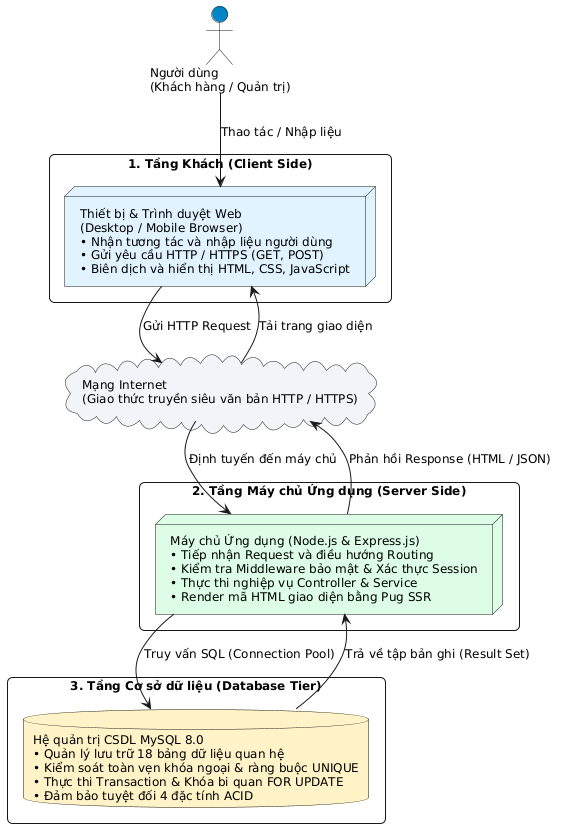
  <p><em>Hình 1: Mô hình Client - Server trong ứng dụng web</em></p>
</div>

### 1.2. Ứng dụng trong hệ thống VAMOS STORE

Trong hệ thống VAMOS STORE, mô hình Client - Server được ứng dụng theo cơ chế **Server-Side Rendering (SSR)**:

- Khi khách hàng truy cập xem danh sách giày dép hoặc bấm đặt hàng, trình duyệt gửi request về Node.js Server.
- Server tiếp nhận request, gọi xuống Microsoft SQL Server 2022 để lấy dữ liệu sản phẩm, biến thể kho, sau đó sử dụng Template Engine Pug để biên dịch trực tiếp thành mã HTML hoàn chỉnh và trả về cho trình duyệt.
- **Ưu điểm áp dụng:** Giúp trang web tải nhanh, tối ưu hóa công cụ tìm kiếm (SEO) vượt trội cho các sản phẩm giày, đồng thời bảo mật tuyệt đối mã nguồn xử lý giá và logic kho phía máy chủ.

---

## 2. NGÔN NGỮ JAVASCRIPT VÀ NỀN TẢNG NODE.JS

### 2.1. Ngôn ngữ JavaScript (ES6+)

JavaScript là ngôn ngữ lập trình thông dịch bậc cao, hướng đối tượng dựa trên prototype, ban đầu được phát triển để tạo các hiệu ứng tương tác trên trình duyệt web. Cùng với sự phát triển mạnh mẽ của tiêu chuẩn ECMAScript (đặc biệt từ phiên bản ES6/ES2015 trở đi), JavaScript đã trang bị các tính năng ngôn ngữ hiện đại:

- Cú pháp `async/await` và `Promise` giúp xử lý các tác vụ bất đồng bộ một cách trực quan, tránh hiện tượng "Callback Hell".
- `Arrow functions`, `Destructuring assignment`, `Spread/Rest operator` giúp viết mã ngắn gọn, rõ ràng và dễ bảo trì.
- `Classes` và cú pháp module `import/export` hoặc `CommonJS` hỗ trợ lập trình hướng đối tượng và module hóa chuẩn mực.

### 2.2. Nền tảng Node.js

Node.js là một môi trường thực thi mã JavaScript đa nền tảng, mã nguồn mở, hoạt động bên ngoài trình duyệt web, được xây dựng trên nền tảng JavaScript Engine V8 của Google Chrome.

- **Kiến trúc hướng sự kiện (Event-driven):** Node.js vận hành dựa trên cơ chế phát và lắng nghe sự kiện, giúp hệ thống phản hồi cực nhanh với các hành động của người dùng.
- **Cơ chế I/O bất đồng bộ, không phong tỏa (Non-blocking I/O) và Vòng lặp sự kiện (Event Loop):** Thay vì tạo ra một luồng (thread) mới cho mỗi request như kiến trúc truyền thống đa luồng (multi-threaded) của Java hay PHP, Node.js sử dụng một luồng đơn (Single Thread) để xử lý hàng ngàn kết nối đồng thời mà không bị nghẽn I/O trong lúc chờ truy vấn cơ sở dữ liệu.
- **Lý do lựa chọn cho VAMOS STORE:** Nền tảng Node.js cho phép đội ngũ phát triển sử dụng duy nhất một ngôn ngữ JavaScript xuyên suốt từ Backend đến Frontend, tốc độ thực thi I/O vượt trội, rất phù hợp với bài toán thương mại điện tử cần xử lý nhiều truy vấn duyệt sản phẩm và đặt hàng đồng thời.

---

## 3. FRAMEWORK EXPRESS.JS

### 3.1. Tổng quan về Express.js

Express.js là một web framework mã nguồn mở tối giản (minimalist), linh hoạt và phổ biến hàng đầu dành cho Node.js. Express.js cung cấp một tập hợp các tính năng cốt lõi mạnh mẽ để phát triển các ứng dụng web và API:

- **Hệ thống định tuyến (Routing):** Quản lý điều hướng URL request (GET, POST, PUT, DELETE) đến các controller xử lý tương ứng một cách mạch lạc.
- **Cơ chế Middleware:** Là các hàm trung gian có quyền truy cập vào đối tượng request (`req`), response (`res`) và hàm `next()` trong chu trình xử lý. Middleware được dùng để xác thực quyền đăng nhập, ghi log, phân tích dữ liệu form (`body-parser`), quản lý phiên và xử lý lỗi tập trung.
- **Tích hợp Template Engine linh hoạt:** Hỗ trợ kết nối liền mạch với Pug để kết xuất giao diện HTML phía máy chủ.

### 3.2. Vai trò trong dự án VAMOS STORE

Express.js đóng vai trò là "bộ xương sống" kết nối toàn bộ hệ thống VAMOS STORE:

- Phân tách mạch lạc giữa các route công khai cho khách hàng (`/products`, `/cart`, `/checkout`) và các route quản trị bảo mật (`/admin/products`, `/admin/orders`, `/admin/inventory`).
- Cung cấp các Middleware kiểm tra vai trò (`requireAdmin`, `sessionContextMiddleware`): ngăn chặn khách vãng lai chưa đăng nhập truy cập trang thanh toán, ngăn chặn khách hàng thông thường truy cập trái phép vào các trang quản trị của Admin.

---

## 4. MÔ HÌNH MVC VÀ KIẾN TRÚC THỰC THI (APPLICATION ARCHITECTURE)

### 4.1. Khái niệm Model - View - Controller (MVC)

Mô hình MVC là một mẫu kiến trúc phần mềm kinh điển trong công nghệ web, chia tách ứng dụng thành ba thành phần độc lập:

1. **Model (Mô hình dữ liệu):** Đại diện cho dữ liệu và các quy tắc nghiệp vụ lưu trữ. Model tương tác trực tiếp với hệ quản trị cơ sở dữ liệu để thực hiện các thao tác CRUD (Create, Read, Update, Delete).
2. **View (Giao diện hiển thị):** Chịu trách nhiệm trực quan hóa dữ liệu nhận được từ Controller thành giao diện HTML mà người dùng nhìn thấy trên trình duyệt.
3. **Controller (Bộ điều khiển):** Tiếp nhận yêu cầu từ View/Client, điều phối các thao tác xử lý nghiệp vụ, gọi Model để lấy dữ liệu và chỉ định View tương ứng để render kết quả trả về.

<div align="center">
  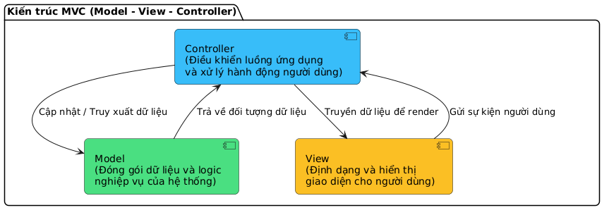
  <p><em>Hình 2: Mô hình kiến trúc MVC phân lớp</em></p>
</div>

<div align="center">
  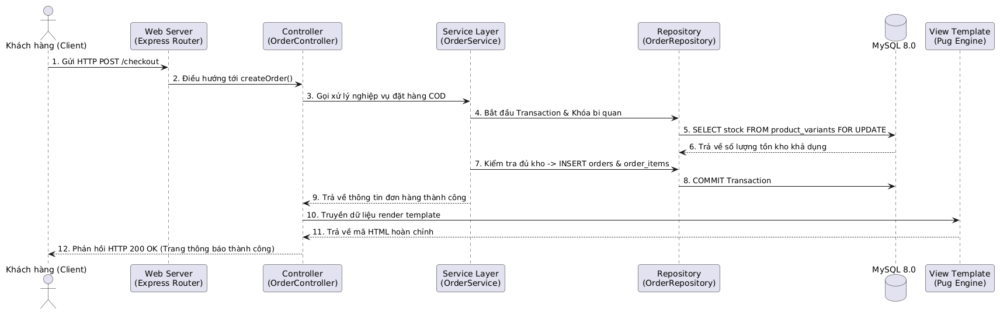
  <p><em>Hình 3: Luồng xử lý một Request trong kiến trúc phân lớp</em></p>
</div>

### 4.2. Hiện thực Kiến trúc thực tế trong VAMOS STORE

Để vừa đảm bảo tính module hóa cao vừa tối ưu hóa hiệu năng, hệ thống VAMOS STORE áp dụng mô hình kiến trúc thực thi kết hợp linh hoạt, phù hợp với từng phân hệ nghiệp vụ:

- **Mô hình Ba tầng (Three-Tier Service / Repository Pattern):** Được áp dụng cho các phân hệ nghiệp vụ phức tạp đòi hỏi xử lý giao dịch nguyên tử (ACID Transaction) và quản lý dữ liệu lớn:
  - *Phân hệ Đặt hàng & Hủy đơn:* `OrderService` (`src/services/order.service.js`) quản lý Transaction nguyên tử, khóa bi quan trừ kho, kiểm tra Rule Q8 voucher, tính toán snapshot và kích hoạt hoàn kho.
  - *Phân hệ Danh mục & Sản phẩm:* `ProductService` và `ProductRepository` phụ trách truy vấn dữ liệu sản phẩm, phân trang, lọc đa tiêu chí.
  - *Phân hệ Danh sách yêu thích:* `WishlistService` và `WishlistRepository` quản lý lưu trữ bền vững phía máy chủ.
- **Mô hình Hai tầng trực tiếp (Two-Tier Direct Controller - Database Pattern):** Được áp dụng cho phân hệ Quản trị (`AdminController`) và Giỏ hàng (`CartController`). Bộ điều khiển trực tiếp thực thi các câu lệnh T-SQL tham số hóa thông qua Database Helper (`src/config/database.js`). Mô hình này giúp loại bỏ các lớp bọc (wrapper) trung gian không cần thiết, tăng tốc độ truy vấn và đơn giản hóa việc bảo trì mã nguồn cho các thao tác CRUD quản trị viên.

<div align="center">
  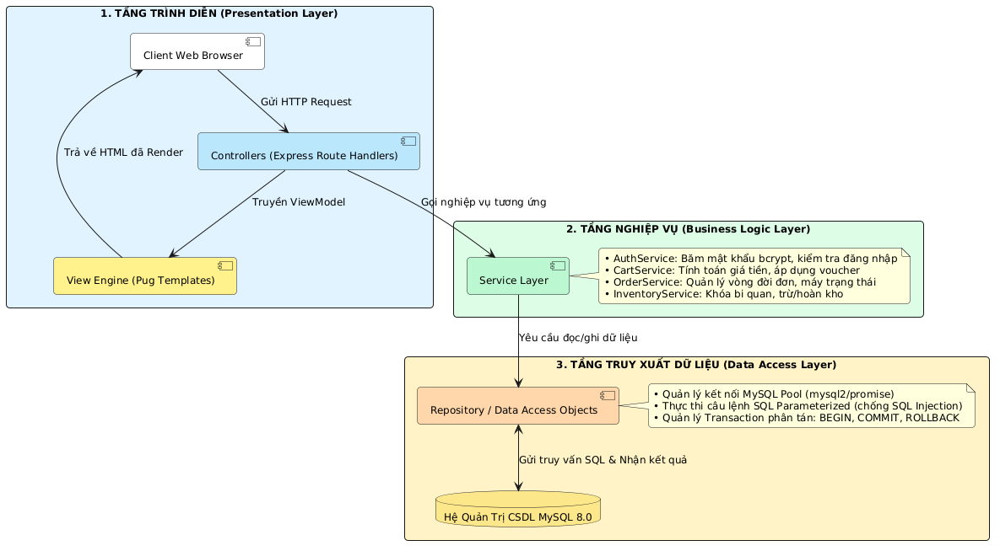
  <p><em>Hình 4: Chi tiết cấu trúc tầng trong kiến trúc phân lớp VAMOS STORE</em></p>
</div>

---

## 5. TEMPLATE ENGINE PUG (JADE)

### 5.1. Khái niệm và đặc điểm

Pug (trước đây có tên là Jade) là một công cụ tạo mẫu (Template Engine) hiệu năng cao dành cho Node.js:

- **Cú pháp tối giản dựa trên thụt lề (Indentation-based):** Pug loại bỏ hoàn toàn các thẻ đóng `</...>` và dấu ngoặc nhọn `< >` rườm rà của HTML truyền thống, giúp mã nguồn giao diện gọn gàng hơn từ 30% đến 50%.
- **Kế thừa giao diện (Template Inheritance):** Hỗ trợ cơ chế kế thừa thông qua từ khóa `extends` và ghi đè nội dung theo từng vùng bằng `block`. Điều này cho phép xây dựng một layout khung chuẩn (`layout.pug`) chứa Header, Navigation, Footer dùng chung, các trang con chỉ cần chèn nội dung đặc thù.
- **Tính năng Mixin:** Cho phép đóng gói các đoạn giao diện lặp lại (như Card sản phẩm, Badge trạng thái đơn hàng, Hộp thoại xác nhận) thành các hàm tái sử dụng linh hoạt.

```pug
//- Ví dụ cú pháp Pug kế thừa layout trong VAMOS STORE
extends ../layouts/main.pug

block content
  div(class="container mx-auto px-4 py-8")
    h1(class="text-2xl font-bold text-gray-900") Danh sách giày Sneaker
    div(class="grid grid-cols-1 md:grid-cols-4 gap-6 mt-6")
      each product in products
        +productCard(product)
```

---

## 6. CSS FRAMEWORK TAILWIND CSS

### 6.1. Triết lý Utility-first CSS

Khác với các CSS framework truyền thống cung cấp sẵn các component cố định (như Bootstrap hay Semantic UI với các class `.btn`, `.card` bị đóng khung phong cách), Tailwind CSS là một framework theo định hướng **Utility-first**:

- Cung cấp hàng ngàn class tiện ích cấp thấp (low-level utility classes) phản ánh trực tiếp các thuộc tính CSS như khoảng cách (`p-4`, `m-2`), căn chỉnh bố cục Flexbox/Grid (`flex`, `grid-cols-4`), màu sắc (`bg-coral-500`, `text-charcoal-900`), và trạng thái hover/focus (`hover:bg-coral-600`).
- **Khả năng Responsive vượt trội:** Tích hợp sẵn các tiền tố breakpoint (`sm:`, `md:`, `lg:`, `xl:`) giúp điều chỉnh bố cục website mượt mà trên mọi kích thước màn hình mà không cần viết media query thủ công.
- **Tối ưu hóa dung lượng (PurgeCSS / JIT Mode):** Bộ biên dịch Just-In-Time (JIT) của Tailwind chỉ xuất ra các class CSS thực sự được sử dụng trong mã nguồn Pug, giúp file stylesheet production cực nhẹ (thường dưới 20KB), tăng tốc độ tải trang đáng kể.

---

## 7. HỆ QUẢN TRỊ CƠ SỞ DỮ LIỆU MICROSOFT SQL SERVER 2022

### 7.1. Tổng quan về Microsoft SQL Server 2022

Microsoft SQL Server 2022 là hệ quản trị cơ sở dữ liệu quan hệ doanh nghiệp (Enterprise RDBMS) hàng đầu thế giới được phát triển bởi tập đoàn Microsoft, được triển khai chính thức trong dự án qua Docker image `mcr.microsoft.com/mssql/server:2022-latest`:

- **Chuẩn hóa giao dịch ACID toàn diện:** Hỗ trợ đầy đủ các đặc tính toàn vẹn giao dịch **ACID** (Atomicity, Consistency, Isolation, Durability) qua các giao dịch T-SQL an toàn.
- **Khóa bi quan cấp dòng với gợi ý bảng (Table Hints):** Hỗ trợ cú pháp `SELECT ... WITH (UPDLOCK, ROWLOCK)`, cho phép khóa một dòng dữ liệu biến thể trong suốt quá trình giao dịch, ngăn chặn tình trạng hai phiên làm việc đọc cùng một số lượng tồn và dẫn đến Race Condition (bán vượt tồn kho).
- **Thực thi nghiêm ngặt ràng buộc CHECK & FOREIGN KEY:** SQL Server kiểm tra và thực thi chặt chẽ các biểu thức logic `CHECK` (giá tiền không âm, số lượng đặt hàng lớn hơn 0, ngày kết thúc lớn hơn ngày bắt đầu) và ràng buộc toàn vẹn tham chiếu.
- **Bảng mã Unicode `NVARCHAR`:** Hỗ trợ lưu trữ hoàn hảo văn bản tiếng Việt có dấu và bộ ký tự quốc tế.
- **Chỉ mục có điều kiện (Filtered Unique Indexes):** Cho phép tạo ràng buộc duy nhất trên tập con dữ liệu, ví dụ bảo đảm mỗi người dùng chỉ có tối đa một địa chỉ giao hàng mặc định (`WHERE is_default = 1`).

---

## 8. CƠ CHẾ XÁC THỰC VÀ QUẢN LÝ PHIÊN (AUTHENTICATION & SECURITY)

### 8.1. Quản lý phiên làm việc máy chủ (Session-based Authentication)

Hệ thống VAMOS STORE sử dụng thư viện `express-session` để duy trì trạng thái đăng nhập của người dùng:

- Khi người dùng đăng nhập thành công với email và mật khẩu đúng, server khởi tạo một bản ghi session trong bộ nhớ máy chủ (MemoryStore) và cấp một mã định danh phiên ngẫu nhiên (Session ID mang tên cookie `vamos_sid`).
- Session ID được mã hóa và gửi về trình duyệt qua cookie mang cờ `HttpOnly: true` (ngăn chặn mã độc JavaScript phía client đánh cắp cookie qua tấn công XSS) và `SameSite: 'lax'` (cân bằng giữa trải nghiệm điều hướng và bảo vệ chống tấn công giả mạo yêu cầu CSRF).
- Mọi request tiếp theo từ trình duyệt tự động gửi kèm cookie này; middleware phía server (`sessionContextMiddleware`) sẽ đối soát phiên để trích xuất quyền hạn (`req.session.user.role`).

### 8.2. Kỹ thuật băm mật khẩu một chiều với Bcryptjs

- **Nguyên tắc an toàn:** Tuyệt đối không lưu mật khẩu của người dùng dưới dạng văn bản thuần (plaintext) trong cơ sở dữ liệu.
- **Thuật toán Bcrypt:** Là hàm băm mật khẩu thích ứng (adaptive hash function), tích hợp cơ chế tự động sinh chuỗi muối ngẫu nhiên (Salt) và cấu hình chi phí tính toán (Work factor / Salt rounds >= 10). Thuật toán này có khả năng làm chậm tốc độ tính toán của máy tính kẻ tấn công, vô hiệu hóa hoàn toàn các kỹ thuật tấn công tra cứu bảng cầu vồng (Rainbow Table) hoặc tấn công vét cạn (Brute-force).

---

## 9. CÔNG NGHỆ CONTAINER HÓA DOCKER VÀ DOCKER COMPOSE

### 9.1. Khái niệm Container và Docker

Docker là nền tảng ảo hóa mức hệ điều hành (Containerization) cho phép đóng gói toàn bộ mã nguồn ứng dụng, môi trường thực thi Node.js, các gói phụ thuộc (npm dependencies) và cấu hình hệ thống vào một đơn vị độc lập gọi là **Container**.

- Khác với máy ảo truyền thống (Virtual Machine) đòi hỏi cả một hệ điều hành khách (Guest OS) nặng nề, Docker Container chia sẻ chung nhân hệ điều hành máy chủ (Host OS Kernel), giúp khởi động tức thì chỉ trong vài giây và tiêu tốn rất ít tài nguyên phần cứng.

### 9.2. Docker Compose trong VAMOS STORE

Docker Compose là công cụ giúp định nghĩa và vận hành ứng dụng đa container (Multi-container applications) thông qua file cấu hình `docker-compose.yml`:

- **Web Service (`vamos_store_app`):** Container chạy ứng dụng Node.js/Express, kết nối cổng 3000 ra môi trường ngoài.
- **Database Service (`vamos_store_mssql`):** Container chạy hệ quản trị CSDL Microsoft SQL Server 2022 (`mcr.microsoft.com/mssql/server:2022-latest`), cấu hình ổ cứng gắn ngoài (Docker Volume `mssql_data`) để lưu trữ dữ liệu bền vững ngay cả khi container bị khởi động lại.
- **Lợi ích ứng dụng:** Đảm bảo tính nhất quán tuyệt đối của môi trường chạy ứng dụng giữa các máy tính của các thành viên trong nhóm phát triển và máy chủ triển khai ("Build once, run anywhere").


---

# CHƯƠNG II: PHÂN TÍCH VÀ THIẾT KẾ HỆ THỐNG (SYSTEM ANALYSIS & DESIGN)

---

## 1. PHÂN TÍCH NGHIỆP VỤ HỆ THỐNG

Dựa trên việc đối chiếu trực tiếp với hệ thống định tuyến (Routes), các bộ điều khiển (Controllers) và các middleware xác thực thực tế trong mã nguồn dự án VAMOS STORE, nghiệp vụ hệ thống được chuẩn hóa chính xác theo 3 nhóm tác nhân (Actors):

### 1.1. Nghiệp vụ của Khách vãng lai (Guest)
Khách vãng lai là người dùng truy cập vào hệ thống nhưng chưa thực hiện đăng nhập hoặc chưa có tài khoản thành viên:
* **Khám phá và tra cứu sản phẩm:** Xem trang chủ với slider banner quảng bá chiến dịch marketing; xem danh mục sản phẩm nổi bật, sản phẩm mới nhất và sản phẩm bán chạy; tìm kiếm sản phẩm theo từ khóa (khớp tên sản phẩm, mã sản phẩm hoặc thương hiệu).
* **Bộ lọc sản phẩm đa tiêu chí:** Sử dụng bộ lọc nâng cao tại trang cửa hàng (`/products`) để lọc sản phẩm theo danh mục (`category`), đối tượng giới tính (`gender_target: MEN, WOMEN, KIDS, UNISEX`), kích cỡ giày (`size: 36 - 45`), màu sắc (`color`) và khoảng giá bán (`min_price`, `max_price`); sắp xếp theo giá tăng/giảm hoặc tên A-Z.
* **Xem chi tiết sản phẩm:** Xem bộ sưu tập ảnh góc chụp chi tiết; đọc thông số kỹ thuật và hướng dẫn chọn cỡ giày; tương tác chọn ma trận Size x Màu sắc để kiểm tra tức thời tình trạng còn hàng và số lượng tồn thực tế của từng mã biến thể SKU.
* **Đăng ký tài khoản thành viên:** Nhập họ tên, email hợp lệ, số điện thoại và mật khẩu (tối thiểu 6 ký tự) để khởi tạo tài khoản `Customer`. Hệ thống tự động khởi tạo giỏ hàng cá nhân (quan hệ 1:1) ngay khi tạo tài khoản thành công.
* **Đăng nhập hệ thống:** Xác thực danh tính bằng email và mật khẩu qua thuật toán `bcryptjs`, lưu giữ phiên làm việc an toàn thông qua Session trên máy chủ.
* **Quy trình Khôi phục mật khẩu (Thiết kế):** Gửi yêu cầu đặt lại mật khẩu khi quên (CSDL đã thiết kế cấu trúc bảng `password_reset_tokens` và token hash bảo mật, đang ở trạng thái chờ tích hợp Email Service).

### 1.2. Nghiệp vụ của Khách hàng thành viên (Customer)
Khách hàng thành viên là người dùng đã đăng nhập tài khoản có vai trò `CUSTOMER`:
* **Kế thừa toàn bộ quyền của Khách vãng lai:** Xem hàng, tìm kiếm, lọc và xem thông tin chi tiết.
* **Quản lý giỏ hàng trực tuyến:** Thêm biến thể sản phẩm vào giỏ hàng cá nhân (`carts` và `cart_items`); điều chỉnh số lượng (giới hạn tối thiểu 1 đôi, tối đa 10 đôi bán lẻ cho mỗi mặt hàng theo Quy tắc Q7); xóa từng dòng sản phẩm hoặc làm trống giỏ hàng; hệ thống tự động kiểm tra tồn kho tức thời.
* **Quản lý danh sách yêu thích (Wishlist):** Thêm hoặc xóa sản phẩm khỏi danh sách yêu thích được lưu trữ bền vững trong CSDL (`wishlist_items`).
* **Quản lý hồ sơ và sổ địa chỉ giao hàng:** Cập nhật thông tin cá nhân; đổi mật khẩu tài khoản; thêm mới, chỉnh sửa, xóa địa chỉ nhận hàng và thiết lập địa chỉ mặc định (ràng buộc duy nhất 1 địa chỉ mặc định qua Filtered Unique Index).
* **Đặt hàng thanh toán COD (Checkout):** Chọn địa chỉ giao hàng; áp dụng mã giảm giá voucher (nếu thỏa mãn hạn mức và chưa từng dùng theo Quy tắc Q8); kiểm tra tóm tắt tài chính (tạm tính, giảm giá, phí ship, tổng thanh toán); xác nhận tạo đơn hàng trong một Transaction CSDL nguyên tử kèm trừ kho và lưu snapshot thông tin bất biến.
* **Tra cứu và theo dõi đơn hàng (Order Tracking):** Xem danh sách lịch sử đơn hàng; xem chi tiết từng đơn hàng kèm bản sao snapshot địa chỉ và sản phẩm; theo dõi tiến trình chuyển trạng thái theo thời gian thực.
* **Chủ động hủy đơn hàng:** Được quyền tự hủy đơn hàng DUY NHẤT khi đơn đang ở trạng thái chờ xác nhận (`PENDING`). Hệ thống tự động kích hoạt Transaction hoàn trả tồn kho và phục hồi lượt dùng voucher.

### 1.3. Nghiệp vụ của Quản trị viên (Admin)
Quản trị viên là người dùng có vai trò `ADMIN`, có toàn quyền điều hành và quản lý hoạt động kinh doanh:
* **Bảng điều khiển tổng quan (Dashboard):** Xem thống kê tổng doanh thu thực tế (chỉ tính từ các đơn hàng có `order_status = 'COMPLETED'` và `payment_status = 'PAID'`); thống kê số lượng đơn theo 6 trạng thái; theo dõi Top 4 sản phẩm bán chạy nhất theo số lượng bán (`ORDER BY total_sold DESC`); xem danh sách cảnh báo tồn kho thấp (`stock_quantity <= 5`) và danh sách đơn hàng khẩn cấp cần xử lý.
* **Quản lý Danh mục và Thương hiệu:** Thêm mới danh mục và thương hiệu; chỉnh sửa mô tả và đường dẫn tĩnh SEO (slug); bật/tắt trạng thái hiển thị của danh mục.
* **Quản lý Sản phẩm và Biến thể:** Tạo mới thông tin sản phẩm cha; cấu hình ma trận biến thể giày theo Size x Color x SKU kèm số lượng tồn kho ban đầu; quản lý bộ ảnh sản phẩm và chỉ định ảnh đại diện chính (`is_primary = 1`); chỉnh sửa thông tin hoặc ẩn/hiện sản phẩm.
* **Quản lý Tồn kho và Thẻ kho (Inventory Management):** Tra cứu tồn kho chi tiết theo từng mã SKU; thực hiện điều chỉnh tăng/giảm kho thủ công khi kiểm kê thực tế; bắt buộc ghi nhận lý do điều chỉnh để lưu vết kiểm toán vào bảng `inventory_transactions`.
* **Vận hành và Xử lý Đơn hàng (Order Fulfillment):** Xem danh sách đơn hàng có phân trang và bộ lọc trạng thái; xem chi tiết snapshot đơn hàng; thực hiện chuyển đổi trạng thái đơn hàng theo đúng máy trạng thái chuẩn (`PENDING` $\rightarrow$ `CONFIRMED` $\rightarrow$ `PROCESSING` $\rightarrow$ `SHIPPING` $\rightarrow$ `COMPLETED`); hủy đơn hàng nội bộ kèm lý do và kích hoạt hoàn kho tự động. Khi chuyển trạng thái sang `COMPLETED` trong luồng COD, hệ thống tự động cập nhật `payment_status = 'PAID'`.
* **Quản lý Mã giảm giá (Vouchers):** Tạo mới mã ưu đãi; cấu hình hình thức giảm (phần trăm hoặc tiền cố định), giá trị giảm, mức giảm trần, giá trị đơn tối thiểu, khung thời gian hiệu lực và giới hạn số lượt dùng; bật/tắt trạng thái voucher.
* **Quản lý Tài khoản Khách hàng (Customer Accounts):** Tra cứu danh sách khách hàng, xem tổng số đơn và tổng chi tiêu tích lũy; xem chi tiết hồ sơ cá nhân, sổ địa chỉ và lịch sử đơn hàng; khóa hoặc mở khóa tài khoản khách hàng (`status = 'active' | 'locked'`) với cơ chế bảo vệ nghiêm ngặt: tuyệt đối không cho phép khóa tài khoản ADMIN.
* **Quản lý Banner quảng bá trang chủ:** Xem danh sách banner theo thứ tự hiển thị `display_order`; thêm banner mới kèm link điều hướng; bật/tắt trạng thái hiển thị; xóa vật lý banner khỏi CSDL.

### 1.4. Ma trận phân quyền các tác nhân (Actor Permissions Matrix)

Dưới đây là ma trận phân quyền truy cập và thực thi chức năng của 3 tác nhân (`Guest`, `Customer`, `Admin`) trên toàn bộ các phân hệ của VAMOS STORE:

| Phân hệ / Nghiệp vụ | Khách vãng lai (Guest) | Khách hàng (Customer) | Quản trị viên (Admin) |
| :--- | :---: | :---: | :---: |
| Xem trang chủ, tìm kiếm, lọc sản phẩm | Cho phép | Cho phép | Cho phép |
| Xem chi tiết sản phẩm, kiểm tra tồn kho SKU | Cho phép | Cho phép | Cho phép |
| Đăng ký / Đăng nhập tài khoản | Cho phép | Cho phép | Cho phép |
| Quản lý giỏ hàng trực tuyến (Carts) | Không (Cần đăng nhập) | Toàn quyền | Không |
| Quản lý danh sách yêu thích (Wishlist) | Không (Cần đăng nhập) | Toàn quyền | Không |
| Quản lý hồ sơ cá nhân & Sổ địa chỉ | Không | Toàn quyền (Cá nhân) | Không |
| Đặt hàng thanh toán COD & Áp voucher | Không (Cần đăng nhập) | Toàn quyền | Không |
| Tra cứu lịch sử & Chi tiết đơn hàng | Không | Đơn hàng cá nhân | Toàn bộ đơn hàng |
| Hủy đơn hàng khi trạng thái PENDING | Không | Cho phép (Đơn cá nhân) | Cho phép (Kèm hoàn kho) |
| Quản lý danh mục, thương hiệu, banner | Không | Không | Toàn quyền (CRUD) |
| Quản lý sản phẩm, biến thể SKU, ảnh | Không | Không | Toàn quyền (CRUD) |
| Quản lý tồn kho & Điều chỉnh thẻ kho | Không | Không | Toàn quyền |
| Vận hành chuyển trạng thái đơn hàng | Không | Không | Toàn quyền (Fulfillment) |
| Quản lý mã giảm giá (Vouchers) | Không | Không | Toàn quyền |
| Quản lý tài khoản khách hàng | Không | Không | Toàn quyền (Khóa/Mở) |
| Bảng điều khiển KPI & Báo cáo doanh thu | Không | Không | Toàn quyền (Dashboard) |

_Bảng 2: Ma trận phân quyền các Actor trong VAMOS STORE_

---

## 2. THIẾT KẾ HỆ THỐNG

### 2.1. Sơ đồ Use Case (Use Case Diagrams)

Hệ thống VAMOS STORE chuẩn hóa chính xác **14 Use Case cốt lõi** phục vụ 3 tác nhân (`Guest`, `Customer`, `Admin`), được tổ chức thành 4 phân hệ chính:
1. Phân hệ Xác thực & Tài khoản (`UC01`, `UC02`, `UC03`, `UC04`).
2. Phân hệ Duyệt hàng & Mua sắm (`UC05`, `UC06`, `UC07`).
3. Phân hệ Quản lý Đơn hàng Khách hàng (`UC08`, `UC09`).
4. Phân hệ Quản trị Vận hành Admin (`UC10`, `UC11`, `UC12`, `UC13`, `UC14`).

#### A. Sơ đồ Use Case tổng quát toàn hệ thống

<div align="center">
  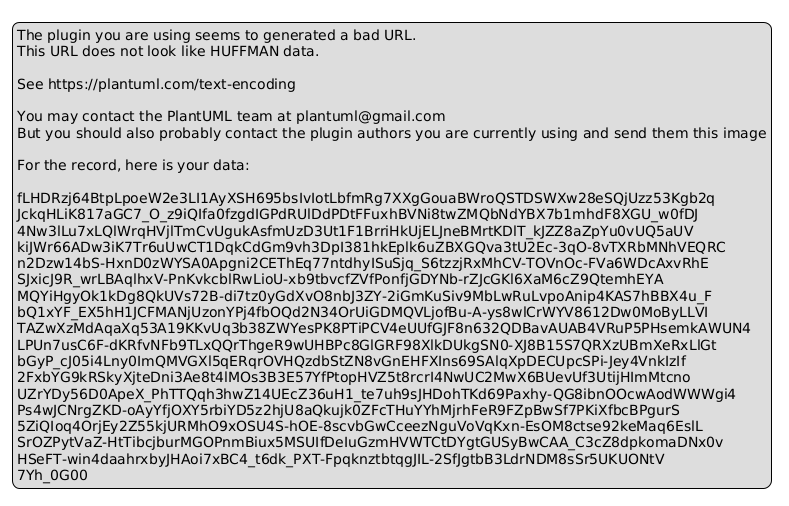
  <p><strong>Hình 5: Sơ đồ Use Case tổng quát VAMOS STORE</strong></p>
</div>

---

#### B. Sơ đồ Use Case chi tiết phân hệ Mua sắm & Đặt hàng COD
* Ca sử dụng trọng tâm là **"Đặt hàng COD" (`UC07`)** được thực hiện bởi `Customer`.
* Quan hệ `<<include>>`: Luồng đặt hàng bắt buộc phải thực hiện bước *"Chọn địa chỉ nhận hàng"* và *"Xác nhận đơn hàng"*.
* Quan hệ `<<extend>>`: Khách hàng có thể tùy chọn *"Áp dụng mã giảm giá"* khi đơn hàng thỏa mãn điều kiện giá trị tối thiểu của voucher.

<div align="center">
  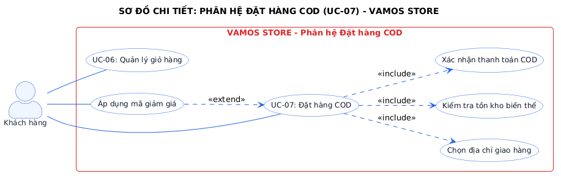
  <p><strong>Hình 6: Sơ đồ Use Case chi tiết Đặt hàng COD</strong></p>
</div>

---

#### C. Sơ đồ Use Case chi tiết Quản lý đơn hàng & Kho Admin
* Khách hàng theo dõi tiến trình đơn hàng qua **"Tra cứu và theo dõi đơn hàng" (`UC08`)**.
* Chức năng **"Hủy đơn hàng" (`UC09`)** là điểm mở rộng (`<<extend>>`) gắn kèm điều kiện: chỉ khả dụng khi `order_status = 'PENDING'`.
* Quản trị viên thực hiện **"Admin xử lý đơn hàng" (`UC10`)** để điều phối trạng thái và **"Quản lý tồn kho" (`UC11`)** để kiểm kê, điều chỉnh số lượng tồn.

<div align="center">
  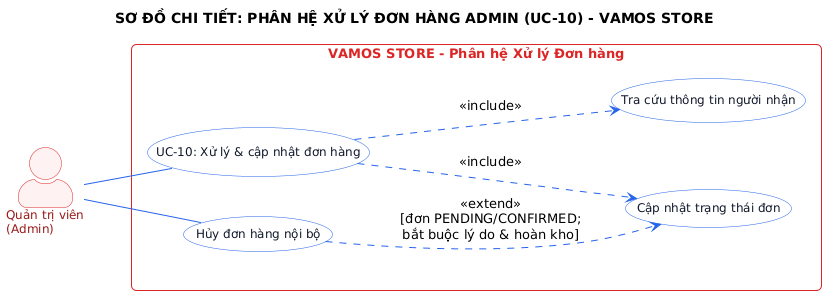
  <p><strong>Hình 7: Sơ đồ Use Case chi tiết Vận hành đơn hàng và Kho hàng Admin</strong></p>
</div>

---

#### D. Bảng đặc tả tổng hợp 14 Use Case hệ thống VAMOS STORE

| Mã UC | Tên Use Case | Tác nhân chính | Tiền điều kiện | Hậu điều kiện thành công | Luồng sự kiện chính |
|:---:|:---|:---:|:---|:---|:---|
| **UC01** | Đăng ký tài khoản | Guest | Chưa đăng nhập, email chưa tồn tại trong hệ thống. | Tạo tài khoản `Customer`, băm mật khẩu `bcryptjs`, tự động tạo giỏ hàng rỗng (1:1). | 1. Nhập họ tên, email, SĐT, MK.<br>2. Hệ thống kiểm tra hợp lệ.<br>3. Lưu bản ghi `users`, cấp `carts`, chuyển đến trang đăng nhập. |
| **UC02** | Đăng nhập hệ thống | Guest, Customer, Admin | Đã có tài khoản trong CSDL. | Thiết lập Session người dùng, phân quyền truy cập theo vai trò. | 1. Nhập email và mật khẩu.<br>2. Đối soát mật khẩu hash.<br>3. Điều hướng: Admin vào `/admin`, Customer vào `/`. |
| **UC03** | Khôi phục mật khẩu (Thiết kế) | Guest | Quên mật khẩu tài khoản. | CSDL đã có bảng `password_reset_tokens` hỗ trợ; quy trình xử lý hoàn chỉnh chưa được triển khai trong phiên bản hiện tại. | 1. Người dùng gửi yêu cầu khôi phục.<br>2. (Chức năng trong thiết kế, chưa triển khai luồng gửi email). |
| **UC04** | Quản lý hồ sơ & địa chỉ | Customer | Đã đăng nhập `Customer`. | Cập nhật hồ sơ, lưu sổ địa chỉ trong bảng `addresses`. | 1. Vào trang cá nhân.<br>2. Thêm/sửa địa chỉ nhận hàng.<br>3. Chọn địa chỉ mặc định (duy nhất qua Filtered Index). |
| **UC05** | Tìm kiếm & xem sản phẩm | Guest, Customer | Không có. | Hiển thị danh sách sản phẩm, chi tiết biến thể và tồn kho. | 1. Tìm từ khóa hoặc chọn bộ lọc.<br>2. Xem danh sách kết quả.<br>3. Xem chi tiết sản phẩm và chọn Size/Màu. |
| **UC06** | Quản lý giỏ hàng | Customer | Đã đăng nhập `Customer`. | Bản ghi `cart_items` được cập nhật tương ứng. | 1. Chọn biến thể giày và số lượng.<br>2. Thêm vào giỏ.<br>3. Tăng/giảm (tối đa 10 đôi) hoặc xóa sản phẩm. |
| **UC07** | Đặt hàng COD | Customer | Giỏ hàng có sản phẩm, đã đăng nhập. | Tạo đơn hàng trong bảng `orders`, trừ kho, lưu snapshot, làm trống giỏ hàng. | 1. Vào trang Checkout.<br>2. Chọn địa chỉ và nhập voucher.<br>3. Bấm Đặt hàng.<br>4. Hệ thống chạy Transaction nguyên tử và chuyển hướng thành công. |
| **UC08** | Tra cứu & theo dõi đơn hàng | Customer | Đã đăng nhập, có đơn hàng đã đặt. | Hiển thị thông tin chi tiết đơn hàng, snapshot giá và tiến trình xử lý. | 1. Vào Lịch sử đơn hàng.<br>2. Chọn xem chi tiết đơn.<br>3. Xem trạng thái vận chuyển và danh sách sản phẩm đặt. |
| **UC09** | Hủy đơn hàng | Customer | Đơn hàng của chính mình ở trạng thái `PENDING`. | Trạng thái chuyển `CANCELLED`, hoàn trả số lượng tồn kho, hoàn lại lượt dùng voucher. | 1. Vào chi tiết đơn `PENDING`.<br>2. Bấm "Hủy đơn hàng" và nhập lý do.<br>3. Hệ thống chạy Transaction cập nhật trạng thái và hoàn kho. |
| **UC10** | Admin xử lý đơn hàng | Admin | Đã đăng nhập `Admin`. | Trạng thái đơn chuyển đổi theo quy trình chuẩn, cập nhật `payment_status` khi xong. | 1. Vào danh sách đơn hàng Admin.<br>2. Chọn đơn cần duyệt.<br>3. Chuyển trạng thái (`PENDING` $\rightarrow$ `CONFIRMED` $\rightarrow$ ... $\rightarrow$ `COMPLETED`). |
| **UC11** | Quản lý tồn kho | Admin | Đã đăng nhập `Admin`. | Số lượng tồn kho biến thể cập nhật, ghi nhật ký kiểm toán vào `inventory_transactions`. | 1. Vào trang Quản lý kho.<br>2. Tra cứu mã SKU.<br>3. Nhập số lượng điều chỉnh và lý do.<br>4. Hệ thống cập nhật kho và lưu thẻ kho. |
| **UC12** | Quản lý sản phẩm & danh mục | Admin | Đã đăng nhập `Admin`. | Dữ liệu sản phẩm, biến thể, ảnh, danh mục, thương hiệu được lưu vào CSDL. | 1. Vào trang Quản lý sản phẩm/danh mục.<br>2. Nhập thông tin, tạo biến thể Size/Color/SKU.<br>3. Bấm Lưu để ghi dữ liệu nguyên tử. |
| **UC13** | Quản lý mã giảm giá | Admin | Đã đăng nhập `Admin`. | Bản ghi voucher mới được lưu vào bảng `vouchers`. | 1. Vào trang Quản lý Voucher.<br>2. Nhập mã, giá trị giảm, hạn mức, ngày hiệu lực.<br>3. Bấm Lưu hoặc bật/tắt hiển thị. |
| **UC14** | Báo cáo doanh thu | Admin | Đã đăng nhập `Admin`. | Dashboard hiển thị tổng doanh thu từ đơn `COMPLETED` + `PAID`, Top 4 bán chạy. | 1. Truy cập `/admin/dashboard`.<br>2. Hệ thống tổng hợp số liệu CSDL thời gian thực.<br>3. Hiển thị KPI, biểu đồ và danh sách sản phẩm. |

_Bảng 3: Danh sách 14 Use Case nghiệp vụ hệ thống VAMOS STORE_

---

### 2.2. Sơ đồ điều hướng màn hình (Sitemap)

Website VAMOS STORE được phân định cấu trúc trang chặt chẽ thành 3 phân vùng độc lập dựa trên cơ chế phân quyền RBAC và middleware bảo vệ:

1. **Phân vùng công khai (Public Zone):**
   * Trang chủ (`/`): Banner slider, danh mục nổi bật, sản phẩm mới, top bán chạy.
   * Cửa hàng (`/products`): Danh sách sản phẩm kèm bộ lọc đa tiêu chí bên thanh sidebar.
   * Chi tiết sản phẩm (`/products/:slug`): Thư viện ảnh, mô tả, chọn Size/Màu và kiểm tra tồn kho.
   * Tìm kiếm trực tiếp (`/api/products/search`): Gợi ý kết quả tìm kiếm thời gian thực.
   * Xác thực tài khoản: Đăng nhập (`/auth/login`), Đăng ký (`/auth/register`), Quên mật khẩu (`/auth/forgot-password`).
   * Trang thông tin tĩnh: Giới thiệu (`/about`), Chính sách (`/policy`), Khuyến mãi (`/promotions`).

2. **Phân vùng Khách hàng (Customer Protected Zone - Yêu cầu đăng nhập `CUSTOMER`):**
   * Giỏ hàng trực tuyến (`/cart`): Quản lý mặt hàng, số lượng, tạm tính.
   * Đặt hàng thanh toán COD (`/checkout`): Chọn địa chỉ, áp voucher, xác nhận đặt hàng.
   * Đặt hàng thành công (`/checkout/success/:id`): Xem mã đơn và thông báo xác nhận.
   * Hồ sơ cá nhân (`/account/profile`): Cập nhật thông tin, đổi mật khẩu.
   * Sổ địa chỉ giao hàng (`/account/addresses`): Thêm, sửa, xóa, đặt địa chỉ mặc định.
   * Lịch sử đơn hàng (`/account/orders`): Danh sách đơn hàng cá nhân.
   * Chi tiết đơn hàng (`/account/orders/:id`): Xem chi tiết đơn và nút hủy đơn khi `PENDING`.
   * Danh sách yêu thích (`/account/wishlist` và `/api/wishlist`): Sản phẩm đã lưu.

3. **Phân vùng Quản trị (Admin Protected Zone - Yêu cầu quyền `ADMIN` qua `requireAdmin`):**
   * Bảng điều khiển tổng quan (`/admin/dashboard`): Doanh thu, đơn hàng, Top 4 bán chạy, cảnh báo kho.
   * Quản lý sản phẩm (`/admin/products`): Danh sách, thêm mới, sửa, ẩn/hiện sản phẩm và biến thể.
   * Quản lý tồn kho (`/admin/inventory`): Kiểm kê tồn kho, điều chỉnh kho thủ công, thẻ kho lịch sử.
   * Quản lý danh mục & thương hiệu (`/admin/categories`): Thêm mới, đổi trạng thái.
   * Vận hành đơn hàng (`/admin/orders`): Danh sách đơn, chi tiết đơn, chuyển đổi trạng thái 6 bước.
   * Quản lý voucher (`/admin/vouchers`): Danh sách, tạo voucher mới, bật/tắt trạng thái.
   * Quản lý khách hàng (`/admin/customers`): Danh sách khách, chi tiết chi tiêu, khóa/mở khóa tài khoản.
   * Quản lý banner (`/admin/banners`): Danh sách banner trang chủ, thêm banner, bật/tắt, xóa banner.

<div align="center">
  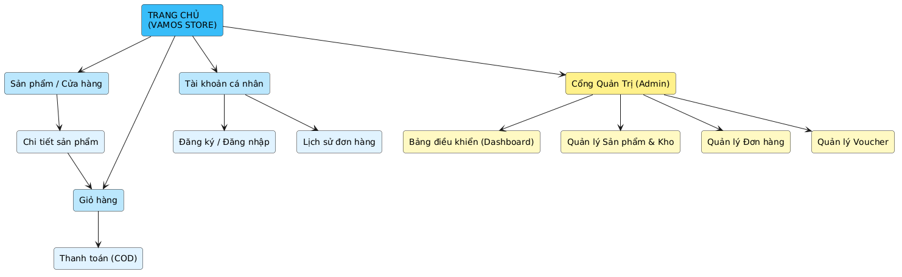
  <p><strong>Hình 8: Sơ đồ điều hướng màn hình (Sitemap) VAMOS STORE</strong></p>
</div>

---

### 2.3. Mô hình thực thể quan hệ - ERD (Entity-Relationship Diagram)

Hệ thống cơ sở dữ liệu VAMOS STORE được thiết kế chuẩn hóa ở dạng chuẩn 3NF (Third Normal Form) gồm **chính xác 20 thực thể nghiệp vụ** chạy trên hệ quản trị CSDL Microsoft SQL Server 2022 (bảng `schema_migrations` là bảng quản lý phiên bản migration kỹ thuật, không thuộc miền thực thể nghiệp vụ):

<div align="center">
  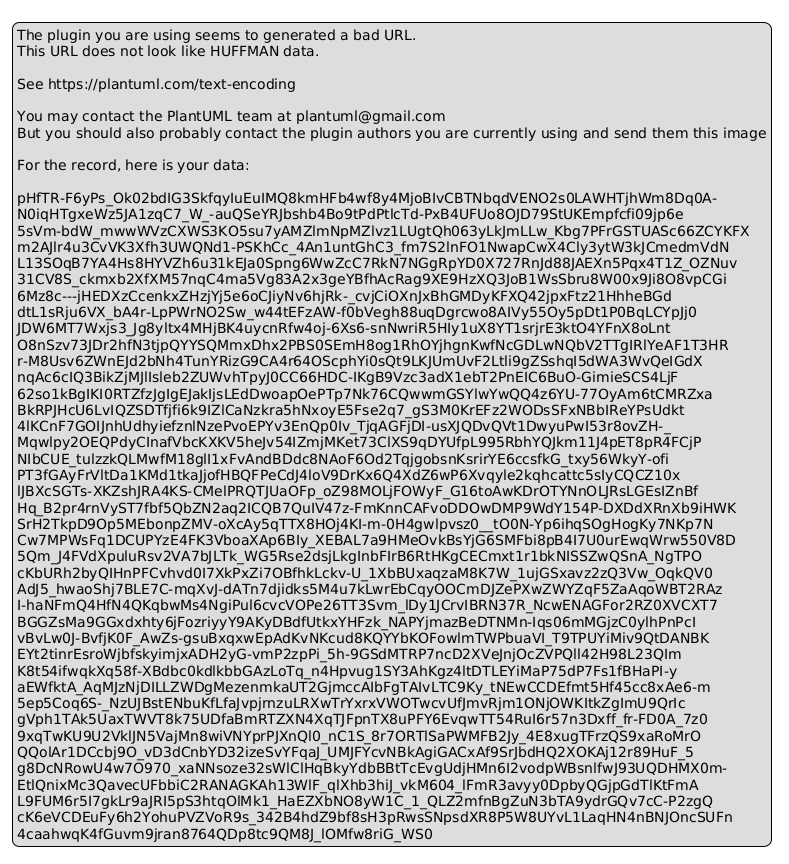
  <p><strong>Hình 9: Mô hình thực thể quan hệ (ERD 20 bảng nghiệp vụ) - VAMOS STORE</strong></p>
</div>

---

### 2.4. Từ điển dữ liệu chi tiết (Data Dictionary)

Toàn bộ 20 bảng nghiệp vụ được đặc tả chính xác theo chuẩn cú pháp DDL Microsoft SQL Server trong `database/mssql_schema.sql` và các file migration thực tế:

#### Bảng 4: Thực thể `users` (Tài khoản người dùng)
*Mục đích: Quản trị thông tin xác thực và phân quyền tài khoản người dùng (`CUSTOMER`, `ADMIN`).*

| Thuộc tính | Kiểu dữ liệu | Bắt buộc | Ràng buộc | Giá trị mặc định | Mô tả nghiệp vụ |
| :--- | :--- | :---: | :---: | :---: | :--- |
| `id` | `INT` | Có | PK, IDENTITY(1,1) | Tự tăng | Mã định danh duy nhất của người dùng |
| `full_name` | `NVARCHAR(100)` | Có | | | Họ và tên đầy đủ |
| `email` | `NVARCHAR(150)` | Có | UNIQUE | | Địa chỉ thư điện tử dùng để đăng nhập |
| `password_hash` | `NVARCHAR(255)` | Có | | | Mật khẩu đã băm bằng thuật toán bcryptjs |
| `phone` | `NVARCHAR(20)` | Không | NULL | | Số điện thoại liên lạc của người dùng |
| `role` | `NVARCHAR(20)` | Có | CHECK | `'CUSTOMER'` | Vai trò tài khoản: `ADMIN` hoặc `CUSTOMER` |
| `status` | `NVARCHAR(20)` | Có | CHECK | `'active'` | Trạng thái tài khoản: `active` hoặc `locked` |
| `created_at` | `DATETIME2` | Có | | `GETDATE()` | Thời điểm tạo tài khoản |
| `updated_at` | `DATETIME2` | Có | | `GETDATE()` | Thời điểm cập nhật tài khoản gần nhất |

---

#### Bảng 5: Thực thể `categories` (Danh mục sản phẩm)
*Mục đích: Phân loại nhóm sản phẩm giày dép (Sneaker, Thể thao, Sandal, Dép).*

| Thuộc tính | Kiểu dữ liệu | Bắt buộc | Ràng buộc | Giá trị mặc định | Mô tả nghiệp vụ |
| :--- | :--- | :---: | :---: | :---: | :--- |
| `id` | `INT` | Có | PK, IDENTITY(1,1) | Tự tăng | Mã định danh danh mục |
| `name` | `NVARCHAR(100)` | Có | | | Tên hiển thị của danh mục |
| `slug` | `NVARCHAR(120)` | Có | UNIQUE | | Đường dẫn tĩnh thân thiện SEO |
| `description` | `NVARCHAR(MAX)` | Không | NULL | | Mô tả chi tiết về danh mục |
| `is_active` | `BIT` | Có | | `1` | Trạng thái hiển thị (1: Bật, 0: Tạm ẩn) |
| `created_at` | `DATETIME2` | Có | | `GETDATE()` | Thời điểm tạo danh mục |

---

#### Bảng 6: Thực thể `brands` (Thương hiệu sản phẩm)
*Mục đích: Quản lý thương hiệu đối tác sản xuất giày dép (Nike, Adidas, Puma,...).*

| Thuộc tính | Kiểu dữ liệu | Bắt buộc | Ràng buộc | Giá trị mặc định | Mô tả nghiệp vụ |
| :--- | :--- | :---: | :---: | :---: | :--- |
| `id` | `INT` | Có | PK, IDENTITY(1,1) | Tự tăng | Mã định danh thương hiệu |
| `name` | `NVARCHAR(100)` | Có | | | Tên thương hiệu |
| `slug` | `NVARCHAR(120)` | Có | UNIQUE | | Đường dẫn tĩnh SEO của thương hiệu |
| `description` | `NVARCHAR(MAX)` | Không | NULL | | Thông tin giới thiệu thương hiệu |
| `created_at` | `DATETIME2` | Có | | `GETDATE()` | Thời điểm tạo thương hiệu |

---

#### Bảng 7: Thực thể `sizes` (Kích cỡ giày sneaker)
*Mục đích: Danh mục các cỡ giày chuẩn hóa phục vụ cấu hình biến thể (Size 36 đến 45).*

| Thuộc tính | Kiểu dữ liệu | Bắt buộc | Ràng buộc | Giá trị mặc định | Mô tả nghiệp vụ |
| :--- | :--- | :---: | :---: | :---: | :--- |
| `id` | `INT` | Có | PK, IDENTITY(1,1) | Tự tăng | Mã định danh kích cỡ |
| `size_name` | `NVARCHAR(20)` | Có | UNIQUE | | Tên kích cỡ giày (36, 37, 38, ..., 45) |
| `display_order` | `INT` | Có | | `0` | Thứ tự ưu tiên sắp xếp khi hiển thị |

---

#### Bảng 8: Thực thể `colors` (Màu sắc giày sneaker)
*Mục đích: Danh mục màu sắc sản phẩm hỗ trợ tạo biến thể (Trắng, Đen, Xám, Đỏ,...).*

| Thuộc tính | Kiểu dữ liệu | Bắt buộc | Ràng buộc | Giá trị mặc định | Mô tả nghiệp vụ |
| :--- | :--- | :---: | :---: | :---: | :--- |
| `id` | `INT` | Có | PK, IDENTITY(1,1) | Tự tăng | Mã định danh màu sắc |
| `color_name` | `NVARCHAR(50)` | Có | UNIQUE | | Tên gọi màu sắc |
| `hex_code` | `NVARCHAR(10)` | Không | NULL | | Mã màu thập lục phân (Hex Code, ví dụ `#FFFFFF`) |

---

#### Bảng 9: Thực thể `vouchers` (Mã giảm giá khuyến mãi)
*Mục đích: Quản lý các chiến dịch khuyến mãi chiết khấu đơn hàng.*

| Thuộc tính | Kiểu dữ liệu | Bắt buộc | Ràng buộc | Giá trị mặc định | Mô tả nghiệp vụ |
| :--- | :--- | :---: | :---: | :---: | :--- |
| `id` | `INT` | Có | PK, IDENTITY(1,1) | Tự tăng | Mã định danh voucher |
| `code` | `NVARCHAR(50)` | Có | UNIQUE | | Mã nhập ưu đãi (ví dụ `VAMOS100`) |
| `name` | `NVARCHAR(100)` | Có | | | Tên chiến dịch ưu đãi |
| `discount_type` | `NVARCHAR(20)` | Có | CHECK | | Hình thức giảm: `percentage` hoặc `fixed_amount` |
| `discount_value` | `DECIMAL(12,0)`| Có | CHECK (>0) | | Giá trị giảm (% chiết khấu hoặc số tiền VNĐ) |
| `min_order_value`| `DECIMAL(12,0)`| Có | CHECK (>=0)| `0` | Giá trị đơn hàng tối thiểu để được áp dụng |
| `max_discount_amount`| `DECIMAL(12,0)`| Không| NULL | | Mức giảm tối đa trần khi giảm theo % |
| `start_date` | `DATETIME2` | Có | CHECK | | Thời điểm bắt đầu có hiệu lực |
| `end_date` | `DATETIME2` | Có | CHECK | | Thời điểm hết hạn (`end_date >= start_date`) |
| `usage_limit` | `INT` | Có | CHECK (>=0)| `0` | Tổng số lượt dùng tối đa toàn sàn (0: không giới hạn)|
| `used_count` | `INT` | Có | CHECK (>=0)| `0` | Số lượt đã sử dụng thực tế |
| `is_active` | `BIT` | Có | | `1` | Trạng thái hiển thị voucher |
| `created_at` | `DATETIME2` | Có | | `GETDATE()` | Thời điểm tạo voucher |

---

#### Bảng 10: Thực thể `banners` (Banner quảng bá trang chủ)
*Mục đích: Quản lý hình ảnh và liên kết slider quảng cáo tại trang chủ storefront.*

| Thuộc tính | Kiểu dữ liệu | Bắt buộc | Ràng buộc | Giá trị mặc định | Mô tả nghiệp vụ |
| :--- | :--- | :---: | :---: | :---: | :--- |
| `id` | `INT` | Có | PK, IDENTITY(1,1) | Tự tăng | Mã định danh banner |
| `title` | `NVARCHAR(150)` | Có | | | Tiêu đề chiến dịch banner |
| `image_url` | `NVARCHAR(1000)`| Có | | | Đường dẫn URL hình ảnh banner từ CDN |
| `link_url` | `NVARCHAR(255)` | Không | NULL | | Đường dẫn đích khi người dùng nhấp vào |
| `display_order` | `INT` | Có | | `0` | Thứ tự ưu tiên hiển thị trên carousel slider |
| `is_active` | `BIT` | Có | | `1` | Trạng thái kích hoạt hiển thị (1: Bật, 0: Tắt) |
| `created_at` | `DATETIME2` | Có | | `GETDATE()` | Thời điểm tạo banner |

---

#### Bảng 11: Thực thể `addresses` (Sổ địa chỉ nhận hàng)
*Mục đích: Lưu trữ danh sách địa chỉ giao hàng của từng khách hàng (quan hệ Composition với `User`).*

| Thuộc tính | Kiểu dữ liệu | Bắt buộc | Ràng buộc | Giá trị mặc định | Mô tả nghiệp vụ |
| :--- | :--- | :---: | :---: | :---: | :--- |
| `id` | `INT` | Có | PK, IDENTITY(1,1) | Tự tăng | Mã định danh địa chỉ |
| `user_id` | `INT` | Có | FK $\rightarrow$ `users(id)` | ON DELETE CASCADE | Chủ sở hữu địa chỉ |
| `recipient_name`| `NVARCHAR(100)` | Có | | | Họ tên người nhận hàng |
| `phone` | `NVARCHAR(20)` | Có | | | Số điện thoại nhận hàng |
| `province` | `NVARCHAR(100)` | Có | | | Tỉnh / Thành phố |
| `district` | `NVARCHAR(100)` | Có | | | Quận / Huyện |
| `ward` | `NVARCHAR(100)` | Có | | | Phường / Xã |
| `detail_address`| `NVARCHAR(255)` | Có | | | Địa chỉ chi tiết (số nhà, tên đường, thôn xóm)|
| `is_default` | `BIT` | Có | Filtered Index: `uq_user_default_address` (WHERE `is_default = 1`) | `0` | Đánh dấu địa chỉ mặc định (duy nhất 1 địa chỉ mặc định/user) |
| `created_at` | `DATETIME2` | Có | | `GETDATE()` | Thời điểm thêm địa chỉ |
| `updated_at` | `DATETIME2` | Có | | `GETDATE()` | Thời điểm cập nhật địa chỉ |

---

#### Bảng 12: Thực thể `password_reset_tokens` (Token khôi phục mật khẩu)
*Mục đích: Lưu trữ token băm bảo mật phục vụ quy trình đặt lại mật khẩu. Chức năng khôi phục mật khẩu đã được đưa vào thiết kế và có cấu trúc dữ liệu hỗ trợ, tuy nhiên quy trình xử lý hoàn chỉnh chưa được triển khai trong phiên bản hiện tại.*

| Thuộc tính | Kiểu dữ liệu | Bắt buộc | Ràng buộc | Giá trị mặc định | Mô tả nghiệp vụ |
| :--- | :--- | :---: | :---: | :---: | :--- |
| `id` | `INT` | Có | PK, IDENTITY(1,1) | Tự tăng | Mã định danh token |
| `user_id` | `INT` | Có | FK $\rightarrow$ `users(id)` | ON DELETE CASCADE | Tài khoản yêu cầu khôi phục mật khẩu |
| `token_hash` | `NVARCHAR(255)` | Có | UNIQUE | | Chuỗi băm token ngẫu nhiên bảo mật |
| `expires_at` | `DATETIME2` | Có | | | Thời điểm hết hạn của token (30 phút) |
| `used_at` | `DATETIME2` | Không | NULL | | Thời điểm token đã được sử dụng thành công |
| `created_at` | `DATETIME2` | Có | | `GETDATE()` | Thời điểm khởi tạo yêu cầu |

---

#### Bảng 13: Thực thể `carts` (Giỏ hàng trực tuyến)
*Mục đích: Quản lý giỏ hàng thành viên với quan hệ 1:1 nghiêm ngặt đối với `users`.*

| Thuộc tính | Kiểu dữ liệu | Bắt buộc | Ràng buộc | Giá trị mặc định | Mô tả nghiệp vụ |
| :--- | :--- | :---: | :---: | :---: | :--- |
| `id` | `INT` | Có | PK, IDENTITY(1,1) | Tự tăng | Mã định danh giỏ hàng |
| `user_id` | `INT` | Có | FK $\rightarrow$ `users(id)` | UNIQUE, CASCADE | Khách hàng sở hữu giỏ hàng (ràng buộc 1:1) |
| `created_at` | `DATETIME2` | Có | | `GETDATE()` | Thời điểm khởi tạo giỏ hàng |
| `updated_at` | `DATETIME2` | Có | | `GETDATE()` | Thời điểm cập nhật giỏ hàng gần nhất |

---

#### Bảng 14: Thực thể `products` (Sản phẩm giày gốc)
*Mục đích: Lưu trữ thông tin chung của mẫu giày cha trước khi phân tách biến thể Size/Màu.*

| Thuộc tính | Kiểu dữ liệu | Bắt buộc | Ràng buộc | Giá trị mặc định | Mô tả nghiệp vụ |
| :--- | :--- | :---: | :---: | :---: | :--- |
| `id` | `INT` | Có | PK, IDENTITY(1,1) | Tự tăng | Mã định danh sản phẩm |
| `category_id` | `INT` | Có | FK $\rightarrow$ `categories` | NO ACTION | Danh mục trực thuộc |
| `brand_id` | `INT` | Không | FK $\rightarrow$ `brands` | SET NULL | Thương hiệu sản xuất |
| `product_code` | `NVARCHAR(50)` | Có | UNIQUE | | Mã quản lý sản phẩm nội bộ |
| `name` | `NVARCHAR(200)` | Có | | | Tên gọi thương mại của sản phẩm |
| `slug` | `NVARCHAR(255)` | Có | UNIQUE | | Đường dẫn tĩnh thân thiện SEO |
| `description` | `NVARCHAR(MAX)` | Không | NULL | | Mô tả chi tiết tính năng, công nghệ sản phẩm |
| `gender_target`| `NVARCHAR(20)` | Có | CHECK | `'UNISEX'` | Đối tượng khách hàng: `MEN, WOMEN, KIDS, UNISEX`|
| `base_price` | `DECIMAL(12,0)`| Có | CHECK (>=0) | | Giá niêm yết gốc của sản phẩm |
| `sale_price` | `DECIMAL(12,0)`| Không| CHECK | NULL | Giá khuyến mãi (`sale_price < base_price`) |
| `status` | `NVARCHAR(20)` | Có | CHECK | `'active'` | Trạng thái: `active`, `inactive`, `draft` |
| `created_at` | `DATETIME2` | Có | | `GETDATE()` | Thời điểm tạo sản phẩm |
| `updated_at` | `DATETIME2` | Có | | `GETDATE()` | Thời điểm cập nhật sản phẩm gần nhất |

---

#### Bảng 15: Thực thể `product_images` (Bộ sưu tập ảnh sản phẩm)
*Mục đích: Lưu trữ album hình ảnh các góc chụp chi tiết của mẫu giày.*

| Thuộc tính | Kiểu dữ liệu | Bắt buộc | Ràng buộc | Giá trị mặc định | Mô tả nghiệp vụ |
| :--- | :--- | :---: | :---: | :---: | :--- |
| `id` | `INT` | Có | PK, IDENTITY(1,1) | Tự tăng | Mã định danh hình ảnh |
| `product_id` | `INT` | Có | FK $\rightarrow$ `products(id)`| ON DELETE CASCADE | Sản phẩm cha chứa hình ảnh |
| `image_url` | `NVARCHAR(1000)`| Có | | | Đường dẫn URL hình ảnh chất lượng cao |
| `is_primary` | `BIT` | Có | Filtered Index: `uq_product_primary_image` (WHERE `is_primary = 1`) | `0` | Đánh dấu ảnh đại diện chính (duy nhất 1 ảnh chính/sản phẩm) |
| `display_order` | `INT` | Có | | `0` | Thứ tự ưu tiên hiển thị trong slider ảnh |

---

#### Bảng 16: Thực thể `product_variants` (Biến thể SKU và Tồn kho)
*Mục đích: Quản lý ma trận phân loại Size x Color và lưu trữ số lượng tồn kho theo từng mã SKU.*

| Thuộc tính | Kiểu dữ liệu | Bắt buộc | Ràng buộc | Giá trị mặc định | Mô tả nghiệp vụ |
| :--- | :--- | :---: | :---: | :---: | :--- |
| `id` | `INT` | Có | PK, IDENTITY(1,1) | Tự tăng | Mã định danh biến thể |
| `product_id` | `INT` | Có | FK $\rightarrow$ `products` | ON DELETE CASCADE | Mẫu giày cha trực thuộc |
| `size_id` | `INT` | Có | FK $\rightarrow$ `sizes` | NO ACTION | Kích cỡ giày của biến thể |
| `color_id` | `INT` | Có | FK $\rightarrow$ `colors` | NO ACTION | Màu sắc của biến thể |
| `sku` | `NVARCHAR(100)` | Có | UNIQUE | | Mã SKU duy nhất định danh biến thể |
| `stock_quantity`| `INT` | Có | CHECK (>=0) | `0` | Số lượng tồn kho thực tế có thể bán |
| `status` | `NVARCHAR(20)` | Có | CHECK | `'active'` | Trạng thái biến thể: `active` hoặc `inactive` |
| `created_at` | `DATETIME2` | Có | | `GETDATE()` | Thời điểm tạo biến thể |
| `updated_at` | `DATETIME2` | Có | | `GETDATE()` | Thời điểm cập nhật biến thể |
| *Ràng buộc* | | | `UNIQUE(product_id, size_id, color_id)` | | Chống trùng lặp cặp kích cỡ và màu sắc |

---

#### Bảng 17: Thực thể `cart_items` (Chi tiết mặt hàng trong giỏ)
*Mục đích: Lưu trữ từng dòng sản phẩm khách hàng chọn đưa vào giỏ hàng.*

| Thuộc tính | Kiểu dữ liệu | Bắt buộc | Ràng buộc | Giá trị mặc định | Mô tả nghiệp vụ |
| :--- | :--- | :---: | :---: | :---: | :--- |
| `id` | `INT` | Có | PK, IDENTITY(1,1) | Tự tăng | Mã định danh dòng mặt hàng giỏ |
| `cart_id` | `INT` | Có | FK $\rightarrow$ `carts(id)` | ON DELETE CASCADE | Giỏ hàng sở hữu |
| `variant_id` | `INT` | Có | FK $\rightarrow$ `product_variants`| NO ACTION | Biến thể sản phẩm chọn mua |
| `quantity` | `INT` | Có | CHECK (>0) | `1` | Số lượng đặt (Quy tắc Q7: tối đa 10 đôi) |
| `created_at` | `DATETIME2` | Có | | `GETDATE()` | Thời điểm thêm vào giỏ |
| `updated_at` | `DATETIME2` | Có | | `GETDATE()` | Thời điểm sửa số lượng |
| *Ràng buộc* | | | `UNIQUE(cart_id, variant_id)` | | Một biến thể chỉ xuất hiện 1 dòng trong giỏ |

---

#### Bảng 18: Thực thể `orders` (Thông tin tổng quát đơn hàng)
*Mục đích: Lưu trữ hồ sơ giao dịch đặt hàng và snapshot thông tin tài chính bất biến.*

| Thuộc tính | Kiểu dữ liệu | Bắt buộc | Ràng buộc | Giá trị mặc định | Mô tả nghiệp vụ |
| :--- | :--- | :---: | :---: | :---: | :--- |
| `id` | `INT` | Có | PK, IDENTITY(1,1) | Tự tăng | Mã định danh đơn hàng |
| `order_code` | `NVARCHAR(50)` | Có | UNIQUE | | Mã đơn hàng hiển thị (ví dụ `ORD-1731800000-XYZ`)|
| `user_id` | `INT` | Có | FK $\rightarrow$ `users(id)` | NO ACTION | Khách hàng đặt mua |
| `recipient_name_snapshot`| `NVARCHAR(100)`| Có | | | Snapshot họ tên người nhận tại thời điểm đặt |
| `recipient_phone_snapshot`| `NVARCHAR(20)`| Có | | | Snapshot số điện thoại người nhận |
| `delivery_address_snapshot`| `NVARCHAR(255)`| Có | | | Snapshot địa chỉ nhận hàng chi tiết đầy đủ |
| `subtotal` | `DECIMAL(12,0)`| Có | CHECK (>=0) | | Tổng tiền hàng tạm tính trước giảm giá |
| `discount_amount`| `DECIMAL(12,0)`| Có | CHECK (>=0) | `0` | Số tiền chiết khấu được giảm từ voucher |
| `shipping_fee` | `DECIMAL(12,0)`| Có | CHECK (>=0) | `0` | Cước phí vận chuyển đơn hàng |
| `total_amount` | `DECIMAL(12,0)`| Có | CHECK (>=0) | | Tổng số tiền thanh toán cuối cùng |
| `voucher_id` | `INT` | Không | FK $\rightarrow$ `vouchers` | SET NULL | Voucher đã áp dụng (nếu có) |
| `voucher_code_snapshot`| `NVARCHAR(50)`| Không | NULL | | Snapshot mã voucher tại thời điểm đặt |
| `payment_method`| `NVARCHAR(20)`| Có | CHECK | `'COD'` | Hình thức thanh toán: `COD` |
| `payment_status`| `NVARCHAR(20)`| Có | CHECK | `'UNPAID'` | Trạng thái thanh toán: `UNPAID` hoặc `PAID` |
| `order_status` | `NVARCHAR(20)` | Có | CHECK | `'PENDING'` | Trạng thái: `PENDING, CONFIRMED, PROCESSING, SHIPPING, COMPLETED, CANCELLED`|
| `customer_note`| `NVARCHAR(500)`| Không | NULL | | Ghi chú dặn dò của khách hàng khi giao hàng |
| `admin_note` | `NVARCHAR(500)`| Không | NULL | | Ghi chú xử lý nội bộ của quản trị viên |
| `created_at` | `DATETIME2` | Có | | `GETDATE()` | Thời điểm tạo đơn hàng |
| `updated_at` | `DATETIME2` | Có | | `GETDATE()` | Thời điểm cập nhật trạng thái đơn gần nhất |

---

#### Bảng 19: Thực thể `order_items` (Snapshot chi tiết từng món hàng đặt)
*Mục đích: Lưu giữ bản sao bất biến của các sản phẩm trong đơn, bảo toàn dữ liệu lịch sử kế toán.*

| Thuộc tính | Kiểu dữ liệu | Bắt buộc | Ràng buộc | Giá trị mặc định | Mô tả nghiệp vụ |
| :--- | :--- | :---: | :---: | :---: | :--- |
| `id` | `INT` | Có | PK, IDENTITY(1,1) | Tự tăng | Mã định danh dòng chi tiết đơn hàng |
| `order_id` | `INT` | Có | FK $\rightarrow$ `orders(id)` | ON DELETE CASCADE | Đơn hàng trực thuộc |
| `product_variant_id`| `INT` | Có | FK $\rightarrow$ `product_variants`| NO ACTION | Biến thể giày đã đặt mua |
| `product_name_snapshot`| `NVARCHAR(200)`| Có| | | Snapshot tên sản phẩm tại thời điểm mua |
| `sku_snapshot` | `NVARCHAR(100)`| Có | | | Snapshot mã SKU biến thể |
| `size_snapshot`| `NVARCHAR(20)` | Có | | | Snapshot kích cỡ giày |
| `color_snapshot`| `NVARCHAR(50)` | Có | | | Snapshot màu sắc giày |
| `unit_price` | `DECIMAL(12,0)`| Có | CHECK (>=0) | | Snapshot đơn giá bán thực tế của 1 đôi |
| `quantity` | `INT` | Có | CHECK (>0) | | Số lượng đặt mua của mặt hàng này |
| `line_total` | `DECIMAL(12,0)`| Có | CHECK (>=0) | | Thành tiền của dòng (`unit_price * quantity`)|

---

#### Bảng 20: Thực thể `order_status_histories` (Nhật ký chuyển đổi trạng thái đơn)
*Mục đích: Lưu vết kiểm toán (Audit Trail) cho toàn bộ tiến trình chuyển đổi trạng thái của đơn hàng.*

| Thuộc tính | Kiểu dữ liệu | Bắt buộc | Ràng buộc | Giá trị mặc định | Mô tả nghiệp vụ |
| :--- | :--- | :---: | :---: | :---: | :--- |
| `id` | `INT` | Có | PK, IDENTITY(1,1) | Tự tăng | Mã định danh dòng lịch sử trạng thái |
| `order_id` | `INT` | Có | FK $\rightarrow$ `orders(id)` | ON DELETE CASCADE | Đơn hàng được ghi nhận |
| `changed_by` | `INT` | Có | FK $\rightarrow$ `users(id)` | NO ACTION | Người thực hiện thao tác (Admin hoặc Khách)|
| `previous_status`| `NVARCHAR(50)`| Không| NULL | | Trạng thái trước khi chuyển đổi |
| `new_status` | `NVARCHAR(50)` | Có | | | Trạng thái mới sau khi chuyển đổi |
| `note` | `NVARCHAR(255)`| Không | NULL | | Lý do chuyển đổi hoặc lý do hủy đơn |
| `created_at` | `DATETIME2` | Có | | `GETDATE()` | Thời điểm ghi nhận sự kiện chuyển trạng thái |

---

#### Bảng 21: Thực thể `inventory_transactions` (Lịch sử biến động thẻ kho)
*Mục đích: Ghi nhận vết kiểm toán mọi lần tăng/giảm tồn kho (bán hàng, hoàn kho hủy đơn, kiểm kê kho).*

| Thuộc tính | Kiểu dữ liệu | Bắt buộc | Ràng buộc | Giá trị mặc định | Mô tả nghiệp vụ |
| :--- | :--- | :---: | :---: | :---: | :--- |
| `id` | `INT` | Có | PK, IDENTITY(1,1) | Tự tăng | Mã định danh giao dịch kho |
| `variant_id` | `INT` | Có | FK $\rightarrow$ `product_variants`| NO ACTION | Biến thể giày có biến động tồn kho |
| `user_id` | `INT` | Có | FK $\rightarrow$ `users(id)` | NO ACTION | Người thực hiện (Admin kiểm kê hoặc Khách đặt)|
| `old_quantity` | `INT` | Có | CHECK (>=0) | | Số lượng tồn kho trước khi thay đổi |
| `new_quantity` | `INT` | Có | CHECK (>=0) | | Số lượng tồn kho sau khi thay đổi |
| `change_quantity`| `INT` | Có | | | Số lượng thay đổi (+ để tăng, - để giảm) |
| `reason` | `NVARCHAR(255)`| Có | | | Lý do điều chỉnh (Xuất bán, Hoàn hủy, Kiểm kê)|
| `created_at` | `DATETIME2` | Có | | `GETDATE()` | Thời điểm phát sinh giao dịch thẻ kho |

---

#### Bảng 22: Thực thể `voucher_usages` (Nhật ký sử dụng mã giảm giá)
*Mục đích: Thực thi ràng buộc Quy tắc Q8 (mỗi khách hàng chỉ được dùng tối đa 1 lần cho mỗi voucher).*

| Thuộc tính | Kiểu dữ liệu | Bắt buộc | Ràng buộc | Giá trị mặc định | Mô tả nghiệp vụ |
| :--- | :--- | :---: | :---: | :---: | :--- |
| `id` | `INT` | Có | PK, IDENTITY(1,1) | Tự tăng | Mã định danh lượt sử dụng |
| `voucher_id` | `INT` | Có | FK $\rightarrow$ `vouchers(id)`| NO ACTION | Mã voucher được áp dụng |
| `user_id` | `INT` | Có | FK $\rightarrow$ `users(id)` | NO ACTION | Khách hàng hưởng ưu đãi |
| `order_id` | `INT` | Có | FK $\rightarrow$ `orders(id)` | ON DELETE CASCADE | Đơn hàng áp dụng mã ưu đãi |
| `used_at` | `DATETIME2` | Có | | `GETDATE()` | Thời điểm sử dụng mã voucher |
| *Ràng buộc* | | | `UNIQUE(voucher_id, user_id)` | | Ràng buộc cứng: 1 khách chỉ dùng 1 voucher 1 lần |

---

#### Bảng 23: Thực thể `wishlist_items` (Danh sách sản phẩm yêu thích)
*Mục đích: Lưu trữ danh sách sản phẩm yêu thích được lưu bền vững phía máy chủ cho khách hàng.*

| Thuộc tính | Kiểu dữ liệu | Bắt buộc | Ràng buộc | Giá trị mặc định | Mô tả nghiệp vụ |
| :--- | :--- | :---: | :---: | :---: | :--- |
| `id` | `INT` | Có | PK, IDENTITY(1,1) | Tự tăng | Mã định danh dòng mặt hàng yêu thích |
| `user_id` | `INT` | Có | FK $\rightarrow$ `users(id)` | ON DELETE CASCADE | Khách hàng lưu sản phẩm |
| `product_id` | `INT` | Có | FK $\rightarrow$ `products(id)`| ON DELETE CASCADE | Sản phẩm được đưa vào danh sách yêu thích |
| `created_at` | `DATETIME2` | Có | | `GETDATE()` | Thời điểm lưu sản phẩm vào danh sách |
| *Ràng buộc* | | | `UNIQUE(user_id, product_id)` | | Một sản phẩm chỉ xuất hiện 1 lần trong wishlist |

---

### 2.5. Sơ đồ hoạt động (Activity Diagrams)

Toàn bộ 5 sơ đồ hoạt động cốt lõi được xây dựng chuẩn mực theo cú pháp UML 2.5, mô hình hóa chính xác các luồng rẽ nhánh, kiểm tra dữ liệu máy chủ và các giao dịch nguyên tử (ACID Transaction) kết hợp khóa dòng bi quan `SELECT ... WITH (UPDLOCK, ROWLOCK)` của Microsoft SQL Server:

#### A. Quy trình Đăng ký & Đăng nhập (Hình 10)
Mô hình hóa quy trình xác thực hai tác nhân: Đăng ký thành viên mới (kiểm tra tính duy nhất của email, băm mật khẩu `bcryptjs`, khởi tạo giỏ hàng tự động) và Đăng nhập (so khớp hash mật khẩu, cấp phiên làm việc `session`, chuyển hướng theo vai trò `ADMIN` hoặc `CUSTOMER`).

<div align="center">
  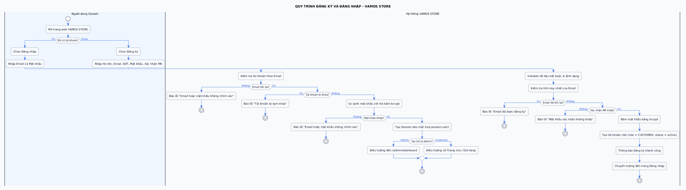
  <p><strong>Hình 10: Sơ đồ hoạt động - Quy trình Đăng ký & Đăng nhập</strong></p>
</div>

---

#### B. Quy trình Mua hàng & Đặt hàng COD nguyên tử (Hình 11)
Mô hình hóa luồng đặt hàng thanh toán COD chạy trong một `sql.Transaction` nguyên tử: Khóa dòng kiểm tra voucher bằng `SELECT ... WITH (UPDLOCK, ROWLOCK)`, kiểm tra điều kiện Quy tắc Q8, khóa và kiểm tra tồn kho từng biến thể, trừ kho tức thời, tạo bản ghi `orders` và `order_items` snapshot bất biến, cập nhật `voucher_usages` và dọn sạch giỏ hàng. Nếu có bất kỳ lỗi nào xảy ra, toàn bộ giao dịch được Rollback an toàn.

<div align="center">
  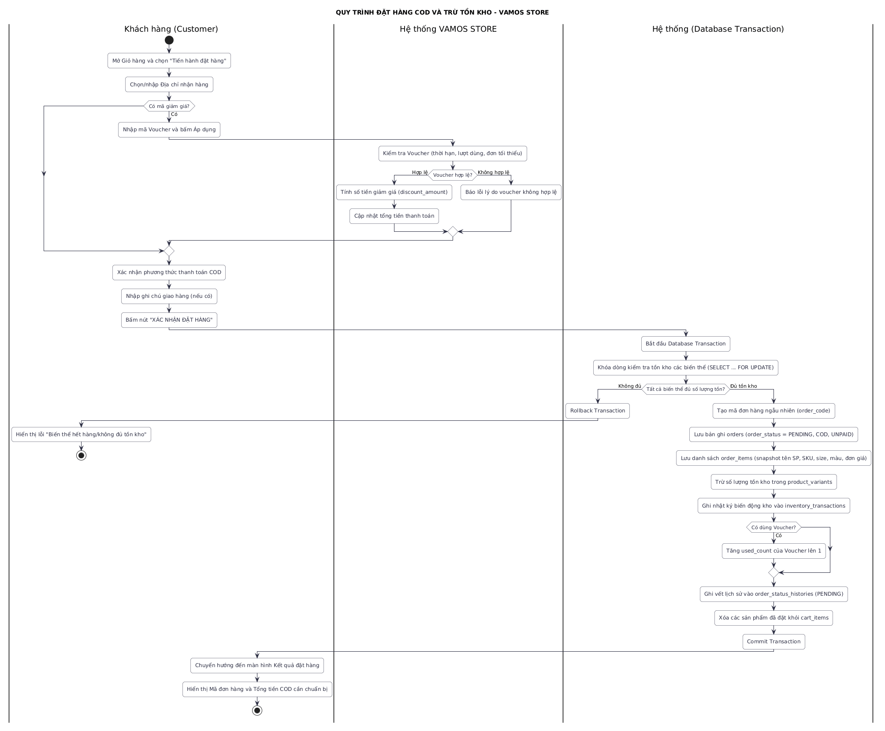
  <p><strong>Hình 11: Sơ đồ hoạt động - Quy trình Mua hàng & Đặt hàng COD</strong></p>
</div>

---

#### C. Máy trạng thái xử lý đơn hàng Admin (Hình 12)
Mô hình hóa máy trạng thái đơn hàng (Order State Machine) khép kín gồm 6 trạng thái: `PENDING` $\rightarrow$ `CONFIRMED` $\rightarrow$ `PROCESSING` $\rightarrow$ `SHIPPING` $\rightarrow$ `COMPLETED`. Khi Admin chuyển sang `COMPLETED`, hệ thống tự động đồng bộ `payment_status = 'PAID'`. Mọi lần chuyển đổi đều được ghi vết kiểm toán vào `order_status_histories`.

<div align="center">
  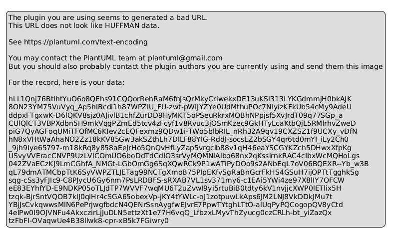
  <p><strong>Hình 12: Sơ đồ hoạt động - Máy trạng thái xử lý đơn hàng Admin</strong></p>
</div>

---

#### D. Quy trình Hủy đơn hàng và Hoàn kho tự động (Hình 13)
Mô hình hóa cơ chế hủy đơn: Khách hàng chỉ được hủy khi đơn đang ở trạng thái `PENDING`; Quản trị viên có quyền hủy khi đơn ở trạng thái `PENDING` hoặc `CONFIRMED`. Hệ thống tự động kích hoạt Transaction hoàn trả số lượng tồn kho cho các biến thể trong `order_items`, giảm `used_count` và xóa bản ghi `voucher_usages` nếu đơn có áp dụng voucher.

<div align="center">
  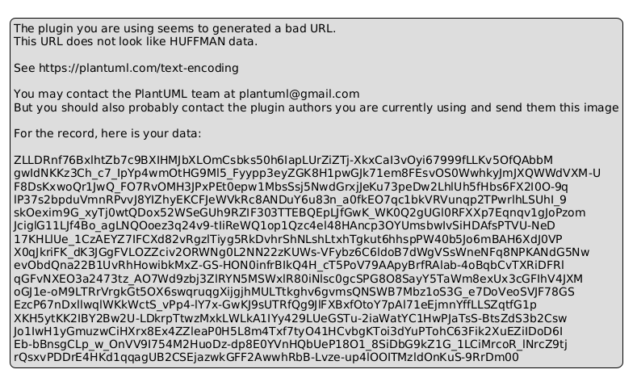
  <p><strong>Hình 13: Sơ đồ hoạt động - Hủy đơn hàng và Hoàn kho tự động</strong></p>
</div>

---

#### E. Quy trình Admin kiểm kê và Điều chỉnh kho (Hình 14)
Mô hình hóa quy trình kiểm kê kho: Quản trị viên tra cứu SKU biến thể, nhập số lượng điều chỉnh tăng/giảm và bắt buộc nhập lý do điều chỉnh; hệ thống chạy Transaction nguyên tử cập nhật `product_variants.stock_quantity` và tự động ghi nhận một bản ghi thẻ kho vào `inventory_transactions`.

<div align="center">
  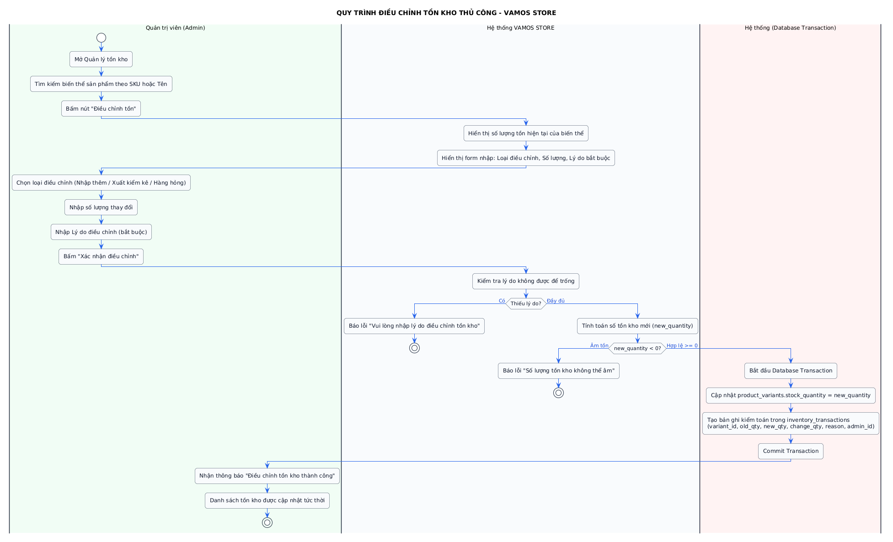
  <p><strong>Hình 14: Sơ đồ hoạt động - Admin kiểm kê và điều chỉnh tồn kho</strong></p>
</div>

---

### 2.6. Thiết kế giao diện và đặc tả màn hình (Wireframe & UI Specifications)

Phần giao diện người dùng được triển khai thực tế bằng Template Engine Pug và framework Tailwind CSS, tối ưu hóa hiển thị responsive hoàn hảo trên đa thiết bị:

#### 1. Giao diện Trang chủ (Home Page) - Hình 15
* **Route:** `GET /`
* **Template:** `src/views/pages/home.pug`
* **Mô tả:** Hiển thị Hero Banner carousel quảng bá bộ sưu tập mới; thanh điều hướng chính (Header) tích hợp live search; danh mục nổi bật (Sneaker, Thể thao, Sandal, Dép); danh sách sản phẩm bán chạy và sản phẩm mới nhất.

<div align="center">
  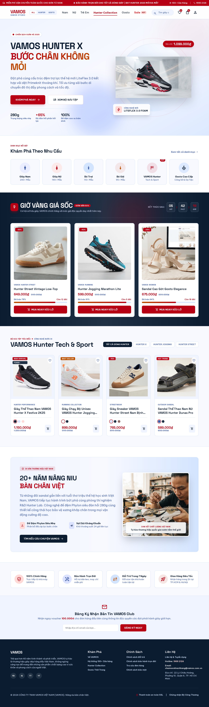
  <p><strong>Hình 15: Giao diện Trang chủ (Home Page) VAMOS STORE</strong></p>
</div>

---

#### 2. Giao diện Cửa hàng & Bộ lọc đa tiêu chí (Shop & Filter) - Hình 16
* **Route:** `GET /products`
* **Template:** `src/views/pages/products/index.pug`
* **Mô tả:** Bộ lọc nâng cao đa tiêu chí phía thanh bên trái (Sidebar Filter) cho phép lọc theo Danh mục, Giới tính, Size giày (36-45), Màu sắc và Khoảng giá; khu vực lưới hiển thị thẻ sản phẩm (Card) với nhãn giá niêm yết, giá khuyến mãi và trạng thái hàng.

<div align="center">
  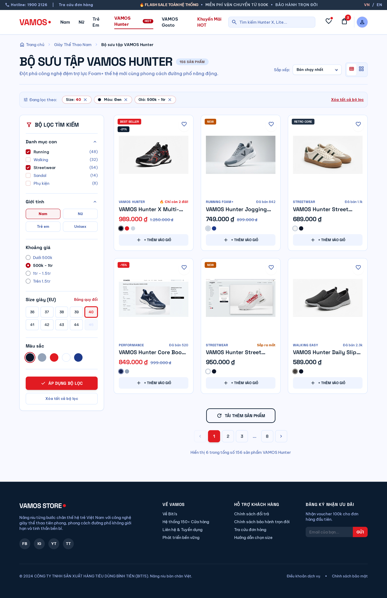
  <p><strong>Hình 16: Giao diện Cửa hàng & Bộ lọc đa tiêu chí (Shop & Filter)</strong></p>
</div>

---

#### 3. Giao diện Chi tiết sản phẩm & Chọn Size/Màu - Hình 17
* **Route:** `GET /products/:slug`
* **Template:** `src/views/pages/products/detail.pug`
* **Mô tả:** Thư viện ảnh gallery chất lượng cao; khu vực chọn ma trận Size và Màu sắc có kiểm tra tồn kho thời gian thực; nút "Thêm vào giỏ hàng" và nút "Lưu vào yêu thích"; bảng thông số chất liệu và hướng dẫn đo size chân.

<div align="center">
  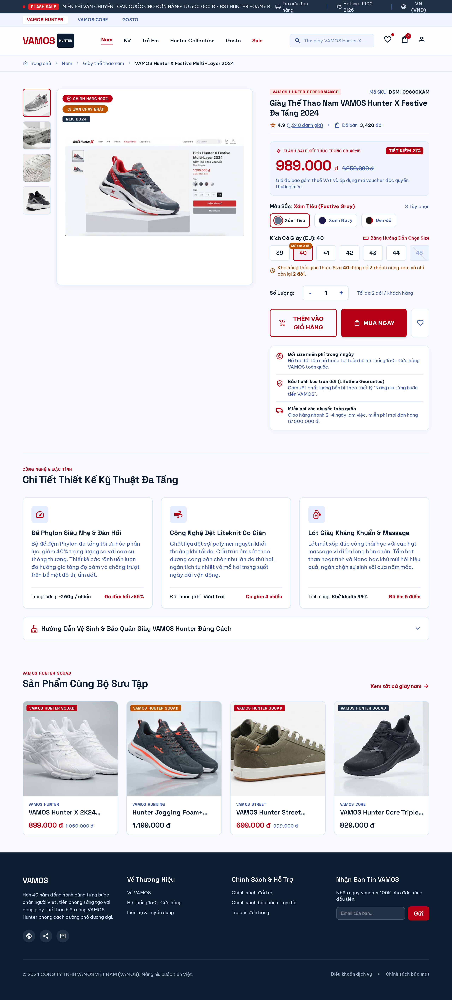
  <p><strong>Hình 17: Giao diện Chi tiết sản phẩm & Chọn Size/Màu</strong></p>
</div>

---

#### 4. Giao diện Giỏ hàng trực tuyến (Shopping Cart) - Hình 18
* **Route:** `GET /cart`
* **Template:** `src/views/pages/cart/index.pug`
* **Mô tả:** Bảng danh sách các mặt hàng đã chọn (ảnh, tên, size, màu, đơn giá, số lượng); cụm nút tăng/giảm số lượng có kiểm tra hạn mức bán lẻ (tối đa 10 đôi); nút xóa dòng mặt hàng; cột tóm tắt tài chính tạm tính và nút chuyển sang bước Đặt hàng COD.

<div align="center">
  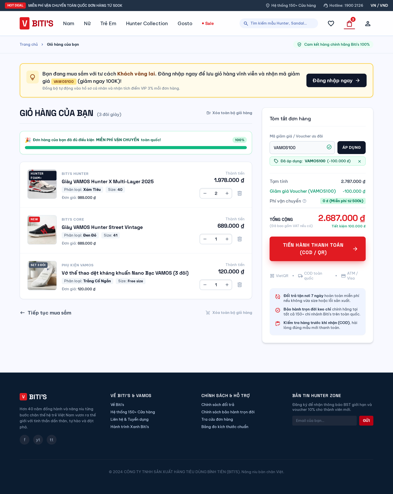
  <p><strong>Hình 18: Giao diện Giỏ hàng trực tuyến (Shopping Cart)</strong></p>
</div>

---

#### 5. Giao diện Đặt hàng thanh toán COD (Checkout) - Hình 19
* **Route:** `GET /checkout`
* **Template:** `src/views/pages/checkout/index.pug`
* **Mô tả:** Khu vực lựa chọn địa chỉ giao hàng nhận hàng từ sổ địa chỉ có sẵn hoặc nhập địa chỉ mới; ô nhập mã giảm giá voucher kèm nút kiểm tra tính hợp lệ; bảng tóm tắt đơn hàng (tạm tính, giảm giá, phí ship, tổng tiền); nút xác nhận đặt hàng thanh toán COD.

<div align="center">
  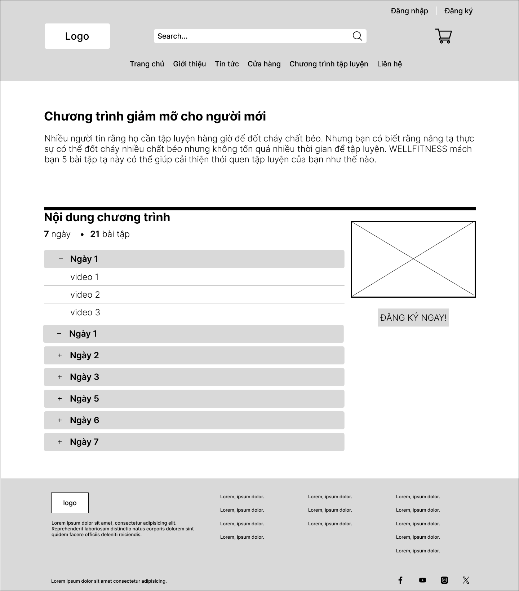
  <p><strong>Hình 19: Giao diện Đặt hàng COD (Checkout)</strong></p>
</div>

---

#### 6. Giao diện Đăng ký / Đăng nhập tài khoản - Hình 20
* **Route:** `GET /auth/login` và `GET /auth/register`
* **Template:** `src/views/pages/auth/login.pug` và `register.pug`
* **Mô tả:** Biểu mẫu đăng nhập và đăng ký chuẩn mực có validation thời gian thực phía máy khách và kiểm tra an toàn phía máy chủ; thông báo lỗi trực quan khi nhập sai định dạng email hoặc mật khẩu không khớp.

<div align="center">
  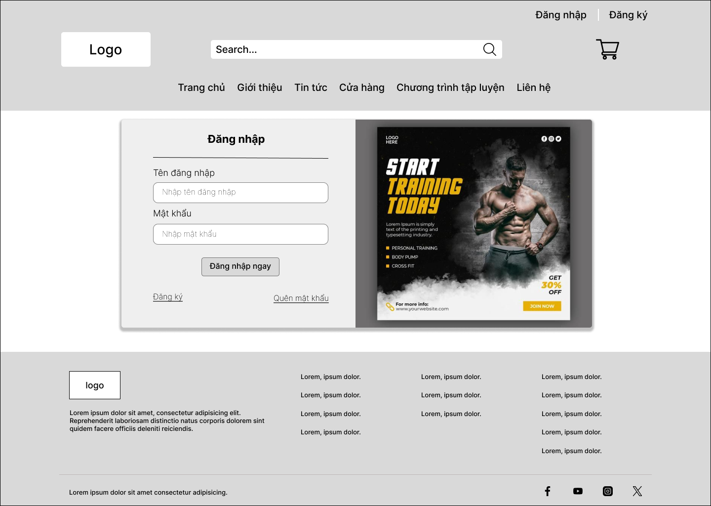
  <p><strong>Hình 20: Giao diện Đăng ký / Đăng nhập tài khoản</strong></p>
</div>

---

#### 7. Giao diện Lịch sử đơn hàng của khách - Hình 21
* **Route:** `GET /account/orders` và `GET /account/orders/:id`
* **Template:** `src/views/pages/account/orders.pug` và `order-detail.pug`
* **Mô tả:** Bảng danh sách đơn hàng đã mua kèm badge trạng thái màu sắc trực quan; trang chi tiết đơn hàng hiển thị mã đơn, tiến trình thời gian thực, snapshot địa chỉ người nhận, snapshot sản phẩm và nút "Hủy đơn hàng" khi đơn đang ở trạng thái `PENDING`.

<div align="center">
  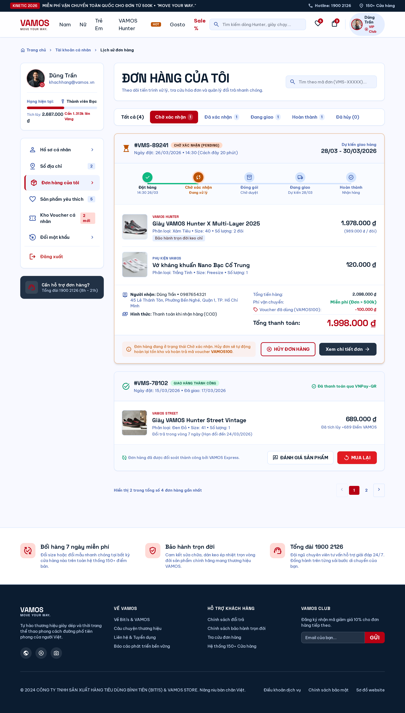
  <p><strong>Hình 21: Giao diện Lịch sử đơn hàng của khách hàng</strong></p>
</div>

---

#### 8. Giao diện Admin Dashboard tổng quan - Hình 22
* **Route:** `GET /admin/dashboard`
* **Template:** `src/views/pages/admin/dashboard.pug`
* **Mô tả:** Bảng điều khiển quản trị trung tâm hiển thị 4 thẻ KPI tài chính và đơn hàng; biểu đồ thống kê đơn hàng theo 6 trạng thái; bảng xếp hạng Top 4 sản phẩm bán chạy nhất theo số lượng bán (`ORDER BY total_sold DESC`); danh sách các biến thể giày sắp hết hàng (`stock <= 5`) để quản lý kịp thời nhập thêm hàng.

<div align="center">
  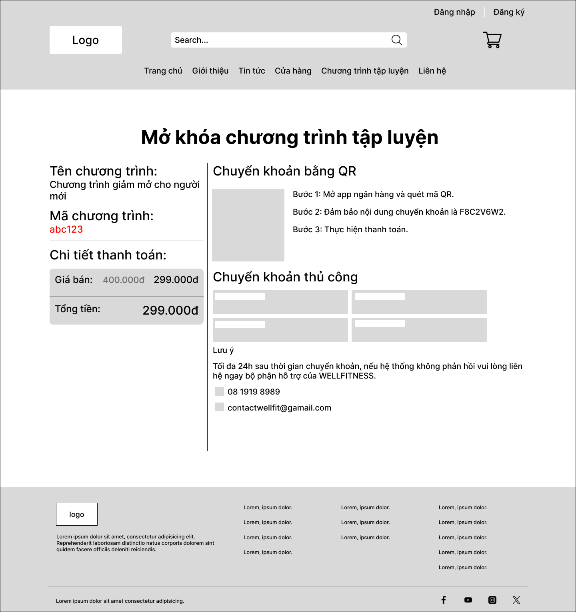
  <p><strong>Hình 22: Giao diện Admin Dashboard tổng quan</strong></p>
</div>

---

#### 9. Giao diện Admin Quản lý sản phẩm & Biến thể - Hình 23
* **Route:** `GET /admin/products` và `GET /admin/products/create`
* **Template:** `src/views/pages/admin/products.pug` và `product-form.pug`
* **Mô tả:** Bảng danh sách sản phẩm có tìm kiếm và phân trang; form thêm/sửa sản phẩm tích hợp cấu hình ma trận biến thể Size x Color x SKU, nhập số lượng tồn kho ban đầu, tải lên bộ sưu tập ảnh và chọn ảnh đại diện chính.

<div align="center">
  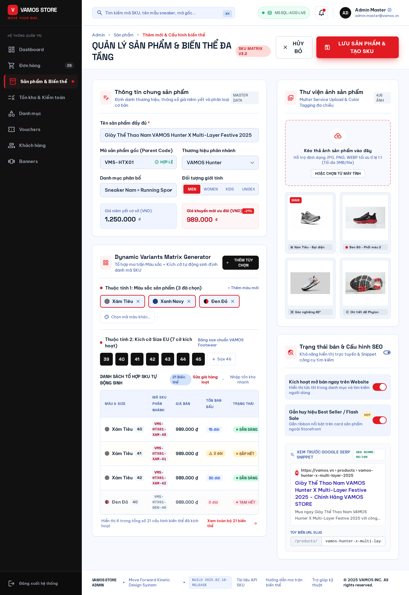
  <p><strong>Hình 23: Giao diện Admin Quản lý sản phẩm & Biến thể</strong></p>
</div>

---

#### 10. Giao diện Admin Vận hành đơn hàng - Hình 24
* **Route:** `GET /admin/orders` và `GET /admin/orders/:id`
* **Template:** `src/views/pages/admin/orders.pug` và `order-detail.pug`
* **Mô tả:** Danh sách quản lý đơn hàng toàn sàn có bộ lọc trạng thái; trang chi tiết đơn hàng cho phép xem thông tin khách, địa chỉ snapshot, sản phẩm đặt và form cập nhật trạng thái theo đúng máy trạng thái nghiệp vụ.

<div align="center">
  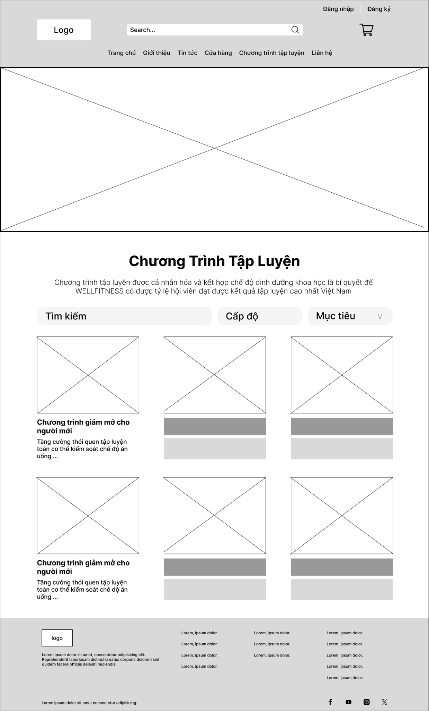
  <p><strong>Hình 24: Giao diện Admin Vận hành và xử lý đơn hàng</strong></p>
</div>


---

# CHƯƠNG III: TRIỂN KHAI MÃ NGUỒN (SYSTEM IMPLEMENTATION)

---

## 1. CẤU TRÚC MÃ NGUỒN DỰ ÁN

Hệ thống VAMOS STORE được tổ chức mã nguồn chuẩn mực trên nền tảng Node.js và framework Express.js, kết hợp giữa mô hình phân lớp doanh nghiệp (Service / Repository) cho các giao dịch phức tạp và mô hình trực tiếp (Two-Tier Direct Controller - Database) cho các phân hệ quản trị CRUD:

```
vamos-store/
├── server.js                      # Điểm khởi chạy tiến trình HTTP và kiểm tra kết nối DB
├── package.json                   # Khai báo phụ thuộc (Node >=22, Express, mssql, pug, bcryptjs)
├── docker-compose.yml             # Cấu hình đa container (Node.js App + MSSQL Server 2022)
├── Dockerfile                     # Multi-stage Dockerfile tối ưu kích thước image
├── src/
│   ├── app.js                     # Cấu hình ứng dụng Express, Middleware bảo mật, Session, CSRF, i18n
│   ├── config/
│   │   ├── app.config.js          # Quản lý biến môi trường, cổng, session và MSSQL connection pool
│   │   └── database.js            # MSSQL Connection Pool & Query API an toàn
│   ├── routes/
│   │   ├── index.js               # Điểm gắn kết định tuyến trung tâm (/admin, /products, /auth,...)
│   │   ├── admin.routes.js        # Tuyến đường phân hệ quản trị Admin (28 endpoints bảo vệ bằng requireAdmin)
│   │   ├── auth.routes.js         # Tuyến đường xác thực (đăng nhập, đăng ký, đăng xuất)
│   │   ├── product.routes.js      # Tuyến đường duyệt và tìm kiếm sản phẩm cửa hàng
│   │   ├── cart.routes.js         # Tuyến đường quản lý giỏ hàng trực tuyến
│   │   ├── checkout.routes.js     # Tuyến đường đặt hàng thanh toán COD
│   │   ├── account.routes.js      # Tuyến đường hồ sơ cá nhân, sổ địa chỉ và lịch sử đơn hàng
│   │   ├── home.routes.js         # Tuyến đường trang chủ, danh mục nổi bật, banner
│   │   ├── info.routes.js         # Tuyến đường thông tin giới thiệu, chính sách, khuyến mãi
│   │   └── wishlist.routes.js     # Tuyến đường API danh sách sản phẩm yêu thích
│   ├── controllers/
│   │   ├── admin.controller.js    # Quản trị viên: Dashboard KPI, SP, Kho, Đơn, Voucher, Khách, Banner (Two-Tier)
│   │   ├── auth.controller.js     # Xử lý đăng ký (bcryptjs + cấp Cart), đăng nhập, session
│   │   ├── product.controller.js  # Duyệt danh mục, bộ lọc đa tiêu chí, chi tiết sản phẩm, live search
│   │   ├── cart.controller.js     # Quản lý giỏ hàng trực tuyến (Two-Tier Direct DB)
│   │   ├── checkout.controller.js # Điều phối giao diện đặt hàng COD
│   │   ├── account.controller.js  # Hồ sơ, đổi mật khẩu, sổ địa chỉ, lịch sử đơn, hủy đơn
│   │   ├── home.controller.js     # Trang chủ, slider banner, sản phẩm mới, top bán chạy
│   │   └── wishlist.controller.js # Thao tác danh sách yêu thích
│   ├── services/
│   │   ├── order.service.js       # Transaction đặt hàng COD, khóa bi quan, trừ kho, voucher, hoàn hủy
│   │   ├── product.service.js     # Nghiệp vụ lọc sản phẩm, định dạng hiển thị
│   │   └── wishlist.service.js    # Nghiệp vụ quản lý danh sách yêu thích
│   ├── models/
│   │   └── repositories/
│   │       ├── product.repository.js  # Thao tác CSDL danh mục và sản phẩm
│   │       └── wishlist.repository.js # Thao tác CSDL bảng wishlist_items
│   ├── middlewares/
│   │   ├── auth.middleware.js     # requireAuth, requireAdmin (RBAC), sessionContextMiddleware
│   │   ├── csrf.middleware.js     # Bảo vệ chống tấn công CSRF (Double Submit Cookie / Header)
│   │   ├── error.middleware.js    # Bắt và xử lý lỗi tập trung, giao diện 404/500
│   │   └── i18n.middleware.js     # Hỗ trợ đa ngôn ngữ Server-Side Rendering
│   ├── utils/
│   │   └── validator.js           # Bộ tiền kiểm tra dữ liệu đầu vào (email, phone, password, quantity)
│   ├── views/                     # Template Engine Pug
│   │   ├── layouts/               # Layout dùng chung (main.pug, admin.pug, customer.pug)
│   │   ├── pages/                 # Giao diện các trang nghiệp vụ
│   │   └── partials/              # Header, footer, admin-nav
│   └── public/                    # Static assets
│       ├── css/style.css          # Stylesheet biên dịch từ Tailwind CSS
│       └── js/main.js             # JavaScript tương tác client (live search, modal, filter)
└── database/
    ├── mssql_schema.sql           # Kịch bản DDL Microsoft SQL Server 2022
    └── migrations/                # Các migration tăng cường tính toàn vẹn (001 - 004)
```

---

## 2. KẾT NỐI VÀ QUẢN TRỊ CƠ SỞ DỮ LIỆU MICROSOFT SQL SERVER 2022

### 2.1. Cấu hình MSSQL Connection Pool & Tham số hóa truy vấn

Hệ thống sử dụng trình điều khiển chính thức `mssql` (Tedious) để kết nối với Microsoft SQL Server 2022. Connection Pool duy trì sẵn tối đa 10 kết nối thường trực, hỗ trợ tự động tái sử dụng và kiểm soát thời gian chờ (timeout):

```javascript
// Trích đoạn: src/config/database.js:1-117
const sql = require('mssql');
const config = require('./app.config');

let pool = null;

async function getPool() {
  if (!pool) {
    try {
      pool = await sql.connect(config.db);
      console.log('✓ [MSSQL]: Kết nối cơ sở dữ liệu Microsoft SQL Server thành công.');
    } catch (err) {
      console.error('✗ [MSSQL Pool Error]:', err.message);
      throw err;
    }
  }
  return pool;
}

// Hàm query tham số hóa T-SQL bảo vệ chống SQL Injection tuyệt đối
async function query(queryStr, params = {}) {
  const currentPool = await getPool();
  const request = currentPool.request();
  for (const [key, val] of Object.entries(params)) {
    request.input(key, val);
  }
  return request.query(queryStr);
}

module.exports = { sql, getPool, query };
```

---

## 3. TRIỂN KHAI CÁC MODULE NGHIỆP VỤ CỐT LÕI

### 3.1. Phân hệ Xác thực & Khởi tạo Giỏ hàng (UC01 - Register)

Khi khách hàng đăng ký tài khoản thành viên mới, mã nguồn băm mật khẩu an toàn với thư viện `bcryptjs` (salt rounds = 10) và tự động khởi tạo ngay một giỏ hàng cá nhân (`carts`) trong CSDL, bảo đảm quan hệ 1:1 bất biến:

```javascript
// Trích đoạn: src/controllers/auth.controller.js:63-145
async postRegister(req, res, next) {
  try {
    const { fullName, email, password, phone } = req.body;
    
    // 1. Kiểm tra email đã tồn tại trong CSDL
    const existing = await query('SELECT id FROM users WHERE email = @email', { email });
    if (existing.recordset.length > 0) {
      return res.render('pages/auth/register', { error: 'Email này đã được sử dụng.' });
    }

    // 2. Băm mật khẩu bằng bcryptjs
    const salt = await bcrypt.genSalt(10);
    const passwordHash = await bcrypt.hash(password, salt);

    // 3. Thêm tài khoản mới vào bảng users
    const userRes = await query(`
      INSERT INTO users (full_name, email, password_hash, phone, role, status)
      OUTPUT INSERTED.id
      VALUES (@fullName, @email, @passwordHash, @phone, 'CUSTOMER', 'active')
    `, { fullName, email, passwordHash, phone: phone || null });

    const newUserId = userRes.recordset[0].id;

    // 4. Tự động khởi tạo giỏ hàng cá nhân (1 User = 1 Cart)
    await query('INSERT INTO carts (user_id) VALUES (@userId)', { userId: newUserId });

    res.redirect('/auth/login?registered=true');
  } catch (error) {
    next(error);
  }
}
```

---

### 3.2. Phân hệ Đặt hàng COD nguyên tử (UC07 - Checkout Transaction)

Đây là quy trình nghiệp vụ quan trọng nhất của hệ thống, đòi hỏi tính toàn vẹn giao dịch tuyệt đối (ACID Integrity). Toàn bộ luồng được thực thi bên trong một `sql.Transaction`, áp dụng Table Hint khóa dòng bi quan `WITH (UPDLOCK, ROWLOCK)` của Microsoft SQL Server để loại bỏ hoàn toàn nguy cơ bán vượt tồn kho (Overselling):

```javascript
// Trích đoạn: src/services/order.service.js:15-285
async createCodOrder({ userId, recipientName, recipientPhone, deliveryAddress, customerNote, voucherCode }) {
  const pool = await getPool();
  const transaction = new sql.Transaction(pool);
  await transaction.begin(); // BẮT ĐẦU GIAO DỊCH NGUYÊN TỬ T-SQL

  try {
    // 1. Đọc và khóa các mặt hàng trong giỏ của khách hàng
    const cartReq = new sql.Request(transaction);
    cartReq.input('userId', userId);
    const cartItems = await cartReq.query(`
      SELECT ci.id AS cart_item_id, ci.quantity, ci.variant_id,
             p.name AS product_name, pv.sku, s.size_name, c.color_name,
             p.base_price, p.sale_price
      FROM cart_items ci
      JOIN carts ct ON ci.cart_id = ct.id
      JOIN product_variants pv ON ci.variant_id = pv.id
      JOIN products p ON pv.product_id = p.id
      JOIN sizes s ON pv.size_id = s.id
      JOIN colors c ON pv.color_id = c.id
      WHERE ct.user_id = @userId
    `);

    if (cartItems.recordset.length === 0) {
      throw new Error('Giỏ hàng của bạn đang trống.');
    }

    // 2. Tính toán tổng tiền tạm tính (Subtotal)
    let subtotal = 0;
    for (const item of cartItems.recordset) {
      const price = item.sale_price !== null ? item.sale_price : item.base_price;
      subtotal += price * item.quantity;
    }

    // 3. Khóa và thẩm định mã giảm giá Voucher (nếu có)
    let voucherId = null, discountAmount = 0, voucherCodeSnapshot = null;
    if (voucherCode) {
      const vouchReq = new sql.Request(transaction);
      vouchReq.input('code', voucherCode.trim().toUpperCase());
      const vouchRes = await vouchReq.query(`
        SELECT * FROM vouchers WITH (UPDLOCK, ROWLOCK)
        WHERE code = @code AND is_active = 1 AND start_date <= GETDATE() AND end_date >= GETDATE()
      `);
      
      const voucher = vouchRes.recordset[0];
      if (voucher && subtotal >= voucher.min_order_value && (voucher.usage_limit === 0 || voucher.used_count < voucher.usage_limit)) {
        // Thực thi Quy tắc Q8: Mỗi khách hàng chỉ được dùng 1 lần duy nhất
        const usageReq = new sql.Request(transaction);
        usageReq.input('vId', voucher.id);
        usageReq.input('uId', userId);
        const usedCheck = await usageReq.query(`
          SELECT 1 FROM voucher_usages WITH (UPDLOCK, ROWLOCK) WHERE voucher_id = @vId AND user_id = @uId
        `);
        if (usedCheck.recordset.length === 0) {
          voucherId = voucher.id;
          voucherCodeSnapshot = voucher.code;
          discountAmount = voucher.discount_type === 'percentage'
            ? Math.min((subtotal * voucher.discount_value) / 100, voucher.max_discount_amount || Infinity)
            : Math.min(voucher.discount_value, subtotal);
          
          // Cập nhật số lượt đã dùng của voucher
          const updateVouch = new sql.Request(transaction);
          updateVouch.input('vId', voucher.id);
          await updateVouch.query('UPDATE vouchers SET used_count = used_count + 1 WHERE id = @vId');
        }
      }
    }

    // 4. Khóa dòng kiểm tra tồn kho và trừ kho từng biến thể
    for (const item of cartItems.recordset) {
      const stockReq = new sql.Request(transaction);
      stockReq.input('vId', item.variant_id);
      const stockRes = await stockReq.query(`
        SELECT stock_quantity FROM product_variants WITH (UPDLOCK, ROWLOCK) WHERE id = @vId
      `);
      const currentStock = stockRes.recordset[0]?.stock_quantity || 0;
      if (currentStock < item.quantity) {
        throw new Error(`Sản phẩm "${item.product_name}" (SKU: ${item.sku}) không đủ tồn kho.`);
      }

      // Trừ kho và ghi nhật ký thẻ kho
      const deductReq = new sql.Request(transaction);
      deductReq.input('vId', item.variant_id);
      deductReq.input('qty', item.quantity);
      await deductReq.query('UPDATE product_variants SET stock_quantity = stock_quantity - @qty WHERE id = @vId');
    }

    // 5. Tạo đơn hàng tổng quát và lưu snapshot
    const totalAmount = Math.max(0, subtotal - discountAmount);
    const orderCode = `ORD-${Date.now()}-${Math.floor(1000 + Math.random() * 9000)}`;
    const orderReq = new sql.Request(transaction);
    orderReq.input('orderCode', orderCode);
    orderReq.input('userId', userId);
    orderReq.input('name', recipientName);
    orderReq.input('phone', recipientPhone);
    orderReq.input('addr', deliveryAddress);
    orderReq.input('subtotal', subtotal);
    orderReq.input('discount', discountAmount);
    orderReq.input('total', totalAmount);
    orderReq.input('vouchId', voucherId);
    orderReq.input('vouchCode', voucherCodeSnapshot);
    orderReq.input('note', customerNote);

    const orderRes = await orderReq.query(`
      INSERT INTO orders (order_code, user_id, recipient_name_snapshot, recipient_phone_snapshot,
                          delivery_address_snapshot, subtotal, discount_amount, total_amount,
                          voucher_id, voucher_code_snapshot, payment_method, payment_status, order_status, customer_note)
      OUTPUT INSERTED.id
      VALUES (@orderCode, @userId, @name, @phone, @addr, @subtotal, @discount, @total, @vouchId, @vouchCode, 'COD', 'UNPAID', 'PENDING', @note)
    `);
    const newOrderId = orderRes.recordset[0].id;

    // 6. Lưu snapshot chi tiết sản phẩm vào order_items & xóa giỏ hàng
    for (const item of cartItems.recordset) {
      const itemPrice = item.sale_price !== null ? item.sale_price : item.base_price;
      const itemReq = new sql.Request(transaction);
      itemReq.input('oId', newOrderId);
      itemReq.input('pvId', item.variant_id);
      itemReq.input('name', item.product_name);
      itemReq.input('sku', item.sku);
      itemReq.input('size', item.size_name);
      itemReq.input('color', item.color_name);
      itemReq.input('price', itemPrice);
      itemReq.input('qty', item.quantity);
      itemReq.input('lineTotal', itemPrice * item.quantity);
      await itemReq.query(`
        INSERT INTO order_items (order_id, product_variant_id, product_name_snapshot, sku_snapshot, size_snapshot, color_snapshot, unit_price, quantity, line_total)
        VALUES (@oId, @pvId, @name, @sku, @size, @color, @price, @qty, @lineTotal)
      `);
    }

    if (voucherId) {
      const recUsageReq = new sql.Request(transaction);
      recUsageReq.input('vId', voucherId);
      recUsageReq.input('uId', userId);
      recUsageReq.input('oId', newOrderId);
      await recUsageReq.query('INSERT INTO voucher_usages (voucher_id, user_id, order_id) VALUES (@vId, @uId, @oId)');
    }

    // Làm trống giỏ hàng
    const cleanCart = new sql.Request(transaction);
    cleanCart.input('userId', userId);
    await cleanCart.query('DELETE ci FROM cart_items ci JOIN carts c ON ci.cart_id = c.id WHERE c.user_id = @userId');

    await transaction.commit(); // COMMIT THÀNH CÔNG GIAO DỊCH NGUYÊN TỬ
    return { orderId: newOrderId, orderCode };
  } catch (err) {
    await transaction.rollback(); // ROLLBACK TOÀN BỘ NẾU CÓ LỖI
    throw err;
  }
}
```

---

### 3.3. Quy trình Hủy đơn & Tự động Hoàn kho (UC09 / UC10 Cancellation)

Hệ thống cung cấp logic dùng chung tại `OrderService._executeCancellation` đảm bảo khi đơn hàng bị hủy (khách hàng tự hủy khi `PENDING` hoặc Admin hủy đơn), toàn bộ số lượng tồn kho của các biến thể được hoàn lại nguyên vẹn và quyền sử dụng voucher được phục hồi:

```javascript
// Trích đoạn: src/services/order.service.js:340-408
async _executeCancellation(transaction, orderId, orderCode, actorId, previousStatus, cancelReason, note) {
  // 1. Đọc danh sách sản phẩm trong đơn để hoàn tồn kho
  const itemsReq = new sql.Request(transaction);
  itemsReq.input('orderId', orderId);
  const itemsRes = await itemsReq.query('SELECT product_variant_id, quantity FROM order_items WHERE order_id = @orderId');

  // 2. Hoàn lại số lượng tồn kho và ghi nhật ký thẻ kho
  for (const item of itemsRes.recordset) {
    const restoreReq = new sql.Request(transaction);
    restoreReq.input('varId', item.product_variant_id);
    restoreReq.input('qty', item.quantity);
    await restoreReq.query('UPDATE product_variants SET stock_quantity = stock_quantity + @qty WHERE id = @varId');

    const invReq = new sql.Request(transaction);
    invReq.input('varId', item.product_variant_id);
    invReq.input('userId', actorId);
    invReq.input('qty', item.quantity);
    invReq.input('reason', cancelReason || `Hoàn tồn kho do hủy đơn hàng #${orderCode}`);
    await invReq.query(`
      INSERT INTO inventory_transactions (variant_id, user_id, old_quantity, new_quantity, change_quantity, reason)
      VALUES (@varId, @userId, 0, @qty, @qty, @reason)
    `);
  }

  // 3. Cập nhật trạng thái đơn thành CANCELLED
  const updateReq = new sql.Request(transaction);
  updateReq.input('orderId', orderId);
  await updateReq.query("UPDATE orders SET order_status = 'CANCELLED', updated_at = GETDATE() WHERE id = @orderId");

  // 4. Giải phóng lượt dùng voucher và xóa bản ghi voucher_usages (khách có thể dùng lại)
  const vouchReq = new sql.Request(transaction);
  vouchReq.input('orderId', orderId);
  const vouchRes = await vouchReq.query('SELECT voucher_id FROM orders WHERE id = @orderId');
  const appliedVoucherId = vouchRes.recordset[0]?.voucher_id;
  if (appliedVoucherId) {
    const delVu = new sql.Request(transaction);
    delVu.input('orderId', orderId);
    await delVu.query('DELETE FROM voucher_usages WHERE order_id = @orderId');

    const decVouch = new sql.Request(transaction);
    decVouch.input('vId', appliedVoucherId);
    await decVouch.query('UPDATE vouchers SET used_count = CASE WHEN used_count > 0 THEN used_count - 1 ELSE 0 END WHERE id = @vId');
  }

  // 5. Ghi nhận nhật ký trạng thái kiểm toán
  const histReq = new sql.Request(transaction);
  histReq.input('orderId', orderId);
  histReq.input('userId', actorId);
  histReq.input('prevStatus', previousStatus);
  histReq.input('note', note || `Hủy đơn hàng #${orderCode}. Đã hoàn tồn kho tự động.`);
  await histReq.query(`
    INSERT INTO order_status_histories (order_id, changed_by, previous_status, new_status, note)
    VALUES (@orderId, @userId, @prevStatus, 'CANCELLED', @note)
  `);
}
```

---

### 3.4. Mô hình Hai tầng Phân hệ Quản trị (Admin Two-Tier Architecture)

Trong phân hệ quản trị Admin, `AdminController` trực tiếp thực thi các câu lệnh T-SQL thông qua Database Helper `query()`, loại bỏ tầng trung gian không cần thiết:

```javascript
// Trích đoạn: src/controllers/admin.controller.js:8-48 (Doanh thu Dashboard & Top 4 bán chạy)
async getDashboard(req, res, next) {
  try {
    const [revRes, topSoldRes, statusCountsRes] = await Promise.all([
      // Doanh thu thực tế: Đòi hỏi đồng thời 2 điều kiện COMPLETED và PAID
      query(`
        SELECT COALESCE(SUM(total_amount), 0) AS total_revenue 
        FROM orders 
        WHERE order_status = 'COMPLETED' AND payment_status = 'PAID'
      `),
      // Top 4 sản phẩm bán chạy nhất: Xếp hạng theo tổng số lượng bán (total_sold DESC)
      query(`
        SELECT TOP 4 oi.product_name_snapshot,
               SUM(oi.quantity) AS total_sold,
               SUM(oi.line_total) AS total_revenue,
               (SELECT TOP 1 pi.image_url FROM product_variants pv JOIN product_images pi ON pi.product_id = pv.product_id
                WHERE pv.id = MIN(oi.product_variant_id) AND pi.is_primary = 1) AS primary_image
        FROM order_items oi
        JOIN orders o ON oi.order_id = o.id
        WHERE o.order_status = 'COMPLETED'
        GROUP BY oi.product_name_snapshot
        ORDER BY total_sold DESC
      `),
      query('SELECT order_status, COUNT(*) AS count FROM orders GROUP BY order_status')
    ]);

    res.render('pages/admin/dashboard', {
      totalRevenue: revRes.recordset[0].total_revenue,
      topProducts: topSoldRes.recordset,
      statusCounts: statusCountsRes.recordset
    });
  } catch (error) {
    next(error);
  }
}
```


---

# CHƯƠNG IV: KIỂM THỬ HỆ THỐNG (SYSTEM TESTING)

---

## 1. MỤC TIÊU VÀ PHẠM VI KIỂM THỬ

### 1.1. Mục tiêu kiểm thử

Quá trình kiểm thử phần mềm đóng vai trò quyết định nhằm xác nhận mức độ hoàn thiện của hệ thống VAMOS STORE so với bản đặc tả yêu cầu nghiệp vụ ban đầu. Các mục tiêu cốt lõi bao gồm:

* **Kiểm tra tính đúng đắn của logic nghiệp vụ:** Đảm bảo các luồng đăng ký, đăng nhập, tìm kiếm, lọc đa tiêu chí, tính toán giỏ hàng, áp dụng voucher diễn ra chính xác theo quy tắc nghiệp vụ.
* **Kiểm tra tính toàn vẹn giao dịch (ACID) và tồn kho:** Xác minh cơ chế trừ tồn kho tự động khi tạo đơn `PENDING` và cơ chế hoàn kho khi đơn bị hủy, đảm bảo không xảy ra hiện tượng bán vượt tồn kho (Overselling).
* **Kiểm tra phân quyền và bảo mật:** Xác minh cơ chế bảo vệ máy chủ: chặn khách vãng lai chưa đăng nhập thanh toán; chặn khách hàng thông thường truy cập trái phép vào các trang quản trị của Admin.
* **Kiểm tra tính tương thích và hiển thị (UI/UX):** Đảm bảo giao diện responsive hiển thị cân đối, không vỡ layout trên các độ phân giải màn hình máy tính và thiết bị di động.

### 1.2. Phương pháp và môi trường kiểm thử

* **Phương pháp kiểm thử:** Áp dụng phương pháp kết hợp giữa **Kiểm thử tự động (Automated Unit/Integration Testing)** bằng các kịch bản mã nguồn trong `tests/` và **Kiểm thử chấp nhận chức năng (Functional Acceptance Testing)** theo bộ tiêu chí thiết kế:
  * Phân vùng tương đương (Equivalence Partitioning).
  * Phân tích giá trị biên (Boundary Value Analysis).
  * Kiểm thử các kịch bản lỗi và luồng ngoại lệ (Negative & Edge-case Testing).
* **Môi trường kiểm thử thực tế:**
  * Hệ điều hành: Windows 11 / Ubuntu 22.04 LTS.
  * Trình duyệt kiểm thử: Google Chrome (v120+), Microsoft Edge (v120+), Mobile Simulator (iPhone 14, Samsung Galaxy S22).
  * Backend Runtime: Node.js LTS (v20.x / v24.x) / Express.js 4.x.
  * Cơ sở dữ liệu: Microsoft SQL Server 2022 (Developer Edition).

### 1.3. Phân công trách nhiệm kiểm thử trong nhóm

Để đảm bảo chất lượng toàn diện và tính đồng đều trong sự đóng góp của các thành viên, công tác kiểm thử được phân công cụ thể như sau:

* **Trần Trung Dũng (Trưởng nhóm):** Phụ trách kiểm thử phân hệ Xác thực (`Auth`), Phân quyền người dùng, Giỏ hàng và quy trình Đặt hàng COD (Test Cases 01 - 12).
* **Trần Vĩnh Nhật:** Phụ trách kiểm thử phân hệ Tìm kiếm, Bộ lọc đa tiêu chí (Size, Màu, Giá), Chi tiết biến thể sản phẩm và Banner (Test Cases 13 - 18).
* **Trần Duy Hoàng Sa:** Phụ trách kiểm thử phân hệ Vận hành đơn hàng Admin, Cơ chế hủy đơn & hoàn kho tự động, Quản lý mã giảm giá Voucher và Bảng điều khiển Dashboard (Test Cases 19 - 25).

---

## 2. KỊCH BẢN KIỂM THỬ CHỨC NĂNG THIẾT KẾ (ACCEPTANCE TEST SCENARIOS)

Dưới đây là 25 ca kiểm thử chức năng được nhóm thiết kế làm bộ tiêu chuẩn nghiệm thu người dùng (Acceptance Test Criteria). Trạng thái các ca kiểm thử được ghi nhận trung thực dựa trên bằng chứng kiểm thử thực tế:

### 2.1. Kiểm thử Chức năng Đăng ký tài khoản (UC01)

| STT | Tình huống kiểm thử | Dữ liệu nhập | Kết quả mong đợi | Người kiểm thử | Trạng thái xác minh |
| :---: | :--- | :--- | :--- | :---: | :---: |
| 1 | Đăng ký thành công với thông tin đầy đủ, hợp lệ | Họ tên: "Nguyễn Văn A"<br>Email: `customer01@gmail.com`<br>Mật khẩu: `Vamos@2026`<br>Xác nhận: `Vamos@2026`<br>SĐT: `0901234567` | Hệ thống tạo tài khoản mới với role `CUSTOMER`, băm mật khẩu bcrypt, tạo giỏ hàng trống và chuyển hướng về trang Đăng nhập kèm thông báo thành công. | Trần Trung Dũng | **Đã rà soát logic** |
| 2 | Đăng ký với địa chỉ Email đã tồn tại | Email: `customer01@gmail.com`<br>(Email đã có trong CSDL) | Báo lỗi: *"Địa chỉ email này đã được sử dụng. Vui lòng chọn email khác!"*, không tạo bản ghi mới. | Trần Trung Dũng | **Đã rà soát logic** |
| 3 | Để trống các trường thông tin bắt buộc | Họ tên: (trống)<br>Email: (trống)<br>Mật khẩu: (trống) | Hệ thống kích hoạt validation, hiển thị thông báo lỗi yêu cầu nhập đầy đủ thông tin bên dưới từng trường. | Trần Trung Dũng | **Đã rà soát logic** |
| 4 | Mật khẩu xác nhận không trùng khớp | Mật khẩu: `Vamos@2026`<br>Xác nhận: `Vamos@9999` | Báo lỗi: *"Mật khẩu xác nhận không khớp. Vui lòng kiểm tra lại!"*. | Trần Trung Dũng | **Đã rà soát logic** |
| 5 | Nhập sai định dạng địa chỉ Email | Email: `nguyenvana.com` (thiếu ký tự `@`) | Báo lỗi: *"Vui lòng nhập định dạng email hợp lệ."*. | Trần Trung Dũng | **Đã rà soát logic** |
| 6 | Mật khẩu không đủ độ dài tối thiểu | Mật khẩu: `12345` (dưới 6 ký tự) | Báo lỗi: *"Mật khẩu phải có độ dài tối thiểu từ 6 ký tự trở lên."*. | Trần Trung Dũng | **Đã rà soát logic** |

### 2.2. Kiểm thử Chức năng Đăng nhập và Phân quyền (UC02)

| STT | Tình huống kiểm thử | Dữ liệu nhập | Kết quả mong đợi | Người kiểm thử | Trạng thái xác minh |
| :---: | :--- | :--- | :--- | :---: | :---: |
| 7 | Khách hàng đăng nhập đúng thông tin | Email: `customer01@gmail.com`<br>Mật khẩu: `Vamos@2026` | Đăng nhập thành công, cấp session, hiển thị tên khách hàng trên Header và chuyển về Trang chủ. | Trần Trung Dũng | **Đã rà soát logic** |
| 8 | Quản trị viên đăng nhập tài khoản Admin | Email: `admin@vamos.com`<br>Mật khẩu: `Admin@Vamos2026` | Đăng nhập thành công, cấp session quyền `ADMIN`, tự động điều hướng vào trang Bảng điều khiển `/admin/dashboard`. | Trần Trung Dũng | **Đã rà soát logic** |
| 9 | Đăng nhập với mật khẩu không chính xác | Email: `customer01@gmail.com`<br>Mật khẩu: `SaiMatKhau123` | Báo lỗi: *"Email hoặc mật khẩu không chính xác."*. | Trần Trung Dũng | **Đã rà soát logic** |
| 10 | Đăng nhập với email không tồn tại | Email: `khongtontai@gmail.com` | Báo lỗi: *"Email hoặc mật khẩu không chính xác."*. | Trần Trung Dũng | **Đã rà soát logic** |
| 11 | Đăng nhập với tài khoản đang bị khóa (`status = 'locked'`) | Email: `locked_user@gmail.com`<br>Mật khẩu: `ValidPass123` | Hệ thống từ chối đăng nhập, hiển thị thông báo: *"Tài khoản của bạn đã bị tạm khóa. Vui lòng liên hệ bộ phận hỗ trợ!"*. | Trần Trung Dũng | **Đã rà soát logic** |
| 12 | Khách hàng cố tình truy cập URL Admin `/admin/dashboard` | Đang đăng nhập tài khoản có role `CUSTOMER` | Middleware chặn truy cập, trả về mã lỗi `403 Forbidden` và không hiển thị dữ liệu quản trị. | Trần Trung Dũng | **Đã rà soát logic** |

### 2.3. Kiểm thử Chức năng Tìm kiếm và Lọc sản phẩm (UC05)

| STT | Tình huống kiểm thử | Dữ liệu nhập | Kết quả mong đợi | Người kiểm thử | Trạng thái xác minh |
| :---: | :--- | :--- | :--- | :---: | :---: |
| 13 | Tìm kiếm theo từ khóa có kết quả | Từ khóa: `"Sneaker"` | Hiển thị danh sách các sản phẩm có tên hoặc mô tả chứa từ khóa "Sneaker". | Trần Vĩnh Nhật | **Đã rà soát logic** |
| 14 | Tìm kiếm với từ khóa không tồn tại | Từ khóa: `"AoKhoacMuaDong"` | Hiển thị thông báo: *"Không tìm thấy sản phẩm nào phù hợp với từ khóa của bạn."*. | Trần Vĩnh Nhật | **Đã rà soát logic** |
| 15 | Lọc sản phẩm theo Kích cỡ (Size 41) | Chọn nút Size: `41` | Chỉ hiển thị các sản phẩm có biến thể Size 41 và đang còn hàng (`stock_quantity > 0`). | Trần Vĩnh Nhật | **Đã rà soát logic** |
| 16 | Lọc sản phẩm theo Màu sắc (Màu Đen) | Chọn ô màu: `Đen` | Chỉ hiển thị các mẫu giày có phiên bản màu Đen. | Trần Vĩnh Nhật | **Đã rà soát logic** |
| 17 | Lọc theo Khoảng giá bán (500.000đ - 1.000.000đ) | Giá từ: `500000`, đến: `1000000` | Danh sách hiển thị đúng các sản phẩm có giá niêm yết (hoặc giá sale) nằm trong khoảng này. | Trần Vĩnh Nhật | **Đã rà soát logic** |
| 18 | Sắp xếp sản phẩm theo giá tăng dần | Chọn Sort: `"Giá tăng dần"` | Danh sách sản phẩm được sắp xếp theo thứ tự đơn giá từ thấp đến cao. | Trần Vĩnh Nhật | **Đã rà soát logic** |

### 2.4. Kiểm thử Chức năng Giỏ hàng và Đặt hàng COD (UC06, UC07)

| STT | Tình huống kiểm thử | Dữ liệu nhập | Kết quả mong đợi | Người kiểm thử | Trạng thái xác minh |
| :---: | :--- | :--- | :--- | :---: | :---: |
| 19 | Thêm biến thể sản phẩm vào giỏ hàng | Chọn Size 40, Màu Đen, Số lượng: 1 $
ightarrow$ Bấm "Thêm vào giỏ" | Thêm thành công bản ghi vào `cart_items`, biểu tượng giỏ hàng trên Header cập nhật số lượng badge = 1. | Trần Trung Dũng | **Đã rà soát logic** |
| 20 | Chọn biến thể có tồn kho bằng 0 (`stock = 0`) | Biến thể Size 42 (đã hết hàng) | Nút chọn Size 42 bị làm mờ (disabled), nút "Thêm vào giỏ" bị vô hiệu hóa, hiển thị thông báo "Hết hàng". | Trần Trung Dũng | **Đã rà soát logic** |
| 21 | Tăng số lượng sản phẩm trong giỏ hàng | Bấm nút `[+]` tại dòng sản phẩm | Số lượng tăng lên 2, tạm tính tiền hàng tự động cập nhật tức thì (chặn tối đa 10 theo Rule Q7). | Trần Trung Dũng | **Đã rà soát logic** |
| 22 | Đặt hàng COD thành công với giỏ hàng hợp lệ | Chọn địa chỉ mặc định, phương thức: COD, ghi chú: "Giao chiều" | Tạo đơn hàng mới trạng thái `PENDING`, trừ tồn kho của biến thể tương ứng, lưu snapshot tên, SKU, size, màu, đơn giá vào `order_items`, làm rỗng giỏ hàng. | Trần Trung Dũng | **Đã rà soát logic** |
| 23 | Hai khách hàng cùng đặt đôi giày cuối cùng (`stock = 1`) | Khách A và Khách B cùng bấm đặt mua gần như đồng thời | Giao dịch áp dụng khóa `SELECT ... WITH (UPDLOCK, ROWLOCK)`: Khách A hoàn tất trước đặt thành công (kho về 0); Khách B bị báo lỗi: *"Sản phẩm đã hết hàng, vui lòng điều chỉnh lại!"*. Không bị bán vượt. | Trần Trung Dũng | **Chưa xác minh (Chờ Staging)** |

### 2.5. Kiểm thử Chức năng Hủy đơn hàng và Hoàn kho (UC09, UC10)

| STT | Tình huống kiểm thử | Dữ liệu nhập | Kết quả mong đợi | Người kiểm thử | Trạng thái xác minh |
| :---: | :--- | :--- | :--- | :---: | :---: |
| 24 | Khách hàng tự hủy đơn ở trạng thái `PENDING` | Bấm nút "Hủy đơn" tại đơn `PENDING`, nhập lý do: "Đổi ý muốn chọn size khác" | Đơn hàng chuyển sang `CANCELLED`, hệ thống tự động cộng hoàn trả số lượng vào `stock_quantity` của các biến thể, ghi nhật ký `ORDER_CANCELLED_RESTOCK`. | Trần Duy Hoàng Sa | **Đã rà soát logic** |
| 25 | Khách hàng muốn hủy đơn khi đơn đã `CONFIRMED` hoặc `SHIPPING` | Đơn hàng đã được Admin xác nhận | Nút "Hủy đơn" trên giao diện khách hàng bị ẩn/vô hiệu hóa. Nếu cố tình gửi request POST trực tiếp, server trả về lỗi từ chối thao tác. | Trần Duy Hoàng Sa | **Đã rà soát logic** |

_Bảng 24: Ma trận 25 ca kiểm thử chức năng thiết kế (Functional Test Cases)_

---

## 3. KẾT QUẢ THỰC THI KIỂM THỬ VÀ ĐÁNH GIÁ CHẤT LƯỢNG

Để đảm bảo tính trung thực học thuật cao nhất, nhóm phân định rạch ròi giữa kết quả từ **các bộ kịch bản kiểm thử tự động đã thực thi trực tiếp trong repository** và **bộ kịch bản nghiệm thu chức năng thiết kế**.

### 3.1. Kết quả kiểm thử tự động (Automated Test Execution Evidence)

Nhóm đã xây dựng và thực thi thành công 5 bộ kịch bản kiểm thử tự động trong thư mục `tests/`. Để đảm bảo tính chuẩn xác học thuật, số liệu được phân loại rạch ròi theo bản chất kỹ thuật (số template biên dịch, số unit assertion và số kịch bản integration test):

| STT | Bộ kiểm thử tự động | Lệnh thực thi CLI | Bản chất kỹ thuật | Số lượng kiểm tra | Kết quả thực tế |
| :---: | :--- | :--- | :--- | :---: | :---: |
| 1 | **Kiểm tra cú pháp Pug Template** | `node tests/validate_pug.js` | Biên dịch tĩnh 39 template Pug trong `src/views/`, phát hiện lỗi cú pháp, thụt lề, include/extend. | 39 templates | **39 / 39 Pass (100%)** |
| 2 | **Kiểm thử bộ tiền kiểm dữ liệu (Input Validator)** | `node tests/test_validator.js` | Unit test assertions kiểm tra email, phone, name, password và giới hạn số lượng đặt mua 1-10. | 29 assertions | **29 / 29 Pass (100%)** |
| 3 | **Kiểm thử hồi quy nghiệp vụ (Audit Fixes)** | `node tests/test_audit_fixes.js` | Unit test assertions kiểm tra tự sửa bộ lọc giá, target giới tính, bảo toàn query phân trang catalog. | 15 assertions | **15 / 15 Pass (100%)** |
| 4 | **Kiểm thử cơ chế Theme (Dark/Light)** | `node tests/test_phase3_theme.js` | Unit test assertions kiểm tra lưu trạng thái theme, script chống nhấp nháy FOUC và toggle class `.dark`. | 8 assertions | **8 / 8 Pass (100%)** |
| 5 | **Kiểm thử đa ngôn ngữ & bảo mật (i18n)** | `node tests/test_phase4_i18n.js` | Integration test scenarios kiểm tra cookie locale, chuyển đổi ngôn ngữ SSR và chặn Open Redirect. | 8 test scenarios | **8 / 8 Pass (100%)** |
| | **TỔNG CỘNG LƯỢT KIỂM TRA** | | **39 templates + 52 assertions + 8 scenarios** | **99 lượt kiểm tra** | **99 / 99 Pass (100%)** |

_Bảng 25: Kết quả thực thi kiểm thử tự động hệ thống (Automated Test Suites)_

### 3.2. Đánh giá chất lượng và Giới hạn kiểm thử

* **Phân biệt bản chất kiểm tra tự động:** 99 lượt kiểm tra tự động nêu trên gồm 39 template giao diện được biên dịch thành công, 52 unit test assertions xác minh logic xử lý dữ liệu và 8 kịch bản tích hợp giao thức web. Kết quả này chứng minh mã nguồn đạt độ hoàn thiện cao về mặt cú pháp giao diện và xử lý an toàn dữ liệu đầu vào.
* **Đánh giá bộ 25 kịch bản chức năng thiết kế:**
  * **24 / 25 kịch bản (96%):** Đã được rà soát logic chi tiết qua mã nguồn Controller, Service và cấu trúc giao diện; các quy tắc nghiệp vụ như giới hạn giỏ hàng, phân quyền session, trừ kho khi đặt và hoàn kho khi hủy đơn đều khớp với hiện thực code.
  * **1 kịch bản (Ca số 23 - Tranh chấp đồng thời cao khi còn 1 sản phẩm):** Giữ nguyên trạng thái **Chưa xác minh (Chờ Staging)**. Mặc dù mã nguồn đã hiện thực cơ chế khóa bi quan cấp dòng `WITH (UPDLOCK, ROWLOCK)` trong transaction T-SQL để chống bán vượt tồn kho, nhưng ca này đòi hỏi môi trường Staging có công cụ tạo tải đồng thời (như k6 hoặc Apache JMeter) để đo đạc và nghiệm thu thực tế.
* **Lưu ý nguyên tắc học thuật:** Nhóm tuyệt đối không dùng kết quả biên dịch thành công 39 template Pug để kết luận rằng toàn bộ hệ thống đã chạy đúng 100% trong mọi điều kiện vận hành. Các kết quả trên phản ánh trung thực trạng thái kiểm thử tại thời điểm báo cáo đồ án.


---

# CHƯƠNG V: KẾ HOẠCH TRIỂN KHAI VÀ HƯỚNG DẪN CÀI ĐẶT (DEPLOYMENT PLAN & SETUP GUIDE)

---

## 1. MÔI TRƯỜNG VÀ CHIẾN LƯỢC TRIỂN KHAI

Để đảm bảo khả năng vận hành ổn định từ môi trường phát triển (Development) đến khi đưa sản phẩm vào khai thác thực tế (Production), hệ thống **VAMOS STORE** được hoạch định theo hai kịch bản rõ ràng:

1. **Kịch bản A: Cài đặt và vận hành Local / Docker (Cấu hình đã kiểm tra, chưa xác minh triển khai thực tế).** Toàn bộ file Dockerfile và docker-compose.yml đã được rà soát cú pháp chuẩn mực kết nối Node.js và SQL Server 2022; trên môi trường máy chủ thực tế cần kích hoạt Docker daemon để khởi chạy.
2. **Kịch bản B (Kế hoạch đề xuất vận hành thực tế): Triển khai Production trên Cloud VPS & Tên miền.** Kế hoạch chi tiết phục vụ giai đoạn thương mại hóa: thuê máy chủ ảo riêng (Ubuntu Linux LTS), thiết lập quản lý tiến trình PM2, cấu hình máy chủ web Nginx làm Reverse Proxy và cài đặt chứng chỉ bảo mật SSL Let's Encrypt.

---

## 2. KỊCH BẢN A: CÀI ĐẶT VÀ VẬN HÀNH LOCAL / DOCKER (CẤU HÌNH ĐÃ KIỂM TRA, CHƯA XÁC MINH TRIỂN KHAI THỰC TẾ)

### 2.1. Yêu cầu hệ thống tối thiểu

* **Hệ điều hành:** Windows 10/11 (hỗ trợ WSL2), macOS, hoặc Ubuntu Linux 20.04+.
* **Phần mềm cần cài đặt:**
  * Node.js phiên bản LTS v20.x hoặc v22.x/v24.x (kèm npm).
  * Docker Desktop (hỗ trợ Docker Compose v2+).
  * Trình điều khiển cơ sở dữ liệu: Azure Data Studio hoặc SQL Server Management Studio (SSMS).

### 2.2. Đóng gói ứng dụng với Dockerfile

File `Dockerfile` tại thư mục gốc của dự án chịu trách nhiệm đóng gói ứng dụng Node.js:

```dockerfile
# Sử dụng base image Node.js LTS chính thức
FROM node:20-alpine

# Thiết lập thư mục làm việc trong container
WORKDIR /app

# Sao chép package.json và cài đặt dependencies
COPY package*.json ./
RUN npm install --production

# Sao chép toàn bộ mã nguồn vào container
COPY . .

# Biên dịch stylesheet Tailwind CSS cho production
RUN npm run build:css

# Mở cổng 3000 cho ứng dụng
EXPOSE 3000

# Lệnh khởi chạy ứng dụng chính thức
CMD ["node", "server.js"]
```

### 2.3. Cấu hình điều phối với Docker Compose

File `docker-compose.yml` liên kết hai dịch vụ chính: `app` (Node.js App) và `mssql` (SQL Server 2022):

```yaml
version: "3.8"

services:
  # 1. Dịch vụ Cơ sở dữ liệu Microsoft SQL Server 2022
  mssql:
    image: mcr.microsoft.com/mssql/server:2022-latest
    container_name: vamos_store_mssql
    restart: always
    environment:
      ACCEPT_EULA: "Y"
      MSSQL_SA_PASSWORD: "${DB_PASSWORD:-YourStrongPassword123!}"
      MSSQL_PID: "Developer"
    ports:
      - "1433:1433"
    volumes:
      - mssql_data:/var/opt/mssql
    networks:
      - vamos_network

  # 2. Dịch vụ Ứng dụng Web Node.js
  app:
    build: .
    container_name: vamos_store_app
    restart: always
    depends_on:
      - mssql
    environment:
      NODE_ENV: production
      PORT: 3000
      DB_SERVER: mssql
      DB_PORT: 1433
      DB_USER: sa
      DB_PASSWORD: "${DB_PASSWORD:-YourStrongPassword123!}"
      DB_NAME: vamos_store_db
      DB_TRUST_SERVER_CERTIFICATE: "true"
      SESSION_SECRET: "${SESSION_SECRET:-YourSecureRandomSessionSecretKey32CharsMin}"
    ports:
      - "3000:3000"
    networks:
      - vamos_network

volumes:
  mssql_data:

networks:
  vamos_network:
    driver: bridge
```

### 2.4. Quy trình khởi chạy và nạp dữ liệu Local

```bash
# Bước 1: Khởi động container CSDL SQL Server 2022
docker-compose up -d mssql

# Bước 2: Kiểm tra trạng thái container đang chạy
docker ps

# Bước 3: Khởi tạo bảng CSDL và nạp dữ liệu mẫu hạt giống (seed data)
node database/init_mssql.js

# Bước 4: Khởi động ứng dụng Node.js tại local
npm start
# Ứng dụng sẽ lắng nghe tại: http://localhost:3000
```

---

## 3. KỊCH BẢN B: KẾ HOẠCH TRIỂN KHAI PRODUCTION TRÊN CLOUD VPS & TÊN MIỀN

Dưới đây là kế hoạch chi tiết từng bước được đề xuất để đưa hệ thống VAMOS STORE lên môi trường Internet khi triển khai kinh doanh chính thức:

### 3.1. Đăng ký Tên miền và Thiết lập Bản ghi DNS

- **Bước 1:** Đăng ký tên miền thương hiệu (ví dụ: `vamosstore.shop` hoặc `vamos-footwear.vn`) tại nhà cung cấp tên miền (Inet, Namecheap, v.v.).
- **Bước 2:** Cấu hình trỏ bản ghi A (Address Record) từ tên miền về địa chỉ IP Public của máy chủ Cloud VPS:
  * Host `@` $\rightarrow$ Points to: `<IP_ADDRESS_VPS>`
  * Host `www` $\rightarrow$ Points to: `<IP_ADDRESS_VPS>`

### 3.2. Cấu hình Máy chủ ảo Cloud VPS (Ubuntu Linux)

- **Bước 1:** Thuê máy chủ Cloud VPS chạy Ubuntu 22.04 LTS (cấu hình tối thiểu: 2 vCPU, 4GB RAM, 40GB SSD để đáp ứng Microsoft SQL Server on Linux).
- **Bước 2:** Kết nối SSH bảo mật và cập nhật hệ điều hành:
  ```bash
  ssh deploy@<IP_ADDRESS_VPS>
  sudo apt update && sudo apt upgrade -y
  sudo apt install -y ufw curl git
  ```
- **Bước 3:** Cấu hình tường lửa bảo vệ máy chủ (chỉ mở các cổng cần thiết):
  ```bash
  sudo ufw default deny incoming
  sudo ufw default allow outgoing
  sudo ufw allow 22/tcp    # Cổng SSH
  sudo ufw allow 80/tcp    # Cổng HTTP
  sudo ufw allow 443/tcp   # Cổng HTTPS
  sudo ufw enable
  ```
- **Bước 4:** Cài đặt Node.js LTS và trình quản lý tiến trình PM2:
  ```bash
  curl -fsSL https://deb.nodesource.com/setup_20.x | sudo -E bash -
  sudo apt install -y nodejs
  sudo npm install -g pm2
  ```

### 3.3. Cài đặt CSDL Microsoft SQL Server 2022 on Linux

Triển khai Microsoft SQL Server 2022 qua container Docker chuyên dụng để cô lập tài nguyên:

```bash
docker run -e "ACCEPT_EULA=Y" \
  -e "MSSQL_SA_PASSWORD=<STRONG_PRODUCTION_PASSWORD>" \
  -p 1433:1433 \
  --name vamos_mssql_prod \
  --restart always \
  -v /var/opt/mssql_prod:/var/opt/mssql \
  -d mcr.microsoft.com/mssql/server:2022-latest
```

### 3.4. Triển khai Ứng dụng Web bằng PM2

- **Bước 1:** Clone mã nguồn dự án vào thư mục `/var/www/vamos-store`:
  ```bash
  cd /var/www
  git clone <REPO_URL> vamos-store
  cd vamos-store
  npm install --production
  npm run build:css
  ```
- **Bước 2:** Tạo file biến môi trường bảo mật `.env` (không lưu mật khẩu trong git):
  ```bash
  cat <<EOT >> .env
  NODE_ENV=production
  PORT=3000
  APP_URL=https://vamosstore.shop
  DB_SERVER=127.0.0.1
  DB_PORT=1433
  DB_USER=sa
  DB_PASSWORD=<STRONG_PRODUCTION_PASSWORD>
  DB_NAME=vamos_store_db
  DB_ENCRYPT=false
  DB_TRUST_SERVER_CERTIFICATE=true
  SESSION_SECRET=<RANDOM_GENERATED_32_CHAR_SECRET>
  EOT
  ```
- **Bước 3:** Nạp schema và khởi động tiến trình bằng PM2:
  ```bash
  node database/init_mssql.js
  pm2 start server.js --name "vamos-store"
  pm2 save
  pm2 startup systemd
  ```

### 3.5. Cấu hình Reverse Proxy Nginx và Chứng chỉ SSL Let's Encrypt

- **Bước 1:** Cài đặt máy chủ web Nginx:
  ```bash
  sudo apt install -y nginx
  ```
- **Bước 2:** Cấu hình Virtual Host `/etc/nginx/sites-available/vamosstore.shop`:
  ```nginx
  server {
      listen 80;
      server_name vamosstore.shop www.vamosstore.shop;

      location / {
          proxy_pass http://127.0.0.1:3000;
          proxy_http_version 1.1;
          proxy_set_header Upgrade $http_upgrade;
          proxy_set_header Connection 'upgrade';
          proxy_set_header Host $host;
          proxy_cache_bypass $http_upgrade;
          proxy_set_header X-Real-IP $remote_addr;
          proxy_set_header X-Forwarded-For $proxy_add_x_forwarded_for;
          proxy_set_header X-Forwarded-Proto $scheme;
      }
  }
  ```
- **Bước 3:** Kích hoạt Virtual Host và kiểm tra cấu hình:
  ```bash
  sudo ln -s /etc/nginx/sites-available/vamosstore.shop /etc/nginx/sites-enabled/
  sudo nginx -t
  sudo systemctl restart nginx
  ```
- **Bước 4:** Cài đặt chứng chỉ SSL tự động gia hạn với Certbot:
  ```bash
  sudo apt install -y certbot python3-certbot-nginx
  sudo certbot --nginx -d vamosstore.shop -d www.vamosstore.shop
  ```

### 3.6. Đánh giá tính khả thi và an toàn sau triển khai

Kế hoạch triển khai Kịch bản B đảm bảo hệ thống đạt tính sẵn sàng cao (High Availability), bảo mật toàn diện với HTTPS/SSL mã hóa đường truyền, cô lập tài khoản cơ sở dữ liệu và tự động phục hồi dịch vụ sau sự cố khởi động lại máy chủ nhờ PM2 daemon.


---

# CHƯƠNG VI: HẠN CHẾ VÀ HƯỚNG PHÁT TRIỂN (CONCLUSION)

---

## 1. HẠN CHẾ CỦA HỆ THỐNG

Mặc dù hệ thống website bán giày dép **VAMOS STORE** đã hoàn thiện các mục tiêu cơ bản theo đặc tả yêu cầu phiên bản 1.0, song do giới hạn về mặt thời gian và nguồn lực thử nghiệm, đồ án vẫn còn một số điểm hạn chế kỹ thuật sau:

1. **Chưa tích hợp cổng thanh toán trực tuyến tự động:** Hệ thống hiện tại mới chỉ hỗ trợ duy nhất phương thức thanh toán tiền mặt khi nhận hàng (COD). Các cổng thanh toán trực tuyến phổ biến như VNPAY, MoMo, ZaloPay hoặc thẻ quốc tế (Visa/Mastercard) chưa được tích hợp chính thức trong phiên bản này.
2. **Chưa kết nối API với các đơn vị vận chuyển bên ngoài:** Cước phí giao hàng hiện đang áp dụng theo biểu phí cố định (Flat-rate) hoặc miễn phí vận chuyển theo giá trị đơn hàng được cấu hình trong mã nguồn, chưa có tính năng tự động gọi API của GHTK, GHN hay Viettel Post để tính cước phí động theo trọng lượng và khoảng cách địa lý.
3. **Chức năng khôi phục mật khẩu (UC03):** Chức năng khôi phục mật khẩu đã được đưa vào thiết kế và có cấu trúc dữ liệu hỗ trợ, tuy nhiên quy trình xử lý hoàn chỉnh chưa được triển khai trong phiên bản hiện tại.
4. **Quy trình đổi trả hàng chưa tự động hóa trên giao diện web:** Do đặc thù ngành giày dép đòi hỏi khâu kiểm tra tình trạng giày, đế giày và đối soát kỹ lưỡng, quy trình đổi size hoặc trả hàng hiện mới chỉ dừng lại ở trang thông tin chính sách và hướng dẫn khách hàng liên hệ hotline chăm sóc khách hàng.
5. **Hệ thống đề xuất sản phẩm còn đơn giản:** Danh sách sản phẩm gợi ý và liên quan hiện đang lấy ngẫu nhiên theo danh mục hoặc sản phẩm mới nhất, chưa ứng dụng các thuật toán máy học hoặc học máy để cá nhân hóa gợi ý theo hành vi duyệt web của từng khách hàng.

---

## 2. HƯỚNG PHÁT TRIỂN TƯƠNG LAI

Để nâng cao năng lực cạnh tranh và mở rộng quy mô kinh doanh thực tế, nhóm nghiên cứu đề xuất các định hướng phát triển cho hệ thống VAMOS STORE trong các phiên bản tiếp theo:

1. **Tích hợp cổng thanh toán điện tử đa kênh:**
   - Tích hợp cổng thanh toán trực tuyến VNPAY Sandbox / Production, cho phép khách hàng quét mã VietQR ngân hàng hoặc thanh toán qua thẻ nội địa/quốc tế.
   - Xây dựng cơ chế Webhook / IPN xử lý kết quả thanh toán bất đồng bộ và tự động cập nhật `payment_status = 'PAID'`.
2. **Tự động hóa chuỗi cung ứng và vận chuyển:**
   - Tích hợp trực tiếp với API của các đơn vị giao vận lớn (Giao Hàng Nhanh - GHN API, Giao Hàng Tiết Kiệm - GHTK API).
   - Tự động đẩy đơn, tạo mã vận đơn (Tracking Code), in phiếu giao hàng trực tiếp từ màn hình Admin và đồng bộ trạng thái giao vận theo thời gian thực.
3. **Hoàn thiện dịch vụ gửi thông báo và Email tự động:**
   - Cấu hình dịch vụ gửi email giao dịch qua SMTP/SendGrid để tự động gửi liên kết đặt lại mật khẩu và hóa đơn điện tử khi đơn hàng được tạo thành công.
4. **Phát triển ứng dụng di động đa nền tảng (Mobile App):**
   - Xây dựng ứng dụng di động cho hai hệ điều hành iOS và Android bằng Flutter hoặc React Native, tái sử dụng toàn bộ hệ thống API Backend hiện có của VAMOS STORE.
   - Tích hợp tính năng gửi thông báo đẩy (Push Notifications) về tình trạng đơn hàng và các chương trình ưu đãi flash-sale.
5. **Ứng dụng Trí tuệ nhân tạo (AI Recommendation & Virtual Try-on):**
   - Xây dựng mô hình AI gợi ý mẫu giày dựa trên lịch sử xem hàng và độ tương đồng phong cách (Collaborative Filtering).
   - Nghiên cứu tích hợp công nghệ thực tế ảo tăng cường (AR) giúp khách hàng ướm thử giày trên chân thông qua camera điện thoại trước khi đặt mua.

---

## 3. KẾT LUẬN

Sau một thời gian nỗ lực nghiên cứu, phân tích nghiệp vụ, thiết kế hệ thống và hiện thực mã nguồn, nhóm sinh viên đã hoàn thành dự án môn học Dự án Java (JAV102) với đề tài **"Xây dựng Website bán giày dép VAMOS STORE"** đạt đúng các tiêu chuẩn chất lượng học thuật và yêu cầu thực tiễn của Nhà trường.

### Những kết quả chính đã đạt được:

- **Về mặt phân tích & thiết kế:** Xây dựng thành công bộ tài liệu kỹ thuật chuẩn mực bao gồm hồ sơ 3 Actor (`Guest`, `Customer`, `Admin`), 14 Use Case chi tiết, sơ đồ điều hướng Sitemap, mô hình CSDL quan hệ ERD 20 thực thể nghiệp vụ, Từ điển dữ liệu chi tiết cho toàn bộ 20 bảng, 5 sơ đồ hoạt động (Activity Diagrams) và bộ khung Wireframe đặc tả 10 màn hình cốt lõi.
- **Về mặt kỹ thuật kiến trúc:** Ứng dụng thành công mô hình MVC phân lớp trên nền tảng Node.js và Express.js (kết hợp Three-Tier cho Order/Product và Two-Tier cho Admin/Cart); kết hợp Template Engine Pug và Tailwind CSS mang lại giao diện responsive hiện đại, tốc độ tải trang nhanh và thân thiện với SEO.
- **Về mặt cơ sở dữ liệu:** Thiết kế schema Microsoft SQL Server 2022 chuẩn hóa, giải quyết triệt để bài toán quản lý biến thể giày phức tạp (`Size x Color x SKU`), bảo vệ tính toàn vẹn kho hàng bằng Transaction và Khóa bi quan (`SELECT ... WITH (UPDLOCK, ROWLOCK)`), đồng thời áp dụng mẫu Snapshot bất biến bảo vệ dữ liệu lịch sử đơn hàng.
- **Về mặt kỹ năng thực tiễn:** Quá trình thực hiện đồ án đã giúp các thành viên trong nhóm củng cố sâu sắc tư duy kiến trúc phần mềm, kỹ năng làm việc nhóm, kỹ năng phân tích bài toán thực tế, quản lý phiên bản với Git và đóng gói môi trường với Docker.

Dự án môn học Dự án Java (JAV102) VAMOS STORE không chỉ là kết tinh tri thức của toàn bộ chương trình đào tạo chuyên ngành Phát triển phần mềm tại Trường Cao đẳng Thực hành FPT Polytechnic Đà Nẵng, mà còn là một nền tảng thực tế vững chắc, có khả năng phát triển và ứng dụng thương mại hóa trong tương lai.


---

# TÀI LIỆU THAM KHẢO (REFERENCES)

---

## 1. TÀI LIỆU CÔNG NGHỆ CHÍNH THỐNG (OFFICIAL DOCUMENTATION)

1. **Node.js Foundation.** (2024). _Node.js v20.x / v24.x Documentation_.  
   URL: https://nodejs.org/docs/latest/api/
2. **Express.js Team.** (2024). _Express - Fast, unopinionated, minimalist web framework for Node.js_.  
   URL: https://expressjs.com/
3. **Pug Community.** (2024). _Pug: Robust, elegant, feature rich template engine for Node.js_.  
   URL: https://pugjs.org/api/getting-started.html
4. **Tailwind Labs.** (2024). _Tailwind CSS Documentation: Utility-first CSS framework_.  
   URL: https://tailwindcss.com/docs/installation
5. **Microsoft Corporation.** (2024). _SQL Server 2022 Technical Documentation & T-SQL Reference: Table Hints & Transactions_.  
   URL: https://learn.microsoft.com/en-us/sql/sql-server/
6. **Docker Inc.** (2024). _Docker Documentation: Containerize applications and Compose multi-container apps_.  
   URL: https://docs.docker.com/
7. **Bcrypt.js Project.** (2024). _Optimized bcrypt in JavaScript with zero dependencies_.  
   URL: https://www.npmjs.com/package/bcryptjs
8. **Object Management Group (OMG).** (2017). _Unified Modeling Language (UML) Specification v2.5.1_.  
   URL: https://www.omg.org/spec/UML/

---

## 2. TÀI LIỆU HỌC THUẬT & GIÁO TRÌNH THAM KHẢO

9. **Trường Cao đẳng Thực hành FPT Polytechnic.** (2023). _Giáo trình Thiết kế và Phát triển Ứng dụng Web với Node.js & Express_. Bộ môn Công nghệ Thông tin.
10. **Trường Cao đẳng Thực hành FPT Polytechnic.** (2023). _Giáo trình Phân tích và Thiết kế Hệ thống Thông tin_. Bộ môn Công nghệ Thông tin.
11. **Trường Cao đẳng Thực hành FPT Polytechnic.** (2024). _Quy định và Hướng dẫn thực hiện Báo cáo Đồ án Tốt nghiệp chuyên ngành Lập trình Web_.
12. **Martin Fowler.** (2002). _Patterns of Enterprise Application Architecture_. Addison-Wesley Professional.
13. **Robert C. Martin.** (2008). _Clean Code: A Handbook of Agile Software Craftsmanship_. Prentice Hall.


---

