# BÁO CÁO CHUYÊN ĐỀ
# PHÂN TÍCH VÀ THIẾT KẾ HỆ THỐNG WEBSITE BÁN GIÀY DÉP VAMOS STORE

**Đơn vị đào tạo:** Trường Cao đẳng Thực hành FPT Polytechnic  
**Bộ môn:** Công nghệ Thông tin — Chuyên ngành Phát triển Phần mềm / Ứng dụng Web  
**Đề tài tốt nghiệp / Chuyên đề:** Xây dựng Website bán giày dép trực tuyến VAMOS STORE  
**Nhóm sinh viên thực hiện:**
1. **Trần Trung Dũng** — MSSV: TD01702 (Trưởng nhóm)
2. **Trần Vĩnh Nhật** — MSSV: TD01482 (Thành viên)
3. **Trần Duy Hoàng Sa** — MSSV: TD01519 (Thành viên)  
**Giảng viên hướng dẫn:** ThS. Hoàng Hà  
**Thời gian hoàn thành:** Tháng 12/2026

---

# LỜI NÓI ĐẦU & PHẠM VI TÀI LIỆU

Trong quá trình học tập và làm đồ án tốt nghiệp tại Trường Cao đẳng Thực hành FPT Polytechnic, giai đoạn **Phân tích và Thiết kế hệ thống** luôn là bước đi mang tính quyết định đến chất lượng, sự ổn định và khả năng mở rộng của một sản phẩm phần mềm. Một giao diện đẹp mắt chỉ thực sự có giá trị khi nó được nâng đỡ bởi một mô hình chức năng rõ ràng, một cấu trúc cơ sở dữ liệu chặt chẽ và những quy trình nghiệp vụ được mô hình hóa minh bạch.

Tài liệu này được nhóm sinh viên chúng em biên soạn thành một **Báo cáo chuyên đề độc lập**, tập trung sâu vào đúng **4 nội dung trọng tâm** mà Giảng viên hướng dẫn yêu cầu:
1. **Phần 1: Phân tích Chức năng Hệ thống – Use Case:** Xác định các tác nhân, phân quyền truy cập, xây dựng sơ đồ Use Case tổng thể và đặc tả chi tiết 14 ca sử dụng cốt lõi của website.
2. **Phần 2: Phân tích Cơ sở Dữ liệu – ERD:** Mô hình hóa cấu trúc lưu trữ gồm 20 bảng nghiệp vụ thực tế trên hệ quản trị Microsoft SQL Server 2022, phân tích các mối quan hệ thực thể, vai trò của từng nhóm bảng và các ràng buộc toàn vẹn dữ liệu quan trọng.
3. **Phần 3: Mô hình hóa Quy trình – Activity Diagram:** Trình bày trình tự các bước thực thi của 7 quy trình nghiệp vụ trọng yếu nhất theo mô hình đa làn (Swimlanes: Người dùng — Ứng dụng Web — Cơ sở dữ liệu), giải thích chi tiết các điều kiện rẽ nhánh và giao dịch nguyên tử.
4. **Phần 4: Thiết kế Giao diện – User Interface (UI):** Minh họa trực quan 17 màn hình máy tính để bàn thực tế ($1440 \times 900$), giải thích bố cục, thông tin hiển thị, thao tác của người dùng và mối liên kết trực tiếp với các phần phân tích trước đó.

Báo cáo được trình bày với vai trò là người sinh viên bảo vệ đồ án trước Hội đồng Giảng viên: giải thích tường minh lý do lựa chọn từng giải pháp thiết kế, cách thức vận hành và sự nhất quán tuyệt đối với mã nguồn hiện hữu của dự án VAMOS STORE.

---

# MỤC LỤC

* **LỜI NÓI ĐẦU & PHẠM VI TÀI LIỆU** ..................................................................................... 4
* **MỤC LỤC** ........................................................................................................................... 5
* **DANH MỤC HÌNH ẢNH** ....................................................................................................... 6
* **DANH MỤC BẢNG BIỂU** .................................................................................................... 9
* **PHẦN 1. PHÂN TÍCH CHỨC NĂNG HỆ THỐNG – USE CASE** ............................................ 10
  * 1.1. Giới thiệu tổng quan hệ thống ....................................................................................... 10
  * 1.2. Xác định các tác nhân (Actor) ....................................................................................... 10
  * 1.3. Sơ đồ Use Case tổng quát ............................................................................................. 14
  * 1.4. Danh sách và đặc tả chi tiết các Use Case (UC01 — UC14) ............................................. 16
  * 1.5. Nhận xét về mô hình Use Case ...................................................................................... 27
* **PHẦN 2. PHÂN TÍCH CƠ SỞ DỮ LIỆU – ERD** .................................................................... 29
  * 2.1. Giới thiệu mô hình dữ liệu ............................................................................................. 29
  * 2.2. Sơ đồ ERD tổng quát và các phân hệ ............................................................................. 29
  * 2.3. Phân tích các nhóm thực thể nghiệp vụ thực tế ................................................................ 32
  * 2.4. Phân tích các mối quan hệ tiêu biểu ................................................................................ 35
  * 2.5. Khóa và ràng buộc toàn vẹn dữ liệu ................................................................................ 36
  * 2.6. Nhận xét về thiết kế cơ sở dữ liệu ................................................................................... 38
* **PHẦN 3. MÔ HÌNH HÓA QUY TRÌNH – ACTIVITY DIAGRAM** ............................................ 40
  * 3.1. Giới thiệu Activity Diagram ............................................................................................ 40
  * 3.2. Phân tích các quy trình hoạt động nghiệp vụ ................................................................... 41
  * 3.3. Những nghiệp vụ cần giải thích sâu (Đặt hàng COD, Hủy đơn, Quản lý đơn) .................. 50
  * 3.4. Nhận xét về Activity Diagram .......................................................................................... 51
* **PHẦN 4. THIẾT KẾ GIAO DIỆN – USER INTERFACE** .......................................................... 52
  * 4.1. Giới thiệu thiết kế giao diện ............................................................................................ 52
  * 4.2. Giao diện dành cho Guest (Khách vãng lai) ..................................................................... 52
  * 4.3. Giao diện dành cho Customer (Khách hàng thành viên) ................................................... 55
  * 4.4. Giao diện dành cho Admin (Quản trị viên) ....................................................................... 58
  * 4.5. Nhận xét chung về giao diện và mối liên kết 4 phần ........................................................ 64

---

# DANH MỤC HÌNH ẢNH

* **Hình 1:** Sơ đồ Use Case tổng quát toàn hệ thống (14 Use Cases nghiệp vụ) ...................... 15
* **Hình 2:** Sơ đồ Use Case chi tiết phân hệ Mua sắm & Đặt hàng COD ................................. 16
* **Hình 3:** Sơ đồ Use Case chi tiết phân hệ Quản trị Admin ................................................... 16
* **Hình 4:** Sơ đồ thực thể quan hệ ERD tổng thể (20 bảng nghiệp vụ CSDL) ........................... 29
* **Hình 5:** Sơ đồ ERD phân hệ Người dùng & Sổ địa chỉ ........................................................ 30
* **Hình 6:** Sơ đồ ERD phân hệ Danh mục, Thương hiệu & Sản phẩm ..................................... 31
* **Hình 7:** Sơ đồ ERD phân hệ Giỏ hàng & Biến thể tồn kho .................................................. 31
* **Hình 8:** Sơ đồ ERD phân hệ Đơn hàng & Lịch sử trạng thái ............................................... 32
* **Hình 9:** Sơ đồ hoạt động — Quy trình Đăng ký tài khoản (AD01) ........................................ 41
* **Hình 10:** Sơ đồ hoạt động — Quy trình Đăng nhập & Hợp nhất giỏ hàng (AD02) ................ 42
* **Hình 11:** Sơ đồ hoạt động — Quy trình Tìm kiếm & Xem chi tiết sản phẩm (AD05) ............ 43
* **Hình 12:** Sơ đồ hoạt động — Quy trình Quản lý giỏ hàng trực tuyến (AD06) ...................... 44
* **Hình 13:** Sơ đồ hoạt động — Quy trình Đặt hàng thanh toán COD nguyên tử (AD08) ......... 45
* **Hình 14:** Sơ đồ hoạt động — Quy trình Hủy đơn hàng và hoàn tồn kho (AD10) ................. 47
* **Hình 15:** Sơ đồ hoạt động — Quy trình Admin xử lý & Cập nhật đơn hàng (AD11) ............. 48
* **Hình 16:** Sơ đồ hoạt động — Quản lý kho hàng & Điều chỉnh tồn kho (AD12) ..................... 49
* **Hình 17:** Sơ đồ hoạt động — Quản lý danh mục & Sản phẩm biến thể (AD13) .................... 50
* **Hình 18:** Giao diện Trang chủ VAMOS STORE dành cho Khách vãng lai ........................... 52
* **Hình 19:** Giao diện Cửa hàng sản phẩm & Bộ lọc đa thuộc tính ......................................... 53
* **Hình 20:** Giao diện Chi tiết sản phẩm & Bộ chọn biến thể SKU .......................................... 54
* **Hình 21:** Giao diện Đăng nhập hệ thống ............................................................................ 54
* **Hình 22:** Giao diện Đăng ký tài khoản thành viên ............................................................... 55
* **Hình 23:** Giao diện Giỏ hàng trực tuyến của Khách hàng .................................................... 56
* **Hình 24:** Giao diện Đặt hàng & Xác nhận thanh toán COD ................................................. 56
* **Hình 25:** Giao diện Lịch sử & Theo dõi chi tiết đơn hàng .................................................... 57
* **Hình 26:** Giao diện Danh sách sản phẩm yêu thích (Wishlist) ............................................. 58
* **Hình 27:** Giao diện Admin Dashboard & Thống kê doanh thu ............................................. 58
* **Hình 28:** Giao diện Admin Quản lý danh sách sản phẩm & SKU ........................................ 59
* **Hình 29:** Giao diện Admin Quản lý & Vận hành đơn hàng .................................................. 60
* **Hình 30:** Giao diện Admin Quản lý danh mục & Thương hiệu ............................................ 60
* **Hình 31:** Giao diện Admin Quản lý tồn kho & Kiểm kê thẻ kho ............................................ 61
* **Hình 32:** Giao diện Admin Quản lý mã giảm giá voucher .................................................... 62
* **Hình 33:** Giao diện Admin Quản lý tài khoản khách hàng ................................................... 63
* **Hình 34:** Giao diện Admin Quản lý banner quảng cáo trang chủ ......................................... 64

---

# DANH MỤC BẢNG BIỂU

* **Bảng 1:** Ma trận phân quyền các tác nhân (Actor Permissions Matrix) ............................ 12
* **Bảng 2:** Danh sách tổng hợp 14 Use Case nghiệp vụ hệ thống VAMOS STORE ................ 16
* **Bảng 3:** Danh mục 20 bảng nghiệp vụ cơ sở dữ liệu VAMOS STORE (SQL Server 2022) ... 33
* **Bảng 4:** Bảng đối soát tên cột khóa ngoại thực tế trong cấu trúc DDL ................................ 38
* **Bảng 5:** Danh mục các quy trình hoạt động nghiệp vụ trọng yếu (Activity Diagrams) ......... 40


# PHẦN 1. PHÂN TÍCH CHỨC NĂNG HỆ THỐNG – USE CASE

---

## 1.1. GIỚI THIỆU TỔNG QUAN HỆ THỐNG

Dự án **VAMOS STORE** được nhóm sinh viên chúng em định hướng phát triển thành một hệ thống website thương mại điện tử chuyên biệt phục vụ kinh doanh bán lẻ giày dép trực tuyến. Trong thị trường bán lẻ thời trang hiện đại, việc quản lý sản phẩm giày dép đòi hỏi sự tỉ mỉ cao do mỗi mẫu giày luôn đi kèm các quy cách đa dạng về kích cỡ (Size) và màu sắc (Color). 

Hệ thống VAMOS STORE được xây dựng nhằm cung cấp giải pháp toàn diện cho cả hai đối tượng:
* **Phía người tiêu dùng:** Cung cấp trải nghiệm mua sắm trực tuyến thuận tiện, cho phép tìm kiếm nhanh chóng, lọc sản phẩm theo nhiều tiêu chí (thương hiệu, khoảng giá, size, màu sắc), xem chi tiết hình ảnh và tồn kho của từng biến thể cụ thể, quản lý giỏ hàng linh hoạt và thực hiện đặt hàng thanh toán khi nhận hàng (Cash on Delivery - COD).
* **Phía ban quản trị cửa hàng:** Cung cấp một cổng điều hành tập trung (Admin Portal) nhằm quản lý danh mục sản phẩm, theo dõi và kiểm kê biến động kho hàng thời gian thực qua thẻ kho, xử lý và điều phối các đơn hàng COD theo máy trạng thái nghiêm ngặt, quản trị các chương trình khuyến mãi voucher và theo dõi báo cáo doanh thu thực tế.

Mục đích của việc phân tích chức năng thông qua **Mô hình Use Case (Use Case Model)** là giúp nhóm xác định rõ ràng: Hệ thống sẽ phục vụ những ai (Tác nhân - Actors), mỗi nhóm người dùng được phép thực hiện những công việc gì (Chức năng - Use Cases), và ranh giới quyền hạn giữa các vai trò được phân định như thế nào trước khi bắt tay vào thiết kế cấu trúc dữ liệu và lập trình mã nguồn.

---

## 1.2. XÁC ĐỊNH CÁC TÁC NHÂN (ACTOR)

Dựa trên yêu cầu nghiệp vụ thực tế của một cửa hàng bán lẻ giày dép quy mô vừa và nhỏ, nhóm chúng em xác định hệ thống có **3 tác nhân con người chính (Primary Actors)** và **1 tác nhân phụ hệ thống (Secondary Actor)**:

```
                    +--------------------+
                    | Khách vãng lai     |
                    | (Guest)            |
                    +--------------------+
                              ^
                              | (Kế thừa quyền)
                    +--------------------+
                    | Khách hàng         |
                    | (Customer)         |
                    +--------------------+
```

### 1. Guest – Khách vãng lai
* **Định nghĩa:** Là người truy cập vào website thông qua trình duyệt nhưng chưa đăng nhập tài khoản người dùng (hoặc chưa từng đăng ký tài khoản).
* **Quyền hạn và vai trò:** Khách vãng lai được phép tiếp cận toàn bộ các trang thông tin công khai nhằm mục đích tìm hiểu sản phẩm. Guest có thể xem banner quảng cáo trên trang chủ, tìm kiếm mẫu giày theo từ khóa, lọc danh sách sản phẩm theo danh mục và giá tiền, xem chi tiết từng biến thể size/màu và kiểm tra tình trạng còn hàng. Ngoài ra, Guest có thể đưa sản phẩm vào giỏ hàng tạm thời (được lưu trữ trong phiên làm việc trên trình duyệt), thực hiện đăng ký tài khoản mới hoặc gửi yêu cầu khôi phục mật khẩu khi bị quên.

### 2. Customer – Khách hàng thành viên
* **Định nghĩa:** Là người đã có tài khoản hợp lệ, đã đăng nhập thành công vào hệ thống và được cấp quyền vai trò `CUSTOMER`.
* **Quan hệ kế thừa:** Trong mô hình phân tích của nhóm, **Customer kế thừa toàn bộ quyền hạn của Guest (`Customer -|> Guest`)**. Điều này có nghĩa là mọi thao tác mà một khách vãng lai làm được thì khách hàng thành viên đều làm được mà không gặp bất kỳ rào cản nào.
* **Quyền hạn bổ sung:** Bên cạnh các chức năng công khai, Customer được cấp các đặc quyền dành riêng cho thành viên nhằm phục vụ giao dịch:
  * Quản lý hồ sơ cá nhân và đổi mật khẩu.
  * Quản lý sổ địa chỉ giao hàng cá nhân, được phép thiết lập một địa chỉ làm địa chỉ mặc định để thanh toán nhanh.
  * Quản lý giỏ hàng bền vững (dữ liệu được lưu vĩnh viễn trên cơ sở dữ liệu thay vì bị mất đi khi đóng trình duyệt).
  * Đánh dấu và lưu trữ các mẫu giày ưa thích vào danh sách yêu thích (Wishlist).
  * Thực hiện quy trình đặt hàng thanh toán khi nhận hàng (Checkout COD) và áp dụng mã giảm giá voucher.
  * Xem lại lịch sử mua hàng, theo dõi tiến trình vận chuyển của từng đơn hàng.
  * Tự thao tác hủy đơn hàng khi đơn còn đang ở trạng thái Chờ xác nhận (`PENDING`).

### 3. Admin – Quản trị viên
* **Định nghĩa:** Là nhân sự quản trị của cửa hàng VAMOS STORE, sử dụng tài khoản nội bộ có vai trò `ADMIN` để đăng nhập vào phân hệ quản trị riêng biệt (`/admin`).
* **Quyền hạn và vai trò:** Admin nắm giữ toàn quyền vận hành dữ liệu của hệ thống, bao gồm:
  * Quản lý danh mục sản phẩm, thương hiệu và banner tiếp thị trang chủ.
  * Quản lý danh sách sản phẩm, tạo lập ma trận biến thể SKU (Size $\times$ Màu) và tải lên bộ ảnh sản phẩm.
  * Quản lý tồn kho hàng hóa, thực hiện các phiếu điều chỉnh xuất/nhập kho và theo dõi lịch sử thẻ kho kiểm toán.
  * Xử lý và cập nhật tiến trình đơn hàng theo quy tắc máy trạng thái (từ Chờ xác nhận, Đã xác nhận, Đang xử lý, Đang giao hàng đến Hoàn tất hoặc Hủy đơn).
  * Quản lý các chiến dịch mã giảm giá (Voucher), hạn mức và số lượt áp dụng.
  * Quản lý tài khoản khách hàng, có quyền khóa các tài khoản vi phạm hoặc mở khóa hoạt động.
  * Xem Dashboard thống kê tổng quan và theo dõi báo cáo doanh thu thực tế từ các đơn hàng giao thành công.

### 4. Dịch vụ Email (Email Service) — Secondary Actor
* **Bối cảnh mô hình hóa:** Tác nhân phụ này đại diện cho hạ tầng dịch vụ gửi mail SMTP dự kiến tích hợp vào hệ thống để gửi đường dẫn chứa token bảo mật cho người dùng trong ca sử dụng Khôi phục mật khẩu (`UC03`). Việc đưa `Email Service` vào sơ đồ Use Case giúp mô hình phản ánh đầy đủ quy trình tương tác dự kiến giữa hệ thống với các dịch vụ bên ngoài.

> **Quy tắc phân quyền tinh gọn của nhóm:** Hệ thống VAMOS STORE được thiết kế tập trung cho mô hình kinh doanh giày dép trực tuyến tinh gọn, do đó **HOÀN TOÀN KHÔNG TỒN TẠI TÁC NHÂN NHÂN VIÊN (STAFF)** trong hệ thống. Toàn bộ công tác duyệt đơn, cập nhật kho và vận hành đều do tác nhân `Admin` đảm nhiệm; người mua hàng tự thao tác thông qua tài khoản `Customer`.

---

### Bảng 1: Ma trận phân quyền các tác nhân (Actor Permissions Matrix)

Nhằm giúp Giảng viên dễ dàng đối soát quyền hạn của từng tác nhân trên các cụm chức năng nghiệp vụ, nhóm chúng em tổng hợp thành ma trận phân quyền chi tiết dưới đây:

| Nhóm nghiệp vụ | Khách vãng lai (`Guest`) | Khách hàng (`Customer`) | Quản trị viên (`Admin`) | Giải thích cơ chế kiểm soát |
| :--- | :---: | :---: | :---: | :--- |
| **Xem catalog, tìm kiếm, lọc giày dép** | **Cho phép** | **Cho phép** *(Kế thừa)* | **Cho phép** | Công khai toàn bộ cho mọi đối tượng |
| **Xem chi tiết sản phẩm, bảng size, tồn kho** | **Cho phép** | **Cho phép** *(Kế thừa)* | **Cho phép** | Truy vấn dữ liệu tồn kho realtime |
| **Đăng ký tài khoản mới** | **Cho phép** | — | — | Chỉ dành cho người chưa đăng nhập |
| **Đăng nhập hệ thống** | **Cho phép** | **Cho phép** | **Cho phép** | Điều hướng theo vai trò (Customer / Admin) |
| **Khôi phục mật khẩu** | **Cho phép** | **Cho phép** | — | Mô hình hóa trong thiết kế dữ liệu |
| **Quản lý giỏ hàng** | **Lưu Session** | **Lưu CSDL** | — | Tự động gộp giỏ hàng khi đăng nhập |
| **Đánh dấu danh sách yêu thích (Wishlist)** | — | **Cho phép** | — | Lưu bền vững trong bảng `wishlist_items` |
| **Quản lý thông tin cá nhân & Sổ địa chỉ** | — | **Cho phép** | — | Giới hạn tối đa một địa chỉ mặc định |
| **Đặt hàng thanh toán COD** | — | **Cho phép** | — | Thực thi Transaction trừ kho tức thời |
| **Xem lịch sử & chi tiết đơn hàng cá nhân** | — | **Cho phép** | — | Truy vấn theo `user_id` của phiên đăng nhập |
| **Tự hủy đơn hàng khi đang Chờ xác nhận** | — | **Cho phép** *(Chỉ PENDING)* | — | Tự động hoàn trả số lượng tồn kho |
| **Quản lý danh mục, thương hiệu, banner** | — | — | **Toàn quyền** | Kiểm soát hiển thị trên giao diện người dùng |
| **Quản lý sản phẩm cha và biến thể SKU** | — | — | **Toàn quyền** | Ràng buộc duy nhất mã SKU |
| **Điều chỉnh tồn kho & Xem nhật ký thẻ kho** | — | — | **Toàn quyền** | Lưu vết bắt buộc trong `inventory_transactions` |
| **Điều phối máy trạng thái đơn hàng (FSM)** | — | — | **Toàn quyền** | Kiểm soát luồng chuyển đổi trạng thái hợp lệ |
| **Hủy đơn hàng bởi Quản trị viên** | — | — | **Cho phép** *(PENDING/CONFIRMED)* | Hoàn tồn kho và hoàn voucher |
| **Quản lý mã giảm giá voucher** | — | — | **Toàn quyền** | Quản lý hạn mức chiết khấu và lượt dùng |
| **Quản lý tài khoản người dùng (Khóa/Mở)** | — | — | **Toàn quyền** | Hủy phiên làm việc ngay khi bị khóa |
| **Xem báo cáo doanh thu & KPI Dashboard** | — | — | **Toàn quyền** | Thống kê từ đơn `COMPLETED` + `PAID` |

_Bảng 1: Ma trận phân quyền các tác nhân (Actor Permissions Matrix)_

---

## 1.3. SƠ ĐỒ USE CASE TỔNG QUÁT VÀ CÁC PHÂN HỆ

### A. Sơ đồ Use Case tổng quát toàn hệ thống (14 Use Cases)

Sơ đồ Use Case tổng quát thể hiện bức tranh bao quát toàn bộ 14 chức năng cốt lõi của VAMOS STORE, phân định rõ phạm vi trách nhiệm của 3 tác nhân con người (`Guest`, `Customer`, `Admin`) cùng tác nhân phụ `Email Service`:

<div align="center">
  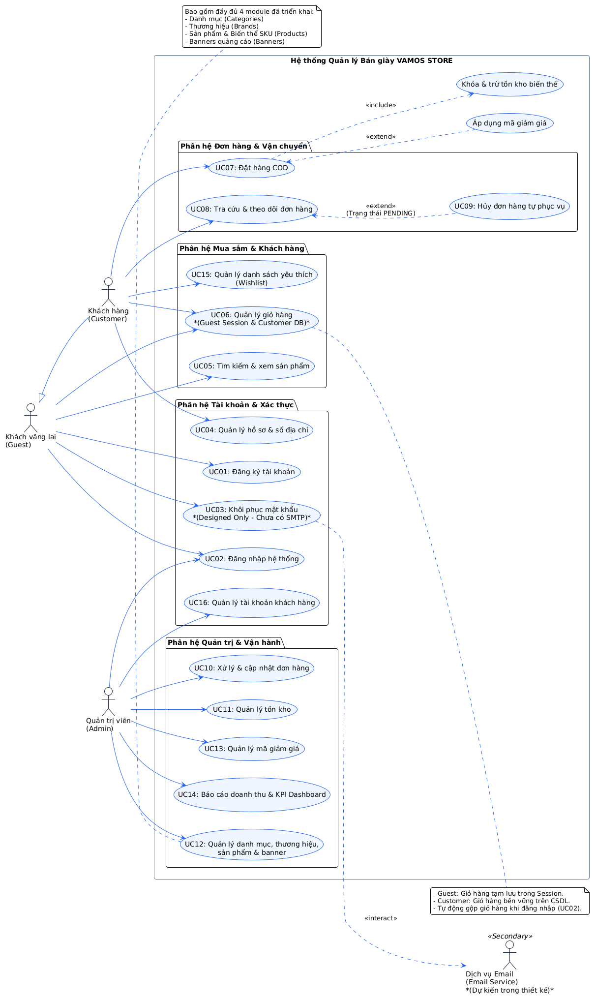
  <p><strong>Hình 1: Sơ đồ Use Case tổng quát toàn hệ thống (14 Use Cases nghiệp vụ)</strong></p>
</div>

* **Hướng dẫn đọc và ý nghĩa phân chia chức năng trong sơ đồ tổng quát:**
  * **Phân định theo ranh giới gói (Package):** Hệ thống được chia thành 4 khối chức năng logic:
    1. *Tài khoản & Xác thực:* Bao gồm các ca sử dụng từ `UC01` đến `UC04`.
    2. *Mua sắm & Khách hàng:* Bao gồm ca sử dụng tìm kiếm (`UC05`), giỏ hàng (`UC06`) và danh sách yêu thích.
    3. *Đơn hàng & Vận chuyển:* Bao gồm ca sử dụng đặt hàng COD (`UC07`), theo dõi đơn (`UC08`) và hủy đơn (`UC09`).
    4. *Quản trị & Vận hành:* Bao gồm toàn bộ các chức năng quản lý nội bộ từ `UC10` đến `UC14`.
  * **Mối quan hệ kế thừa (`Generalization`):** Đường mũi tên tam giác rỗng từ `Customer` hướng về `Guest` thể hiện rằng mọi quyền năng của Khách vãng lai (như xem catalog, tìm kiếm giày, xem chi tiết biến thể) đương nhiên thuộc về Khách hàng. Nhờ vậy, sơ đồ tránh được việc phải vẽ các đường nối trùng lặp từ `Customer` đến các chức năng cơ bản của `Guest`, giúp sơ đồ trong sáng và chuẩn mực theo chuẩn UML.
  * **Quan hệ phụ thuộc bắt buộc (`<<include>>`):** Trong ca sử dụng Đặt hàng COD (`UC07`), hành động kiểm tra khóa dòng và trừ tồn kho biến thể là bắt buộc phải diễn ra thành công thì đơn hàng mới được tạo. Mối quan hệ `include` thể hiện tính ràng buộc chặt chẽ này.
  * **Quan hệ mở rộng có điều kiện (`<<extend>>`):** Khi đặt hàng COD (`UC07`), việc áp dụng mã giảm giá voucher là hành động mở rộng tùy chọn (chỉ xảy ra khi người dùng có mã và muốn sử dụng), do đó được mô hình hóa bằng quan hệ `extend`. Tương tự, tại màn hình xem chi tiết đơn hàng (`UC08`), ca sử dụng Hủy đơn hàng (`UC09`) chỉ được kích hoạt mở rộng khi đơn hàng đang ở trạng thái Chờ xác nhận (`PENDING`).

---

### B. Sơ đồ Use Case chi tiết phân hệ Mua sắm & Đặt hàng COD

Để giúp Giảng viên theo dõi sâu hơn hành trình trải nghiệm của khách hàng từ lúc tìm giày đến lúc hoàn tất đơn hàng, nhóm phân rã chi tiết phân hệ Mua sắm:

<div align="center">
  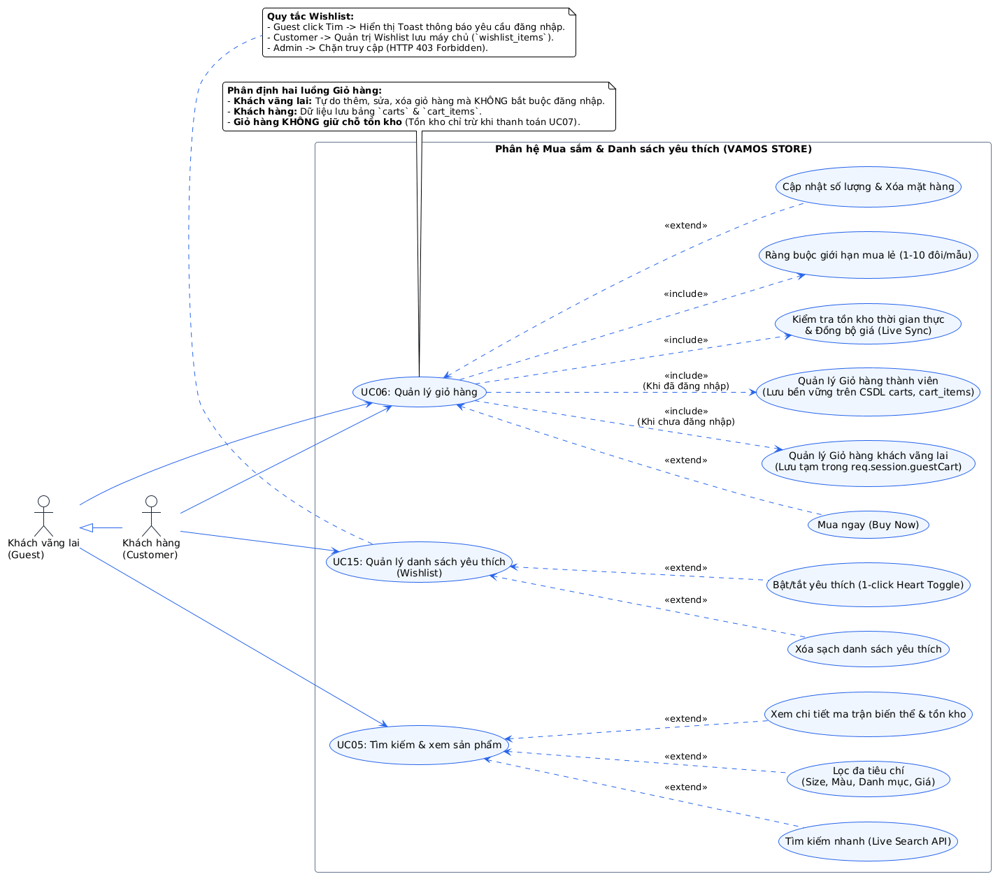
  <p><strong>Hình 2: Sơ đồ Use Case chi tiết phân hệ Mua sắm & Đặt hàng COD</strong></p>
</div>

* **Ý nghĩa phân hệ:** Sơ đồ làm nổi bật chuỗi giá trị thương mại: Người dùng tìm kiếm sản phẩm $\rightarrow$ Chọn Size/Màu đưa vào giỏ hàng $\rightarrow$ Chuyển sang Checkout COD $\rightarrow$ Hệ thống thực thi giao dịch trừ kho và áp voucher $\rightarrow$ Khách hàng tra cứu và theo dõi trạng thái đơn hàng trong hồ sơ cá nhân.

---

### C. Sơ đồ Use Case chi tiết phân hệ Quản lý Admin

Sơ đồ phân rã các ca sử dụng dành riêng cho Quản trị viên, thể hiện sự bao quát từ khâu nhập liệu danh mục đến vận hành kho và đơn hàng:

<div align="center">
  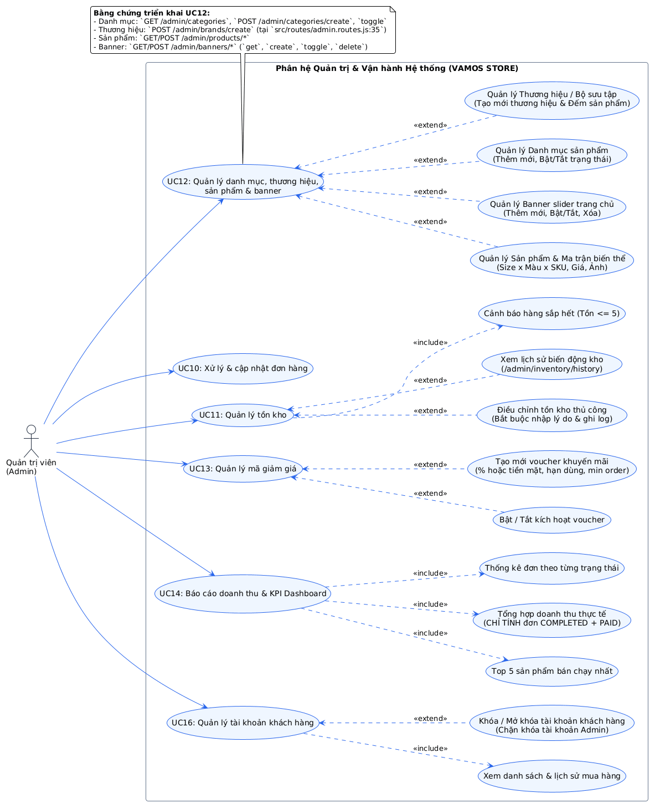
  <p><strong>Hình 3: Sơ đồ Use Case chi tiết phân hệ Quản trị Admin</strong></p>
</div>

* **Ý nghĩa phân hệ:** Khẳng định quyền kiểm soát toàn diện của Quản trị viên: Vừa tiếp nhận và chuyển đổi trạng thái đơn hàng COD, vừa kiểm soát số lượng biến thể qua thẻ kho, vừa cập nhật danh mục, voucher và xem báo cáo hiệu quả tài chính.

---

## 1.4. DANH SÁCH VÀ ĐẶC TẢ CHI TIẾT CÁC USE CASE (UC01 — UC14)

### Bảng 2: Danh sách tổng hợp 14 Use Case nghiệp vụ hệ thống VAMOS STORE

Dưới đây là danh mục 14 Use Case chuẩn mực của hệ thống VAMOS STORE, được nhóm đối chiếu và thống nhất 100% với sơ đồ Use Case tổng quát:

| Mã UC | Tên Use Case | Tác nhân chính | Thuộc phân hệ | Mục đích nghiệp vụ cốt lõi |
| :---: | :--- | :---: | :--- | :--- |
| **UC01** | Đăng ký | Guest | Tài khoản & Xác thực | Tạo tài khoản thành viên Customer và cấp giỏ hàng rỗng 1:1 |
| **UC02** | Đăng nhập | Guest, Customer, Admin | Tài khoản & Xác thực | Xác thực danh tính qua Bcrypt, cấp phiên và điều hướng vai trò |
| **UC03** | Khôi phục mật khẩu | Guest, Customer | Tài khoản & Xác thực | Tiếp nhận yêu cầu cấp lại mật khẩu (Thiết kế kiến trúc dữ liệu) |
| **UC04** | Quản lý hồ sơ và địa chỉ | Customer | Tài khoản & Xác thực | Cập nhật thông tin cá nhân và quản lý sổ địa chỉ nhận hàng |
| **UC05** | Tìm kiếm và xem sản phẩm | Guest, Customer | Mua sắm & Đặt hàng | Tra cứu danh mục, lọc đa tiêu chí và xem ma trận biến thể tồn kho |
| **UC06** | Quản lý giỏ hàng | Customer (Guest tạm) | Mua sắm & Đặt hàng | Thêm, cập nhật số lượng (1-10 đôi) và xóa mặt hàng trong giỏ |
| **UC07** | Đặt hàng COD | Customer | Mua sắm & Đặt hàng | Giao dịch nguyên tử trừ tồn kho, áp voucher và tạo đơn COD |
| **UC08** | Tra cứu và theo dõi đơn hàng | Customer | Đơn hàng cá nhân | Xem lịch sử đơn, tiến trình vận chuyển và snapshot chi tiết bất biến |
| **UC09** | Hủy đơn hàng | Customer | Đơn hàng cá nhân | Tự hủy đơn PENDING kèm Transaction tự động hoàn trả tồn kho |
| **UC10** | Admin xử lý và cập nhật đơn hàng | Admin | Quản trị & Vận hành | Điều phối đơn qua máy trạng thái chuẩn, cập nhật tiền COD và hoàn kho |
| **UC11** | Quản lý tồn kho | Admin | Quản trị & Vận hành | Giám sát SKU và tạo giao dịch điều chỉnh kho kèm lưu vết lý do |
| **UC12** | Quản lý sản phẩm và danh mục | Admin | Quản trị & Vận hành | Cấu hình sản phẩm, danh mục, thương hiệu, banner và bộ ảnh |
| **UC13** | Quản lý mã giảm giá | Admin | Quản trị & Vận hành | Thiết lập chính sách voucher: chiết khấu, hạn mức đơn và lượt dùng |
| **UC14** | Báo cáo doanh thu | Admin | Quản trị & Vận hành | Tổng hợp doanh thu thực tế từ đơn COMPLETED+PAID và Top 4 bán chạy |

_Bảng 2: Danh sách tổng hợp 14 Use Case nghiệp vụ hệ thống VAMOS STORE_

---

### ĐẶC TẢ CHI TIẾT TỪNG USE CASE

Dưới đây là phần đặc tả chi tiết cho từng ca sử dụng theo đúng cấu trúc học thuật: Mục đích, Tác nhân, Mô tả nghiệp vụ, Luồng xử lý chính theo trình tự từng bước và các Luồng ngoại lệ xử lý sự cố.

---

#### 1. UC01: ĐĂNG KÝ
* **Mã Use Case:** `UC01`
* **Tên Use Case:** Đăng ký tài khoản thành viên
* **Mục đích:** Cung cấp chức năng cho người dùng mới khởi tạo tài khoản trên hệ thống để được hưởng các quyền lợi thành viên như lưu địa chỉ nhận hàng, mua hàng COD, theo dõi đơn và áp dụng voucher.
* **Tác nhân:** Khách vãng lai (`Guest`).
* **Mô tả:** Khách vãng lai điền thông tin cá nhân vào biểu mẫu đăng ký trên website. Hệ thống kiểm tra dữ liệu, kiểm tra tính duy nhất của email, băm mật khẩu bảo mật và cấp phát một giỏ hàng cá nhân mới.
* **Luồng xử lý chính:**
  1. Khách vãng lai nhấn vào liên kết "Đăng ký" trên thanh điều hướng để mở trang `/auth/register`.
  2. Hệ thống hiển thị biểu mẫu đăng ký gồm các trường: Họ và tên, Email, Số điện thoại, Mật khẩu và Xác nhận mật khẩu.
  3. Người dùng nhập đầy đủ thông tin hợp lệ và nhấn nút "Đăng ký tài khoản".
  4. Hệ thống kiểm tra hợp lệ dữ liệu ở phía máy chủ: Họ tên tối thiểu 2 ký tự; Email đúng định dạng RFC; Số điện thoại chuẩn 10 chữ số; Mật khẩu tối thiểu 6 ký tự; Hai lần nhập mật khẩu phải trùng khớp.
  5. Hệ thống truy vấn cơ sở dữ liệu kiểm tra sự tồn tại của Email trong bảng `users`.
  6. Khi email chưa tồn tại, hệ thống băm mật khẩu bằng thư viện `bcryptjs` với hệ số muối `saltRounds = 10`.
  7. Hệ thống mở Transaction CSDL: Tạo một bản ghi mới trong bảng `users` với vai trò `role = 'CUSTOMER'` và trạng thái `status = 'active'`; đồng thời tự động tạo một bản ghi giỏ hàng rỗng trong bảng `carts` gắn với `user_id` vừa sinh ra (quan hệ 1:1).
  8. Hệ thống khởi tạo phiên đăng nhập tự động (`req.session.user`) với cookie `vamos_sid`, lưu thông báo chào mừng và chuyển hướng người dùng về trang chủ `/`.
* **Luồng ngoại lệ:**
  * *4a. Dữ liệu nhập không hợp lệ:* Hệ thống giữ lại các thông tin đã điền (trừ mật khẩu) và hiển thị thông báo lỗi chi tiết tương ứng bên dưới từng ô nhập liệu.
  * *5a. Email đã được đăng ký từ trước:* Hệ thống hiển thị thông báo: "Địa chỉ email này đã được sử dụng. Vui lòng đăng nhập hoặc sử dụng email khác."
  * *7a. Lỗi kết nối cơ sở dữ liệu:* Giao dịch bị Rollback hoàn toàn, hệ thống ghi nhật ký lỗi và hiển thị thông báo thân thiện: "Không thể hoàn tất đăng ký lúc này. Xin quý khách vui lòng thử lại sau."

---

#### 2. UC02: ĐĂNG NHẬP
* **Mã Use Case:** `UC02`
* **Tên Use Case:** Đăng nhập hệ thống
* **Mục đích:** Xác thực danh tính của người dùng thông qua email và mật khẩu, cấp phiên làm việc an toàn và phân quyền điều hướng đúng theo vai trò.
* **Tác nhân:** Khách vãng lai (`Guest`), Khách hàng (`Customer`), Quản trị viên (`Admin`).
* **Mô tả:** Người dùng nhập email và mật khẩu đã đăng ký. Hệ thống đối soát mã băm mật khẩu, kiểm tra trạng thái hoạt động của tài khoản, tự động gộp giỏ hàng tạm (nếu có) và đưa người dùng về trang chức năng phù hợp.
* **Luồng xử lý chính:**
  1. Người dùng bấm chọn "Đăng nhập" trên thanh điều hướng để mở trang `/auth/login`.
  2. Hệ thống hiển thị form đăng nhập yêu cầu nhập Email và Mật khẩu.
  3. Người dùng điền thông tin và bấm nút "Đăng nhập".
  4. Hệ thống chuẩn hóa email (chuyển chữ thường, cắt khoảng trắng đầu cuối) và truy vấn bảng `users`.
  5. Nếu tìm thấy tài khoản, hệ thống kiểm tra trạng thái hoạt động: Nếu `status === 'locked'`, lập tức từ chối và thông báo tài khoản bị khóa.
  6. Hệ thống thực thi hàm `bcrypt.compare(password, user.password_hash)` để so sánh mật khẩu nhập vào với mã băm lưu trong CSDL.
  7. Đối soát thành công, hệ thống tạo phiên làm việc trong Express Session lưu trên bộ nhớ RAM (`MemoryStore`), thiết lập cookie `vamos_sid` (HttpOnly, SameSite=Lax, thời hạn 7 ngày).
  8. **Hợp nhất giỏ hàng (Cart Merging):** Hệ thống kiểm tra xem người dùng có giỏ hàng tạm trong phiên khách vãng lai (`req.session.guestCart`) hay không. Nếu có, tự động kiểm tra tồn kho và chuyển các dòng sản phẩm vào bảng `cart_items` của khách hàng trên CSDL, sau đó xóa giỏ hàng tạm.
  9. Hệ thống phân quyền điều hướng: Nếu `user.role === 'ADMIN'`, chuyển hướng về cổng quản trị `/admin/dashboard`; nếu là `CUSTOMER`, chuyển hướng về trang yêu cầu trước đó hoặc trang chủ `/`.
* **Luồng ngoại lệ:**
  * *4a. Email không tồn tại trong hệ thống:* Hệ thống hiển thị thông báo bảo mật chung: "Email hoặc mật khẩu không chính xác" (tránh làm lộ danh sách người dùng cho kẻ tấn công).
  * *5a. Tài khoản đang bị khóa:* Hệ thống hiển thị thông báo: "Tài khoản của bạn đã bị vô hiệu hóa. Vui lòng liên hệ ban quản trị để được hỗ trợ."
  * *6a. Mật khẩu không chính xác:* Hệ thống hiển thị thông báo: "Email hoặc mật khẩu không chính xác."

---

#### 3. UC03: KHÔI PHỤC MẬT KHẨU
* **Mã Use Case:** `UC03`
* **Tên Use Case:** Khôi phục mật khẩu (Thiết kế kiến trúc dữ liệu)
* **Mục đích:** Cung cấp phương án kỹ thuật an toàn giúp người dùng lấy lại quyền truy cập tài khoản khi bị quên mật khẩu mà không làm lộ mật khẩu cũ.
* **Tác nhân:** Khách vãng lai (`Guest`), Khách hàng (`Customer`), Dịch vụ Email (`Email Service` — Secondary Actor).
* **Mô tả & Lưu ý hiện trạng kỹ thuật:**
  > **Ghi chú báo cáo:** Chức năng Khôi phục mật khẩu hiện mới dừng lại ở mức **Thiết kế kiến trúc và mô hình dữ liệu**. Trong cơ sở dữ liệu đã có sẵn bảng `password_reset_tokens` (`token_hash NVARCHAR(255) NOT NULL UNIQUE`, `expires_at`, `used_at`). Tuy nhiên, trong mã nguồn thực tế của dự án, các route tiếp nhận, controller xử lý và hạ tầng kết nối máy chủ gửi mail SMTP (như Nodemailer / Gmail API) **chưa được triển khai hoàn chỉnh**. Nhóm chúng em mô tả Use Case này dưới dạng quy trình thiết kế chuẩn, hoàn toàn không trình bày như một chức năng đã vận hành thực tế.
* **Luồng xử lý thiết kế (Designed Flow):**
  1. Người dùng bấm vào liên kết "Quên mật khẩu?" tại trang đăng nhập.
  2. Hệ thống hiển thị giao diện yêu cầu nhập địa chỉ Email đã đăng ký.
  3. Người dùng nhập email và bấm nút "Gửi liên kết đặt lại mật khẩu".
  4. Hệ thống kiểm tra xem email có tồn tại trong bảng `users` hay không.
  5. Nếu tồn tại, hệ thống sinh một chuỗi ngẫu nhiên có độ dài 32 bytes (CSPRNG), băm chuỗi này bằng thuật toán SHA-256 để tạo giá trị `token_hash`, và lưu vào bảng `password_reset_tokens` với thời hạn hết hiệu lực là 15 phút.
  6. Hệ thống gửi một email chứa đường dẫn đặt lại mật khẩu kèm token gốc qua `Email Service` đến hòm thư người dùng.
  7. Người dùng mở liên kết trong email, điền mật khẩu mới và xác nhận mật khẩu.
  8. Hệ thống kiểm tra tính hợp lệ của token (chưa hết hạn và chưa từng được sử dụng).
  9. Hệ thống băm mật khẩu mới bằng Bcrypt, cập nhật vào bảng `users`, đồng thời ghi nhận thời điểm sử dụng (`used_at = GETDATE()`) vào bảng `password_reset_tokens` để vô hiệu hóa token.
* **Luồng ngoại lệ thiết kế:**
  * *4a. Email không tồn tại:* Hệ thống vẫn hiển thị thông báo "Nếu email của bạn tồn tại, chúng tôi đã gửi hướng dẫn đặt lại mật khẩu" nhằm ngăn chặn kỹ thuật dò quét tài khoản (Account Enumeration Attack).
  * *8a. Token đã hết hạn hoặc đã sử dụng:* Hệ thống từ chối cập nhật và yêu cầu người dùng gửi lại yêu cầu khôi phục mới.

---

#### 4. UC04: QUẢN LÝ HỒ SƠ VÀ ĐỊA CHỈ
* **Mã Use Case:** `UC04`
* **Tên Use Case:** Quản lý hồ sơ và địa chỉ
* **Mục đích:** Cho phép khách hàng thành viên chủ động cập nhật thông tin cá nhân (họ tên, số điện thoại), đổi mật khẩu tài khoản và quản lý nhiều địa chỉ nhận hàng để tiện cho việc thanh toán.
* **Tác nhân:** Khách hàng thành viên (`Customer`).
* **Mô tả:** Khách hàng truy cập trang quản lý tài khoản để sửa thông tin liên hệ, thực hiện đổi mật khẩu bảo mật hoặc thêm/sửa/xóa các địa chỉ nhận hàng trong sổ địa chỉ.
* **Luồng xử lý chính:**
  1. Khách hàng truy cập trang Thông tin tài khoản (`/account/profile`).
  2. **Cập nhật thông tin:** Khách hàng thay đổi Họ tên hoặc Số điện thoại và nhấn "Lưu thay đổi". Hệ thống kiểm tra dữ liệu và cập nhật bản ghi trong bảng `users`.
  3. **Đổi mật khẩu:** Khách hàng nhập mật khẩu hiện tại, mật khẩu mới (tối thiểu 6 ký tự) và xác nhận. Hệ thống đối soát mật khẩu cũ bằng `bcrypt.compare`; nếu đúng, băm mật khẩu mới và lưu vào CSDL.
  4. **Quản lý sổ địa chỉ (`/account/addresses`):** Hệ thống hiển thị danh sách các địa chỉ hiện có của khách hàng lấy từ bảng `addresses`.
  5. Khách hàng có thể: Thêm mới địa chỉ (Họ tên người nhận, SĐT, Tỉnh/Thành, Quận/Huyện, Phường/Xã, Địa chỉ chi tiết); Sửa thông tin địa chỉ; Xóa địa chỉ; hoặc Chọn "Đặt làm mặc định".
  6. **Cơ chế chọn địa chỉ mặc định:** Khi khách hàng chọn đặt một địa chỉ làm mặc định, hệ thống mở Transaction CSDL để gỡ bỏ cờ mặc định (`is_default = 0`) ở toàn bộ các địa chỉ cũ của khách hàng đó, sau đó gán `is_default = 1` cho địa chỉ được chọn. Filtered Unique Index `uq_user_default_address` bảo đảm mỗi khách hàng có tối đa một địa chỉ mặc định.
* **Luồng ngoại lệ:**
  * *3a. Mật khẩu hiện tại không đúng:* Hệ thống báo lỗi: "Mật khẩu hiện tại không chính xác. Vui lòng kiểm tra lại."
  * *5a. Địa chỉ bị xóa là địa chỉ duy nhất:* Hệ thống cho phép xóa và sổ địa chỉ trở về trạng thái trống (0 địa chỉ mặc định).

---

#### 5. UC05: TÌM KIẾM VÀ XEM SẢN PHẨM
* **Mã Use Case:** `UC05`
* **Tên Use Case:** Tìm kiếm và xem sản phẩm
* **Mục đích:** Giúp người mua hàng dễ dàng tra cứu, lọc danh mục giày dép theo nhu cầu và khám phá thông tin chi tiết về từng mẫu giày (kích cỡ size, màu sắc, mức giá và số lượng tồn kho).
* **Tác nhân:** Khách vãng lai (`Guest`), Khách hàng (`Customer`).
* **Mô tả:** Người dùng nhập từ khóa vào ô tìm kiếm hoặc dùng bộ lọc ở trang Cửa hàng để duyệt danh mục giày. Khi bấm vào một sản phẩm cụ thể, hệ thống hiển thị chi tiết hình ảnh, bảng size, màu sắc và mức tồn kho tương ứng.
* **Luồng xử lý chính:**
  1. Người dùng nhập từ khóa tìm kiếm tại thanh tìm kiếm chung hoặc vào trang Cửa hàng (`/products`).
  2. Người dùng tùy chọn áp dụng các bộ lọc ở cột bên trái: Danh mục (`category`), Thương hiệu (`brand`), Đối tượng (`gender_target`: Nam, Nữ, Trẻ em, Unisex), Khoảng giá, Kích cỡ Size (38-45), Màu sắc và Sắp xếp (Mới nhất, Giá tăng/giảm).
  3. Hệ thống tạo câu truy vấn SQL động an toàn có tham số hóa, thực hiện phân trang 12 sản phẩm/trang và hiển thị kết quả lên giao diện.
  4. Người dùng bấm vào một thẻ sản phẩm cụ thể để chuyển tới trang Chi tiết (`/products/:slug`).
  5. Hệ thống truy vấn thông tin sản phẩm cha (`products`), bộ ảnh (`product_images`) và ma trận các biến thể SKU kết hợp từ `product_variants`, `sizes`, `colors`.
  6. Người dùng click chọn Size và Màu sắc mong muốn. Giao diện tự động cập nhật mã SKU tương ứng, giá bán thực tế và mức tồn kho khả dụng (Còn hàng / Tạm hết hàng).
* **Luồng ngoại lệ:**
  * *3a. Không tìm thấy sản phẩm nào:* Hệ thống hiển thị thông báo: "Không tìm thấy sản phẩm nào phù hợp với bộ lọc đã chọn" kèm nút xóa bộ lọc.
  * *6a. Biến thể được chọn đã hết hàng (`stock_quantity = 0`):* Giao diện tự động vô hiệu hóa nút "Thêm vào giỏ hàng" và hiển thị nhãn "Tạm hết hàng".

---

#### 6. UC06: QUẢN LÝ GIỎ HÀNG
* **Mã Use Case:** `UC06`
* **Tên Use Case:** Quản lý giỏ hàng
* **Mục đích:** Cho phép người mua thu thập các mẫu giày dép dự định mua sắm, theo dõi tạm tính chi phí, điều chỉnh số lượng hoặc xóa bỏ mặt hàng trước khi quyết định đặt hàng.
* **Tác nhân:** Khách vãng lai (`Guest`), Khách hàng (`Customer`).
* **Mô tả:** Người dùng chọn size/màu và số lượng tại trang chi tiết sản phẩm rồi bấm thêm vào giỏ. Tại trang giỏ hàng, người dùng có thể tăng giảm số lượng (từ 1 đến 10 đôi/mặt hàng) hoặc bấm nút xóa sản phẩm.
* **Luồng xử lý chính:**
  1. Tại trang chi tiết sản phẩm, người dùng chọn Kích cỡ, Màu sắc, chọn Số lượng (từ 1 đến 10 đôi) và bấm "Thêm vào giỏ hàng".
  2. Hệ thống kiểm tra số lượng yêu cầu so với tồn kho thực tế (`stock_quantity`) của biến thể SKU đó trong CSDL.
  3. Phân nhánh lưu trữ theo đối tượng người dùng:
     * *Nếu là Guest:* Sản phẩm được lưu vào mảng `req.session.guestCart` trong phiên làm việc. Nếu SKU đã có sẵn, thực hiện cộng dồn số lượng (ràng buộc tối đa không vượt quá tồn kho và không quá 10 đôi).
     * *Nếu là Customer:* Hệ thống truy vấn bảng `carts` của người dùng. Nếu SKU đã có trong `cart_items`, thực hiện `UPDATE quantity`; nếu chưa có, thực hiện `INSERT` dòng mới.
  4. Hệ thống trả về phản hồi thành công và cập nhật số đếm giỏ hàng trên thanh điều hướng.
  5. Người dùng truy cập trang Giỏ hàng (`/cart`) để xem danh sách các mặt hàng: Ảnh đại diện, Tên sản phẩm, Size, Màu, Đơn giá, Thành tiền và Tổng tạm tính.
  6. Người dùng có thể bấm nút +/- để tăng giảm số lượng hoặc bấm nút thùng rác để xóa sản phẩm.
* **Luồng ngoại lệ:**
  * *2a. Số lượng yêu cầu vượt quá tồn kho:* Hệ thống từ chối thêm và hiển thị cảnh báo: "Số lượng yêu cầu vượt quá tồn kho hiện có trong kho hàng."
  * *6a. Giảm số lượng về 0:* Hệ thống tự động xóa mặt hàng đó khỏi giỏ hàng.

---

#### 7. UC07: ĐẶT HÀNG COD
* **Mã Use Case:** `UC07`
* **Tên Use Case:** Đặt hàng thanh toán khi nhận hàng (COD)
* **Mục đích:** Chuyển đổi các mặt hàng trong giỏ thành đơn đặt hàng chính thức với phương thức thanh toán tiền mặt khi nhận hàng (Cash on Delivery), đảm bảo trừ tồn kho chính xác và chống bán vượt tồn kho.
* **Tác nhân:** Khách hàng thành viên (`Customer`).
* **Mô tả:** Khách hàng từ giỏ hàng chuyển sang trang thanh toán, xác nhận thông tin giao hàng, nhập mã voucher giảm giá (nếu có) và nhấn đặt hàng COD. Hệ thống thực hiện giao dịch nguyên tử (Transaction) kiểm tra tồn kho, trừ kho, tạo đơn, tạo chi tiết đơn, ghi thẻ kho và xóa giỏ hàng.
* **Luồng xử lý chính:**
  1. Khách hàng bấm "Tiến hành thanh toán" từ trang giỏ hàng để mở trang `/checkout`.
  2. Hệ thống tải danh sách sản phẩm trong giỏ và sổ địa chỉ đã lưu (tự động điền địa chỉ mặc định nếu có).
  3. Khách hàng xác nhận thông tin người nhận (Họ tên, SĐT, Địa chỉ chi tiết) hoặc chọn địa chỉ khác.
  4. **Áp dụng mã giảm giá (Voucher - Tùy chọn):** Khách hàng nhập mã voucher và bấm "Áp dụng". Hệ thống kiểm tra: Mã tồn tại, đang hoạt động (`is_active = 1`), còn hạn dùng, đơn hàng đạt giá trị tối thiểu, chưa hết lượt dùng tổng và khách hàng này chưa từng dùng mã. Nếu hợp lệ, tính toán số tiền giảm giá và trừ vào tổng thanh toán.
  5. Khách hàng kiểm tra tóm tắt chi phí (Tạm tính, Phí vận chuyển 30.000 VNĐ, Số tiền giảm giá, Tổng thanh toán) và nhấn "Xác nhận đặt hàng COD".
  6. **Mở Transaction CSDL (Giao dịch nguyên tử):**
     * a. Khóa các dòng biến thể cần mua bằng cơ chế khóa bi quan: `SELECT stock_quantity FROM product_variants WITH (UPDLOCK, ROWLOCK) WHERE id = @variantId`.
     * b. Kiểm tra tồn kho: Nếu bất kỳ biến thể nào có `stock_quantity < quantity_mua`, lập tức hủy bỏ giao dịch.
     * c. Trừ tồn kho biến thể: `UPDATE product_variants SET stock_quantity = stock_quantity - @qty WHERE id = @variantId`.
     * d. Ghi thẻ kho kiểm toán: `INSERT INTO inventory_transactions` lưu số lượng cũ, mới, thay đổi âm (`-qty`) và lý do xuất bán.
     * e. Tạo đơn hàng chính: `INSERT INTO orders` lưu mã đơn duy nhất (`order_code`), `user_id`, snapshot người nhận (`recipient_name_snapshot`, `recipient_phone_snapshot`, `delivery_address_snapshot`), snapshot voucher, `subtotal`, `discount_amount`, `shipping_fee`, `total_amount`, `payment_method = 'COD'`, `payment_status = 'UNPAID'`, `order_status = 'PENDING'`.
     * f. Tạo các dòng chi tiết: `INSERT INTO order_items` lưu snapshot tên sản phẩm, mã SKU, size, màu, đơn giá mua `unit_price`, số lượng và thành tiền.
     * g. Nếu có dùng voucher: `INSERT INTO voucher_usages` ghi nhận lịch sử dùng và tăng `used_count` trong bảng `vouchers`.
     * h. Ghi nhật ký trạng thái: `INSERT INTO order_status_histories` với `new_status = 'PENDING'`.
     * i. Làm rỗng giỏ hàng: `DELETE FROM cart_items WHERE cart_id = @cartId`.
  7. Commit Transaction CSDL thành công. Hệ thống chuyển hướng người dùng tới trang thông báo thành công (`/checkout/success/:orderCode`).
* **Luồng ngoại lệ:**
  * *4a. Voucher không đủ điều kiện:* Hệ thống báo lỗi chi tiết (Hết hạn, không đủ đơn tối thiểu, đã dùng rồi) và giữ nguyên tổng tiền.
  * *6b. Tồn kho bị thiếu do có người mua trước (Race Condition):* Transaction bị Rollback ngay lập tức. Hệ thống thông báo: "Rất tiếc, sản phẩm [Tên - Size] vừa hết hàng hoặc không đủ số lượng để đáp ứng. Vui lòng kiểm tra lại giỏ hàng."

---

#### 8. UC08: TRA CỨU VÀ THEO DÕI ĐƠN HÀNG
* **Mã Use Case:** `UC08`
* **Tên Use Case:** Tra cứu và theo dõi đơn hàng
* **Mục đích:** Cho phép khách hàng xem lại toàn bộ lịch sử các đơn hàng đã đặt, theo dõi tiến trình vận chuyển theo thời gian thực và xem lại bản sao chi tiết từng món hàng đã mua.
* **Tác nhân:** Khách hàng thành viên (`Customer`).
* **Mô tả:** Khách hàng vào mục "Đơn hàng của tôi" để xem danh sách đơn hàng. Bấm vào một đơn hàng cụ thể để xem địa chỉ nhận hàng snapshot, timeline trạng thái đơn hàng và danh sách sản phẩm với giá lúc mua.
* **Luồng xử lý chính:**
  1. Khách hàng truy cập trang Đơn hàng cá nhân (`/account/orders`).
  2. Hệ thống truy vấn bảng `orders` lọc theo `user_id` hiện tại, sắp xếp theo thời gian mới nhất.
  3. Giao diện hiển thị danh sách các đơn hàng tóm tắt: Mã đơn, Ngày đặt, Tổng tiền, Huy hiệu trạng thái đơn hàng (Badge màu sắc) và Trạng thái thanh toán.
  4. Khách hàng bấm chọn một đơn hàng cụ thể để xem chi tiết (`/account/orders/:orderCode`).
  5. Hệ thống truy vấn thông tin đơn hàng từ `orders`, các mặt hàng từ `order_items` và timeline lịch sử từ `order_status_histories`.
  6. Giao diện hiển thị: Thông tin người nhận và địa chỉ snapshot bất biến; Chi tiết từng món giày đã đặt (ảnh, tên, size, màu, đơn giá lúc mua); Tổng thanh toán; và Timeline trạng thái vận chuyển từ lúc tạo đơn đến lúc giao hàng.
* **Luồng ngoại lệ:**
  * *5a. Cố tình truy cập đơn hàng của người khác:* Hệ thống kiểm tra `user_id` của đơn hàng không khớp với tài khoản đang đăng nhập, từ chối truy cập và chuyển hướng về danh sách với thông báo bảo mật.

---

#### 9. UC09: HỦY ĐƠN HÀNG
* **Mã Use Case:** `UC09`
* **Tên Use Case:** Hủy đơn hàng tự phục vụ
* **Mục đích:** Cho phép người mua tự thao tác hủy đơn hàng khi thay đổi nhu cầu mua sắm mà không cần gọi điện cho cửa hàng, với điều kiện đơn hàng chưa bước vào khâu đóng gói vận chuyển.
* **Tác nhân:** Khách hàng thành viên (`Customer`).
* **Mô tả:** Khi đơn hàng đang ở trạng thái Chờ xác nhận (`PENDING`), khách hàng bấm nút "Hủy đơn hàng" trong chi tiết đơn. Hệ thống mở Transaction chuyển trạng thái sang `CANCELLED`, tự động cộng trả lại số lượng tồn kho cho các biến thể và hoàn lại lượt dùng voucher.
* **Luồng xử lý chính:**
  1. Khách hàng mở trang chi tiết đơn hàng (`/account/orders/:orderCode`).
  2. Hệ thống kiểm tra điều kiện: **Đơn hàng bắt buộc phải đang ở trạng thái `order_status = 'PENDING'` (Chờ xác nhận)** thì nút "Hủy đơn hàng" màu đỏ mới xuất hiện.
  3. Khách hàng nhấn nút "Hủy đơn hàng", giao diện hiển thị hộp thoại xác nhận yêu cầu nhập lý do hủy.
  4. Khách hàng xác nhận hủy đơn.
  5. **Mở Transaction CSDL hủy đơn & hoàn tồn kho:**
     * a. Khóa đơn hàng `WITH (UPDLOCK, ROWLOCK)` và kiểm tra lại trạng thái. Nếu trạng thái đã bị đổi khác `PENDING`, dừng giao dịch.
     * b. Cập nhật trạng thái đơn: `UPDATE orders SET order_status = 'CANCELLED', updated_at = GETDATE() WHERE id = @orderId`.
     * c. Duyệt qua từng dòng mặt hàng trong `order_items`, khóa dòng biến thể tương ứng trong `product_variants` và hoàn lại số lượng tồn: `UPDATE product_variants SET stock_quantity = stock_quantity + @qty WHERE id = @variantId`.
     * d. Ghi thẻ kho hoàn trả: `INSERT INTO inventory_transactions` lưu số lượng thay đổi dương (`+qty`), lý do hoàn kho do khách tự hủy đơn.
     * e. Xử lý Voucher: Nếu đơn có áp voucher, xóa bản ghi trong `voucher_usages` và giảm `used_count` trong bảng `vouchers`.
     * f. Ghi nhật ký: `INSERT INTO order_status_histories` lưu vết chuyển từ `PENDING` sang `CANCELLED`.
  6. Commit Transaction CSDL thành công. Giao diện cập nhật trạng thái đơn thành "Đã hủy" và thông báo hoàn tất cho khách hàng.
* **Luồng ngoại lệ:**
  * *2a. Đơn hàng đã được xác nhận hoặc đang vận chuyển (`CONFIRMED`, `PROCESSING`, `SHIPPING`):* Nút hủy không hiển thị. Nếu khách hàng gửi request trực tiếp, hệ thống từ chối và báo lỗi: "Đơn hàng đã được cửa hàng xử lý hoặc đang giao, không thể tự hủy lúc này."

---

#### 10. UC10: ADMIN XỬ LÝ VÀ CẬP NHẬT ĐƠN HÀNG
* **Mã Use Case:** `UC10`
* **Tên Use Case:** Admin xử lý và cập nhật đơn hàng
* **Mục đích:** Giúp Quản trị viên điều phối quy trình xử lý đơn hàng theo đúng chuỗi cung ứng, kiểm soát việc chuyển đổi trạng thái theo quy tắc máy trạng thái nghiêm ngặt, tự động cập nhật thanh toán COD và hoàn kho nếu hủy đơn.
* **Tác nhân:** Quản trị viên (`Admin`).
* **Mô tả:** Admin vào mục Quản lý đơn hàng, xem danh sách đơn cần xử lý, bấm vào chi tiết đơn và nhấn nút chuyển sang trạng thái kế tiếp theo quy định (Chờ xác nhận $\rightarrow$ Đã xác nhận $\rightarrow$ Đang xử lý $\rightarrow$ Đang giao hàng $\rightarrow$ Hoàn tất).
* **Luồng xử lý chính:**
  1. Quản trị viên truy cập trang Quản lý đơn hàng (`/admin/orders`).
  2. Hệ thống hiển thị bảng danh sách đơn hàng có phân trang, hỗ trợ lọc theo trạng thái và tìm kiếm theo mã đơn hoặc tên khách hàng.
  3. Quản trị viên bấm xem chi tiết đơn hàng (`/admin/orders/:id`).
  4. Hệ thống kiểm tra trạng thái hiện tại của đơn và chỉ hiển thị các nút hành động chuyển đổi hợp lệ theo ma trận máy trạng thái (FSM):
     * `PENDING` $\rightarrow$ `CONFIRMED` hoặc `CANCELLED`
     * `CONFIRMED` $\rightarrow$ `PROCESSING` hoặc `CANCELLED`
     * `PROCESSING` $\rightarrow$ `SHIPPING`
     * `SHIPPING` $\rightarrow$ `COMPLETED`
  5. Quản trị viên chọn trạng thái kế tiếp và nhập ghi chú điều hành (ví dụ: "Đã đóng gói xong, giao cho bưu tá").
  6. **Mở Transaction CSDL:**
     * a. Khóa đơn hàng `WITH (UPDLOCK, ROWLOCK)` và kiểm tra luồng chuyển đổi. Nếu bước chuyển không hợp lệ, ném ngoại lệ dừng thực hiện.
     * b. **Trường hợp chuyển sang `COMPLETED`:** Hệ thống ghi nhận khách đã nhận hàng và trả tiền mặt COD, tự động cập nhật đồng thời `order_status = 'COMPLETED'` và `payment_status = 'PAID'`. *(Lưu ý: Tồn kho đã được trừ lúc tạo đơn, hệ thống TUYỆT ĐỐI KHÔNG trừ kho lần thứ hai tại bước này)*.
     * c. **Trường hợp Admin chọn `CANCELLED` (chỉ cho phép khi đơn ở `PENDING` hoặc `CONFIRMED`):** Hệ thống tự động kích hoạt hoàn lại số lượng tồn kho cho các biến thể trong đơn, ghi thẻ kho `inventory_transactions` và hoàn lại voucher.
     * d. Ghi nhật ký: `INSERT INTO order_status_histories` lưu lại người thao tác (`changed_by`), trạng thái cũ, trạng thái mới và ghi chú.
  7. Commit Transaction CSDL thành công. Giao diện cập nhật trạng thái mới.
* **Luồng ngoại lệ:**
  * *6a. Thao tác nhảy cóc trạng thái trái quy tắc FSM:* Hệ thống từ chối thực hiện và hiển thị lỗi: "Không thể chuyển trạng thái đơn hàng từ [Trạng thái cũ] sang [Trạng thái mới]. Luồng chuyển đổi không được phép."

---

#### 11. UC11: QUẢN LÝ TỒN KHO
* **Mã Use Case:** `UC11`
* **Tên Use Case:** Quản lý tồn kho
* **Mục đích:** Giúp Quản trị viên theo dõi mức tồn kho thời gian thực của từng mã SKU biến thể (Size $\times$ Màu), nhận cảnh báo khi hàng sắp hết và thực hiện điều chỉnh số lượng tồn kho thủ công (nhập hàng, kiểm kê) có lưu vết kiểm toán bắt buộc.
* **Tác nhân:** Quản trị viên (`Admin`).
* **Mô tả:** Admin vào mục Quản lý tồn kho để xem danh sách toàn bộ các SKU. Khi cần nhập thêm hàng hoặc cân bằng kho sau kiểm kê, Admin bấm nút điều chỉnh, nhập số lượng mới và bắt buộc phải điền lý do biến động.
* **Luồng xử lý chính:**
  1. Quản trị viên truy cập trang Quản lý tồn kho (`/admin/inventory`).
  2. Hệ thống hiển thị bảng danh sách các biến thể SKU: Hình ảnh, Tên mẫu giày, Kích cỡ Size, Màu sắc, Mã SKU, Tồn kho hiện tại và Huy hiệu cảnh báo (Còn hàng / Sắp hết hàng $\le 5$ / Hết hàng $= 0$).
  3. Quản trị viên có thể tìm kiếm theo mã SKU hoặc lọc các sản phẩm có tồn kho thấp.
  4. Để điều chỉnh tồn kho, Quản trị viên bấm nút "Điều chỉnh tồn kho" tại dòng SKU tương ứng.
  5. Hệ thống hiển thị modal điều chỉnh gồm: Số lượng tồn hiện tại, Ô nhập số lượng tồn mới sau điều chỉnh, Số lượng chênh lệch tự động tính và Ô nhập Lý do điều chỉnh (Bắt buộc).
  6. Quản trị viên điền số lượng mới, nhập lý do (ví dụ: "Nhập bổ sung lô hàng đợt 2", "Kiểm kê phát hiện lỗi hỏng") và bấm "Lưu cập nhật".
  7. **Mở Transaction CSDL:**
     * a. Cập nhật tồn kho: `UPDATE product_variants SET stock_quantity = @newQty, updated_at = GETDATE() WHERE id = @id`.
     * b. Ghi thẻ kho kiểm toán: `INSERT INTO inventory_transactions (variant_id, user_id, old_quantity, new_quantity, change_quantity, reason) VALUES (@varId, @adminId, @oldQty, @newQty, @changeQty, @reason)`.
  8. Commit Transaction CSDL thành công. Bảng giao diện cập nhật số lượng tồn mới và bổ sung vào nhật ký thẻ kho.
* **Luồng ngoại lệ:**
  * *6a. Nhập số lượng mới âm hoặc để trống lý do:* Hệ thống kiểm tra dữ liệu phía server (CHECK `new_quantity >= 0`), từ chối lưu và báo lỗi yêu cầu nhập đầy đủ.

---

#### 12. UC12: QUẢN LÝ SẢN PHẨM VÀ DANH MỤC
* **Mã Use Case:** `UC12`
* **Tên Use Case:** Quản lý sản phẩm và danh mục
* **Mục đích:** Cung cấp công cụ quản trị danh mục hàng hóa toàn diện: Cấu hình danh mục (`categories`), thương hiệu (`brands`), banner trang chủ (`banners`), khởi tạo sản phẩm cha (`products`), thiết lập ma trận biến thể SKU và tải lên bộ sưu tập ảnh sản phẩm.
* **Tác nhân:** Quản trị viên (`Admin`).
* **Mô tả:** Admin thêm mới hoặc chỉnh sửa sản phẩm, lựa chọn danh sách size và màu sắc áp dụng để hệ thống sinh ma trận SKU, nhập mức tồn ban đầu và tải lên nhiều ảnh (chỉ định đúng một ảnh chính).
* **Luồng xử lý chính:**
  1. Quản trị viên truy cập trang Quản lý sản phẩm (`/admin/products`).
  2. **Thêm sản phẩm mới:**
     * a. Bấm nút "Thêm sản phẩm mới" (`/admin/products/new`).
     * b. Điền thông tin sản phẩm cha: Tên sản phẩm, Mã sản phẩm (`product_code`), Đường dẫn thân thiện (`slug`), Danh mục, Thương hiệu, Đối tượng (`gender_target`), Giá gốc (`base_price`), Giá khuyến mãi (`sale_price`), Mô tả chi tiết.
     * c. Chọn danh sách các Kích cỡ size và Màu sắc mở bán để hệ thống sinh ma trận tổ hợp biến thể SKU.
     * d. Điền số lượng tồn kho ban đầu cho từng mã SKU được sinh ra.
     * e. Tải lên danh sách hình ảnh sản phẩm và đánh dấu chọn đúng 1 ảnh làm ảnh đại diện chính (`is_primary = 1`).
     * f. Bấm "Lưu sản phẩm". Hệ thống thực thi Transaction lưu sản phẩm cha, lưu các biến thể trong `product_variants`, lưu các ảnh trong `product_images` và ghi nhận thẻ kho ban đầu.
  3. **Quản lý Danh mục & Thương hiệu (`/admin/categories`):** Admin thêm mới, sửa tên, mô tả và đường dẫn slug cho các phân loại sản phẩm.
  4. **Quản lý Banner quảng cáo (`/admin/banners`):** Admin tải lên hình ảnh banner tiếp thị, gán liên kết và sắp xếp thứ tự hiển thị trên slider trang chủ.
* **Luồng ngoại lệ:**
  * *2b. Trùng mã sản phẩm hoặc trùng Slug:* Hệ thống báo lỗi trùng lặp do vi phạm ràng buộc UNIQUE của CSDL.
  * *2e. Vi phạm chỉ định ảnh chính:* Filtered Unique Index `uq_product_primary_image` bảo đảm mỗi sản phẩm có tối đa một ảnh chính; nếu chọn nhiều hơn một, hệ thống tự động gỡ cờ ảnh cũ để bảo đảm toàn vẹn dữ liệu.

---

#### 13. UC13: QUẢN LÝ MÃ GIẢM GIÁ
* **Mã Use Case:** `UC13`
* **Tên Use Case:** Quản lý mã giảm giá
* **Mục đích:** Giúp Quản trị viên khởi tạo và kiểm soát các chiến dịch khuyến mãi voucher nhằm kích cầu mua sắm, thiết lập giá trị chiết khấu, hạn mức đơn tối thiểu, thời hạn áp dụng và giới hạn lượt dùng.
* **Tác nhân:** Quản trị viên (`Admin`).
* **Mô tả:** Admin tạo mã giảm giá mới với các quy định cụ thể (% hoặc số tiền cố định), theo dõi số lượt đã sử dụng trên tổng lượt phát hành, hoặc tạm ngừng kích hoạt voucher khi cần.
* **Luồng xử lý chính:**
  1. Quản trị viên truy cập trang Quản lý Voucher (`/admin/vouchers`).
  2. Hệ thống hiển thị bảng danh sách các mã giảm giá hiện có kèm chỉ số: Mã code, Tên chương trình, Loại giảm (% hoặc số tiền), Giá trị giảm, Đơn tối thiểu, Thời hạn từ ngày đến ngày, Số lượt đã dùng / Tổng giới hạn (`used_count` / `usage_limit`), và Trạng thái kích hoạt.
  3. **Tạo voucher mới:**
     * a. Bấm nút "Thêm Voucher mới".
     * b. Điền Mã code (chữ in hoa không dấu, ví dụ: `VAMOS50K`, `SUMMER2026`), Tên ưu đãi.
     * c. Chọn Loại giảm giá: Theo phần trăm (`percentage`) hoặc Số tiền cố định (`fixed_amount`).
     * d. Điền Giá trị giảm (`discount_value`), Giá trị đơn hàng tối thiểu (`min_order_value`), Mức giảm tối đa (`max_discount_amount` nếu là loại %).
     * e. Thiết lập Ngày bắt đầu (`start_date`) và Ngày kết thúc (`end_date`).
     * f. Thiết lập Tổng số lượt dùng tối đa (`usage_limit`).
     * g. Bấm "Lưu Voucher". Hệ thống kiểm tra ràng buộc ngày tháng (`end_date >= start_date`) và tính duy nhất của mã trước khi lưu vào CSDL.
  4. Quản trị viên có thể bật/tắt công tắc kích hoạt (`is_active = 0/1`) để tạm dừng hoặc mở lại voucher.
* **Luồng ngoại lệ:**
  * *3b. Mã voucher bị trùng lặp:* Hệ thống thông báo: "Mã giảm giá này đã tồn tại trong hệ thống. Vui lòng chọn mã khác."
  * *3e. Ngày kết thúc nhỏ hơn ngày bắt đầu:* Ràng buộc CHECK `chk_vouchers_dates` của CSDL kích hoạt, hệ thống báo lỗi không hợp lệ.

---

#### 14. UC14: BÁO CÁO DOANH THU
* **Mã Use Case:** `UC14`
* **Tên Use Case:** Báo cáo doanh thu
* **Mục đích:** Tổng hợp và báo cáo số liệu doanh thu bán hàng thực tế từ các đơn hàng giao thành công, thống kê hiệu quả kinh doanh và xếp hạng các sản phẩm bán chạy nhất giúp ban quản trị định hướng nhập hàng.
* **Tác nhân:** Quản trị viên (`Admin`).
* **Mô tả:** Admin vào trang Dashboard quản trị để xem các thẻ chỉ số KPI tài chính và danh sách Top 4 sản phẩm bán chạy nhất được tính toán tự động từ CSDL.
* **Quy chuẩn ghi nhận doanh thu thực tế:**
  > **Quy tắc kế toán của nhóm:** Doanh thu thực tế của hệ thống VAMOS STORE được tính toán nghiêm ngặt theo công thức:
  > $$\text{Tổng Doanh Thu} = \sum (\text{orders.total\_amount}) \quad \text{với điều kiện} \quad \text{order\_status} = \text{'COMPLETED'} \quad \text{VÀ} \quad \text{payment\_status} = \text{'PAID'}$$
  > Các đơn hàng ở trạng thái `PENDING`, `CONFIRMED`, `PROCESSING`, `SHIPPING` hoặc `CANCELLED` chưa được ghi nhận vào doanh thu thực tế nhằm đảm bảo tính an toàn và chính xác kế toán cho mô hình bán hàng COD.
* **Luồng xử lý chính:**
  1. Quản trị viên truy cập trang Dashboard (`/admin/dashboard`).
  2. Hệ thống thực thi các truy vấn tổng hợp:
     * a. Tính Tổng doanh thu thực tế từ các đơn hàng thỏa mãn điều kiện `COMPLETED` và `PAID`.
     * b. Thống kê số lượng đơn hàng phân bổ theo từng trạng thái (Pending, Confirmed, Processing, Shipping, Completed, Cancelled).
     * c. Thống kê tổng số lượng sản phẩm đang mở bán và số khách hàng thành viên.
     * d. **Báo cáo Top 4 sản phẩm bán chạy nhất:** Truy vấn kết hợp bảng `orders`, `order_items` và `products` với điều kiện đơn hàng đã hoàn tất (`order_status = 'COMPLETED'`), tính tổng số lượng bán ra `SUM(oi.quantity)` thành `total_sold`, sắp xếp theo `ORDER BY total_sold DESC` và lấy ra 4 sản phẩm đứng đầu.
  3. Giao diện hiển thị các khối thẻ chỉ số KPI, biểu đồ phân bố đơn hàng và bảng danh sách Top 4 sản phẩm bán chạy nhất kèm ảnh đại diện và doanh thu lũy kế.
* **Luồng ngoại lệ:**
  * *2a. Chưa có đơn hàng hoàn tất nào:* Hệ thống hiển thị doanh thu 0 VNĐ và hiển thị thông báo "Chưa có dữ liệu giao dịch hoàn tất trong kỳ báo cáo."

---

## 1.5. NHẬN XÉT VỀ MÔ HÌNH USE CASE

Qua quá trình phân tích và xây dựng mô hình Use Case cho hệ thống VAMOS STORE, nhóm chúng em rút ra các kết luận tổng kết sau:

1. **Sự phân chia chức năng rành mạch theo vai trò người dùng:**
   * Tác nhân `Guest` được bao bọc trong phạm vi các chức năng công khai, tập trung hoàn toàn vào việc tiếp cận catalog, duyệt xem mẫu mã giày và kích thích nhu cầu đăng ký tài khoản.
   * Tác nhân `Customer` tập trung vào hành trình mua sắm khép kín: từ quản lý giỏ hàng bền vững, sử dụng sổ địa chỉ, đặt hàng COD nguyên tử đến việc theo dõi và tự phục vụ hủy đơn khi cần.
   * Tác nhân `Admin` nắm quyền kiểm soát toàn diện ở hậu trường: từ danh mục, sản phẩm, kho hàng đến điều phối đơn hàng và phân tích tài chính. Việc loại bỏ tác nhân `Staff` giúp hệ thống tinh gọn, phù hợp với quy mô thực tế của đồ án.
2. **Vai trò nền tảng làm tiền đề cho các giai đoạn thiết kế tiếp theo:**
   * Mô hình Use Case đã xác định chính xác phạm vi ranh giới của toàn bộ hệ thống. Dựa trên 14 Use Case này, nhóm chúng em đã xác định được những thực thể dữ liệu nào cần được lưu trữ để chuyển tiếp sang **Phần 2: Thiết kế Cơ sở Dữ liệu (ERD)**.
   * Đồng thời, các ca sử dụng phức tạp có nhiều bước rẽ nhánh như Đặt hàng COD (`UC07`), Hủy đơn (`UC09`), Admin cập nhật đơn (`UC10`) sẽ được mô hình hóa luồng xử lý chi tiết trong **Phần 3: Sơ đồ Hoạt động (Activity Diagram)**.
   * Cuối cùng, các trường thông tin đầu vào và kết quả đầu ra được đặc tả trong từng Use Case chính là căn cứ trực tiếp để nhóm thiết kế bố cục các màn hình trong **Phần 4: Thiết kế Giao diện (User Interface)**.


# PHẦN 2. PHÂN TÍCH CƠ SỞ DỮ LIỆU – ERD

---

## 2.1. GIỚI THIỆU MÔ HÌNH DỮ LIỆU

Trong một hệ thống thương mại điện tử, cơ sở dữ liệu đóng vai trò là "xương sống" lưu trữ toàn bộ tài nguyên thông tin và lịch sử giao dịch của doanh nghiệp. Sau khi đã xác định được 14 Use Case nghiệp vụ ở Phần 1, bước tiếp theo của nhóm chúng em là tiến hành phân tích và thiết kế mô hình dữ liệu quan hệ (**Entity Relationship Diagram - ERD**).

Hệ thống VAMOS STORE sử dụng hệ quản trị cơ sở dữ liệu doanh nghiệp **Microsoft SQL Server 2022**. Cơ sở dữ liệu được thiết kế nhằm phục vụ việc lưu trữ thông tin tài khoản người dùng, danh mục, thương hiệu, sản phẩm giày dép, các biến thể size và màu sắc, mức tồn kho khả dụng, giỏ hàng, đơn hàng COD, mã giảm giá voucher và các banner tiếp thị trên trang chủ.

Việc xây dựng sơ đồ ERD mang lại những giá trị cốt lõi sau cho quá trình phát triển phần mềm:
1. **Xác định chính xác các thực thể cần lưu trữ:** Nhận diện rõ đâu là các đối tượng độc lập trong thế giới thực cần được trừu tượng hóa thành các bảng dữ liệu (như người dùng, sản phẩm, đơn hàng).
2. **Xác định mối quan hệ logic giữa các thực thể:** Làm rõ cách thức các bảng liên kết với nhau qua các khóa chính (PK) và khóa ngoại (FK) theo các tỷ lệ quan hệ 1:1, 1:N và N:N.
3. **Hạn chế tối đa dữ liệu trùng lặp (Chuẩn hóa 3NF):** Tách bạch thông tin kích cỡ (`sizes`) và màu sắc (`colors`) ra khỏi bảng sản phẩm cha (`products`) để tránh việc phải gõ lại tên size hoặc mã màu ở nhiều nơi, giúp tiết kiệm dung lượng lưu trữ và dễ dàng cập nhật.
4. **Bảo đảm tính nhất quán và toàn vẹn dữ liệu:** Sử dụng các ràng buộc khóa ngoại, ràng buộc kiểm tra (CHECK), ràng buộc duy nhất (UNIQUE) và các chỉ mục lọc có điều kiện (Filtered Unique Indexes) để bảo đảm dữ liệu đưa vào CSDL luôn hợp lệ, không bị mồ côi hay sai lệch.
5. **Làm cơ sở vững chắc để triển khai chức năng hệ thống:** Toàn bộ các câu lệnh truy vấn dữ liệu, các giao dịch thêm đơn hàng hoặc trừ kho trong mã nguồn Node.js/Express đều trực tiếp thao tác dựa trên cấu trúc bảng được định nghĩa trong mô hình ERD này.

---

## 2.2. SƠ ĐỒ ERD TỔNG QUÁT VÀ CÁC PHÂN HỆ

Cơ sở dữ liệu của VAMOS STORE bao gồm chính xác **20 bảng nghiệp vụ thực tế** (Business Tables). Bảng kỹ thuật `schema_migrations` được công cụ di chuyển cấu trúc CSDL sử dụng nội bộ để theo dõi phiên bản script SQL, không tham gia vào luồng dữ liệu nghiệp vụ nên không tính vào danh mục 20 bảng này.

Dưới đây là sơ đồ ERD tổng thể bao quát toàn bộ 20 bảng cơ sở dữ liệu của hệ thống:

<div align="center">
  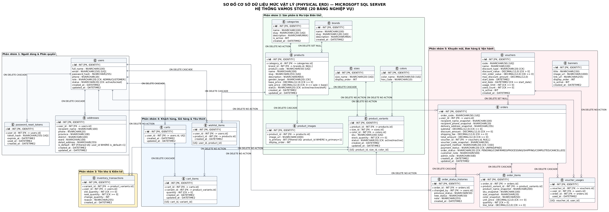
  <p><strong>Hình 4: Sơ đồ thực thể quan hệ ERD tổng thể (20 bảng nghiệp vụ CSDL)</strong></p>
</div>

* **Giải thích cấu trúc và vai trò các bảng trung tâm trong sơ đồ ERD tổng thể:**
  * **Vai trò của các bảng trung tâm:**
    * `users`: Đóng vai trò là đầu mối định danh người dùng toàn hệ thống, là gốc phát sinh của sổ địa chỉ (`addresses`), giỏ hàng (`carts`), danh sách yêu thích (`wishlist_items`), đơn hàng (`orders`) và người thực hiện thẻ kho (`inventory_transactions`).
    * `products`: Đại diện cho sản phẩm giày cha, lưu trữ các thông tin chung như tên gọi, đường dẫn slug, danh mục, thương hiệu, mức giá gốc và giá khuyến mãi.
    * `product_variants`: Đóng vai trò là "trái tim" của hệ thống kho hàng. Trong ngành giày dép, một đôi giày không thể bán chung chung mà bắt buộc khách hàng phải chọn đúng Size và Màu sắc. Bảng `product_variants` là giao điểm kết hợp giữa `products`, `sizes` và `colors`, quản lý mã SKU độc nhất và số lượng tồn kho khả dụng thời gian thực (`stock_quantity`).
    * `orders`: Đóng vai trò là đầu mối chứng từ giao dịch thương mại, ghi nhận tổng tiền, phương thức COD, trạng thái vận chuyển và các thông tin snapshot bất biến.
  * **Vì sao sản phẩm cần được quản lý theo biến thể Size và Màu sắc?**
    Nếu thiết kế bảng sản phẩm lưu trực tiếp số lượng tồn kho, hệ thống sẽ không thể biết được size 40 còn bao nhiêu đôi hay màu Đen đã hết hàng hay chưa. Do đó, việc tách thành thực thể biến thể `product_variants` (mỗi dòng đại diện cho đúng một tổ hợp Sản phẩm $\times$ Size $\times$ Màu) cho phép hệ thống kiểm soát chính xác mức tồn kho của từng quy cách, ngăn chặn tình trạng khách đặt mua đúng size giày đã hết trong kho.
  * **Cách dữ liệu từ giỏ hàng chuyển hóa thành dữ liệu đơn hàng:**
    Khi khách hàng duyệt web, các mặt hàng dự định mua được lưu trong bảng tạm `cart_items` (tham chiếu tới `product_variants.id` qua cột `variant_id`). Khi khách hàng tiến hành bấm Đặt hàng COD, hệ thống đọc dữ liệu từ `cart_items`, kiểm tra tồn kho, trừ kho, và sao chép toàn bộ thông tin sang bảng `order_items` (lưu snapshot tên sản phẩm, size, màu và đơn giá mua `unit_price`). Sau khi đơn hàng được tạo thành công, dữ liệu trong `cart_items` được làm rỗng để chuẩn bị cho lần mua sắm tiếp theo.

Nhằm giúp việc nghiên cứu cấu trúc dữ liệu được thuận tiện và chi tiết, nhóm phân rã sơ đồ tổng thể thành **4 sơ đồ phân hệ nghiệp vụ** dưới đây:

---

### A. Sơ đồ ERD phân hệ Người dùng & Sổ địa chỉ

Phân hệ bao gồm 3 bảng thực thể: `users`, `addresses` và `password_reset_tokens`.

<div align="center">
  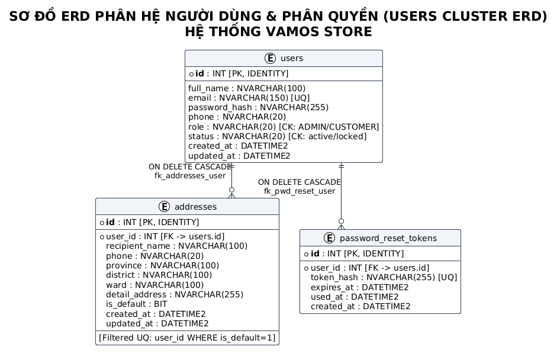
  <p><strong>Hình 5: Sơ đồ ERD phân hệ Người dùng & Sổ địa chỉ</strong></p>
</div>

* **Ý nghĩa:** Quản lý thông tin định danh thành viên. Một tài khoản `users` có thể liên kết với nhiều địa chỉ nhận hàng trong `addresses` (quan hệ 1:N), trong đó chỉ mục lọc `uq_user_default_address` bảo đảm tối đa một địa chỉ mặc định. Bảng `password_reset_tokens` liên kết với `users.id` để lưu trữ token khôi phục mật khẩu.

---

### B. Sơ đồ ERD phân hệ Danh mục, Thương hiệu & Sản phẩm

Phân hệ bao gồm 5 bảng thực thể: `categories`, `brands`, `products`, `product_images` và `banners`.

<div align="center">
  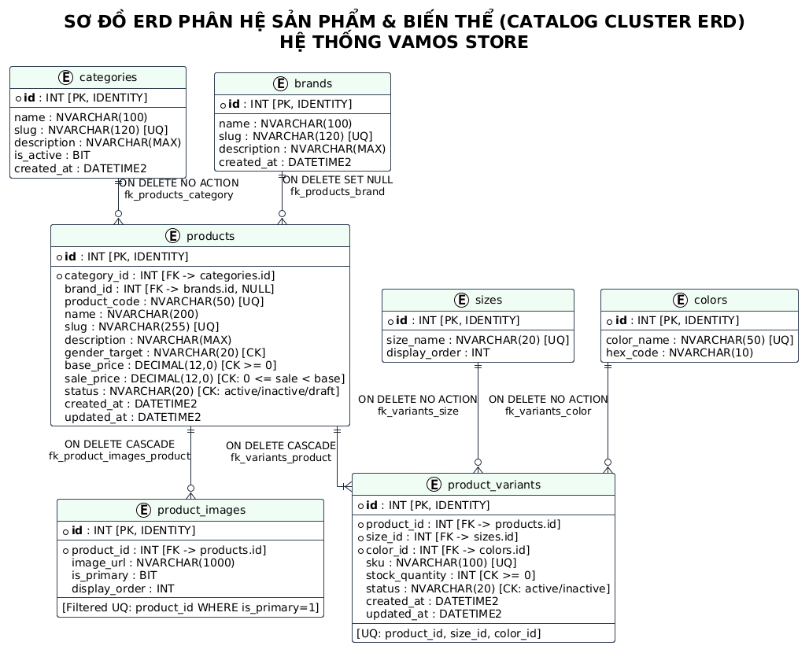
  <p><strong>Hình 6: Sơ đồ ERD phân hệ Danh mục, Thương hiệu & Sản phẩm</strong></p>
</div>

* **Ý nghĩa:** Tổ chức cây danh mục hàng hóa. Bảng `products` nhận khóa ngoại từ `categories.id` và `brands.id`. Mỗi sản phẩm có thể có nhiều ảnh trong `product_images` (quan hệ 1:N), với chỉ mục lọc `uq_product_primary_image` bảo đảm tối đa một ảnh đại diện chính. Bảng `banners` quản lý slider tiếp thị độc lập trên trang chủ.

---

### C. Sơ đồ ERD phân hệ Giỏ hàng & Biến thể tồn kho

Phân hệ bao gồm 6 bảng thực thể: `sizes`, `colors`, `product_variants`, `inventory_transactions`, `carts` và `cart_items`.

<div align="center">
  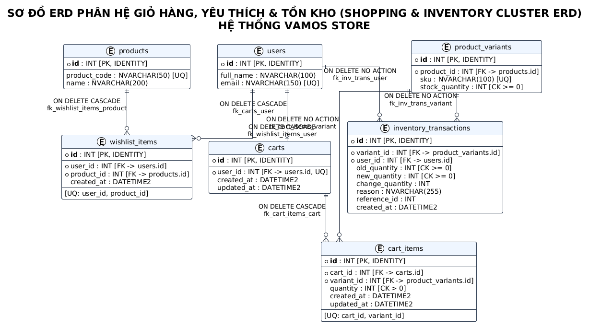
  <p><strong>Hình 7: Sơ đồ ERD phân hệ Giỏ hàng & Biến thể tồn kho</strong></p>
</div>

* **Ý nghĩa:** Mô hình hóa quy cách sản phẩm và cơ chế lưu trữ giỏ hàng. `product_variants` là điểm hội tụ của `products`, `sizes` và `colors`. Mọi biến động tăng giảm kho của biến thể đều được ghi nhận vào `inventory_transactions`. Bảng `cart_items` liên kết giữa giỏ hàng `carts` với biến thể `product_variants`.

---

### D. Sơ đồ ERD phân hệ Đơn hàng & Lịch sử trạng thái

Phân hệ bao gồm 6 bảng thực thể: `orders`, `order_items`, `order_status_histories`, `wishlist_items`, `vouchers` và `voucher_usages`.

<div align="center">
  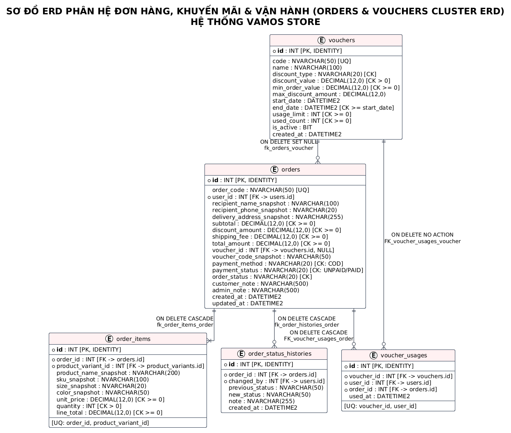
  <p><strong>Hình 8: Sơ đồ ERD phân hệ Đơn hàng & Lịch sử trạng thái</strong></p>
</div>

* **Ý nghĩa:** Quản lý giao dịch và khuyến mãi. Đơn hàng `orders` liên kết với nhiều dòng món hàng trong `order_items` và timeline trạng thái trong `order_status_histories`. Bảng `voucher_usages` lưu vết khách hàng đã áp dụng voucher nào vào đơn hàng nào để chống việc dùng lặp lại.

---

## 2.3. PHÂN TÍCH CÁC NHÓM THỰC THỂ NGHIỆP VỤ THỰC TẾ

Toàn bộ **20 bảng cơ sở dữ liệu nghiệp vụ** trong DDL của dự án VAMOS STORE được phân chia thành 7 nhóm thực thể rõ ràng như sau:

---

### Bảng 3: Danh mục 20 bảng nghiệp vụ cơ sở dữ liệu VAMOS STORE (SQL Server 2022)

| STT | Tên bảng CSDL | Tên tiếng Việt | Nhóm nghiệp vụ | Vai trò cốt lõi trong hệ thống |
| :---: | :--- | :--- | :--- | :--- |
| 1 | `users` | Tài khoản người dùng | Tài khoản | Lưu thông tin định danh, email duy nhất, mật khẩu hash Bcrypt, vai trò phân quyền |
| 2 | `addresses` | Sổ địa chỉ giao hàng | Tài khoản | Lưu nhiều địa chỉ nhận hàng, tối đa 1 mặc định qua Filtered Index |
| 3 | `password_reset_tokens` | Token khôi phục mật khẩu | Tài khoản | Lưu mã băm token SHA-256 khôi phục mật khẩu (Thiết kế dữ liệu) |
| 4 | `categories` | Danh mục sản phẩm | Catalog | Phân tầng danh mục giày (Giày chạy bộ, Sneaker, Sandal...) |
| 5 | `brands` | Thương hiệu sản phẩm | Catalog | Danh sách thương hiệu đối tác (Nike, Adidas, Biti's...) |
| 6 | `products` | Sản phẩm giày gốc | Catalog | Lưu thông tin sản phẩm cha: tên, slug, giới tính, giá gốc, giá khuyến mãi |
| 7 | `product_images` | Bộ sưu tập ảnh sản phẩm | Catalog | Lưu URL ảnh, tối đa 1 ảnh đại diện chính qua Filtered Index |
| 8 | `sizes` | Kích cỡ giày sneaker | Biến thể & Kho | Danh mục size giày chuẩn (size_name: 38, 39, 40... 45) |
| 9 | `colors` | Màu sắc giày | Biến thể & Kho | Danh mục màu sắc (color_name: Đen, Trắng, Đỏ...) kèm mã màu HEX |
| 10 | `product_variants` | Biến thể sản phẩm (SKU) | Biến thể & Kho | Bảng thực thể trung tâm: kết hợp Product x Size x Color, tồn kho khả dụng |
| 11 | `inventory_transactions` | Thẻ kho kiểm toán | Biến thể & Kho | Lưu vết kiểm toán biến động kho: số lượng cũ, mới, thay đổi, lý do |
| 12 | `carts` | Giỏ hàng người dùng | Mua sắm | Giỏ hàng cá nhân bền vững trên CSDL (quan hệ 1:1 nghiêm ngặt với users) |
| 13 | `cart_items` | Chi tiết mặt hàng trong giỏ | Mua sắm | Lưu các biến thể (`variant_id`) và số lượng (1-10 đôi) đang chọn trong giỏ |
| 14 | `wishlist_items` | Sản phẩm yêu thích | Mua sắm | Lưu danh sách sản phẩm yêu thích được đánh dấu bởi khách hàng thành viên |
| 15 | `orders` | Đơn hàng | Đơn hàng | Bảng đầu mối đơn hàng: mã đơn, tổng tiền, COD, snapshot địa chỉ nhận hàng |
| 16 | `order_items` | Snapshot chi tiết đơn hàng | Đơn hàng | Lưu bản sao bất biến từng món hàng đặt (unit_price, size, màu snapshot) |
| 17 | `order_status_histories` | Lịch sử chuyển trạng thái | Đơn hàng | Lưu nhật ký thời gian chuyển đổi máy trạng thái và người thao tác |
| 18 | `vouchers` | Mã giảm giá khuyến mãi | Khuyến mãi | Cấu hình ưu đãi: mã, loại giảm, mức trần, hạn mức đơn tối thiểu, hạn dùng |
| 19 | `voucher_usages` | Lịch sử sử dụng voucher | Khuyến mãi | Lưu vết khách hàng đã áp dụng voucher vào đơn hàng nào (chống lạm dụng) |
| 20 | `banners` | Banner quảng bá trang chủ | Tiếp thị | Quản lý slider marketing trên trang chủ theo thứ tự hiển thị |

_Bảng 3: Danh mục 20 bảng nghiệp vụ cơ sở dữ liệu VAMOS STORE (SQL Server 2022)_

---

### Phân tích chi tiết 7 nhóm thực thể:

**Nhóm 1. Tài khoản và địa chỉ (Accounts & Addresses)**
* `users`: Lưu trữ danh tính người dùng toàn hệ thống gồm: `id` (PK), `full_name`, `email` (UNIQUE), `password_hash` (mã băm Bcrypt), `phone`, `role` (nhận giá trị `'CUSTOMER'` hoặc `'ADMIN'`), `status` (nhận giá trị `'active'` hoặc `'locked'`), `created_at`, `updated_at`.
* `addresses`: Quản lý danh sách các địa chỉ giao hàng của khách hàng gồm: `id` (PK), `user_id` (FK), `recipient_name`, `phone`, `province`, `district`, `ward`, `detail_address`, `is_default`, `created_at`, `updated_at`.
* `password_reset_tokens`: Lưu trữ dữ liệu phục vụ quy trình khôi phục mật khẩu trong thiết kế gồm: `id` (PK), `user_id` (FK), `token_hash` (NVARCHAR(255) NOT NULL UNIQUE - bản băm SHA-256 của token), `expires_at`, `used_at` (thời điểm đã dùng), `created_at`.

**Nhóm 2. Danh mục và thương hiệu (Catalog)**
* `categories`: Phân loại giày dép (Sneaker, Giày thể thao, Giày tây, Dép thời trang) gồm: `id` (PK), `name`, `slug` (UNIQUE), `description`, `is_active`, `created_at`.
* `brands`: Quản lý các nhãn hiệu đối tác sản xuất (Nike, Adidas, Puma, Biti's, Converse) gồm: `id` (PK), `name`, `slug` (UNIQUE), `description`, `created_at`.

**Nhóm 3. Sản phẩm và biến thể (Products & Variants)**
* `products`: Lưu thông tin chung của mẫu giày cha gồm: `id` (PK), `category_id` (FK), `brand_id` (FK), `product_code` (UNIQUE), `name`, `slug` (UNIQUE), `description`, `gender_target` (MEN, WOMEN, KIDS, UNISEX), `base_price`, `sale_price`, `status` (active, inactive, draft).
* `product_images`: Bộ sưu tập ảnh của sản phẩm gồm: `id` (PK), `product_id` (FK), `image_url` (NVARCHAR(1000)), `is_primary` (BIT), `display_order`.
* `sizes`: Danh mục các cỡ giày chuẩn gồm: `id` (PK), `size_name` (NVARCHAR(20) NOT NULL UNIQUE - ví dụ: "38", "39", "40", "41", "42"), `display_order`.
* `colors`: Danh mục màu sắc phối gồm: `id` (PK), `color_name` (NVARCHAR(50) NOT NULL UNIQUE - ví dụ: "Trắng / Đen", "Xám khói"), `hex_code` (mã màu HEX để hiển thị chấm màu giao diện).
* `product_variants`: Thực thể biến thể SKU kết hợp gồm: `id` (PK), `product_id` (FK), `size_id` (FK), `color_id` (FK), `sku` (NVARCHAR(100) NOT NULL UNIQUE), `stock_quantity` (số lượng tồn kho), `status` (active, inactive). Ràng buộc UNIQUE tổ hợp `(product_id, size_id, color_id)`.

**Nhóm 4. Kho và giao dịch tồn kho (Inventory)**
* `inventory_transactions`: Thẻ kho lưu vết biến động tồn kho gồm: `id` (PK), `variant_id` (FK trỏ tới `product_variants.id`), `user_id` (FK trỏ tới `users.id` - người tạo giao dịch), `old_quantity` (tồn trước khi đổi), `new_quantity` (tồn sau khi đổi), `change_quantity` (số lượng thay đổi: âm khi bán, dương khi nhập/hoàn), `reason` (lý do xuất/nhập/kiểm kê), `created_at`.

**Nhóm 5. Giỏ hàng (Shopping Cart)**
* `carts`: Giỏ hàng cá nhân gồm: `id` (PK), `user_id` (INT NOT NULL UNIQUE FK trỏ tới `users.id`, thiết lập quan hệ 1:1 nghiêm ngặt), `created_at`, `updated_at`.
* `cart_items`: Các mặt hàng cụ thể trong giỏ gồm: `id` (PK), `cart_id` (FK), `variant_id` (FK trỏ tới `product_variants.id`), `quantity` (số lượng đặt, từ 1 đến 10), `created_at`, `updated_at`. Ràng buộc UNIQUE `(cart_id, variant_id)`.

**Nhóm 6. Đơn hàng (Orders & Histories)**
* `orders`: Đầu mối đơn hàng gồm: `id` (PK), `order_code` (NVARCHAR(50) NOT NULL UNIQUE), `user_id` (FK), các trường snapshot người nhận (`recipient_name_snapshot`, `recipient_phone_snapshot`, `delivery_address_snapshot` NVARCHAR(255) NOT NULL), `subtotal`, `discount_amount`, `shipping_fee`, `total_amount`, `voucher_id` (FK), `voucher_code_snapshot`, `payment_method` ('COD'), `payment_status` ('UNPAID', 'PAID'), `order_status` ('PENDING', 'CONFIRMED', 'PROCESSING', 'SHIPPING', 'COMPLETED', 'CANCELLED'), `customer_note`, `admin_note`, `created_at`, `updated_at`.
* `order_items`: Chi tiết từng sản phẩm trong đơn gồm: `id` (PK), `order_id` (FK), `product_variant_id` (FK trỏ tới `product_variants.id`), snapshot tên sản phẩm (`product_name_snapshot`), mã SKU (`sku_snapshot`), size (`size_snapshot`), màu (`color_snapshot`), đơn giá mua (`unit_price` DECIMAL(12, 0) NOT NULL), số lượng (`quantity`), thành tiền (`line_total`).
* `order_status_histories`: Nhật ký timeline trạng thái gồm: `id` (PK), `order_id` (FK), `changed_by` (FK trỏ tới `users.id`), `previous_status`, `new_status`, `note`, `created_at`.

**Nhóm 7. Khuyến mãi, yêu thích và giao diện trang chủ (Promotions & Extras)**
* `vouchers`: Bảng chính sách mã giảm giá gồm: `id` (PK), `code` (NVARCHAR(50) NOT NULL UNIQUE), `name`, `discount_type` ('percentage' hoặc 'fixed_amount'), `discount_value`, `min_order_value`, `max_discount_amount`, `start_date`, `end_date`, `usage_limit`, `used_count`, `is_active`, `created_at`.
* `voucher_usages`: Lịch sử áp dụng voucher gồm: `id` (PK), `voucher_id` (FK), `user_id` (FK), `order_id` (FK), `used_at`. Ràng buộc UNIQUE `(voucher_id, user_id)` bảo đảm mỗi khách hàng chỉ dùng mỗi voucher tối đa một lần.
* `wishlist_items`: Danh sách sản phẩm ưa thích gồm: `id` (PK), `user_id` (FK), `product_id` (FK), `created_at`. Ràng buộc UNIQUE `(user_id, product_id)`.
* `banners`: Quản lý slider tiếp thị gồm: `id` (PK), `title`, `image_url` (NVARCHAR(1000)), `link_url`, `display_order`, `is_active`, `created_at`.

---

## 2.4. PHÂN TÍCH CÁC MỐI QUAN HỆ TIÊU BIỂU

Thay vì liệt kê khóa ngoại một cách máy móc, nhóm chúng em xin được phân tích ý nghĩa nghiệp vụ của các mối quan hệ liên kết tiêu biểu nhất trong hệ thống:

### 1. Quan hệ giữa Người dùng và Sổ địa chỉ (`users` $\rightarrow$ `addresses`: 1:N)
* **Ý nghĩa nghiệp vụ:** Trong thực tế mua sắm trực tuyến, một khách hàng có thể có nhiều địa chỉ nhận hàng khác nhau (địa chỉ nhà riêng, địa chỉ công ty, địa chỉ gửi tặng người thân). Do đó, hệ thống thiết kế quan hệ 1:N: Một tài khoản `users` có thể sở hữu nhiều bản ghi `addresses`.
* **Cơ chế ràng buộc:** Khi tài khoản người dùng bị xóa, toàn bộ sổ địa chỉ liên quan sẽ được tự động xóa theo (`ON DELETE CASCADE`) để tránh dữ liệu rác mồ côi.

### 2. Quan hệ giữa Sản phẩm cha và Biến thể SKU (`products` $\rightarrow$ `product_variants`: 1:N)
* **Ý nghĩa nghiệp vụ:** Một mẫu giày sneaker (ví dụ: "Nike Air Force 1 '07") là một sản phẩm cha trong bảng `products`. Khi đưa vào kinh doanh thực tế, mẫu giày này có 5 kích cỡ size (39, 40, 41, 42, 43) và 2 màu sắc (Trắng, Đen). Sự kết hợp này sinh ra $5 \times 2 = 10$ mã SKU độc lập trong bảng `product_variants`.
* **Cơ chế ràng buộc:** Mỗi biến thể mang một mã SKU duy nhất và lưu số lượng tồn kho riêng. Khi sản phẩm cha bị xóa khỏi hệ thống, toàn bộ 10 biến thể con sẽ được tự động xóa theo (`ON DELETE CASCADE`).

### 3. Quan hệ giữa Giỏ hàng và Biến thể sản phẩm (`carts` $\rightarrow$ `cart_items` $\leftarrow$ `product_variants`)
* **Ý nghĩa nghiệp vụ:** Một khách hàng chỉ có duy nhất một giỏ hàng cá nhân (`carts.user_id` UNIQUE). Giỏ hàng này chứa nhiều món hàng khác nhau thông qua bảng liên kết `cart_items`. Mỗi món hàng trong giỏ tham chiếu trực tiếp đến một biến thể SKU cụ thể (`cart_items.variant_id` $\rightarrow$ `product_variants.id`) kèm theo số lượng đặt mua từ 1 đến 10 đôi.
* **Cơ chế ràng buộc:** Ràng buộc UNIQUE `(cart_id, variant_id)` đảm bảo rằng nếu khách hàng chọn thêm một sản phẩm đã có trong giỏ, hệ thống sẽ thực hiện cộng dồn số lượng thay vì tạo ra hai dòng sản phẩm giống hệt nhau.

### 4. Quan hệ giữa Đơn hàng và Chi tiết đơn hàng (`orders` $\rightarrow$ `order_items`: 1:N)
* **Ý nghĩa nghiệp vụ:** Một đơn hàng có thể gồm nhiều đôi giày khác nhau. Bảng `order_items` lưu trữ danh sách các mặt hàng này.
* **Cơ chế Snapshot bảo toàn dữ liệu lịch sử:** Điểm thiết kế quan trọng nhất ở quan hệ này là tính chất **Snapshot bất biến**. Bảng `order_items` lưu trữ trực tiếp cột `unit_price` (đơn giá tại thời điểm khách bấm mua), `product_name_snapshot`, `size_snapshot`, `color_snapshot`. Nếu sau này cửa hàng tăng giá sản phẩm trong bảng `products` từ 1.000.000đ lên 1.200.000đ, giá trị trong `order_items.unit_price` của các đơn hàng cũ vẫn giữ nguyên 1.000.000đ, bảo đảm tính toàn vẹn kế toán và tránh tranh chấp tài chính.

### 5. Quan hệ giữa Đơn hàng và Lịch sử trạng thái (`orders` $\rightarrow$ `order_status_histories`: 1:N)
* **Ý nghĩa nghiệp vụ:** Đơn hàng COD trải qua nhiều giai đoạn xử lý theo thời gian. Mỗi khi đơn hàng chuyển đổi trạng thái (ví dụ từ `PENDING` sang `CONFIRMED`), một bản ghi mới được tự động thêm vào `order_status_histories` để lưu vết thời gian, người thực hiện (`changed_by`), trạng thái trước, trạng thái sau và ghi chú. Điều này phục vụ việc hiển thị thanh tiến trình vận chuyển cho khách hàng và lưu vết kiểm toán cho ban quản trị.

### 6. Quan hệ giữa Voucher và Người dùng (`vouchers` $\rightarrow$ `voucher_usages` $\leftarrow$ `users`)
* **Ý nghĩa nghiệp vụ:** Để ngăn chặn tình trạng một khách hàng gian lận sử dụng cùng một mã giảm giá nhiều lần trên các đơn hàng khác nhau, bảng `voucher_usages` đóng vai trò là bảng liên kết N:N giữa người dùng, voucher và đơn hàng. Ràng buộc UNIQUE `(voucher_id, user_id)` bảo đảm mỗi tài khoản chỉ được kích hoạt thành công mã ưu đãi đó đúng một lần duy nhất.

---

## 2.5. KHÓA VÀ RÀNG BUỘC TOÀN VẸN DỮ LIỆU

Trong quá trình thiết kế cơ sở dữ liệu trên Microsoft SQL Server 2022, nhóm chúng em đã áp dụng đầy đủ các kỹ thuật khóa và ràng buộc toàn vẹn nhằm bảo đảm dữ liệu luôn chính xác và nhất quán:

* **Khóa chính (Primary Key - PK):** Mọi bảng trong hệ thống đều có một khóa chính kiểu số nguyên tự tăng `INT IDENTITY(1,1)` để định danh duy nhất từng bản ghi, giúp tối ưu hóa hiệu năng đánh chỉ mục Clustered Index.
* **Khóa ngoại (Foreign Key - FK):** Thiết lập liên kết tham chiếu giữa các bảng cha và con, ngăn chặn việc chèn các bản ghi mồ côi (ví dụ: không thể thêm một món hàng vào giỏ nếu biến thể sản phẩm đó không tồn tại trong `product_variants`).
* **Ràng buộc duy nhất (UNIQUE Constraint):** Áp dụng trên các trường dữ liệu mang tính định danh tự nhiên:
  * `users.email`: Đảm bảo không thể có hai người dùng đăng ký cùng một địa chỉ email.
  * `product_variants.sku`: Đảm bảo mỗi biến thể giày có một mã vạch SKU độc nhất trên toàn hệ thống.
  * `vouchers.code`: Đảm bảo mỗi mã giảm giá là duy nhất.
  * Tổ hợp `(product_id, size_id, color_id)`: Đảm bảo không thể tạo trùng hai biến thể cùng size và màu cho một sản phẩm.
  * Tổ hợp `(cart_id, variant_id)`: Đảm bảo giỏ hàng không bị trùng lặp dòng sản phẩm.
* **Ràng buộc kiểm tra (CHECK Constraint):** Kiểm soát miền giá trị hợp lệ ở tầng CSDL:
  * `orders.order_status`: Chỉ chấp nhận đúng 6 giá trị: `'PENDING'`, `'CONFIRMED'`, `'PROCESSING'`, `'SHIPPING'`, `'COMPLETED'`, `'CANCELLED'`.
  * `product_variants.stock_quantity >= 0`: Ngăn chặn số lượng tồn kho bị âm.
  * `chk_vouchers_dates`: Bảo đảm ngày kết thúc voucher luôn lớn hơn hoặc bằng ngày bắt đầu (`end_date >= start_date`).

---

### Hai chỉ mục lọc duy nhất đặc thù (Filtered Unique Indexes in SQL Server 2022)

Trong quá trình giải quyết bài toán nghiệp vụ thực tế, các ràng buộc UNIQUE thông thường của SQL không thể xử lý được yêu cầu "chỉ duy nhất một bản ghi mang cờ kích hoạt trong một tập hợp". Nhóm chúng em đã ứng dụng tính năng **Filtered Unique Index** của Microsoft SQL Server để xử lý thành công hai nghiệp vụ phức tạp:

#### 1. Kiểm soát địa chỉ mặc định của người dùng (`uq_user_default_address`)
* **Yêu cầu nghiệp vụ:** Mỗi khách hàng có thể lưu nhiều địa chỉ nhận hàng (`is_default = 0`), nhưng **bảo đảm tối đa một địa chỉ mặc định (`is_default = 1`) cho mỗi người dùng**.
* **Giải thích ý nghĩa:** Khách hàng có thể có 0 địa chỉ mặc định (khi mới tạo tài khoản hoặc chưa đánh dấu địa chỉ nào là mặc định). Khi khách hàng chọn một địa chỉ làm mặc định, số lượng địa chỉ mặc định bằng 1. Chỉ mục lọc ngăn chặn tuyệt đối trường hợp một người dùng có từ 2 địa chỉ mặc định trở lên:
```sql
CREATE UNIQUE NONCLUSTERED INDEX uq_user_default_address
ON addresses (user_id)
WHERE is_default = 1;
```
> *Cơ chế hoạt động:* Chỉ mục này chỉ đưa vào cây B-Tree các bản ghi thỏa mãn điều kiện `is_default = 1`. Khi người dùng cố gắng cập nhật thêm một bản ghi thứ hai có `is_default = 1`, SQL Server sẽ phát hiện trùng lặp `user_id` trong cây chỉ mục và ném lỗi vi phạm UNIQUE ngay lập tức. Điều này bảo đảm tối đa một địa chỉ mặc định cho mỗi user mà không bắt buộc người dùng phải luôn có ít nhất một.

#### 2. Kiểm soát ảnh đại diện chính của sản phẩm (`uq_product_primary_image`)
* **Yêu cầu nghiệp vụ:** Một đôi giày có thể có nhiều ảnh chụp chi tiết (`is_primary = 0`), nhưng **bảo đảm tối đa một ảnh đại diện chính (`is_primary = 1`) cho mỗi sản phẩm**.
* **Giải thích ý nghĩa:** Sản phẩm có thể chưa có ảnh hoặc chưa chỉ định ảnh chính (số lượng ảnh chính bằng 0). Khi chỉ định ảnh bìa, số lượng ảnh chính bằng 1. Chỉ mục lọc ngăn chặn lỗi hiển thị hai ảnh bìa đè lên nhau trên storefront:
```sql
CREATE UNIQUE NONCLUSTERED INDEX uq_product_primary_image
ON product_images (product_id)
WHERE is_primary = 1;
```

---

### Bảng 4: Bảng đối soát tên cột khóa ngoại thực tế trong cấu trúc DDL

Để bảo đảm tính chuẩn xác 100% giữa nội dung báo cáo và mã nguồn SQL Server thực tế trong dự án, nhóm chúng em tổng hợp bảng đối soát các tên cột quan trọng dễ gây nhầm lẫn:

| Bảng nguồn | Tên cột thực tế trong DDL | Kiểu dữ liệu SQL Server | Bảng & Cột tham chiếu | Giải thích và quy chuẩn đối soát |
| :--- | :--- | :--- | :--- | :--- |
| `cart_items` | **`variant_id`** | `INT NOT NULL` | `product_variants(id)` | Tên cột là `variant_id`, KHÔNG dùng `product_variant_id` |
| `inventory_transactions` | **`variant_id`** | `INT NOT NULL` | `product_variants(id)` | Tên cột là `variant_id`, KHÔNG dùng `product_variant_id` |
| `order_items` | **`product_variant_id`** | `INT NOT NULL` | `product_variants(id)` | Tên cột là `product_variant_id`, KHÔNG dùng `variant_id` |
| `order_items` | **`unit_price`** | `DECIMAL(12, 0) NOT NULL` | — *(Bản sao snapshot)* | Tên cột là `unit_price`, KHÔNG dùng `price_at_purchase` |
| `password_reset_tokens` | **`token_hash`** | `NVARCHAR(255) NOT NULL` | — *(Bản băm SHA-256)* | Tên cột là `token_hash` UNIQUE, KHÔNG tồn tại cột `token` |
| `password_reset_tokens` | **`used_at`** | `DATETIME2 NULL` | — *(Thời điểm sử dụng)* | Tên cột là `used_at`, KHÔNG dùng cột `is_used` |
| `orders` | **`delivery_address_snapshot`** | `NVARCHAR(255) NOT NULL` | — *(Bản sao snapshot)* | Snapshot địa chỉ bất biến độ dài tối đa 255 ký tự |
| `order_status_histories` | **`changed_by`** | `INT NOT NULL` | `users(id)` | Tên cột là `changed_by`, KHÔNG dùng `changed_by_user_id` |
| `order_status_histories` | **`previous_status`** | `NVARCHAR(50) NULL` | — | Tên cột là `previous_status`, KHÔNG dùng `from_status` |
| `order_status_histories` | **`new_status`** | `NVARCHAR(50) NOT NULL` | — | Tên cột là `new_status`, KHÔNG dùng `to_status` |
| `sizes` | **`size_name`** | `NVARCHAR(20) NOT NULL` | — *(UNIQUE)* | Tên cột là `size_name`, KHÔNG dùng `size_value` |
| `colors` | **`color_name`** | `NVARCHAR(50) NOT NULL` | — *(UNIQUE)* | Tên cột là `color_name`, KHÔNG dùng `name` |

_Bảng 4: Bảng đối soát tên cột khóa ngoại thực tế trong cấu trúc DDL_

---

## 2.6. NHẬN XÉT VỀ THIẾT KẾ CƠ SỞ DỮ LIỆU

Tổng kết lại quá trình thiết kế cơ sở dữ liệu cho dự án VAMOS STORE:

1. **Tính cấu trúc và phân nhóm nghiệp vụ khoa học:** CSDL gồm đúng 20 bảng nghiệp vụ, được phân bổ mạch lạc thành 7 nhóm thực thể. Thiết kế này giúp các thành viên trong nhóm dễ dàng nắm bắt, phân chia công việc lập trình controller/model mà không bị chồng chéo.
2. **Giải quyết triệt để bài toán biến thể giày dép và tồn kho:** Mô hình hóa thành công thực thể trung tâm `product_variants` kết hợp với `inventory_transactions` giúp hệ thống quản lý tồn kho theo từng kích cỡ và màu sắc một cách minh bạch, loại bỏ hoàn toàn nguy cơ bán vượt tồn kho.
3. **Bảo toàn dữ liệu lịch sử bằng kỹ thuật Snapshot:** Việc lưu trữ bản sao địa chỉ nhận hàng và đơn giá mua trong `orders` và `order_items` giúp hệ thống hoàn toàn miễn nhiễm trước những thay đổi về giá hoặc thông tin cá nhân của người dùng trong tương lai.
4. **Cơ sở cho việc xây dựng logic xử lý:** Cấu trúc bảng và các ràng buộc dữ liệu chặt chẽ ở Phần 2 này là nền tảng trực tiếp để nhóm thiết kế các luồng giao dịch nguyên tử trong **Phần 3: Sơ đồ Hoạt động (Activity Diagram)** tiếp theo.


# PHẦN 3. MÔ HÌNH HÓA QUY TRÌNH – ACTIVITY DIAGRAM

---

## 3.1. GIỚI THIỆU ACTIVITY DIAGRAM

Nếu như mô hình Use Case ở Phần 1 giúp chúng ta trả lời câu hỏi *"Hệ thống có những chức năng gì?"* và mô hình ERD ở Phần 2 trả lời câu hỏi *"Hệ thống lưu trữ những dữ liệu gì?"*, thì **Sơ đồ Hoạt động (Activity Diagram)** chính là công cụ đắc lực để trả lời câu hỏi then chốt: *"Hệ thống xử lý các nghiệp vụ theo trình tự như thế nào?"*.

Trong công nghệ phần mềm và chuẩn mô hình hóa UML, Activity Diagram được nhóm sinh viên chúng em sử dụng để mô tả chi tiết khía cạnh động (Dynamic Aspect) của các luồng nghiệp vụ. Một sơ đồ hoạt động hoàn chỉnh bao gồm các thành phần chuẩn mực:
* **Điểm bắt đầu (Initial Node):** Ký hiệu bằng hình tròn đen đặc, đánh dấu điểm khởi nguồn khi người dùng bắt đầu thực hiện thao tác.
* **Các hoạt động (Action/Activity Nodes):** Các hình chữ nhật bo tròn thể hiện từng bước xử lý cụ thể của người dùng hoặc hệ thống.
* **Nút rẽ nhánh quyết định (Decision Nodes):** Hình thoi biểu diễn các điểm kiểm tra điều kiện (Guard Conditions). Dòng xử lý sẽ tách thành các nhánh Đúng (`[true]`) hoặc Sai (`[false]`) tùy thuộc vào kết quả kiểm tra.
* **Điểm kết thúc (Final Node):** Ký hiệu bằng hình tròn có vòng viền bao quanh tâm đen, đánh dấu điểm kết thúc trọn vẹn của quy trình.
* **Kỹ thuật phân làn trực quan (2 Swimlanes):** Theo định hướng tinh gọn, đơn giản hóa và tập trung sâu vào nghiệp vụ cốt lõi, nhóm chúng em chuẩn hóa cấu trúc sơ đồ thành **2 phân làn xử lý rõ ràng**:
  1. *Làn Người dùng (`User` / `Customer` / `Admin`):* Thể hiện hành vi trực quan của người dùng như nhập form dữ liệu, lựa chọn bộ lọc, thêm sản phẩm vào giỏ hoặc bấm nút xác nhận thao tác trên giao diện.
  2. *Làn Hệ thống (`VAMOS STORE System`):* Thể hiện chuỗi xử lý khép kín của máy chủ và CSDL, bao gồm kiểm tra tính hợp lệ dữ liệu (Validation), thực thi các giao dịch (Transactions), kiểm tra tồn kho tức thời, cập nhật trạng thái đơn hàng và trả về thông báo phản hồi.
Luồng điều khiển đi thẳng từ trên xuống dưới một cách mạch lạc, rẽ nhánh trực quan qua các hình thoi Quyết định (Decision) với 2 nhánh phân định rõ: [Đúng / Hợp lệ] và [Sai / Lỗi], giúp người đọc và hội đồng thẩm định có thể nắm bắt và kiểm tra quy trình chỉ trong 30 giây.

---

### Bảng 5: Danh mục các quy trình hoạt động nghiệp vụ trọng yếu (Activity Diagrams)

Dưới đây là 7 quy trình hoạt động nghiệp vụ trọng tâm nhất của hệ thống VAMOS STORE được mô hình hóa qua 9 sơ đồ chuẩn:

| STT | Tên quy trình nghiệp vụ | Mã sơ đồ | Tác nhân chính | Trọng tâm kiểm soát kỹ thuật |
| :---: | :--- | :---: | :---: | :--- |
| 1 | **Đăng ký tài khoản** | `AD01` | Khách vãng lai | Validation server-side, băm mật khẩu Bcrypt, cấp giỏ hàng rỗng 1:1 |
| 2 | **Đăng nhập & Hợp nhất giỏ** | `AD02` | Khách / Admin | Đối soát Bcrypt, cấp Express Session (`vamos_sid`), gộp giỏ hàng tự động |
| 3 | **Tìm kiếm & Xem sản phẩm** | `AD05` | Khách / Khách hàng | Truy vấn tham số hóa động, phân trang, truy vấn biến thể tồn kho realtime |
| 4 | **Quản lý giỏ hàng trực tuyến** | `AD06` | Khách / Khách hàng | Phân nhánh Session (Guest) và CSDL (Customer), ràng buộc 1-10 đôi/mặt hàng |
| 5 | **Đặt hàng COD nguyên tử** | `AD08` | Khách hàng | Transaction CSDL khóa bi quan, trừ kho tức thời, ghi thẻ kho, tạo snapshot |
| 6 | **Hủy đơn hàng và hoàn kho** | `AD10` | Khách hàng | Chỉ hủy đơn PENDING, hoàn trả tồn kho tự động, ghi thẻ kho, hoàn voucher |
| 7 | **Admin xử lý & FSM đơn hàng** | `AD11` | Quản trị viên | Kiểm soát máy trạng thái 6 bước, cập nhật thanh toán COD, chống trừ kho kép |
| 8 | **Quản lý kho & Thẻ kho** | `AD12` | Quản trị viên | Cảnh báo tồn kho thấp, điều chỉnh tăng/giảm kho kèm lưu vết bắt buộc |
| 9 | **Quản lý danh mục & Sản phẩm** | `AD13` | Quản trị viên | Sinh ma trận SKU, tải bộ ảnh, kiểm soát ảnh chính qua Filtered Index |

_Bảng 5: Danh mục các quy trình hoạt động nghiệp vụ trọng yếu (Activity Diagrams)_

---

## 3.2. PHÂN TÍCH CÁC QUY TRÌNH HOẠT ĐỘNG NGHIỆP VỤ

### 1. Quy trình Đăng ký tài khoản (AD01)

**a. Mục đích:** Thiết lập tài khoản thành viên mới cho người dùng, đảm bảo thông tin cá nhân hợp lệ, mật khẩu được bảo vệ an toàn và tự động khởi tạo giỏ hàng cá nhân sẵn sàng cho việc mua sắm.

**b. Tác nhân tham gia:** Khách vãng lai (`Guest`), Máy chủ ứng dụng Web (`Express Server`), Cơ sở dữ liệu (`SQL Server`).

**c. Sơ đồ hoạt động:**

<div align="center">
  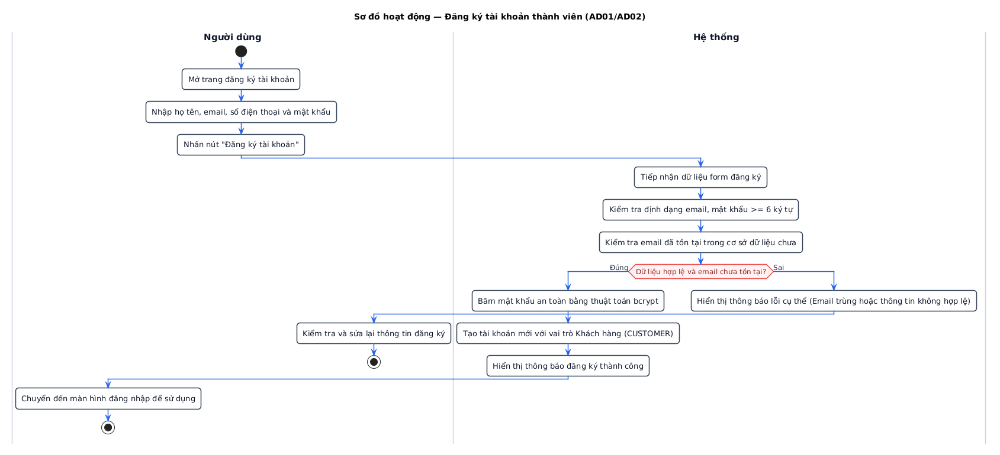
  <p><strong>Hình 9: Sơ đồ hoạt động — Quy trình Đăng ký tài khoản (AD01)</strong></p>
</div>

**d. Giải thích luồng xử lý chi tiết:**
* *Điểm bắt đầu:* Khách vãng lai truy cập vào trang Đăng ký tài khoản (`/auth/register`), điền đầy đủ thông tin vào form (Họ tên, Email, Số điện thoại, Mật khẩu, Nhập lại mật khẩu) và nhấn nút "Đăng ký".
* *Kiểm tra dữ liệu đầu vào:* Tầng Controller tại Web Application tiếp nhận request và thực hiện kiểm tra tính hợp lệ (Validation). Nếu dữ liệu không thỏa mãn (ví dụ họ tên dưới 2 ký tự, mật khẩu dưới 6 ký tự hoặc hai lần nhập mật khẩu không khớp), luồng rẽ nhánh về phía thất bại, trả về biểu mẫu kèm thông báo lỗi cụ thể để người dùng sửa lại.
* *Kiểm tra tính duy nhất của Email:* Nếu dữ liệu hợp lệ, Web Application gửi câu lệnh truy vấn tới SQL Server: `SELECT id FROM users WHERE email = @email`. Nếu email đã tồn tại, hệ thống từ chối và hiển thị thông báo lỗi trùng lặp.
* *Băm mật khẩu và thực thi giao dịch:* Khi email chưa tồn tại, máy chủ tiến hành băm mật khẩu một chiều bằng thư viện `bcryptjs` với hệ số làm chậm `saltRounds = 10`. Tiếp đó, máy chủ mở Transaction CSDL để thực thi đồng thời hai thao tác:
  1. `INSERT INTO users (full_name, email, password_hash, phone, role, status)` với `role = 'CUSTOMER'` và `status = 'active'`.
  2. `INSERT INTO carts (user_id)` cấp phát một giỏ hàng rỗng cá nhân (quan hệ 1:1).
* *Khởi tạo phiên và kết thúc:* SQL Server xác nhận commit thành công. Máy chủ thiết lập phiên đăng nhập tự động (`req.session.user`), gửi cookie phiên `vamos_sid` về trình duyệt và chuyển hướng khách hàng về trang chủ với thông báo chào mừng.

**e. Kết quả nghiệp vụ:** Một tài khoản khách hàng mới được ghi nhận an toàn trong CSDL, mật khẩu gốc không bao giờ bị lưu lộ, một giỏ hàng cá nhân đã sẵn sàng hoạt động.

---

### 2. Quy trình Đăng nhập hệ thống & Hợp nhất giỏ hàng (AD02)

**a. Mục đích:** Xác minh danh tính người dùng qua email và mật khẩu, cấp phiên làm việc bảo mật, phân quyền truy cập chính xác và tự động chuyển các mặt hàng từ giỏ tạm của khách vãng lai sang giỏ hàng CSDL bền vững.

**b. Tác nhân tham gia:** Khách vãng lai (`Guest`) / Khách hàng (`Customer`) / Quản trị viên (`Admin`), Máy chủ ứng dụng Web, Cơ sở dữ liệu.

**c. Sơ đồ hoạt động:**

<div align="center">
  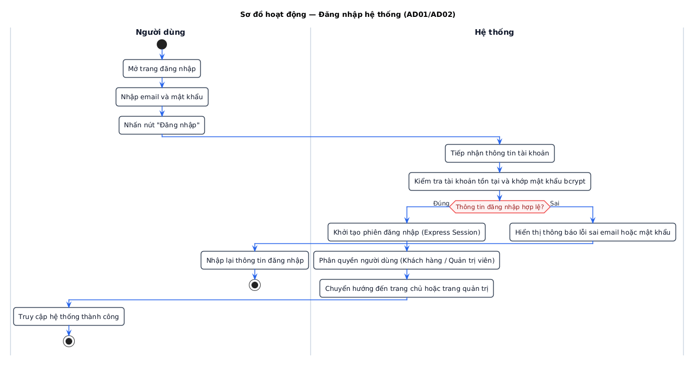
  <p><strong>Hình 10: Sơ đồ hoạt động — Quy trình Đăng nhập & Hợp nhất giỏ hàng (AD02)</strong></p>
</div>

**d. Giải thích luồng xử lý chi tiết:**
* *Điểm bắt đầu:* Người dùng nhập Email và Mật khẩu tại trang Đăng nhập (`/auth/login`) và nhấn nút "Đăng nhập".
* *Truy vấn người dùng:* Máy chủ chuẩn hóa email và truy vấn bảng `users`. Nếu không tìm thấy bản ghi nào, hệ thống trả về thông báo lỗi chung "Email hoặc mật khẩu không chính xác" và kết thúc luồng.
* *Kiểm tra trạng thái tài khoản:* Nếu tìm thấy người dùng, hệ thống kiểm tra trường `status`. Nếu `status === 'locked'`, hệ thống lập tức chặn đăng nhập và thông báo tài khoản đã bị vô hiệu hóa bởi ban quản trị.
* *Đối soát mã băm mật khẩu:* Máy chủ gọi hàm `bcrypt.compare(password, user.password_hash)`. Nếu kết quả là `false`, hệ thống báo lỗi sai mật khẩu.
* *Khởi tạo phiên làm việc:* Nếu so khớp thành công, hệ thống cấp phiên đăng nhập Express Session lưu trên RAM (`MemoryStore`), gắn thông tin `req.session.user = { id, fullName, email, role }` và gửi cookie phiên `vamos_sid` (HttpOnly, SameSite=Lax, Max-Age 7 ngày) về trình duyệt.
* *Hợp nhất giỏ hàng tự động (Cart Merging):* Hệ thống kiểm tra xem trước khi đăng nhập, người dùng có chọn giày vào giỏ hàng tạm `req.session.guestCart` hay không. Nếu có, hệ thống duyệt từng mặt hàng, kiểm tra tồn kho và chuyển thành các bản ghi trong bảng `cart_items` của khách hàng trên CSDL, sau đó xóa giỏ hàng tạm.
* *Phân quyền điều hướng và kết thúc:* Nếu người dùng có vai trò `role === 'ADMIN'`, chuyển hướng về cổng quản trị `/admin/dashboard`; nếu là `CUSTOMER`, chuyển hướng về trang chủ hoặc trang yêu cầu trước đó.

**e. Kết quả nghiệp vụ:** Người dùng đăng nhập thành công vào phiên làm việc bảo mật, giỏ hàng tạm thời được bảo toàn nguyên vẹn trên CSDL và được điều hướng đúng phân hệ.

---

### 3. Quy trình Tìm kiếm & Xem chi tiết sản phẩm (AD05)

**a. Mục đích:** Cung cấp trải nghiệm khám phá sản phẩm mượt mà, cho phép tìm kiếm theo từ khóa, lọc theo nhiều tiêu chí kết hợp và xem chi tiết ma trận biến thể (Size $\times$ Màu) cùng mức tồn kho khả dụng thời gian thực.

**b. Tác nhân tham gia:** Khách vãng lai (`Guest`), Khách hàng (`Customer`), Máy chủ ứng dụng Web, Cơ sở dữ liệu.

**c. Sơ đồ hoạt động:**

<div align="center">
  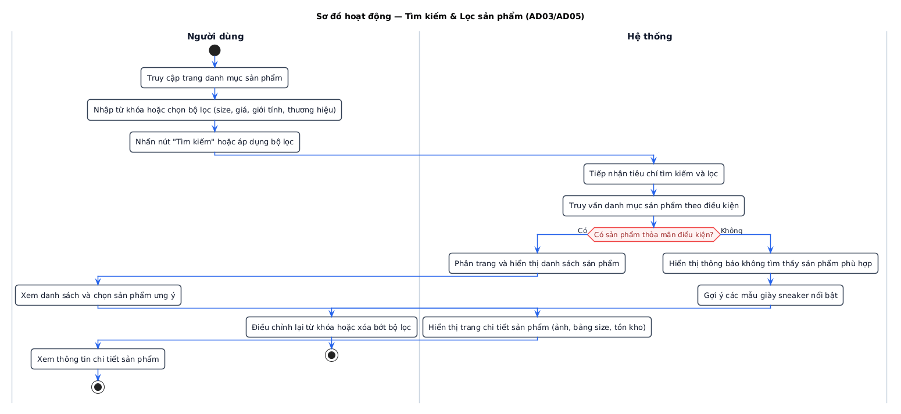
  <p><strong>Hình 11: Sơ đồ hoạt động — Quy trình Tìm kiếm & Xem chi tiết sản phẩm (AD05)</strong></p>
</div>

**d. Giải thích luồng xử lý chi tiết:**
* *Điểm bắt đầu:* Người dùng nhập từ khóa tìm kiếm hoặc bấm chọn các tiêu chí lọc tại trang Cửa hàng (`/products`) như Danh mục, Thương hiệu, Đối tượng (Nam/Nữ/Trẻ em), Khoảng giá, Size giày và Màu sắc.
* *Truy vấn dữ liệu động:* Máy chủ biên dịch câu lệnh SQL động an toàn có tham số hóa, phân trang 12 sản phẩm/trang và truy vấn SQL Server để lấy danh sách sản phẩm cha đang mở bán (`status = 'active'`).
* *Xem chi tiết sản phẩm:* Khi người dùng click vào một sản phẩm cụ thể, máy chủ tiếp nhận tham số đường dẫn thân thiện (`slug`), truy vấn thông tin sản phẩm cha từ `products`, bộ sưu tập ảnh từ `product_images`, và toàn bộ danh sách biến thể kết hợp `product_variants` $\bowtie$ `sizes` $\bowtie$ `colors`.
* *Tương tác chọn Size và Màu:* Khi trang chi tiết hiển thị, người dùng click chọn Kích cỡ size và Màu sắc trên giao diện. Mã JavaScript phía client tự động bắt sự kiện, tra cứu mã SKU tương ứng trong mảng dữ liệu, cập nhật hiển thị số lượng tồn kho khả dụng thời gian thực (`stock_quantity`).
* *Kết thúc:* Nếu biến thể còn hàng, nút "Thêm vào giỏ" sáng rõ; nếu hết hàng, nút tự động chuyển sang trạng thái Disabled kèm nhãn "Tạm hết hàng".

**e. Kết quả nghiệp vụ:** Người dùng nắm bắt chính xác thông tin mẫu giày, quy cách và tồn kho thực tế của từng cỡ giày trước khi quyết định mua hàng.

---

### 4. Quy trình Quản lý giỏ hàng trực tuyến (AD06)

**a. Mục đích:** Giúp người mua hàng dễ dàng thu thập các đôi giày ưng ý, theo dõi tạm tính chi phí, điều chỉnh số lượng (giới hạn từ 1 đến 10 đôi) hoặc xóa bỏ mặt hàng trước khi thanh toán.

**b. Tác nhân tham gia:** Khách vãng lai (`Guest`), Khách hàng (`Customer`), Máy chủ ứng dụng Web, Cơ sở dữ liệu.

**c. Sơ đồ hoạt động:**

<div align="center">
  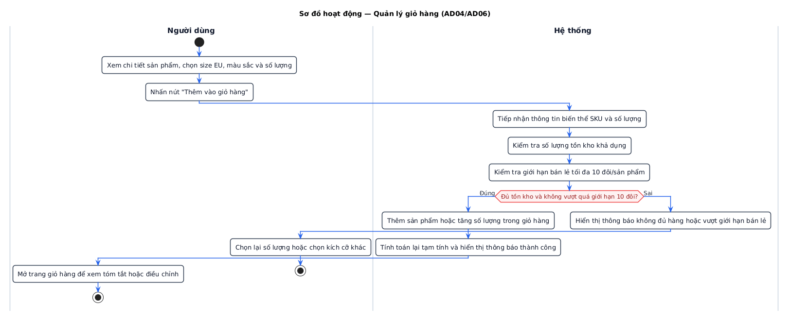
  <p><strong>Hình 12: Sơ đồ hoạt động — Quy trình Quản lý giỏ hàng trực tuyến (AD06)</strong></p>
</div>

**d. Giải thích luồng xử lý chi tiết:**
* *Điểm bắt đầu:* Người dùng chọn Size, Màu sắc và Số lượng tại trang chi tiết sản phẩm rồi nhấn nút "Thêm vào giỏ hàng".
* *Kiểm tra tồn kho:* Máy chủ kiểm tra số lượng yêu cầu so với tồn kho thực tế (`stock_quantity`) của biến thể SKU đó. Nếu số lượng yêu cầu vượt quá tồn kho, máy chủ trả về thông báo lỗi và từ chối thêm.
* *Phân nhánh lưu trữ theo đối tượng:*
  * *Nếu là Guest:* Sản phẩm được lưu vào mảng `req.session.guestCart` trong phiên làm việc của trình duyệt. Nếu SKU đã có sẵn, thực hiện cộng dồn số lượng (ràng buộc tối đa 10 đôi/mặt hàng).
  * *Nếu là Customer:* Máy chủ truy vấn bảng `carts` của khách hàng. Nếu SKU đã có trong `cart_items`, thực hiện `UPDATE quantity`; nếu chưa có, thực hiện `INSERT` bản ghi mới.
* *Cập nhật giao diện giỏ hàng:* Người dùng truy cập trang Giỏ hàng (`/cart`). Giao diện hiển thị danh sách các món hàng kèm ảnh, tên, size, màu, đơn giá, bộ nút tăng/giảm (+/-) số lượng và nút xóa.
* *Điều chỉnh hoặc xóa mặt hàng:* Khi người dùng bấm +/- hoặc xóa, máy chủ kiểm tra tồn kho khả dụng trước khi cập nhật CSDL và trả về tổng tiền tạm tính mới.

**e. Kết quả nghiệp vụ:** Giỏ hàng được cập nhật đồng bộ, số lượng mặt hàng không bao giờ vượt quá tồn kho khả dụng, tổng tiền tạm tính được tính toán chính xác.

---

### 5. Quy trình Đặt hàng COD nguyên tử (AD08)

**a. Mục đích:** Chuyển đổi các mặt hàng trong giỏ thành đơn đặt hàng chính thức với hình thức thanh toán tiền mặt khi nhận hàng (COD), đảm bảo tính toàn vẹn giao dịch (ACID Transaction), khóa dòng chống bán vượt tồn kho và bảo toàn dữ liệu lịch sử bằng snapshot.

**b. Tác nhân tham gia:** Khách hàng thành viên (`Customer`), Máy chủ ứng dụng Web (`OrderService`), Cơ sở dữ liệu (`SQL Server`).

**c. Sơ đồ hoạt động:**

<div align="center">
  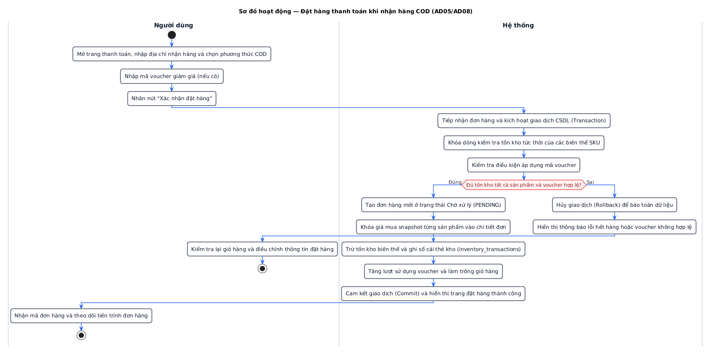
  <p><strong>Hình 13: Sơ đồ hoạt động — Quy trình Đặt hàng thanh toán COD nguyên tử (AD08)</strong></p>
</div>

**d. Giải thích luồng xử lý chi tiết:**
* *Điểm bắt đầu:* Khách hàng bấm "Tiến hành thanh toán" từ trang giỏ hàng để mở trang Checkout (`/checkout`).
* *Xác nhận thông tin giao hàng & Áp dụng voucher:* Khách hàng xác nhận thông tin người nhận (Họ tên, SĐT, Địa chỉ chi tiết). Nếu có mã voucher, khách hàng nhập mã và bấm "Áp dụng". Máy chủ kiểm tra các điều kiện: Voucher đang kích hoạt, còn hạn dùng, đơn đạt giá trị tối thiểu, chưa hết lượt dùng tổng và khách hàng này chưa từng dùng mã. Nếu hợp lệ, trừ tiền giảm giá vào tổng thanh toán.
* *Nhấn Đặt hàng COD & Mở Transaction:* Khách hàng bấm "Xác nhận đặt hàng COD". Tầng `OrderService` lập tức mở một Transaction CSDL trên SQL Server.
* *Khóa bi quan (Pessimistic Locking):* Duyệt qua từng mặt hàng trong đơn, thực thi câu lệnh khóa dòng:
  ```sql
  SELECT stock_quantity, sku 
  FROM product_variants WITH (UPDLOCK, ROWLOCK) 
  WHERE id = @variantId;
  ```
* *Kiểm tra tồn kho:* Nếu bất kỳ biến thể nào có `stock_quantity < quantity_mua`, hệ thống lập tức ném lỗi và Rollback toàn bộ Transaction, thông báo cho khách hàng biết mặt hàng vừa bị người khác mua hết.
* *Trừ tồn kho & Ghi thẻ kho:* Khi đủ hàng, hệ thống trừ tồn kho biến thể:
  ```sql
  UPDATE product_variants 
  SET stock_quantity = stock_quantity - @qty, updated_at = GETDATE() 
  WHERE id = @variantId;
  ```
  Đồng thời chèn một bản ghi vào `inventory_transactions` lưu số lượng cũ, mới, thay đổi âm (`-qty`) và lý do xuất bán.
* *Tạo đơn hàng và chi tiết snapshot:* Chèn bản ghi vào bảng `orders` (lưu `recipient_name_snapshot`, `recipient_phone_snapshot`, `delivery_address_snapshot`, `payment_method = 'COD'`, `payment_status = 'UNPAID'`, `order_status = 'PENDING'`). Chèn các dòng vào `order_items` lưu snapshot tên sản phẩm, mã SKU, size, màu và đơn giá mua `unit_price`.
* *Ghi nhận voucher & Xóa giỏ hàng:* Nếu có voucher, ghi vào `voucher_usages` và tăng `used_count` trong bảng `vouchers`. Ghi nhật ký khởi tạo vào `order_status_histories`. Xóa toàn bộ sản phẩm trong `cart_items`.
* *Commit và kết thúc:* SQL Server xác nhận commit thành công. Máy chủ chuyển hướng khách hàng tới trang Hoàn tất đơn hàng kèm mã đơn duy nhất.

**e. Kết quả nghiệp vụ:** Đơn hàng COD được tạo lập thành công, tồn kho bị trừ ngay lập tức tại thời điểm đặt hàng, thẻ kho và snapshot được lưu vết hoàn hảo, giỏ hàng được làm sạch.

---

### 6. Quy trình Hủy đơn hàng và tự động hoàn kho (AD10)

**a. Mục đích:** Cho phép khách hàng tự thao tác hủy đơn hàng khi thay đổi nhu cầu, với điều kiện đơn hàng chưa bước vào khâu đóng gói vận chuyển, đồng thời tự động cộng trả lại số lượng tồn kho cho các biến thể trong CSDL.

**b. Tác nhân tham gia:** Khách hàng thành viên (`Customer`), Máy chủ ứng dụng Web, Cơ sở dữ liệu.

**c. Sơ đồ hoạt động:**

<div align="center">
  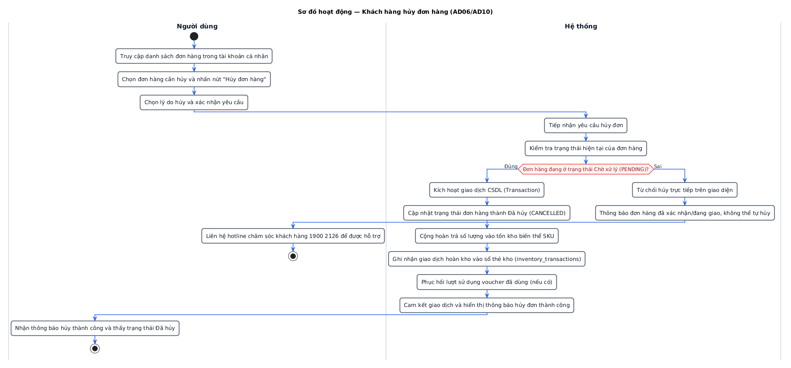
  <p><strong>Hình 14: Sơ đồ hoạt động — Quy trình Hủy đơn hàng và hoàn tồn kho (AD10)</strong></p>
</div>

**d. Giải thích luồng xử lý chi tiết:**
* *Điểm bắt đầu:* Khách hàng truy cập trang chi tiết đơn hàng (`/account/orders/:orderCode`).
* *Kiểm tra trạng thái đơn:* **Khách hàng chỉ được phép tự hủy đơn khi đơn hàng đang ở trạng thái `order_status = 'PENDING'` (Chờ xác nhận)**. Nếu đơn đã chuyển sang trạng thái khác, nút hủy sẽ không hiển thị trên giao diện.
* *Xác nhận hủy & Mở Transaction:* Khách hàng nhấn nút "Hủy đơn hàng", nhập lý do và bấm xác nhận. Máy chủ mở Transaction CSDL.
* *Khóa đơn và đổi trạng thái:* Máy chủ khóa bản ghi đơn hàng bằng `UPDLOCK, ROWLOCK` để kiểm tra lại trạng thái. Cập nhật `order_status = 'CANCELLED'`.
* *Hoàn trả tồn kho tự động & Ghi thẻ kho:* Duyệt qua từng dòng mặt hàng trong `order_items`, khóa các dòng biến thể tương ứng trong `product_variants` và hoàn lại số lượng tồn:
  ```sql
  UPDATE product_variants 
  SET stock_quantity = stock_quantity + @qty, updated_at = GETDATE() 
  WHERE id = @variantId;
  ```
  Đồng thời chèn bản ghi vào `inventory_transactions` lưu số lượng thay đổi dương (`+qty`), lý do hoàn kho do khách tự hủy đơn.
* *Hoàn trả voucher & Ghi nhật ký:* Nếu đơn có áp voucher, hệ thống xóa bản ghi trong `voucher_usages` và giảm `used_count` trong bảng `vouchers`. Chèn bản ghi vào `order_status_histories` ghi nhận bước chuyển từ `PENDING` sang `CANCELLED`.
* *Commit và kết thúc:* Transaction commit thành công, giao diện cập nhật trạng thái đơn thành "Đã hủy".

**e. Kết quả nghiệp vụ:** Đơn hàng được hủy an toàn, tồn kho các mẫu giày được tự động hoàn lại ngay lập tức mà không cần thủ kho phải can thiệp thủ công, lượt dùng voucher được trả lại cho khách hàng.

---

### 7. Quy trình Admin xử lý & Cập nhật đơn hàng (AD11)

**a. Mục đích:** Giúp Quản trị viên điều phối đơn hàng COD qua từng giai đoạn của chuỗi cung ứng theo quy tắc máy trạng thái nghiêm ngặt, tự động ghi nhận thanh toán tiền mặt khi giao thành công và hoàn kho tự động nếu Admin quyết định hủy đơn.

**b. Tác nhân tham gia:** Quản trị viên (`Admin`), Máy chủ ứng dụng Web, Cơ sở dữ liệu.

**c. Sơ đồ hoạt động:**

<div align="center">
  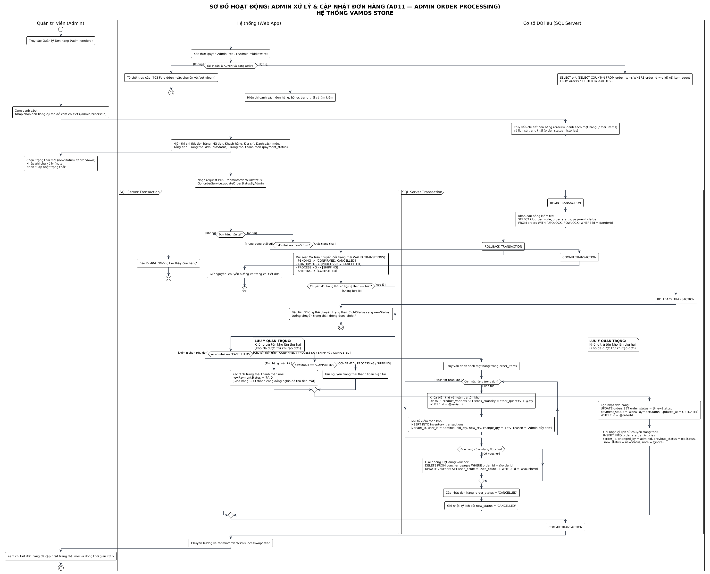
  <p><strong>Hình 15: Sơ đồ hoạt động — Quy trình Admin xử lý & Cập nhật đơn hàng (AD11)</strong></p>
</div>

**d. Giải thích luồng xử lý chi tiết:**
* *Điểm bắt đầu:* Quản trị viên truy cập trang Quản lý đơn hàng (`/admin/orders`), bấm xem chi tiết đơn hàng cần xử lý.
* *Kiểm tra ma trận chuyển trạng thái hợp lệ:* Máy chủ kiểm tra trạng thái hiện tại của đơn hàng và chỉ kích hoạt các nút bấm tương ứng theo đúng ma trận FSM:
  * `PENDING` $\rightarrow$ `CONFIRMED` hoặc `CANCELLED`
  * `CONFIRMED` $\rightarrow$ `PROCESSING` hoặc `CANCELLED`
  * `PROCESSING` $\rightarrow$ `SHIPPING`
  * `SHIPPING` $\rightarrow$ `COMPLETED`
  * `COMPLETED` và `CANCELLED` là trạng thái kết thúc (Terminal states), không được phép chuyển tiếp.
* *Mở Transaction CSDL:* Quản trị viên chọn trạng thái kế tiếp và nhập ghi chú điều hành. Máy chủ mở Transaction CSDL.
* *Xử lý khi chuyển sang `COMPLETED`:* Khi đơn hàng giao thành công và thu tiền mặt, hệ thống tự động cập nhật đồng thời `order_status = 'COMPLETED'` và `payment_status = 'PAID'`. *(Lưu ý: Tồn kho đã được trừ lúc tạo đơn, hệ thống TUYỆT ĐỐI KHÔNG trừ kho lần thứ hai tại bước này)*.
* *Xử lý khi Admin chọn `CANCELLED`:* Quản trị viên chỉ được hủy khi đơn ở `PENDING` hoặc `CONFIRMED`. Hệ thống tự động hoàn lại tồn kho toàn bộ mặt hàng về `product_variants`, ghi thẻ kho `inventory_transactions` và hoàn lại voucher.
* *Ghi nhật ký và Commit:* Chèn bản ghi vào `order_status_histories` lưu lại người thao tác (`changed_by`), trạng thái cũ, trạng thái mới và ghi chú. Commit Transaction CSDL thành công.

**e. Kết quả nghiệp vụ:** Đơn hàng được điều phối đúng quy chuẩn chuỗi cung ứng, không có hiện tượng nhảy cóc trạng thái, thanh toán COD được cập nhật tự động khi hoàn tất và tồn kho luôn được bảo toàn chính xác.

---

### 8. Quy trình Quản lý kho & Thẻ kho (AD12)

**a. Mục đích:** Cung cấp công cụ cho Quản trị viên theo dõi mức tồn kho của từng biến thể SKU, nhận cảnh báo hàng sắp hết và thực hiện điều chỉnh số lượng tồn kho thủ công (kiểm kê, nhập hàng) có lưu vết bắt buộc.

**b. Tác nhân tham gia:** Quản trị viên (`Admin`), Máy chủ ứng dụng Web, Cơ sở dữ liệu.

**c. Sơ đồ hoạt động:**

<div align="center">
  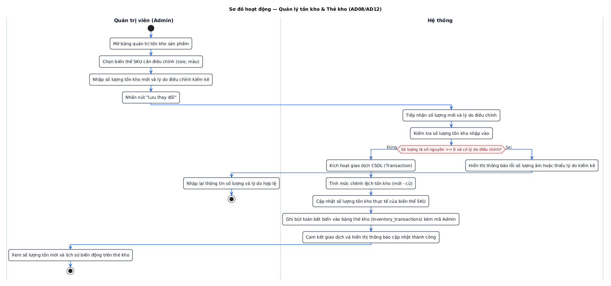
  <p><strong>Hình 16: Sơ đồ hoạt động — Quản lý kho hàng & Điều chỉnh tồn kho (AD12)</strong></p>
</div>

**d. Giải thích luồng xử lý chi tiết:**
* *Điểm bắt đầu:* Quản trị viên vào mục Quản lý tồn kho (`/admin/inventory`), chọn một mã SKU cần điều chỉnh và bấm nút "Điều chỉnh tồn kho".
* *Nhập liệu kiểm kê:* Hệ thống hiển thị modal. Quản trị viên điền số lượng tồn kho mới sau kiểm kê và bắt buộc phải điền Lý do điều chỉnh (Kiểm kê định kỳ, nhập thêm hàng mới, hàng lỗi hỏng).
* *Mở Transaction CSDL:* Máy chủ kiểm tra số lượng mới không được âm (`CHECK new_quantity >= 0`). Cập nhật `stock_quantity` trong bảng `product_variants`, đồng thời chèn một bản ghi mới vào bảng `inventory_transactions` lưu số lượng cũ, mới, thay đổi và lý do.
* *Kết thúc:* Transaction commit thành công, giao diện cập nhật mức tồn mới và hiển thị vào bảng nhật ký thẻ kho.

**e. Kết quả nghiệp vụ:** Số lượng tồn kho được cân bằng chính xác theo thực tế, mọi biến động đều có nguyên nhân và người chịu trách nhiệm rõ ràng.

---

### 9. Quy trình Quản lý danh mục & Sản phẩm biến thể (AD13)

**a. Mục đích:** Hướng dẫn luồng tạo mới sản phẩm cha, sinh ma trận biến thể tổ hợp Size $\times$ Màu, nhập mức tồn kho ban đầu và tải lên bộ ảnh sản phẩm có chỉ định ảnh chính.

**b. Tác nhân tham gia:** Quản trị viên (`Admin`), Máy chủ ứng dụng Web, Cơ sở dữ liệu.

**c. Sơ đồ hoạt động:**

<div align="center">
  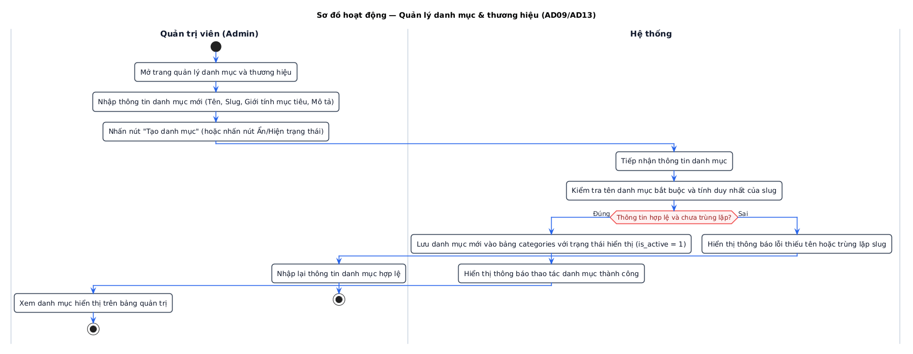
  <p><strong>Hình 17: Sơ đồ hoạt động — Quản lý danh mục & Sản phẩm biến thể (AD13)</strong></p>
</div>

**d. Giải thích luồng xử lý chi tiết:**
* *Điểm bắt đầu:* Quản trị viên mở trang Thêm sản phẩm mới (`/admin/products/new`).
* *Nhập thông tin sản phẩm cha:* Điền tên sản phẩm, mã code, slug, danh mục, thương hiệu, giới tính, giá gốc, giá khuyến mãi và mô tả.
* *Sinh ma trận biến thể SKU:* Quản trị viên tích chọn danh sách các Kích cỡ size (38-45) và Màu sắc mở bán. Hệ thống tự động sinh ra danh sách tổ hợp biến thể, Quản trị viên điền số lượng tồn kho ban đầu cho từng mã SKU.
* *Tải ảnh và chọn ảnh chính:* Quản trị viên tải lên danh sách ảnh sản phẩm và tích chọn đúng một ảnh làm ảnh chính (`is_primary = 1`).
* *Mở Transaction CSDL:* Lưu bản ghi `products`, lưu các biến thể trong `product_variants`, lưu các ảnh trong `product_images` (được bảo vệ bởi Filtered Index `uq_product_primary_image`) và ghi thẻ kho khởi tạo ban đầu.
* *Kết thúc:* Commit Transaction thành công, sản phẩm mới chính thức xuất hiện trên storefront.

**e. Kết quả nghiệp vụ:** Sản phẩm giày mới được thiết lập hoàn chỉnh với đầy đủ các kích cỡ, màu sắc, ảnh đại diện và tồn kho ban đầu.

---

## 3.3. NHỮNG NGHIỆP VỤ CẦN GIẢI THÍCH SÂU

Trong quá trình bảo vệ đồ án, có 3 nghiệp vụ mang tính chất cốt lõi mà nhóm chúng em đặc biệt chú trọng phân tích sâu về giải pháp kỹ thuật:

### 1. Quy trình Đặt hàng COD nguyên tử (Atomic COD Checkout)
* **Bài toán kỹ thuật:** Trong thương mại điện tử, rủi ro lớn nhất là bán vượt tồn kho (Overselling) khi có hai khách hàng cùng đặt mua đôi giày cuối cùng tại cùng một thời điểm (Race Condition).
* **Giải pháp của nhóm:** Thay vì đọc tồn kho rồi trừ sau, hệ thống VAMOS STORE sử dụng **Transaction mức độ cô lập cao kết hợp khóa bi quan `WITH (UPDLOCK, ROWLOCK)`**. Khi câu lệnh `SELECT` diễn ra, dòng dữ liệu của biến thể SKU đó lập tức bị khóa độc quyền cho đến khi Transaction kết thúc. Khách hàng thứ hai sẽ phải đợi hoặc nhận được thông báo hết hàng ngay lập tức khi người thứ nhất hoàn tất.
* **Thanh toán tiền mặt khi nhận hàng (COD):** Hệ thống không sử dụng các cổng thanh toán trung gian như VNPAY hay Momo mà triển khai thuần túy phương thức COD: Đơn hàng tạo ra với trạng thái thanh toán ban đầu là `UNPAID` (Chưa thanh toán), khách hàng chỉ trả tiền mặt cho nhân viên giao hàng khi bưu tá giao hàng tới tận nhà.

### 2. Quy trình Hủy đơn hàng và tự động hoàn kho
* **Phân định quyền hạn hủy đơn rõ ràng:**
  * *Khách hàng thành viên (`Customer`):* **CHỈ ĐƯỢC PHÉP tự hủy đơn khi đơn hàng đang ở trạng thái `PENDING` (Chờ xác nhận)**. Khi đơn đã được cửa hàng duyệt sang `CONFIRMED` hoặc đóng gói `PROCESSING`, quyền tự hủy của khách hàng bị đóng lại để tránh gây rối loạn vận hành giao vận.
  * *Quản trị viên (`Admin`):* Được phép hủy đơn khi đơn ở trạng thái `PENDING` hoặc `CONFIRMED` (ví dụ khi gọi điện xác nhận mà khách không bắt máy hoặc khách đổi ý).
* **Cơ chế hoàn trả kho và hoàn voucher tự động:** Mọi trường hợp hủy đơn hợp lệ đều tự động kích hoạt Transaction hoàn trả số lượng tồn kho `stock_quantity = stock_quantity + @qty` về bảng `product_variants`, ghi thẻ kho kiểm toán `inventory_transactions` với số lượng thay đổi dương (`+qty`), đồng thời xóa bản ghi trong `voucher_usages` để khách hàng có thể sử dụng lại mã giảm giá cho đơn hàng khác.

### 3. Quy trình Admin cập nhật trạng thái đơn hàng (Order FSM)
* **Kiểm soát máy trạng thái nghiêm ngặt:** Hệ thống định nghĩa chính xác **6 trạng thái chuẩn** trong CSDL: `PENDING`, `CONFIRMED`, `PROCESSING`, `SHIPPING`, `COMPLETED`, `CANCELLED`. Nhóm **tuyệt đối không sử dụng các trạng thái ngoại lai như `SHIPPED` hoặc `DELIVERED`** vì không tồn tại trong ràng buộc CHECK của CSDL.
* **Ma trận chuyển đổi trạng thái một chiều hợp lệ:**
  $$	ext{PENDING} \longrightarrow \text{CONFIRMED} \longrightarrow \text{PROCESSING} \longrightarrow \text{SHIPPING} \longrightarrow \text{COMPLETED}$$
  *(Trạng thái `CANCELLED` chỉ được phép chuyển từ `PENDING` hoặc `CONFIRMED`)*.
* **Nguyên tắc chống trừ tồn kho lần thứ hai (Anti-Double Deduction):** Khi đơn hàng COD được nhân viên giao hàng thành công, Quản trị viên cập nhật đơn sang `COMPLETED`. Lúc này, hệ thống tự động ghi nhận tiền mặt đã thu bằng cách đổi `payment_status = 'PAID'`. Do tồn kho đã được trừ ngay từ bước tạo đơn (`OUT_SALE`), hệ thống **tuyệt đối không trừ kho thêm lần nào nữa**, bảo đảm số liệu tồn kho luôn khớp với số lượng thực tế trong kho hàng.

---

## 3.4. NHẬN XÉT VỀ ACTIVITY DIAGRAM

Tổng kết lại quá trình mô hình hóa quy trình bằng Activity Diagram:

1. **Minh bạch hóa luồng xử lý và tương tác giữa các bên:** Việc ứng dụng mô hình 3 làn Swimlanes (Người dùng — Ứng dụng Web — CSDL) giúp làm rõ ranh giới trách nhiệm, cho thấy rõ mỗi thao tác click chuột của người dùng sẽ kích hoạt logic kiểm tra nào ở backend và câu lệnh SQL nào ở CSDL.
2. **Dự báo và bao quát toàn bộ các trường hợp ngoại lệ:** Thay vì chỉ mô tả luồng thành công (Happy Path), các sơ đồ hoạt động đã mô hình hóa đầy đủ các nhánh lỗi (dữ liệu sai, email trùng, hết tồn kho, tài khoản bị khóa, mã voucher không hợp lệ), giúp các thành viên khi viết mã nguồn không bị bỏ sót các trường hợp biên.
3. **Mối liên kết trực tiếp với Giao diện người dùng:** Các bước xử lý được mô hình hóa trong Activity Diagram chính là cơ sở trực tiếp để nhóm thiết kế các thông báo phản hồi (Flash messages), các hộp thoại xác nhận và trạng thái bật/tắt của các nút bấm trong **Phần 4: Thiết kế Giao diện (User Interface)** tiếp theo.


# PHẦN 4. THIẾT KẾ GIAO DIỆN – USER INTERFACE

---

## 4.1. GIỚI THIỆU THIẾT KẾ GIAO DIỆN

Giao diện người dùng (User Interface - UI) là điểm chạm trực quan cuối cùng, nơi người dùng tương tác trực tiếp với các chức năng và dữ liệu của hệ thống. Trong đồ án VAMOS STORE, nhóm sinh viên chúng em định hướng xây dựng một giao diện thương mại điện tử hiện đại, tinh tế và tập trung tối đa vào trải nghiệm người dùng (UX - User Experience).

Hệ thống giao diện được phát triển dựa trên công nghệ kết xuất từ máy chủ (Server-Side Rendering - SSR) với công cụ tạo mẫu **Pug Template Engine** kết hợp cùng khung tiện ích kiểu dáng **Tailwind CSS**. Triết lý thiết kế giao diện của nhóm tuân thủ các nguyên tắc cốt lõi:
1. **Phân cấp thị giác rõ ràng (Visual Hierarchy):** Áp dụng quy tắc phối màu 60-30-10 (60% màu nền trắng/xám trung tính trang nhã, 30% màu thẻ sản phẩm và khung viền xám sáng, 10% màu xanh dương `Primary Blue #2563EB` hoặc xanh lá `Emerald #059669` cho các nút bấm hành động then chốt).
2. **Thiết kế phân định theo 3 nhóm tác nhân:** Giao diện được cấu trúc khoa học theo vai trò người dùng: Khu vực công khai cho Khách vãng lai (`Guest`), Khu vực quản lý tài khoản & mua sắm cho Khách hàng thành viên (`Customer`), và Cổng quản trị tập trung (Admin Portal) với thanh bên Sidebar tối màu chuyên nghiệp dành riêng cho Quản trị viên (`Admin`).
3. **Ảnh chụp từ hệ thống thực tế:** Toàn bộ **17 hình ảnh giao diện** trong báo cáo này đều được chụp trực tiếp từ môi trường ứng dụng thực tế đang chạy ở độ phân giải tiêu chuẩn máy tính để bàn (Desktop Viewport $1440 \times 900$ pixels). Nhóm hoàn toàn không sử dụng ảnh dựng đồ họa (mockup) hay ảnh tạo giả.

---

## 4.2. GIAO DIỆN DÀNH CHO GUEST (KHÁCH VÃNG LAI)

Khách vãng lai khi truy cập vào website có thể trải nghiệm toàn bộ các màn hình công khai nhằm tìm hiểu sản phẩm và đăng ký tài khoản:

---

### 1. Giao diện Trang chủ (Home Page)

<div align="center">
  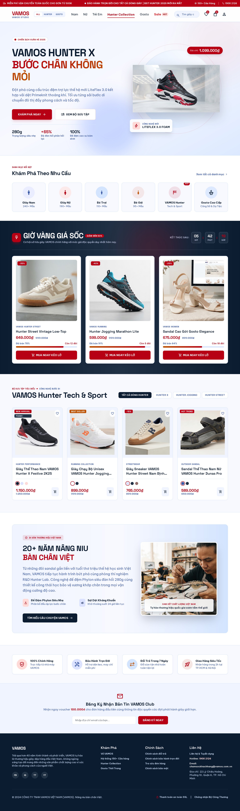
  <p><strong>Hình 18: Giao diện Trang chủ VAMOS STORE dành cho Khách vãng lai</strong></p>
</div>

* **Mục đích màn hình:** Đóng vai trò là "mặt tiền số" của cửa hàng, thu hút sự chú ý của khách hàng mới, giới thiệu các chiến dịch marketing nổi bật và trưng bày các mẫu giày dép bán chạy nhất.
* **Những khu vực chính:**
  * *Thanh điều hướng cố định (Header):* Logo thương hiệu Vamos Store, thanh tìm kiếm nhanh, danh mục sản phẩm, nút xem Wishlist và biểu tượng Giỏ hàng có gắn số đếm realtime.
  * *Hero Banner Slider:* Băng chuyền trình chiếu các banner quảng cáo khuyến mãi lấy dữ liệu trực tiếp từ bảng `banners` trong CSDL.
  * *Lưới sản phẩm nổi bật (Featured Products):* Danh sách các mẫu giày mới về và giày bán chạy được xếp theo bố cục 4 cột cân đối.
* **Thông tin hiển thị:** Hình ảnh đại diện sản phẩm, nhãn giảm giá (Sale Badge), tên giày, thương hiệu, giá niêm yết và giá khuyến mãi định dạng VNĐ.
* **Thao tác có thể thực hiện:** Bấm chuyển banner slider, gõ từ khóa tìm kiếm, bấm vào các danh mục trên menu, hoặc click vào một thẻ sản phẩm cụ thể.
* **Kết quả sau thao tác:** Hệ thống chuyển hướng người dùng đến trang chi tiết sản phẩm hoặc trang cửa hàng tương ứng.

---

### 2. Giao diện Cửa hàng sản phẩm & Bộ lọc đa thuộc tính (Shop & Multi-filter)

<div align="center">
  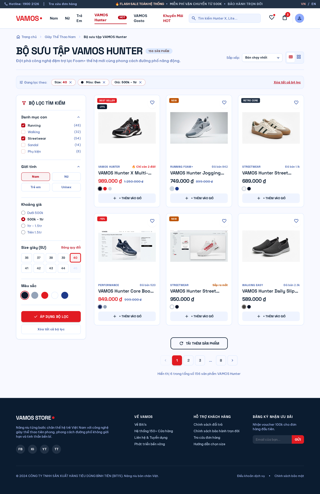
  <p><strong>Hình 19: Giao diện Cửa hàng sản phẩm & Bộ lọc đa thuộc tính</strong></p>
</div>

* **Mục đích màn hình:** Giúp người mua dễ dàng tra cứu, thu hẹp phạm vi tìm kiếm giữa hàng trăm mẫu giày dép bằng bộ lọc nhiều tiêu chí kết hợp.
* **Những khu vực chính:**
  * *Cột bộ lọc bên trái (Sidebar Filter):* Các nhóm tiêu chí lọc theo Danh mục, Thương hiệu, Giới tính, Khoảng giá, Kích cỡ Size (38-45) và Màu sắc.
  * *Khu vực hiển thị danh sách sản phẩm:* Lưới sản phẩm 3-4 cột ở giữa màn hình.
  * *Thanh sắp xếp và phân trang:* Hộp chọn sắp xếp theo giá/mới nhất ở góc trên và thanh phân trang số (Pagination) ở cuối trang.
* **Thông tin hiển thị:** Số lượng kết quả tìm thấy, các tiêu chí lọc đang được kích hoạt, thẻ sản phẩm kèm ảnh và giá bán.
* **Thao tác có thể thực hiện:** Tích chọn các ô lọc, kéo thanh trượt giá, đổi tiêu chí sắp xếp và bấm chuyển trang.
* **Kết quả sau thao tác:** Trang web gửi request kèm tham số truy vấn (Query Parameters), CSDL thực thi lọc và làm mới lưới sản phẩm ngay lập tức.

---

### 3. Giao diện Chi tiết sản phẩm & Bộ chọn biến thể SKU (Product Detail)

<div align="center">
  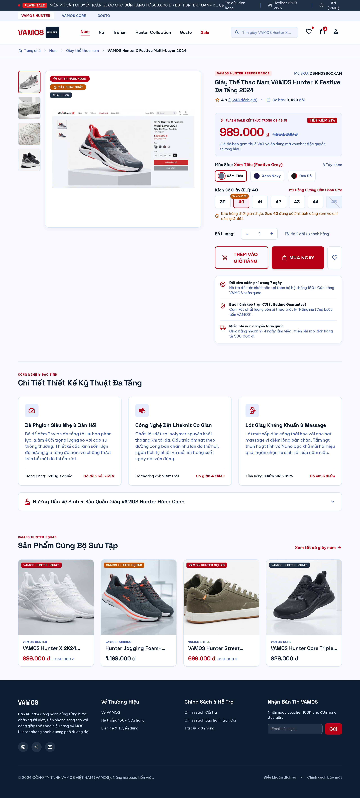
  <p><strong>Hình 20: Giao diện Chi tiết sản phẩm & Bộ chọn biến thể SKU</strong></p>
</div>

* **Mục đích màn hình:** Cung cấp thông tin chuyên sâu về mẫu giày, cho phép khách hàng xem nhiều góc ảnh chụp, tương tác chọn Size và Màu sắc mong muốn và kiểm tra số lượng tồn kho trước khi đặt mua.
* **Những khu vực chính:**
  * *Khung hình ảnh bên trái:* Khung ảnh lớn và dải ảnh thu nhỏ (Thumbnails) lấy từ bảng `product_images`.
  * *Khung thông tin và bộ chọn bên phải:* Tên sản phẩm, thương hiệu, mức giá, bộ chọn Kích cỡ size, bộ chọn Màu sắc, bộ chọn số lượng (1-10 đôi) và nút "Thêm vào giỏ hàng".
  * *Khối mô tả chi tiết phía dưới:* Bài viết giới thiệu chất liệu, kiểu dáng và hướng dẫn chọn size giày.
* **Thông tin hiển thị:** Mã SKU biến thể tương ứng, tình trạng tồn kho khả dụng thời gian thực ("Còn 12 sản phẩm trong kho" hoặc nhãn đỏ "Tạm hết hàng").
* **Thao tác có thể thực hiện:** Bấm đổi ảnh xem góc chụp, click chọn Size/Màu, tăng giảm số lượng mua, bấm "Thêm vào giỏ hàng" hoặc bấm "Thêm vào yêu thích".
* **Kết quả sau thao tác:** Biến thể được đưa vào giỏ hàng tạm (lưu trong phiên của Guest) và biểu tượng giỏ hàng trên thanh điều hướng tự động tăng số lượng.

---

### 4. Giao diện Đăng nhập hệ thống (Authentication Login)

<div align="center">
  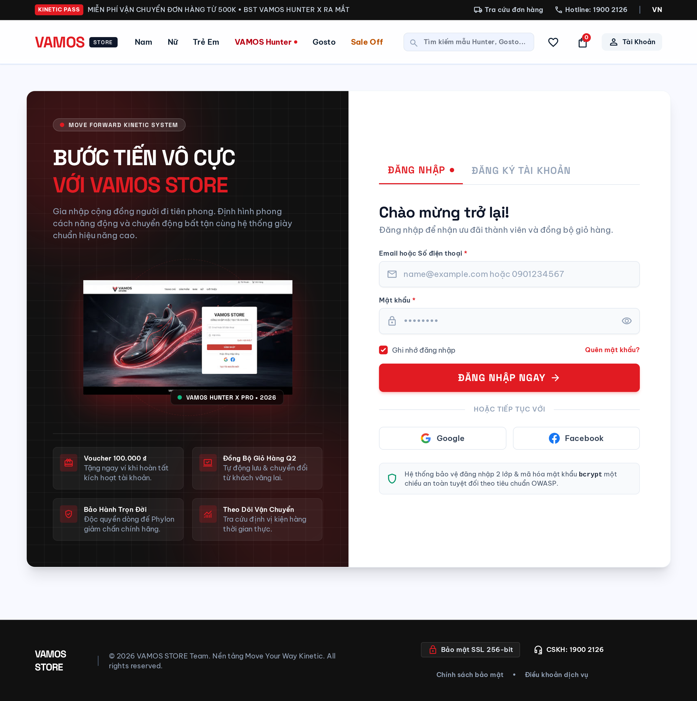
  <p><strong>Hình 21: Giao diện Đăng nhập hệ thống</strong></p>
</div>

* **Mục đích màn hình:** Cung cấp biểu mẫu xác thực danh tính người dùng bằng email và mật khẩu để cấp phiên làm việc bảo mật.
* **Những khu vực chính:** Khối biểu mẫu đặt ở trung tâm màn hình, gồm ô nhập Email, ô nhập Mật khẩu, liên kết "Quên mật khẩu?" và liên kết chuyển sang trang "Đăng ký".
* **Thông tin hiển thị:** Các nhãn hướng dẫn nhập liệu, khung thông báo lỗi màu đỏ (Alert Error) xuất hiện phía trên form khi người dùng điền sai thông tin hoặc tài khoản bị khóa.
* **Thao tác có thể thực hiện:** Điền thông tin và bấm nút "Đăng nhập".
* **Kết quả sau thao tác:** Hệ thống xác thực bằng Bcrypt, cấp cookie `vamos_sid`, tự động hợp nhất giỏ hàng tạm và chuyển hướng người dùng về trang chủ hoặc cổng quản trị tùy theo vai trò (`CUSTOMER` hoặc `ADMIN`).

---

### 5. Giao diện Đăng ký tài khoản thành viên (User Register)

<div align="center">
  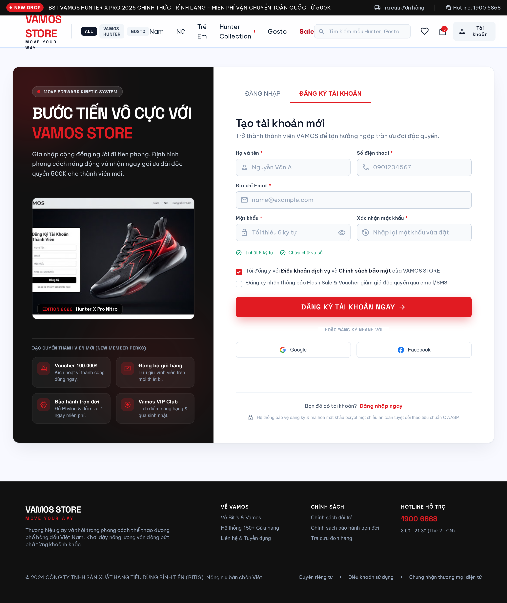
  <p><strong>Hình 22: Giao diện Đăng ký tài khoản thành viên</strong></p>
</div>

* **Mục đích màn hình:** Tiếp nhận thông tin của khách hàng mới để tạo tài khoản thành viên trên hệ thống.
* **Những khu vực chính:** Biểu mẫu đăng ký gồm 5 trường nhập liệu: Họ và tên, Địa chỉ Email, Số điện thoại, Mật khẩu, Nhập lại mật khẩu và nút "Đăng ký".
* **Thông tin hiển thị:** Thông báo phản hồi hợp lệ phía client và server, cảnh báo khi mật khẩu không đủ độ dài hoặc email đã tồn tại.
* **Thao tác có thể thực hiện:** Điền thông tin cá nhân và bấm nút "Đăng ký tài khoản".
* **Kết quả sau thao tác:** Bản ghi người dùng mới được tạo trong `users`, một giỏ hàng rỗng cá nhân được cấp trong `carts`, hệ thống tự động đăng nhập và đưa người dùng về trang chủ với thông báo chào mừng.

---

## 4.3. GIAO DIỆN DÀNH CHO CUSTOMER (KHÁCH HÀNG THÀNH VIÊN)

Sau khi đăng nhập thành công, khách hàng thành viên được kích hoạt các chức năng mua sắm nâng cao, lưu trữ giỏ hàng vĩnh viễn và quản lý đơn hàng cá nhân:

---

### 6. Giao diện Giỏ hàng trực tuyến (Shopping Cart)

<div align="center">
  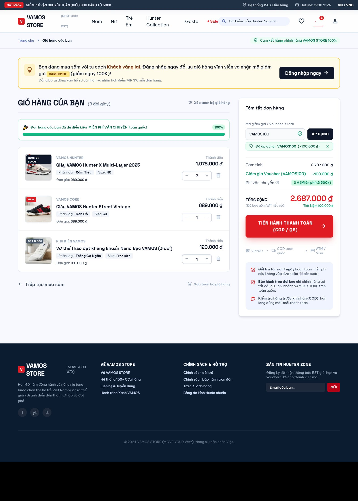
  <p><strong>Hình 23: Giao diện Giỏ hàng trực tuyến của Khách hàng</strong></p>
</div>

* **Mục đích màn hình:** Cho phép khách hàng rà soát lại toàn bộ danh sách các mẫu giày dép dự định mua sắm, thay đổi số lượng hoặc loại bỏ các mặt hàng không còn nhu cầu trước khi chuyển sang thanh toán.
* **Những khu vực chính:**
  * *Bảng chi tiết giỏ hàng bên trái:* Cột hình ảnh, cột tên sản phẩm kèm quy cách Size/Màu, đơn giá, bộ điều chỉnh số lượng (+/-) và nút xóa mặt hàng.
  * *Khối tóm tắt đơn hàng bên phải:* Tạm tính tiền hàng, phí vận chuyển ước tính và tổng tiền dự kiến kèm nút lớn "Tiến hành thanh toán".
* **Thông tin hiển thị:** Đơn giá và thành tiền từng dòng sản phẩm, tổng tiền toàn bộ giỏ hàng, cảnh báo tồn kho nếu vượt quá số lượng cho phép.
* **Thao tác có thể thực hiện:** Bấm nút + hoặc - để thay đổi số lượng mua (giới hạn từ 1 đến 10 đôi), bấm biểu tượng thùng rác để xóa sản phẩm, hoặc bấm "Tiến hành thanh toán".
* **Kết quả sau thao tác:** CSDL cập nhật bảng `cart_items` tương ứng, tổng tiền tạm tính được tính toán lại ngay tức khắc.

---

### 7. Giao diện Đặt hàng thanh toán COD (Checkout COD)

<div align="center">
  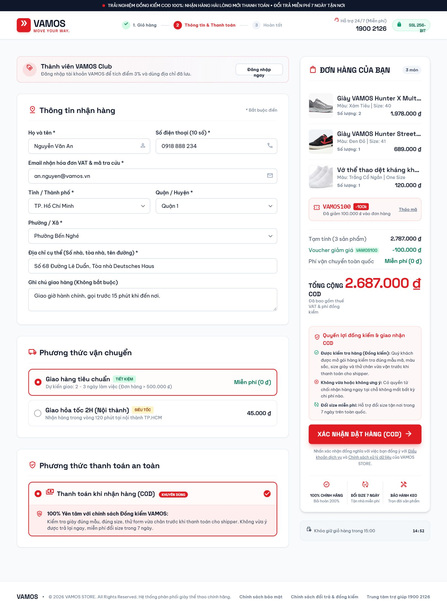
  <p><strong>Hình 24: Giao diện Đặt hàng & Xác nhận thanh toán COD</strong></p>
</div>

* **Mục đích màn hình:** Là chốt chặn giao dịch thương mại cuối cùng, nơi khách hàng xác nhận địa chỉ nhận hàng, áp dụng voucher ưu đãi và gửi yêu cầu tạo đơn hàng COD chính thức.
* **Những khu vực chính:**
  * *Cột thông tin giao hàng bên trái:* Chọn nhanh địa chỉ mặc định đã lưu hoặc nhập thông tin người nhận mới (Họ tên, SĐT, Tỉnh/Thành, Quận/Huyện, Địa chỉ chi tiết, Ghi chú đơn hàng).
  * *Phương thức thanh toán:* Được cố định là **Thanh toán khi nhận hàng (COD)** kèm hướng dẫn kiểm tra hàng trước khi trả tiền mặt.
  * *Cột tóm tắt và khuyến mãi bên phải:* Khung nhập mã giảm giá Voucher có nút "Áp dụng", bảng kê chi phí (Tạm tính + Phí giao hàng 30.000đ - Số tiền giảm giá = Tổng thanh toán) và nút "Xác nhận đặt hàng COD".
* **Thông tin hiển thị:** Chi tiết các món hàng đặt mua, số tiền chiết khấu nếu áp voucher thành công, tổng thanh toán cuối cùng.
* **Thao tác có thể thực hiện:** Chọn địa chỉ, nhập mã voucher và bấm nút "Xác nhận đặt hàng COD".
* **Kết quả sau thao tác:** Hệ thống thực thi Transaction khóa bi quan trừ tồn kho, tạo đơn hàng trong `orders` và chuyển hướng sang trang Hoàn tất đơn hàng.

---

### 8. Giao diện Lịch sử & Theo dõi chi tiết đơn hàng (Order History & Tracking)

<div align="center">
  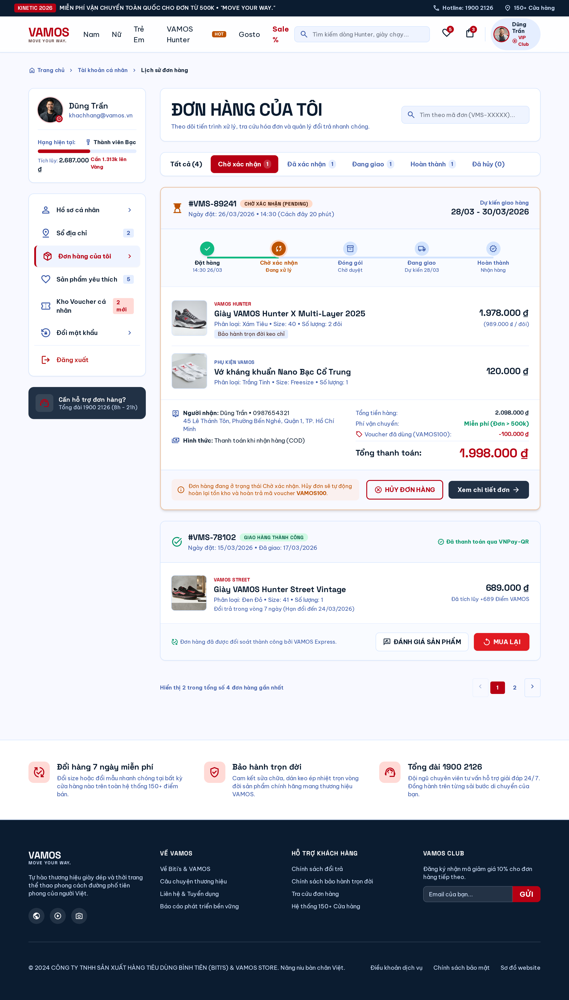
  <p><strong>Hình 25: Giao diện Lịch sử & Theo dõi chi tiết đơn hàng</strong></p>
</div>

* **Mục đích màn hình:** Giúp khách hàng quản lý và giám sát toàn bộ các đơn hàng đã đặt trong quá khứ và hiện tại.
* **Những khu vực chính:** Danh sách các thẻ đơn hàng theo thời gian mới nhất; trong trang chi tiết có thanh tiến trình vận chuyển (Timeline Tracking), khối thông tin địa chỉ nhận hàng snapshot bất biến và danh sách các món hàng kèm đơn giá mua.
* **Thông tin hiển thị:** Mã đơn hàng (ví dụ: `ORD-20261210-001`), ngày đặt, trạng thái đơn hàng (Badge màu: Vàng cho PENDING, Xanh cho CONFIRMED, Tím cho SHIPPING, Xanh lá cho COMPLETED, Đỏ cho CANCELLED), chi tiết từng mặt hàng và nút "Hủy đơn hàng".
* **Thao tác có thể thực hiện:** Xem chi tiết đơn hàng, hoặc bấm nút "Hủy đơn hàng" (nút này chỉ xuất hiện khi đơn hàng đang ở trạng thái `PENDING`).
* **Kết quả sau thao tác:** Khi hủy đơn thành công, trạng thái chuyển sang `CANCELLED` và tồn kho được tự động hoàn lại trong CSDL.

---

### 9. Giao diện Danh sách sản phẩm yêu thích (Wishlist)

<div align="center">
  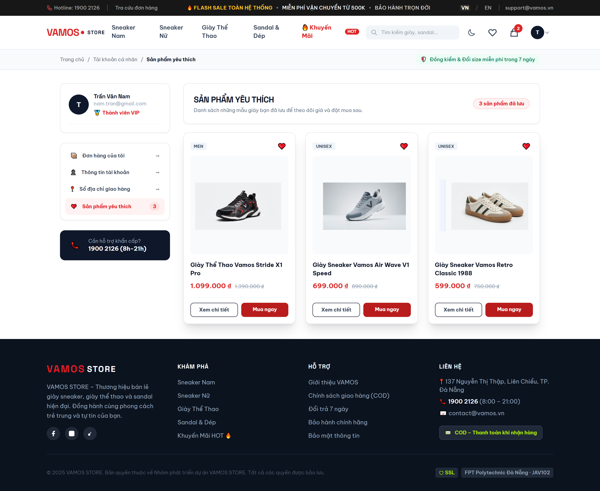
  <p><strong>Hình 26: Giao diện Danh sách sản phẩm yêu thích (Wishlist)</strong></p>
</div>

* **Mục đích màn hình:** Giúp khách hàng lưu lại những mẫu giày yêu thích để tiện theo dõi giá và đưa ra quyết định mua sắm sau.
* **Những khu vực chính:** Lưới các thẻ sản phẩm đã được đánh dấu tim đỏ, lưu trữ trong bảng `wishlist_items` của khách hàng.
* **Thông tin hiển thị:** Ảnh sản phẩm, tên, giá bán và nút chuyển nhanh đến trang chi tiết.
* **Thao tác có thể thực hiện:** Bấm bỏ thích để xóa khỏi danh sách, hoặc bấm xem chi tiết để đặt mua.
* **Kết quả sau thao tác:** CSDL cập nhật bảng `wishlist_items` tương ứng.

---

## 4.4. GIAO DIỆN DÀNH CHO ADMIN (QUẢN TRỊ VIÊN)

Phân hệ Quản trị (Admin Portal) được phân tách thành khu vực riêng biệt (`/admin`), sở hữu thiết kế Dashboard chuyên nghiệp với thanh bên Sidebar tối màu chứa đầy đủ các phân hệ quản lý dữ liệu:

---

### 10. Giao diện Admin Dashboard & Thống kê doanh thu

<div align="center">
  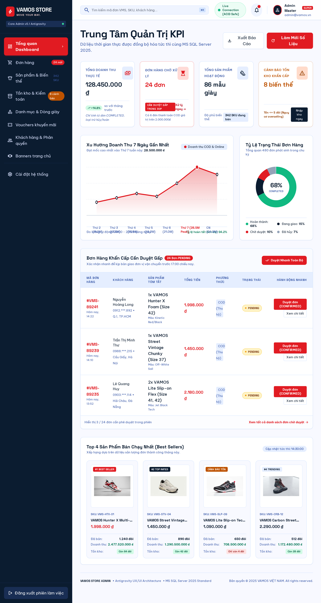
  <p><strong>Hình 27: Giao diện Admin Dashboard & Thống kê doanh thu</strong></p>
</div>

* **Mục đích màn hình:** Giúp Quản trị viên nắm bắt nhanh chóng bức tranh toàn cảnh về hoạt động kinh doanh, các chỉ số KPI tài chính và danh sách các việc cần xử lý gấp.
* **Những khu vực chính:** 4 khối thẻ chỉ số KPI trên cùng, bảng xếp hạng Top 4 sản phẩm bán chạy nhất ở cột trái, và danh sách các đơn hàng mới đặt ở cột phải.
* **Thông tin hiển thị:**
  * *Tổng doanh thu thực tế:* Tính toán nghiêm ngặt từ các đơn hàng thỏa mãn điều kiện `COMPLETED` và `PAID`.
  * *Đơn hàng chờ xác nhận:* Số lượng đơn hàng `PENDING` cần duyệt.
  * *Tổng sản phẩm và Khách hàng:* Số lượng mẫu giày và số thành viên đã đăng ký.
  * *Top 4 sản phẩm bán chạy nhất:* Ảnh sản phẩm, tên mẫu giày, tổng số lượng bán ra (`total_sold`) và tổng doanh thu tích lũy.
* **Thao tác có thể thực hiện:** Bấm vào các thẻ KPI hoặc liên kết để chuyển nhanh đến màn hình quản trị tương ứng.
* **Ý nghĩa đối với vận hành:** Cung cấp số liệu tài chính trung thực và chính xác theo thời gian thực giúp ban quản lý đưa ra quyết định nhập hàng kịp thời.

---

### 11. Giao diện Admin Quản lý danh sách sản phẩm & SKU (Product Management)

<div align="center">
  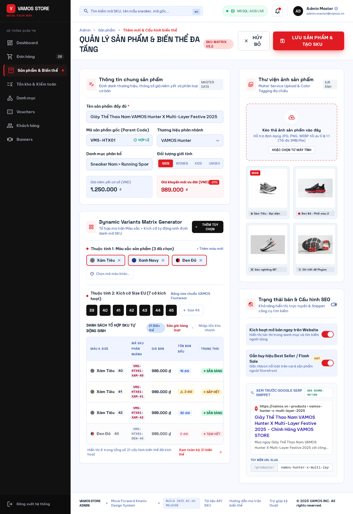
  <p><strong>Hình 28: Giao diện Admin Quản lý danh sách sản phẩm & SKU</strong></p>
</div>

* **Mục đích màn hình:** Quản lý toàn bộ danh mục giày dép của cửa hàng và cấu hình các biến thể mở bán.
* **Những khu vực chính:** Thanh công cụ lọc theo Danh mục, Thương hiệu, Trạng thái; nút "Thêm sản phẩm mới"; bảng danh sách sản phẩm hiển thị ảnh bìa, mã code, tên, giá gốc, giá bán và tổng số biến thể SKU.
* **Thao tác có thể thực hiện:** Tìm kiếm sản phẩm, bấm xem/sửa thông tin sản phẩm, chuyển trạng thái mở bán (Active / Inactive) hoặc tạo mới sản phẩm kèm ma trận biến thể.
* **Ý nghĩa đối với vận hành:** Kiểm soát toàn bộ hàng hóa hiển thị trên website bán hàng.

---

### 12. Giao diện Admin Quản lý & Vận hành đơn hàng (Order Fulfillment)

<div align="center">
  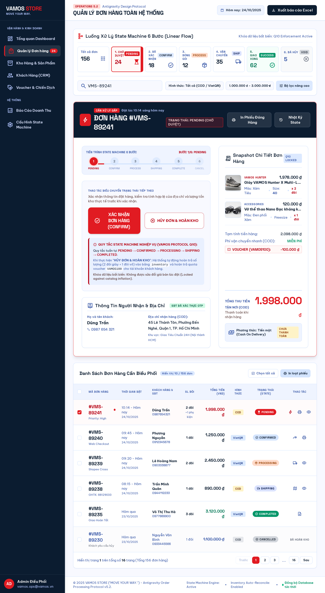
  <p><strong>Hình 29: Giao diện Admin Quản lý & Vận hành đơn hàng</strong></p>
</div>

* **Mục đích màn hình:** Tiếp nhận, kiểm soát và điều phối đơn hàng COD qua các bước của chuỗi cung ứng theo quy tắc máy trạng thái nghiêm ngặt.
* **Những khu vực chính:** Thanh tab lọc nhanh theo trạng thái (Tất cả, PENDING, CONFIRMED, PROCESSING, SHIPPING, COMPLETED, CANCELLED), bảng danh sách đơn hàng có mã đơn, khách hàng, tổng tiền, ngày đặt và nút xem chi tiết.
* **Thao tác có thể thực hiện:** Bấm xem chi tiết đơn hàng, chọn chuyển đổi trạng thái kế tiếp (hệ thống chỉ kích hoạt các nút bấm hợp lệ theo ma trận FSM: PENDING $\rightarrow$ CONFIRMED $\rightarrow$ PROCESSING $\rightarrow$ SHIPPING $\rightarrow$ COMPLETED; hoặc hủy đơn).
* **Ý nghĩa đối với vận hành:** Đảm bảo đơn hàng được đóng gói và giao đúng quy trình, tự động cập nhật thanh toán tiền mặt COD khi hoàn tất và tự động hoàn kho nếu hủy đơn.

---

### 13. Giao diện Admin Quản lý danh mục & Thương hiệu (Categories & Brands)

<div align="center">
  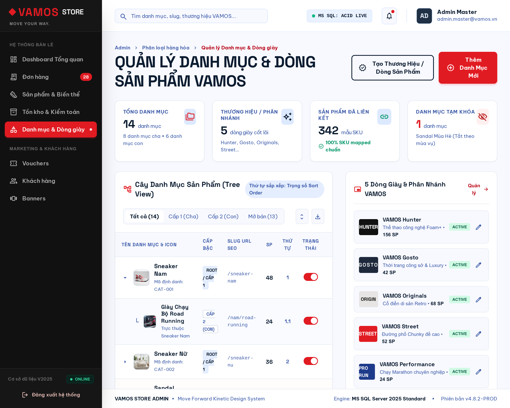
  <p><strong>Hình 30: Giao diện Admin Quản lý danh mục & Thương hiệu</strong></p>
</div>

* **Mục đích màn hình:** Cấu hình hệ thống phân loại giày dép và danh sách các thương hiệu đối tác cung ứng.
* **Những khu vực chính:** Bảng quản trị Danh mục sản phẩm (`categories`) và Bảng quản trị Thương hiệu (`brands`) đi kèm các form thêm mới hoặc chỉnh sửa.
* **Thao tác có thể thực hiện:** Thêm danh mục mới, chỉnh sửa tên gọi, mô tả và cấu hình đường dẫn thân thiện URL (`slug`) duy nhất.
* **Ý nghĩa đối với vận hành:** Duy trì cây danh mục phân loại khoa học giúp khách hàng dễ dàng tìm kiếm sản phẩm trên cửa hàng.

---

### 14. Giao diện Admin Quản lý tồn kho & Kiểm kê thẻ kho (Inventory Management)

<div align="center">
  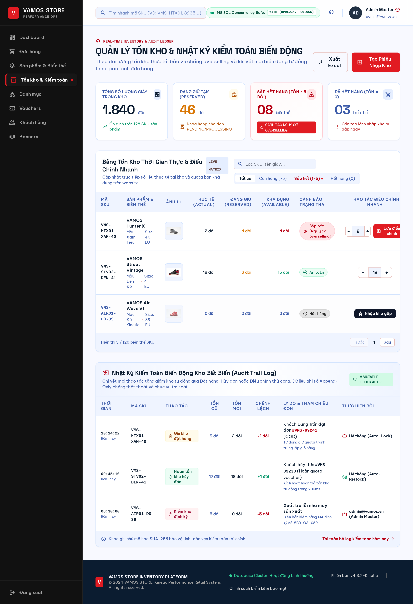
  <p><strong>Hình 31: Giao diện Admin Quản lý tồn kho & Kiểm kê thẻ kho</strong></p>
</div>

* **Mục đích màn hình:** Giám sát chi tiết mức tồn kho của từng biến thể SKU độc lập và thực hiện cân bằng kho sau kiểm kê có lưu vết kiểm toán.
* **Những khu vực chính:** Bảng danh sách toàn bộ các biến thể SKU hiển thị Mã SKU, Tên giày, Size, Màu, Tồn kho thực tế, Huy hiệu cảnh báo mức độ an toàn (Đỏ: Hết hàng, Vàng: Sắp hết $\le 5$, Xanh: An toàn) và nút "Điều chỉnh tồn kho".
* **Thao tác có thể thực hiện:** Bấm nút điều chỉnh, nhập số lượng tồn mới và bắt buộc điền Lý do biến động để lưu vào bảng nhật ký `inventory_transactions`.
* **Ý nghĩa đối với vận hành:** Ngăn chặn thất thoát hàng hóa, bảo đảm tính minh bạch kiểm toán kho hàng.

---

### 15. Giao diện Admin Quản lý mã giảm giá (Voucher Management)

<div align="center">
  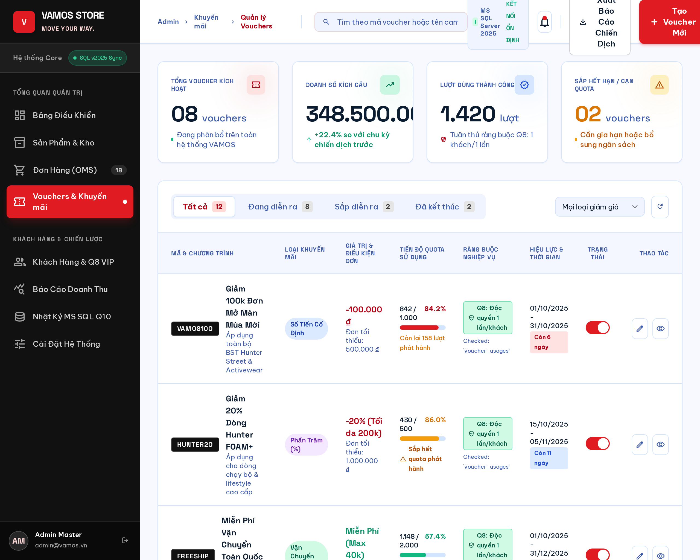
  <p><strong>Hình 32: Giao diện Admin Quản lý mã giảm giá voucher</strong></p>
</div>

* **Mục đích màn hình:** Thiết lập và quản lý các chương trình ưu đãi khuyến mãi nhằm kích thích doanh số bán lẻ.
* **Những khu vực chính:** Bảng danh sách voucher hiển thị mã code in hoa, loại giảm giá (% hoặc tiền), giá trị giảm, đơn tối thiểu, thời hạn áp dụng, thanh tiến độ lượt dùng (`used_count` / `usage_limit`) và công tắc bật/tắt kích hoạt.
* **Thao tác có thể thực hiện:** Bấm tạo voucher mới, chỉnh sửa thời hạn hiệu lực hoặc bật/tắt trạng thái hoạt động.
* **Ý nghĩa đối với vận hành:** Giúp cửa hàng chủ động điều tiết các chương trình khuyến mãi theo mùa mà không vượt quá ngân sách chiết khấu.

---

### 16. Giao diện Admin Quản lý tài khoản khách hàng (Customer Management)

<div align="center">
  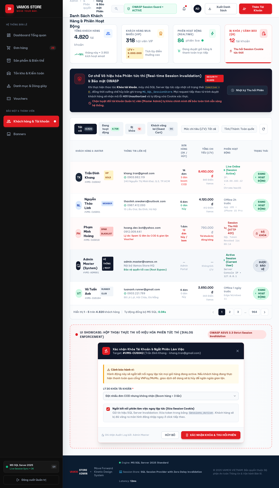
  <p><strong>Hình 33: Giao diện Admin Quản lý tài khoản khách hàng</strong></p>
</div>

* **Mục đích màn hình:** Giám sát danh sách thành viên và kiểm soát an toàn bảo mật tài khoản người dùng trên hệ thống.
* **Những khu vực chính:** Bảng danh sách người dùng hiển thị Họ tên, Email, Số điện thoại, Vai trò (`CUSTOMER` hoặc `ADMIN`), Ngày tạo tài khoản, Trạng thái hoạt động (`active` hoặc `locked`) và nút hành động Khóa/Mở khóa.
* **Thao tác có thể thực hiện:** Bấm nút "Khóa tài khoản" đối với các tài khoản vi phạm chính sách hoặc "Mở khóa" khi cần phục hồi.
* **Ý nghĩa đối với vận hành:** Bảo vệ hệ thống khỏi các hành vi spam hoặc gian lận đơn hàng; khi tài khoản bị khóa, middleware xác thực sẽ lập tức hủy phiên làm việc của người dùng đó.

---

### 17. Giao diện Admin Quản lý banner quảng cáo trang chủ (Banner Management)

<div align="center">
  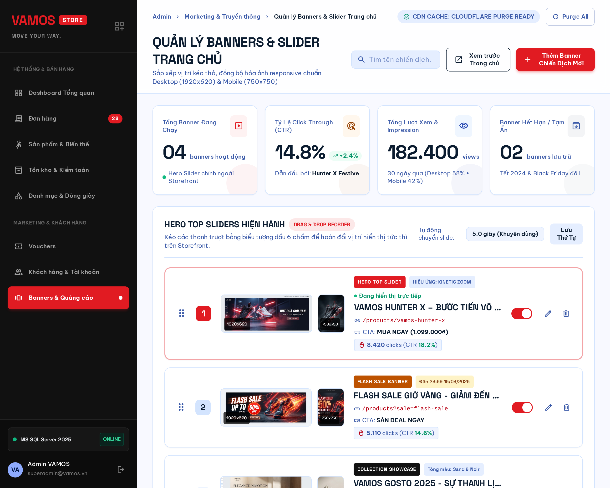
  <p><strong>Hình 34: Giao diện Admin Quản lý banner quảng cáo trang chủ</strong></p>
</div>

* **Mục đích màn hình:** Quản lý nội dung và hình ảnh của các banner slider marketing hiển thị trên trang chủ.
* **Những khu vực chính:** Bảng danh sách các banner hiển thị ảnh xem trước thu nhỏ, tiêu đề, liên kết điều hướng (`link_url`), thứ tự hiển thị (`display_order`) và trạng thái kích hoạt.
* **Thao tác có thể thực hiện:** Tải lên banner mới, thay đổi thứ tự ưu tiên hoặc bật/tắt hiển thị.
* **Ý nghĩa đối với vận hành:** Giúp nhân sự marketing nhanh chóng cập nhật các thông điệp truyền thông và sự kiện ưu đãi lên trang chủ mà không cần can thiệp vào mã nguồn.

---

## 4.5. NHẬN XÉT CHUNG VỀ GIAO DIỆN VÀ MỐI LIÊN KẾT XUYÊN SUỐT 4 PHẦN

Sau khi hoàn thành việc thiết kế giao diện và đối chiếu với toàn bộ quá trình phân tích hệ thống, nhóm chúng em xin được trình bày phần tổng kết về **mối quan hệ liên kết mật thiết giữa 4 phần trong báo cáo**:

### 1. Sự phân cấp giao diện phản ánh đúng mô hình Use Case (Phần 1 $\rightarrow$ Phần 4)
Mỗi màn hình được xây dựng đều xuất phát trực tiếp từ các ca sử dụng đã xác định:
* Các trang dành cho Khách vãng lai (Trang chủ Hình 18, Cửa hàng Hình 19, Chi tiết Hình 20) hiện thực hóa ca sử dụng tìm kiếm và xem catalog (`UC05`).
* Màn hình Giỏ hàng (Hình 23) và Đặt hàng COD (Hình 24) hiện thực hóa ca sử dụng `UC06` và `UC07`.
* Màn hình Lịch sử đơn hàng (Hình 25) hiện thực hóa ca sử dụng theo dõi (`UC08`) và hủy đơn (`UC09`).
* Toàn bộ 8 màn hình trong phân hệ Admin (Hình 27 đến 34) hiện thực hóa trọn vẹn các ca sử dụng quản trị từ `UC10` đến `UC14`.

### 2. Dữ liệu trên giao diện được bảo đảm bởi mô hình ERD (Phần 2 $\rightarrow$ Phần 4)
Mọi thông tin xuất hiện trên giao diện đều được ánh xạ chính xác từ 20 bảng cơ sở dữ liệu:
* Ô chọn kích cỡ và màu sắc tại trang chi tiết sản phẩm lấy dữ liệu từ `sizes` và `colors`, được gắn kết qua `product_variants`.
* Thông tin địa chỉ nhận hàng và giá tiền tại trang đặt hàng COD được lưu giữ bất biến nhờ các cột snapshot trong `orders` (`delivery_address_snapshot`) và `order_items` (`unit_price`).
* Việc một khách hàng chỉ có thể đánh dấu 1 địa chỉ mặc định hay một sản phẩm chỉ có 1 ảnh đại diện chính được kiểm soát chặt chẽ ở tầng CSDL nhờ hai chỉ mục lọc `uq_user_default_address` và `uq_product_primary_image`.

### 3. Thao tác tương tác của người dùng tuân theo sơ đồ Activity Diagram (Phần 3 $\rightarrow$ Phần 4)
Trình tự bấm nút, thông báo lỗi và luồng chuyển trang của người dùng hoàn toàn khớp với các quy trình hoạt động đã mô hình hóa:
* Khi khách hàng bấm "Xác nhận đặt hàng COD", hệ thống chạy đúng theo sơ đồ `AD08`: mở Transaction, khóa bi quan kiểm tra tồn kho, trừ kho, tạo đơn, tạo chi tiết và xóa giỏ hàng.
* Khi khách hàng xem chi tiết đơn hàng, nút "Hủy đơn hàng" chỉ xuất hiện khi trạng thái là `PENDING` đúng theo quy tắc rẽ nhánh trong sơ đồ `AD10`.
* Khi Quản trị viên cập nhật đơn hàng, các nút hành động chỉ cho phép chuyển đổi một chiều theo đúng ma trận máy trạng thái FSM trong sơ đồ `AD11`.

### Ví dụ minh chứng chuỗi liên kết xuyên suốt cho nghiệp vụ "Đặt hàng COD":

```
  +--------------------------------------------------------------------------+
  | 1. USE CASE (Phần 1):                                                    |
  |    Customer thực hiện ca sử dụng UC07 (Đặt hàng COD).                   |
  +--------------------------------------------------------------------------+
                                       |
                                       v
  +--------------------------------------------------------------------------+
  | 2. ERD (Phần 2):                                                         |
  |    Dữ liệu được lưu trữ và kiểm soát qua 8 bảng liên kết:                |
  |    users, addresses, carts, cart_items, product_variants,                |
  |    inventory_transactions, orders, order_items, vouchers, voucher_usages.|
  +--------------------------------------------------------------------------+
                                       |
                                       v
  +--------------------------------------------------------------------------+
  | 3. ACTIVITY DIAGRAM (Phần 3):                                            |
  |    Sơ đồ AD08 mô hình hóa quy trình 3 làn: Kiểm tra giỏ hàng,             |
  |    khóa bi quan UPDLOCK kiểm tra tồn kho, trừ kho tức thời,              |
  |    ghi thẻ kho OUT_SALE, tạo đơn hàng snapshot và làm rỗng giỏ.         |
  +--------------------------------------------------------------------------+
                                       |
                                       v
  +--------------------------------------------------------------------------+
  | 4. USER INTERFACE (Phần 4):                                              |
  |    Khách hàng thao tác tại màn hình Giỏ hàng (Hình 23) và                |
  |    trang Checkout COD (Hình 24), nhận kết quả mã đơn hàng thành công.   |
  +--------------------------------------------------------------------------+
```

Chuỗi liên kết hữu cơ trên chứng minh rằng đồ án **VAMOS STORE** đã được nhóm sinh viên chúng em thực hiện với phương pháp luận công nghệ phần mềm bài bản: từ phân tích yêu cầu nghiệp vụ, mô hình hóa dữ liệu, thiết kế quy trình xử lý cho đến hoàn thiện giao diện ứng dụng thực tế.
